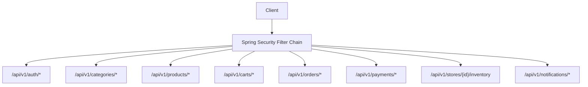
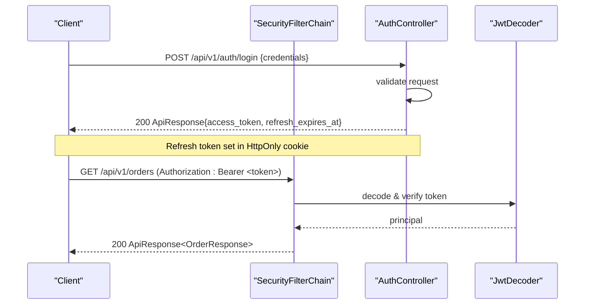
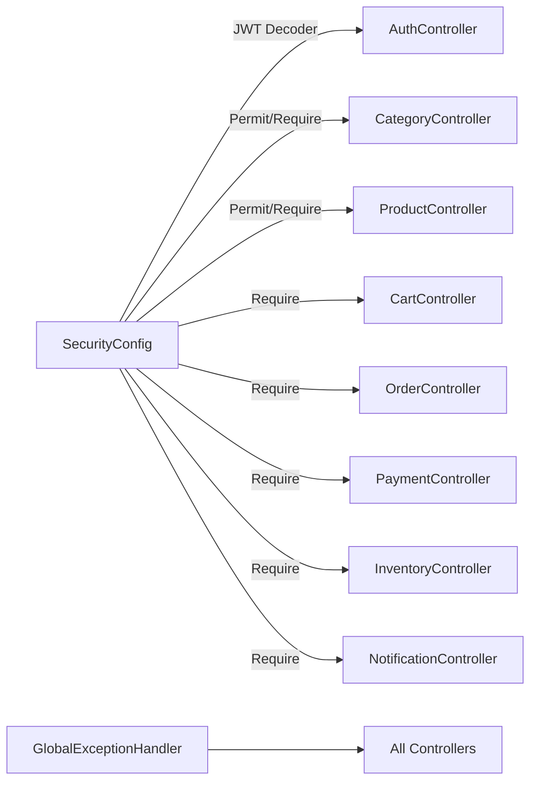

# API Reference

<cite>
**Referenced Files in This Document**
- [application.yml](file://src/main/resources/application.yml)
- [SecurityConfig.java](file://src/main/java/com/smartcoffee/config/SecurityConfig.java)
- [WebSocketConfig.java](file://src/main/java/com/smartcoffee/config/WebSocketConfig.java)
- [GlobalExceptionHandler.java](file://src/main/java/com/smartcoffee/common/api/GlobalExceptionHandler.java)
- [AuthController.java](file://src/main/java/com/smartcoffee/modules/auth/api/AuthController.java)
- [CategoryController.java](file://src/main/java/com/smartcoffee/modules/catalog/api/CategoryController.java)
- [ProductController.java](file://src/main/java/com/smartcoffee/modules/catalog/api/ProductController.java)
- [CartController.java](file://src/main/java/com/smartcoffee/modules/cart/api/CartController.java)
- [OrderController.java](file://src/main/java/com/smartcoffee/modules/ordering/api/OrderController.java)
- [PaymentController.java](file://src/main/java/com/smartcoffee/modules/payment/api/PaymentController.java)
- [InventoryController.java](file://src/main/java/com/smartcoffee/modules/inventory/api/InventoryController.java)
- [NotificationController.java](file://src/main/java/com/smartcoffee/modules/notification/api/NotificationController.java)
</cite>

## Table of Contents
1. Introduction
2. Project Structure
3. Core Components
4. Architecture Overview
5. Detailed Component Analysis
6. Dependency Analysis
7. Performance Considerations
8. Troubleshooting Guide
9. Conclusion
10. Appendices

## Introduction
This document provides a comprehensive API reference for the Smart Coffee Backend REST endpoints and WebSocket configuration. It covers HTTP methods, URL patterns, request/response schemas, authentication requirements, error responses, parameter validation rules, business constraints, and real-time notification channels. It also documents JWT-based authentication flows, idempotency usage, pagination, and versioning strategy based on the codebase.

## Project Structure
The API surface is organized by domain modules under /api/v1:
- Authentication: /api/v1/auth
- Catalog (public): /api/v1/categories, /api/v1/products
- Cart: /api/v1/carts
- Orders: /api/v1/orders
- Payments: /api/v1/payments
- Inventory (store-scoped): /api/v1/stores/{storeId}/inventory
- Notifications: /api/v1/notifications

Authentication and authorization are enforced via Spring Security with stateless JWT. Public endpoints include auth, stores, categories, and products. All other endpoints require an authenticated user context.

**Diagram sources**
- [SecurityConfig.java:47-79](file://src/main/java/com/smartcoffee/config/SecurityConfig.java#L47-L79)
- [AuthController.java:13-15](file://src/main/java/com/smartcoffee/modules/auth/api/AuthController.java#L13-L15)
- [CategoryController.java:9-11](file://src/main/java/com/smartcoffee/modules/catalog/api/CategoryController.java#L9-L11)
- [ProductController.java:9-11](file://src/main/java/com/smartcoffee/modules/catalog/api/ProductController.java#L9-L11)
- [CartController.java:11-13](file://src/main/java/com/smartcoffee/modules/cart/api/CartController.java#L11-L13)
- [OrderController.java:13-15](file://src/main/java/com/smartcoffee/modules/ordering/api/OrderController.java#L13-L15)
- [PaymentController.java:11-13](file://src/main/java/com/smartcoffee/modules/payment/api/PaymentController.java#L11-L13)
- [InventoryController.java:10-12](file://src/main/java/com/smartcoffee/modules/inventory/api/InventoryController.java#L10-L12)
- [NotificationController.java:11-13](file://src/main/java/com/smartcoffee/modules/notification/api/NotificationController.java#L11-L13)

**Section sources**
- [SecurityConfig.java:47-79](file://src/main/java/com/smartcoffee/config/SecurityConfig.java#L47-L79)

## Core Components
- Global error handling returns standardized ApiErrorResponse with correlation ID across all endpoints.
- Pagination is provided for list endpoints using PaginatedResponse wrapper.
- Idempotency-Key header is used for write operations to ensure safe retries.
- JWT tokens are validated statelessly; refresh token is managed via HttpOnly cookie.

Key behaviors:
- Validation errors return 400 with field-level details.
- Business exceptions map to their specific status codes with error codes.
- Unexpected exceptions return 500 with a generic message.

**Section sources**
- [GlobalExceptionHandler.java:11-38](file://src/main/java/com/smartcoffee/common/api/GlobalExceptionHandler.java#L11-L38)

## Architecture Overview
Authentication flow uses JWT access tokens and a refresh token stored in an HttpOnly cookie. Public endpoints are explicitly permitted; all others require authentication.

**Diagram sources**
- [SecurityConfig.java:31-44](file://src/main/java/com/smartcoffee/config/SecurityConfig.java#L31-L44)
- [SecurityConfig.java:47-79](file://src/main/java/com/smartcoffee/config/SecurityConfig.java#L47-L79)
- [AuthController.java:33-45](file://src/main/java/com/smartcoffee/modules/auth/api/AuthController.java#L33-L45)

**Section sources**
- [SecurityConfig.java:31-79](file://src/main/java/com/smartcoffee/config/SecurityConfig.java#L31-L79)
- [AuthController.java:25-59](file://src/main/java/com/smartcoffee/modules/auth/api/AuthController.java#L25-L59)

## Detailed Component Analysis

### Authentication API
Base path: /api/v1/auth

- Register
  - Method: POST
  - Path: /api/v1/auth/register
  - Auth: None
  - Request body: RegisterRequest (validated)
  - Response: 201 ApiResponse<AuthResponse>
  - Notes: Sets refresh token in HttpOnly cookie scoped to /api/v1/auth

- Login
  - Method: POST
  - Path: /api/v1/auth/login
  - Auth: None
  - Request body: LoginRequest (validated)
  - Response: 200 ApiResponse<AuthResponse>
  - Notes: Sets refresh token in HttpOnly cookie

- Refresh
  - Method: POST
  - Path: /api/v1/auth/refresh
  - Auth: None
  - Cookies: refresh_token (HttpOnly)
  - Response: 200 ApiResponse<AuthResponse>
  - Notes: Updates refresh token expiry in cookie

- Logout
  - Method: POST
  - Path: /api/v1/auth/logout
  - Auth: None
  - Cookies: refresh_token (optional)
  - Response: 204 No Content
  - Notes: Clears refresh token cookie

- Logout All
  - Method: POST
  - Path: /api/v1/auth/logout-all
  - Auth: Required (current actor)
  - Response: 204 No Content
  - Notes: Invalidates sessions for current user

Validation and constraints:
- Requests use Jakarta Validation annotations; violations return 400 with field errors.

Error responses:
- 400 VALIDATION_ERROR with field details
- 401/403 when security rejects invalid or missing credentials/tokens
- 500 INTERNAL_ERROR for unexpected failures

**Section sources**
- [AuthController.java:13-70](file://src/main/java/com/smartcoffee/modules/auth/api/AuthController.java#L13-L70)
- [GlobalExceptionHandler.java:19-31](file://src/main/java/com/smartcoffee/common/api/GlobalExceptionHandler.java#L19-L31)

### Catalog API (Public)
Base paths: /api/v1/categories, /api/v1/products

- List Categories
  - Method: GET
  - Path: /api/v1/categories
  - Auth: None
  - Response: 200 ApiResponse<List<CategoryResponse>>

- Get Product Details
  - Method: GET
  - Path: /api/v1/products/{productId}
  - Query params: storeId (UUID, required)
  - Auth: None
  - Response: 200 ApiResponse<ProductDetailsResponse>

Constraints:
- productId must be a valid UUID
- storeId must be a valid UUID

Error responses:
- 400 for invalid parameters
- 404 if product not found (mapped by application logic)
- 500 for unexpected errors

**Section sources**
- [CategoryController.java:9-21](file://src/main/java/com/smartcoffee/modules/catalog/api/CategoryController.java#L9-L21)
- [ProductController.java:9-21](file://src/main/java/com/smartcoffee/modules/catalog/api/ProductController.java#L9-L21)

### Cart API
Base path: /api/v1/carts

- Get Current Cart
  - Method: GET
  - Path: /api/v1/carts/current
  - Query params: storeId (UUID, required)
  - Auth: Required
  - Response: 200 ApiResponse<CartResponse>

- Add Item to Current Cart
  - Method: POST
  - Path: /api/v1/carts/current/items
  - Auth: Required
  - Request body: AddCartItemRequest (validated)
  - Response: 200 ApiResponse<CartResponse>

- Update Item Quantity
  - Method: PATCH
  - Path: /api/v1/carts/{cartId}/items/{itemId}
  - Auth: Required
  - Request body: UpdateCartItemRequest (validated)
  - Response: 200 ApiResponse<CartResponse>

- Remove Item
  - Method: DELETE
  - Path: /api/v1/carts/{cartId}/items/{itemId}
  - Auth: Required
  - Response: 200 ApiResponse<CartResponse>

- Clear Cart
  - Method: DELETE
  - Path: /api/v1/carts/{cartId}/items
  - Auth: Required
  - Response: 200 ApiResponse<CartResponse>

Constraints:
- cartId and itemId must be valid UUIDs
- storeId must be a valid UUID
- Request bodies validated; invalid values return 400

Error responses:
- 400 for validation errors
- 404 for missing resources
- 500 for unexpected errors

**Section sources**
- [CartController.java:11-47](file://src/main/java/com/smartcoffee/modules/cart/api/CartController.java#L11-L47)

### Orders API
Base path: /api/v1/orders

- Create Order
  - Method: POST
  - Path: /api/v1/orders
  - Headers: Idempotency-Key (UUID, required)
  - Auth: Required
  - Request body: CreateOrderRequest (validated)
  - Response: 201 ApiResponse<OrderResponse>
  - Notes: Ensures idempotent checkout using Idempotency-Key

- Get Order
  - Method: GET
  - Path: /api/v1/orders/{id}
  - Auth: Required
  - Response: 200 ApiResponse<OrderResponse>

Constraints:
- Idempotency-Key must be a valid UUID
- id must be a valid UUID
- Request body validated

Error responses:
- 400 for validation errors
- 409 conflict if duplicate key used
- 404 if order not found
- 500 for unexpected errors

**Section sources**
- [OrderController.java:13-40](file://src/main/java/com/smartcoffee/modules/ordering/api/OrderController.java#L13-L40)

### Payments API
Base path: /api/v1/payments

- Cash Payment
  - Method: POST
  - Path: /api/v1/payments/cash
  - Headers: Idempotency-Key (UUID, required)
  - Auth: Required
  - Request body: CashPaymentRequest (validated)
  - Response: 200 ApiResponse<PaymentResponse>

- KHQR Payment
  - Method: POST
  - Path: /api/v1/payments/khqr
  - Headers: Idempotency-Key (UUID, required)
  - Auth: Required
  - Request body: KhqrPaymentRequest (validated)
  - Response: 200 ApiResponse<PaymentResponse>

- Verify KHQR Payment
  - Method: POST
  - Path: /api/v1/payments/{paymentId}/verify
  - Auth: Required
  - Response: 200 ApiResponse<PaymentResponse>

Constraints:
- paymentId must be a valid UUID
- Idempotency-Key must be a valid UUID
- Request bodies validated

Error responses:
- 400 for validation errors
- 404 for missing payments
- 500 for unexpected errors

**Section sources**
- [PaymentController.java:11-37](file://src/main/java/com/smartcoffee/modules/payment/api/PaymentController.java#L11-L37)

### Inventory API (Store-scoped)
Base path: /api/v1/stores/{storeId}/inventory

- List Inventory Balances
  - Method: GET
  - Path: /api/v1/stores/{storeId}/inventory
  - Auth: Required
  - Authorization: Requires INVENTORY_READ permission and store ownership
  - Response: 200 ApiResponse<List<InventoryBalanceResponse>>

Constraints:
- storeId must be a valid UUID
- Caller must have required permissions and store access

Error responses:
- 403 if insufficient permissions or store mismatch
- 404 if store not found
- 500 for unexpected errors

**Section sources**
- [InventoryController.java:10-32](file://src/main/java/com/smartcoffee/modules/inventory/api/InventoryController.java#L10-L32)

### Notifications API
Base path: /api/v1/notifications

- List Notifications
  - Method: GET
  - Path: /api/v1/notifications
  - Query params: page (int, default 0), size (int, default 20)
  - Auth: Required
  - Response: 200 ApiResponse<PaginatedResponse<NotificationResponse>>

- Unread Count
  - Method: GET
  - Path: /api/v1/notifications/unread-count
  - Auth: Required
  - Response: 200 ApiResponse<UnreadCountResponse>

- Mark Single Notification Read
  - Method: PATCH
  - Path: /api/v1/notifications/{id}/read
  - Auth: Required
  - Response: 200 ApiResponse<Void>

- Mark All Notifications Read
  - Method: PATCH
  - Path: /api/v1/notifications/read-all
  - Auth: Required
  - Response: 200 ApiResponse<Void>

Constraints:
- page >= 0, size > 0 recommended
- id must be a valid UUID

Error responses:
- 400 for invalid parameters
- 404 for missing notifications
- 500 for unexpected errors

**Section sources**
- [NotificationController.java:11-47](file://src/main/java/com/smartcoffee/modules/notification/api/NotificationController.java#L11-L47)

## Dependency Analysis
- Security depends on JWT decoder configured from properties.
- Controllers depend on application services and current actor provider.
- Global exception handler centralizes error mapping.

**Diagram sources**
- [SecurityConfig.java:31-79](file://src/main/java/com/smartcoffee/config/SecurityConfig.java#L31-L79)
- [GlobalExceptionHandler.java:11-38](file://src/main/java/com/smartcoffee/common/api/GlobalExceptionHandler.java#L11-L38)
- [AuthController.java:13-70](file://src/main/java/com/smartcoffee/modules/auth/api/AuthController.java#L13-L70)
- [CategoryController.java:9-21](file://src/main/java/com/smartcoffee/modules/catalog/api/CategoryController.java#L9-L21)
- [ProductController.java:9-21](file://src/main/java/com/smartcoffee/modules/catalog/api/ProductController.java#L9-L21)
- [CartController.java:11-47](file://src/main/java/com/smartcoffee/modules/cart/api/CartController.java#L11-L47)
- [OrderController.java:13-40](file://src/main/java/com/smartcoffee/modules/ordering/api/OrderController.java#L13-L40)
- [PaymentController.java:11-37](file://src/main/java/com/smartcoffee/modules/payment/api/PaymentController.java#L11-L37)
- [InventoryController.java:10-32](file://src/main/java/com/smartcoffee/modules/inventory/api/InventoryController.java#L10-L32)
- [NotificationController.java:11-47](file://src/main/java/com/smartcoffee/modules/notification/api/NotificationController.java#L11-L47)

**Section sources**
- [SecurityConfig.java:31-79](file://src/main/java/com/smartcoffee/config/SecurityConfig.java#L31-L79)
- [GlobalExceptionHandler.java:11-38](file://src/main/java/com/smartcoffee/common/api/GlobalExceptionHandler.java#L11-L38)

## Performance Considerations
- Stateless JWT avoids server-side sessions, improving horizontal scalability.
- Idempotency-Key headers prevent duplicate processing on retries for orders and payments.
- Pagination reduces payload sizes for large notification lists.
- Health and metrics endpoints exposed for monitoring.

[No sources needed since this section provides general guidance]

## Troubleshooting Guide
Common error responses:
- 400 VALIDATION_ERROR: Missing or invalid fields; check request schema and constraints.
- 401/403: Missing or invalid Authorization header; ensure valid JWT and sufficient permissions.
- 404: Resource not found; verify IDs and scoping (e.g., storeId).
- 409 CONFLICT: Duplicate Idempotency-Key usage; ensure unique keys per operation.
- 500 INTERNAL_ERROR: Unexpected server error; inspect logs and correlation ID.

Correlation ID:
- Every response includes a correlation ID to aid tracing.

**Section sources**
- [GlobalExceptionHandler.java:13-38](file://src/main/java/com/smartcoffee/common/api/GlobalExceptionHandler.java#L13-L38)

## Conclusion
The Smart Coffee Backend exposes a clear, versioned REST API under /api/v1 with consistent error handling, JWT-based authentication, idempotency support, and pagination. Public catalog endpoints enable discovery, while authenticated endpoints manage carts, orders, payments, inventory, and notifications. Real-time updates are supported via STOMP over WebSocket at /ws with topic and queue destinations.

[No sources needed since this section summarizes without analyzing specific files]

## Appendices

### Authentication Requirements and Public Endpoints
- Public (no auth): /api/v1/auth/**, /api/v1/stores/**, /api/v1/categories/**, /api/v1/products/**
- All other endpoints require a valid JWT in the Authorization header.

**Section sources**
- [SecurityConfig.java:58-73](file://src/main/java/com/smartcoffee/config/SecurityConfig.java#L58-L73)

### JWT Configuration
- Access token lifetime and refresh token duration are configurable.
- Secret is loaded from environment variables.

**Section sources**
- [application.yml:49-53](file://src/main/resources/application.yml#L49-L53)

### WebSocket Endpoints
- Endpoint: /ws
- Allowed origins: http://localhost:*
- Message broker prefixes: /topic, /queue
- User destination prefix: /user
- Application destination prefix: /app

Usage:
- Connect via STOMP to /ws
- Subscribe to /topic/* or /user/*/queue/* for real-time notifications
- Send messages to /app/* for server handlers

**Section sources**
- [WebSocketConfig.java:10-18](file://src/main/java/com/smartcoffee/config/WebSocketConfig.java#L10-L18)

### Idempotency Policy
- Write endpoints accept Idempotency-Key header (UUID).
- Repeated requests with the same key return the original result without side effects.
- Applies to order creation and payment initiation.

**Section sources**
- [OrderController.java:29-33](file://src/main/java/com/smartcoffee/modules/ordering/api/OrderController.java#L29-L33)
- [PaymentController.java:22-31](file://src/main/java/com/smartcoffee/modules/payment/api/PaymentController.java#L22-L31)

### Versioning Strategy
- Base path uses /api/v1.
- To introduce breaking changes, create a new versioned base path (e.g., /api/v2) and deprecate older versions gradually.
- Maintain backward compatibility within a major version where possible.

[No sources needed since this section provides general guidance]

### Deprecation Policy
- Announce deprecation in release notes and API docs.
- Provide migration guides for request/response schema changes.
- Keep deprecated endpoints available for a defined grace period.

[No sources needed since this section provides general guidance]

### Migration Guide for Breaking Changes
- Introduce new endpoints under a new versioned base path.
- Support both old and new clients during transition.
- Communicate timeline for removal and provide SDK updates if applicable.

[No sources needed since this section provides general guidance]