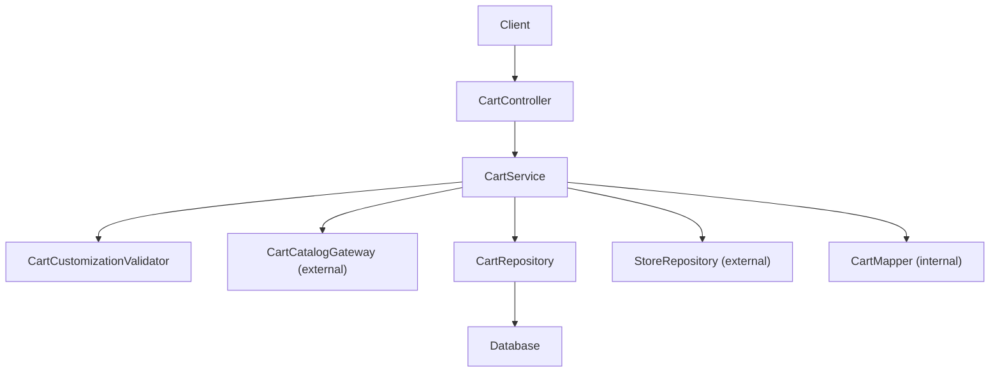
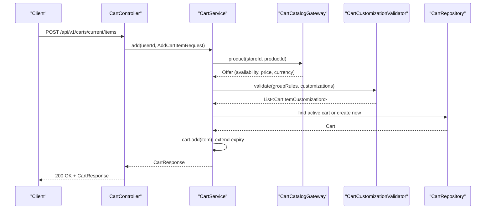
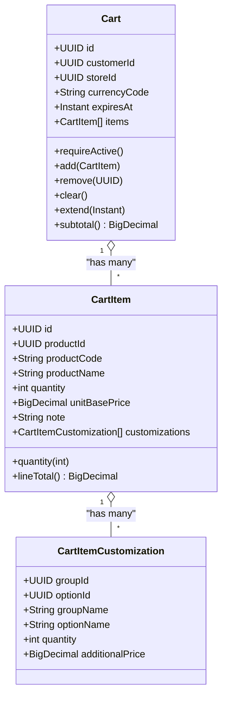
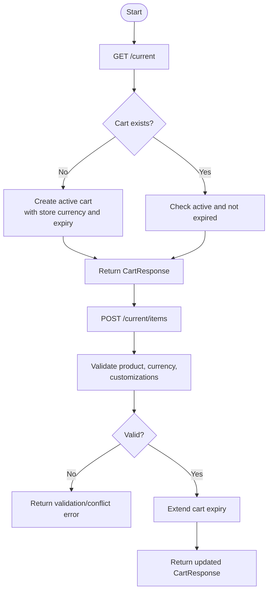
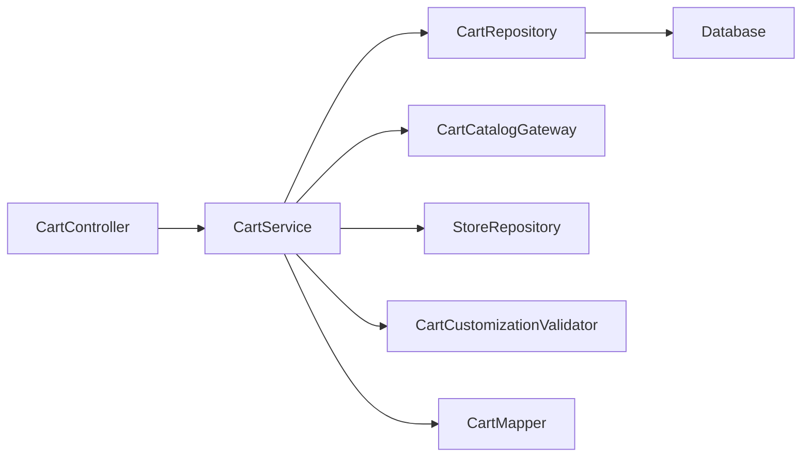

# Cart API

<cite>
**Referenced Files in This Document**
- [CartController.java](file://src/main/java/com/smartcoffee/modules/cart/api/CartController.java)
- [AddCartItemRequest.java](file://src/main/java/com/smartcoffee/modules/cart/api/AddCartItemRequest.java)
- [UpdateCartItemRequest.java](file://src/main/java/com/smartcoffee/modules/cart/api/UpdateCartItemRequest.java)
- [CartResponse.java](file://src/main/java/com/smartcoffee/modules/cart/api/CartResponse.java)
- [CartItemResponse.java](file://src/main/java/com/smartcoffee/modules/cart/api/CartItemResponse.java)
- [CartCustomizationResponse.java](file://src/main/java/com/smartcoffee/modules/cart/api/CartCustomizationResponse.java)
- [SelectedCustomizationRequest.java](file://src/main/java/com/smartcoffee/modules/cart/api/SelectedCustomizationRequest.java)
- [CartService.java](file://src/main/java/com/smartcoffee/modules/cart/application/CartService.java)
- [CartCustomizationValidator.java](file://src/main/java/com/smartcoffee/modules/cart/application/CartCustomizationValidator.java)
- [Cart.java](file://src/main/java/com/smartcoffee/modules/cart/domain/Cart.java)
- [CartItem.java](file://src/main/java/com/smartcoffee/modules/cart/domain/CartItem.java)
- [CartRepository.java](file://src/main/java/com/smartcoffee/modules/cart/persistence/CartRepository.java)
</cite>

## Table of Contents
1. Introduction
2. Project Structure
3. Core Components
4. Architecture Overview
5. Detailed Component Analysis
6. Dependency Analysis
7. Performance Considerations
8. Troubleshooting Guide
9. Conclusion

## Introduction
This document provides detailed API documentation for shopping cart operations, including creating or retrieving the current cart, adding items, updating item quantities, removing items, and clearing the cart. It defines request and response schemas, explains validation rules, customization selection behavior, and cart expiration handling. It also includes example workflows and common error scenarios to help clients integrate reliably.

## Project Structure
The cart feature is implemented as a module with clear separation:
- API layer: Controllers and DTOs for HTTP requests/responses
- Application layer: Use cases, validation, and mapping
- Domain layer: Business entities and invariants
- Persistence layer: Repositories for data access

**Diagram sources**
- [CartController.java:11-47](file://src/main/java/com/smartcoffee/modules/cart/api/CartController.java#L11-L47)
- [CartService.java:13-114](file://src/main/java/com/smartcoffee/modules/cart/application/CartService.java#L13-L114)
- [CartRepository.java:9-14](file://src/main/java/com/smartcoffee/modules/cart/persistence/CartRepository.java#L9-L14)

**Section sources**
- [CartController.java:11-47](file://src/main/java/com/smartcoffee/modules/cart/api/CartController.java#L11-L47)
- [CartService.java:13-114](file://src/main/java/com/smartcoffee/modules/cart/application/CartService.java#L13-L114)

## Core Components
- CartController: Exposes REST endpoints for cart operations under /api/v1/carts
- CartService: Orchestrates business logic, validates inputs, interacts with catalog and persistence
- CartCustomizationValidator: Validates customization selections against product rules
- Domain models: Cart and CartItem enforce invariants like active status, positive quantities, and totals
- Repository: Provides queries and pessimistic locking for safe concurrent updates

Key responsibilities:
- Ensure carts are active and not expired before mutations
- Validate product availability and currency consistency
- Enforce customization group rules (minimum/maximum, single selection, option validity)
- Persist changes and return normalized responses

**Section sources**
- [CartController.java:11-47](file://src/main/java/com/smartcoffee/modules/cart/api/CartController.java#L11-L47)
- [CartService.java:35-114](file://src/main/java/com/smartcoffee/modules/cart/application/CartService.java#L35-L114)
- [CartCustomizationValidator.java:10-51](file://src/main/java/com/smartcoffee/modules/cart/application/CartCustomizationValidator.java#L10-L51)
- [Cart.java:48-102](file://src/main/java/com/smartcoffee/modules/cart/domain/Cart.java#L48-L102)
- [CartItem.java:44-76](file://src/main/java/com/smartcoffee/modules/cart/domain/CartItem.java#L44-L76)
- [CartRepository.java:9-14](file://src/main/java/com/smartcoffee/modules/cart/persistence/CartRepository.java#L9-L14)

## Architecture Overview
The cart API follows a layered architecture:
- Controller receives and validates HTTP requests
- Service coordinates use cases, calling catalog and persistence layers
- Domain enforces business rules
- Repository handles data access with optimistic concurrency via versioning and pessimistic locks where needed

**Diagram sources**
- [CartController.java:27-30](file://src/main/java/com/smartcoffee/modules/cart/api/CartController.java#L27-L30)
- [CartService.java:48-62](file://src/main/java/com/smartcoffee/modules/cart/application/CartService.java#L48-L62)
- [CartCustomizationValidator.java:10-51](file://src/main/java/com/smartcoffee/modules/cart/application/CartCustomizationValidator.java#L10-L51)
- [CartRepository.java:9-14](file://src/main/java/com/smartcoffee/modules/cart/persistence/CartRepository.java#L9-L14)

## Detailed Component Analysis

### API Endpoints
Base path: /api/v1/carts

- Get current cart
  - Method: GET
  - Path: /current?storeId={uuid}
  - Response: ApiResponse<CartResponse>
  - Behavior: Returns the customer’s active cart for the store; creates one if none exists; ensures it is active and not expired

- Add item to cart
  - Method: POST
  - Path: /current/items
  - Request body: AddCartItemRequest
  - Response: ApiResponse<CartResponse>
  - Behavior: Validates product availability, currency match, and customization rules; adds item and extends cart expiry

- Update item quantity
  - Method: PATCH
  - Path: /{cartId}/items/{itemId}
  - Request body: UpdateCartItemRequest
  - Response: ApiResponse<CartResponse>
  - Behavior: Updates quantity on the owned cart item; extends expiry

- Remove item
  - Method: DELETE
  - Path: /{cartId}/items/{itemId}
  - Response: ApiResponse<CartResponse>
  - Behavior: Removes the specified item from the owned cart

- Clear cart
  - Method: DELETE
  - Path: /{cartId}/items
  - Response: ApiResponse<CartResponse>
  - Behavior: Empties all items from the owned cart

Notes:
- All mutating endpoints require ownership of the cart by the authenticated user
- Responses are wrapped in a standard ApiResponse envelope

**Section sources**
- [CartController.java:22-47](file://src/main/java/com/smartcoffee/modules/cart/api/CartController.java#L22-L47)

### Request Schemas

- AddCartItemRequest
  - Fields:
    - storeId: UUID, required
    - productId: UUID, required
    - quantity: integer, 1–99
    - note: string, max length 500
    - customizations: list of SelectedCustomizationRequest
  - Validation:
    - Quantity must be between 1 and 99 inclusive
    - Customization entries validated by CartCustomizationValidator

- UpdateCartItemRequest
  - Fields:
    - quantity: integer, 1–99
  - Validation:
    - Quantity must be between 1 and 99 inclusive

- SelectedCustomizationRequest
  - Fields:
    - groupId: UUID, required
    - optionId: UUID, required
    - quantity: integer, minimum 1
  - Validation:
    - Each customization must belong to a valid group and option
    - Group-level min/max and selection type enforced by validator

**Section sources**
- [AddCartItemRequest.java:7-8](file://src/main/java/com/smartcoffee/modules/cart/api/AddCartItemRequest.java#L7-L8)
- [UpdateCartItemRequest.java:5-6](file://src/main/java/com/smartcoffee/modules/cart/api/UpdateCartItemRequest.java#L5-L6)
- [SelectedCustomizationRequest.java:6-7](file://src/main/java/com/smartcoffee/modules/cart/api/SelectedCustomizationRequest.java#L6-L7)
- [CartCustomizationValidator.java:10-51](file://src/main/java/com/smartcoffee/modules/cart/application/CartCustomizationValidator.java#L10-L51)

### Response Schemas

- CartResponse
  - Fields:
    - cartId: UUID
    - storeId: UUID
    - status: string (e.g., ACTIVE)
    - fulfillmentType: string (nullable)
    - currencyCode: string
    - items: list of CartItemResponse
    - subtotal: BigDecimal
    - discountAmount: BigDecimal
    - taxAmount: BigDecimal
    - totalAmount: BigDecimal
    - expiresAt: Instant
    - version: long

- CartItemResponse
  - Fields:
    - cartItemId: UUID
    - productId: UUID
    - productCode: string
    - productName: string
    - quantity: int
    - unitBasePrice: BigDecimal
    - unitCustomizationPrice: BigDecimal
    - lineTotal: BigDecimal
    - note: string
    - customizations: list of CartCustomizationResponse

- CartCustomizationResponse
  - Fields:
    - groupId: UUID
    - optionId: UUID
    - groupName: string
    - optionName: string
    - quantity: int
    - additionalPrice: BigDecimal

Notes:
- Totals are derived from item line totals and any applied discounts/taxes at higher layers
- Currency code is set when the cart is created based on store defaults

**Section sources**
- [CartResponse.java:3-3](file://src/main/java/com/smartcoffee/modules/cart/api/CartResponse.java#L3-L3)
- [CartItemResponse.java:6-8](file://src/main/java/com/smartcoffee/modules/cart/api/CartItemResponse.java#L6-L8)
- [CartCustomizationResponse.java:6-7](file://src/main/java/com/smartcoffee/modules/cart/api/CartCustomizationResponse.java#L6-L7)

### Business Rules and Validation

- Cart activity and expiration
  - Mutations require the cart to be active and not expired
  - On mutation, cart expiry is extended by 24 hours from now
  - If expired, the cart is marked EXPIRED and operation fails

- Product availability and currency
  - Adding an item requires the product to be available
  - The product’s currency must match the cart’s currency

- Item quantity constraints
  - Item quantity must be positive
  - API-level quantity is constrained to 1–99

- Customization selection rules
  - Each customization group has minimum and maximum counts
  - SINGLE selection groups allow only one option
  - Duplicate options within a group are rejected
  - Only active options belonging to the product are allowed

- Ownership and concurrency
  - Mutating endpoints lock the cart by customerId to prevent concurrent modifications
  - Domain uses versioned entities for optimistic concurrency control

**Section sources**
- [Cart.java:63-102](file://src/main/java/com/smartcoffee/modules/cart/domain/Cart.java#L63-L102)
- [CartService.java:48-86](file://src/main/java/com/smartcoffee/modules/cart/application/CartService.java#L48-L86)
- [CartItem.java:44-76](file://src/main/java/com/smartcoffee/modules/cart/domain/CartItem.java#L44-L76)
- [CartCustomizationValidator.java:10-51](file://src/main/java/com/smartcoffee/modules/cart/application/CartCustomizationValidator.java#L10-L51)
- [CartRepository.java:12-13](file://src/main/java/com/smartcoffee/modules/cart/persistence/CartRepository.java#L12-L13)

### Data Model Relationships

**Diagram sources**
- [Cart.java:11-43](file://src/main/java/com/smartcoffee/modules/cart/domain/Cart.java#L11-L43)
- [CartItem.java:11-39](file://src/main/java/com/smartcoffee/modules/cart/domain/CartItem.java#L11-L39)

### Workflows

- Create or retrieve current cart
  - GET /api/v1/carts/current?storeId={uuid}
  - Creates a new active cart if none exists for the customer/store
  - Ensures cart is active and not expired

- Add item with customizations
  - POST /api/v1/carts/current/items
  - Validates product availability and currency
  - Validates customization selections against group rules
  - Adds item and extends expiry

- Update item quantity
  - PATCH /{cartId}/items/{itemId}
  - Locks cart by owner, updates quantity, extends expiry

- Remove item
  - DELETE /{cartId}/items/{itemId}
  - Locks cart by owner, removes item

- Clear cart
  - DELETE /{cartId}/items
  - Locks cart by owner, clears all items

**Diagram sources**
- [CartService.java:35-62](file://src/main/java/com/smartcoffee/modules/cart/application/CartService.java#L35-L62)
- [CartCustomizationValidator.java:10-51](file://src/main/java/com/smartcoffee/modules/cart/application/CartCustomizationValidator.java#L10-L51)

### Error Scenarios
- Product unavailable: Conflict error when adding an unavailable product
- Currency mismatch: Conflict error if product currency differs from cart currency
- Invalid customization: Validation error for missing/extra selections, duplicates, invalid options, or wrong selection type
- Expired or inactive cart: Conflict error on mutations if cart is not active or expired
- Item not found: Resource not found when updating/removing non-existent item
- Cart not found: Resource not found when operating on a cart not owned by the user

**Section sources**
- [CartService.java:48-86](file://src/main/java/com/smartcoffee/modules/cart/application/CartService.java#L48-L86)
- [Cart.java:63-102](file://src/main/java/com/smartcoffee/modules/cart/domain/Cart.java#L63-L102)
- [CartCustomizationValidator.java:10-51](file://src/main/java/com/smartcoffee/modules/cart/application/CartCustomizationValidator.java#L10-L51)

## Dependency Analysis
- Controller depends on Service and security context provider
- Service depends on:
  - Repository for cart persistence and locking
  - Catalog gateway for product details and customization rules
  - Store repository for store lookup and default currency
  - Validator for customization rule enforcement
  - Mapper for domain-to-response conversion
- Domain entities encapsulate business rules and totals calculation

**Diagram sources**
- [CartController.java:11-47](file://src/main/java/com/smartcoffee/modules/cart/api/CartController.java#L11-L47)
- [CartService.java:13-114](file://src/main/java/com/smartcoffee/modules/cart/application/CartService.java#L13-L114)
- [CartRepository.java:9-14](file://src/main/java/com/smartcoffee/modules/cart/persistence/CartRepository.java#L9-L14)

**Section sources**
- [CartController.java:11-47](file://src/main/java/com/smartcoffee/modules/cart/api/CartController.java#L11-L47)
- [CartService.java:13-114](file://src/main/java/com/smartcoffee/modules/cart/application/CartService.java#L13-L114)

## Performance Considerations
- Entity graphs are used to eagerly load cart items and customizations to avoid N+1 queries
- Pessimistic write lock is applied during mutations to prevent race conditions
- Versioned entities provide optimistic concurrency control at the persistence layer
- Short-lived carts with automatic expiry reduce storage growth and simplify cleanup

[No sources needed since this section provides general guidance]

## Troubleshooting Guide
Common issues and resolutions:
- 409 Conflict: CART_NOT_ACTIVE or CART_EXPIRED
  - Cause: Attempted mutation on a cart that is not active or has expired
  - Resolution: Retrieve the current cart again; a new active cart may be created automatically

- 409 Conflict: PRODUCT_UNAVAILABLE or CURRENCY_MISMATCH
  - Cause: Product unavailable or currency does not match cart currency
  - Resolution: Verify product availability and ensure correct store/product selection

- 400 Validation errors: Customization-related
  - Cause: Missing required customizations, too many selections, duplicate options, invalid options, or wrong selection type
  - Resolution: Review group rules and adjust customization selections accordingly

- 404 Not Found: Cart item or cart not found
  - Cause: Operating on an item or cart that does not exist or is not owned by the user
  - Resolution: Confirm cartId and itemId; ensure the user owns the cart

- Concurrency conflicts
  - Cause: Simultaneous updates to the same cart
  - Resolution: Retry after receiving a conflict; the system uses locking and versioning to protect integrity

**Section sources**
- [CartService.java:48-86](file://src/main/java/com/smartcoffee/modules/cart/application/CartService.java#L48-L86)
- [Cart.java:63-102](file://src/main/java/com/smartcoffee/modules/cart/domain/Cart.java#L63-L102)
- [CartCustomizationValidator.java:10-51](file://src/main/java/com/smartcoffee/modules/cart/application/CartCustomizationValidator.java#L10-L51)

## Conclusion
The Cart API provides a robust, validated, and secure interface for managing shopping carts. It enforces business rules around activity, expiration, availability, currency, and customization selections while ensuring data integrity through locking and versioning. Clients should handle validation and conflict errors gracefully and rely on the current cart endpoint to maintain consistent state across sessions.