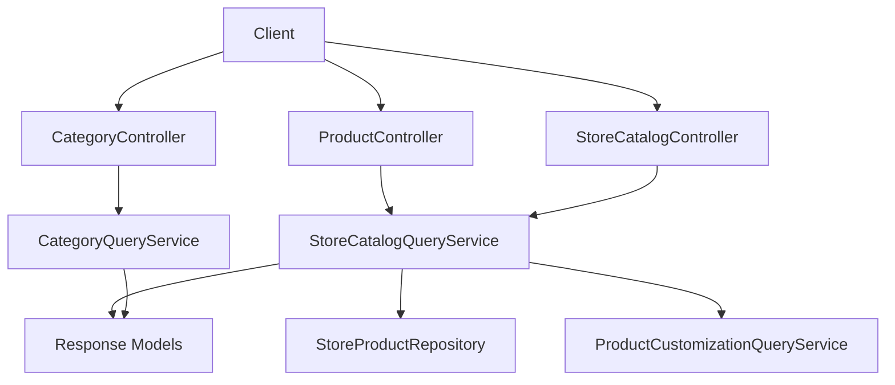
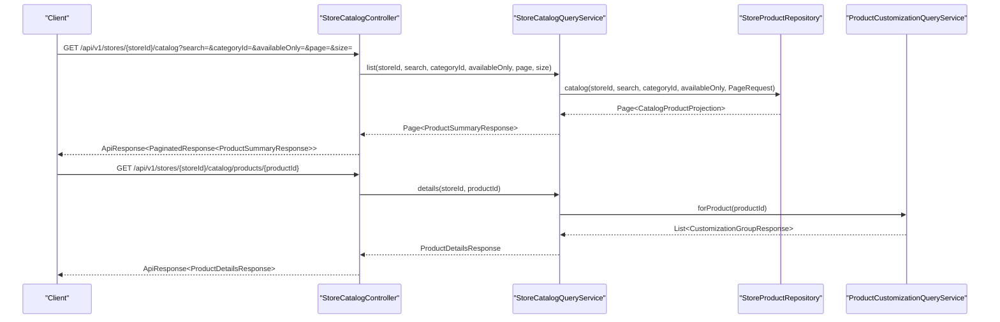
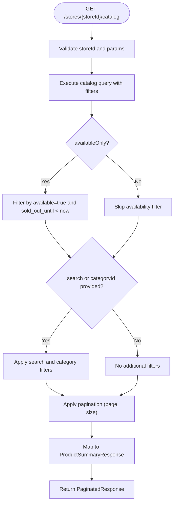
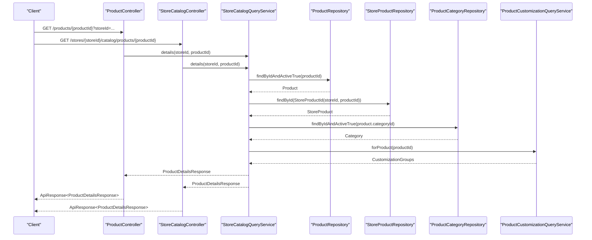
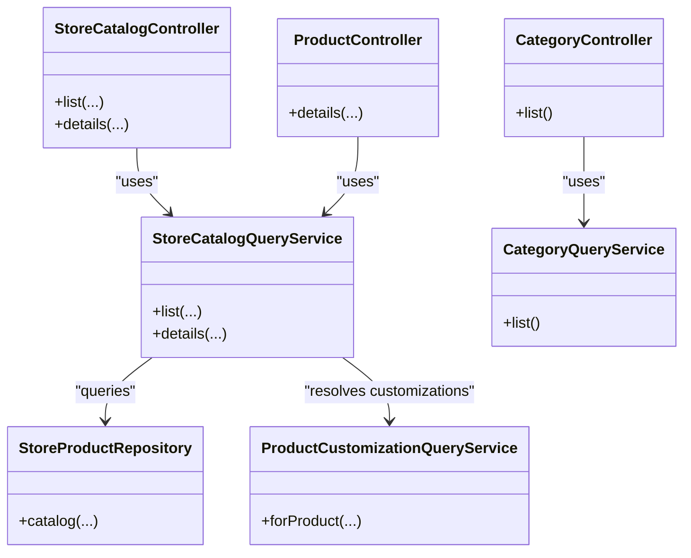

# Catalog API

<cite>
**Referenced Files in This Document**
- [ProductController.java](file://src/main/java/com/smartcoffee/modules/catalog/api/ProductController.java)
- [CategoryController.java](file://src/main/java/com/smartcoffee/modules/catalog/api/CategoryController.java)
- [StoreCatalogController.java](file://src/main/java/com/smartcoffee/modules/catalog/api/StoreCatalogController.java)
- [ProductSummaryResponse.java](file://src/main/java/com/smartcoffee/modules/catalog/api/ProductSummaryResponse.java)
- [CategoryResponse.java](file://src/main/java/com/smartcoffee/modules/catalog/api/CategoryResponse.java)
- [ProductDetailsResponse.java](file://src/main/java/com/smartcoffee/modules/catalog/api/ProductDetailsResponse.java)
- [CustomizationGroupResponse.java](file://src/main/java/com/smartcoffee/modules/catalog/api/CustomizationGroupResponse.java)
- [CustomizationOptionResponse.java](file://src/main/java/com/smartcoffee/modules/catalog/api/CustomizationOptionResponse.java)
- [StoreCatalogQueryService.java](file://src/main/java/com/smartcoffee/modules/catalog/application/StoreCatalogQueryService.java)
- [CategoryQueryService.java](file://src/main/java/com/smartcoffee/modules/catalog/application/CategoryQueryService.java)
- [ProductCustomizationQueryService.java](file://src/main/java/com/smartcoffee/modules/catalog/application/ProductCustomizationQueryService.java)
- [StoreProductRepository.java](file://src/main/java/com/smartcoffee/modules/catalog/persistence/StoreProductRepository.java)
- [StoreProduct.java](file://src/main/java/com/smartcoffee/modules/catalog/domain/StoreProduct.java)
- [PaginatedResponse.java](file://src/main/java/com/smartcoffee/common/api/PaginatedResponse.java)
- [ApiResponse.java](file://src/main/java/com/smartcoffee/common/api/ApiResponse.java)
</cite>

## Table of Contents
1. [Introduction](#introduction)
2. [Project Structure](#project-structure)
3. [Core Components](#core-components)
4. [Architecture Overview](#architecture-overview)
5. [Detailed Component Analysis](#detailed-component-analysis)
6. [Dependency Analysis](#dependency-analysis)
7. [Performance Considerations](#performance-considerations)
8. [Troubleshooting Guide](#troubleshooting-guide)
9. [Conclusion](#conclusion)
10. [Appendices](#appendices)

## Introduction
This document provides comprehensive API documentation for catalog management endpoints, focusing on product browsing, category listing, store-specific catalogs, and product detail retrieval. It explains request parameters for filtering, sorting, and pagination; documents response schemas including ProductSummaryResponse, CategoryResponse, and ProductDetailsResponse; and clarifies store-scoped data access, product availability checks, and customization options retrieval. Examples of complex queries are included to guide integration.

## Project Structure
The catalog feature is implemented as a Spring Boot module with controllers, application services, domain entities, and persistence repositories:
- Controllers expose REST endpoints under /api/v1/categories, /api/v1/products, and /api/v1/stores/{storeId}/catalog.
- Application services encapsulate business logic for querying categories, store catalogs, and product details.
- Persistence layer includes JPA repositories and native queries that enforce store scoping and availability rules.
- Response models define the contract for clients.

**Diagram sources**
- [CategoryController.java:9-21](file://src/main/java/com/smartcoffee/modules/catalog/api/CategoryController.java#L9-L21)
- [ProductController.java:9-21](file://src/main/java/com/smartcoffee/modules/catalog/api/ProductController.java#L9-L21)
- [StoreCatalogController.java:8-13](file://src/main/java/com/smartcoffee/modules/catalog/api/StoreCatalogController.java#L8-L13)
- [CategoryQueryService.java:19-24](file://src/main/java/com/smartcoffee/modules/catalog/application/CategoryQueryService.java#L19-L24)
- [StoreCatalogQueryService.java:33-59](file://src/main/java/com/smartcoffee/modules/catalog/application/StoreCatalogQueryService.java#L33-L59)
- [StoreProductRepository.java:8-29](file://src/main/java/com/smartcoffee/modules/catalog/persistence/StoreProductRepository.java#L8-L29)

**Section sources**
- [CategoryController.java:9-21](file://src/main/java/com/smartcoffee/modules/catalog/api/CategoryController.java#L9-L21)
- [ProductController.java:9-21](file://src/main/java/com/smartcoffee/modules/catalog/api/ProductController.java#L9-L21)
- [StoreCatalogController.java:8-13](file://src/main/java/com/smartcoffee/modules/catalog/api/StoreCatalogController.java#L8-L13)

## Core Components
- CategoryController: Lists all active categories.
- StoreCatalogController: Lists products for a specific store with search, category filter, availability filter, and pagination; retrieves product details scoped to a store.
- ProductController: Retrieves product details by product ID and store ID.
- StoreCatalogQueryService: Implements store-scoped catalog listing and product detail retrieval, enforcing store existence, product availability, and customization resolution.
- CategoryQueryService: Returns ordered list of active categories with image URLs resolved.
- ProductCustomizationQueryService: Resolves customization groups and options for a product.

Key response models:
- ProductSummaryResponse: Summary fields for catalog listings.
- CategoryResponse: Category metadata and ordering.
- ProductDetailsResponse: Full product details including category, price, availability, preparation time, and customizations.

**Section sources**
- [StoreCatalogController.java:8-13](file://src/main/java/com/smartcoffee/modules/catalog/api/StoreCatalogController.java#L8-L13)
- [ProductController.java:9-21](file://src/main/java/com/smartcoffee/modules/catalog/api/ProductController.java#L9-L21)
- [CategoryController.java:9-21](file://src/main/java/com/smartcoffee/modules/catalog/api/CategoryController.java#L9-L21)
- [StoreCatalogQueryService.java:33-59](file://src/main/java/com/smartcoffee/modules/catalog/application/StoreCatalogQueryService.java#L33-L59)
- [CategoryQueryService.java:19-24](file://src/main/java/com/smartcoffee/modules/catalog/application/CategoryQueryService.java#L19-L24)
- [ProductCustomizationQueryService.java:20-29](file://src/main/java/com/smartcoffee/modules/catalog/application/ProductCustomizationQueryService.java#L20-L29)
- [ProductSummaryResponse.java:1-6](file://src/main/java/com/smartcoffee/modules/catalog/api/ProductSummaryResponse.java#L1-L6)
- [CategoryResponse.java:1-5](file://src/main/java/com/smartcoffee/modules/catalog/api/CategoryResponse.java#L1-L5)
- [ProductDetailsResponse.java](file://src/main/java/com/smartcoffee/modules/catalog/api/ProductDetailsResponse.java)

## Architecture Overview
The catalog API follows a layered architecture:
- Presentation layer (controllers) validates inputs and delegates to services.
- Application layer (services) enforces business rules such as store scoping, availability, and customization retrieval.
- Persistence layer (repositories) executes optimized native queries for store-scoped product listings and counts.

**Diagram sources**
- [StoreCatalogController.java:8-13](file://src/main/java/com/smartcoffee/modules/catalog/api/StoreCatalogController.java#L8-L13)
- [StoreCatalogQueryService.java:33-59](file://src/main/java/com/smartcoffee/modules/catalog/application/StoreCatalogQueryService.java#L33-L59)
- [StoreProductRepository.java:8-29](file://src/main/java/com/smartcoffee/modules/catalog/persistence/StoreProductRepository.java#L8-L29)
- [ProductCustomizationQueryService.java:20-29](file://src/main/java/com/smartcoffee/modules/catalog/application/ProductCustomizationQueryService.java#L20-L29)

## Detailed Component Analysis

### Categories API
- Endpoint: GET /api/v1/categories
- Purpose: Retrieve all active categories ordered by display order and name.
- Request: None required.
- Response: Array of CategoryResponse wrapped in ApiResponse.
- Notes: Image URLs are resolved via CatalogImageUrlResolver.

**Section sources**
- [CategoryController.java:9-21](file://src/main/java/com/smartcoffee/modules/catalog/api/CategoryController.java#L9-L21)
- [CategoryQueryService.java:19-24](file://src/main/java/com/smartcoffee/modules/catalog/application/CategoryQueryService.java#L19-L24)
- [CategoryResponse.java:1-5](file://src/main/java/com/smartcoffee/modules/catalog/api/CategoryResponse.java#L1-L5)

### Store Catalog Listing API
- Endpoint: GET /api/v1/stores/{storeId}/catalog
- Purpose: Browse products offered by a specific store with filtering and pagination.
- Path Parameters:
  - storeId: UUID identifying the store.
- Query Parameters:
  - search: Optional string to filter by product name or code (case-insensitive).
  - categoryId: Optional UUID to filter by category.
  - availableOnly: Boolean flag to include only currently available products.
  - page: Integer page index (default 0).
  - size: Integer page size (default 20, capped at 100).
- Response: Paginated list of ProductSummaryResponse wrapped in ApiResponse.
- Availability Logic:
  - A product is considered available if store_product.available is true and sold_out_until is null or before current timestamp.
- Sorting:
  - Results are ordered by product name ascending.

**Diagram sources**
- [StoreCatalogController.java:8-13](file://src/main/java/com/smartcoffee/modules/catalog/api/StoreCatalogController.java#L8-L13)
- [StoreCatalogQueryService.java:33-44](file://src/main/java/com/smartcoffee/modules/catalog/application/StoreCatalogQueryService.java#L33-L44)
- [StoreProductRepository.java:8-29](file://src/main/java/com/smartcoffee/modules/catalog/persistence/StoreProductRepository.java#L8-L29)
- [StoreProduct.java:46-48](file://src/main/java/com/smartcoffee/modules/catalog/domain/StoreProduct.java#L46-L48)

**Section sources**
- [StoreCatalogController.java:8-13](file://src/main/java/com/smartcoffee/modules/catalog/api/StoreCatalogController.java#L8-L13)
- [StoreCatalogQueryService.java:33-44](file://src/main/java/com/smartcoffee/modules/catalog/application/StoreCatalogQueryService.java#L33-L44)
- [StoreProductRepository.java:8-29](file://src/main/java/com/smartcoffee/modules/catalog/persistence/StoreProductRepository.java#L8-L29)
- [StoreProduct.java:46-48](file://src/main/java/com/smartcoffee/modules/catalog/domain/StoreProduct.java#L46-L48)
- [PaginatedResponse.java](file://src/main/java/com/smartcoffee/common/api/PaginatedResponse.java)

### Product Details API
- Endpoints:
  - GET /api/v1/stores/{storeId}/catalog/products/{productId}
  - GET /api/v1/products/{productId}?storeId={storeId}
- Purpose: Retrieve detailed information for a product within a store context.
- Path Parameters:
  - storeId: UUID identifying the store.
  - productId: UUID identifying the product.
- Response: ProductDetailsResponse wrapped in ApiResponse.
- Behavior:
  - Validates store existence and product offering by the store.
  - Determines effective price using base price or store override.
  - Includes category details and customization groups/options.

**Diagram sources**
- [ProductController.java:9-21](file://src/main/java/com/smartcoffee/modules/catalog/api/ProductController.java#L9-L21)
- [StoreCatalogController.java:8-13](file://src/main/java/com/smartcoffee/modules/catalog/api/StoreCatalogController.java#L8-L13)
- [StoreCatalogQueryService.java:46-59](file://src/main/java/com/smartcoffee/modules/catalog/application/StoreCatalogQueryService.java#L46-L59)
- [ProductCustomizationQueryService.java:20-29](file://src/main/java/com/smartcoffee/modules/catalog/application/ProductCustomizationQueryService.java#L20-L29)

**Section sources**
- [ProductController.java:9-21](file://src/main/java/com/smartcoffee/modules/catalog/api/ProductController.java#L9-L21)
- [StoreCatalogController.java:8-13](file://src/main/java/com/smartcoffee/modules/catalog/api/StoreCatalogController.java#L8-L13)
- [StoreCatalogQueryService.java:46-59](file://src/main/java/com/smartcoffee/modules/catalog/application/StoreCatalogQueryService.java#L46-L59)

### Response Schemas
- ProductSummaryResponse:
  - Fields: productId, productCode, categoryId, categoryName, name, description, imageUrl, price, currencyCode, available, preparationMinutes, customizable.
- CategoryResponse:
  - Fields: categoryId, parentCategoryId, code, name, description, imageUrl, displayOrder.
- ProductDetailsResponse:
  - Fields: productId, productCode, categoryId, categoryName, name, description, imageUrl, price, currencyCode, available, preparationMinutes, customizations (list of CustomizationGroupResponse).
- CustomizationGroupResponse:
  - Fields: groupId, code, name, selectionType, required, minimumSelections, maximumSelections, options (list of CustomizationOptionResponse).
- CustomizationOptionResponse:
  - Fields: optionId, code, name, additionalPrice, available.

Notes:
- All responses are wrapped in ApiResponse with correlation context.
- Pagination uses PaginatedResponse containing page number, size, total elements, total pages, first, and last flags.

**Section sources**
- [ProductSummaryResponse.java:1-6](file://src/main/java/com/smartcoffee/modules/catalog/api/ProductSummaryResponse.java#L1-L6)
- [CategoryResponse.java:1-5](file://src/main/java/com/smartcoffee/modules/catalog/api/CategoryResponse.java#L1-L5)
- [ProductDetailsResponse.java](file://src/main/java/com/smartcoffee/modules/catalog/api/ProductDetailsResponse.java)
- [CustomizationGroupResponse.java:1-6](file://src/main/java/com/smartcoffee/modules/catalog/api/CustomizationGroupResponse.java#L1-L6)
- [CustomizationOptionResponse.java:1-6](file://src/main/java/com/smartcoffee/modules/catalog/api/CustomizationOptionResponse.java#L1-L6)
- [ApiResponse.java](file://src/main/java/com/smartcoffee/common/api/ApiResponse.java)
- [PaginatedResponse.java](file://src/main/java/com/smartcoffee/common/api/PaginatedResponse.java)

## Dependency Analysis
- Controllers depend on application services for business logic.
- StoreCatalogQueryService depends on:
  - StoreRepository for store validation.
  - ProductRepository for product lookup.
  - ProductCategoryRepository for category lookup.
  - StoreProductRepository for store-scoped product queries.
  - ProductCustomizationQueryService for customization data.
  - CatalogImageUrlResolver for image URL resolution.
- StoreProductRepository implements native queries that enforce store scoping, category filtering, availability checks, and search across product names and codes.

**Diagram sources**
- [StoreCatalogController.java:8-13](file://src/main/java/com/smartcoffee/modules/catalog/api/StoreCatalogController.java#L8-L13)
- [ProductController.java:9-21](file://src/main/java/com/smartcoffee/modules/catalog/api/ProductController.java#L9-L21)
- [CategoryController.java:9-21](file://src/main/java/com/smartcoffee/modules/catalog/api/CategoryController.java#L9-L21)
- [StoreCatalogQueryService.java:13-31](file://src/main/java/com/smartcoffee/modules/catalog/application/StoreCatalogQueryService.java#L13-L31)
- [CategoryQueryService.java:9-17](file://src/main/java/com/smartcoffee/modules/catalog/application/CategoryQueryService.java#L9-L17)
- [ProductCustomizationQueryService.java:9-18](file://src/main/java/com/smartcoffee/modules/catalog/application/ProductCustomizationQueryService.java#L9-L18)
- [StoreProductRepository.java:7-30](file://src/main/java/com/smartcoffee/modules/catalog/persistence/StoreProductRepository.java#L7-L30)

**Section sources**
- [StoreCatalogQueryService.java:13-31](file://src/main/java/com/smartcoffee/modules/catalog/application/StoreCatalogQueryService.java#L13-L31)
- [StoreProductRepository.java:7-30](file://src/main/java/com/smartcoffee/modules/catalog/persistence/StoreProductRepository.java#L7-L30)

## Performance Considerations
- Pagination: Default page size is 20 with a hard cap at 100 to prevent excessive payloads. Clients should tune page and size based on client needs.
- Filtering: Native query performs efficient filtering by store, category, availability, and search terms. Ensure appropriate indexes exist on store_id, category_id, and product_name/product_code columns.
- Availability Check: Computed in SQL using stored flags and timestamps to avoid client-side calculations.
- Image Resolution: Image URLs are resolved server-side to public endpoints, reducing client complexity.

[No sources needed since this section provides general guidance]

## Troubleshooting Guide
Common errors and resolutions:
- Store not found: Occurs when storeId does not exist or is inactive. Verify storeId and ensure the store is active.
- Product not found: Occurs when productId is inactive or missing. Confirm productId exists and is active.
- Product is not offered by this store: Occurs when the store does not offer the requested product. Verify store-product association.
- Category not found: Occurs when product’s category is inactive or missing. Ensure category is active and linked.
- Invalid pagination: Page must be non-negative; size is capped at 100. Adjust parameters accordingly.

Error handling:
- Services throw ResourceNotFoundException for missing entities.
- Responses are wrapped in ApiResponse with correlation context for tracing.

**Section sources**
- [StoreCatalogQueryService.java:46-64](file://src/main/java/com/smartcoffee/modules/catalog/application/StoreCatalogQueryService.java#L46-L64)
- [ApiResponse.java](file://src/main/java/com/smartcoffee/common/api/ApiResponse.java)

## Conclusion
The Catalog API provides robust, store-scoped product browsing and detail retrieval with flexible filtering, availability checks, and customization support. Use the documented endpoints and parameters to build efficient integrations, and follow best practices for pagination and error handling.

[No sources needed since this section summarizes without analyzing specific files]

## Appendices

### Example Queries
- Browse available products in a store filtered by category:
  - GET /api/v1/stores/{storeId}/catalog?categoryId={categoryId}&availableOnly=true&page=0&size=20
- Search products by keyword:
  - GET /api/v1/stores/{storeId}/catalog?search=latte&page=0&size=20
- Retrieve product details for a store:
  - GET /api/v1/stores/{storeId}/catalog/products/{productId}
- Alternative product details endpoint:
  - GET /api/v1/products/{productId}?storeId={storeId}

### Bulk Operations
- The current catalog API focuses on read operations. For bulk updates or writes, use other modules’ APIs (e.g., inventory or product management) as applicable.

[No sources needed since this section provides general guidance]