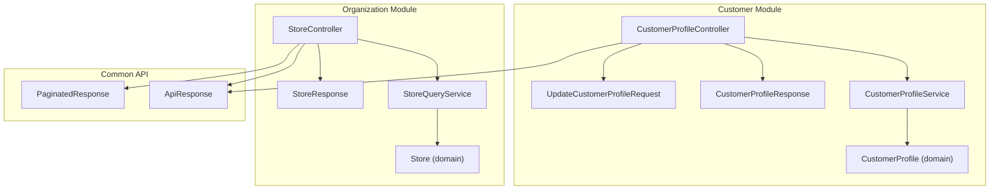
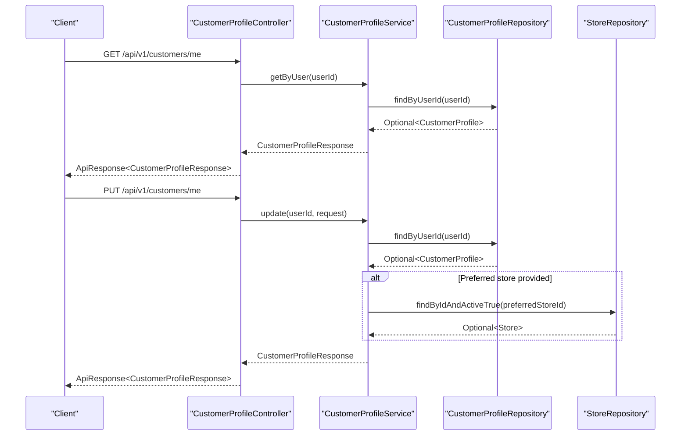
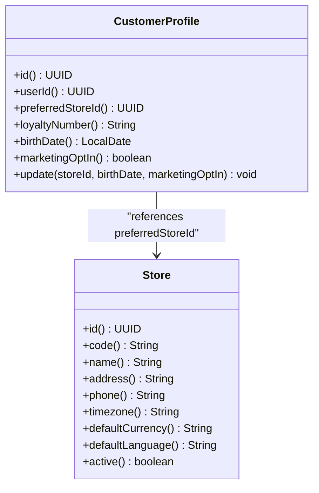
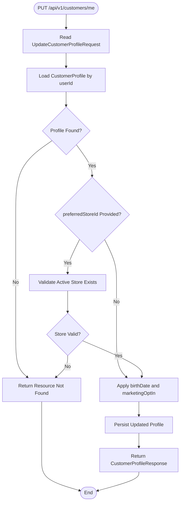
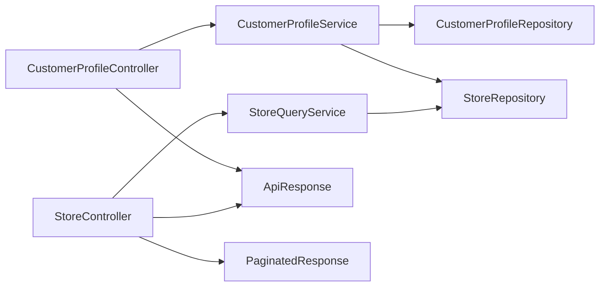

# Customer & Organization API

<cite>
**Referenced Files in This Document**
- [CustomerProfileController.java](file://src/main/java/com/smartcoffee/modules/customer/api/CustomerProfileController.java)
- [CustomerProfileResponse.java](file://src/main/java/com/smartcoffee/modules/customer/api/CustomerProfileResponse.java)
- [UpdateCustomerProfileRequest.java](file://src/main/java/com/smartcoffee/modules/customer/api/UpdateCustomerProfileRequest.java)
- [CustomerProfileService.java](file://src/main/java/com/smartcoffee/modules/customer/application/CustomerProfileService.java)
- [CustomerProfile.java](file://src/main/java/com/smartcoffee/modules/customer/domain/CustomerProfile.java)
- [StoreController.java](file://src/main/java/com/smartcoffee/modules/organization/api/StoreController.java)
- [StoreResponse.java](file://src/main/java/com/smartcoffee/modules/organization/api/StoreResponse.java)
- [StoreQueryService.java](file://src/main/java/com/smartcoffee/modules/organization/application/StoreQueryService.java)
- [Store.java](file://src/main/java/com/smartcoffee/modules/organization/domain/Store.java)
- [ApiResponse.java](file://src/main/java/com/smartcoffee/common/api/ApiResponse.java)
- [PaginatedResponse.java](file://src/main/java/com/smartcoffee/common/api/PaginatedResponse.java)
</cite>

## Table of Contents
1. [Introduction](#introduction)
2. [Project Structure](#project-structure)
3. [Core Components](#core-components)
4. [Architecture Overview](#architecture-overview)
5. [Detailed Component Analysis](#detailed-component-analysis)
6. [Dependency Analysis](#dependency-analysis)
7. [Performance Considerations](#performance-considerations)
8. [Troubleshooting Guide](#troubleshooting-guide)
9. [Conclusion](#conclusion)

## Introduction
This document provides comprehensive API documentation for customer profile and organization management endpoints. It covers:
- Retrieving and updating the authenticated customer’s profile
- Accessing store information with search and pagination
- Managing multi-store context via preferred store selection
- Response schemas for CustomerProfileResponse and StoreResponse
- Validation rules, error handling, and examples for customer data and store administration operations

## Project Structure
The relevant code is organized by feature modules:
- Customer module exposes profile endpoints and services
- Organization module exposes store listing and retrieval endpoints
- Common API types provide standardized response envelopes and pagination

**Diagram sources**
- [CustomerProfileController.java:10-25](file://src/main/java/com/smartcoffee/modules/customer/api/CustomerProfileController.java#L10-L25)
- [CustomerProfileService.java:12-38](file://src/main/java/com/smartcoffee/modules/customer/application/CustomerProfileService.java#L12-L38)
- [CustomerProfile.java:8-43](file://src/main/java/com/smartcoffee/modules/customer/domain/CustomerProfile.java#L8-L43)
- [CustomerProfileResponse.java:6-12](file://src/main/java/com/smartcoffee/modules/customer/api/CustomerProfileResponse.java#L6-L12)
- [UpdateCustomerProfileRequest.java:6-9](file://src/main/java/com/smartcoffee/modules/customer/api/UpdateCustomerProfileRequest.java#L6-L9)
- [StoreController.java:11-31](file://src/main/java/com/smartcoffee/modules/organization/api/StoreController.java#L11-L31)
- [StoreQueryService.java:14-37](file://src/main/java/com/smartcoffee/modules/organization/application/StoreQueryService.java#L14-L37)
- [Store.java:7-45](file://src/main/java/com/smartcoffee/modules/organization/domain/Store.java#L7-L45)
- [StoreResponse.java:5-15](file://src/main/java/com/smartcoffee/modules/organization/api/StoreResponse.java#L5-L15)
- [ApiResponse.java:5-8](file://src/main/java/com/smartcoffee/common/api/ApiResponse.java#L5-L8)
- [PaginatedResponse.java:5-7](file://src/main/java/com/smartcoffee/common/api/PaginatedResponse.java#L5-L7)

**Section sources**
- [CustomerProfileController.java:10-25](file://src/main/java/com/smartcoffee/modules/customer/api/CustomerProfileController.java#L10-L25)
- [StoreController.java:11-31](file://src/main/java/com/smartcoffee/modules/organization/api/StoreController.java#L11-L31)
- [ApiResponse.java:5-8](file://src/main/java/com/smartcoffee/common/api/ApiResponse.java#L5-L8)
- [PaginatedResponse.java:5-7](file://src/main/java/com/smartcoffee/common/api/PaginatedResponse.java#L5-L7)

## Core Components
- Customer Profile Controller: Provides GET and PUT endpoints under /api/v1/customers/me to retrieve and update the current customer’s profile. Uses CurrentActorProvider to resolve the authenticated user ID.
- Customer Profile Service: Implements business logic for fetching and updating profiles, including validation that a preferred store exists and is active.
- Store Controller: Exposes GET /api/v1/stores for paginated search and GET /api/v1/stores/{storeId} for single store retrieval.
- Store Query Service: Performs read-only queries against stores, filtering by active status and name search, with safe pagination parameters.

Key responsibilities:
- Enforce authentication context for profile operations
- Validate preferred store references before updates
- Provide consistent API responses and pagination metadata

**Section sources**
- [CustomerProfileController.java:10-25](file://src/main/java/com/smartcoffee/modules/customer/api/CustomerProfileController.java#L10-L25)
- [CustomerProfileService.java:20-38](file://src/main/java/com/smartcoffee/modules/customer/application/CustomerProfileService.java#L20-L38)
- [StoreController.java:17-31](file://src/main/java/com/smartcoffee/modules/organization/api/StoreController.java#L17-L31)
- [StoreQueryService.java:20-37](file://src/main/java/com/smartcoffee/modules/organization/application/StoreQueryService.java#L20-L37)

## Architecture Overview
The API follows a layered design:
- Controllers handle HTTP requests and map them to service methods
- Services encapsulate business rules and orchestrate persistence access
- Domain models represent core entities
- Common API types standardize responses and pagination

**Diagram sources**
- [CustomerProfileController.java:17-25](file://src/main/java/com/smartcoffee/modules/customer/api/CustomerProfileController.java#L17-L25)
- [CustomerProfileService.java:20-38](file://src/main/java/com/smartcoffee/modules/customer/application/CustomerProfileService.java#L20-L38)

## Detailed Component Analysis

### Customer Profile Endpoints
Base path: /api/v1/customers/me

- Get Customer Profile
  - Method: GET
  - Description: Returns the authenticated customer’s profile.
  - Authentication: Required (uses CurrentActorProvider).
  - Success Response: ApiResponse<CustomerProfileResponse>.
  - Error Responses: Resource not found if no profile exists for the user.

- Update Customer Profile
  - Method: PUT
  - Description: Updates preferred store, birth date, and marketing opt-in.
  - Request Body: UpdateCustomerProfileRequest.
  - Validation:
    - preferredStoreId must reference an active store when provided.
    - Birth date and marketing opt-in are optional fields.
  - Success Response: ApiResponse<CustomerProfileResponse>.
  - Error Responses: Resource not found if profile or preferred store does not exist.

Response Schema: CustomerProfileResponse
- customerId: UUID
- userId: UUID
- preferredStoreId: UUID (nullable)
- loyaltyNumber: String (nullable)
- birthDate: LocalDate (nullable)
- marketingOptIn: boolean

Request Schema: UpdateCustomerProfileRequest
- preferredStoreId: UUID (nullable)
- birthDate: LocalDate (nullable)
- marketingOptIn: boolean

Example Requests and Responses
- GET /api/v1/customers/me
  - Response: { success: true, data: { customerId, userId, preferredStoreId, loyaltyNumber, birthDate, marketingOptIn }, requestId, timestamp }
- PUT /api/v1/customers/me
  - Request: { preferredStoreId: "<uuid-or-null>", birthDate: "<yyyy-mm-dd-or-null>", marketingOptIn: true }
  - Response: { success: true, data: { ... }, requestId, timestamp }

Validation Rules
- preferredStoreId: If present, must correspond to an active store; otherwise, a resource not found error is returned.
- birthDate: Optional; accepted as ISO date string.
- marketingOptIn: Boolean flag indicating consent for marketing communications.

**Section sources**
- [CustomerProfileController.java:17-25](file://src/main/java/com/smartcoffee/modules/customer/api/CustomerProfileController.java#L17-L25)
- [CustomerProfileService.java:20-38](file://src/main/java/com/smartcoffee/modules/customer/application/CustomerProfileService.java#L20-L38)
- [CustomerProfileResponse.java:6-12](file://src/main/java/com/smartcoffee/modules/customer/api/CustomerProfileResponse.java#L6-L12)
- [UpdateCustomerProfileRequest.java:6-9](file://src/main/java/com/smartcoffee/modules/customer/api/UpdateCustomerProfileRequest.java#L6-L9)

### Store Management Endpoints
Base path: /api/v1/stores

- List Stores
  - Method: GET
  - Query Parameters:
    - search: String (default "")
    - page: Integer (default 0)
    - size: Integer (default 20)
  - Description: Returns a paginated list of active stores filtered by name containing the search term.
  - Success Response: ApiResponse<PaginatedResponse<StoreResponse>>.

- Get Store by ID
  - Method: GET
  - Path Parameter: storeId (UUID)
  - Description: Retrieves a single active store by ID.
  - Success Response: ApiResponse<StoreResponse>.
  - Error Responses: Resource not found if store does not exist or is inactive.

Response Schema: StoreResponse
- storeId: UUID
- storeCode: String
- storeName: String
- address: String
- phone: String (nullable)
- timezone: String
- defaultCurrency: String
- defaultLanguage: String
- open: boolean (derived from query results)
- active: boolean

Pagination Metadata: PaginatedResponse.Pagination
- page: int
- size: int
- totalElements: long
- totalPages: int
- first: boolean
- last: boolean

Example Requests and Responses
- GET /api/v1/stores?search=central&page=0&size=20
  - Response: { success: true, data: { items: [StoreResponse...], pagination: { page, size, totalElements, totalPages, first, last } }, requestId, timestamp }
- GET /api/v1/stores/{storeId}
  - Response: { success: true, data: StoreResponse, requestId, timestamp }

Search Behavior
- Case-insensitive substring match on store name.
- Only active stores are included in results.

**Section sources**
- [StoreController.java:17-31](file://src/main/java/com/smartcoffee/modules/organization/api/StoreController.java#L17-L31)
- [StoreQueryService.java:20-37](file://src/main/java/com/smartcoffee/modules/organization/application/StoreQueryService.java#L20-L37)
- [StoreResponse.java:5-15](file://src/main/java/com/smartcoffee/modules/organization/api/StoreResponse.java#L5-L15)
- [PaginatedResponse.java:5-7](file://src/main/java/com/smartcoffee/common/api/PaginatedResponse.java#L5-L7)

### Customer-Store Relationships and Multi-Store Context
- Relationship Model:
  - A CustomerProfile may have a preferredStoreId referencing a Store.
  - The preferred store is used to contextualize customer-specific settings such as default location and locale.
- Validation:
  - When updating a profile, if preferredStoreId is provided, it must point to an active store; otherwise, the operation fails with a resource not found error.
- Multi-Store Context:
  - Clients can set or change the preferred store per customer to tailor experiences across multiple locations.

**Diagram sources**
- [CustomerProfile.java:8-43](file://src/main/java/com/smartcoffee/modules/customer/domain/CustomerProfile.java#L8-L43)
- [Store.java:7-45](file://src/main/java/com/smartcoffee/modules/organization/domain/Store.java#L7-L45)

**Section sources**
- [CustomerProfileService.java:26-38](file://src/main/java/com/smartcoffee/modules/customer/application/CustomerProfileService.java#L26-L38)
- [CustomerProfile.java:41-43](file://src/main/java/com/smartcoffee/modules/customer/domain/CustomerProfile.java#L41-L43)
- [Store.java:26-45](file://src/main/java/com/smartcoffee/modules/organization/domain/Store.java#L26-L45)

### Data Flow and Processing Logic

#### Profile Update Flow

**Diagram sources**
- [CustomerProfileController.java:22-25](file://src/main/java/com/smartcoffee/modules/customer/api/CustomerProfileController.java#L22-L25)
- [CustomerProfileService.java:26-38](file://src/main/java/com/smartcoffee/modules/customer/application/CustomerProfileService.java#L26-L38)

**Section sources**
- [CustomerProfileService.java:26-38](file://src/main/java/com/smartcoffee/modules/customer/application/CustomerProfileService.java#L26-L38)

### Example Operations

- Retrieve Current Customer Profile
  - Action: GET /api/v1/customers/me
  - Expected Outcome: Returns the authenticated user’s profile wrapped in ApiResponse.

- Update Preferred Store and Preferences
  - Action: PUT /api/v1/customers/me
  - Payload: { preferredStoreId: "<uuid>", birthDate: "<yyyy-mm-dd>", marketingOptIn: true }
  - Expected Outcome: Updates profile fields and returns updated CustomerProfileResponse.

- Search Stores
  - Action: GET /api/v1/stores?search=main&page=0&size=10
  - Expected Outcome: Returns paginated list of active stores matching the search term.

- Get Store Details
  - Action: GET /api/v1/stores/{storeId}
  - Expected Outcome: Returns StoreResponse for the specified active store.

**Section sources**
- [CustomerProfileController.java:17-25](file://src/main/java/com/smartcoffee/modules/customer/api/CustomerProfileController.java#L17-L25)
- [StoreController.java:17-31](file://src/main/java/com/smartcoffee/modules/organization/api/StoreController.java#L17-L31)

## Dependency Analysis
- CustomerProfileController depends on:
  - CustomerProfileService for business logic
  - CurrentActorProvider for authenticated user resolution
  - ApiResponse for standardized responses
- CustomerProfileService depends on:
  - CustomerProfileRepository for profile persistence
  - StoreRepository for validating preferred store existence and activity
- StoreController depends on:
  - StoreQueryService for store queries
  - ApiResponse and PaginatedResponse for standardized responses
- StoreQueryService depends on:
  - StoreRepository for querying stores

**Diagram sources**
- [CustomerProfileController.java:10-25](file://src/main/java/com/smartcoffee/modules/customer/api/CustomerProfileController.java#L10-L25)
- [CustomerProfileService.java:12-38](file://src/main/java/com/smartcoffee/modules/customer/application/CustomerProfileService.java#L12-L38)
- [StoreController.java:11-31](file://src/main/java/com/smartcoffee/modules/organization/api/StoreController.java#L11-L31)
- [StoreQueryService.java:14-37](file://src/main/java/com/smartcoffee/modules/organization/application/StoreQueryService.java#L14-L37)
- [ApiResponse.java:5-8](file://src/main/java/com/smartcoffee/common/api/ApiResponse.java#L5-L8)
- [PaginatedResponse.java:5-7](file://src/main/java/com/smartcoffee/common/api/PaginatedResponse.java#L5-L7)

**Section sources**
- [CustomerProfileController.java:10-25](file://src/main/java/com/smartcoffee/modules/customer/api/CustomerProfileController.java#L10-L25)
- [CustomerProfileService.java:12-38](file://src/main/java/com/smartcoffee/modules/customer/application/CustomerProfileService.java#L12-L38)
- [StoreController.java:11-31](file://src/main/java/com/smartcoffee/modules/organization/api/StoreController.java#L11-L31)
- [StoreQueryService.java:14-37](file://src/main/java/com/smartcoffee/modules/organization/application/StoreQueryService.java#L14-L37)

## Performance Considerations
- Pagination Safety: Store list endpoint enforces minimum and maximum page sizes to prevent excessive loads.
- Read-Only Transactions: Profile retrieval and store queries use read-only transactions to optimize performance.
- Filtering: Store search uses case-insensitive substring matching on names, limited to active stores to reduce result sets.

[No sources needed since this section provides general guidance]

## Troubleshooting Guide
Common Errors:
- Resource Not Found (Profile): Occurs when retrieving or updating a profile for a user without an existing profile.
- Resource Not Found (Preferred Store): Occurs when updating a profile with a preferredStoreId that does not exist or is inactive.
- Resource Not Found (Store): Occurs when requesting a store by ID that does not exist or is inactive.

Resolution Steps:
- Ensure the authenticated user has a corresponding customer profile before attempting updates.
- Verify that any preferredStoreId points to an active store.
- Confirm store IDs exist and are active when accessing store details.

Error Handling Patterns:
- Controllers return ApiResponse envelopes with success flags and timestamps.
- Services throw domain-specific exceptions that are handled globally to produce consistent error responses.

**Section sources**
- [CustomerProfileService.java:20-38](file://src/main/java/com/smartcoffee/modules/customer/application/CustomerProfileService.java#L20-L38)
- [StoreQueryService.java:20-37](file://src/main/java/com/smartcoffee/modules/organization/application/StoreQueryService.java#L20-L37)
- [ApiResponse.java:5-8](file://src/main/java/com/smartcoffee/common/api/ApiResponse.java#L5-L8)

## Conclusion
The Customer & Organization API provides robust endpoints for managing customer profiles and store information. It enforces strong validation for multi-store contexts, ensures data integrity through repository checks, and delivers consistent responses using common API types. Clients can confidently retrieve and update customer preferences and explore store configurations with secure, paginated search capabilities.

[No sources needed since this section summarizes without analyzing specific files]