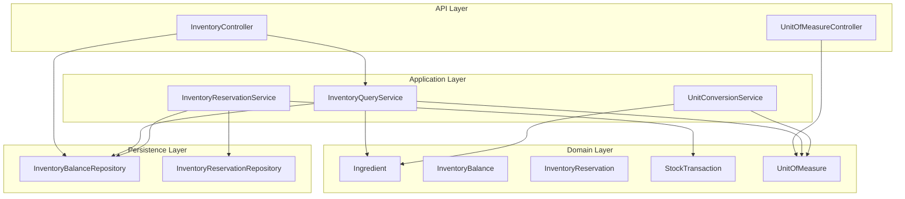
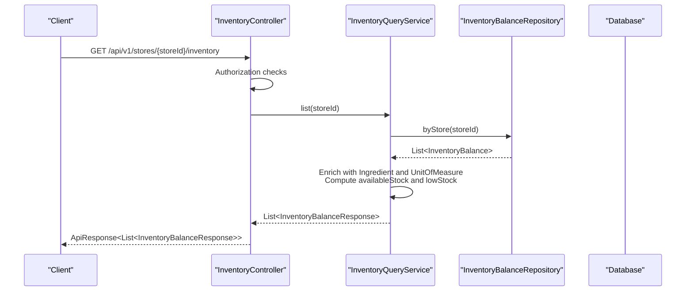
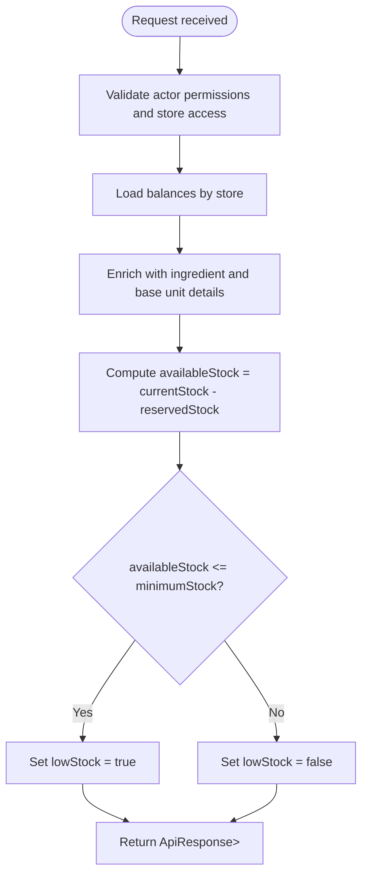
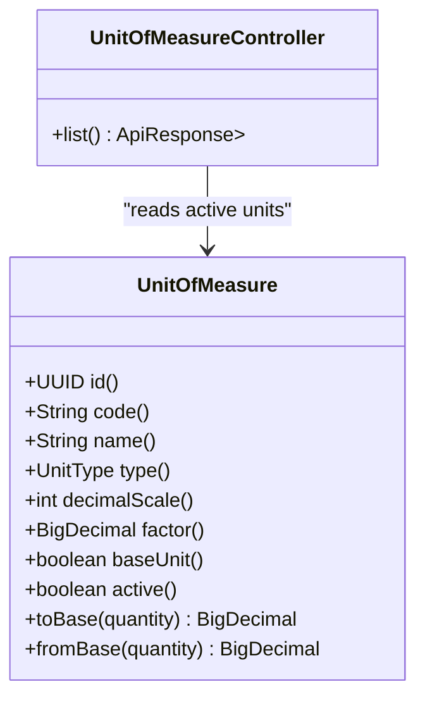
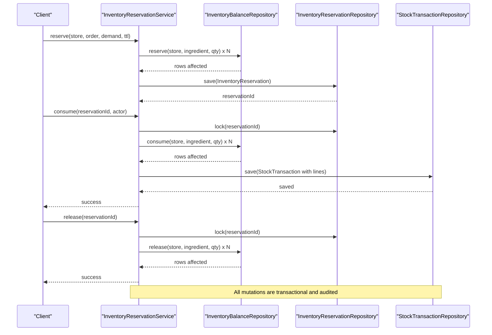
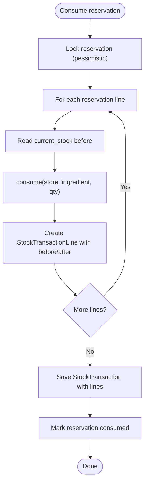
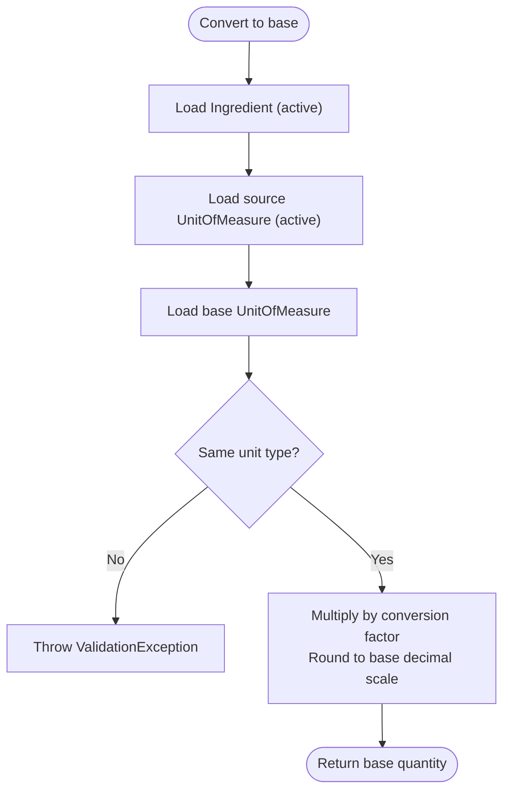
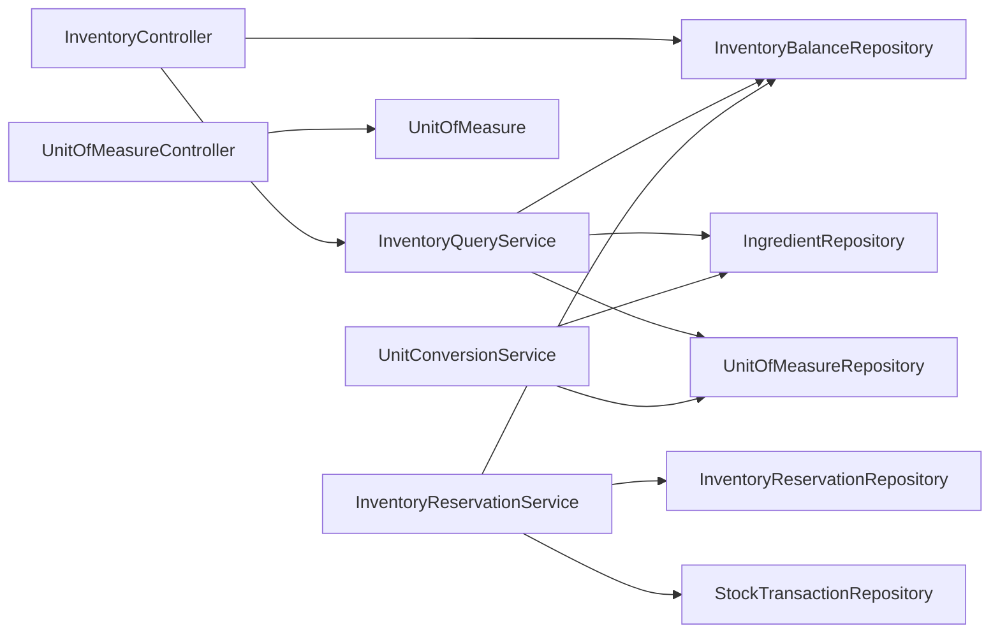

# Inventory API

<cite>
**Referenced Files in This Document**
- [InventoryController.java](file://src/main/java/com/smartcoffee/modules/inventory/api/InventoryController.java)
- [UnitOfMeasureController.java](file://src/main/java/com/smartcoffee/modules/inventory/api/UnitOfMeasureController.java)
- [InventoryBalanceResponse.java](file://src/main/java/com/smartcoffee/modules/inventory/api/InventoryBalanceResponse.java)
- [UnitOfMeasureResponse.java](file://src/main/java/com/smartcoffee/modules/inventory/api/UnitOfMeasureResponse.java)
- [InventoryQueryService.java](file://src/main/java/com/smartcoffee/modules/inventory/application/InventoryQueryService.java)
- [InventoryReservationService.java](file://src/main/java/com/smartcoffee/modules/inventory/application/InventoryReservationService.java)
- [UnitConversionService.java](file://src/main/java/com/smartcoffee/modules/inventory/application/UnitConversionService.java)
- [Ingredient.java](file://src/main/java/com/smartcoffee/modules/inventory/domain/Ingredient.java)
- [InventoryBalance.java](file://src/main/java/com/smartcoffee/modules/inventory/domain/InventoryBalance.java)
- [InventoryReservation.java](file://src/main/java/com/smartcoffee/modules/inventory/domain/InventoryReservation.java)
- [StockTransaction.java](file://src/main/java/com/smartcoffee/modules/inventory/domain/StockTransaction.java)
- [UnitOfMeasure.java](file://src/main/java/com/smartcoffee/modules/inventory/domain/UnitOfMeasure.java)
- [InventoryBalanceRepository.java](file://src/main/java/com/smartcoffee/modules/inventory/persistence/InventoryBalanceRepository.java)
- [InventoryReservationRepository.java](file://src/main/java/com/smartcoffee/modules/inventory/persistence/InventoryReservationRepository.java)
</cite>

## Table of Contents
1. Introduction
2. Project Structure
3. Core Components
4. Architecture Overview
5. Detailed Component Analysis
6. Dependency Analysis
7. Performance Considerations
8. Troubleshooting Guide
9. Conclusion

## Introduction
This document provides comprehensive API documentation for the inventory management module, focusing on:
- Ingredient stock levels and low stock alerts
- Unit of measure management and conversions
- Inventory balance queries per store
- Stock reservation system, consumption tracking, and inventory reconciliation via ledgered transactions
- Examples of monitoring workflows and stock adjustment operations

The module exposes read endpoints for inventory balances and unit of measures, and application services that implement reservation, release, consumption, expiration, and conversion logic with strict concurrency controls and auditability through stock transaction records.

## Project Structure
The inventory module is organized by layers:
- API layer: REST controllers for listing inventory balances and units of measure
- Application layer: Services orchestrating business logic (queries, reservations, conversions)
- Domain layer: Entities representing ingredients, balances, reservations, transactions, and units of measure
- Persistence layer: JPA repositories with custom native queries for safe updates and pessimistic locking

**Diagram sources**
- [InventoryController.java:10-32](file://src/main/java/com/smartcoffee/modules/inventory/api/InventoryController.java#L10-L32)
- [UnitOfMeasureController.java:9-24](file://src/main/java/com/smartcoffee/modules/inventory/api/UnitOfMeasureController.java#L9-L24)
- [InventoryQueryService.java:1-3](file://src/main/java/com/smartcoffee/modules/inventory/application/InventoryQueryService.java#L1-L3)
- [InventoryReservationService.java:30-98](file://src/main/java/com/smartcoffee/modules/inventory/application/InventoryReservationService.java#L30-L98)
- [UnitConversionService.java:11-32](file://src/main/java/com/smartcoffee/modules/inventory/application/UnitConversionService.java#L11-L32)
- [Ingredient.java:8-31](file://src/main/java/com/smartcoffee/modules/inventory/domain/Ingredient.java#L8-L31)
- [InventoryBalance.java:7-23](file://src/main/java/com/smartcoffee/modules/inventory/domain/InventoryBalance.java#L7-L23)
- [InventoryReservation.java:8-36](file://src/main/java/com/smartcoffee/modules/inventory/domain/InventoryReservation.java#L8-L36)
- [StockTransaction.java:7-31](file://src/main/java/com/smartcoffee/modules/inventory/domain/StockTransaction.java#L7-L31)
- [UnitOfMeasure.java:8-34](file://src/main/java/com/smartcoffee/modules/inventory/domain/UnitOfMeasure.java#L8-L34)
- [InventoryBalanceRepository.java:9-23](file://src/main/java/com/smartcoffee/modules/inventory/persistence/InventoryBalanceRepository.java#L9-L23)
- [InventoryReservationRepository.java:11-20](file://src/main/java/com/smartcoffee/modules/inventory/persistence/InventoryReservationRepository.java#L11-L20)

**Section sources**
- [InventoryController.java:10-32](file://src/main/java/com/smartcoffee/modules/inventory/api/InventoryController.java#L10-L32)
- [UnitOfMeasureController.java:9-24](file://src/main/java/com/smartcoffee/modules/inventory/api/UnitOfMeasureController.java#L9-L24)
- [InventoryQueryService.java:1-3](file://src/main/java/com/smartcoffee/modules/inventory/application/InventoryQueryService.java#L1-L3)
- [InventoryReservationService.java:30-98](file://src/main/java/com/smartcoffee/modules/inventory/application/InventoryReservationService.java#L30-L98)
- [UnitConversionService.java:11-32](file://src/main/java/com/smartcoffee/modules/inventory/application/UnitConversionService.java#L11-L32)
- [Ingredient.java:8-31](file://src/main/java/com/smartcoffee/modules/inventory/domain/Ingredient.java#L8-L31)
- [InventoryBalance.java:7-23](file://src/main/java/com/smartcoffee/modules/inventory/domain/InventoryBalance.java#L7-L23)
- [InventoryReservation.java:8-36](file://src/main/java/com/smartcoffee/modules/inventory/domain/InventoryReservation.java#L8-L36)
- [StockTransaction.java:7-31](file://src/main/java/com/smartcoffee/modules/inventory/domain/StockTransaction.java#L7-L31)
- [UnitOfMeasure.java:8-34](file://src/main/java/com/smartcoffee/modules/inventory/domain/UnitOfMeasure.java#L8-L34)
- [InventoryBalanceRepository.java:9-23](file://src/main/java/com/smartcoffee/modules/inventory/persistence/InventoryBalanceRepository.java#L9-L23)
- [InventoryReservationRepository.java:11-20](file://src/main/java/com/smartcoffee/modules/inventory/persistence/InventoryReservationRepository.java#L11-L20)

## Core Components
- InventoryController: Exposes GET /api/v1/stores/{storeId}/inventory to list ingredient balances for a store with authorization checks.
- UnitOfMeasureController: Exposes GET /api/v1/units-of-measure to list active units of measure with conversion metadata.
- InventoryQueryService: Reads balances per store, enriches with ingredient and base unit info, computes available stock and low-stock flag.
- InventoryReservationService: Implements reserve, release, consume, and expire flows with optimistic concurrency and pessimistic reservation locking.
- UnitConversionService: Converts quantities between submitted units and ingredient base units with validation and rounding.

Key response schemas:
- InventoryBalanceResponse fields: ingredientId, ingredientCode, ingredientName, baseUnitCode, currentStock, reservedStock, availableStock, minimumStock, averageUnitCost, lowStock, version.
- UnitOfMeasureResponse fields: unitId, code, name, type, decimalScale, conversionFactorToBase, baseUnit.

Low stock alerting:
- The lowStock flag is derived from comparing availableStock to minimumStock; clients can use this to surface alerts.

**Section sources**
- [InventoryController.java:10-32](file://src/main/java/com/smartcoffee/modules/inventory/api/InventoryController.java#L10-L32)
- [UnitOfMeasureController.java:9-24](file://src/main/java/com/smartcoffee/modules/inventory/api/UnitOfMeasureController.java#L9-L24)
- [InventoryBalanceResponse.java:6-8](file://src/main/java/com/smartcoffee/modules/inventory/api/InventoryBalanceResponse.java#L6-L8)
- [UnitOfMeasureResponse.java:6-7](file://src/main/java/com/smartcoffee/modules/inventory/api/UnitOfMeasureResponse.java#L6-L7)
- [InventoryQueryService.java:1-3](file://src/main/java/com/smartcoffee/modules/inventory/application/InventoryQueryService.java#L1-L3)
- [InventoryReservationService.java:43-98](file://src/main/java/com/smartcoffee/modules/inventory/application/InventoryReservationService.java#L43-L98)
- [UnitConversionService.java:21-32](file://src/main/java/com/smartcoffee/modules/inventory/application/UnitConversionService.java#L21-L32)

## Architecture Overview
The inventory API follows a layered architecture with clear separation of concerns:
- Controllers handle HTTP requests and enforce authorization.
- Application services encapsulate business rules and orchestrate persistence calls.
- Domain entities model state and behavior, including versioning and lifecycle transitions.
- Repositories provide data access with safe update queries and locking strategies.

**Diagram sources**
- [InventoryController.java:10-32](file://src/main/java/com/smartcoffee/modules/inventory/api/InventoryController.java#L10-L32)
- [InventoryQueryService.java:1-3](file://src/main/java/com/smartcoffee/modules/inventory/application/InventoryQueryService.java#L1-L3)
- [InventoryBalanceRepository.java:22-23](file://src/main/java/com/smartcoffee/modules/inventory/persistence/InventoryBalanceRepository.java#L22-L23)

## Detailed Component Analysis

### Inventory Balance Query
- Endpoint: GET /api/v1/stores/{storeId}/inventory
- Behavior: Requires authentication and store authorization; returns all ingredient balances for the store, including computed available stock and low stock flag.
- Data enrichment: Joins ingredient and base unit metadata to produce human-readable responses.

**Diagram sources**
- [InventoryController.java:26-32](file://src/main/java/com/smartcoffee/modules/inventory/api/InventoryController.java#L26-L32)
- [InventoryQueryService.java:1-3](file://src/main/java/com/smartcoffee/modules/inventory/application/InventoryQueryService.java#L1-L3)
- [InventoryBalance.java:40-42](file://src/main/java/com/smartcoffee/modules/inventory/domain/InventoryBalance.java#L40-L42)

**Section sources**
- [InventoryController.java:10-32](file://src/main/java/com/smartcoffee/modules/inventory/api/InventoryController.java#L10-L32)
- [InventoryQueryService.java:1-3](file://src/main/java/com/smartcoffee/modules/inventory/application/InventoryQueryService.java#L1-L3)
- [InventoryBalance.java:40-42](file://src/main/java/com/smartcoffee/modules/inventory/domain/InventoryBalance.java#L40-L42)

### Unit of Measure Management
- Endpoint: GET /api/v1/units-of-measure
- Behavior: Returns all active units of measure with conversion factors and whether they are base units.
- Usage: Clients can convert quantities using UnitConversionService or compute conversions client-side using conversionFactorToBase and decimalScale.

**Diagram sources**
- [UnitOfMeasureController.java:9-24](file://src/main/java/com/smartcoffee/modules/inventory/api/UnitOfMeasureController.java#L9-L24)
- [UnitOfMeasure.java:8-80](file://src/main/java/com/smartcoffee/modules/inventory/domain/UnitOfMeasure.java#L8-L80)

**Section sources**
- [UnitOfMeasureController.java:9-24](file://src/main/java/com/smartcoffee/modules/inventory/api/UnitOfMeasureController.java#L9-L24)
- [UnitOfMeasure.java:8-80](file://src/main/java/com/smartcoffee/modules/inventory/domain/UnitOfMeasure.java#L8-L80)

### Stock Reservation System
- Reserve: Creates a reservation for an order with a TTL; reserves required quantities atomically; returns existing reservation if already present for the same order.
- Release: Releases reserved quantities back to available stock when a reservation is canceled or not fulfilled.
- Consume: Consumes reserved quantities, records stock changes, marks reservation consumed, and writes a stock transaction line item for auditability.
- Expire: Automatically releases expired reservations based on TTL.

Concurrency and safety:
- Uses pessimistic write locks on reservations to prevent race conditions during consume/release/expire.
- Uses optimistic versioning on inventory balances via row-level version columns updated in native queries.

**Diagram sources**
- [InventoryReservationService.java:43-98](file://src/main/java/com/smartcoffee/modules/inventory/application/InventoryReservationService.java#L43-L98)
- [InventoryBalanceRepository.java:10-20](file://src/main/java/com/smartcoffee/modules/inventory/persistence/InventoryBalanceRepository.java#L10-L20)
- [InventoryReservationRepository.java:11-20](file://src/main/java/com/smartcoffee/modules/inventory/persistence/InventoryReservationRepository.java#L11-L20)
- [StockTransaction.java:36-53](file://src/main/java/com/smartcoffee/modules/inventory/domain/StockTransaction.java#L36-L53)

**Section sources**
- [InventoryReservationService.java:43-98](file://src/main/java/com/smartcoffee/modules/inventory/application/InventoryReservationService.java#L43-L98)
- [InventoryBalanceRepository.java:10-20](file://src/main/java/com/smartcoffee/modules/inventory/persistence/InventoryBalanceRepository.java#L10-L20)
- [InventoryReservationRepository.java:11-20](file://src/main/java/com/smartcoffee/modules/inventory/persistence/InventoryReservationRepository.java#L11-L20)
- [StockTransaction.java:36-53](file://src/main/java/com/smartcoffee/modules/inventory/domain/StockTransaction.java#L36-L53)

### Consumption Tracking and Inventory Reconciliation
- Consumption flow decrements both current_stock and reserved_stock and records a StockTransaction with type SALE_CONSUMPTION and reference to the order.
- Each StockTransaction includes multiple StockTransactionLine entries per ingredient, capturing before/after balances for full auditability.
- Reconciliation: Summing StockTransactionLine deltas per ingredient should reconcile to InventoryBalance.current_stock within tolerance for rounding.

**Diagram sources**
- [InventoryReservationService.java:67-85](file://src/main/java/com/smartcoffee/modules/inventory/application/InventoryReservationService.java#L67-L85)
- [StockTransaction.java:36-53](file://src/main/java/com/smartcoffee/modules/inventory/domain/StockTransaction.java#L36-L53)

**Section sources**
- [InventoryReservationService.java:67-85](file://src/main/java/com/smartcoffee/modules/inventory/application/InventoryReservationService.java#L67-L85)
- [StockTransaction.java:36-53](file://src/main/java/com/smartcoffee/modules/inventory/domain/StockTransaction.java#L36-L53)

### Unit Conversion
- Converts a quantity from a submitted unit to the ingredient’s base unit, validating unit compatibility and applying correct rounding.
- Useful for intake operations where incoming stock may be recorded in different units than the base unit.

**Diagram sources**
- [UnitConversionService.java:21-32](file://src/main/java/com/smartcoffee/modules/inventory/application/UnitConversionService.java#L21-L32)
- [UnitOfMeasure.java:71-79](file://src/main/java/com/smartcoffee/modules/inventory/domain/UnitOfMeasure.java#L71-L79)

**Section sources**
- [UnitConversionService.java:21-32](file://src/main/java/com/smartcoffee/modules/inventory/application/UnitConversionService.java#L21-L32)
- [UnitOfMeasure.java:71-79](file://src/main/java/com/smartcoffee/modules/inventory/domain/UnitOfMeasure.java#L71-L79)

### Response Schemas

- InventoryBalanceResponse
  - Fields:
    - ingredientId: UUID
    - ingredientCode: String
    - ingredientName: String
    - baseUnitCode: String
    - currentStock: BigDecimal
    - reservedStock: BigDecimal
    - availableStock: BigDecimal
    - minimumStock: BigDecimal
    - averageUnitCost: BigDecimal
    - lowStock: boolean
    - version: long
  - Notes:
    - availableStock is derived from currentStock minus reservedStock.
    - lowStock indicates when availableStock is less than or equal to minimumStock.

- UnitOfMeasureResponse
  - Fields:
    - unitId: UUID
    - code: String
    - name: String
    - type: String (unit type enum value)
    - decimalScale: int
    - conversionFactorToBase: BigDecimal
    - baseUnit: boolean

**Section sources**
- [InventoryBalanceResponse.java:6-8](file://src/main/java/com/smartcoffee/modules/inventory/api/InventoryBalanceResponse.java#L6-L8)
- [UnitOfMeasureResponse.java:6-7](file://src/main/java/com/smartcoffee/modules/inventory/api/UnitOfMeasureResponse.java#L6-L7)
- [InventoryBalance.java:40-42](file://src/main/java/com/smartcoffee/modules/inventory/domain/InventoryBalance.java#L40-L42)

## Dependency Analysis
- Controllers depend on application services for business logic and on repositories for data access.
- InventoryQueryService depends on InventoryBalanceRepository, IngredientRepository, and UnitOfMeasureRepository to build enriched responses.
- InventoryReservationService coordinates InventoryBalanceRepository, InventoryReservationRepository, and StockTransactionRepository to ensure atomicity and auditability.
- UnitConversionService depends on UnitOfMeasureRepository and IngredientRepository to validate and perform conversions.

**Diagram sources**
- [InventoryController.java:10-32](file://src/main/java/com/smartcoffee/modules/inventory/api/InventoryController.java#L10-L32)
- [UnitOfMeasureController.java:9-24](file://src/main/java/com/smartcoffee/modules/inventory/api/UnitOfMeasureController.java#L9-L24)
- [InventoryQueryService.java:1-3](file://src/main/java/com/smartcoffee/modules/inventory/application/InventoryQueryService.java#L1-L3)
- [InventoryReservationService.java:30-98](file://src/main/java/com/smartcoffee/modules/inventory/application/InventoryReservationService.java#L30-L98)
- [UnitConversionService.java:11-32](file://src/main/java/com/smartcoffee/modules/inventory/application/UnitConversionService.java#L11-L32)

**Section sources**
- [InventoryController.java:10-32](file://src/main/java/com/smartcoffee/modules/inventory/api/InventoryController.java#L10-L32)
- [UnitOfMeasureController.java:9-24](file://src/main/java/com/smartcoffee/modules/inventory/api/UnitOfMeasureController.java#L9-L24)
- [InventoryQueryService.java:1-3](file://src/main/java/com/smartcoffee/modules/inventory/application/InventoryQueryService.java#L1-L3)
- [InventoryReservationService.java:30-98](file://src/main/java/com/smartcoffee/modules/inventory/application/InventoryReservationService.java#L30-L98)
- [UnitConversionService.java:11-32](file://src/main/java/com/smartcoffee/modules/inventory/application/UnitConversionService.java#L11-L32)

## Performance Considerations
- Use pagination for large inventories if needed; current list endpoint returns all balances for a store.
- Native update queries in InventoryBalanceRepository minimize round trips and apply row-level version increments to avoid lost updates.
- Pessimistic locking on reservations prevents contention during consume/release/expire operations.
- Avoid unnecessary conversions; prefer server-side conversion via UnitConversionService to ensure consistent rounding.

[No sources needed since this section provides general guidance]

## Troubleshooting Guide
Common errors and their causes:
- Insufficient stock during reservation: Thrown when available stock cannot cover demand; verify current and reserved stocks and adjust orders or replenish inventory.
- Inventory balance conflict during release/consume/expire: Indicates concurrent modifications or insufficient reserved/current stock; retry with updated state or investigate conflicting operations.
- Reservation not found: Occurs when attempting to operate on a non-existent or already finalized reservation; verify reservationId and status.
- Unknown unit of measure or incompatible unit type: Occurs during conversion if the submitted unit is inactive or does not match the ingredient’s base unit type; check unit configuration.

Operational tips:
- Monitor lowStock flags from inventory balances to proactively trigger reordering.
- Use stock transactions to reconcile discrepancies and trace root causes of inventory drift.
- Ensure TTLs for reservations align with expected order processing times to avoid premature expirations.

**Section sources**
- [InventoryReservationService.java:43-98](file://src/main/java/com/smartcoffee/modules/inventory/application/InventoryReservationService.java#L43-L98)
- [UnitConversionService.java:21-32](file://src/main/java/com/smartcoffee/modules/inventory/application/UnitConversionService.java#L21-L32)

## Conclusion
The inventory module provides robust APIs and services for managing ingredient stock levels, unit of measures, and reservations with strong consistency guarantees and full auditability. Clients can monitor stock levels, detect low stock conditions, and integrate with reservation and consumption workflows to maintain accurate inventory across order processing.

[No sources needed since this section summarizes without analyzing specific files]