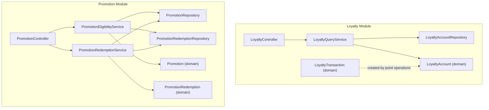
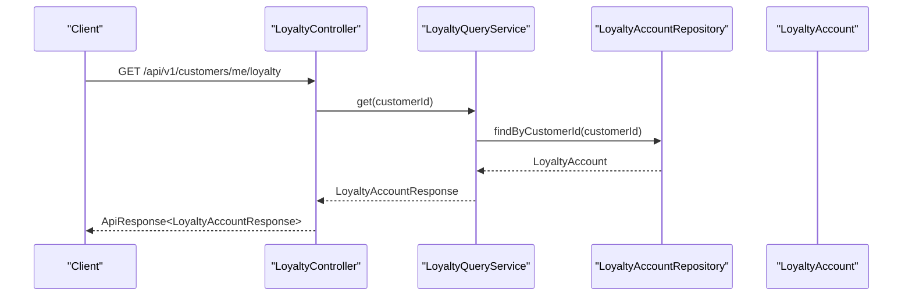
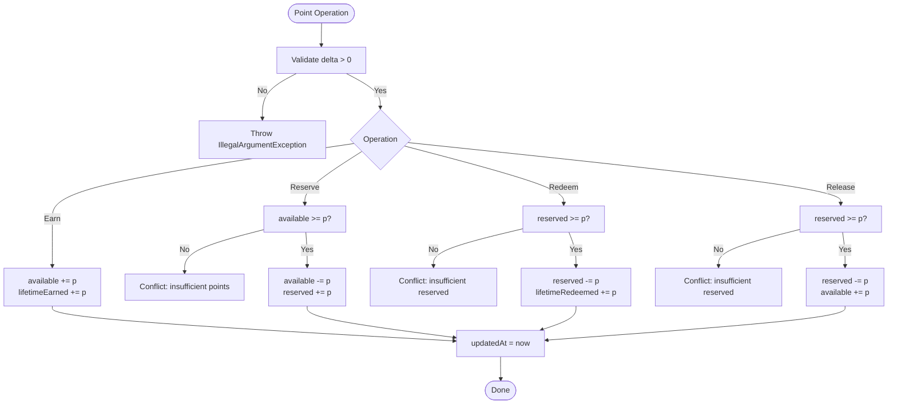
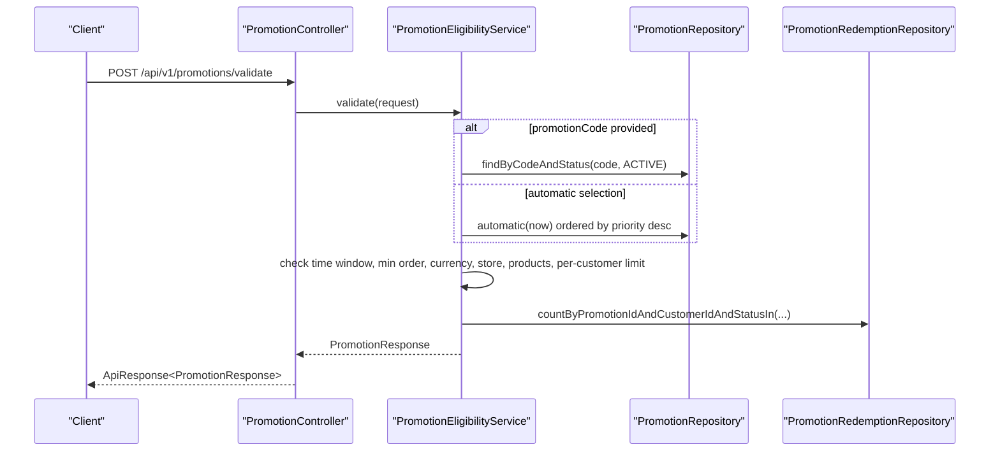
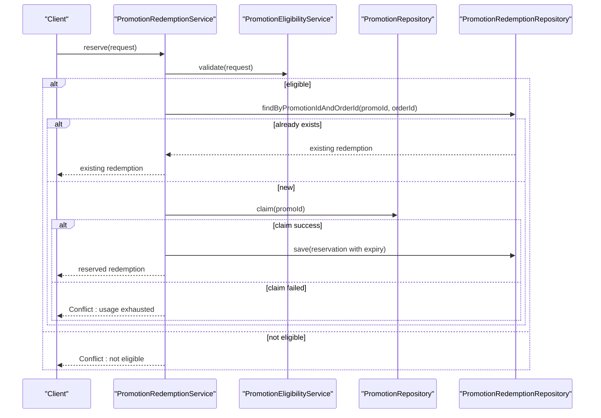
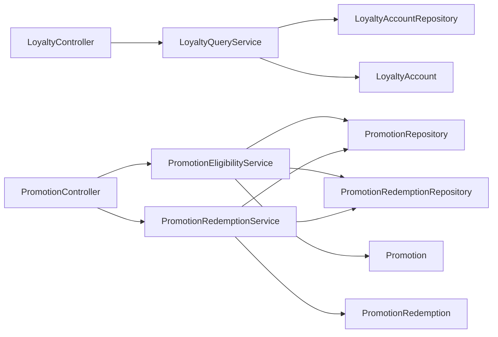

# Loyalty & Promotion API

<cite>
**Referenced Files in This Document**
- [LoyaltyController.java](file://src/main/java/com/smartcoffee/modules/loyalty/api/LoyaltyController.java)
- [LoyaltyAccountResponse.java](file://src/main/java/com/smartcoffee/modules/loyalty/api/LoyaltyAccountResponse.java)
- [LoyaltyQueryService.java](file://src/main/java/com/smartcoffee/modules/loyalty/application/LoyaltyQueryService.java)
- [LoyaltyAccount.java](file://src/main/java/com/smartcoffee/modules/loyalty/domain/LoyaltyAccount.java)
- [LoyaltyTransaction.java](file://src/main/java/com/smartcoffee/modules/loyalty/domain/LoyaltyTransaction.java)
- [LoyaltyAccountRepository.java](file://src/main/java/com/smartcoffee/modules/loyalty/persistence/LoyaltyAccountRepository.java)
- [PromotionController.java](file://src/main/java/com/smartcoffee/modules/promotion/api/PromotionController.java)
- [PromotionValidationRequest.java](file://src/main/java/com/smartcoffee/modules/promotion/api/PromotionValidationRequest.java)
- [PromotionResponse.java](file://src/main/java/com/smartcoffee/modules/promotion/api/PromotionResponse.java)
- [PromotionEligibilityService.java](file://src/main/java/com/smartcoffee/modules/promotion/application/PromotionEligibilityService.java)
- [PromotionRedemptionService.java](file://src/main/java/com/smartcoffee/modules/promotion/application/PromotionRedemptionService.java)
- [Promotion.java](file://src/main/java/com/smartcoffee/modules/promotion/domain/Promotion.java)
- [PromotionRedemption.java](file://src/main/java/com/smartcoffee/modules/promotion/domain/PromotionRedemption.java)
- [PromotionRepository.java](file://src/main/java/com/smartcoffee/modules/promotion/persistence/PromotionRepository.java)
- [PromotionRedemptionRepository.java](file://src/main/java/com/smartcoffee/modules/promotion/persistence/PromotionRedemptionRepository.java)
</cite>

## Table of Contents
1. Introduction
2. Project Structure
3. Core Components
4. Architecture Overview
5. Detailed Component Analysis
6. Dependency Analysis
7. Performance Considerations
8. Troubleshooting Guide
9. Conclusion

## Introduction
This document provides comprehensive API documentation for the loyalty program and promotion management features. It covers:
- Loyalty account balance queries
- Points calculation rules and transaction tracking
- Promotion eligibility checking
- Promotion reservation and redemption workflows
It also includes response schemas for LoyaltyAccountResponse and PromotionResponse, along with examples of usage flows.

## Project Structure
The loyalty and promotion capabilities are implemented as separate modules under src/main/java/com/smartcoffee/modules:
- Loyalty module: controllers, services, domain entities, and repositories for points accounts and transactions
- Promotion module: controllers, services, domain entities, and repositories for promotions and redemptions

**Diagram sources**
- [LoyaltyController.java:10-27](file://src/main/java/com/smartcoffee/modules/loyalty/api/LoyaltyController.java#L10-L27)
- [LoyaltyQueryService.java:10-24](file://src/main/java/com/smartcoffee/modules/loyalty/application/LoyaltyQueryService.java#L10-L24)
- [LoyaltyAccount.java:8-31](file://src/main/java/com/smartcoffee/modules/loyalty/domain/LoyaltyAccount.java#L8-L31)
- [LoyaltyTransaction.java:7-31](file://src/main/java/com/smartcoffee/modules/loyalty/domain/LoyaltyTransaction.java#L7-L31)
- [LoyaltyAccountRepository.java:9-15](file://src/main/java/com/smartcoffee/modules/loyalty/persistence/LoyaltyAccountRepository.java#L9-L15)
- [PromotionController.java:9-21](file://src/main/java/com/smartcoffee/modules/promotion/api/PromotionController.java#L9-L21)
- [PromotionEligibilityService.java:12-38](file://src/main/java/com/smartcoffee/modules/promotion/application/PromotionEligibilityService.java#L12-L38)
- [PromotionRedemptionService.java:12-52](file://src/main/java/com/smartcoffee/modules/promotion/application/PromotionRedemptionService.java#L12-L52)
- [Promotion.java:8-49](file://src/main/java/com/smartcoffee/modules/promotion/domain/Promotion.java#L8-L49)
- [PromotionRedemption.java:9-40](file://src/main/java/com/smartcoffee/modules/promotion/domain/PromotionRedemption.java#L9-L40)
- [PromotionRepository.java:10-26](file://src/main/java/com/smartcoffee/modules/promotion/persistence/PromotionRepository.java#L10-L26)
- [PromotionRedemptionRepository.java:7-14](file://src/main/java/com/smartcoffee/modules/promotion/persistence/PromotionRedemptionRepository.java#L7-L14)

## Core Components
- Loyalty endpoints:
  - GET /api/v1/customers/me/loyalty returns the authenticated customer’s loyalty account balance and lifetime metrics.
- Promotion endpoints:
  - POST /api/v1/promotions/validate checks eligibility and calculates discount amount for a given order context.
  - Reservation and redemption are performed via application services; controllers expose validation while reservation/redemption can be integrated into checkout flows.

Key response schemas:
- LoyaltyAccountResponse: accountId, customerId, availablePoints, reservedPoints, lifetimeEarnedPoints, lifetimeRedeemedPoints, version
- PromotionResponse: promotionId, code, name, eligible, discountAmount, currencyCode, reason

**Section sources**
- [LoyaltyController.java:10-27](file://src/main/java/com/smartcoffee/modules/loyalty/api/LoyaltyController.java#L10-L27)
- [LoyaltyAccountResponse.java:5-6](file://src/main/java/com/smartcoffee/modules/loyalty/api/LoyaltyAccountResponse.java#L5-L6)
- [PromotionController.java:9-21](file://src/main/java/com/smartcoffee/modules/promotion/api/PromotionController.java#L9-L21)
- [PromotionResponse.java:6-7](file://src/main/java/com/smartcoffee/modules/promotion/api/PromotionResponse.java#L6-L7)

## Architecture Overview
The system follows a layered design:
- Controllers handle HTTP requests and map to application services
- Application services implement business logic (eligibility, redemption, querying)
- Domain models encapsulate state and behavior
- Repositories provide persistence access

**Diagram sources**
- [LoyaltyController.java:23-27](file://src/main/java/com/smartcoffee/modules/loyalty/api/LoyaltyController.java#L23-L27)
- [LoyaltyQueryService.java:18-24](file://src/main/java/com/smartcoffee/modules/loyalty/application/LoyaltyQueryService.java#L18-L24)
- [LoyaltyAccountRepository.java:14-14](file://src/main/java/com/smartcoffee/modules/loyalty/persistence/LoyaltyAccountRepository.java#L14-L14)
- [LoyaltyAccount.java:78-104](file://src/main/java/com/smartcoffee/modules/loyalty/domain/LoyaltyAccount.java#L78-L104)

## Detailed Component Analysis

### Loyalty Account Balance Query
- Endpoint: GET /api/v1/customers/me/loyalty
- Behavior:
  - Resolves the current customer from the security context
  - Queries the loyalty account by customer ID
  - Returns a read-only DTO containing balances and lifetime totals

Response schema: LoyaltyAccountResponse
- accountId: UUID
- customerId: UUID
- availablePoints: long
- reservedPoints: long
- lifetimeEarnedPoints: long
- lifetimeRedeemedPoints: long
- version: long

Example usage flow:
- Client calls the endpoint to display current points and lifetime stats in the user profile.

**Section sources**
- [LoyaltyController.java:23-27](file://src/main/java/com/smartcoffee/modules/loyalty/api/LoyaltyController.java#L23-L27)
- [LoyaltyQueryService.java:18-24](file://src/main/java/com/smartcoffee/modules/loyalty/application/LoyaltyQueryService.java#L18-L24)
- [LoyaltyAccountResponse.java:5-6](file://src/main/java/com/smartcoffee/modules/loyalty/api/LoyaltyAccountResponse.java#L5-L6)

### Points Calculation and Transaction Tracking
Domain model: LoyaltyAccount
- earn(p): increases available and lifetime earned
- reserve(p): moves points from available to reserved (requires sufficient available)
- redeem(p): converts reserved to redeemed (requires sufficient reserved)
- release(p): returns reserved back to available (cancellation path)

Rules:
- All point deltas must be positive
- Insufficient funds or reservations raise conflict errors
- Each mutation updates updatedAt timestamp and is versioned

Transaction tracking:
- LoyaltyTransaction records each change with before/after balances, delta, type, orderId, sourceEventId, and occurredAt
- Transaction numbers follow a stable prefix format

**Diagram sources**
- [LoyaltyAccount.java:46-76](file://src/main/java/com/smartcoffee/modules/loyalty/domain/LoyaltyAccount.java#L46-L76)
- [LoyaltyTransaction.java:36-50](file://src/main/java/com/smartcoffee/modules/loyalty/domain/LoyaltyTransaction.java#L36-L50)

**Section sources**
- [LoyaltyAccount.java:46-76](file://src/main/java/com/smartcoffee/modules/loyalty/domain/LoyaltyAccount.java#L46-L76)
- [LoyaltyTransaction.java:7-50](file://src/main/java/com/smartcoffee/modules/loyalty/domain/LoyaltyTransaction.java#L7-L50)

### Promotion Eligibility Checking
Endpoint: POST /api/v1/promotions/validate
Input schema: PromotionValidationRequest
- storeId: UUID (required)
- customerId: UUID (required)
- orderId: UUID (required)
- promotionCode: String (optional; if null, automatic promotions are considered)
- subtotal: BigDecimal >= 0 (required)
- currencyCode: String (required)
- productIds: List<UUID> (optional)
- categoryIds: List<UUID> (optional)

Behavior:
- If promotionCode is provided, look up active promotion by code
- Otherwise, select the highest-priority automatic promotion that is currently active
- Validate eligibility:
  - Time window: startsAt <= now < endsAt and status ACTIVE
  - Minimum order amount: subtotal >= minimumOrderAmount
  - Currency match: promotion.currency == request.currencyCode (if set)
  - Store eligibility: promotion applies to the store (or no store restriction)
  - Product eligibility: promotion applies to any product in request.productIds (or no product restriction)
  - Per-customer limit: count of current/reserved redemptions per customer < perCustomerLimit
- Compute discount using Promotion.discount(subtotal), capped by maximumDiscountAmount and subtotal

Response schema: PromotionResponse
- promotionId: UUID (null if not found)
- code: String
- name: String
- eligible: boolean
- discountAmount: BigDecimal
- currencyCode: String
- reason: String (e.g., PROMOTION_NOT_FOUND, PROMOTION_NOT_ELIGIBLE)

**Diagram sources**
- [PromotionController.java:18-21](file://src/main/java/com/smartcoffee/modules/promotion/api/PromotionController.java#L18-L21)
- [PromotionEligibilityService.java:24-58](file://src/main/java/com/smartcoffee/modules/promotion/application/PromotionEligibilityService.java#L24-L58)
- [PromotionRepository.java:11-18](file://src/main/java/com/smartcoffee/modules/promotion/persistence/PromotionRepository.java#L11-L18)
- [PromotionRedemptionRepository.java:8-9](file://src/main/java/com/smartcoffee/modules/promotion/persistence/PromotionRedemptionRepository.java#L8-L9)

**Section sources**
- [PromotionController.java:18-21](file://src/main/java/com/smartcoffee/modules/promotion/api/PromotionController.java#L18-L21)
- [PromotionValidationRequest.java:7-9](file://src/main/java/com/smartcoffee/modules/promotion/api/PromotionValidationRequest.java#L7-L9)
- [PromotionEligibilityService.java:24-58](file://src/main/java/com/smartcoffee/modules/promotion/application/PromotionEligibilityService.java#L24-L58)
- [PromotionResponse.java:6-7](file://src/main/java/com/smartcoffee/modules/promotion/api/PromotionResponse.java#L6-L7)
- [Promotion.java:66-75](file://src/main/java/com/smartcoffee/modules/promotion/domain/Promotion.java#L66-L75)

### Promotion Redemption Workflow
Services:
- PromotionRedemptionService.reserve(request):
  - Re-validates eligibility
  - Idempotency: if a redemption already exists for the same promotion and order, return it
  - Atomically claims one usage slot on the promotion
  - Creates a reserved redemption with an expiration time (15 minutes)
- PromotionRedemptionService.releaseForOrder(order):
  - Releases all reserved redemptions for the order and releases promotion claim slots
- PromotionRedemptionService.redeemForOrder(order):
  - Marks reserved redemptions as redeemed

Domain: PromotionRedemption
- States: RESERVED -> REDEEMED or RELEASED
- Enforces transitions and timestamps

**Diagram sources**
- [PromotionRedemptionService.java:25-36](file://src/main/java/com/smartcoffee/modules/promotion/application/PromotionRedemptionService.java#L25-L36)
- [PromotionEligibilityService.java:24-38](file://src/main/java/com/smartcoffee/modules/promotion/application/PromotionEligibilityService.java#L24-L38)
- [PromotionRepository.java:20-26](file://src/main/java/com/smartcoffee/modules/promotion/persistence/PromotionRepository.java#L20-L26)
- [PromotionRedemptionRepository.java:11-11](file://src/main/java/com/smartcoffee/modules/promotion/persistence/PromotionRedemptionRepository.java#L11-L11)
- [PromotionRedemption.java:45-59](file://src/main/java/com/smartcoffee/modules/promotion/domain/PromotionRedemption.java#L45-L59)

Usage examples:
- Checkout flow:
  1) Call POST /api/v1/promotions/validate to compute discount
  2) Call reserve to lock the promotion for the order
  3) On successful payment, call redeemForOrder
  4) On failure/cancellation, call releaseForOrder

**Section sources**
- [PromotionRedemptionService.java:25-52](file://src/main/java/com/smartcoffee/modules/promotion/application/PromotionRedemptionService.java#L25-L52)
- [PromotionRedemption.java:45-76](file://src/main/java/com/smartcoffee/modules/promotion/domain/PromotionRedemption.java#L45-L76)

## Dependency Analysis
Key dependencies and relationships:
- LoyaltyController depends on LoyaltyQueryService and security resolvers
- LoyaltyQueryService depends on LoyaltyAccountRepository and maps to LoyaltyAccount
- PromotionController depends on PromotionEligibilityService
- PromotionEligibilityService depends on PromotionRepository, PromotionRedemptionRepository, and uses JdbcTemplate for store/product eligibility checks
- PromotionRedemptionService depends on PromotionEligibilityService, PromotionRepository, and PromotionRedemptionRepository

**Diagram sources**
- [LoyaltyController.java:10-27](file://src/main/java/com/smartcoffee/modules/loyalty/api/LoyaltyController.java#L10-L27)
- [LoyaltyQueryService.java:10-24](file://src/main/java/com/smartcoffee/modules/loyalty/application/LoyaltyQueryService.java#L10-L24)
- [PromotionController.java:9-21](file://src/main/java/com/smartcoffee/modules/promotion/api/PromotionController.java#L9-L21)
- [PromotionEligibilityService.java:12-38](file://src/main/java/com/smartcoffee/modules/promotion/application/PromotionEligibilityService.java#L12-L38)
- [PromotionRedemptionService.java:12-52](file://src/main/java/com/smartcoffee/modules/promotion/application/PromotionRedemptionService.java#L12-L52)

**Section sources**
- [LoyaltyController.java:10-27](file://src/main/java/com/smartcoffee/modules/loyalty/api/LoyaltyController.java#L10-L27)
- [PromotionController.java:9-21](file://src/main/java/com/smartcoffee/modules/promotion/api/PromotionController.java#L9-L21)

## Performance Considerations
- Read-heavy queries:
  - Loyalty account balance query is read-only and uses a simple repository lookup
- Concurrency control:
  - Promotion claim/release use optimistic concurrency via versioning and atomic SQL updates
  - Redemptions are idempotent per promotion+order pair
- Eligibility checks:
  - Store and product eligibility use direct SQL checks; ensure appropriate indexes on foreign keys and filters
- Caching:
  - No caching is applied at the service layer; consider caching static promotion metadata if needed

[No sources needed since this section provides general guidance]

## Troubleshooting Guide
Common issues and resolutions:
- Insufficient points:
  - Occurs when attempting to reserve/redeem more points than available/reserved
  - Resolution: Ensure sufficient available or reserved points before calling point operations
- Reserved points conflict:
  - Occurs when releasing or redeeming more points than reserved
  - Resolution: Verify reservation state before release/redeem
- Promotion not found:
  - Returned when the code does not exist or is not active
  - Resolution: Verify promotion code and status
- Promotion not eligible:
  - Reasons include time window, minimum order amount, currency mismatch, store/product restrictions, or per-customer limit exceeded
  - Resolution: Adjust order context or promotion configuration
- Usage exhausted:
  - Occurs when trying to reserve a promotion whose usage limit has been reached
  - Resolution: Use another promotion or wait for usage to free up

**Section sources**
- [LoyaltyAccount.java:46-76](file://src/main/java/com/smartcoffee/modules/loyalty/domain/LoyaltyAccount.java#L46-L76)
- [PromotionEligibilityService.java:24-58](file://src/main/java/com/smartcoffee/modules/promotion/application/PromotionEligibilityService.java#L24-L58)
- [PromotionRedemptionService.java:25-36](file://src/main/java/com/smartcoffee/modules/promotion/application/PromotionRedemptionService.java#L25-L36)

## Conclusion
The loyalty and promotion APIs provide robust support for points-based rewards and flexible promotional discounts. The loyalty module tracks balances and lifetime metrics with clear transactional semantics, while the promotion module enforces eligibility rules and safe reservation/redemption workflows. Together, they enable reliable reward and discount application across the ordering lifecycle.