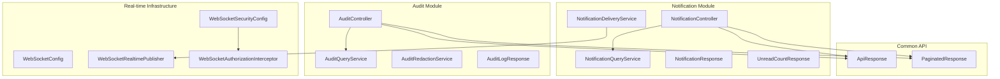
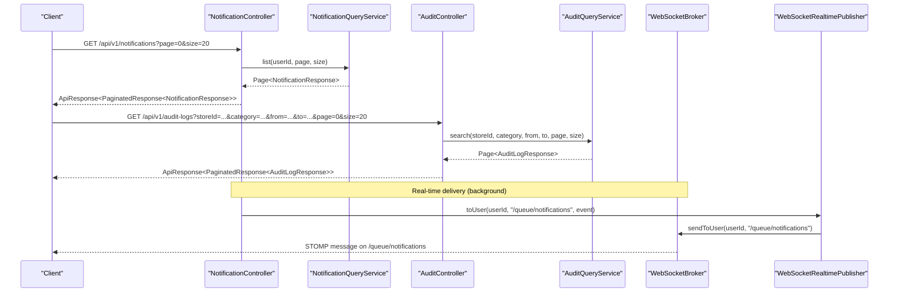
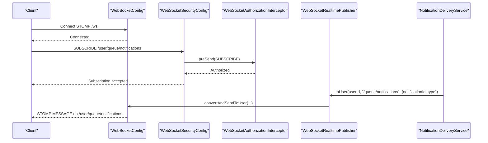
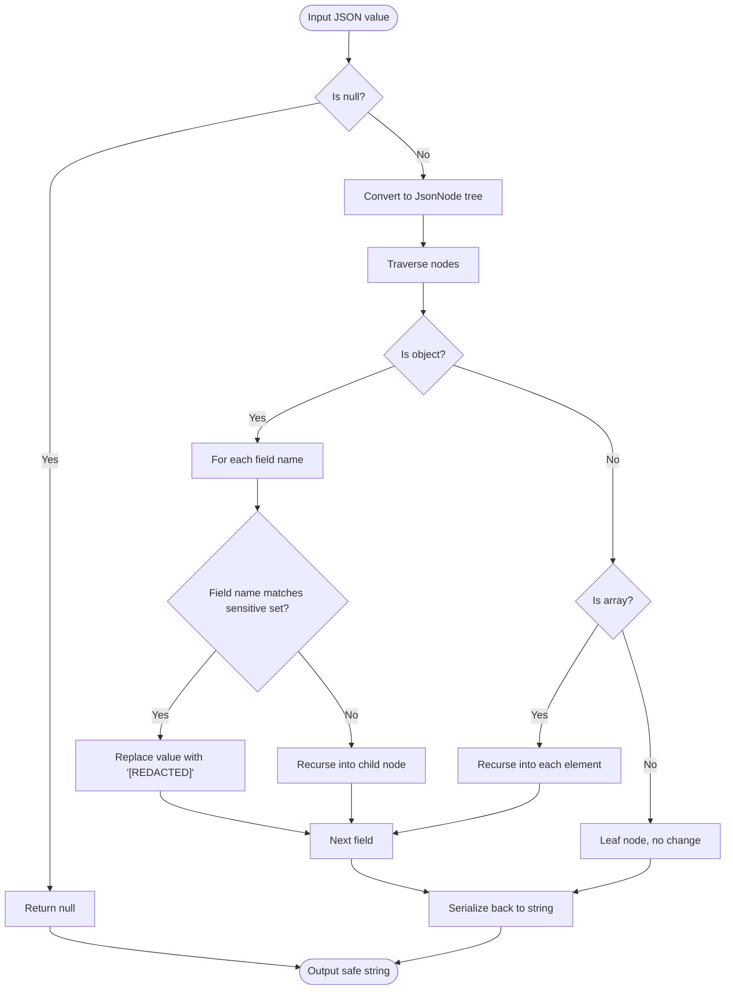
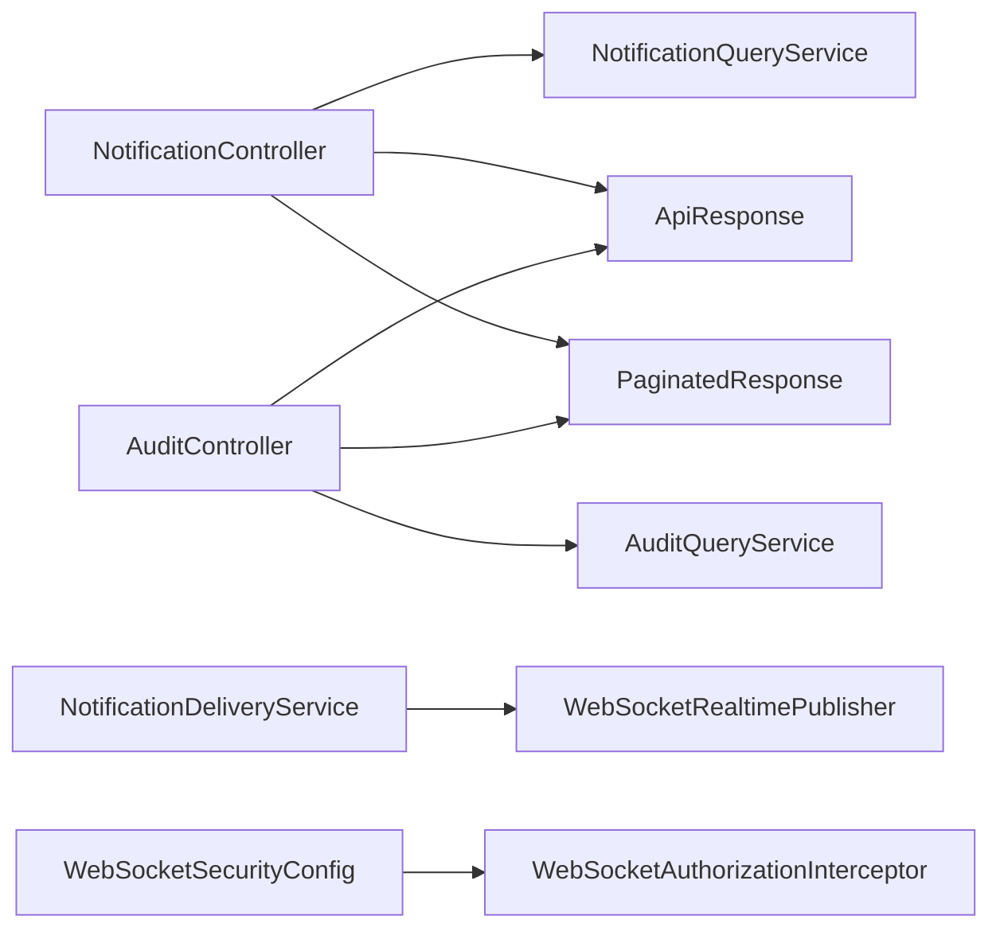

# Notification & Audit API

<cite>
**Referenced Files in This Document**
- [NotificationController.java](file://src/main/java/com/smartcoffee/modules/notification/api/NotificationController.java)
- [NotificationResponse.java](file://src/main/java/com/smartcoffee/modules/notification/api/NotificationResponse.java)
- [UnreadCountResponse.java](file://src/main/java/com/smartcoffee/modules/notification/api/UnreadCountResponse.java)
- [NotificationQueryService.java](file://src/main/java/com/smartcoffee/modules/notification/application/NotificationQueryService.java)
- [NotificationDeliveryService.java](file://src/main/java/com/smartcoffee/modules/notification/application/NotificationDeliveryService.java)
- [AuditController.java](file://src/main/java/com/smartcoffee/modules/audit/api/AuditController.java)
- [AuditLogResponse.java](file://src/main/java/com/smartcoffee/modules/audit/api/AuditLogResponse.java)
- [AuditQueryService.java](file://src/main/java/com/smartcoffee/modules/audit/application/AuditQueryService.java)
- [AuditRedactionService.java](file://src/main/java/com/smartcoffee/modules/audit/application/AuditRedactionService.java)
- [WebSocketConfig.java](file://src/main/java/com/smartcoffee/config/WebSocketConfig.java)
- [WebSocketSecurityConfig.java](file://src/main/java/com/smartcoffee/config/WebSocketSecurityConfig.java)
- [WebSocketRealtimePublisher.java](file://src/main/java/com/smartcoffee/infrastructure/realtime/WebSocketRealtimePublisher.java)
- [WebSocketAuthorizationInterceptor.java](file://src/main/java/com/smartcoffee/infrastructure/realtime/WebSocketAuthorizationInterceptor.java)
- [ApiResponse.java](file://src/main/java/com/smartcoffee/common/api/ApiResponse.java)
- [PaginatedResponse.java](file://src/main/java/com/smartcoffee/common/api/PaginatedResponse.java)
</cite>

## Table of Contents
1. [Introduction](#introduction)
2. [Project Structure](#project-structure)
3. [Core Components](#core-components)
4. [Architecture Overview](#architecture-overview)
5. [Detailed Component Analysis](#detailed-component-analysis)
6. [Dependency Analysis](#dependency-analysis)
7. [Performance Considerations](#performance-considerations)
8. [Troubleshooting Guide](#troubleshooting-guide)
9. [Conclusion](#conclusion)

## Introduction
This document provides detailed API documentation for the notification and audit logging capabilities of the Smart Coffee backend. It covers:
- Retrieving notifications and marking them as read
- Querying unread notification counts
- Accessing audit logs with filtering and pagination
- Real-time delivery of notifications via WebSocket
- Audit log redaction for sensitive data
- Security auditing and compliance reporting patterns

The APIs are RESTful, use standard HTTP methods, and return a consistent envelope for success responses. Pagination is supported for list endpoints.

## Project Structure
The relevant code is organized by feature modules:
- Notification module: controllers, application services, domain entities, persistence, and delivery logic
- Audit module: controllers, query service, domain entity, and redaction utility
- Real-time infrastructure: WebSocket configuration, security interceptors, and publisher
- Common API types: response envelope and pagination wrapper

**Diagram sources**
- [NotificationController.java:11-47](file://src/main/java/com/smartcoffee/modules/notification/api/NotificationController.java#L11-L47)
- [NotificationQueryService.java:11-44](file://src/main/java/com/smartcoffee/modules/notification/application/NotificationQueryService.java#L11-L44)
- [NotificationDeliveryService.java:13-65](file://src/main/java/com/smartcoffee/modules/notification/application/NotificationDeliveryService.java#L13-L65)
- [AuditController.java:12-41](file://src/main/java/com/smartcoffee/modules/audit/api/AuditController.java#L12-L41)
- [AuditQueryService.java:11-30](file://src/main/java/com/smartcoffee/modules/audit/application/AuditQueryService.java#L11-L30)
- [AuditRedactionService.java:11-73](file://src/main/java/com/smartcoffee/modules/audit/application/AuditRedactionService.java#L11-L73)
- [WebSocketConfig.java:7-18](file://src/main/java/com/smartcoffee/config/WebSocketConfig.java#L7-L18)
- [WebSocketSecurityConfig.java:9-34](file://src/main/java/com/smartcoffee/config/WebSocketSecurityConfig.java#L9-L34)
- [WebSocketRealtimePublisher.java:1-4](file://src/main/java/com/smartcoffee/infrastructure/realtime/WebSocketRealtimePublisher.java#L1-L4)
- [WebSocketAuthorizationInterceptor.java:10-37](file://src/main/java/com/smartcoffee/infrastructure/realtime/WebSocketAuthorizationInterceptor.java#L10-L37)
- [ApiResponse.java:5-8](file://src/main/java/com/smartcoffee/common/api/ApiResponse.java#L5-L8)
- [PaginatedResponse.java:5-7](file://src/main/java/com/smartcoffee/common/api/PaginatedResponse.java#L5-L7)

**Section sources**
- [NotificationController.java:11-47](file://src/main/java/com/smartcoffee/modules/notification/api/NotificationController.java#L11-L47)
- [AuditController.java:12-41](file://src/main/java/com/smartcoffee/modules/audit/api/AuditController.java#L12-L41)
- [WebSocketConfig.java:7-18](file://src/main/java/com/smartcoffee/config/WebSocketConfig.java#L7-L18)
- [WebSocketSecurityConfig.java:9-34](file://src/main/java/com/smartcoffee/config/WebSocketSecurityConfig.java#L9-L34)

## Core Components
- NotificationController: Exposes endpoints to list notifications, get unread count, mark single or all notifications as read.
- NotificationQueryService: Implements business logic for listing, counting, and updating read status.
- NotificationDeliveryService: Scheduled worker that delivers notifications via WebSocket, push, email, or in-app channels.
- AuditController: Exposes search endpoint for audit logs with authorization checks and store scoping.
- AuditQueryService: Applies default time ranges, enforces maximum range size, and maps domain to response DTOs.
- AuditRedactionService: Redacts sensitive fields from JSON payloads before they are persisted or exposed.
- WebSocket infrastructure: Configures STOMP broker, authorizes subscriptions, and publishes events to users/stores.

**Section sources**
- [NotificationController.java:11-47](file://src/main/java/com/smartcoffee/modules/notification/api/NotificationController.java#L11-L47)
- [NotificationQueryService.java:11-44](file://src/main/java/com/smartcoffee/modules/notification/application/NotificationQueryService.java#L11-L44)
- [NotificationDeliveryService.java:13-65](file://src/main/java/com/smartcoffee/modules/notification/application/NotificationDeliveryService.java#L13-L65)
- [AuditController.java:12-41](file://src/main/java/com/smartcoffee/modules/audit/api/AuditController.java#L12-L41)
- [AuditQueryService.java:11-30](file://src/main/java/com/smartcoffee/modules/audit/application/AuditQueryService.java#L11-L30)
- [AuditRedactionService.java:11-73](file://src/main/java/com/smartcoffee/modules/audit/application/AuditRedactionService.java#L11-L73)
- [WebSocketConfig.java:7-18](file://src/main/java/com/smartcoffee/config/WebSocketConfig.java#L7-L18)
- [WebSocketSecurityConfig.java:9-34](file://src/main/java/com/smartcoffee/config/WebSocketSecurityConfig.java#L9-L34)

## Architecture Overview
The system exposes REST endpoints for clients to manage notifications and inspect audit logs. Notifications can be delivered in real time over WebSocket using STOMP. Audit logs are secured by permissions and store-level authorization. Sensitive data in audit payloads is redacted automatically.

**Diagram sources**
- [NotificationController.java:22-47](file://src/main/java/com/smartcoffee/modules/notification/api/NotificationController.java#L22-L47)
- [NotificationQueryService.java:19-44](file://src/main/java/com/smartcoffee/modules/notification/application/NotificationQueryService.java#L19-L44)
- [AuditController.java:28-41](file://src/main/java/com/smartcoffee/modules/audit/api/AuditController.java#L28-L41)
- [AuditQueryService.java:19-30](file://src/main/java/com/smartcoffee/modules/audit/application/AuditQueryService.java#L19-L30)
- [WebSocketRealtimePublisher.java:1-4](file://src/main/java/com/smartcoffee/infrastructure/realtime/WebSocketRealtimePublisher.java#L1-L4)

## Detailed Component Analysis

### Notification Endpoints
Base path: /api/v1/notifications

- List notifications
  - Method: GET
  - Path: /api/v1/notifications
  - Query parameters:
    - page: integer, default 0
    - size: integer, default 20, capped at 100
  - Success response: ApiResponse<PaginatedResponse<NotificationResponse>>
  - Notes: Results are ordered by creation date descending. Only non-archived notifications are returned.

- Get unread count
  - Method: GET
  - Path: /api/v1/notifications/unread-count
  - Success response: ApiResponse<UnreadCountResponse>

- Mark notification as read
  - Method: PATCH
  - Path: /api/v1/notifications/{id}/read
  - Path parameter: id (UUID)
  - Success response: ApiResponse<Void>

- Mark all notifications as read
  - Method: PATCH
  -Path: /api/v1/notifications/read-all
  - Success response: ApiResponse<Void>

Response schemas:
- NotificationResponse
  - Fields:
    - notificationRecipientId: UUID
    - notificationId: UUID
    - type: string
    - category: string
    - messageKey: string
    - templateArguments: string
    - actionUrl: string
    - priority: string
    - createdAt: timestamp (ISO instant)
    - readAt: timestamp (ISO instant)

- UnreadCountResponse
  - Fields:
    - unreadCount: long

Example usage:
- Retrieve first page of notifications: GET /api/v1/notifications?page=0&size=20
- Get unread count: GET /api/v1/notifications/unread-count
- Mark one notification as read: PATCH /api/v1/notifications/{id}/read
- Mark all notifications as read: PATCH /api/v1/notifications/read-all

Error handling:
- If a requested notification does not exist when marking as read, a resource-not-found error is raised.

**Section sources**
- [NotificationController.java:22-47](file://src/main/java/com/smartcoffee/modules/notification/api/NotificationController.java#L22-L47)
- [NotificationQueryService.java:19-44](file://src/main/java/com/smartcoffee/modules/notification/application/NotificationQueryService.java#L19-L44)
- [NotificationResponse.java:6-8](file://src/main/java/com/smartcoffee/modules/notification/api/NotificationResponse.java#L6-L8)
- [UnreadCountResponse.java:3-4](file://src/main/java/com/smartcoffee/modules/notification/api/UnreadCountResponse.java#L3-L4)
- [ApiResponse.java:5-8](file://src/main/java/com/smartcoffee/common/api/ApiResponse.java#L5-L8)
- [PaginatedResponse.java:5-7](file://src/main/java/com/smartcoffee/common/api/PaginatedResponse.java#L5-L7)

### Audit Log Endpoints
Base path: /api/v1/audit-logs

- Search audit logs
  - Method: GET
  - Path: /api/v1/audit-logs
  - Query parameters:
    - storeId: optional UUID
    - category: optional string
    - from: optional timestamp (ISO instant)
    - to: optional timestamp (ISO instant)
    - page: integer, default 0
    - size: integer, default 20, capped at 100
  - Authorization: Requires AUDIT_READ permission; if storeId is provided, caller must have access to that store
  - Success response: ApiResponse<PaginatedResponse<AuditLogResponse>>

Response schema:
- AuditLogResponse
  - Fields:
    - auditLogId: long
    - occurredAt: timestamp (ISO instant)
    - actorUserId: UUID
    - storeId: UUID
    - action: string
    - category: string
    - aggregateType: string
    - aggregateId: UUID
    - outcome: string
    - reason: string
    - requestId: string

Validation rules:
- Default time window: if from/to are omitted, defaults to last 30 days
- Maximum range: queries spanning more than 366 days are rejected

Example usage:
- Search recent logs for a store: GET /api/v1/audit-logs?storeId={storeId}&category=ORDER&page=0&size=20

**Section sources**
- [AuditController.java:28-41](file://src/main/java/com/smartcoffee/modules/audit/api/AuditController.java#L28-L41)
- [AuditQueryService.java:19-30](file://src/main/java/com/smartcoffee/modules/audit/application/AuditQueryService.java#L19-L30)
- [AuditLogResponse.java:6-7](file://src/main/java/com/smartcoffee/modules/audit/api/AuditLogResponse.java#L6-L7)
- [ApiResponse.java:5-8](file://src/main/java/com/smartcoffee/common/api/ApiResponse.java#L5-L8)
- [PaginatedResponse.java:5-7](file://src/main/java/com/smartcoffee/common/api/PaginatedResponse.java#L5-L7)

### Real-time Notification Delivery via WebSocket
Overview:
- The server enables a STOMP-based WebSocket broker under /ws.
- Clients subscribe to user-scoped destinations like /user/queue/notifications.
- Background delivery pushes lightweight events to connected clients.

Configuration:
- Broker prefixes: /topic, /queue
- User destination prefix: /user
- Application destination prefix: /app
- Endpoint: /ws

Security:
- Subscriptions are intercepted and validated against the current authenticated actor.
- Store-scoped topics require store access; user-scoped destinations must match the authenticated user.

Publisher:
- Events are sent to specific users or stores using the realtime publisher abstraction.

**Diagram sources**
- [WebSocketConfig.java:10-18](file://src/main/java/com/smartcoffee/config/WebSocketConfig.java#L10-L18)
- [WebSocketSecurityConfig.java:22-34](file://src/main/java/com/smartcoffee/config/WebSocketSecurityConfig.java#L22-L34)
- [WebSocketAuthorizationInterceptor.java:18-36](file://src/main/java/com/smartcoffee/infrastructure/realtime/WebSocketAuthorizationInterceptor.java#L18-L36)
- [WebSocketRealtimePublisher.java:1-4](file://src/main/java/com/smartcoffee/infrastructure/realtime/WebSocketRealtimePublisher.java#L1-L4)
- [NotificationDeliveryService.java:34-65](file://src/main/java/com/smartcoffee/modules/notification/application/NotificationDeliveryService.java#L34-L65)

### Audit Log Redaction and Security Auditing
Redaction:
- A dedicated service recursively traverses JSON structures and replaces sensitive field values with a placeholder.
- Sensitive field names include common secrets such as passwords, tokens, secrets, authorization headers, device tokens, and private keys.

Security auditing:
- Audit logs capture actor identity, store context, actions, categories, aggregates, outcomes, reasons, request identifiers, and source.
- Queries enforce permission checks and store authorization to ensure only authorized users can inspect logs.

**Diagram sources**
- [AuditRedactionService.java:31-73](file://src/main/java/com/smartcoffee/modules/audit/application/AuditRedactionService.java#L31-L73)

**Section sources**
- [AuditRedactionService.java:11-73](file://src/main/java/com/smartcoffee/modules/audit/application/AuditRedactionService.java#L11-L73)
- [AuditController.java:28-41](file://src/main/java/com/smartcoffee/modules/audit/api/AuditController.java#L28-L41)

## Dependency Analysis
The following diagram highlights key dependencies between controllers, services, and real-time components.

**Diagram sources**
- [NotificationController.java:11-47](file://src/main/java/com/smartcoffee/modules/notification/api/NotificationController.java#L11-L47)
- [NotificationQueryService.java:11-44](file://src/main/java/com/smartcoffee/modules/notification/application/NotificationQueryService.java#L11-L44)
- [AuditController.java:12-41](file://src/main/java/com/smartcoffee/modules/audit/api/AuditController.java#L12-L41)
- [AuditQueryService.java:11-30](file://src/main/java/com/smartcoffee/modules/audit/application/AuditQueryService.java#L11-L30)
- [NotificationDeliveryService.java:13-65](file://src/main/java/com/smartcoffee/modules/notification/application/NotificationDeliveryService.java#L13-L65)
- [WebSocketSecurityConfig.java:9-34](file://src/main/java/com/smartcoffee/config/WebSocketSecurityConfig.java#L9-L34)
- [WebSocketAuthorizationInterceptor.java:10-37](file://src/main/java/com/smartcoffee/infrastructure/realtime/WebSocketAuthorizationInterceptor.java#L10-L37)
- [ApiResponse.java:5-8](file://src/main/java/com/smartcoffee/common/api/ApiResponse.java#L5-L8)
- [PaginatedResponse.java:5-7](file://src/main/java/com/smartcoffee/common/api/PaginatedResponse.java#L5-L7)

**Section sources**
- [NotificationController.java:11-47](file://src/main/java/com/smartcoffee/modules/notification/api/NotificationController.java#L11-L47)
- [AuditController.java:12-41](file://src/main/java/com/smartcoffee/modules/audit/api/AuditController.java#L12-L41)
- [NotificationDeliveryService.java:13-65](file://src/main/java/com/smartcoffee/modules/notification/application/NotificationDeliveryService.java#L13-L65)
- [WebSocketSecurityConfig.java:9-34](file://src/main/java/com/smartcoffee/config/WebSocketSecurityConfig.java#L9-L34)

## Performance Considerations
- Pagination limits: Both notification and audit endpoints cap page size at 100 to prevent excessive payloads.
- Time-range constraints: Audit queries restrict the span to a maximum of 366 days to avoid heavy scans.
- Default windows: Audit queries default to a 30-day window when not specified.
- Real-time delivery: Notification delivery runs on a scheduled interval and processes batches to reduce overhead.

[No sources needed since this section provides general guidance]

## Troubleshooting Guide
- Notification not found when marking as read:
  - Ensure the notification recipient exists for the current user.
  - Verify the ID corresponds to an active, non-archived notification.

- Audit query range errors:
  - If the from-to span exceeds 366 days, the request will be rejected. Narrow the time window.

- WebSocket subscription denied:
  - Ensure you are subscribed to your own user destination (/user/...).
  - For store-scoped topics, verify you have access to the target store.

- Missing permission for audit logs:
  - Confirm the current actor has AUDIT_READ permission.
  - If querying by store, confirm store-level authorization.

**Section sources**
- [NotificationQueryService.java:34-44](file://src/main/java/com/smartcoffee/modules/notification/application/NotificationQueryService.java#L34-L44)
- [AuditQueryService.java:19-30](file://src/main/java/com/smartcoffee/modules/audit/application/AuditQueryService.java#L19-L30)
- [WebSocketAuthorizationInterceptor.java:18-36](file://src/main/java/com/smartcoffee/infrastructure/realtime/WebSocketAuthorizationInterceptor.java#L18-L36)
- [AuditController.java:28-41](file://src/main/java/com/smartcoffee/modules/audit/api/AuditController.java#L28-L41)

## Conclusion
The Notification and Audit APIs provide robust, secure, and scalable capabilities for managing user notifications and maintaining auditable records. Real-time delivery via WebSocket ensures timely updates, while strict authorization and redaction mechanisms protect sensitive information. Use the documented endpoints and schemas to integrate client applications effectively.

[No sources needed since this section summarizes without analyzing specific files]