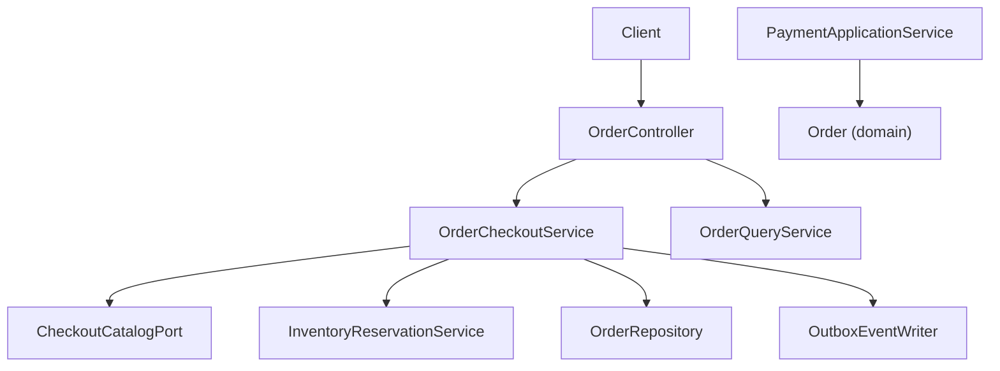
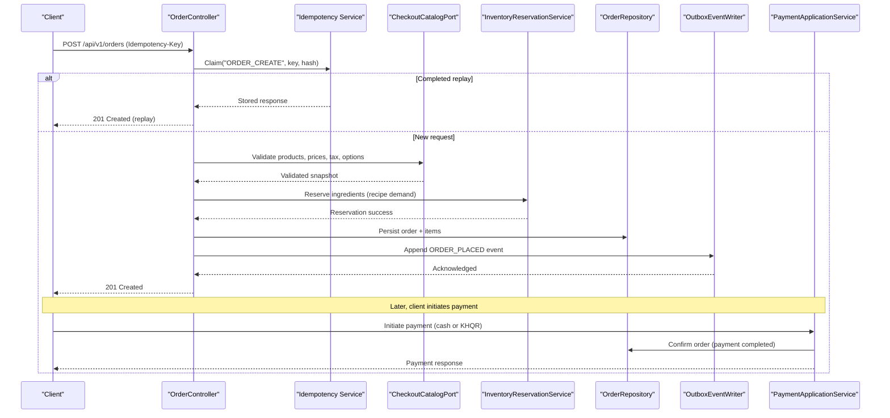
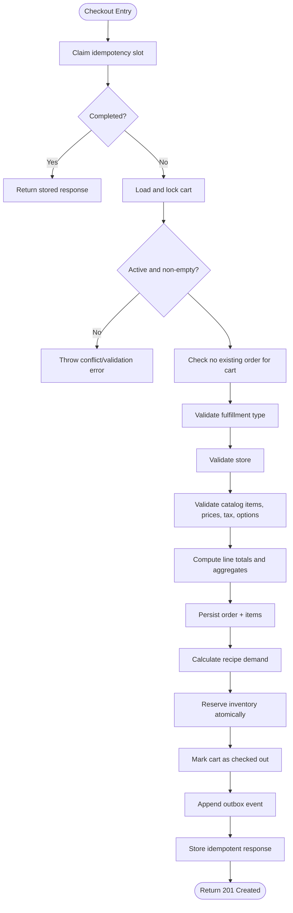
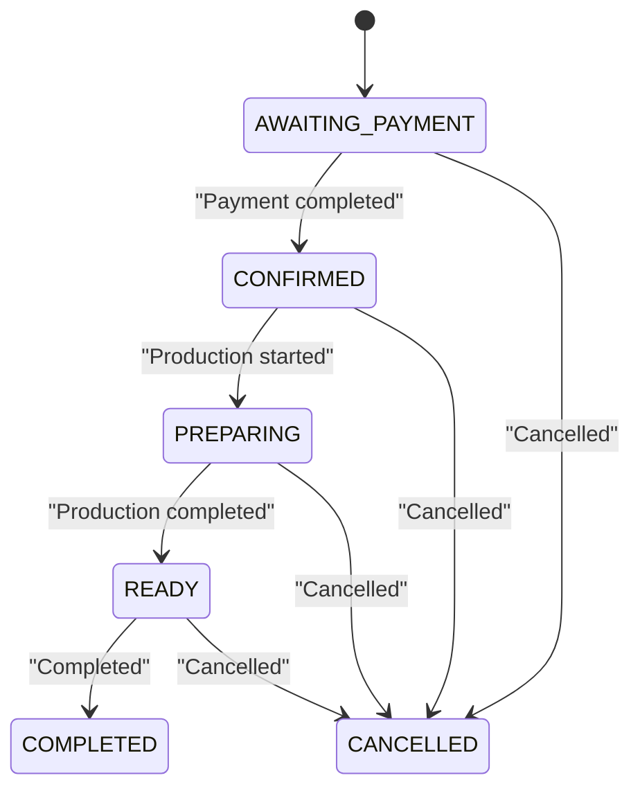
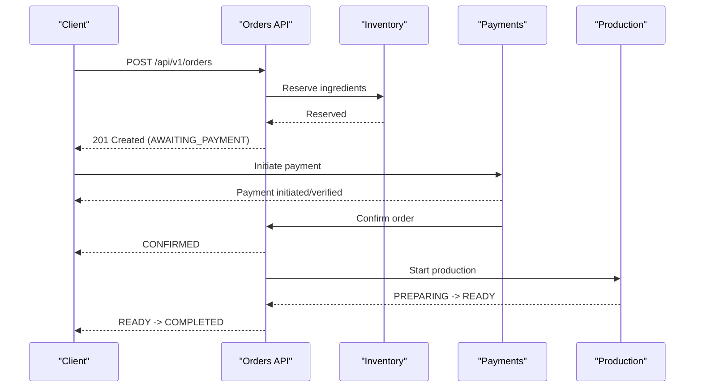
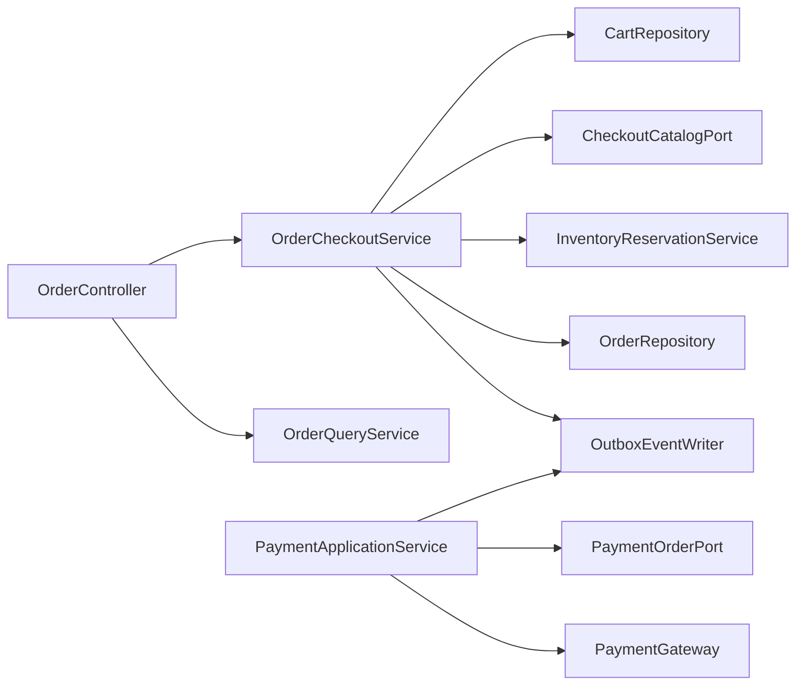
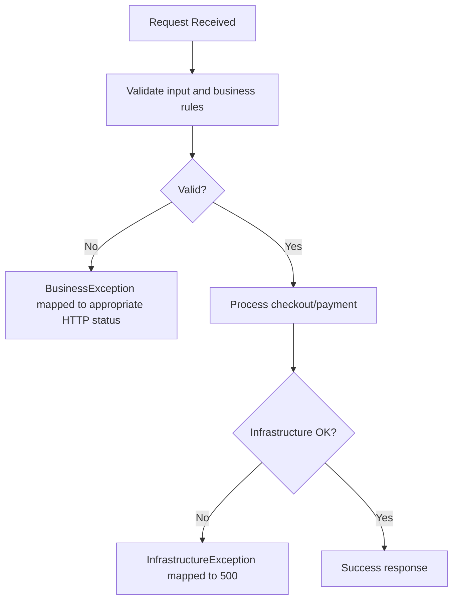

# Orders API

<cite>
**Referenced Files in This Document**
- [OrderController.java](file://src/main/java/com/smartcoffee/modules/ordering/api/OrderController.java)
- [CreateOrderRequest.java](file://src/main/java/com/smartcoffee/modules/ordering/api/CreateOrderRequest.java)
- [OrderResponse.java](file://src/main/java/com/smartcoffee/modules/ordering/api/OrderResponse.java)
- [OrderItemResponse.java](file://src/main/java/com/smartcoffee/modules/ordering/api/OrderItemResponse.java)
- [OrderCheckoutService.java](file://src/main/java/com/smartcoffee/modules/ordering/application/OrderCheckoutService.java)
- [OrderQueryService.java](file://src/main/java/com/smartcoffee/modules/ordering/application/OrderQueryService.java)
- [Order.java](file://src/main/java/com/smartcoffee/modules/ordering/domain/Order.java)
- [OrderStatus.java](file://src/main/java/com/smartcoffee/modules/ordering/domain/OrderStatus.java)
- [PaymentStatus.java](file://src/main/java/com/smartcoffee/modules/ordering/domain/PaymentStatus.java)
- [OrderItem.java](file://src/main/java/com/smartcoffee/modules/ordering/domain/OrderItem.java)
- [OrderRepository.java](file://src/main/java/com/smartcoffee/modules/ordering/persistence/OrderRepository.java)
- [InventoryReservationService.java](file://src/main/java/com/smartcoffee/modules/inventory/application/InventoryReservationService.java)
- [PaymentApplicationService.java](file://src/main/java/com/smartcoffee/modules/payment/application/PaymentApplicationService.java)
- [GlobalExceptionHandler.java](file://src/main/java/com/smartcoffee/common/api/GlobalExceptionHandler.java)
- [ORDER_FLOW.mermaid](file://architecture/ORDER_FLOW.mermaid)
</cite>

## Table of Contents
1. [Introduction](#introduction)
2. [Project Structure](#project-structure)
3. [Core Components](#core-components)
4. [Architecture Overview](#architecture-overview)
5. [Detailed Component Analysis](#detailed-component-analysis)
6. [Dependency Analysis](#dependency-analysis)
7. [Performance Considerations](#performance-considerations)
8. [Troubleshooting Guide](#troubleshooting-guide)
9. [Conclusion](#conclusion)

## Introduction
This document provides comprehensive API documentation for order management endpoints, focusing on:
- Creating an order from a cart
- Tracking order status and payment status
- Retrieving order history
- Cancelling orders
It also explains the checkout process, inventory reservation, payment initiation, and order status transitions, with examples of complete order lifecycles and error handling for failed scenarios.

## Project Structure
The Orders API is implemented as part of a modular monolith. The relevant pieces are:
- REST controller exposing order endpoints
- Application services orchestrating checkout, queries, and domain operations
- Domain models representing orders, items, statuses, and payment states
- Persistence layer for orders and related data
- Cross-cutting concerns like idempotency, outbox events, and global exception handling

**Diagram sources**
- [OrderController.java:13-40](file://src/main/java/com/smartcoffee/modules/ordering/api/OrderController.java#L13-L40)
- [OrderCheckoutService.java:28-60](file://src/main/java/com/smartcoffee/modules/ordering/application/OrderCheckoutService.java#L28-L60)
- [OrderQueryService.java:10-24](file://src/main/java/com/smartcoffee/modules/ordering/application/OrderQueryService.java#L10-L24)
- [InventoryReservationService.java:30-54](file://src/main/java/com/smartcoffee/modules/inventory/application/InventoryReservationService.java#L30-L54)
- [PaymentApplicationService.java:20-87](file://src/main/java/com/smartcoffee/modules/payment/application/PaymentApplicationService.java#L20-L87)

**Section sources**
- [OrderController.java:13-40](file://src/main/java/com/smartcoffee/modules/ordering/api/OrderController.java#L13-L40)
- [OrderCheckoutService.java:28-60](file://src/main/java/com/smartcoffee/modules/ordering/application/OrderCheckoutService.java#L28-L60)

## Core Components
- OrderController: Exposes POST /api/v1/orders to create orders and GET /api/v1/orders/{id} to retrieve an order.
- CreateOrderRequest: Request schema for creating an order from a cart.
- OrderResponse: Response schema returned by order endpoints.
- OrderItemResponse: Response schema for individual order items.
- OrderCheckoutService: Orchestrates checkout, including validation, pricing, inventory reservation, persistence, and event emission.
- OrderQueryService: Provides read access to orders for a customer.
- Order (domain): Encapsulates order state, transitions, and history.
- InventoryReservationService: Reserves ingredients atomically during checkout.
- PaymentApplicationService: Initiates and verifies payments; confirms orders upon successful payment.
- GlobalExceptionHandler: Normalizes errors into consistent API responses.

**Section sources**
- [OrderController.java:13-40](file://src/main/java/com/smartcoffee/modules/ordering/api/OrderController.java#L13-L40)
- [CreateOrderRequest.java:6-8](file://src/main/java/com/smartcoffee/modules/ordering/api/CreateOrderRequest.java#L6-L8)
- [OrderResponse.java:7-10](file://src/main/java/com/smartcoffee/modules/ordering/api/OrderResponse.java#L7-L10)
- [OrderItemResponse.java:6-8](file://src/main/java/com/smartcoffee/modules/ordering/api/OrderItemResponse.java#L6-L8)
- [OrderCheckoutService.java:62-132](file://src/main/java/com/smartcoffee/modules/ordering/application/OrderCheckoutService.java#L62-L132)
- [OrderQueryService.java:20-24](file://src/main/java/com/smartcoffee/modules/ordering/application/OrderQueryService.java#L20-L24)
- [Order.java:66-94](file://src/main/java/com/smartcoffee/modules/ordering/domain/Order.java#L66-L94)
- [InventoryReservationService.java:43-54](file://src/main/java/com/smartcoffee/modules/inventory/application/InventoryReservationService.java#L43-L54)
- [PaymentApplicationService.java:48-107](file://src/main/java/com/smartcoffee/modules/payment/application/PaymentApplicationService.java#L48-L107)
- [GlobalExceptionHandler.java:11-37](file://src/main/java/com/smartcoffee/common/api/GlobalExceptionHandler.java#L11-L37)

## Architecture Overview
The checkout flow integrates multiple modules to ensure consistency and reliability:
- Idempotent order creation using request hashing and key-based claims
- Authoritative catalog price and tax validation
- Atomic inventory reservation based on recipe demand
- Order persistence with immutable line items
- Outbox event publication for downstream consumers
- Payment initiation and verification leading to order confirmation

**Diagram sources**
- [OrderController.java:29-40](file://src/main/java/com/smartcoffee/modules/ordering/api/OrderController.java#L29-L40)
- [OrderCheckoutService.java:62-132](file://src/main/java/com/smartcoffee/modules/ordering/application/OrderCheckoutService.java#L62-L132)
- [InventoryReservationService.java:43-54](file://src/main/java/com/smartcoffee/modules/inventory/application/InventoryReservationService.java#L43-L54)
- [PaymentApplicationService.java:48-107](file://src/main/java/com/smartcoffee/modules/payment/application/PaymentApplicationService.java#L48-L107)
- [ORDER_FLOW.mermaid:1-60](file://architecture/ORDER_FLOW.mermaid#L1-L60)

## Detailed Component Analysis

### Endpoints

#### Create Order
- Method and path: POST /api/v1/orders
- Headers:
  - Idempotency-Key: UUID used to deduplicate repeated requests within a time window
- Request body: CreateOrderRequest
- Success response: 201 Created with ApiResponse<OrderResponse>
- Error responses:
  - 400 Validation errors
  - 404 Resource not found
  - 409 Conflict (cart issues, stock, currency/price changes)
  - 500 Internal server error

Request Schema: CreateOrderRequest
- Fields:
  - cartId: UUID (required)
  - fulfillmentType: String (required; must be a valid FulfillmentType value)
  - specialInstructions: String (optional, max length 500)

Response Schema: OrderResponse
- Fields:
  - orderId: UUID
  - orderNumber: String
  - status: String (OrderStatus enum value)
  - paymentStatus: String (PaymentStatus enum value)
  - currencyCode: String (ISO currency code)
  - subtotal: BigDecimal
  - discountAmount: BigDecimal
  - taxAmount: BigDecimal
  - deliveryFee: BigDecimal
  - roundingAmount: BigDecimal
  - totalAmount: BigDecimal
  - totalQuantity: Integer
  - orderedAt: Instant
  - items: List<OrderItemResponse>
  - idempotentReplay: Boolean (true if this was a replayed idempotent response)

Response Schema: OrderItemResponse
- Fields:
  - orderItemId: UUID
  - productId: UUID
  - productName: String
  - quantity: Integer
  - lineTotal: BigDecimal
  - customizations: List<String>

Notes:
- The server computes authoritative totals, taxes, and discounts; clients must not send these values.
- All monetary fields use precise decimal arithmetic.

**Section sources**
- [OrderController.java:29-40](file://src/main/java/com/smartcoffee/modules/ordering/api/OrderController.java#L29-L40)
- [CreateOrderRequest.java:6-8](file://src/main/java/com/smartcoffee/modules/ordering/api/CreateOrderRequest.java#L6-L8)
- [OrderResponse.java:7-10](file://src/main/java/com/smartcoffee/modules/ordering/api/OrderResponse.java#L7-L10)
- [OrderItemResponse.java:6-8](file://src/main/java/com/smartcoffee/modules/ordering/api/OrderItemResponse.java#L6-L8)

#### Get Order
- Method and path: GET /api/v1/orders/{id}
- Path parameter:
  - id: UUID of the order
- Success response: ApiResponse<OrderResponse>
- Error responses:
  - 404 Not found
  - 500 Internal server error

Behavior:
- Returns the order belonging to the authenticated customer.

**Section sources**
- [OrderController.java:36-40](file://src/main/java/com/smartcoffee/modules/ordering/api/OrderController.java#L36-L40)
- [OrderQueryService.java:20-24](file://src/main/java/com/smartcoffee/modules/ordering/application/OrderQueryService.java#L20-L24)

### Checkout Process
The checkout service performs the following steps:
- Claims idempotency slot using scope, user, key, and request hash
- Loads and locks the cart owned by the customer
- Validates cart contents and ensures it is active and non-empty
- Prevents duplicate checkout for the same cart
- Validates fulfillment type
- Validates store existence
- Validates product details, prices, tax rates, and customization options against the catalog
- Computes per-line and aggregate totals
- Persists the order with immutable line items
- Calculates recipe demand and reserves inventory atomically
- Marks the cart as checked out
- Emits an ORDER_PLACED event via the outbox
- Stores the response for idempotent replays

**Diagram sources**
- [OrderCheckoutService.java:62-132](file://src/main/java/com/smartcoffee/modules/ordering/application/OrderCheckoutService.java#L62-L132)

**Section sources**
- [OrderCheckoutService.java:62-132](file://src/main/java/com/smartcoffee/modules/ordering/application/OrderCheckoutService.java#L62-L132)

### Inventory Reservation
During checkout:
- Recipe demand is computed from validated catalog items
- Inventory is reserved atomically per ingredient
- If any ingredient is insufficient, the entire operation fails and rolls back
- A reservation record is created with a TTL (e.g., 15 minutes)

Release, consume, and expire flows are supported for later lifecycle stages.

**Section sources**
- [OrderCheckoutService.java:117-118](file://src/main/java/com/smartcoffee/modules/ordering/application/OrderCheckoutService.java#L117-L118)
- [InventoryReservationService.java:43-54](file://src/main/java/com/smartcoffee/modules/inventory/application/InventoryReservationService.java#L43-L54)

### Payment Initiation and Verification
After order creation:
- Clients initiate payment via payment endpoints (cash or KHQR)
- For cash: amount received is converted and validated; order is confirmed when sufficient
- For KHQR: a provider reference is obtained; polling verifies payment completion
- On successful payment:
  - Order payment status becomes PAID
  - Order status transitions to CONFIRMED
  - Receipt generation is triggered
  - Payment completed events are emitted

**Section sources**
- [PaymentApplicationService.java:48-107](file://src/main/java/com/smartcoffee/modules/payment/application/PaymentApplicationService.java#L48-L107)

### Order Status Transitions
Order lifecycle states and transitions:
- Creation: AWAITING_PAYMENT
- Payment completed: CONFIRMED
- Production started: PREPARING
- Production completed: READY
- Completion: COMPLETED
- Cancellation: CANCELLED

Transitions are enforced by domain methods that validate preconditions and record history.

**Diagram sources**
- [Order.java:174-286](file://src/main/java/com/smartcoffee/modules/ordering/domain/Order.java#L174-L286)
- [OrderStatus.java:3-5](file://src/main/java/com/smartcoffee/modules/ordering/domain/OrderStatus.java#L3-L5)
- [PaymentStatus.java:3-5](file://src/main/java/com/smartcoffee/modules/ordering/domain/PaymentStatus.java#L3-L5)

**Section sources**
- [Order.java:174-286](file://src/main/java/com/smartcoffee/modules/ordering/domain/Order.java#L174-L286)
- [OrderStatus.java:3-5](file://src/main/java/com/smartcoffee/modules/ordering/domain/OrderStatus.java#L3-L5)
- [PaymentStatus.java:3-5](file://src/main/java/com/smartcoffee/modules/ordering/domain/PaymentStatus.java#L3-L5)

### Order History Retrieval
- Use GET /api/v1/orders/{id} to retrieve a specific order for the authenticated customer
- The repository supports fetching orders with eager loading of items and customizations
- Additional pagination endpoints can be added using the repository’s page query method

**Section sources**
- [OrderController.java:36-40](file://src/main/java/com/smartcoffee/modules/ordering/api/OrderController.java#L36-L40)
- [OrderQueryService.java:20-24](file://src/main/java/com/smartcoffee/modules/ordering/application/OrderQueryService.java#L20-L24)
- [OrderRepository.java:10-20](file://src/main/java/com/smartcoffee/modules/ordering/persistence/OrderRepository.java#L10-L20)

### Order Cancellation
- Orders can be cancelled while in eligible states (not already completed or cancelled)
- Cancellation sets status to CANCELLED and records history
- Payment expiration may also transition an order to CANCELLED when payment remains pending beyond its window

**Section sources**
- [Order.java:174-181](file://src/main/java/com/smartcoffee/modules/ordering/domain/Order.java#L174-L181)
- [Order.java:210-234](file://src/main/java/com/smartcoffee/modules/ordering/domain/Order.java#L210-L234)

### Complete Order Lifecycle Example
End-to-end sequence:
1. Client calls POST /api/v1/orders with Idempotency-Key and CreateOrderRequest
2. Server validates cart, catalog, and inventory; persists order; emits ORDER_PLACED
3. Client initiates payment (cash or KHQR)
4. Payment verified; order confirmed; receipt requested
5. Production workflow transitions order through PREPARING and READY
6. Order marked COMPLETED

[No sources needed since this diagram shows conceptual workflow, not actual code structure]

## Dependency Analysis
Key dependencies between components:
- OrderController depends on OrderCheckoutService and OrderQueryService
- OrderCheckoutService depends on:
  - CartRepository (for cart locking and checkout)
  - CheckoutCatalogPort (for authoritative product validation)
  - InventoryReservationService (for atomic ingredient reservations)
  - OrderRepository (for persistence)
  - OutboxEventWriter (for event emission)
  - IdempotencyService and CanonicalRequestHasher (for idempotency)
- PaymentApplicationService depends on:
  - PaymentOrderPort (to load and confirm orders)
  - PaymentGateway implementations (for provider interactions)
  - OutboxEventWriter (for payment events)

**Diagram sources**
- [OrderController.java:13-40](file://src/main/java/com/smartcoffee/modules/ordering/api/OrderController.java#L13-L40)
- [OrderCheckoutService.java:28-60](file://src/main/java/com/smartcoffee/modules/ordering/application/OrderCheckoutService.java#L28-L60)
- [PaymentApplicationService.java:20-87](file://src/main/java/com/smartcoffee/modules/payment/application/PaymentApplicationService.java#L20-L87)

**Section sources**
- [OrderController.java:13-40](file://src/main/java/com/smartcoffee/modules/ordering/api/OrderController.java#L13-L40)
- [OrderCheckoutService.java:28-60](file://src/main/java/com/smartcoffee/modules/ordering/application/OrderCheckoutService.java#L28-L60)
- [PaymentApplicationService.java:20-87](file://src/main/java/com/smartcoffee/modules/payment/application/PaymentApplicationService.java#L20-L87)

## Performance Considerations
- Idempotency reduces duplicate processing and protects against network retries
- Pessimistic locking on critical resources (cart, order) prevents race conditions
- Outbox pattern decouples event publishing from transactional writes
- Eager loading of order items and customizations avoids N+1 queries
- Precise decimal arithmetic prevents rounding drift across calculations

[No sources needed since this section provides general guidance]

## Troubleshooting Guide
Common error categories and handling:
- Validation errors:
  - Missing or invalid fields in CreateOrderRequest
  - Invalid fulfillment type
  - Mismatched currency or changed prices detected during catalog validation
- Business conflicts:
  - Empty cart
  - Cart already checked out
  - Insufficient stock
  - Currency mismatch
  - Price change
  - Order state conflicts (e.g., cancelling completed orders)
- Infrastructure errors:
  - Idempotency response storage/replay failures
  - Unexpected exceptions

All errors are normalized by GlobalExceptionHandler into ApiErrorResponse with correlation IDs for tracing.

**Diagram sources**
- [GlobalExceptionHandler.java:11-37](file://src/main/java/com/smartcoffee/common/api/GlobalExceptionHandler.java#L11-L37)

**Section sources**
- [GlobalExceptionHandler.java:11-37](file://src/main/java/com/smartcoffee/common/api/GlobalExceptionHandler.java#L11-L37)
- [OrderCheckoutService.java:74-100](file://src/main/java/com/smartcoffee/modules/ordering/application/OrderCheckoutService.java#L74-L100)
- [OrderCheckoutService.java:127-131](file://src/main/java/com/smartcoffee/modules/ordering/application/OrderCheckoutService.java#L127-L131)

## Conclusion
The Orders API provides a robust, idempotent checkout experience with authoritative pricing, atomic inventory reservation, and clear order state transitions. It integrates seamlessly with payment workflows and emits reliable events for downstream systems. By adhering to the documented schemas and lifecycle, clients can build resilient order management experiences.