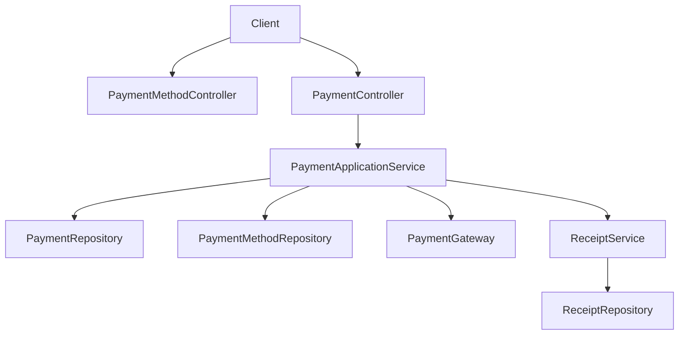
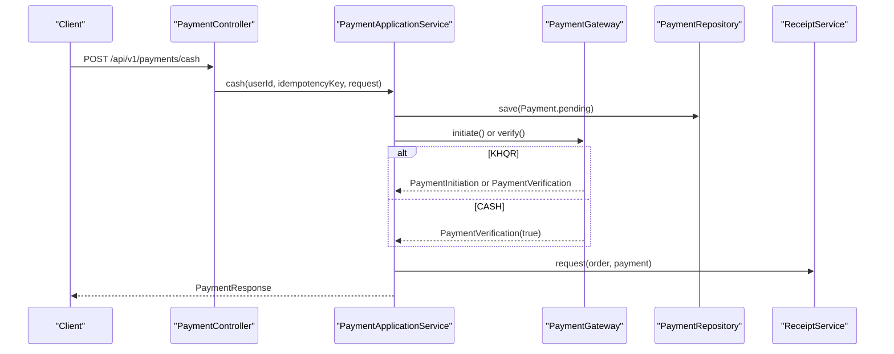
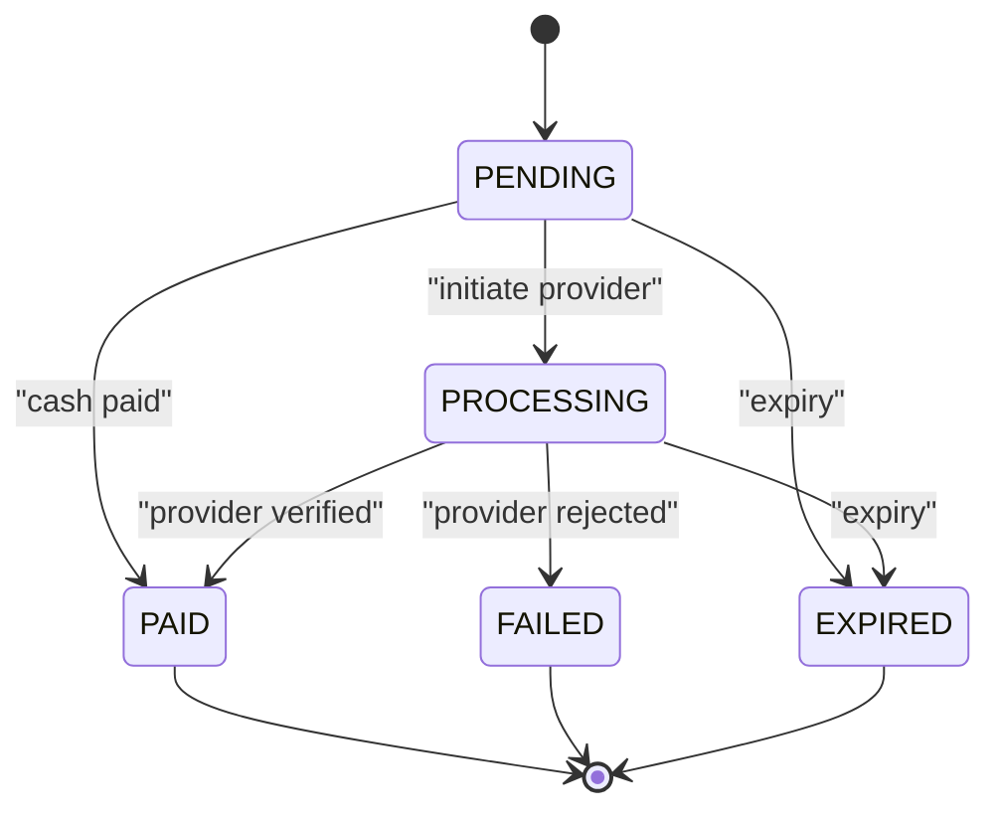
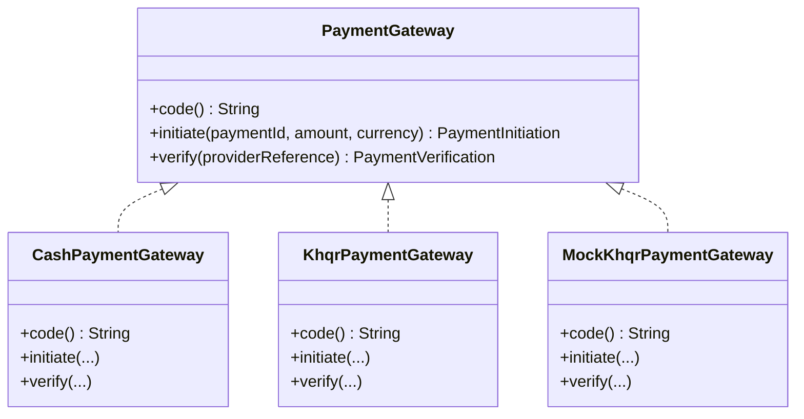
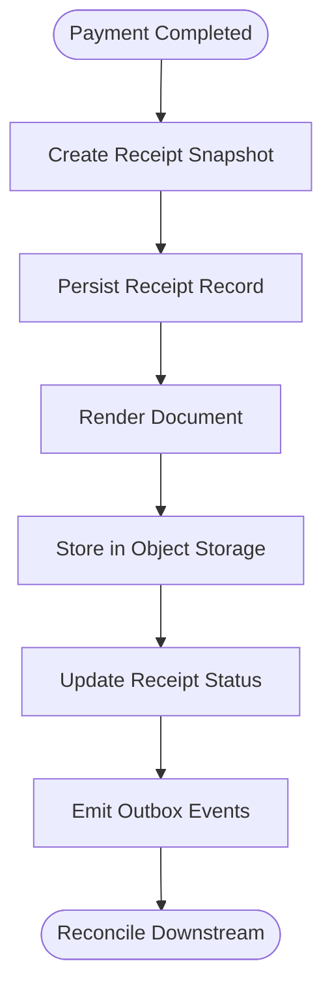
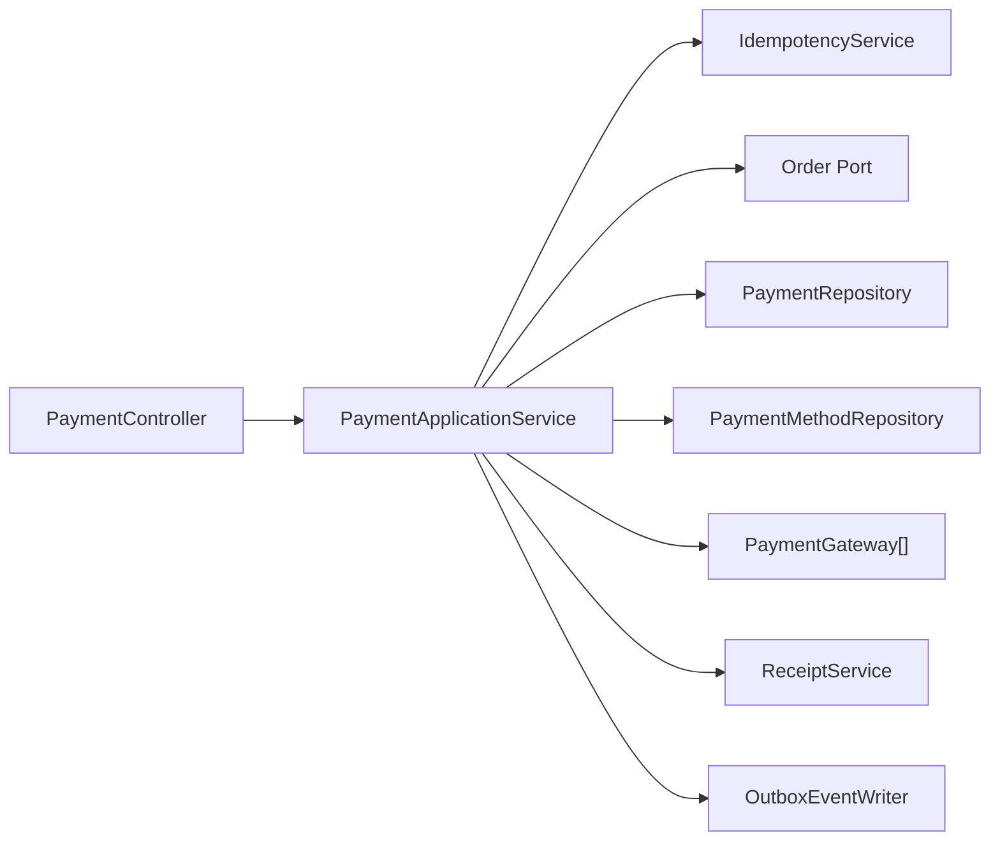

# Payments API

<cite>
**Referenced Files in This Document**
- [PaymentController.java](file://src/main/java/com/smartcoffee/modules/payment/api/PaymentController.java)
- [PaymentMethodController.java](file://src/main/java/com/smartcoffee/modules/payment/api/PaymentMethodController.java)
- [CashPaymentRequest.java](file://src/main/java/com/smartcoffee/modules/payment/api/CashPaymentRequest.java)
- [KhqrPaymentRequest.java](file://src/main/java/com/smartcoffee/modules/payment/api/KhqrPaymentRequest.java)
- [PaymentResponse.java](file://src/main/java/com/smartcoffee/modules/payment/api/PaymentResponse.java)
- [PaymentApplicationService.java](file://src/main/java/com/smartcoffee/modules/payment/application/PaymentApplicationService.java)
- [ReceiptService.java](file://src/main/java/com/smartcoffee/modules/payment/application/ReceiptService.java)
- [ReceiptProcessor.java](file://src/main/java/com/smartcoffee/modules/payment/application/ReceiptProcessor.java)
- [PaymentGateway.java](file://src/main/java/com/smartcoffee/infrastructure/payment/PaymentGateway.java)
- [CashPaymentGateway.java](file://src/main/java/com/smartcoffee/infrastructure/payment/CashPaymentGateway.java)
- [KhqrPaymentGateway.java](file://src/main/java/com/smartcoffee/infrastructure/payment/KhqrPaymentGateway.java)
- [MockKhqrPaymentGateway.java](file://src/main/java/com/smartcoffee/infrastructure/payment/MockKhqrPaymentGateway.java)
- [PaymentStatus.java](file://src/main/java/com/smartcoffee/modules/payment/domain/PaymentStatus.java)
- [Payment.java](file://src/main/java/com/smartcoffee/modules/payment/domain/Payment.java)
- [PaymentRepository.java](file://src/main/java/com/smartcoffee/modules/payment/persistence/PaymentRepository.java)
- [PaymentMethodRepository.java](file://src/main/java/com/smartcoffee/modules/payment/persistence/PaymentMethodRepository.java)
</cite>

## Table of Contents
1. [Introduction](#introduction)
2. [Project Structure](#project-structure)
3. [Core Components](#core-components)
4. [Architecture Overview](#architecture-overview)
5. [Detailed Component Analysis](#detailed-component-analysis)
6. [Dependency Analysis](#dependency-analysis)
7. [Performance Considerations](#performance-considerations)
8. [Troubleshooting Guide](#troubleshooting-guide)
9. [Conclusion](#conclusion)

## Introduction
This document provides detailed API documentation for the payment processing endpoints in the Smart Coffee backend. It covers:
- Payment method listing
- Cash payment processing
- KHQR digital payment initiation and verification
- Payment status tracking
- Request/response schemas
- Payment state machine
- Payment gateway integrations
- Callback handling patterns
- Receipt generation and reconciliation processes
- Examples of successful and failed flows

The implementation uses a modular architecture with clear separation between controllers, application services, domain models, persistence, and infrastructure gateways. Idempotency is enforced on payment creation endpoints to prevent duplicate processing.

## Project Structure
The payment feature spans multiple layers:
- API layer: REST controllers expose endpoints for payment methods, cash payments, KHQR payments, and verification.
- Application layer: Orchestrates business logic, idempotency, order integration, receipt creation, and event publishing.
- Domain layer: Encapsulates payment state transitions and receipts.
- Infrastructure layer: Provides payment gateway adapters (cash and KHQR).
- Persistence layer: JPA repositories for payments, payment methods, and receipts.

**Diagram sources**
- [PaymentMethodController.java:18-24](file://src/main/java/com/smartcoffee/modules/payment/api/PaymentMethodController.java#L18-L24)
- [PaymentController.java:22-37](file://src/main/java/com/smartcoffee/modules/payment/api/PaymentController.java#L22-L37)
- [PaymentApplicationService.java:48-108](file://src/main/java/com/smartcoffee/modules/payment/application/PaymentApplicationService.java#L48-L108)
- [PaymentRepository.java:11-24](file://src/main/java/com/smartcoffee/modules/payment/persistence/PaymentRepository.java#L11-L24)
- [PaymentMethodRepository.java:7-11](file://src/main/java/com/smartcoffee/modules/payment/persistence/PaymentMethodRepository.java#L7-L11)
- [PaymentGateway.java:1-5](file://src/main/java/com/smartcoffee/infrastructure/payment/PaymentGateway.java#L1-L5)
- [ReceiptService.java:21-32](file://src/main/java/com/smartcoffee/modules/payment/application/ReceiptService.java#L21-L32)

**Section sources**
- [PaymentController.java:11-37](file://src/main/java/com/smartcoffee/modules/payment/api/PaymentController.java#L11-L37)
- [PaymentMethodController.java:9-24](file://src/main/java/com/smartcoffee/modules/payment/api/PaymentMethodController.java#L9-L24)
- [PaymentApplicationService.java:20-46](file://src/main/java/com/smartcoffee/modules/payment/application/PaymentApplicationService.java#L20-L46)

## Core Components
- PaymentMethodController: Lists active payment methods with display ordering.
- PaymentController: Exposes cash payment, KHQR initiation, and KHQR verification endpoints.
- PaymentApplicationService: Implements business rules, idempotency, gateway calls, receipt requests, and event emission.
- PaymentGateway interface and implementations: Abstracts external payment providers; includes CashPaymentGateway and KhqrPaymentGateway (with MockKhqrPaymentGateway for local/test profiles).
- Payment domain model: Encapsulates payment lifecycle and state transitions.
- ReceiptService and ReceiptProcessor: Create receipt snapshots and process rendering/storage.

Key responsibilities:
- Enforce one PAID payment per order.
- Convert tender currency to settlement currency using exchange rate for cash payments.
- Generate provider references and QR payloads via gateways.
- Persist receipts and emit outbox events for downstream processing.

**Section sources**
- [PaymentMethodController.java:18-24](file://src/main/java/com/smartcoffee/modules/payment/api/PaymentMethodController.java#L18-L24)
- [PaymentController.java:22-37](file://src/main/java/com/smartcoffee/modules/payment/api/PaymentController.java#L22-L37)
- [PaymentApplicationService.java:48-108](file://src/main/java/com/smartcoffee/modules/payment/application/PaymentApplicationService.java#L48-L108)
- [PaymentGateway.java:1-5](file://src/main/java/com/smartcoffee/infrastructure/payment/PaymentGateway.java#L1-L5)
- [CashPaymentGateway.java:1-5](file://src/main/java/com/smartcoffee/infrastructure/payment/CashPaymentGateway.java#L1-L5)
- [KhqrPaymentGateway.java:1-8](file://src/main/java/com/smartcoffee/infrastructure/payment/KhqrPaymentGateway.java#L1-L8)
- [MockKhqrPaymentGateway.java:1-4](file://src/main/java/com/smartcoffee/infrastructure/payment/MockKhqrPaymentGateway.java#L1-L4)
- [Payment.java:56-105](file://src/main/java/com/smartcoffee/modules/payment/domain/Payment.java#L56-L105)
- [ReceiptService.java:21-32](file://src/main/java/com/smartcoffee/modules/payment/application/ReceiptService.java#L21-L32)

## Architecture Overview
The payment flow integrates HTTP endpoints, application orchestration, domain state management, and external payment gateways. Receipt generation and event publishing are decoupled through outbox events.

**Diagram sources**
- [PaymentController.java:22-37](file://src/main/java/com/smartcoffee/modules/payment/api/PaymentController.java#L22-L37)
- [PaymentApplicationService.java:48-108](file://src/main/java/com/smartcoffee/modules/payment/application/PaymentApplicationService.java#L48-L108)
- [PaymentGateway.java:1-5](file://src/main/java/com/smartcoffee/infrastructure/payment/PaymentGateway.java#L1-L5)
- [PaymentRepository.java:11-24](file://src/main/java/com/smartcoffee/modules/payment/persistence/PaymentRepository.java#L11-L24)
- [ReceiptService.java:21-32](file://src/main/java/com/smartcoffee/modules/payment/application/ReceiptService.java#L21-L32)

## Detailed Component Analysis

### API Endpoints

#### List Payment Methods
- Endpoint: GET /api/v1/payment-methods
- Purpose: Retrieve active payment methods sorted by display order.
- Response: List of payment methods including code, name, and type.

**Section sources**
- [PaymentMethodController.java:18-24](file://src/main/java/com/smartcoffee/modules/payment/api/PaymentMethodController.java#L18-L24)
- [PaymentMethodRepository.java:7-11](file://src/main/java/com/smartcoffee/modules/payment/persistence/PaymentMethodRepository.java#L7-L11)

#### Cash Payment Processing
- Endpoint: POST /api/v1/payments/cash
- Headers: Idempotency-Key (UUID)
- Request body: CashPaymentRequest
- Behavior:
  - Validates idempotency key and request payload.
  - Loads order and ensures store ownership.
  - Prevents duplicate payment for the same order.
  - Converts tender amount to settlement currency using exchange rate.
  - Creates pending payment, marks paid, confirms order, requests receipt, and emits events.
- Response: PaymentResponse

Request schema: CashPaymentRequest
- orderId: UUID (required)
- storeId: UUID (required)
- amountReceived: BigDecimal (minimum 0.0001)
- tenderCurrency: String (non-blank)
- exchangeRate: BigDecimal (minimum 0.00000001)

**Section sources**
- [PaymentController.java:22-26](file://src/main/java/com/smartcoffee/modules/payment/api/PaymentController.java#L22-L26)
- [PaymentApplicationService.java:48-70](file://src/main/java/com/smartcoffee/modules/payment/application/PaymentApplicationService.java#L48-L70)
- [CashPaymentRequest.java:7-10](file://src/main/java/com/smartcoffee/modules/payment/api/CashPaymentRequest.java#L7-L10)

#### KHQR Digital Payment Initiation
- Endpoint: POST /api/v1/payments/khqr
- Headers: Idempotency-Key (UUID)
- Request body: KhqrPaymentRequest
- Behavior:
  - Validates idempotency key and request payload.
  - Loads order and prevents duplicate payment.
  - Creates pending payment with expiry.
  - Calls KHQR gateway to initiate payment and obtain provider reference and QR payload.
  - Marks payment as processing and returns response with QR payload.
- Response: PaymentResponse

Request schema: KhqrPaymentRequest
- orderId: UUID (required)

**Section sources**
- [PaymentController.java:28-32](file://src/main/java/com/smartcoffee/modules/payment/api/PaymentController.java#L28-L32)
- [PaymentApplicationService.java:72-87](file://src/main/java/com/smartcoffee/modules/payment/application/PaymentApplicationService.java#L72-L87)
- [KhqrPaymentRequest.java:6-7](file://src/main/java/com/smartcoffee/modules/payment/api/KhqrPaymentRequest.java#L6-L7)

#### KHQR Payment Verification
- Endpoint: POST /api/v1/payments/{paymentId}/verify
- Behavior:
  - Locks payment record to avoid race conditions.
  - If already paid, returns current state.
  - Verifies payment via KHQR gateway.
  - On failure, marks payment as failed and emits failure event.
  - On success, marks payment as paid, confirms order, requests receipt, and emits completion events.
- Response: PaymentResponse

**Section sources**
- [PaymentController.java:34-37](file://src/main/java/com/smartcoffee/modules/payment/api/PaymentController.java#L34-L37)
- [PaymentApplicationService.java:89-108](file://src/main/java/com/smartcoffee/modules/payment/application/PaymentApplicationService.java#L89-L108)

### Request and Response Schemas

CashPaymentRequest
- Fields:
  - orderId: UUID
  - storeId: UUID
  - amountReceived: BigDecimal (>= 0.0001)
  - tenderCurrency: String (non-blank)
  - exchangeRate: BigDecimal (>= 0.00000001)

KhqrPaymentRequest
- Fields:
  - orderId: UUID

PaymentResponse
- Fields:
  - paymentId: UUID
  - paymentReference: String
  - orderId: UUID
  - method: String
  - status: String
  - currencyCode: String
  - amount: BigDecimal
  - amountReceived: BigDecimal
  - changeAmount: BigDecimal
  - providerReference: String
  - qrPayload: String
  - expiresAt: Instant
  - paidAt: Instant
  - failureCode: String
  - idempotentReplay: boolean

**Section sources**
- [CashPaymentRequest.java:7-10](file://src/main/java/com/smartcoffee/modules/payment/api/CashPaymentRequest.java#L7-L10)
- [KhqrPaymentRequest.java:6-7](file://src/main/java/com/smartcoffee/modules/payment/api/KhqrPaymentRequest.java#L6-L7)
- [PaymentResponse.java:7-10](file://src/main/java/com/smartcoffee/modules/payment/api/PaymentResponse.java#L7-L10)

### Payment State Machine
The Payment entity enforces strict state transitions:
- PENDING -> PROCESSING (when initiating external payment)
- PENDING -> PAID (cash or verified KHQR)
- PROCESSING -> PAID (verified KHQR)
- PROCESSING -> FAILED (provider rejection)
- PENDING/PROCESSING -> EXPIRED (timeout)

**Diagram sources**
- [PaymentStatus.java:3-5](file://src/main/java/com/smartcoffee/modules/payment/domain/PaymentStatus.java#L3-L5)
- [Payment.java:73-105](file://src/main/java/com/smartcoffee/modules/payment/domain/Payment.java#L73-L105)

**Section sources**
- [PaymentStatus.java:3-5](file://src/main/java/com/smartcoffee/modules/payment/domain/PaymentStatus.java#L3-L5)
- [Payment.java:73-105](file://src/main/java/com/smartcoffee/modules/payment/domain/Payment.java#L73-L105)

### Payment Gateway Integrations
- PaymentGateway interface defines:
  - code(): identifies the gateway
  - initiate(paymentId, amount, currency): returns provider reference, QR payload, and expiration
  - verify(providerReference): returns whether paid, provider status, and verification timestamp
- Implementations:
  - CashPaymentGateway: always verifies as paid; generates internal provider reference
  - KhqrPaymentGateway: placeholder for production; throws unsupported operation until configured
  - MockKhqrPaymentGateway: mock implementation for local/test profiles; returns success and mock QR payload

**Diagram sources**
- [PaymentGateway.java:1-5](file://src/main/java/com/smartcoffee/infrastructure/payment/PaymentGateway.java#L1-L5)
- [CashPaymentGateway.java:1-5](file://src/main/java/com/smartcoffee/infrastructure/payment/CashPaymentGateway.java#L1-L5)
- [KhqrPaymentGateway.java:1-8](file://src/main/java/com/smartcoffee/infrastructure/payment/KhqrPaymentGateway.java#L1-L8)
- [MockKhqrPaymentGateway.java:1-4](file://src/main/java/com/smartcoffee/infrastructure/payment/MockKhqrPaymentGateway.java#L1-L4)

**Section sources**
- [PaymentGateway.java:1-5](file://src/main/java/com/smartcoffee/infrastructure/payment/PaymentGateway.java#L1-L5)
- [CashPaymentGateway.java:1-5](file://src/main/java/com/smartcoffee/infrastructure/payment/CashPaymentGateway.java#L1-L5)
- [KhqrPaymentGateway.java:1-8](file://src/main/java/com/smartcoffee/infrastructure/payment/KhqrPaymentGateway.java#L1-L8)
- [MockKhqrPaymentGateway.java:1-4](file://src/main/java/com/smartcoffee/infrastructure/payment/MockKhqrPaymentGateway.java#L1-L4)

### Callback Handling
- The current implementation does not include a dedicated callback endpoint for external providers.
- For KHQR, clients should poll the verify endpoint using the provider reference stored in the payment record.
- When integrating a real KHQR provider, implement signature validation and idempotent processing of callbacks. Store provider status updates and reconcile with existing payment records.

[No sources needed since this section provides general guidance]

### Receipt Generation and Reconciliation
- ReceiptService creates a receipt snapshot tied to the payment, order, and store. It persists a JSON snapshot containing order number, payment reference, amount, and currency.
- ReceiptProcessor renders the snapshot into a document and stores it in object storage, updating the receipt record accordingly.
- Outbox events are emitted for payment completion and receipt request, enabling asynchronous reconciliation and downstream processing.

**Diagram sources**
- [ReceiptService.java:21-32](file://src/main/java/com/smartcoffee/modules/payment/application/ReceiptService.java#L21-L32)
- [ReceiptProcessor.java:33-41](file://src/main/java/com/smartcoffee/modules/payment/application/ReceiptProcessor.java#L33-L41)
- [PaymentApplicationService.java:128-143](file://src/main/java/com/smartcoffee/modules/payment/application/PaymentApplicationService.java#L128-L143)

**Section sources**
- [ReceiptService.java:21-32](file://src/main/java/com/smartcoffee/modules/payment/application/ReceiptService.java#L21-L32)
- [ReceiptProcessor.java:33-41](file://src/main/java/com/smartcoffee/modules/payment/application/ReceiptProcessor.java#L33-L41)
- [PaymentApplicationService.java:128-143](file://src/main/java/com/smartcoffee/modules/payment/application/PaymentApplicationService.java#L128-L143)

### Examples

#### Successful Cash Payment Flow
- Client sends POST /api/v1/payments/cash with valid Idempotency-Key and CashPaymentRequest.
- Backend validates idempotency, loads order, converts tender to settlement, creates and pays the payment, confirms order, requests receipt, and emits events.
- Response includes payment details, amount received, change amount, and status PAID.

**Section sources**
- [PaymentApplicationService.java:48-70](file://src/main/java/com/smartcoffee/modules/payment/application/PaymentApplicationService.java#L48-L70)

#### Successful KHQR Payment Flow
- Client sends POST /api/v1/payments/khqr with valid Idempotency-Key and KhqrPaymentRequest.
- Backend creates pending payment, initiates KHQR gateway, marks payment as processing, and returns QR payload.
- Client polls POST /api/v1/payments/{paymentId}/verify until payment is PAID.
- On success, backend marks payment as paid, confirms order, requests receipt, and emits events.

**Section sources**
- [PaymentApplicationService.java:72-108](file://src/main/java/com/smartcoffee/modules/payment/application/PaymentApplicationService.java#L72-L108)

#### Failed KHQR Payment Flow
- Client initiates KHQR payment and then verifies.
- Provider rejects payment; backend marks payment as FAILED with failure code and emits failure event.
- Order remains unpaid and can be retried according to business policy.

**Section sources**
- [PaymentApplicationService.java:95-100](file://src/main/java/com/smartcoffee/modules/payment/application/PaymentApplicationService.java#L95-L100)

## Dependency Analysis
The payment module depends on:
- Idempotency service to prevent duplicate processing
- Order port to load orders and confirm them
- Payment repository for persistence and locking
- Payment method repository for method lookup
- Payment gateways for external provider interactions
- Receipt service for receipt snapshot creation
- Outbox event writer for asynchronous event publishing

**Diagram sources**
- [PaymentController.java:22-37](file://src/main/java/com/smartcoffee/modules/payment/api/PaymentController.java#L22-L37)
- [PaymentApplicationService.java:20-46](file://src/main/java/com/smartcoffee/modules/payment/application/PaymentApplicationService.java#L20-L46)
- [PaymentRepository.java:11-24](file://src/main/java/com/smartcoffee/modules/payment/persistence/PaymentRepository.java#L11-L24)
- [PaymentMethodRepository.java:7-11](file://src/main/java/com/smartcoffee/modules/payment/persistence/PaymentMethodRepository.java#L7-L11)
- [PaymentGateway.java:1-5](file://src/main/java/com/smartcoffee/infrastructure/payment/PaymentGateway.java#L1-L5)
- [ReceiptService.java:21-32](file://src/main/java/com/smartcoffee/modules/payment/application/ReceiptService.java#L21-L32)

**Section sources**
- [PaymentApplicationService.java:20-46](file://src/main/java/com/smartcoffee/modules/payment/application/PaymentApplicationService.java#L20-L46)

## Performance Considerations
- Idempotency keys reduce duplicate processing overhead and ensure consistent responses.
- Pessimistic locking on payment verification avoids race conditions during concurrent checks.
- Exchange rate conversion uses precise decimal arithmetic to minimize rounding errors.
- Receipt snapshot creation is synchronous within the transaction boundary to guarantee data consistency.
- Outbox events enable asynchronous processing of notifications and reconciliations without blocking the main request path.

[No sources needed since this section provides general guidance]

## Troubleshooting Guide
Common issues and resolutions:
- STORE_MISMATCH: Ensure the storeId in the request matches the order’s store.
- ORDER_ALREADY_PAID: Verify that no prior PAID payment exists for the order.
- INSUFFICIENT_CASH_RECEIVED: Confirm that the converted settlement amount meets or exceeds the order total.
- Exchange rate is required: Provide a positive exchangeRate when tender currency differs from settlement currency.
- PAYMENT_METHOD_UNAVAILABLE: Ensure the payment method code is active and configured.
- PAYMENT_GATEWAY_UNAVAILABLE: Ensure the appropriate gateway implementation is active for the environment profile.

**Section sources**
- [PaymentApplicationService.java:54-61](file://src/main/java/com/smartcoffee/modules/payment/application/PaymentApplicationService.java#L54-L61)
- [PaymentApplicationService.java:110-126](file://src/main/java/com/smartcoffee/modules/payment/application/PaymentApplicationService.java#L110-L126)

## Conclusion
The Payments API provides robust support for cash and KHQR payments with strong guarantees around idempotency, concurrency, and state transitions. It integrates seamlessly with order confirmation and receipt generation workflows while emitting outbox events for downstream reconciliation. Proper configuration of KHQR gateways and adherence to the documented request/response schemas will ensure reliable payment processing across environments.

[No sources needed since this section summarizes without analyzing specific files]