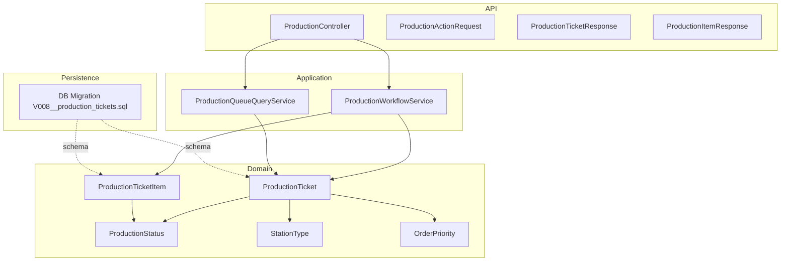
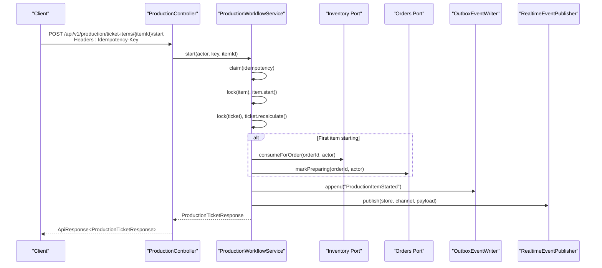
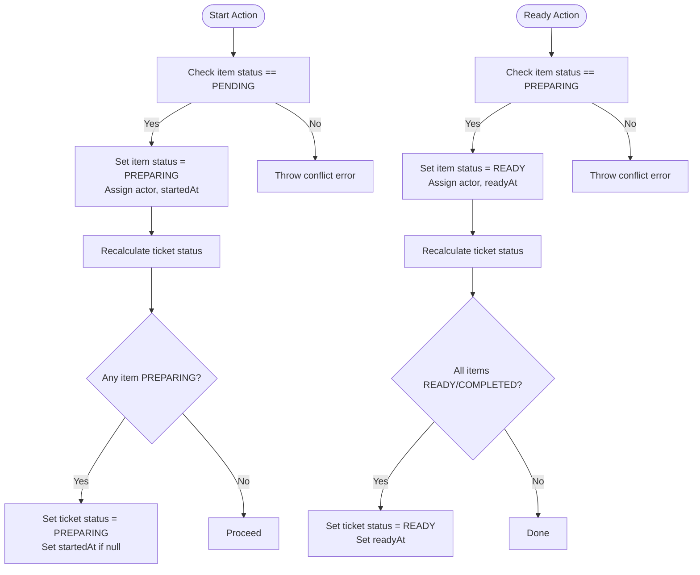
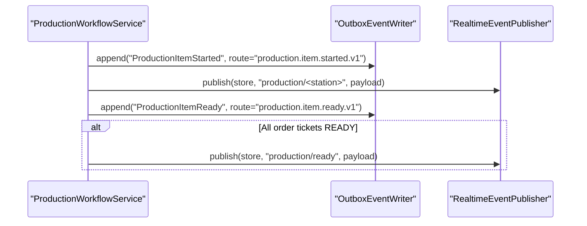
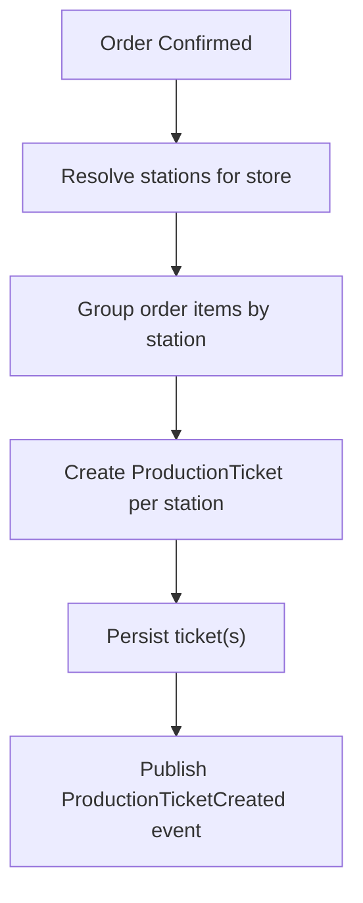
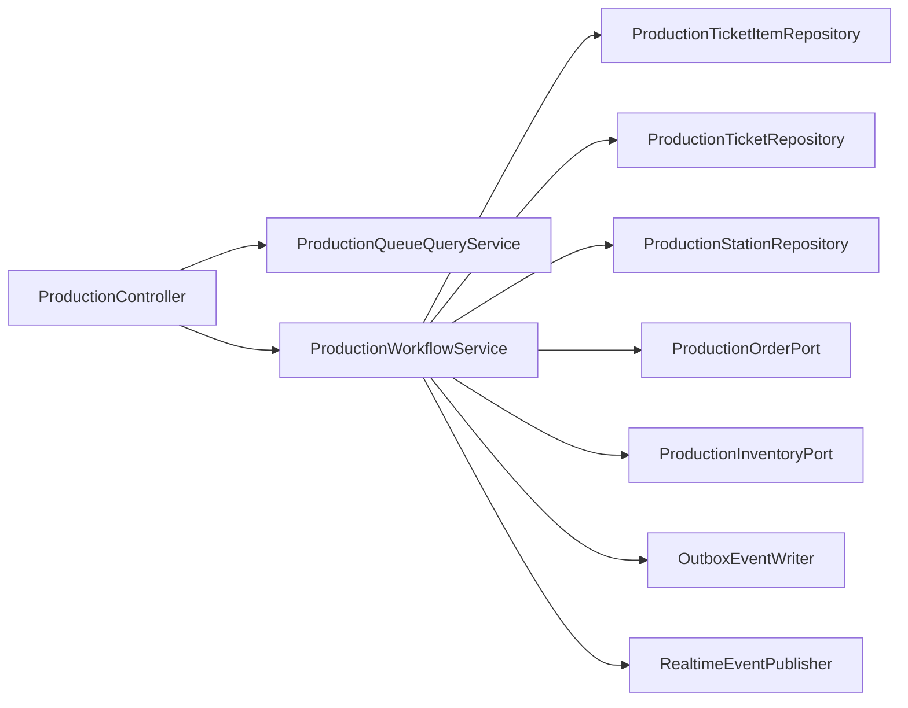

# Production API

<cite>
**Referenced Files in This Document**
- [ProductionController.java](file://src/main/java/com/smartcoffee/modules/production/api/ProductionController.java)
- [ProductionActionRequest.java](file://src/main/java/com/smartcoffee/modules/production/api/ProductionActionRequest.java)
- [ProductionTicketResponse.java](file://src/main/java/com/smartcoffee/modules/production/api/ProductionTicketResponse.java)
- [ProductionItemResponse.java](file://src/main/java/com/smartcoffee/modules/production/api/ProductionItemResponse.java)
- [ProductionWorkflowService.java](file://src/main/java/com/smartcoffee/modules/production/application/ProductionWorkflowService.java)
- [ProductionQueueQueryService.java](file://src/main/java/com/smartcoffee/modules/production/application/ProductionQueueQueryService.java)
- [ProductionTicket.java](file://src/main/java/com/smartcoffee/modules/production/domain/ProductionTicket.java)
- [ProductionTicketItem.java](file://src/main/java/com/smartcoffee/modules/production/domain/ProductionTicketItem.java)
- [ProductionStatus.java](file://src/main/java/com/smartcoffee/modules/production/domain/ProductionStatus.java)
- [StationType.java](file://src/main/java/com/smartcoffee/modules/production/domain/StationType.java)
- [OrderPriority.java](file://src/main/java/com/smartcoffee/modules/production/domain/OrderPriority.java)
- [V008__production_tickets.sql](file://src/main/resources/db/migration/V008__production_tickets.sql)
</cite>

## Table of Contents
1. Introduction
2. Project Structure
3. Core Components
4. Architecture Overview
5. Detailed Component Analysis
6. Dependency Analysis
7. Performance Considerations
8. Troubleshooting Guide
9. Conclusion

## Introduction
This document provides detailed API documentation for kitchen production management endpoints. It covers:
- Production ticket creation (via integration with the ordering flow)
- Status updates and workflow coordination
- Production queue management per station
- Real-time production tracking through events and WebSocket-like channels
- Request and response schemas, including ProductionActionRequest, ProductionTicketResponse, and ProductionItemResponse

The system models a production ticket as an aggregation of items that transition through states such as PENDING, PREPARING, READY, COMPLETED, and CANCELLED. Each item is assigned to a specific station type (e.g., BARISTA, KITCHEN, BAKERY, PACKING, PICKUP).

## Project Structure
The production module follows a layered structure:
- API layer: REST controllers and request/response DTOs
- Application layer: services orchestrating workflows and queries
- Domain layer: entities, enums, and business rules
- Persistence layer: repositories and database migrations

**Diagram sources**
- [ProductionController.java:11-53](file://src/main/java/com/smartcoffee/modules/production/api/ProductionController.java#L11-L53)
- [ProductionWorkflowService.java:19-51](file://src/main/java/com/smartcoffee/modules/production/application/ProductionWorkflowService.java#L19-L51)
- [ProductionQueueQueryService.java:11-22](file://src/main/java/com/smartcoffee/modules/production/application/ProductionQueueQueryService.java#L11-L22)
- [ProductionTicket.java:8-40](file://src/main/java/com/smartcoffee/modules/production/domain/ProductionTicket.java#L8-L40)
- [ProductionTicketItem.java:8-36](file://src/main/java/com/smartcoffee/modules/production/domain/ProductionTicketItem.java#L8-L36)
- [ProductionStatus.java:3-5](file://src/main/java/com/smartcoffee/modules/production/domain/ProductionStatus.java#L3-L5)
- [StationType.java:3-5](file://src/main/java/com/smartcoffee/modules/production/domain/StationType.java#L3-L5)
- [OrderPriority.java:3-5](file://src/main/java/com/smartcoffee/modules/production/domain/OrderPriority.java#L3-L5)
- [V008__production_tickets.sql:24-67](file://src/main/resources/db/migration/V008__production_tickets.sql#L24-L67)

**Section sources**
- [ProductionController.java:11-53](file://src/main/java/com/smartcoffee/modules/production/api/ProductionController.java#L11-L53)
- [ProductionWorkflowService.java:19-51](file://src/main/java/com/smartcoffee/modules/production/application/ProductionWorkflowService.java#L19-L51)
- [ProductionQueueQueryService.java:11-22](file://src/main/java/com/smartcoffee/modules/production/application/ProductionQueueQueryService.java#L11-L22)
- [ProductionTicket.java:8-40](file://src/main/java/com/smartcoffee/modules/production/domain/ProductionTicket.java#L8-L40)
- [ProductionTicketItem.java:8-36](file://src/main/java/com/smartcoffee/modules/production/domain/ProductionTicketItem.java#L8-L36)
- [ProductionStatus.java:3-5](file://src/main/java/com/smartcoffee/modules/production/domain/ProductionStatus.java#L3-L5)
- [StationType.java:3-5](file://src/main/java/com/smartcoffee/modules/production/domain/StationType.java#L3-L5)
- [OrderPriority.java:3-5](file://src/main/java/com/smartcoffee/modules/production/domain/OrderPriority.java#L3-L5)
- [V008__production_tickets.sql:24-67](file://src/main/resources/db/migration/V008__production_tickets.sql#L24-L67)

## Core Components
- ProductionController: Exposes REST endpoints for queue retrieval and item lifecycle actions (start, ready).
- ProductionWorkflowService: Implements idempotent start and ready transitions, inventory consumption, order status updates, event publishing, and real-time notifications.
- ProductionQueueQueryService: Reads active tickets for a given store and station type, ordered by priority and queued time.
- Domain models:
  - ProductionTicket: Aggregates items, tracks timestamps, versioning, and recalculates aggregate status based on item statuses.
  - ProductionTicketItem: Represents a single product line within a ticket, with its own state machine and assignment metadata.
  - Enums: ProductionStatus, StationType, OrderPriority define allowed values for states and classifications.

Key responsibilities:
- Enforce permissions and store authorization at the controller layer.
- Ensure idempotency for critical operations using Idempotency-Key headers.
- Publish outbox events and real-time messages for downstream consumers and dashboards.

**Section sources**
- [ProductionController.java:11-53](file://src/main/java/com/smartcoffee/modules/production/api/ProductionController.java#L11-L53)
- [ProductionWorkflowService.java:53-92](file://src/main/java/com/smartcoffee/modules/production/application/ProductionWorkflowService.java#L53-L92)
- [ProductionQueueQueryService.java:24-32](file://src/main/java/com/smartcoffee/modules/production/application/ProductionQueueQueryService.java#L24-L32)
- [ProductionTicket.java:45-73](file://src/main/java/com/smartcoffee/modules/production/domain/ProductionTicket.java#L45-L73)
- [ProductionTicketItem.java:54-68](file://src/main/java/com/smartcoffee/modules/production/domain/ProductionTicketItem.java#L54-L68)
- [ProductionStatus.java:3-5](file://src/main/java/com/smartcoffee/modules/production/domain/ProductionStatus.java#L3-L5)
- [StationType.java:3-5](file://src/main/java/com/smartcoffee/modules/production/domain/StationType.java#L3-L5)
- [OrderPriority.java:3-5](file://src/main/java/com/smartcoffee/modules/production/domain/OrderPriority.java#L3-L5)

## Architecture Overview
The production API integrates with ordering and inventory subsystems:
- Ticket creation occurs during order confirmation and is persisted per station.
- Start and Ready actions update item and ticket states, consume inventory, and publish events.
- Real-time updates are sent to store-scoped channels for live dashboards.

**Diagram sources**
- [ProductionController.java:38-44](file://src/main/java/com/smartcoffee/modules/production/api/ProductionController.java#L38-L44)
- [ProductionWorkflowService.java:53-73](file://src/main/java/com/smartcoffee/modules/production/application/ProductionWorkflowService.java#L53-L73)

## Detailed Component Analysis

### REST Endpoints

- GET /api/v1/stores/{storeId}/production/{station}
  - Purpose: Retrieve the production queue for a specific store and station type.
  - Authorization: Requires permission code production:queue-read and store access.
  - Path parameters:
    - storeId: UUID of the store
    - station: StationType value (BARISTA, KITCHEN, BAKERY, PACKING, PICKUP)
  - Response: ApiResponse<List<ProductionTicketResponse>>

- POST /api/v1/production/ticket-items/{itemId}/start
  - Purpose: Begin preparing a production item.
  - Headers:
    - Idempotency-Key: UUID used to deduplicate repeated requests.
  - Path parameters:
    - itemId: UUID of the production ticket item
  - Response: ApiResponse<ProductionTicketResponse>

- POST /api/v1/production/ticket-items/{itemId}/ready
  - Purpose: Mark a production item as ready.
  - Headers:
    - Idempotency-Key: UUID used to deduplicate repeated requests.
  - Path parameters:
    - itemId: UUID of the production ticket item
  - Response: ApiResponse<ProductionTicketResponse>

Notes:
- All endpoints return ApiResponse envelopes containing correlation/request IDs where applicable.
- The controller enforces role-based permissions and store scoping before delegating to application services.

**Section sources**
- [ProductionController.java:29-52](file://src/main/java/com/smartcoffee/modules/production/api/ProductionController.java#L29-L52)

### Request Schema: ProductionActionRequest
- Fields:
  - note: Optional string up to 500 characters.
- Usage:
  - Currently defined but not bound to the exposed endpoints in the controller; can be extended for future action payloads.

Validation:
- Size constraint enforced via annotation.

**Section sources**
- [ProductionActionRequest.java:5-6](file://src/main/java/com/smartcoffee/modules/production/api/ProductionActionRequest.java#L5-L6)

### Response Schemas

- ProductionTicketResponse
  - Fields:
    - ticketId: UUID
    - ticketNumber: String
    - orderId: UUID
    - storeId: UUID
    - stationId: UUID
    - stationType: String (derived from StationType)
    - status: String (from ProductionStatus)
    - priority: String (from OrderPriority)
    - queuedAt: Instant
    - items: List<ProductionItemResponse>
    - version: long

- ProductionItemResponse
  - Fields:
    - ticketItemId: UUID
    - orderItemId: UUID
    - productName: String
    - quantity: int
    - customizationSummary: String
    - status: String (from ProductionStatus)
    - startedAt: Instant
    - readyAt: Instant
    - version: long

These responses reflect domain state and timestamps captured during lifecycle transitions.

**Section sources**
- [ProductionTicketResponse.java:6-8](file://src/main/java/com/smartcoffee/modules/production/api/ProductionTicketResponse.java#L6-L8)
- [ProductionItemResponse.java:6-7](file://src/main/java/com/smartcoffee/modules/production/api/ProductionItemResponse.java#L6-L7)

### Station Assignment and Queue Management
- Stations are identified by StationType and mapped to physical or logical stations configured per store.
- Queue retrieval filters by:
  - Store ID
  - Active station matching the requested StationType
  - Ticket statuses PENDING or PREPARING
  - Ordering by priority descending then queued time ascending

This ensures high-priority orders surface first while maintaining FIFO within the same priority level.

**Section sources**
- [ProductionQueueQueryService.java:24-32](file://src/main/java/com/smartcoffee/modules/production/application/ProductionQueueQueryService.java#L24-L32)
- [StationType.java:3-5](file://src/main/java/com/smartcoffee/modules/production/domain/StationType.java#L3-L5)
- [OrderPriority.java:3-5](file://src/main/java/com/smartcoffee/modules/production/domain/OrderPriority.java#L3-L5)

### Production Status Transitions
- Item-level transitions:
  - PENDING -> PREPARING (on start)
  - PREPARING -> READY (on ready)
- Aggregate ticket status recalculation:
  - If all items are READY or COMPLETED, ticket becomes READY and sets ready timestamp.
  - If any item is PREPARING, ticket becomes PREPARING and sets started timestamp if not already set.

**Diagram sources**
- [ProductionTicketItem.java:54-68](file://src/main/java/com/smartcoffee/modules/production/domain/ProductionTicketItem.java#L54-L68)
- [ProductionTicket.java:63-73](file://src/main/java/com/smartcoffee/modules/production/domain/ProductionTicket.java#L63-L73)
- [ProductionStatus.java:3-5](file://src/main/java/com/smartcoffee/modules/production/domain/ProductionStatus.java#L3-L5)

**Section sources**
- [ProductionTicketItem.java:54-68](file://src/main/java/com/smartcoffee/modules/production/domain/ProductionTicketItem.java#L54-L68)
- [ProductionTicket.java:63-73](file://src/main/java/com/smartcoffee/modules/production/domain/ProductionTicket.java#L63-L73)
- [ProductionStatus.java:3-5](file://src/main/java/com/smartcoffee/modules/production/domain/ProductionStatus.java#L3-L5)

### Real-Time Production Tracking
- On item start:
  - An outbox event is published with type ProductionItemStarted.
  - A real-time message is sent to a store-scoped channel named after the station type (lowercased).
- On item ready:
  - An outbox event is published with type ProductionItemReady.
  - If all tickets for the order are READY, a real-time message is sent on channel production/ready with an ORDER_READY payload.

**Diagram sources**
- [ProductionWorkflowService.java:68-72](file://src/main/java/com/smartcoffee/modules/production/application/ProductionWorkflowService.java#L68-L72)
- [ProductionWorkflowService.java:86-90](file://src/main/java/com/smartcoffee/modules/production/application/ProductionWorkflowService.java#L86-L90)

**Section sources**
- [ProductionWorkflowService.java:68-90](file://src/main/java/com/smartcoffee/modules/production/application/ProductionWorkflowService.java#L68-L90)

### Production Ticket Creation (Integration Point)
- Tickets are created per station when an order is confirmed.
- For each station required by the order:
  - Resolve the station configuration for the store.
  - Group order items by station.
  - Create a ProductionTicket with a unique number derived from station code and order number.
  - Persist the ticket and emit a ProductionTicketCreated event to the outbox.

**Diagram sources**
- [ProductionTicketService.java:71-144](file://src/main/java/com/smartcoffee/modules/production/application/ProductionTicketService.java#L71-L144)

**Section sources**
- [ProductionTicketService.java:71-144](file://src/main/java/com/smartcoffee/modules/production/application/ProductionTicketService.java#L71-L144)

## Dependency Analysis
- Controller depends on:
  - ProductionQueueQueryService for queue reads
  - ProductionWorkflowService for item lifecycle actions
  - Security components for actor identity, permissions, and store authorization
- Workflow service depends on:
  - Repositories for tickets, items, and stations
  - Ports for orders and inventory
  - Infrastructure for idempotency, outbox events, and real-time publishing
- Domain entities encapsulate state transitions and validation logic.

**Diagram sources**
- [ProductionController.java:14-18](file://src/main/java/com/smartcoffee/modules/production/api/ProductionController.java#L14-L18)
- [ProductionWorkflowService.java:21-31](file://src/main/java/com/smartcoffee/modules/production/application/ProductionWorkflowService.java#L21-L31)

**Section sources**
- [ProductionController.java:14-18](file://src/main/java/com/smartcoffee/modules/production/api/ProductionController.java#L14-L18)
- [ProductionWorkflowService.java:21-31](file://src/main/java/com/smartcoffee/modules/production/application/ProductionWorkflowService.java#L21-L31)

## Performance Considerations
- Idempotency:
  - Start and Ready actions use idempotency claims keyed by user and request hash to prevent duplicate processing.
- Concurrency:
  - Database row locking is applied to items and tickets during transitions to avoid race conditions.
- Query efficiency:
  - Queue retrieval uses indexed queries filtered by store, station, and status, ordered by priority and queued time.
- Eventual consistency:
  - Outbox events decouple side effects (inventory, order status) from the primary transaction.

[No sources needed since this section provides general guidance]

## Troubleshooting Guide
Common issues and resolutions:
- Resource not found:
  - Occurs when an item or ticket cannot be located by ID. Verify itemId and ticket linkage.
- State conflict:
  - Thrown when attempting invalid transitions (e.g., starting an item not in PENDING or marking ready an item not in PREPARING).
- Station missing:
  - During ticket creation, ensure the station is configured and active for the store.
- Permission denied:
  - Ensure the current actor has required permissions (production:queue-read, production:item-start, production:item-ready) and store access.

Operational checks:
- Validate Idempotency-Key presence and uniqueness for start/ready calls.
- Confirm outbox events are being emitted for auditability and downstream processing.
- Monitor real-time channels for expected messages on production/<station> and production/ready.

**Section sources**
- [ProductionWorkflowService.java:59-61](file://src/main/java/com/smartcoffee/modules/production/application/ProductionWorkflowService.java#L59-L61)
- [ProductionWorkflowService.java:81-83](file://src/main/java/com/smartcoffee/modules/production/application/ProductionWorkflowService.java#L81-L83)
- [ProductionTicketItem.java:54-68](file://src/main/java/com/smartcoffee/modules/production/domain/ProductionTicketItem.java#L54-L68)
- [ProductionTicketService.java:71-82](file://src/main/java/com/smartcoffee/modules/production/application/ProductionTicketService.java#L71-L82)

## Conclusion
The Production API provides robust endpoints for managing kitchen production workflows. It enforces strict state transitions, supports idempotent operations, and integrates with inventory and order systems. Real-time updates and outbox events enable responsive dashboards and reliable downstream processing. Use the provided schemas and examples to implement clients that interact safely and efficiently with the production pipeline.