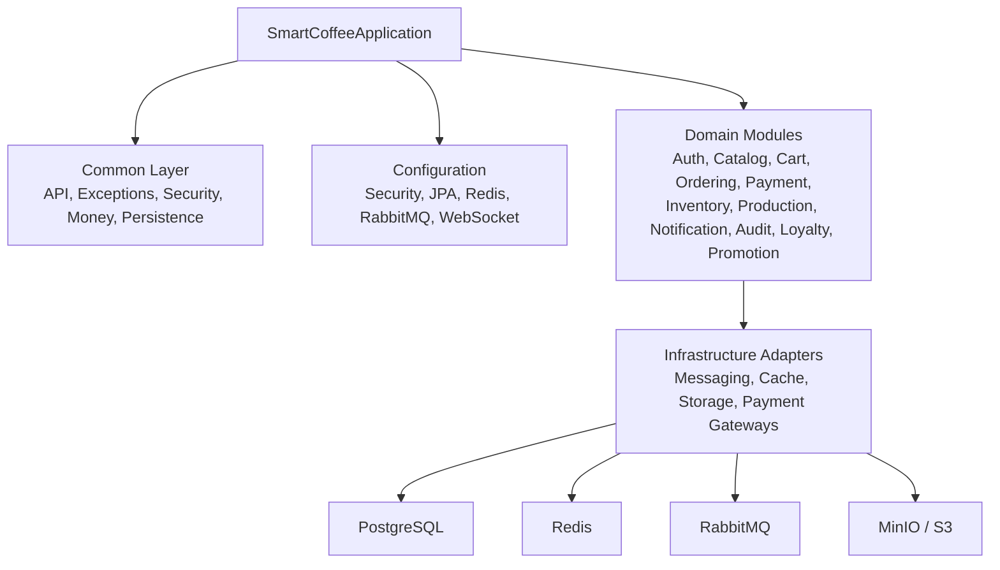
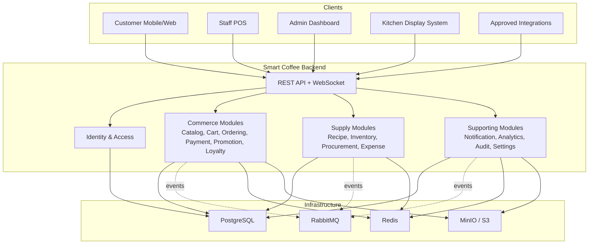
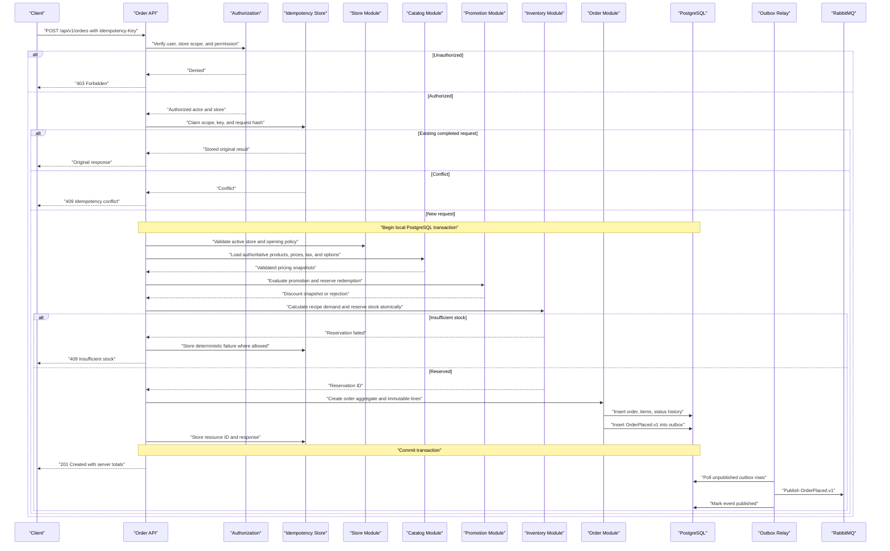
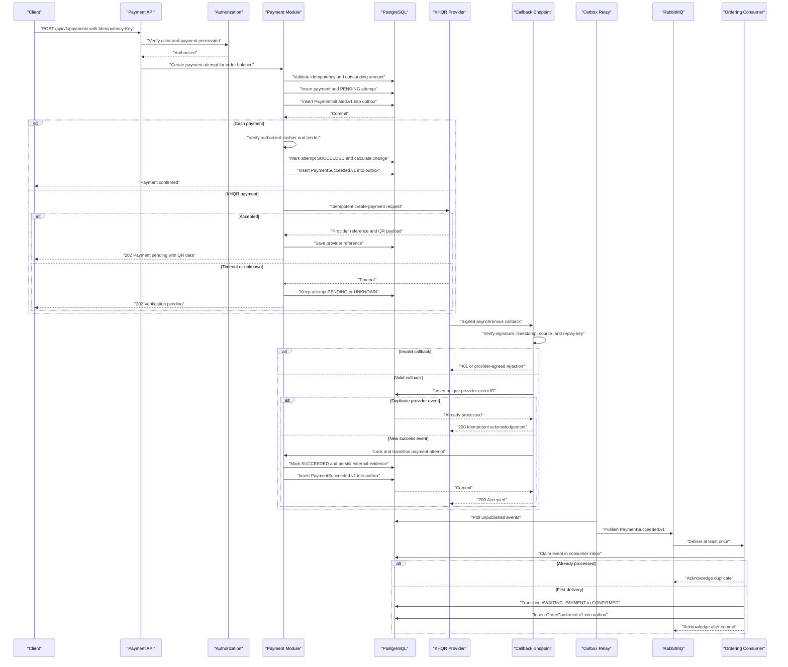
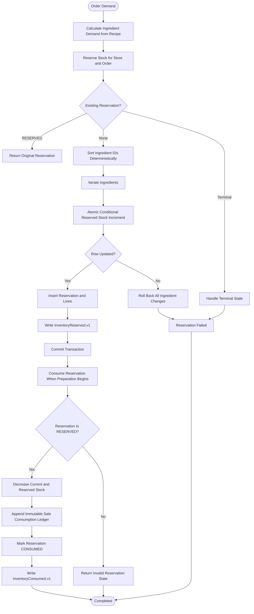
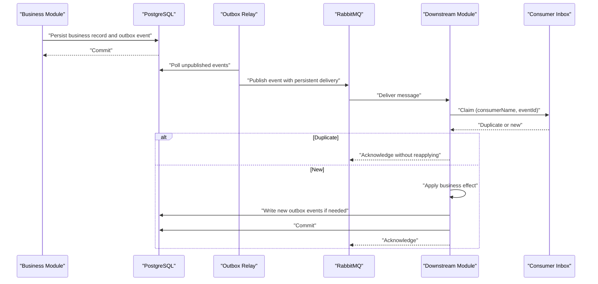
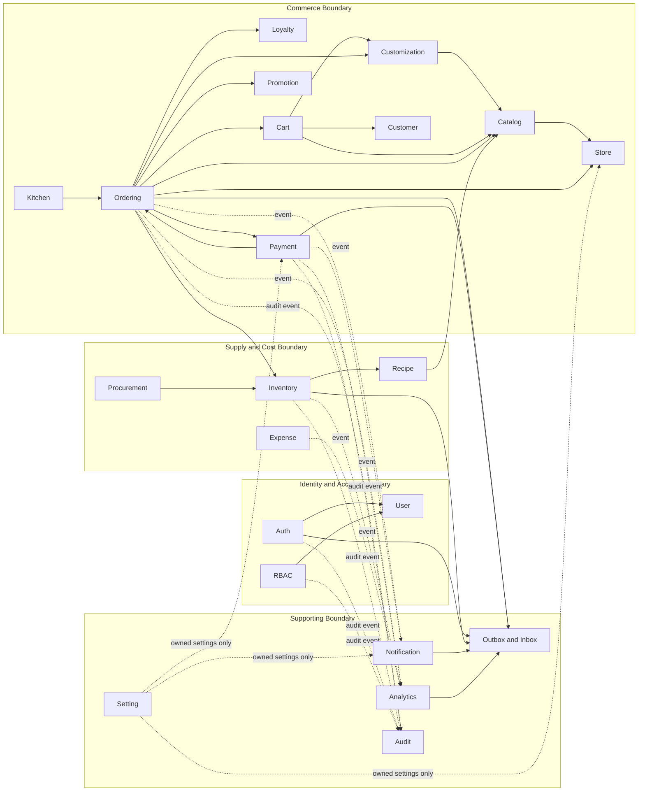
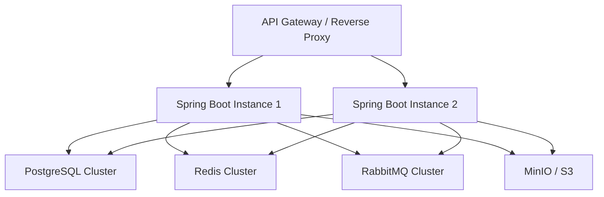

# Architecture Documentation

<cite>
**Referenced Files in This Document**   
- [SYSTEM_ARCHITECTURE.md](file://architecture/SYSTEM_ARCHITECTURE.md)
- [ADR-001-modular-monolith.md](file://adr/ADR-001-modular-monolith.md)
- [ADR-002-postgresql-ownership.md](file://adr/ADR-002-postgresql-ownership.md)
- [ADR-003-rabbitmq.md](file://adr/ADR-003-rabbitmq.md)
- [ADR-004-transactional-outbox.md](file://adr/ADR-004-transactional-outbox.md)
- [DB_OWNERSHIP_MATRIX.md](file://database/DB_OWNERSHIP_MATRIX.md)
- [ORDER_FLOW.mermaid](file://architecture/ORDER_FLOW.mermaid)
- [PAYMENT_FLOW.mermaid](file://architecture/PAYMENT_FLOW.mermaid)
- [INVENTORY_FLOW.mermaid](file://architecture/INVENTORY_FLOW.mermaid)
- [MODULE_DEPENDENCIES.mermaid](file://architecture/MODULE_DEPENDENCIES.mermaid)
- [pom.xml](file://pom.xml)
- [compose.yaml](file://compose.yaml)
- [application.yml](file://src/main/resources/application.yml)
</cite>

## Table of Contents
1. [Introduction](#introduction)
2. [Project Structure](#project-structure)
3. [Core Components](#core-components)
4. [Architecture Overview](#architecture-overview)
5. [Detailed Component Analysis](#detailed-component-analysis)
6. [Dependency Analysis](#dependency-analysis)
7. [Performance Considerations](#performance-considerations)
8. [Troubleshooting Guide](#troubleshooting-guide)
9. [Conclusion](#conclusion)
10. [Appendices](#appendices)

## Introduction
This document describes the Smart Coffee Backend as a modular monolith that is microservice-ready. It explains how domain modules are separated, how they communicate through synchronous application interfaces and durable events, and how critical business transactions remain strongly consistent while non-critical side effects use eventual consistency.

The system supports customer-facing apps, staff POS applications, administrative dashboards, kitchen display systems, and approved integrations. Its primary responsibilities include authentication and authorization, catalog pricing, cart management, order lifecycle, payment processing, recipe-based inventory reservation and consumption, promotion and loyalty accounting, production workflow, notifications, analytics projections, audit trails, and settings.

The backend is a Spring Boot application exposing REST APIs and secured WebSocket destinations. PostgreSQL is the durable source of truth. Redis provides bounded caching and coordination. RabbitMQ handles durable asynchronous work such as notifications, receipt generation, reporting projections, retries, and background processing. MinIO or S3-compatible storage holds images, receipts, and authorized documents.

**Section sources**
- [SYSTEM_ARCHITECTURE.md:15-85](file://architecture/SYSTEM_ARCHITECTURE.md#L15-L85)
- [SYSTEM_ARCHITECTURE.md:88-133](file://architecture/SYSTEM_ARCHITECTURE.md#L88-L133)

## Project Structure
The repository follows a feature-oriented layout under `src/main/java/com/smartcoffee`. Domain capabilities are organized into modules such as `auth`, `catalog`, `cart`, `ordering`, `payment`, `inventory`, `production`, `notification`, `audit`, `loyalty`, `promotion`, `identity`, `customer`, `organization`, `rbac`, `recipe`, and `settings`. Cross-cutting infrastructure lives under `common` and `infrastructure`. Configuration is centralized under `config`, and database migrations live under `src/main/resources/db/migration`.

**Diagram sources**
- [pom.xml:62-306](file://pom.xml#L62-L306)
- [application.yml:17-80](file://src/main/resources/application.yml#L17-L80)

**Section sources**
- [pom.xml:62-306](file://pom.xml#L62-L306)
- [application.yml:1-93](file://src/main/resources/application.yml#L1-L93)

## Core Components
The system is built around these core architectural components:

| Component | Responsibility | Key Design Rule |
|---|---|---|
| Modular Monolith | One deployable with explicit domain boundaries | No direct cross-module JPA injection; use application ports or events |
| PostgreSQL | Durable source of truth for identity, orders, payments, inventory, idempotency, outbox, inbox, and audit | Every table has exactly one write owner |
| Redis | Bounded cache, rate limiting, short-lived coordination | Never the only source of truth for critical state |
| RabbitMQ | Durable asynchronous messaging with at-least-once delivery | Producers use transactional outbox; consumers use durable inbox deduplication |
| Transactional Outbox | Atomic persistence of business records and integration events | Events are published after broker confirmation |
| Consumer Inbox | Idempotent event consumption | Duplicate messages return success without reapplying effects |
| Security Layer | Authentication, authorization, store-scoped access, JWT, WebSocket authorization | Clients are untrusted; server validates prices, totals, roles, and store context |
| Infrastructure Adapters | Messaging, caching, storage, payment gateways, observability | External calls occur outside long-running database transactions |

**Section sources**
- [ADR-001-modular-monolith.md:16-91](file://adr/ADR-001-modular-monolith.md#L16-L91)
- [ADR-002-postgresql-ownership.md:14-93](file://adr/ADR-002-postgresql-ownership.md#L14-L93)
- [ADR-003-rabbitmq.md:14-86](file://adr/ADR-003-rabbitmq.md#L14-L86)
- [ADR-004-transactional-outbox.md:14-112](file://adr/ADR-004-transactional-outbox.md#L14-L112)
- [SYSTEM_ARCHITECTURE.md:291-315](file://architecture/SYSTEM_ARCHITECTURE.md#L291-L315)

## Architecture Overview
The Smart Coffee Backend uses a modular monolith architecture that prioritizes strong local transactions during development and early operations while preserving clear extraction boundaries for future services.

**Diagram sources**
- [SYSTEM_ARCHITECTURE.md:53-133](file://architecture/SYSTEM_ARCHITECTURE.md#L53-L133)
- [MODULE_DEPENDENCIES.mermaid:1-93](file://architecture/MODULE_DEPENDENCIES.mermaid#L1-L93)

**Section sources**
- [SYSTEM_ARCHITECTURE.md:23-47](file://architecture/SYSTEM_ARCHITECTURE.md#L23-L47)
- [SYSTEM_ARCHITECTURE.md:136-196](file://architecture/SYSTEM_ARCHITECTURE.md#L136-L196)
- [SYSTEM_ARCHITECTURE.md:198-289](file://architecture/SYSTEM_ARCHITECTURE.md#L198-L289)

## Detailed Component Analysis

### Ordering Workflow
Order placement is a strongly consistent operation that validates store availability, loads authoritative catalog data, evaluates promotions, reserves inventory atomically, persists immutable order snapshots, and publishes an outbox event. The client never sends authoritative prices, tax, discounts, or totals.

**Diagram sources**
- [ORDER_FLOW.mermaid:1-60](file://architecture/ORDER_FLOW.mermaid#L1-L60)
- [SYSTEM_ARCHITECTURE.md:232-250](file://architecture/SYSTEM_ARCHITECTURE.md#L232-L250)

**Section sources**
- [ORDER_FLOW.mermaid:1-60](file://architecture/ORDER_FLOW.mermaid#L1-L60)
- [SYSTEM_ARCHITECTURE.md:232-250](file://architecture/SYSTEM_ARCHITECTURE.md#L232-L250)

### Payment Workflow
Payment separates payment attempts from order confirmation. Cash payments can be confirmed server-side by an authorized cashier. KHQR payments require provider evidence, signature validation, replay protection, and reconciliation for unknown states. Provider callbacks update payment state and publish `PaymentSucceeded.v1`, which eventually confirms the order.

**Diagram sources**
- [PAYMENT_FLOW.mermaid:1-73](file://architecture/PAYMENT_FLOW.mermaid#L1-L73)
- [SYSTEM_ARCHITECTURE.md:170-174](file://architecture/SYSTEM_ARCHITECTURE.md#L170-L174)

**Section sources**
- [PAYMENT_FLOW.mermaid:1-73](file://architecture/PAYMENT_FLOW.mermaid#L1-L73)
- [SYSTEM_ARCHITECTURE.md:170-174](file://architecture/SYSTEM_ARCHITECTURE.md#L170-L174)

### Inventory Workflow
Inventory owns balances, reservations, lots, and immutable stock movements. Recipe defines product-to-ingredient requirements. Ordering calculates ingredient demand and reserves stock atomically. Consumption occurs when preparation begins. Cancellation releases reserved stock unless it was already consumed.

**Diagram sources**
- [INVENTORY_FLOW.mermaid:1-76](file://architecture/INVENTORY_FLOW.mermaid#L1-L76)
- [SYSTEM_ARCHITECTURE.md:180-183](file://architecture/SYSTEM_ARCHITECTURE.md#L180-L183)

**Section sources**
- [INVENTORY_FLOW.mermaid:1-76](file://architecture/INVENTORY_FLOW.mermaid#L1-L76)
- [SYSTEM_ARCHITECTURE.md:180-183](file://architecture/SYSTEM_ARCHITECTURE.md#L180-L183)

### Event-Driven Communication
The system uses RabbitMQ for durable asynchronous work. Critical producers write events to a transactional outbox; consumers claim events in a durable inbox before applying effects. Delivery semantics are at-least-once, so consumers must be idempotent. Non-critical reactions may use in-process Spring events, but durable workflows require outbox/inbox plus RabbitMQ.

**Diagram sources**
- [ADR-003-rabbitmq.md:63-86](file://adr/ADR-003-rabbitmq.md#L63-L86)
- [ADR-004-transactional-outbox.md:49-70](file://adr/ADR-004-transactional-outbox.md#L49-L70)

**Section sources**
- [ADR-003-rabbitmq.md:8-86](file://adr/ADR-003-rabbitmq.md#L8-L86)
- [ADR-004-transactional-outbox.md:8-112](file://adr/ADR-004-transactional-outbox.md#L8-L112)

## Dependency Analysis
The module dependency graph shows synchronous application dependencies as solid arrows and event-driven dependencies as dashed arrows. Modules must not inject another module’s JPA repository. Cross-module communication uses application ports or documented events.

**Diagram sources**
- [MODULE_DEPENDENCIES.mermaid:1-93](file://architecture/MODULE_DEPENDENCIES.mermaid#L1-L93)

**Section sources**
- [MODULE_DEPENDENCIES.mermaid:1-93](file://architecture/MODULE_DEPENDENCIES.mermaid#L1-L93)
- [SYSTEM_ARCHITECTURE.md:198-229](file://architecture/SYSTEM_ARCHITECTURE.md#L198-L229)

## Performance Considerations
- Use local PostgreSQL transactions for checkout, inventory reservation, promotion redemption, and payment state transitions to avoid partial updates.
- Keep external provider calls outside long-running database transactions to prevent connection and lock contention.
- Use Redis for bounded catalog/store cache, rate limiting, and short-lived coordination, but never as the sole source of truth for orders, payments, stock, promotions, or loyalty.
- Batch outbox publishing and use bounded polling intervals to control broker load.
- Ensure consumers are idempotent and acknowledge messages only after committing local transactions.
- Monitor outbox age, DLQ depth, oldest-message age, Redis degradation, and health indicators.
- Avoid cascade deletes on historical order, payment, stock, loyalty, and audit data.
- Partition large archival tables when necessary and keep reporting projections separate from operational writes.

[No sources needed since this section provides general guidance]

## Troubleshooting Guide
Common operational issues and their architectural remedies include:

| Symptom | Likely Cause | Recommended Action |
|---|---|---|
| Duplicate notification or analytics updates | At-least-once delivery without idempotent consumer | Verify consumer inbox claim and ensure business effects are idempotent |
| Lost integration event | Event published before business transaction committed or outbox not polled | Confirm outbox contract and relay behavior |
| Stale order after payment | Payment callback not applied or ordering consumer rejected event | Check provider callback validation, inbox deduplication, and ordering state transition |
| Partial inventory reservation | Incorrect conditional stock update or missing rollback | Review atomic per-ingredient reservation logic and transaction boundaries |
| High latency on checkout | External provider call inside transaction or excessive locking | Move external calls outside transactions and review lock granularity |
| Redis outage affects reads | Redis used as primary cache without fallback | Ensure Redis is optional for read paths and critical state remains in PostgreSQL |
| Dead-letter queue growing | Permanent business error or malformed event | Inspect DLQ messages, fix schema version mismatches, and avoid retrying permanent failures |
| Health check fails | Missing PostgreSQL, Redis, RabbitMQ, or MinIO connectivity | Validate compose services, environment variables, and Actuator endpoints |

**Section sources**
- [ADR-003-rabbitmq.md:76-86](file://adr/ADR-003-rabbitmq.md#L76-L86)
- [ADR-004-transactional-outbox.md:98-112](file://adr/ADR-004-transactional-outbox.md#L98-L112)
- [SYSTEM_ARCHITECTURE.md:107-128](file://architecture/SYSTEM_ARCHITECTURE.md#L107-L128)

## Conclusion
Smart Coffee Backend adopts a modular monolith architecture that preserves strong transactional correctness for checkout, payment, promotion, and inventory while preparing for future service extraction. PostgreSQL is the durable source of truth, Redis is a bounded cache, RabbitMQ provides durable asynchronous messaging, and MinIO or S3 stores object assets. Clear module boundaries, explicit application interfaces, transactional outbox, consumer inbox, and strict security rules make the system maintainable, observable, and ready for incremental evolution toward microservices.

[No sources needed since this section summarizes without analyzing specific files]

## Appendices

### Technical Decisions Summary

| Decision | Rationale |
|---|---|
| Spring Boot modular monolith | Reduces distributed complexity while enforcing domain boundaries |
| PostgreSQL 16+ | Relational constraints, exact money types, transactions, and auditable ledgers |
| Redis | Bounded caching, rate limiting, and coordination without becoming source of truth |
| RabbitMQ | Mature broker for queues, routing, retries, acknowledgements, and dead-letter handling |
| Transactional outbox and consumer inbox | Atomic business persistence with reliable, idempotent event delivery |
| MinIO locally, S3-compatible in production | Flexible object storage for images, receipts, and documents |

**Section sources**
- [ADR-001-modular-monolith.md:16-91](file://adr/ADR-001-modular-monolith.md#L16-L91)
- [ADR-002-postgresql-ownership.md:14-93](file://adr/ADR-002-postgresql-ownership.md#L14-L93)
- [ADR-003-rabbitmq.md:14-86](file://adr/ADR-003-rabbitmq.md#L14-L86)
- [ADR-004-transactional-outbox.md:14-112](file://adr/ADR-004-transactional-outbox.md#L14-L112)

### Infrastructure Requirements
- PostgreSQL 16+ with Flyway-managed migrations
- Redis with append-only file enabled for durability
- RabbitMQ with publisher confirmations and returns
- MinIO or S3-compatible object storage
- Environment variables for database credentials, JWT secret, MinIO keys, and WebSocket origins
- Docker Compose for local development and testing

**Section sources**
- [compose.yaml:1-71](file://compose.yaml#L1-L71)
- [application.yml:17-80](file://src/main/resources/application.yml#L17-L80)

### Deployment Topology
A typical deployment runs one or more Spring Boot instances behind a reverse proxy or API gateway. Each instance connects to shared PostgreSQL, Redis, RabbitMQ, and object storage. Horizontal scaling should consider:
- Stateless API workers
- Shared durable outbox and inbox tables
- Shared RabbitMQ topology
- Centralized configuration and secrets
- Observability via Actuator, Prometheus metrics, and structured logging

[No sources needed since this diagram shows conceptual deployment topology]