# Critical Data Flows

<cite>
**Referenced Files in This Document**
- [OrderCheckoutService.java](file://src/main/java/com/smartcoffee/modules/ordering/application/OrderCheckoutService.java)
- [PaymentApplicationService.java](file://src/main/java/com/smartcoffee/modules/payment/application/PaymentApplicationService.java)
- [InventoryReservationService.java](file://src/main/java/com/smartcoffee/modules/inventory/application/InventoryReservationService.java)
- [ProductionTicketService.java](file://src/main/java/com/smartcoffee/modules/production/application/ProductionTicketService.java)
- [Order.java](file://src/main/java/com/smartcoffee/modules/ordering/domain/Order.java)
- [Payment.java](file://src/main/java/com/smartcoffee/modules/payment/domain/Payment.java)
- [InventoryReservation.java](file://src/main/java/com/smartcoffee/modules/inventory/domain/InventoryReservation.java)
- [ProductionTicket.java](file://src/main/java/com/smartcoffee/modules/production/domain/ProductionTicket.java)
- [OutboxEventWriter.java](file://src/main/java/com/smartcoffee/infrastructure/messaging/outbox/OutboxEventWriter.java)
- [IdempotencyService.java](file://src/main/java/com/smartcoffee/infrastructure/idempotency/IdempotencyService.java)
- [ReceiptService.java](file://src/main/java/com/smartcoffee/modules/payment/application/ReceiptService.java)
- [EventTypes.java](file://src/main/java/com/smartcoffee/infrastructure/messaging/EventTypes.java)
- [ORDER_FLOW.mermaid](file://architecture/ORDER_FLOW.mermaid)
- [PAYMENT_FLOW.mermaid](file://architecture/PAYMENT_FLOW.mermaid)
- [INVENTORY_FLOW.mermaid](file://architecture/INVENTORY_FLOW.mermaid)
</cite>

## Table of Contents
1. Introduction
2. Project Structure
3. Core Components
4. Architecture Overview
5. Detailed Component Analysis
6. Dependency Analysis
7. Performance Considerations
8. Troubleshooting Guide
9. Conclusion

## Introduction
This document explains the critical data flows for order placement, payment processing, inventory reservation and consumption, and production ticket creation in the Smart Coffee Backend. It focuses on how these flows coordinate across modules using local transactions, idempotency, and a transactional outbox pattern to publish events reliably. It also documents state transitions for orders, payments, and inventory reservations, and describes error handling and rollback scenarios.

## Project Structure
The system is organized by domain modules (ordering, payment, inventory, production) with shared infrastructure for messaging, idempotency, storage, and configuration. Domain services orchestrate business operations within database transactions and persist domain aggregates. Infrastructure components provide:
- Transactional outbox event writing
- Idempotent API request handling
- Payment gateway abstraction
- Receipt snapshotting

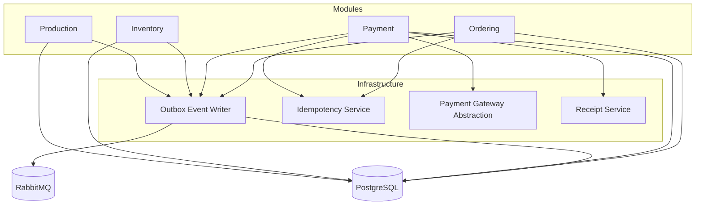

**Diagram sources**
- [OrderCheckoutService.java:62-133](file://src/main/java/com/smartcoffee/modules/ordering/application/OrderCheckoutService.java#L62-L133)
- [PaymentApplicationService.java:48-108](file://src/main/java/com/smartcoffee/modules/payment/application/PaymentApplicationService.java#L48-L108)
- [InventoryReservationService.java:43-97](file://src/main/java/com/smartcoffee/modules/inventory/application/InventoryReservationService.java#L43-L97)
- [ProductionTicketService.java:47-143](file://src/main/java/com/smartcoffee/modules/production/application/ProductionTicketService.java#L47-L143)
- [OutboxEventWriter.java:18-21](file://src/main/java/com/smartcoffee/infrastructure/messaging/outbox/OutboxEventWriter.java#L18-L21)
- [IdempotencyService.java:4-5](file://src/main/java/com/smartcoffee/infrastructure/idempotency/IdempotencyService.java#L4-L5)
- [ReceiptService.java:21-32](file://src/main/java/com/smartcoffee/modules/payment/application/ReceiptService.java#L21-L32)

**Section sources**
- [OrderCheckoutService.java:62-133](file://src/main/java/com/smartcoffee/modules/ordering/application/OrderCheckoutService.java#L62-L133)
- [PaymentApplicationService.java:48-108](file://src/main/java/com/smartcoffee/modules/payment/application/PaymentApplicationService.java#L48-L108)
- [InventoryReservationService.java:43-97](file://src/main/java/com/smartcoffee/modules/inventory/application/InventoryReservationService.java#L43-L97)
- [ProductionTicketService.java:47-143](file://src/main/java/com/smartcoffee/modules/production/application/ProductionTicketService.java#L47-L143)
- [OutboxEventWriter.java:18-21](file://src/main/java/com/smartcoffee/infrastructure/messaging/outbox/OutboxEventWriter.java#L18-L21)
- [IdempotencyService.java:4-5](file://src/main/java/com/smartcoffee/infrastructure/idempotency/IdempotencyService.java#L4-L5)
- [ReceiptService.java:21-32](file://src/main/java/com/smartcoffee/modules/payment/application/ReceiptService.java#L21-L32)

## Core Components
- Order checkout orchestrates cart validation, catalog price verification, recipe demand calculation, inventory reservation, order creation, and outbox event emission.
- Payment application service handles cash and KHQR payments, provider interactions, receipt snapshots, and outbox events for completion or failure.
- Inventory reservation service manages ingredient stock reservations, consumption, release, and expiration with ledgered stock transactions.
- Production ticket service creates station-scoped tickets from confirmed orders and emits creation events via outbox.
- Outbox writer persists events within the same transaction as business state changes.
- Idempotency service prevents duplicate mutations under scoped keys.
- Receipt service captures immutable receipt snapshots tied to payments.

**Section sources**
- [OrderCheckoutService.java:62-133](file://src/main/java/com/smartcoffee/modules/ordering/application/OrderCheckoutService.java#L62-L133)
- [PaymentApplicationService.java:48-108](file://src/main/java/com/smartcoffee/modules/payment/application/PaymentApplicationService.java#L48-L108)
- [InventoryReservationService.java:43-97](file://src/main/java/com/smartcoffee/modules/inventory/application/InventoryReservationService.java#L43-L97)
- [ProductionTicketService.java:47-143](file://src/main/java/com/smartcoffee/modules/production/application/ProductionTicketService.java#L47-L143)
- [OutboxEventWriter.java:18-21](file://src/main/java/com/smartcoffee/infrastructure/messaging/outbox/OutboxEventWriter.java#L18-L21)
- [IdempotencyService.java:4-5](file://src/main/java/com/smartcoffee/infrastructure/idempotency/IdempotencyService.java#L4-L5)
- [ReceiptService.java:21-32](file://src/main/java/com/smartcoffee/modules/payment/application/ReceiptService.java#L21-L32)

## Architecture Overview
The system uses a modular monolith with clear boundaries:
- Ordering module initiates checkout, reserves inventory, persists orders, and publishes OrderPlaced events.
- Payment module processes cash and KHQR payments, interacts with providers, records receipts, and publishes payment completion/failure events.
- Inventory module atomically reserves ingredients, consumes them upon preparation, and logs ledger entries.
- Production module creates station-specific tickets from confirmed orders and emits creation events.
- All cross-module side effects are decoupled via outbox events published to RabbitMQ.

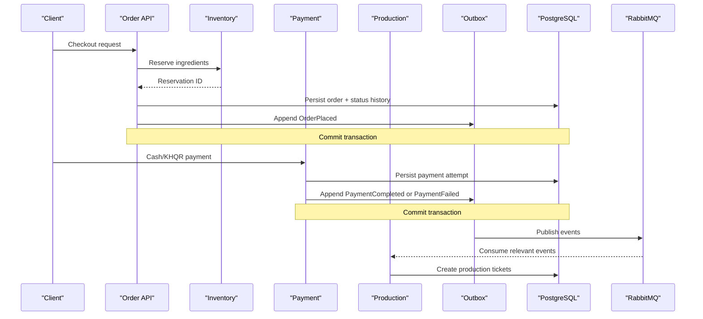

**Diagram sources**
- [OrderCheckoutService.java:62-133](file://src/main/java/com/smartcoffee/modules/ordering/application/OrderCheckoutService.java#L62-L133)
- [PaymentApplicationService.java:48-108](file://src/main/java/com/smartcoffee/modules/payment/application/PaymentApplicationService.java#L48-L108)
- [ProductionTicketService.java:47-143](file://src/main/java/com/smartcoffee/modules/production/application/ProductionTicketService.java#L47-L143)
- [OutboxEventWriter.java:18-21](file://src/main/java/com/smartcoffee/infrastructure/messaging/outbox/OutboxEventWriter.java#L18-L21)

## Detailed Component Analysis

### Order Placement Flow (Cart Checkout to Inventory Reservation and Order Creation)
End-to-end flow:
- Idempotency claim ensures safe retries.
- Cart lock and validation prevent double-checkout and ensure active cart.
- Catalog validation confirms prices and options; currency must match.
- Recipe demand computed from validated items.
- Inventory reserved atomically per store and order with TTL.
- Order created with immutable line items and totals.
- Outbox event emitted for downstream consumers.

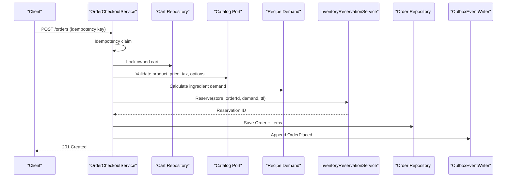

**Diagram sources**
- [OrderCheckoutService.java:62-133](file://src/main/java/com/smartcoffee/modules/ordering/application/OrderCheckoutService.java#L62-L133)
- [InventoryReservationService.java:43-54](file://src/main/java/com/smartcoffee/modules/inventory/application/InventoryReservationService.java#L43-L54)
- [OutboxEventWriter.java:18-21](file://src/main/java/com/smartcoffee/infrastructure/messaging/outbox/OutboxEventWriter.java#L18-L21)

State transitions for Order:
- AWAITING_PAYMENT -> CONFIRMED on payment completion
- CONFIRMED -> PREPARING when production starts
- PREPARING -> READY when production completes
- AWAITING_PAYMENT -> CANCELLED on payment expiry

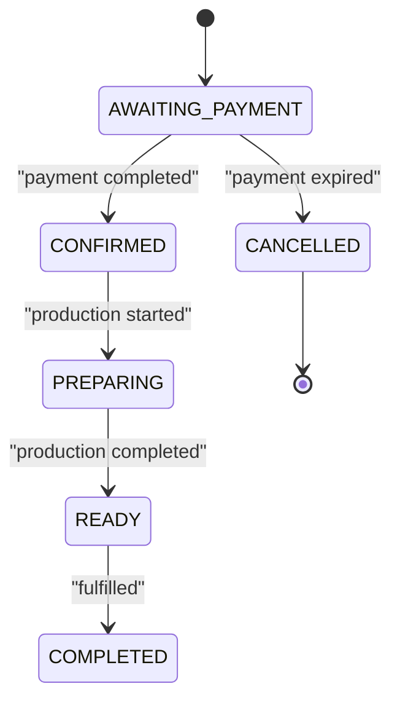

**Diagram sources**
- [Order.java:174-286](file://src/main/java/com/smartcoffee/modules/ordering/domain/Order.java#L174-L286)

Error handling and rollbacks:
- Empty cart, already checked out, currency mismatch, price change, insufficient stock, and invalid fulfillment type raise exceptions that trigger transaction rollback.
- Idempotency conflicts return deterministic responses without side effects.

**Section sources**
- [OrderCheckoutService.java:62-133](file://src/main/java/com/smartcoffee/modules/ordering/application/OrderCheckoutService.java#L62-L133)
- [Order.java:174-286](file://src/main/java/com/smartcoffee/modules/ordering/domain/Order.java#L174-L286)
- [IdempotencyService.java:4-5](file://src/main/java/com/smartcoffee/infrastructure/idempotency/IdempotencyService.java#L4-L5)

### Payment Flow (Cash, KHQR, Callbacks, Receipts)
Key behaviors:
- Cash: validate cashier/tender, mark paid, calculate change, confirm order, request receipt, emit completion event.
- KHQR: initiate provider payment, save provider reference, respond with QR payload; verify asynchronously; on success, mark paid, confirm order, request receipt, emit completion event; on failure, mark failed and emit failure event.
- Receipts: create immutable receipt snapshots bound to payment and order context.

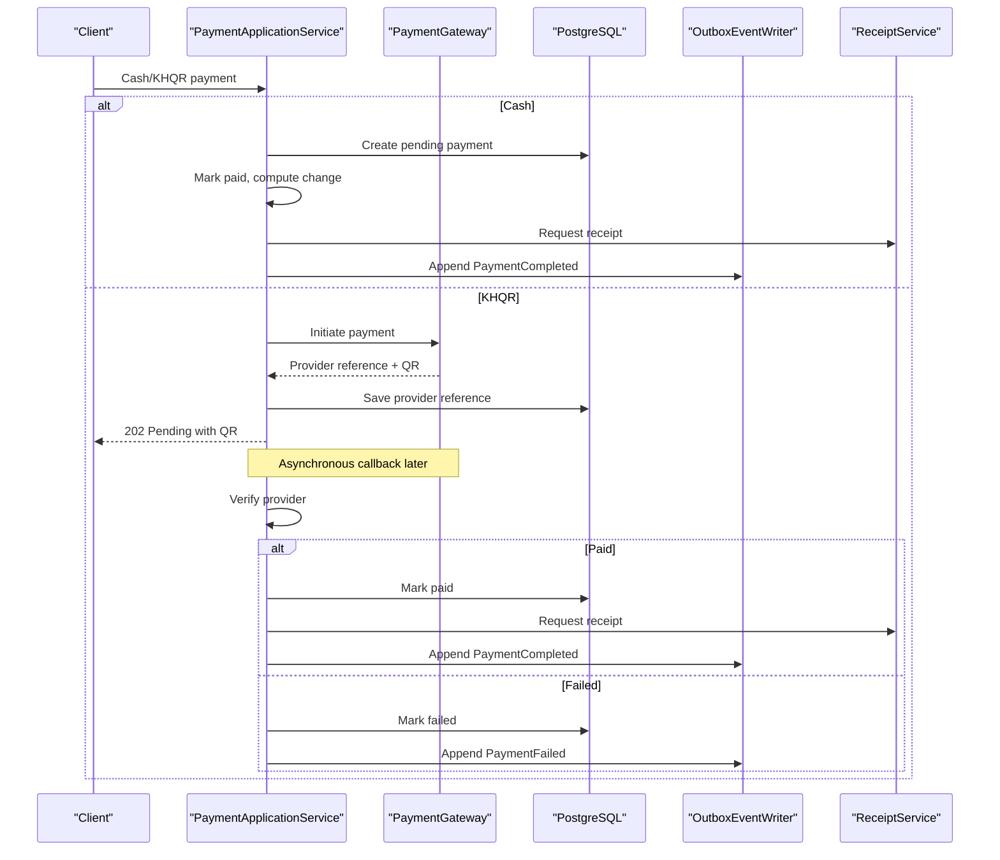

**Diagram sources**
- [PaymentApplicationService.java:48-108](file://src/main/java/com/smartcoffee/modules/payment/application/PaymentApplicationService.java#L48-L108)
- [ReceiptService.java:21-32](file://src/main/java/com/smartcoffee/modules/payment/application/ReceiptService.java#L21-L32)
- [OutboxEventWriter.java:18-21](file://src/main/java/com/smartcoffee/infrastructure/messaging/outbox/OutboxEventWriter.java#L18-L21)

State transitions for Payment:
- PENDING -> PROCESSING during provider interaction
- PROCESSING -> PAID on successful settlement
- PROCESSING -> FAILED on provider rejection
- PENDING -> EXPIRED if not settled within TTL

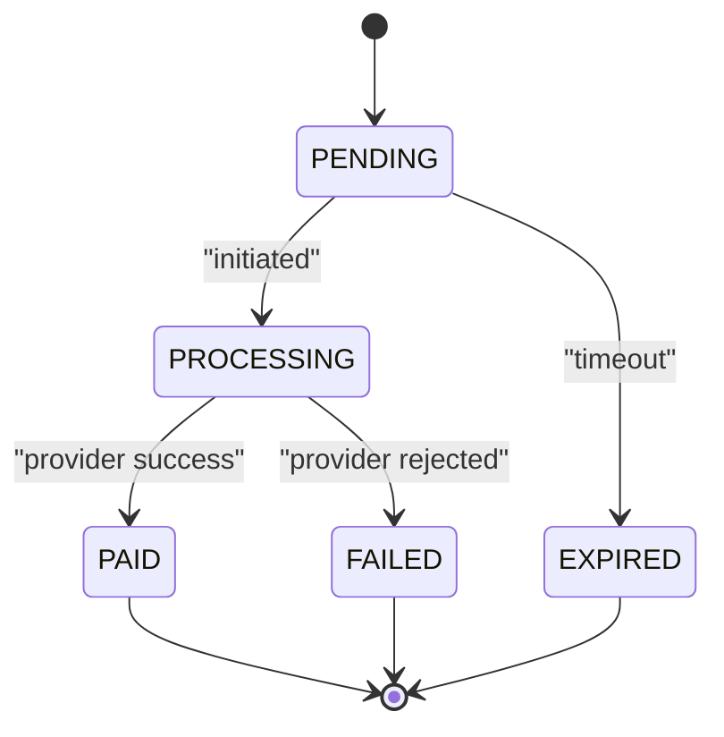

**Diagram sources**
- [Payment.java:73-105](file://src/main/java/com/smartcoffee/modules/payment/domain/Payment.java#L73-L105)

Error handling and rollbacks:
- Store mismatch, already paid, insufficient cash, exchange rate errors, unavailable payment method/gateway, and provider timeouts result in appropriate exceptions or state transitions.
- Idempotency protects against duplicate payment attempts.

**Section sources**
- [PaymentApplicationService.java:48-108](file://src/main/java/com/smartcoffee/modules/payment/application/PaymentApplicationService.java#L48-L108)
- [Payment.java:73-105](file://src/main/java/com/smartcoffee/modules/payment/domain/Payment.java#L73-L105)
- [IdempotencyService.java:4-5](file://src/main/java/com/smartcoffee/infrastructure/idempotency/IdempotencyService.java#L4-L5)

### Inventory Flow (Reservations, Consumption, Stock Updates)
Core operations:
- Reserve: check existing reservation, sort ingredients deterministically, atomically increment reserved stock per ingredient, create reservation lines, emit reservation event.
- Consume: lock reservation, decrease current_stock and reserved_stock, record immutable SALE_CONSUMPTION ledger lines, mark reservation consumed, emit consumption event.
- Release: lock reservation, decrease reserved_stock only, mark released, emit release event.
- Expire: lock reservation, release stock if still active before expiry time, mark expired.

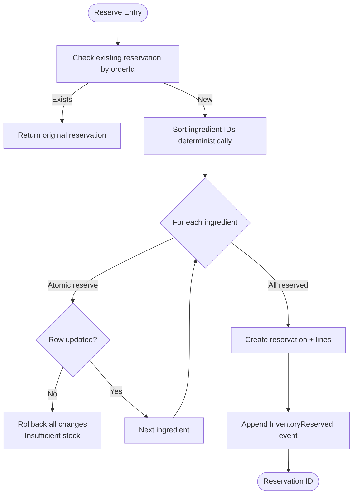

**Diagram sources**
- [InventoryReservationService.java:43-54](file://src/main/java/com/smartcoffee/modules/inventory/application/InventoryReservationService.java#L43-L54)

Consumption flow:
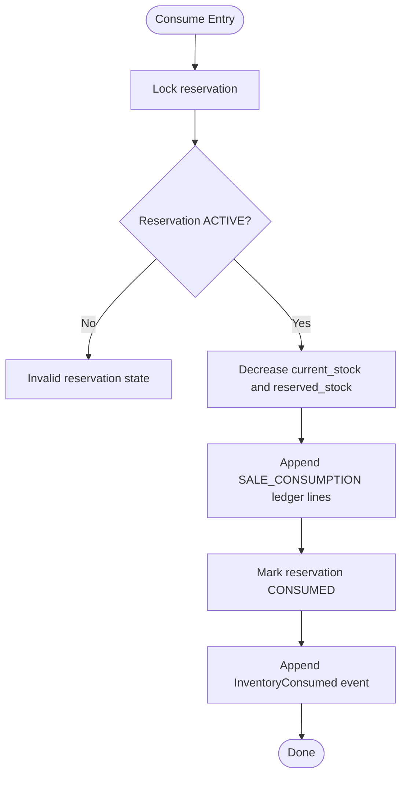

**Diagram sources**
- [InventoryReservationService.java:67-85](file://src/main/java/com/smartcoffee/modules/inventory/application/InventoryReservationService.java#L67-L85)

Release and expire flows:
- Release: lock reservation, decrease reserved_stock only, mark RELEASED, emit release event.
- Expire: lock reservation, release stock if still active before expiry, mark EXPIRED.

**Section sources**
- [InventoryReservationService.java:43-97](file://src/main/java/com/smartcoffee/modules/inventory/application/InventoryReservationService.java#L43-L97)

### Production Ticket Creation
After an order is confirmed and paid:
- Validate order state is CONFIRMED.
- Group order items by production station.
- Resolve station configuration per store.
- Create one ticket per station with items and emit creation event.

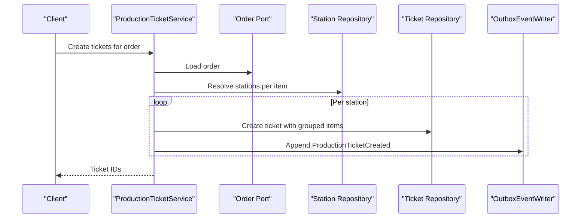

**Diagram sources**
- [ProductionTicketService.java:47-143](file://src/main/java/com/smartcoffee/modules/production/application/ProductionTicketService.java#L47-L143)
- [OutboxEventWriter.java:18-21](file://src/main/java/com/smartcoffee/infrastructure/messaging/outbox/OutboxEventWriter.java#L18-L21)

State transitions for ProductionTicket:
- PENDING -> PREPARING when work begins
- PREPARING -> READY when all items ready
- READY -> COMPLETED when fulfilled
- Any -> CANCELLED on cancellation

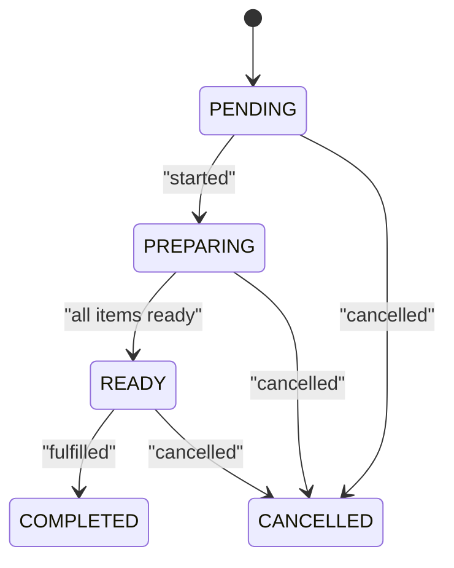

**Diagram sources**
- [ProductionTicket.java:45-73](file://src/main/java/com/smartcoffee/modules/production/domain/ProductionTicket.java#L45-L73)

**Section sources**
- [ProductionTicketService.java:47-143](file://src/main/java/com/smartcoffee/modules/production/application/ProductionTicketService.java#L47-L143)
- [ProductionTicket.java:45-73](file://src/main/java/com/smartcoffee/modules/production/domain/ProductionTicket.java#L45-L73)

### Transactional Outbox Pattern and Event Propagation
- Business services append events to the outbox within the same transaction as domain state changes.
- A background process polls unpublished outbox rows and publishes them to RabbitMQ, then marks them published.
- Consumers use inbox deduplication to handle at-least-once delivery safely.

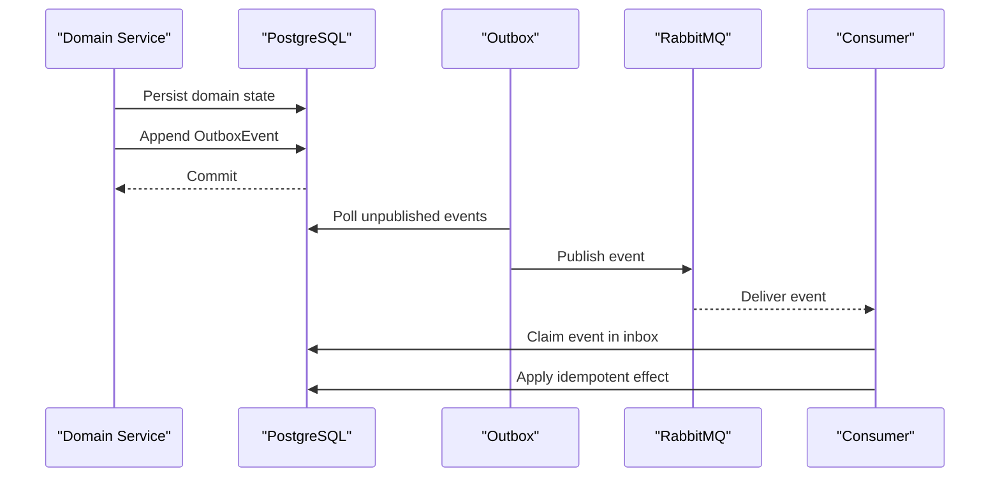

**Diagram sources**
- [OutboxEventWriter.java:18-21](file://src/main/java/com/smartcoffee/infrastructure/messaging/outbox/OutboxEventWriter.java#L18-L21)
- [EventTypes.java:7-8](file://src/main/java/com/smartcoffee/infrastructure/messaging/EventTypes.java#L7-L8)

**Section sources**
- [OutboxEventWriter.java:18-21](file://src/main/java/com/smartcoffee/infrastructure/messaging/outbox/OutboxEventWriter.java#L18-L21)
- [EventTypes.java:7-8](file://src/main/java/com/smartcoffee/infrastructure/messaging/EventTypes.java#L7-L8)

## Dependency Analysis
- Ordering depends on Inventory for reservation and on Catalog/Recipe for pricing and demand.
- Payment depends on Order port to load and confirm orders, on PaymentGateway implementations, and on ReceiptService for snapshots.
- Inventory depends on balance repositories and ledger repositories for atomic updates and auditability.
- Production depends on Order port and Station repository to group and create tickets.
- All modules depend on OutboxEventWriter for reliable event emission.

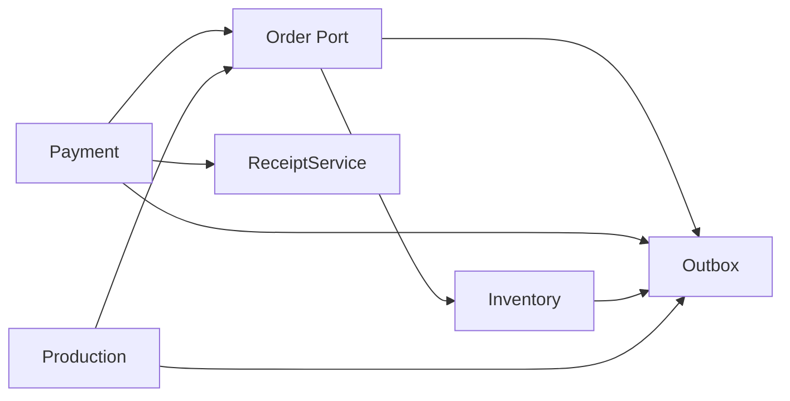

**Diagram sources**
- [OrderCheckoutService.java:62-133](file://src/main/java/com/smartcoffee/modules/ordering/application/OrderCheckoutService.java#L62-L133)
- [PaymentApplicationService.java:48-108](file://src/main/java/com/smartcoffee/modules/payment/application/PaymentApplicationService.java#L48-L108)
- [InventoryReservationService.java:43-97](file://src/main/java/com/smartcoffee/modules/inventory/application/InventoryReservationService.java#L43-L97)
- [ProductionTicketService.java:47-143](file://src/main/java/com/smartcoffee/modules/production/application/ProductionTicketService.java#L47-L143)
- [OutboxEventWriter.java:18-21](file://src/main/java/com/smartcoffee/infrastructure/messaging/outbox/OutboxEventWriter.java#L18-L21)

**Section sources**
- [OrderCheckoutService.java:62-133](file://src/main/java/com/smartcoffee/modules/ordering/application/OrderCheckoutService.java#L62-L133)
- [PaymentApplicationService.java:48-108](file://src/main/java/com/smartcoffee/modules/payment/application/PaymentApplicationService.java#L48-L108)
- [InventoryReservationService.java:43-97](file://src/main/java/com/smartcoffee/modules/inventory/application/InventoryReservationService.java#L43-L97)
- [ProductionTicketService.java:47-143](file://src/main/java/com/smartcoffee/modules/production/application/ProductionTicketService.java#L47-L143)
- [OutboxEventWriter.java:18-21](file://src/main/java/com/smartcoffee/infrastructure/messaging/outbox/OutboxEventWriter.java#L18-L21)

## Performance Considerations
- Use deterministic ordering of ingredient IDs to avoid deadlocks during concurrent reservations.
- Keep inventory operations short-lived and batched where possible to reduce contention.
- Leverage idempotency to absorb client retries without extra work.
- Ensure outbox polling frequency balances latency and throughput.
- Avoid unnecessary catalog lookups by caching read-only catalog data appropriately.

[No sources needed since this section provides general guidance]

## Troubleshooting Guide
Common issues and resolutions:
- Insufficient stock: Reservation fails; review available vs reserved stock and adjust replenishment or order limits.
- Currency or price mismatch: Catalog validation failed; ensure catalog consistency and re-validate pricing before checkout.
- Already paid or already checked out: Idempotency or state guard triggered; verify prior requests and order lifecycle.
- Exchange rate required: Cash conversion requires a valid rate; configure correct tender/settlement rates.
- Payment gateway unavailable: Ensure gateway implementation is registered and healthy.
- Receipt snapshot failure: Investigate persistence errors when creating receipt snapshots.

**Section sources**
- [OrderCheckoutService.java:62-133](file://src/main/java/com/smartcoffee/modules/ordering/application/OrderCheckoutService.java#L62-L133)
- [PaymentApplicationService.java:48-108](file://src/main/java/com/smartcoffee/modules/payment/application/PaymentApplicationService.java#L48-L108)
- [ReceiptService.java:21-32](file://src/main/java/com/smartcoffee/modules/payment/application/ReceiptService.java#L21-L32)

## Conclusion
The Smart Coffee Backend coordinates order placement, payment, inventory, and production through well-defined domain services, robust state machines, and a transactional outbox pattern. This design ensures strong consistency within transactions, reliable asynchronous communication, and resilient handling of failures and retries. The provided diagrams and state models clarify how data flows and transitions occur across modules, enabling operators and developers to reason about correctness, performance, and troubleshooting strategies.