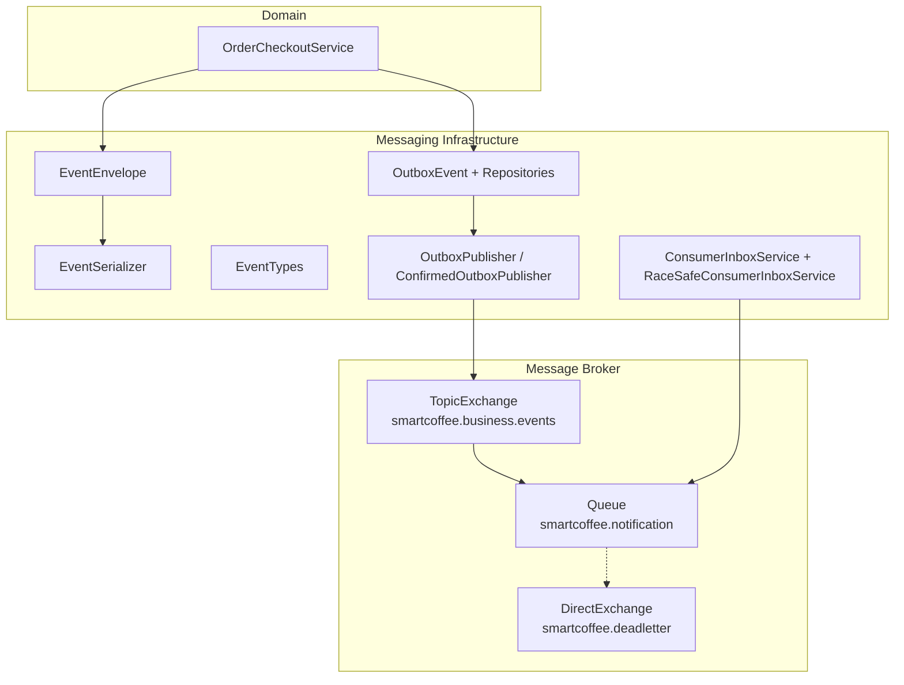
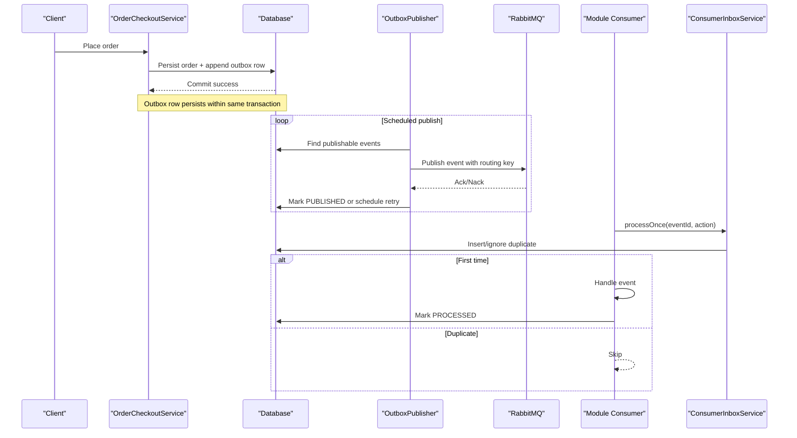
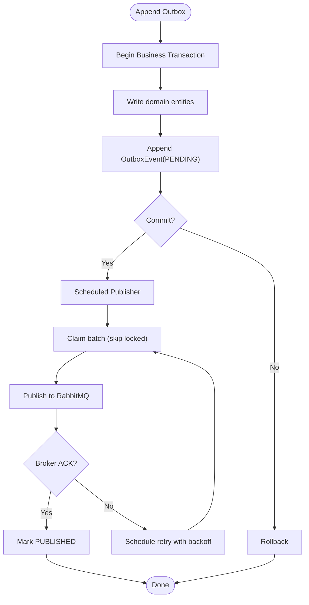
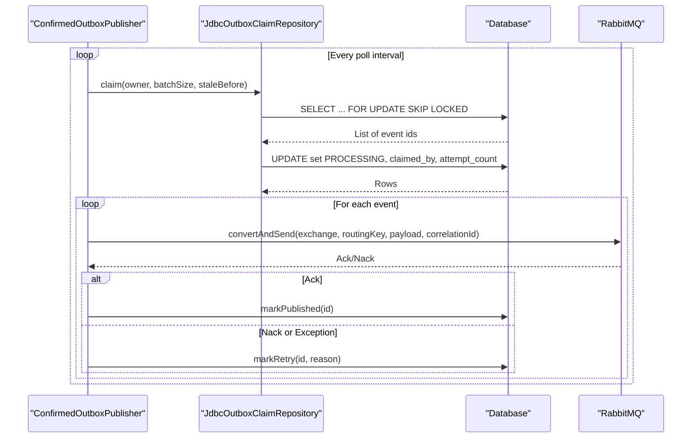
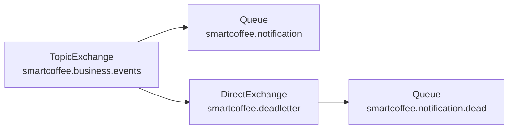
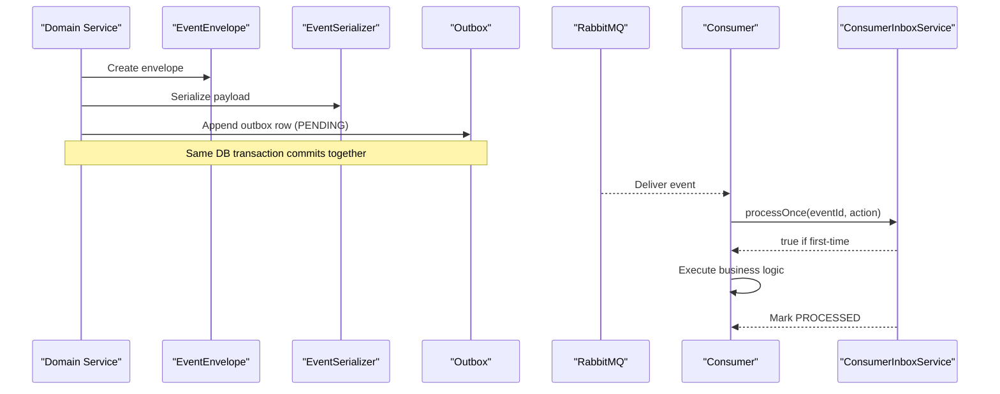
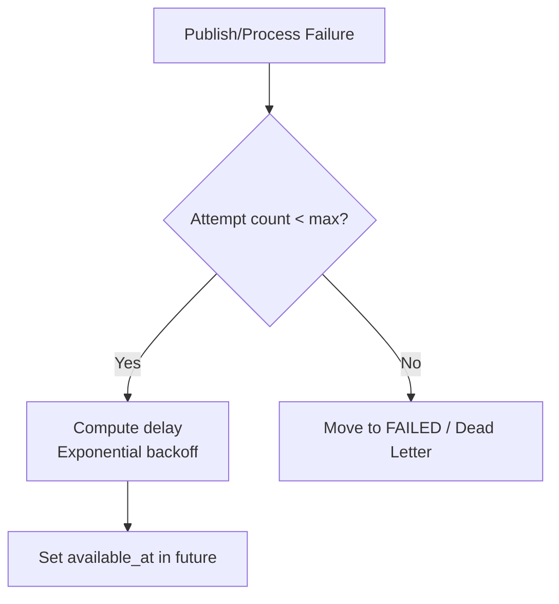
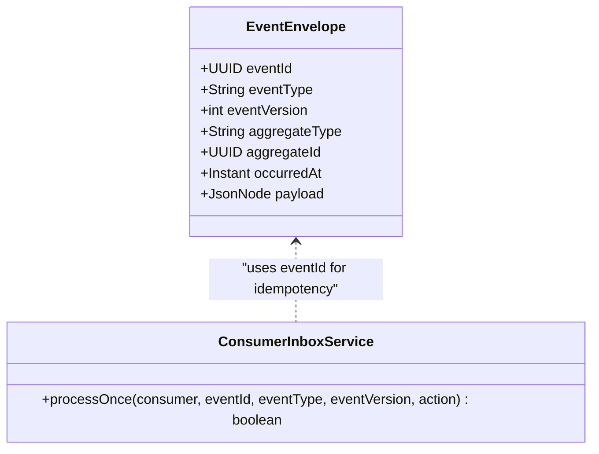
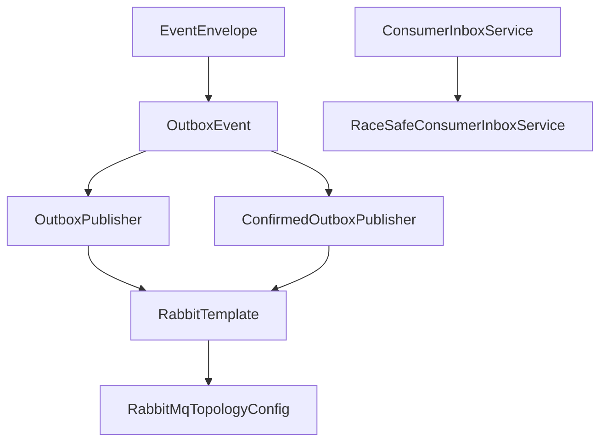

# Event-Driven Communication

<cite>
**Referenced Files in This Document**
- [OutboxEvent.java](file://src/main/java/com/smartcoffee/infrastructure/messaging/outbox/OutboxEvent.java)
- [OutboxPublisher.java](file://src/main/java/com/smartcoffee/infrastructure/messaging/outbox/OutboxPublisher.java)
- [ConfirmedOutboxPublisher.java](file://src/main/java/com/smartcoffee/infrastructure/messaging/outbox/ConfirmedOutboxPublisher.java)
- [JdbcOutboxClaimRepository.java](file://src/main/java/com/smartcoffee/infrastructure/messaging/outbox/JdbcOutboxClaimRepository.java)
- [OutboxEventRepository.java](file://src/main/java/com/smartcoffee/infrastructure/messaging/outbox/OutboxEventRepository.java)
- [OutboxStatus.java](file://src/main/java/com/smartcoffee/infrastructure/messaging/outbox/OutboxStatus.java)
- [OutboxRecoveryJob.java](file://src/main/java/com/smartcoffee/infrastructure/messaging/outbox/OutboxRecoveryJob.java)
- [EventEnvelope.java](file://src/main/java/com/smartcoffee/infrastructure/messaging/EventEnvelope.java)
- [EventSerializer.java](file://src/main/java/com/smartcoffee/infrastructure/messaging/EventSerializer.java)
- [EventTypes.java](file://src/main/java/com/smartcoffee/infrastructure/messaging/EventTypes.java)
- [RabbitMqConfig.java](file://src/main/java/com/smartcoffee/config/RabbitMqConfig.java)
- [RabbitMqTopologyConfig.java](file://src/main/java/com/smartcoffee/config/RabbitMqTopologyConfig.java)
- [ConsumerInboxService.java](file://src/main/java/com/smartcoffee/infrastructure/messaging/inbox/ConsumerInboxService.java)
- [RaceSafeConsumerInboxService.java](file://src/main/java/com/smartcoffee/infrastructure/messaging/inbox/RaceSafeConsumerInboxService.java)
- [OrderCheckoutService.java](file://src/main/java/com/smartcoffee/modules/ordering/application/OrderCheckoutService.java)
- [ORDER_FLOW.mermaid](file://architecture/ORDER_FLOW.mermaid)
- [INVENTORY_FLOW.mermaid](file://architecture/INVENTORY_FLOW.mermaid)
</cite>

## Table of Contents
1. Introduction
2. Project Structure
3. Core Components
4. Architecture Overview
5. Detailed Component Analysis
6. Dependency Analysis
7. Performance Considerations
8. Troubleshooting Guide
9. Conclusion
10. Appendices

## Introduction
This document explains the event-driven communication patterns used throughout Smart Coffee Backend, focusing on the transactional outbox pattern, reliable event publishing to RabbitMQ, and idempotent consumption via a consumer inbox. It details how domain events are created, persisted reliably with business transactions, published asynchronously, and consumed by interested modules with exactly-once semantics. It also covers event types, serialization strategies, error handling for failed deliveries, and mechanisms that support event replay scenarios.

## Project Structure
The eventing infrastructure is implemented under the messaging package with clear separation between:
- Outbox (event persistence and publishing)
- Messaging abstractions (envelope, serializer, types)
- RabbitMQ configuration and topology
- Inbox (idempotent consumption)

**Diagram sources**
- [OrderCheckoutService.java:119-135](file://src/main/java/com/smartcoffee/modules/ordering/application/OrderCheckoutService.java#L119-L135)
- [EventEnvelope.java:1-52](file://src/main/java/com/smartcoffee/infrastructure/messaging/EventEnvelope.java#L1-L52)
- [EventSerializer.java:1-23](file://src/main/java/com/smartcoffee/infrastructure/messaging/EventSerializer.java#L1-L23)
- [EventTypes.java:1-11](file://src/main/java/com/smartcoffee/infrastructure/messaging/EventTypes.java#L1-L11)
- [OutboxEvent.java:15-62](file://src/main/java/com/smartcoffee/infrastructure/messaging/outbox/OutboxEvent.java#L15-L62)
- [OutboxPublisher.java:11-34](file://src/main/java/com/smartcoffee/infrastructure/messaging/outbox/OutboxPublisher.java#L11-L34)
- [ConfirmedOutboxPublisher.java:13-58](file://src/main/java/com/smartcoffee/infrastructure/messaging/outbox/ConfirmedOutboxPublisher.java#L13-L58)
- [RabbitMqTopologyConfig.java:14-86](file://src/main/java/com/smartcoffee/config/RabbitMqTopologyConfig.java#L14-L86)

**Section sources**
- [OrderCheckoutService.java:119-135](file://src/main/java/com/smartcoffee/modules/ordering/application/OrderCheckoutService.java#L119-L135)
- [RabbitMqTopologyConfig.java:14-86](file://src/main/java/com/smartcoffee/config/RabbitMqTopologyConfig.java#L14-L86)

## Core Components
- EventEnvelope: Immutable envelope carrying eventId, eventType, version, aggregate identity, correlation/causation IDs, timestamp, and JSON payload. Enforces required fields at construction time.
- EventSerializer: Serializes envelopes to JSON using a configured ObjectMapper.
- EventTypes: Central registry of event type strings such as OrderPlaced, PaymentCompleted, InventoryReserved, OrderReady.
- OutboxEvent: JPA entity representing an outbox row with status transitions, timestamps, attempt tracking, and optimistic locking.
- Outbox publishers:
  - OutboxPublisher: Polls pending events and publishes them; marks published or schedules retry on failure.
  - ConfirmedOutboxPublisher: Claims rows atomically per instance, publishes with publisher confirms, and updates status accordingly.
- Claim repository: JdbcOutboxClaimRepository implements claim/mark/retry with database-level locking and exponential backoff.
- Consumer inbox: Ensures each event is processed once per consumer, even on retries or duplicates.

**Section sources**
- [EventEnvelope.java:1-52](file://src/main/java/com/smartcoffee/infrastructure/messaging/EventEnvelope.java#L1-L52)
- [EventSerializer.java:1-23](file://src/main/java/com/smartcoffee/infrastructure/messaging/EventSerializer.java#L1-L23)
- [EventTypes.java:1-11](file://src/main/java/com/smartcoffee/infrastructure/messaging/EventTypes.java#L1-L11)
- [OutboxEvent.java:15-216](file://src/main/java/com/smartcoffee/infrastructure/messaging/outbox/OutboxEvent.java#L15-L216)
- [OutboxPublisher.java:11-34](file://src/main/java/com/smartcoffee/infrastructure/messaging/outbox/OutboxPublisher.java#L11-L34)
- [ConfirmedOutboxPublisher.java:13-58](file://src/main/java/com/smartcoffee/infrastructure/messaging/outbox/ConfirmedOutboxPublisher.java#L13-L58)
- [JdbcOutboxClaimRepository.java:26-157](file://src/main/java/com/smartcoffee/infrastructure/messaging/outbox/JdbcOutboxClaimRepository.java#L26-L157)
- [ConsumerInboxService.java:1-34](file://src/main/java/com/smartcoffee/infrastructure/messaging/inbox/ConsumerInboxService.java#L1-L34)
- [RaceSafeConsumerInboxService.java:18-123](file://src/main/java/com/smartcoffee/infrastructure/messaging/inbox/RaceSafeConsumerInboxService.java#L18-L123)

## Architecture Overview
Smart Coffee uses a transactional outbox to guarantee that every domain change that must be communicated is first persisted alongside the business transaction. A background process then publishes these events to RabbitMQ. Consumers use a consumer inbox to ensure idempotent processing.

**Diagram sources**
- [OrderCheckoutService.java:119-135](file://src/main/java/com/smartcoffee/modules/ordering/application/OrderCheckoutService.java#L119-L135)
- [OutboxPublisher.java:21-34](file://src/main/java/com/smartcoffee/infrastructure/messaging/outbox/OutboxPublisher.java#L21-L34)
- [ConfirmedOutboxPublisher.java:28-58](file://src/main/java/com/smartcoffee/infrastructure/messaging/outbox/ConfirmedOutboxPublisher.java#L28-L58)
- [JdbcOutboxClaimRepository.java:26-157](file://src/main/java/com/smartcoffee/infrastructure/messaging/outbox/JdbcOutboxClaimRepository.java#L26-L157)
- [RaceSafeConsumerInboxService.java:18-123](file://src/main/java/com/smartcoffee/infrastructure/messaging/inbox/RaceSafeConsumerInboxService.java#L18-L123)

## Detailed Component Analysis

### Transactional Outbox Pattern
- Domain services append an outbox row inside the same transaction as business writes. For example, placing an order appends an OrderPlaced event envelope into the outbox table.
- The outbox row includes event identity, type, version, aggregate identity, routing key, serialized payload, occurrence time, availability time, and status.
- Status transitions:
  - PENDING: newly appended
  - PROCESSING: claimed by a publisher instance
  - PUBLISHED: acknowledged by broker
  - FAILED: exceeded max attempts
- Optimistic concurrency control prevents lost updates during concurrent claims.

**Diagram sources**
- [OutboxEvent.java:67-95](file://src/main/java/com/smartcoffee/infrastructure/messaging/outbox/OutboxEvent.java#L67-L95)
- [OutboxEvent.java:189-215](file://src/main/java/com/smartcoffee/infrastructure/messaging/outbox/OutboxEvent.java#L189-L215)
- [OutboxPublisher.java:21-34](file://src/main/java/com/smartcoffee/infrastructure/messaging/outbox/OutboxPublisher.java#L21-L34)
- [JdbcOutboxClaimRepository.java:26-157](file://src/main/java/com/smartcoffee/infrastructure/messaging/outbox/JdbcOutboxClaimRepository.java#L26-L157)

**Section sources**
- [OrderCheckoutService.java:119-135](file://src/main/java/com/smartcoffee/modules/ordering/application/OrderCheckoutService.java#L119-L135)
- [OutboxEvent.java:15-216](file://src/main/java/com/smartcoffee/infrastructure/messaging/outbox/OutboxEvent.java#L15-L216)
- [OutboxPublisher.java:11-34](file://src/main/java/com/smartcoffee/infrastructure/messaging/outbox/OutboxPublisher.java#L11-L34)
- [JdbcOutboxClaimRepository.java:26-157](file://src/main/java/com/smartcoffee/infrastructure/messaging/outbox/JdbcOutboxClaimRepository.java#L26-L157)

### Event Publishing Mechanisms
Two publisher strategies coexist:
- OutboxPublisher: Simple polling-based publisher that reads pending events and sends them. On runtime exceptions, it schedules retries.
- ConfirmedOutboxPublisher: Uses database-level claiming with FOR UPDATE SKIP LOCKED to avoid multi-instance collisions. Publishes with CorrelationData and waits for broker acknowledgment. Marks events as published on ACK; otherwise records errors and schedules retries with exponential backoff.

**Diagram sources**
- [ConfirmedOutboxPublisher.java:28-58](file://src/main/java/com/smartcoffee/infrastructure/messaging/outbox/ConfirmedOutboxPublisher.java#L28-L58)
- [JdbcOutboxClaimRepository.java:26-157](file://src/main/java/com/smartcoffee/infrastructure/messaging/outbox/JdbcOutboxClaimRepository.java#L26-L157)

**Section sources**
- [OutboxPublisher.java:11-34](file://src/main/java/com/smartcoffee/infrastructure/messaging/outbox/OutboxPublisher.java#L11-L34)
- [ConfirmedOutboxPublisher.java:13-58](file://src/main/java/com/smartcoffee/infrastructure/messaging/outbox/ConfirmedOutboxPublisher.java#L13-L58)
- [JdbcOutboxClaimRepository.java:26-157](file://src/main/java/com/smartcoffee/infrastructure/messaging/outbox/JdbcOutboxClaimRepository.java#L26-L157)

### Message Queue Integration with RabbitMQ
- Exchange: Topic exchange named smartcoffee.business.events.
- Queues: Example queue smartcoffee.notification bound to specific routing keys (e.g., order.ready.v1, payment.*.v1, loyalty.#).
- Dead lettering: A dedicated dead letter exchange and queue capture failures for later inspection.
- Routing keys: Events include a routing key (e.g., order.placed.v1) enabling fine-grained subscriptions.

**Diagram sources**
- [RabbitMqTopologyConfig.java:14-86](file://src/main/java/com/smartcoffee/config/RabbitMqTopologyConfig.java#L14-L86)
- [RabbitMqConfig.java:5-10](file://src/main/java/com/smartcoffee/config/RabbitMqConfig.java#L5-L10)

**Section sources**
- [RabbitMqTopologyConfig.java:14-86](file://src/main/java/com/smartcoffee/config/RabbitMqTopologyConfig.java#L14-L86)
- [RabbitMqConfig.java:5-10](file://src/main/java/com/smartcoffee/config/RabbitMqConfig.java#L5-L10)

### Domain Events: Creation, Storage, and Consumption
- Creation: Domain services create an EventEnvelope with a unique eventId, stable eventType string from EventTypes, version, aggregate identity, and a JSON payload.
- Storage: The envelope is serialized and appended to the outbox table within the same transaction as domain changes.
- Publication: Background publishers claim and send events to RabbitMQ. Successful delivery marks events as published; failures schedule retries with backoff.
- Consumption: Consumers wrap event handling in ConsumerInboxService.processOnce to ensure idempotency. If the same event arrives multiple times, only one execution proceeds.

**Diagram sources**
- [OrderCheckoutService.java:119-135](file://src/main/java/com/smartcoffee/modules/ordering/application/OrderCheckoutService.java#L119-L135)
- [EventEnvelope.java:1-52](file://src/main/java/com/smartcoffee/infrastructure/messaging/EventEnvelope.java#L1-L52)
- [EventSerializer.java:1-23](file://src/main/java/com/smartcoffee/infrastructure/messaging/EventSerializer.java#L1-L23)
- [RaceSafeConsumerInboxService.java:18-123](file://src/main/java/com/smartcoffee/infrastructure/messaging/inbox/RaceSafeConsumerInboxService.java#L18-L123)

**Section sources**
- [OrderCheckoutService.java:119-135](file://src/main/java/com/smartcoffee/modules/ordering/application/OrderCheckoutService.java#L119-L135)
- [EventEnvelope.java:1-52](file://src/main/java/com/smartcoffee/infrastructure/messaging/EventEnvelope.java#L1-L52)
- [EventSerializer.java:1-23](file://src/main/java/com/smartcoffee/infrastructure/messaging/EventSerializer.java#L1-L23)
- [RaceSafeConsumerInboxService.java:18-123](file://src/main/java/com/smartcoffee/infrastructure/messaging/inbox/RaceSafeConsumerInboxService.java#L18-L123)

### Event Types and Serialization Strategy
- Event types are centralized constants (e.g., OrderPlaced, PaymentCompleted, InventoryReserved, OrderReady).
- Payloads are JSON objects attached to the envelope. The system serializes envelopes to JSON for storage and transport.
- Versioning: Each event carries a version number to enable schema evolution while preserving backward compatibility.

**Section sources**
- [EventTypes.java:1-11](file://src/main/java/com/smartcoffee/infrastructure/messaging/EventTypes.java#L1-L11)
- [EventEnvelope.java:1-52](file://src/main/java/com/smartcoffee/infrastructure/messaging/EventEnvelope.java#L1-L52)
- [EventSerializer.java:1-23](file://src/main/java/com/smartcoffee/infrastructure/messaging/EventSerializer.java#L1-L23)

### Error Handling and Failed Deliveries
- Publisher-side failures:
  - OutboxPublisher catches runtime exceptions and schedules retry with backoff.
  - ConfirmedOutboxPublisher uses broker acknowledgments to distinguish nack and exceptions, recording error reasons and scheduling retries.
- Max attempts: After repeated failures, events transition to FAILED state.
- Dead lettering: Unhandled consumer failures can be routed to a dead letter exchange/queue for investigation.

**Diagram sources**
- [OutboxPublisher.java:21-34](file://src/main/java/com/smartcoffee/infrastructure/messaging/outbox/OutboxPublisher.java#L21-L34)
- [ConfirmedOutboxPublisher.java:28-58](file://src/main/java/com/smartcoffee/infrastructure/messaging/outbox/ConfirmedOutboxPublisher.java#L28-L58)
- [JdbcOutboxClaimRepository.java:127-157](file://src/main/java/com/smartcoffee/infrastructure/messaging/outbox/JdbcOutboxClaimRepository.java#L127-L157)
- [RabbitMqTopologyConfig.java:33-55](file://src/main/java/com/smartcoffee/config/RabbitMqTopologyConfig.java#L33-L55)

**Section sources**
- [OutboxPublisher.java:21-34](file://src/main/java/com/smartcoffee/infrastructure/messaging/outbox/OutboxPublisher.java#L21-L34)
- [ConfirmedOutboxPublisher.java:28-58](file://src/main/java/com/smartcoffee/infrastructure/messaging/outbox/ConfirmedOutboxPublisher.java#L28-L58)
- [JdbcOutboxClaimRepository.java:127-157](file://src/main/java/com/smartcoffee/infrastructure/messaging/outbox/JdbcOutboxClaimRepository.java#L127-L157)
- [RabbitMqTopologyConfig.java:33-55](file://src/main/java/com/smartcoffee/config/RabbitMqTopologyConfig.java#L33-L55)

### Exactly-Once Delivery Semantics and Replay Scenarios
- Producer side:
  - Each event has a unique eventId in the envelope, ensuring deduplication downstream.
  - Outbox ensures durability: events are committed with business data before publication.
- Consumer side:
  - ConsumerInboxService uses a unique constraint on (consumer_name, event_id) to prevent duplicate processing.
  - If a message is retried by the broker, the consumer recognizes the eventId and skips reprocessing.
- Replay:
  - Because events are stored in the outbox with payloads and metadata, they can be replayed by re-publishing from the outbox or by re-processing from the inbox perspective (idempotent by eventId).

**Diagram sources**
- [EventEnvelope.java:1-52](file://src/main/java/com/smartcoffee/infrastructure/messaging/EventEnvelope.java#L1-L52)
- [RaceSafeConsumerInboxService.java:18-123](file://src/main/java/com/smartcoffee/infrastructure/messaging/inbox/RaceSafeConsumerInboxService.java#L18-L123)

**Section sources**
- [EventEnvelope.java:1-52](file://src/main/java/com/smartcoffee/infrastructure/messaging/EventEnvelope.java#L1-L52)
- [RaceSafeConsumerInboxService.java:18-123](file://src/main/java/com/smartcoffee/infrastructure/messaging/inbox/RaceSafeConsumerInboxService.java#L18-L123)

### Examples of Common Events
- OrderPlaced: Emitted when an order is successfully created and reserved. Stored in outbox and published with routing key like order.placed.v1.
- PaymentCompleted: Emitted after successful payment completion; downstream modules (e.g., production, notifications) react accordingly.
- InventoryReserved: Emitted when inventory is reserved for an order; supports analytics and downstream projections.
- OrderReady: Emitted when production completes; triggers notifications and customer updates.

These events follow the same lifecycle: create envelope, append to outbox, publish, consume idempotently.

**Section sources**
- [EventTypes.java:1-11](file://src/main/java/com/smartcoffee/infrastructure/messaging/EventTypes.java#L1-L11)
- [ORDER_FLOW.mermaid:41-59](file://architecture/ORDER_FLOW.mermaid#L41-L59)
- [INVENTORY_FLOW.mermaid:41-75](file://architecture/INVENTORY_FLOW.mermaid#L41-L75)

## Dependency Analysis
- OutboxEvent depends on EventEnvelope for creation and OutboxStatus for lifecycle states.
- Publishers depend on RabbitTemplate and either OutboxEventRepository or JdbcOutboxClaimRepository.
- Topology configuration defines exchanges, queues, bindings, and dead lettering.
- Consumers depend on ConsumerInboxService for idempotency.

**Diagram sources**
- [OutboxEvent.java:15-62](file://src/main/java/com/smartcoffee/infrastructure/messaging/outbox/OutboxEvent.java#L15-L62)
- [OutboxPublisher.java:11-34](file://src/main/java/com/smartcoffee/infrastructure/messaging/outbox/OutboxPublisher.java#L11-L34)
- [ConfirmedOutboxPublisher.java:13-58](file://src/main/java/com/smartcoffee/infrastructure/messaging/outbox/ConfirmedOutboxPublisher.java#L13-L58)
- [RabbitMqTopologyConfig.java:14-86](file://src/main/java/com/smartcoffee/config/RabbitMqTopologyConfig.java#L14-L86)
- [RaceSafeConsumerInboxService.java:18-123](file://src/main/java/com/smartcoffee/infrastructure/messaging/inbox/RaceSafeConsumerInboxService.java#L18-L123)

**Section sources**
- [OutboxEvent.java:15-62](file://src/main/java/com/smartcoffee/infrastructure/messaging/outbox/OutboxEvent.java#L15-L62)
- [OutboxPublisher.java:11-34](file://src/main/java/com/smartcoffee/infrastructure/messaging/outbox/OutboxPublisher.java#L11-L34)
- [ConfirmedOutboxPublisher.java:13-58](file://src/main/java/com/smartcoffee/infrastructure/messaging/outbox/ConfirmedOutboxPublisher.java#L13-L58)
- [RabbitMqTopologyConfig.java:14-86](file://src/main/java/com/smartcoffee/config/RabbitMqTopologyConfig.java#L14-L86)
- [RaceSafeConsumerInboxService.java:18-123](file://src/main/java/com/smartcoffee/infrastructure/messaging/inbox/RaceSafeConsumerInboxService.java#L18-L123)

## Performance Considerations
- Batch size: Configurable via application properties to tune throughput vs. latency.
- Polling intervals: Adjustable delays for outbox polling and recovery jobs.
- Database locking: FOR UPDATE SKIP LOCKED avoids contention across instances.
- Exponential backoff: Reduces pressure on broker and database during transient failures.
- JSON payloads: Keep payloads minimal to reduce network and storage overhead.

[No sources needed since this section provides general guidance]

## Troubleshooting Guide
- Stuck events:
  - Check OutboxStatus for PENDING/PROCESSING/FAILED.
  - Verify available_at and attempt_count to understand retry behavior.
- Duplicate processing:
  - Ensure consumers use ConsumerInboxService.processOnce with consistent consumer names.
- Broker issues:
  - Inspect dead letter queue for unhandled failures.
  - Review publisher logs for nack reasons and exceptions.
- Recovery:
  - Implement OutboxRecoveryJob to reclaim stale PROCESSING events if needed.

**Section sources**
- [OutboxStatus.java:1-7](file://src/main/java/com/smartcoffee/infrastructure/messaging/outbox/OutboxStatus.java#L1-L7)
- [OutboxEvent.java:189-215](file://src/main/java/com/smartcoffee/infrastructure/messaging/outbox/OutboxEvent.java#L189-L215)
- [JdbcOutboxClaimRepository.java:127-157](file://src/main/java/com/smartcoffee/infrastructure/messaging/outbox/JdbcOutboxClaimRepository.java#L127-L157)
- [RabbitMqTopologyConfig.java:33-55](file://src/main/java/com/smartcoffee/config/RabbitMqTopologyConfig.java#L33-L55)
- [OutboxRecoveryJob.java:6-14](file://src/main/java/com/smartcoffee/infrastructure/messaging/outbox/OutboxRecoveryJob.java#L6-L14)

## Conclusion
Smart Coffee’s event-driven architecture combines a robust transactional outbox with reliable RabbitMQ integration and idempotent consumption. This design guarantees durable event emission aligned with business transactions, resilient publishing with retries and dead-lettering, and exactly-once processing semantics via a consumer inbox. The approach supports scalable, decoupled modules and enables safe event replay and schema evolution through versioned envelopes.

[No sources needed since this section summarizes without analyzing specific files]

## Appendices

### Flow References
- Order flow demonstrates outbox usage when creating orders and publishing OrderPlaced.
- Inventory flow shows reservation and consumption events emitted to outbox and delivered to analytics.

**Section sources**
- [ORDER_FLOW.mermaid:41-59](file://architecture/ORDER_FLOW.mermaid#L41-L59)
- [INVENTORY_FLOW.mermaid:41-75](file://architecture/INVENTORY_FLOW.mermaid#L41-L75)