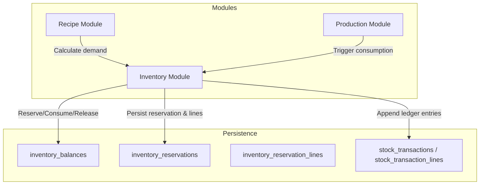
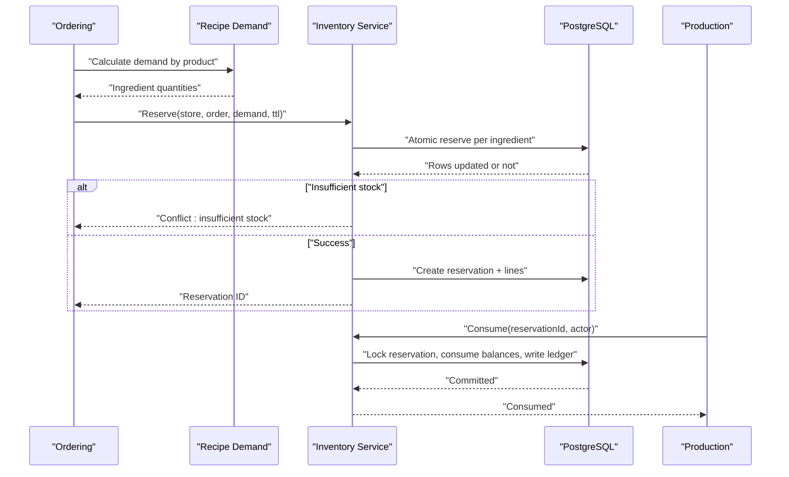
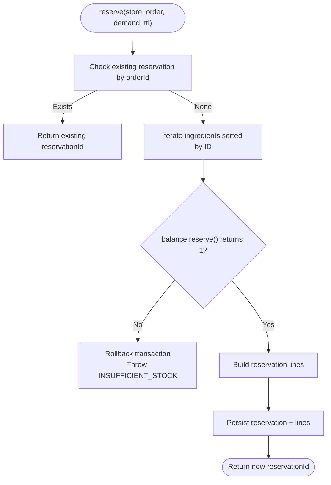
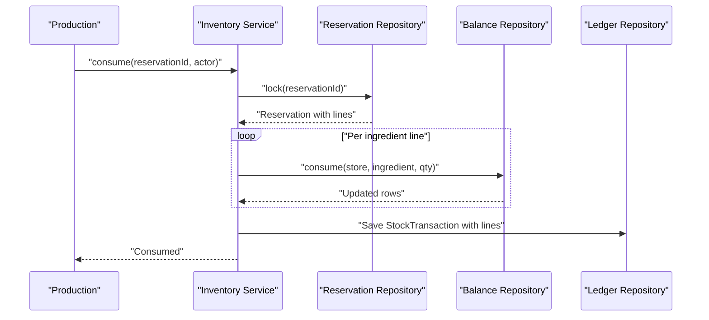
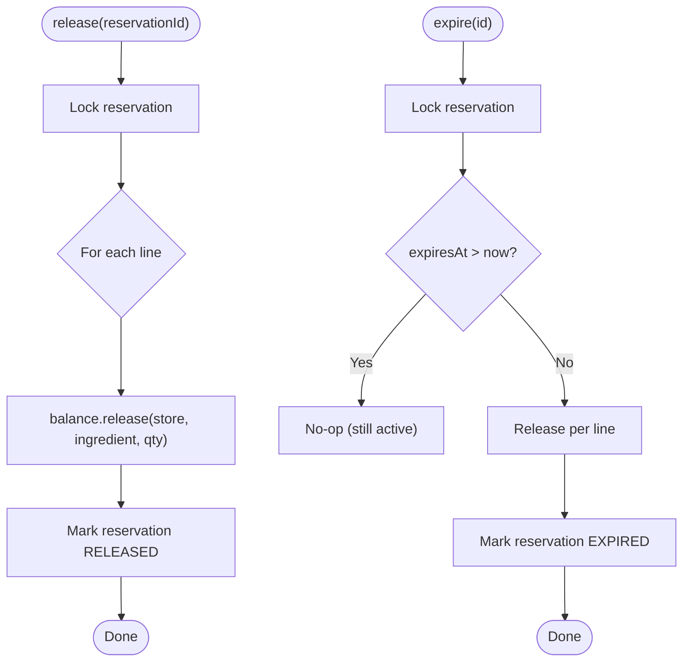
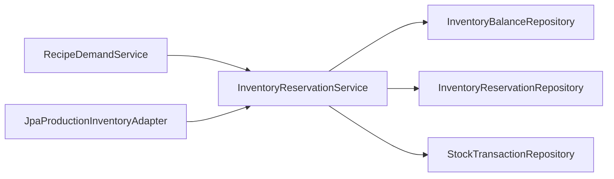

# Inventory Management Flow

<cite>
**Referenced Files in This Document**
- [INVENTORY_FLOW.mermaid](file://architecture/INVENTORY_FLOW.mermaid)
- [InventoryReservationService.java](file://src/main/java/com/smartcoffee/modules/inventory/application/InventoryReservationService.java)
- [InventoryBalanceRepository.java](file://src/main/java/com/smartcoffee/modules/inventory/persistence/InventoryBalanceRepository.java)
- [InventoryReservationRepository.java](file://src/main/java/com/smartcoffee/modules/inventory/persistence/InventoryReservationRepository.java)
- [StockTransactionRepository.java](file://src/main/java/com/smartcoffee/modules/inventory/persistence/StockTransactionRepository.java)
- [InventoryReservation.java](file://src/main/java/com/smartcoffee/modules/inventory/domain/InventoryReservation.java)
- [InventoryReservationLine.java](file://src/main/java/com/smartcoffee/modules/inventory/domain/InventoryReservationLine.java)
- [InventoryBalance.java](file://src/main/java/com/smartcoffee/modules/inventory/domain/InventoryBalance.java)
- [StockTransaction.java](file://src/main/java/com/smartcoffee/modules/inventory/domain/StockTransaction.java)
- [StockTransactionLine.java](file://src/main/java/com/smartcoffee/modules/inventory/domain/StockTransactionLine.java)
- [RecipeDemandService.java](file://src/main/java/com/smartcoffee/modules/recipe/application/RecipeDemandService.java)
- [JpaProductionInventoryAdapter.java](file://src/main/java/com/smartcoffee/modules/production/application/JpaProductionInventoryAdapter.java)
- [V005__recipe_inventory_uom_reservation_ledger.sql](file://src/main/resources/db/migration/V005__recipe_inventory_uom_reservation_ledger.sql)
- [smart-coffee-logical.dbml](file://database/smart-coffee-logical.dbml)
- [InventoryController.java](file://src/main/java/com/smartcoffee/modules/inventory/api/InventoryController.java)
- [InventoryQueryService.java](file://src/main/java/com/smartcoffee/modules/inventory/application/InventoryQueryService.java)
</cite>

## Table of Contents
1. Introduction
2. Project Structure
3. Core Components
4. Architecture Overview
5. Detailed Component Analysis
6. Dependency Analysis
7. Performance Considerations
8. Troubleshooting Guide
9. Conclusion
10. Appendices

## Introduction
This document explains the end-to-end inventory management flow for ingredient reservations, consumption tracking, and stock level updates. It covers how recipe-based demand is calculated, how atomic reservations are created and enforced, how low-stock alerts are surfaced, and how production activities trigger consumption events. It also details the reservation lifecycle, conflict resolution under concurrency, data consistency mechanisms (including rollback behavior), and performance considerations for high-volume operations. Finally, it provides examples of inventory queries and clarifies how accurate stock levels are maintained across concurrent operations.

## Project Structure
The inventory capability spans domain entities, application services, persistence repositories, and cross-module integrations with recipe and production modules. The database schema defines balances, reservations, reservation lines, and an append-only stock transaction ledger.

**Diagram sources**
- [INVENTORY_FLOW.mermaid:1-76](file://architecture/INVENTORY_FLOW.mermaid#L1-L76)
- [V005__recipe_inventory_uom_reservation_ledger.sql:104-144](file://src/main/resources/db/migration/V005__recipe_inventory_uom_reservation_ledger.sql#L104-L144)
- [smart-coffee-logical.dbml:607-636](file://database/smart-coffee-logical.dbml#L607-L636)

**Section sources**
- [INVENTORY_FLOW.mermaid:1-76](file://architecture/INVENTORY_FLOW.mermaid#L1-L76)
- [V005__recipe_inventory_uom_reservation_ledger.sql:104-144](file://src/main/resources/db/migration/V005__recipe_inventory_uom_reservation_ledger.sql#L104-L144)
- [smart-coffee-logical.dbml:607-636](file://database/smart-coffee-logical.dbml#L607-L636)

## Core Components
- Recipe demand calculation aggregates per-ingredient quantities from active recipes for ordered products.
- Inventory reservation service atomically reserves stock per ingredient, persists reservation state, and writes audit ledger entries on consumption.
- Persistence layer enforces optimistic locking on balances and pessimistic locking on reservations to prevent races.
- Production module triggers consumption via a port that locates the order’s reservation and invokes consumption.

Key responsibilities:
- Calculate demand: RecipeDemandService
- Reserve/release/consume: InventoryReservationService
- Balance updates with conditional SQL: InventoryBalanceRepository
- Reservation lifecycle and locking: InventoryReservationRepository + InventoryReservation
- Ledger auditing: StockTransaction + StockTransactionLine
- Consumption trigger from production: JpaProductionInventoryAdapter

**Section sources**
- [RecipeDemandService.java:22-59](file://src/main/java/com/smartcoffee/modules/recipe/application/RecipeDemandService.java#L22-L59)
- [InventoryReservationService.java:43-97](file://src/main/java/com/smartcoffee/modules/inventory/application/InventoryReservationService.java#L43-L97)
- [InventoryBalanceRepository.java:10-23](file://src/main/java/com/smartcoffee/modules/inventory/persistence/InventoryBalanceRepository.java#L10-L23)
- [InventoryReservationRepository.java:11-20](file://src/main/java/com/smartcoffee/modules/inventory/persistence/InventoryReservationRepository.java#L11-L20)
- [InventoryReservation.java:41-79](file://src/main/java/com/smartcoffee/modules/inventory/domain/InventoryReservation.java#L41-L79)
- [StockTransaction.java:36-53](file://src/main/java/com/smartcoffee/modules/inventory/domain/StockTransaction.java#L36-L53)
- [StockTransactionLine.java:33-46](file://src/main/java/com/smartcoffee/modules/inventory/domain/StockTransactionLine.java#L33-L46)
- [JpaProductionInventoryAdapter.java:19-23](file://src/main/java/com/smartcoffee/modules/production/application/JpaProductionInventoryAdapter.java#L19-L23)

## Architecture Overview
The system coordinates three modules:
- Ordering/Checkout computes product demand and delegates to inventory.
- Inventory performs atomic reservations and later consumption, emitting side effects via outbox and MQ (conceptual).
- Production initiates consumption when items are prepared.

**Diagram sources**
- [INVENTORY_FLOW.mermaid:1-76](file://architecture/INVENTORY_FLOW.mermaid#L1-L76)
- [InventoryReservationService.java:43-97](file://src/main/java/com/smartcoffee/modules/inventory/application/InventoryReservationService.java#L43-L97)
- [InventoryBalanceRepository.java:10-23](file://src/main/java/com/smartcoffee/modules/inventory/persistence/InventoryBalanceRepository.java#L10-L23)
- [JpaProductionInventoryAdapter.java:19-23](file://src/main/java/com/smartcoffee/modules/production/application/JpaProductionInventoryAdapter.java#L19-L23)

## Detailed Component Analysis

### Reservation Lifecycle and Concurrency Control
- Idempotent reservation by order: If a reservation already exists for the order, the same reservation ID is returned.
- Atomic reservation: For each ingredient, a conditional update increments reserved_stock only if current_stock - reserved_stock >= requested quantity. On failure, the entire transaction rolls back.
- Deterministic ordering: Ingredients are sorted by ID before reserving to avoid deadlocks across concurrent orders.
- Reservation persistence: After all ingredients succeed, the reservation and its lines are saved within the same transaction.
- Locking: Consuming and releasing use pessimistic write locks on the reservation row to serialize state transitions.

**Diagram sources**
- [InventoryReservationService.java:43-54](file://src/main/java/com/smartcoffee/modules/inventory/application/InventoryReservationService.java#L43-L54)
- [InventoryBalanceRepository.java:10-16](file://src/main/java/com/smartcoffee/modules/inventory/persistence/InventoryBalanceRepository.java#L10-L16)

**Section sources**
- [InventoryReservationService.java:43-54](file://src/main/java/com/smartcoffee/modules/inventory/application/InventoryReservationService.java#L43-L54)
- [InventoryBalanceRepository.java:10-16](file://src/main/java/com/smartcoffee/modules/inventory/persistence/InventoryBalanceRepository.java#L10-L16)
- [InventoryReservationRepository.java:11-20](file://src/main/java/com/smartcoffee/modules/inventory/persistence/InventoryReservationRepository.java#L11-L20)

### Consumption Flow Triggered by Production
- Production calls consumeForOrder(orderId, actor), which finds the reservation by orderId and invokes consumption.
- Consumption locks the reservation, decrements both current_stock and reserved_stock per ingredient, marks the reservation consumed, and appends immutable ledger lines capturing before/after balances.
- Idempotency: Repeated consumption attempts on an already consumed reservation are handled safely by state checks and locking.

**Diagram sources**
- [JpaProductionInventoryAdapter.java:19-23](file://src/main/java/com/smartcoffee/modules/production/application/JpaProductionInventoryAdapter.java#L19-L23)
- [InventoryReservationService.java:67-85](file://src/main/java/com/smartcoffee/modules/inventory/application/InventoryReservationService.java#L67-L85)
- [InventoryBalanceRepository.java:18-20](file://src/main/java/com/smartcoffee/modules/inventory/persistence/InventoryBalanceRepository.java#L18-L20)
- [StockTransaction.java:36-53](file://src/main/java/com/smartcoffee/modules/inventory/domain/StockTransaction.java#L36-L53)

**Section sources**
- [JpaProductionInventoryAdapter.java:19-23](file://src/main/java/com/smartcoffee/modules/production/application/JpaProductionInventoryAdapter.java#L19-L23)
- [InventoryReservationService.java:67-85](file://src/main/java/com/smartcoffee/modules/inventory/application/InventoryReservationService.java#L67-L85)
- [InventoryReservationRepository.java:11-15](file://src/main/java/com/smartcoffee/modules/inventory/persistence/InventoryReservationRepository.java#L11-L15)

### Release and Expiration
- Release: When an order is cancelled before preparation, release locks the reservation, decreases reserved_stock per ingredient, and marks the reservation released.
- Expiration: A background process can expire active reservations past their TTL, releasing reserved stock and marking them expired.

**Diagram sources**
- [InventoryReservationService.java:56-97](file://src/main/java/com/smartcoffee/modules/inventory/application/InventoryReservationService.java#L56-L97)

**Section sources**
- [InventoryReservationService.java:56-97](file://src/main/java/com/smartcoffee/modules/inventory/application/InventoryReservationService.java#L56-L97)

### Data Consistency and Rollback Behavior
- Transactional boundaries: Each operation (reserve, release, consume, expire) runs in its own @Transactional method. Any failure causes a full rollback of balance changes and reservation updates.
- Optimistic locking: InventoryBalance uses a version column; conflicts result in failed updates and exceptions.
- Pessimistic locking: Reservation reads use PESSIMISTIC_WRITE to serialize state transitions during consume/release/expire.
- Conditional updates: Native SQL ensures reserved_stock and current_stock are only modified when constraints hold (e.g., sufficient available stock).
- Auditability: Consumption writes immutable ledger lines with before/after balances, enabling reconciliation and traceability.

**Section sources**
- [InventoryReservationService.java:43-97](file://src/main/java/com/smartcoffee/modules/inventory/application/InventoryReservationService.java#L43-L97)
- [InventoryBalance.java:22-23](file://src/main/java/com/smartcoffee/modules/inventory/domain/InventoryBalance.java#L22-L23)
- [InventoryReservationRepository.java:11-15](file://src/main/java/com/smartcoffee/modules/inventory/persistence/InventoryReservationRepository.java#L11-L15)
- [InventoryBalanceRepository.java:10-20](file://src/main/java/com/smartcoffee/modules/inventory/persistence/InventoryBalanceRepository.java#L10-L20)
- [StockTransaction.java:36-53](file://src/main/java/com/smartcoffee/modules/inventory/domain/StockTransaction.java#L36-L53)

### Low Stock Alerts
- Available stock equals current_stock minus reserved_stock.
- The query response includes a boolean flag indicating whether available stock is at or below minimum_stock, enabling UI/alerts.

**Section sources**
- [InventoryBalance.java:40-46](file://src/main/java/com/smartcoffee/modules/inventory/domain/InventoryBalance.java#L40-L46)
- [InventoryQueryService.java:1-2](file://src/main/java/com/smartcoffee/modules/inventory/application/InventoryQueryService.java#L1-L2)
- [InventoryController.java:26-32](file://src/main/java/com/smartcoffee/modules/inventory/api/InventoryController.java#L26-L32)

### Relationship Between Inventory Transactions and Business Events
- Stock transactions are append-only records tied to business references (e.g., ORDER) and actors, providing an immutable trail for consumption events.
- While event publishing to MQ/outbox is conceptualized in the architecture diagram, the codebase explicitly persists stock transactions for audit and reporting.

**Section sources**
- [StockTransaction.java:36-53](file://src/main/java/com/smartcoffee/modules/inventory/domain/StockTransaction.java#L36-L53)
- [INVENTORY_FLOW.mermaid:70-75](file://architecture/INVENTORY_FLOW.mermaid#L70-L75)

## Dependency Analysis

**Diagram sources**
- [RecipeDemandService.java:22-59](file://src/main/java/com/smartcoffee/modules/recipe/application/RecipeDemandService.java#L22-L59)
- [InventoryReservationService.java:31-41](file://src/main/java/com/smartcoffee/modules/inventory/application/InventoryReservationService.java#L31-L41)
- [InventoryBalanceRepository.java:1-23](file://src/main/java/com/smartcoffee/modules/inventory/persistence/InventoryBalanceRepository.java#L1-L23)
- [InventoryReservationRepository.java:1-20](file://src/main/java/com/smartcoffee/modules/inventory/persistence/InventoryReservationRepository.java#L1-L20)
- [StockTransactionRepository.java:1-8](file://src/main/java/com/smartcoffee/modules/inventory/persistence/StockTransactionRepository.java#L1-L8)
- [JpaProductionInventoryAdapter.java:1-23](file://src/main/java/com/smartcoffee/modules/production/application/JpaProductionInventoryAdapter.java#L1-L23)

**Section sources**
- [RecipeDemandService.java:22-59](file://src/main/java/com/smartcoffee/modules/recipe/application/RecipeDemandService.java#L22-L59)
- [InventoryReservationService.java:31-41](file://src/main/java/com/smartcoffee/modules/inventory/application/InventoryReservationService.java#L31-L41)
- [JpaProductionInventoryAdapter.java:1-23](file://src/main/java/com/smartcoffee/modules/production/application/JpaProductionInventoryAdapter.java#L1-L23)

## Performance Considerations
- Batch reservation: Ingredients are processed deterministically and atomically; sorting by ingredient ID reduces deadlock risk under high concurrency.
- Conditional updates: Native SQL conditions minimize lock contention and avoid unnecessary row updates.
- Pessimistic locking scope: Reservation-level locks are narrow and short-lived, applied only during state transitions.
- Append-only ledger: Stock transactions are written once per consumption, supporting efficient read paths and historical analysis.
- Query efficiency: Inventory listing uses indexed columns (store_id, status, expires_at) for expiration scans and store-scoped queries.

[No sources needed since this section provides general guidance]

## Troubleshooting Guide
Common issues and resolutions:
- Insufficient stock during reservation:
  - Cause: current_stock - reserved_stock < requested quantity.
  - Resolution: Reduce order size, increase stock, or retry after other orders complete.
  - Evidence: Conditional update returns 0 rows affected.
- Inventory balance conflict:
  - Cause: Concurrent modification or invalid state transition.
  - Resolution: Retry with backoff; verify reservation state and actor permissions.
- Reservation not found:
  - Cause: Missing or incorrect reservationId/orderId.
  - Resolution: Ensure the reservation was created for the order and is still ACTIVE.
- Low stock alerts:
  - Use the list endpoint to retrieve available_stock vs minimum_stock flags.

**Section sources**
- [InventoryReservationService.java:43-97](file://src/main/java/com/smartcoffee/modules/inventory/application/InventoryReservationService.java#L43-L97)
- [InventoryController.java:26-32](file://src/main/java/com/smartcoffee/modules/inventory/api/InventoryController.java#L26-L32)
- [InventoryQueryService.java:1-2](file://src/main/java/com/smartcoffee/modules/inventory/application/InventoryQueryService.java#L1-L2)

## Conclusion
The inventory management flow combines deterministic demand aggregation, atomic reservations, strict state transitions, and an immutable ledger to ensure accurate stock levels under concurrency. Recipes drive ingredient requirements, reservations protect availability until consumption, and production triggers finalize usage. The design emphasizes safety through optimistic and pessimistic locking, conditional SQL updates, and transactional boundaries, while providing clear signals for low stock and robust auditability via stock transactions.

[No sources needed since this section summarizes without analyzing specific files]

## Appendices

### Database Schema Highlights
- inventory_balances: tracks current_stock, reserved_stock, minimum_stock, average_unit_cost, and version.
- inventory_reservations: stores reservation lifecycle states and timestamps.
- inventory_reservation_lines: per-ingredient reservation details with reserved and consumed quantities.
- stock_transactions and stock_transaction_lines: append-only ledger capturing deltas and before/after balances.

**Section sources**
- [smart-coffee-logical.dbml:607-636](file://database/smart-coffee-logical.dbml#L607-L636)
- [V005__recipe_inventory_uom_reservation_ledger.sql:104-144](file://src/main/resources/db/migration/V005__recipe_inventory_uom_reservation_ledger.sql#L104-L144)

### Example Inventory Queries
- List inventory for a store: GET /api/v1/stores/{storeId}/inventory
  - Returns current_stock, reserved_stock, available_stock, minimum_stock, lowStock flag, and version per ingredient.
- Identify expired reservations: SELECT reservation_id FROM inventory.inventory_reservations WHERE status='ACTIVE' AND expires_at <= :now ORDER BY expires_at
- Consume stock for an order: Invoke production workflow which calls consumeForOrder(orderId, actor)

**Section sources**
- [InventoryController.java:26-32](file://src/main/java/com/smartcoffee/modules/inventory/api/InventoryController.java#L26-L32)
- [InventoryQueryService.java:1-2](file://src/main/java/com/smartcoffee/modules/inventory/application/InventoryQueryService.java#L1-L2)
- [InventoryReservationRepository.java:19-20](file://src/main/java/com/smartcoffee/modules/inventory/persistence/InventoryReservationRepository.java#L19-L20)
- [JpaProductionInventoryAdapter.java:19-23](file://src/main/java/com/smartcoffee/modules/production/application/JpaProductionInventoryAdapter.java#L19-L23)