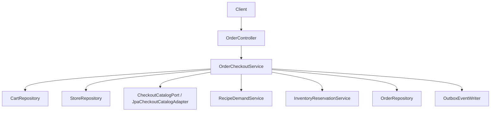
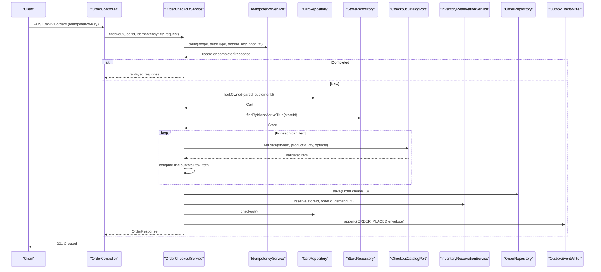
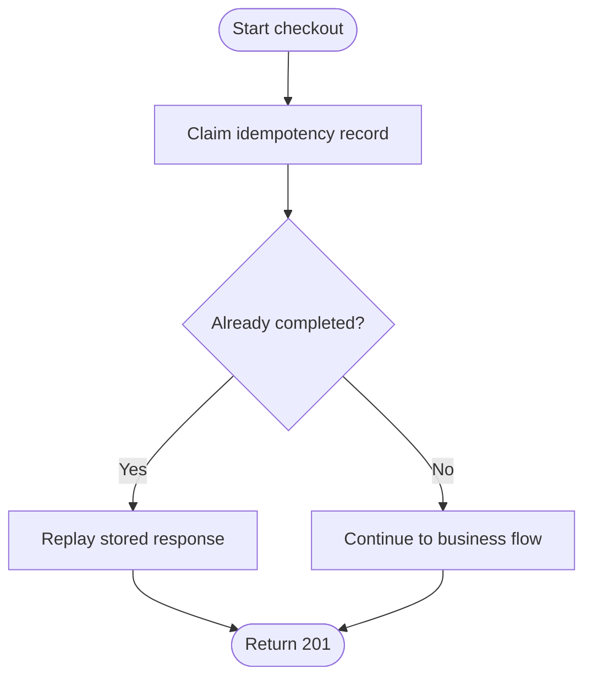
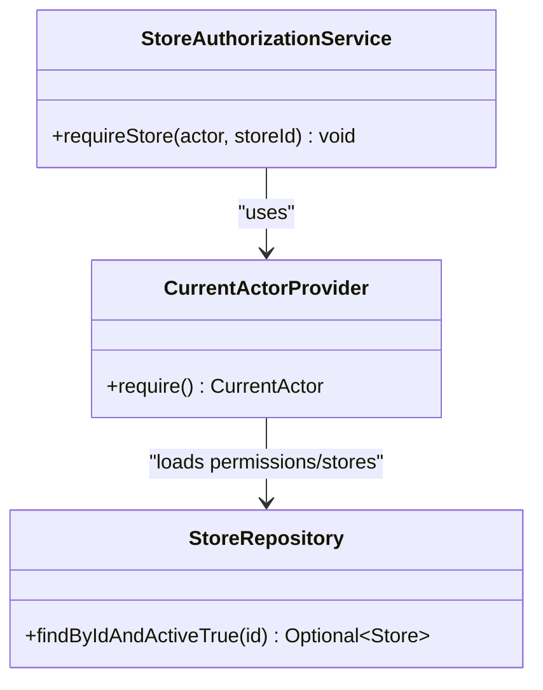
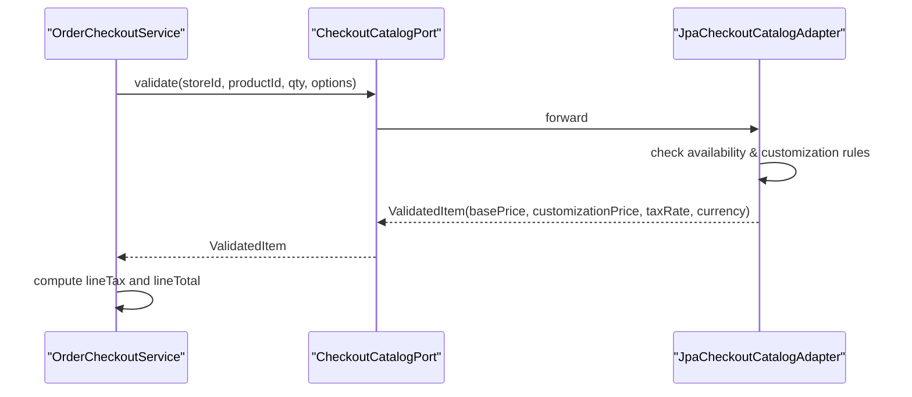
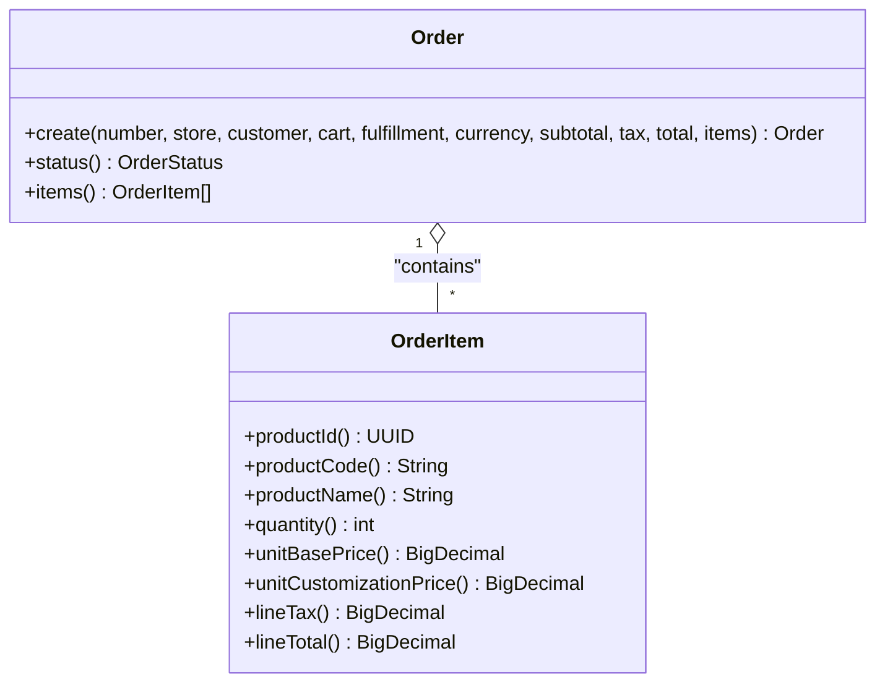
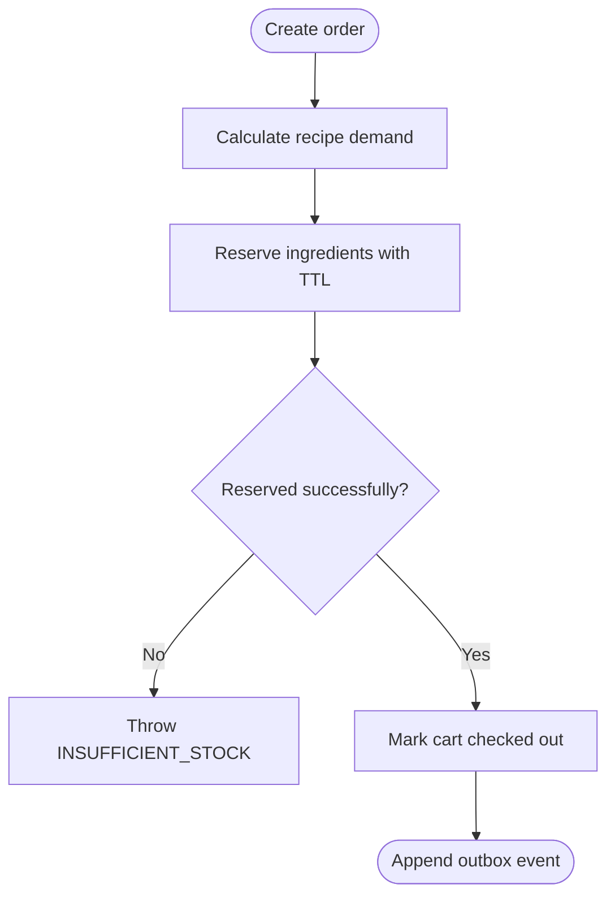
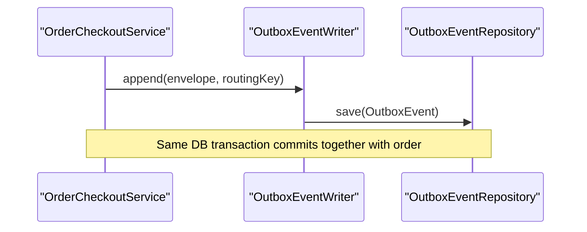
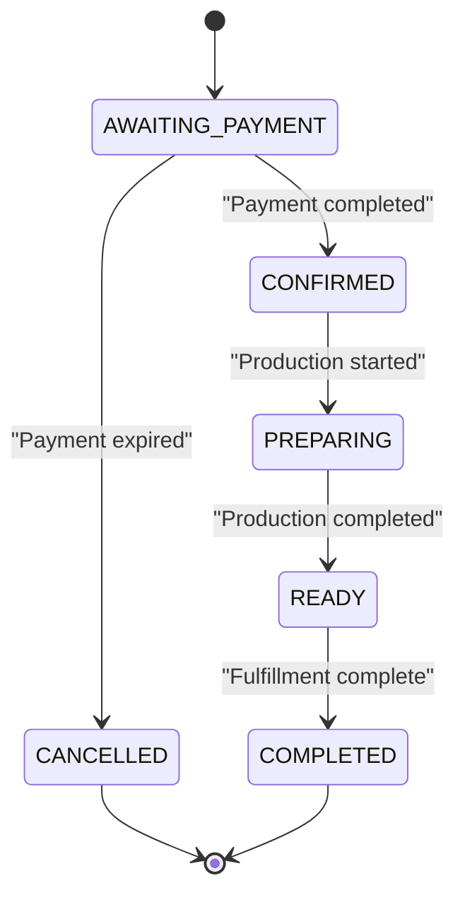
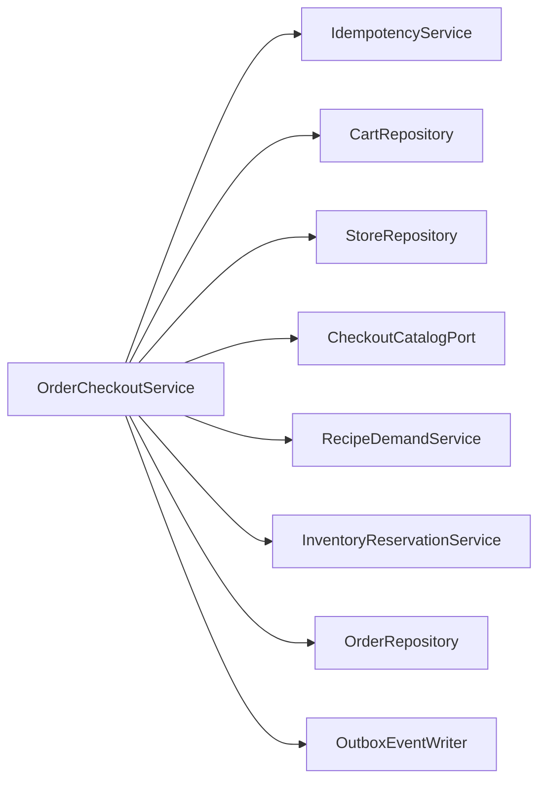

# Order Placement Flow

<cite>
**Referenced Files in This Document**
- [OrderController.java](file://src/main/java/com/smartcoffee/modules/ordering/api/OrderController.java)
- [OrderCheckoutService.java](file://src/main/java/com/smartcoffee/modules/ordering/application/OrderCheckoutService.java)
- [CheckoutCatalogPort.java](file://src/main/java/com/smartcoffee/modules/ordering/application/CheckoutCatalogPort.java)
- [JpaCheckoutCatalogAdapter.java](file://src/main/java/com/smartcoffee/modules/ordering/application/JpaCheckoutCatalogAdapter.java)
- [CartRepository.java](file://src/main/java/com/smartcoffee/modules/cart/persistence/CartRepository.java)
- [Cart.java](file://src/main/java/com/smartcoffee/modules/cart/domain/Cart.java)
- [StoreRepository.java](file://src/main/java/com/smartcoffee/modules/organization/persistence/StoreRepository.java)
- [CurrentActorProvider.java](file://src/main/java/com/smartcoffee/common/security/CurrentActorProvider.java)
- [StoreAuthorizationService.java](file://src/main/java/com/smartcoffee/common/security/StoreAuthorizationService.java)
- [InventoryReservationService.java](file://src/main/java/com/smartcoffee/modules/inventory/application/InventoryReservationService.java)
- [Order.java](file://src/main/java/com/smartcoffee/modules/ordering/domain/Order.java)
- [OrderItem.java](file://src/main/java/com/smartcoffee/modules/ordering/domain/OrderItem.java)
- [OrderRepository.java](file://src/main/java/com/smartcoffee/modules/ordering/persistence/OrderRepository.java)
- [IdempotencyService.java](file://src/main/java/com/smartcoffee/infrastructure/idempotency/IdempotencyService.java)
- [OutboxEventWriter.java](file://src/main/java/com/smartcoffee/infrastructure/messaging/outbox/OutboxEventWriter.java)
- [ADR-004-transactional-outbox.md](file://adr/ADR-004-transactional-outbox.md)
</cite>

## Table of Contents
1. [Introduction](#introduction)
2. [Project Structure](#project-structure)
3. [Core Components](#core-components)
4. [Architecture Overview](#architecture-overview)
5. [Detailed Component Analysis](#detailed-component-analysis)
6. [Dependency Analysis](#dependency-analysis)
7. [Performance Considerations](#performance-considerations)
8. [Troubleshooting Guide](#troubleshooting-guide)
9. [Conclusion](#conclusion)

## Introduction
This document explains the end-to-end order placement flow in Smart Coffee Backend. It covers how a client request is received, validated, and transformed into an immutable order with accurate pricing, promotions (via catalog validation), inventory reservation, and reliable event publishing using the transactional outbox pattern. It also details idempotency handling, store authorization, concurrency safeguards, error scenarios, and state transitions for orders.

## Project Structure
The order placement flow spans multiple modules:
- API layer exposes a POST endpoint that delegates to the checkout service.
- Application orchestration validates inputs, enforces idempotency, checks cart and store, validates catalog items, computes line totals and taxes, creates the order, reserves inventory atomically, marks the cart as checked out, and writes an outbox event.
- Domain models enforce business rules and maintain immutable snapshots of line items and order state.
- Infrastructure provides idempotency, messaging (outbox), and security helpers.

**Diagram sources**
- [OrderController.java:29-33](file://src/main/java/com/smartcoffee/modules/ordering/api/OrderController.java#L29-L33)
- [OrderCheckoutService.java:62-132](file://src/main/java/com/smartcoffee/modules/ordering/application/OrderCheckoutService.java#L62-L132)
- [CartRepository.java:12](file://src/main/java/com/smartcoffee/modules/cart/persistence/CartRepository.java#L12)
- [StoreRepository.java:10-12](file://src/main/java/com/smartcoffee/modules/organization/persistence/StoreRepository.java#L10-L12)
- [CheckoutCatalogPort.java:6-18](file://src/main/java/com/smartcoffee/modules/ordering/application/CheckoutCatalogPort.java#L6-L18)
- [JpaCheckoutCatalogAdapter.java:20-33](file://src/main/java/com/smartcoffee/modules/ordering/application/JpaCheckoutCatalogAdapter.java#L20-L33)
- [InventoryReservationService.java:43-54](file://src/main/java/com/smartcoffee/modules/inventory/application/InventoryReservationService.java#L43-L54)
- [OrderRepository.java:10-20](file://src/main/java/com/smartcoffee/modules/ordering/persistence/OrderRepository.java#L10-L20)
- [OutboxEventWriter.java:18-21](file://src/main/java/com/smartcoffee/infrastructure/messaging/outbox/OutboxEventWriter.java#L18-L21)

**Section sources**
- [OrderController.java:29-33](file://src/main/java/com/smartcoffee/modules/ordering/api/OrderController.java#L29-L33)
- [OrderCheckoutService.java:62-132](file://src/main/java/com/smartcoffee/modules/ordering/application/OrderCheckoutService.java#L62-L132)

## Core Components
- OrderController: Entry point for order creation; reads Idempotency-Key header and delegates to checkout service.
- OrderCheckoutService: Orchestrates checkout within a single transaction: idempotency claim, cart lock and validation, store existence, catalog validation per item, price/tax calculation, order creation, recipe demand calculation, inventory reservation, cart checkout, and outbox event append.
- CheckoutCatalogPort and JpaCheckoutCatalogAdapter: Validate product availability, customization rules, and return canonical pricing and tax rate for each item.
- CartRepository and Cart domain: Provide pessimistic locking on the cart and enforce active/expired states; mark cart as checked out at the end.
- StoreRepository: Ensures the store exists and is active.
- CurrentActorProvider and StoreAuthorizationService: Provide current user context and store access enforcement.
- InventoryReservationService: Atomically reserves ingredients for the order with a TTL and records reservations and stock transactions.
- Order and OrderItem: Immutable snapshots of ordered products, quantities, prices, taxes, customizations, and station codes.
- IdempotencyService: Prevents duplicate processing using a key scoped by user and request hash.
- OutboxEventWriter: Persists events in the same transaction as business changes for reliable eventual delivery.

**Section sources**
- [OrderController.java:29-33](file://src/main/java/com/smartcoffee/modules/ordering/api/OrderController.java#L29-L33)
- [OrderCheckoutService.java:62-132](file://src/main/java/com/smartcoffee/modules/ordering/application/OrderCheckoutService.java#L62-L132)
- [CheckoutCatalogPort.java:6-18](file://src/main/java/com/smartcoffee/modules/ordering/application/CheckoutCatalogPort.java#L6-L18)
- [JpaCheckoutCatalogAdapter.java:20-33](file://src/main/java/com/smartcoffee/modules/ordering/application/JpaCheckoutCatalogAdapter.java#L20-L33)
- [CartRepository.java:12](file://src/main/java/com/smartcoffee/modules/cart/persistence/CartRepository.java#L12)
- [Cart.java:63-70](file://src/main/java/com/smartcoffee/modules/cart/domain/Cart.java#L63-L70)
- [StoreRepository.java:10-12](file://src/main/java/com/smartcoffee/modules/organization/persistence/StoreRepository.java#L10-L12)
- [CurrentActorProvider.java:20-40](file://src/main/java/com/smartcoffee/common/security/CurrentActorProvider.java#L20-L40)
- [StoreAuthorizationService.java:9-12](file://src/main/java/com/smartcoffee/common/security/StoreAuthorizationService.java#L9-L12)
- [InventoryReservationService.java:43-54](file://src/main/java/com/smartcoffee/modules/inventory/application/InventoryReservationService.java#L43-L54)
- [Order.java:66-95](file://src/main/java/com/smartcoffee/modules/ordering/domain/Order.java#L66-L95)
- [OrderItem.java:106-139](file://src/main/java/com/smartcoffee/modules/ordering/domain/OrderItem.java#L106-L139)
- [IdempotencyService.java:4](file://src/main/java/com/smartcoffee/infrastructure/idempotency/IdempotencyService.java#L4)
- [OutboxEventWriter.java:18-21](file://src/main/java/com/smartcoffee/infrastructure/messaging/outbox/OutboxEventWriter.java#L18-L21)

## Architecture Overview
The order placement flow is implemented as a single transactional use case that coordinates multiple bounded contexts:
- Security and authorization are enforced before business logic runs.
- Idempotency prevents duplicate order creation from retries or network retransmissions.
- Catalog validation ensures product availability and correct pricing at checkout time.
- Inventory reservation is performed atomically with the order creation to prevent overselling.
- Events are written to the outbox table within the same transaction for reliable eventual delivery.

**Diagram sources**
- [OrderController.java:29-33](file://src/main/java/com/smartcoffee/modules/ordering/api/OrderController.java#L29-L33)
- [OrderCheckoutService.java:62-132](file://src/main/java/com/smartcoffee/modules/ordering/application/OrderCheckoutService.java#L62-L132)
- [IdempotencyService.java:4](file://src/main/java/com/smartcoffee/infrastructure/idempotency/IdempotencyService.java#L4)
- [CartRepository.java:12](file://src/main/java/com/smartcoffee/modules/cart/persistence/CartRepository.java#L12)
- [StoreRepository.java:10-12](file://src/main/java/com/smartcoffee/modules/organization/persistence/StoreRepository.java#L10-L12)
- [CheckoutCatalogPort.java:6-18](file://src/main/java/com/smartcoffee/modules/ordering/application/CheckoutCatalogPort.java#L6-L18)
- [JpaCheckoutCatalogAdapter.java:20-33](file://src/main/java/com/smartcoffee/modules/ordering/application/JpaCheckoutCatalogAdapter.java#L20-L33)
- [InventoryReservationService.java:43-54](file://src/main/java/com/smartcoffee/modules/inventory/application/InventoryReservationService.java#L43-L54)
- [OrderRepository.java:10-20](file://src/main/java/com/smartcoffee/modules/ordering/persistence/OrderRepository.java#L10-L20)
- [OutboxEventWriter.java:18-21](file://src/main/java/com/smartcoffee/infrastructure/messaging/outbox/OutboxEventWriter.java#L18-L21)

## Detailed Component Analysis

### Request Handling and Idempotency
- The controller reads the Idempotency-Key header and forwards it to the checkout service.
- The checkout service claims an idempotency record scoped by user and request hash. If already completed, it replays the stored response. If processing, it rejects reuse with a different request payload.

**Diagram sources**
- [OrderController.java:29-33](file://src/main/java/com/smartcoffee/modules/ordering/api/OrderController.java#L29-L33)
- [OrderCheckoutService.java:62-73](file://src/main/java/com/smartcoffee/modules/ordering/application/OrderCheckoutService.java#L62-L73)
- [IdempotencyService.java:4](file://src/main/java/com/smartcoffee/infrastructure/idempotency/IdempotencyService.java#L4)

**Section sources**
- [OrderController.java:29-33](file://src/main/java/com/smartcoffee/modules/ordering/api/OrderController.java#L29-L33)
- [OrderCheckoutService.java:62-73](file://src/main/java/com/smartcoffee/modules/ordering/application/OrderCheckoutService.java#L62-L73)
- [IdempotencyService.java:4](file://src/main/java/com/smartcoffee/infrastructure/idempotency/IdempotencyService.java#L4)

### Store Authorization and Validation
- The current actor is resolved from the security context with permissions and store access.
- Store existence and active status are verified before proceeding.
- Although the checkout path uses the cart’s store, the authorization helper is available to enforce store-scoped permissions where needed.

**Diagram sources**
- [CurrentActorProvider.java:20-40](file://src/main/java/com/smartcoffee/common/security/CurrentActorProvider.java#L20-L40)
- [StoreAuthorizationService.java:9-12](file://src/main/java/com/smartcoffee/common/security/StoreAuthorizationService.java#L9-L12)
- [StoreRepository.java:10-12](file://src/main/java/com/smartcoffee/modules/organization/persistence/StoreRepository.java#L10-L12)

**Section sources**
- [CurrentActorProvider.java:20-40](file://src/main/java/com/smartcoffee/common/security/CurrentActorProvider.java#L20-L40)
- [StoreAuthorizationService.java:9-12](file://src/main/java/com/smartcoffee/common/security/StoreAuthorizationService.java#L9-L12)
- [StoreRepository.java:10-12](file://src/main/java/com/smartcoffee/modules/organization/persistence/StoreRepository.java#L10-L12)

### Catalog Validation and Pricing
- Each cart item is validated against the catalog for the target store, including availability and customization rules.
- The adapter returns canonical base price, customization price, tax rate, and currency. The checkout service verifies these match the cart’s captured values to prevent price changes mid-flight.
- Line totals include base plus customization price multiplied by quantity, plus computed tax.

**Diagram sources**
- [CheckoutCatalogPort.java:6-18](file://src/main/java/com/smartcoffee/modules/ordering/application/CheckoutCatalogPort.java#L6-L18)
- [JpaCheckoutCatalogAdapter.java:20-33](file://src/main/java/com/smartcoffee/modules/ordering/application/JpaCheckoutCatalogAdapter.java#L20-L33)
- [OrderCheckoutService.java:92-113](file://src/main/java/com/smartcoffee/modules/ordering/application/OrderCheckoutService.java#L92-L113)

**Section sources**
- [CheckoutCatalogPort.java:6-18](file://src/main/java/com/smartcoffee/modules/ordering/application/CheckoutCatalogPort.java#L6-L18)
- [JpaCheckoutCatalogAdapter.java:20-33](file://src/main/java/com/smartcoffee/modules/ordering/application/JpaCheckoutCatalogAdapter.java#L20-L33)
- [OrderCheckoutService.java:92-113](file://src/main/java/com/smartcoffee/modules/ordering/application/OrderCheckoutService.java#L92-L113)

### Order Creation and Immutable Line Items
- A new order is created with a generated number, store, customer, fulfillment type, currency, and computed financials.
- Order items are created as immutable snapshots of product identifiers, codes, names, quantities, unit prices, taxes, and customizations. These snapshots ensure historical accuracy even if catalog data changes later.

**Diagram sources**
- [Order.java:66-95](file://src/main/java/com/smartcoffee/modules/ordering/domain/Order.java#L66-L95)
- [OrderItem.java:106-139](file://src/main/java/com/smartcoffee/modules/ordering/domain/OrderItem.java#L106-L139)

**Section sources**
- [Order.java:66-95](file://src/main/java/com/smartcoffee/modules/ordering/domain/Order.java#L66-L95)
- [OrderItem.java:106-139](file://src/main/java/com/smartcoffee/modules/ordering/domain/OrderItem.java#L106-L139)

### Inventory Reservation and Concurrency Safeguards
- After creating the order, ingredient demand is calculated via recipe services and passed to inventory reservation.
- Reservation is atomic: it checks balances, reserves stock, and persists the reservation with a TTL. If insufficient stock, a conflict is raised.
- Pessimistic locks on cart and order repositories help prevent race conditions during concurrent checkout attempts.

**Diagram sources**
- [OrderCheckoutService.java:115-119](file://src/main/java/com/smartcoffee/modules/ordering/application/OrderCheckoutService.java#L115-L119)
- [InventoryReservationService.java:43-54](file://src/main/java/com/smartcoffee/modules/inventory/application/InventoryReservationService.java#L43-L54)
- [CartRepository.java:12](file://src/main/java/com/smartcoffee/modules/cart/persistence/CartRepository.java#L12)
- [OrderRepository.java:18-20](file://src/main/java/com/smartcoffee/modules/ordering/persistence/OrderRepository.java#L18-L20)

**Section sources**
- [OrderCheckoutService.java:115-119](file://src/main/java/com/smartcoffee/modules/ordering/application/OrderCheckoutService.java#L115-L119)
- [InventoryReservationService.java:43-54](file://src/main/java/com/smartcoffee/modules/inventory/application/InventoryReservationService.java#L43-L54)
- [CartRepository.java:12](file://src/main/java/com/smartcoffee/modules/cart/persistence/CartRepository.java#L12)
- [OrderRepository.java:18-20](file://src/main/java/com/smartcoffee/modules/ordering/persistence/OrderRepository.java#L18-L20)

### Transactional Outbox Event Publishing
- Within the same transaction, an ORDER_PLACED event envelope is appended to the outbox table.
- The outbox writer requires an existing transaction and serializes the event. A relay will publish to the broker and mark published after confirmation, ensuring no event is lost on rollback.

**Diagram sources**
- [OrderCheckoutService.java:120-125](file://src/main/java/com/smartcoffee/modules/ordering/application/OrderCheckoutService.java#L120-L125)
- [OutboxEventWriter.java:18-21](file://src/main/java/com/smartcoffee/infrastructure/messaging/outbox/OutboxEventWriter.java#L18-L21)
- [ADR-004-transactional-outbox.md:14-20](file://adr/ADR-004-transactional-outbox.md#L14-L20)

**Section sources**
- [OrderCheckoutService.java:120-125](file://src/main/java/com/smartcoffee/modules/ordering/application/OrderCheckoutService.java#L120-L125)
- [OutboxEventWriter.java:18-21](file://src/main/java/com/smartcoffee/infrastructure/messaging/outbox/OutboxEventWriter.java#L18-L21)
- [ADR-004-transactional-outbox.md:14-20](file://adr/ADR-004-transactional-outbox.md#L14-L20)

### State Transitions for Orders
Orders begin in AWAITING_PAYMENT and transition through subsequent states based on payment and production workflows. The following diagram shows the primary transitions relevant to order lifecycle:

**Diagram sources**
- [Order.java:66-95](file://src/main/java/com/smartcoffee/modules/ordering/domain/Order.java#L66-L95)
- [Order.java:174-286](file://src/main/java/com/smartcoffee/modules/ordering/domain/Order.java#L174-L286)

**Section sources**
- [Order.java:66-95](file://src/main/java/com/smartcoffee/modules/ordering/domain/Order.java#L66-L95)
- [Order.java:174-286](file://src/main/java/com/smartcoffee/modules/ordering/domain/Order.java#L174-L286)

## Dependency Analysis
The checkout service depends on several components to ensure correctness and reliability:

**Diagram sources**
- [OrderCheckoutService.java:28-42](file://src/main/java/com/smartcoffee/modules/ordering/application/OrderCheckoutService.java#L28-L42)
- [IdempotencyService.java:4](file://src/main/java/com/smartcoffee/infrastructure/idempotency/IdempotencyService.java#L4)
- [CartRepository.java:12](file://src/main/java/com/smartcoffee/modules/cart/persistence/CartRepository.java#L12)
- [StoreRepository.java:10-12](file://src/main/java/com/smartcoffee/modules/organization/persistence/StoreRepository.java#L10-L12)
- [CheckoutCatalogPort.java:6-18](file://src/main/java/com/smartcoffee/modules/ordering/application/CheckoutCatalogPort.java#L6-L18)
- [InventoryReservationService.java:43-54](file://src/main/java/com/smartcoffee/modules/inventory/application/InventoryReservationService.java#L43-L54)
- [OrderRepository.java:10-20](file://src/main/java/com/smartcoffee/modules/ordering/persistence/OrderRepository.java#L10-L20)
- [OutboxEventWriter.java:18-21](file://src/main/java/com/smartcoffee/infrastructure/messaging/outbox/OutboxEventWriter.java#L18-L21)

**Section sources**
- [OrderCheckoutService.java:28-42](file://src/main/java/com/smartcoffee/modules/ordering/application/OrderCheckoutService.java#L28-L42)

## Performance Considerations
- Use pessimistic locking on cart and order entities to avoid race conditions during concurrent checkout.
- Keep the checkout transaction short by performing only essential work inside it; heavy computations should be minimized.
- Batch outbox publication externally to avoid blocking the request thread.
- Ensure indexes exist on frequently queried fields such as cartId, storeId, and orderId to reduce contention.

[No sources needed since this section provides general guidance]

## Troubleshooting Guide
Common error scenarios and their handling:
- Empty cart: throws a conflict indicating the cart has no items.
- Cart not found or inactive: throws resource not found or conflict when attempting to checkout.
- Currency mismatch or price change detected during catalog validation: throws conflict to protect pricing integrity.
- Product unavailable: thrown by catalog adapter when the product cannot be fulfilled.
- Insufficient stock: thrown by inventory reservation when ingredient balances are inadequate.
- Store not found: thrown when the store linked to the cart is missing or inactive.
- Idempotency conflicts: thrown when the same key is reused with a different request or when a request is still processing.

Error types originate from common exception classes and are surfaced consistently across the system.

**Section sources**
- [OrderCheckoutService.java:74-100](file://src/main/java/com/smartcoffee/modules/ordering/application/OrderCheckoutService.java#L74-L100)
- [JpaCheckoutCatalogAdapter.java:20-33](file://src/main/java/com/smartcoffee/modules/ordering/application/JpaCheckoutCatalogAdapter.java#L20-L33)
- [InventoryReservationService.java:43-54](file://src/main/java/com/smartcoffee/modules/inventory/application/InventoryReservationService.java#L43-L54)
- [IdempotencyService.java:4](file://src/main/java/com/smartcoffee/infrastructure/idempotency/IdempotencyService.java#L4)

## Conclusion
The order placement flow ensures correctness and reliability through:
- Strict idempotency to handle retries safely.
- Store authorization and catalog validation to enforce business rules and pricing integrity.
- Atomic inventory reservation to prevent overselling.
- Immutable order line items to preserve historical accuracy.
- A transactional outbox to guarantee reliable event delivery without distributed transactions.
Concurrency safeguards like pessimistic locking and unique constraints protect against race conditions during high-volume order placement.

[No sources needed since this section summarizes without analyzing specific files]