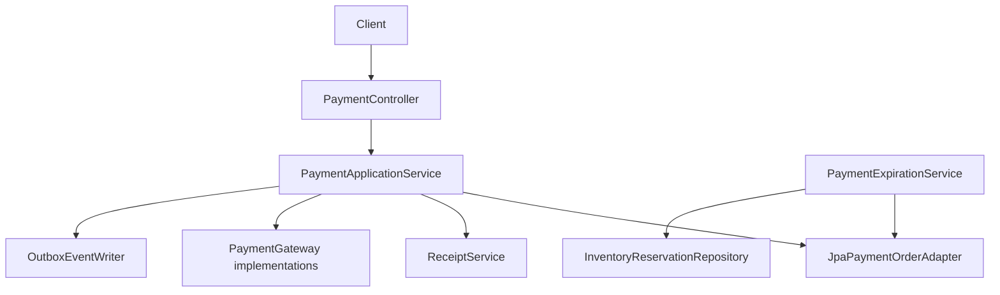
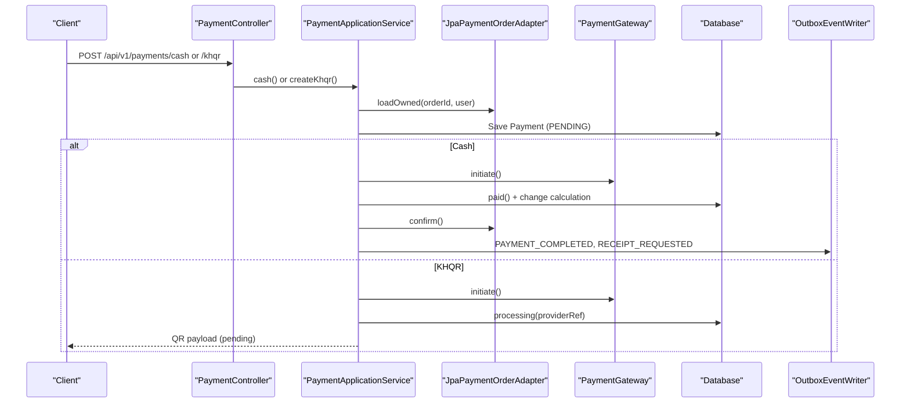
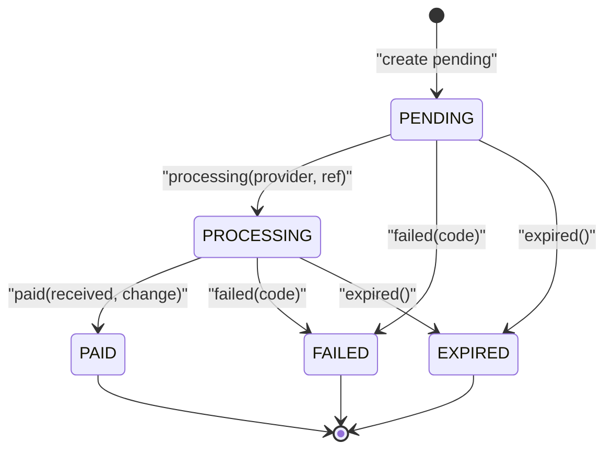
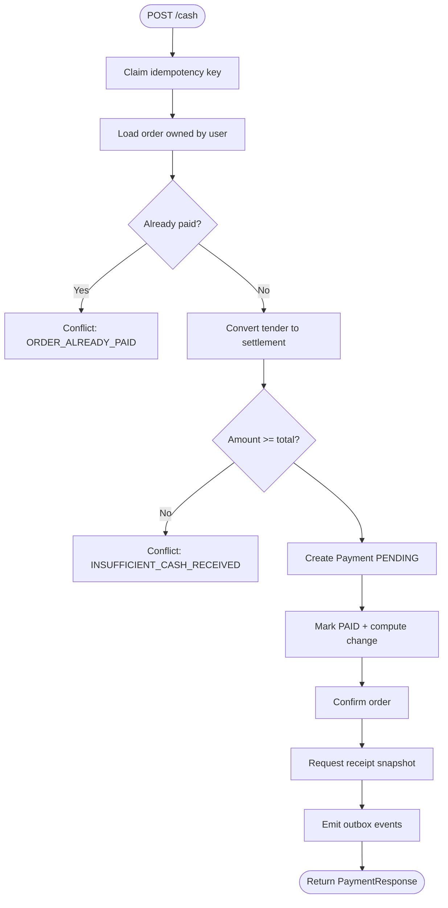
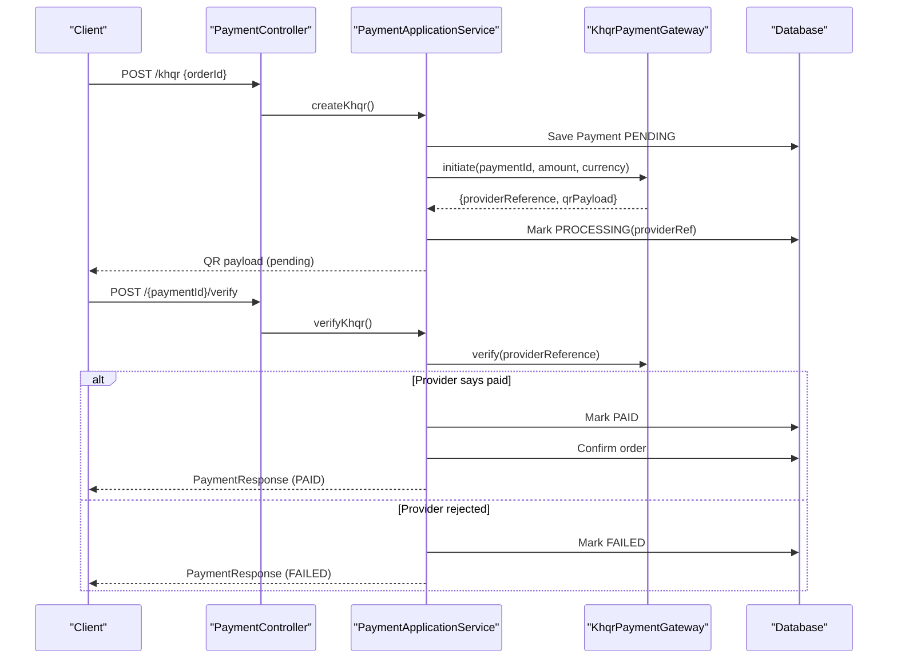
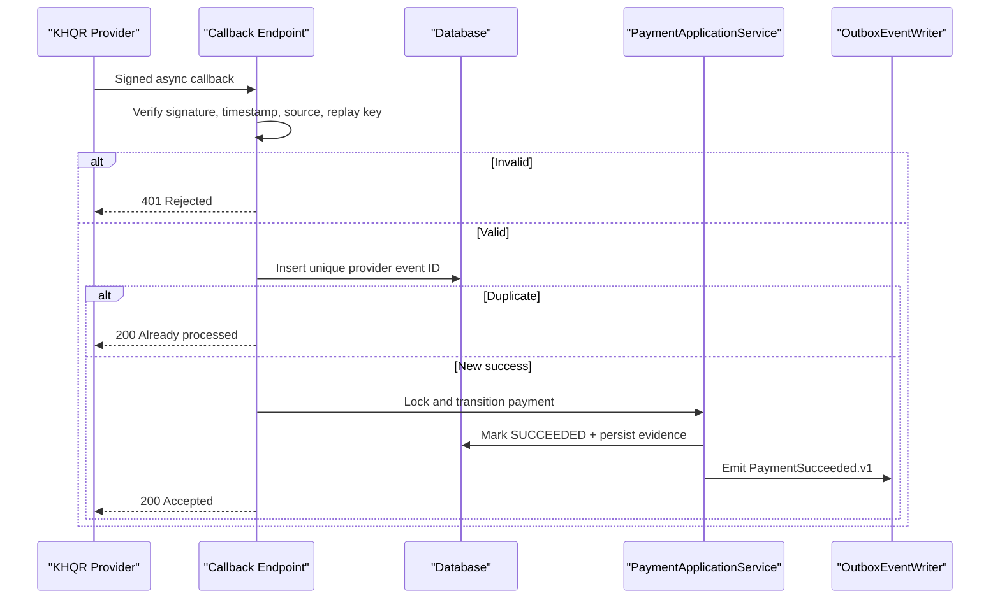
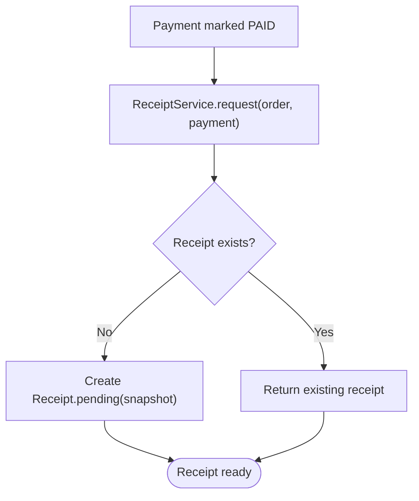
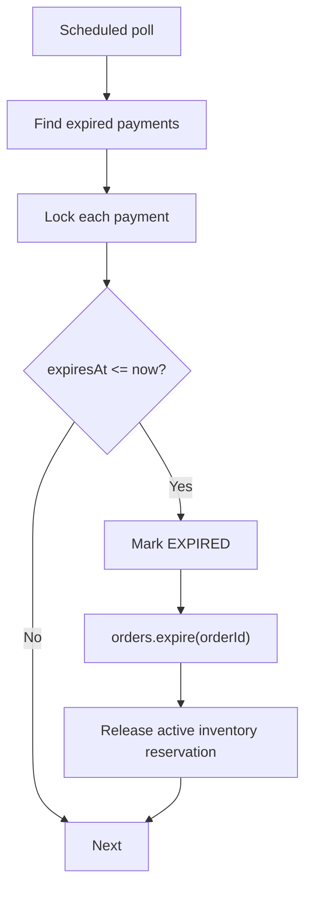
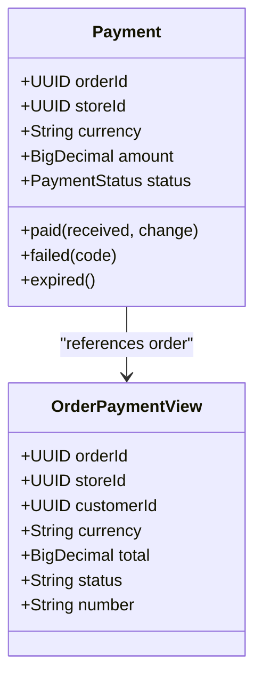
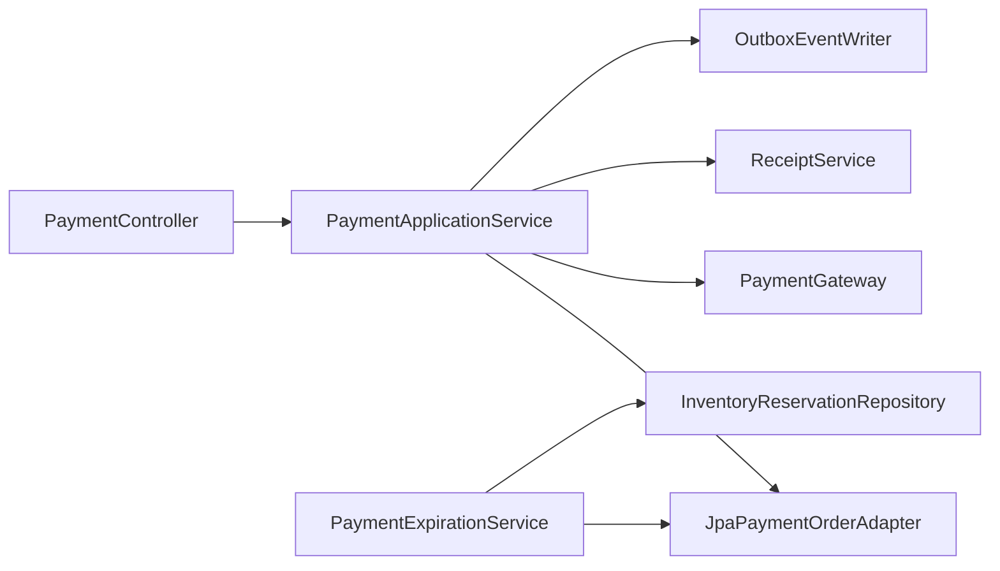

# Payment Processing Flow

<cite>
**Referenced Files in This Document**
- [PaymentController.java](file://src/main/java/com/smartcoffee/modules/payment/api/PaymentController.java)
- [CashPaymentRequest.java](file://src/main/java/com/smartcoffee/modules/payment/api/CashPaymentRequest.java)
- [KhqrPaymentRequest.java](file://src/main/java/com/smartcoffee/modules/payment/api/KhqrPaymentRequest.java)
- [PaymentApplicationService.java](file://src/main/java/com/smartcoffee/modules/payment/application/PaymentApplicationService.java)
- [JpaPaymentOrderAdapter.java](file://src/main/java/com/smartcoffee/modules/payment/application/JpaPaymentOrderAdapter.java)
- [ReceiptService.java](file://src/main/java/com/smartcoffee/modules/payment/application/ReceiptService.java)
- [PaymentExpirationService.java](file://src/main/java/com/smartcoffee/modules/payment/application/PaymentExpirationService.java)
- [Payment.java](file://src/main/java/com/smartcoffee/modules/payment/domain/Payment.java)
- [PaymentStatus.java](file://src/main/java/com/smartcoffee/modules/payment/domain/PaymentStatus.java)
- [PaymentMethodType.java](file://src/main/java/com/smartcoffee/modules/payment/domain/PaymentMethodType.java)
- [PaymentGateway.java](file://src/main/java/com/smartcoffee/infrastructure/payment/PaymentGateway.java)
- [CashPaymentGateway.java](file://src/main/java/com/smartcoffee/infrastructure/payment/CashPaymentGateway.java)
- [KhqrPaymentGateway.java](file://src/main/java/com/smartcoffee/infrastructure/payment/KhqrPaymentGateway.java)
- [PAYMENT_FLOW.mermaid](file://architecture/PAYMENT_FLOW.mermaid)
</cite>

## Table of Contents
1. Introduction
2. Project Structure
3. Core Components
4. Architecture Overview
5. Detailed Component Analysis
6. Dependency Analysis
7. Performance Considerations
8. Troubleshooting Guide
9. Conclusion

## Introduction
This document explains the end-to-end payment processing flow for both cash and digital payments (KHQR). It covers initiation, method selection, amount validation, external gateway integration, callback handling, receipt generation, state transitions, security, idempotency, expiration, refunds, reconciliation, and error handling. The goal is to make the system understandable for both technical and non-technical readers while remaining grounded in the actual implementation.

## Project Structure
The payment feature spans API controllers, application services, domain entities, persistence adapters, infrastructure gateways, and scheduled jobs:
- API layer exposes endpoints for cash and KHQR payments and verification.
- Application service orchestrates business rules, idempotency, order interaction, receipts, and events.
- Domain models define payment state and lifecycle methods.
- Infrastructure gateways abstract external providers (cash mock and KHQR placeholder).
- Scheduled job handles expired payments and inventory release.

**Diagram sources**
- [PaymentController.java:11-38](file://src/main/java/com/smartcoffee/modules/payment/api/PaymentController.java#L11-L38)
- [PaymentApplicationService.java:20-160](file://src/main/java/com/smartcoffee/modules/payment/application/PaymentApplicationService.java#L20-L160)
- [JpaPaymentOrderAdapter.java:10-40](file://src/main/java/com/smartcoffee/modules/payment/application/JpaPaymentOrderAdapter.java#L10-L40)
- [ReceiptService.java:11-32](file://src/main/java/com/smartcoffee/modules/payment/application/ReceiptService.java#L11-L32)
- [PaymentExpirationService.java:12-40](file://src/main/java/com/smartcoffee/modules/payment/application/PaymentExpirationService.java#L12-L40)
- [PaymentGateway.java:1-5](file://src/main/java/com/smartcoffee/infrastructure/payment/PaymentGateway.java#L1-L5)

**Section sources**
- [PaymentController.java:11-38](file://src/main/java/com/smartcoffee/modules/payment/api/PaymentController.java#L11-L38)
- [PaymentApplicationService.java:20-160](file://src/main/java/com/smartcoffee/modules/payment/application/PaymentApplicationService.java#L20-L160)
- [PaymentExpirationService.java:12-40](file://src/main/java/com/smartcoffee/modules/payment/application/PaymentExpirationService.java#L12-L40)

## Core Components
- PaymentController: Exposes REST endpoints for cash and KHQR payments and verification.
- PaymentApplicationService: Central orchestration for payment creation, verification, idempotency, order confirmation, receipt request, and event emission.
- JpaPaymentOrderAdapter: Cross-module adapter to load orders owned by the current customer and update order payment status.
- ReceiptService: Creates a receipt snapshot tied to a payment and order.
- PaymentExpirationService: Periodically expires open payments and releases inventory reservations.
- Payment domain entity and enums: Encapsulate payment state machine and lifecycle transitions.
- PaymentGateway interface and implementations: Abstracts external payment providers; includes a cash mock and a KHQR placeholder.

Key responsibilities:
- Validate inputs and ownership.
- Enforce idempotency via IdempotencyService and CanonicalRequestHasher.
- Integrate with external provider through PaymentGateway.
- Persist payment state changes and emit outbox events.
- Generate receipts upon successful payment.
- Handle expiration and inventory release.

**Section sources**
- [PaymentController.java:11-38](file://src/main/java/com/smartcoffee/modules/payment/api/PaymentController.java#L11-L38)
- [PaymentApplicationService.java:20-160](file://src/main/java/com/smartcoffee/modules/payment/application/PaymentApplicationService.java#L20-L160)
- [JpaPaymentOrderAdapter.java:10-40](file://src/main/java/com/smartcoffee/modules/payment/application/JpaPaymentOrderAdapter.java#L10-L40)
- [ReceiptService.java:11-32](file://src/main/java/com/smartcoffee/modules/payment/application/ReceiptService.java#L11-L32)
- [PaymentExpirationService.java:12-40](file://src/main/java/com/smartcoffee/modules/payment/application/PaymentExpirationService.java#L12-L40)
- [Payment.java:9-105](file://src/main/java/com/smartcoffee/modules/payment/domain/Payment.java#L9-L105)
- [PaymentStatus.java:1-7](file://src/main/java/com/smartcoffee/modules/payment/domain/PaymentStatus.java#L1-L7)
- [PaymentMethodType.java:1-7](file://src/main/java/com/smartcoffee/modules/payment/domain/PaymentMethodType.java#L1-L7)
- [PaymentGateway.java:1-5](file://src/main/java/com/smartcoffee/infrastructure/payment/PaymentGateway.java#L1-L5)

## Architecture Overview
The payment architecture follows a modular monolith pattern with clear separation between API, application, domain, and infrastructure layers. External integrations are abstracted behind a gateway interface. Events are published via an outbox mechanism to ensure reliable delivery to downstream consumers such as ordering and receipt services.

**Diagram sources**
- [PaymentController.java:22-37](file://src/main/java/com/smartcoffee/modules/payment/api/PaymentController.java#L22-L37)
- [PaymentApplicationService.java:48-107](file://src/main/java/com/smartcoffee/modules/payment/application/PaymentApplicationService.java#L48-L107)
- [JpaPaymentOrderAdapter.java:21-34](file://src/main/java/com/smartcoffee/modules/payment/application/JpaPaymentOrderAdapter.java#L21-L34)
- [PaymentGateway.java:1-5](file://src/main/java/com/smartcoffee/infrastructure/payment/PaymentGateway.java#L1-L5)

## Detailed Component Analysis

### Payment State Machine
The Payment entity enforces strict state transitions using domain methods that validate the current state before allowing transitions.

**Diagram sources**
- [Payment.java:56-105](file://src/main/java/com/smartcoffee/modules/payment/domain/Payment.java#L56-L105)
- [PaymentStatus.java:1-7](file://src/main/java/com/smartcoffee/modules/payment/domain/PaymentStatus.java#L1-L7)

**Section sources**
- [Payment.java:56-105](file://src/main/java/com/smartcoffee/modules/payment/domain/Payment.java#L56-L105)

### Cash Payment Lifecycle
Cash payments validate store ownership, prevent double payment, convert tender currency to settlement currency using an exchange rate, calculate change, mark payment as paid, confirm the order, request a receipt, and emit completion events.

**Diagram sources**
- [PaymentApplicationService.java:48-70](file://src/main/java/com/smartcoffee/modules/payment/application/PaymentApplicationService.java#L48-L70)
- [CashPaymentRequest.java:1-12](file://src/main/java/com/smartcoffee/modules/payment/api/CashPaymentRequest.java#L1-L12)

**Section sources**
- [PaymentApplicationService.java:48-70](file://src/main/java/com/smartcoffee/modules/payment/application/PaymentApplicationService.java#L48-L70)
- [CashPaymentRequest.java:1-12](file://src/main/java/com/smartcoffee/modules/payment/api/CashPaymentRequest.java#L1-L12)

### KHQR Digital Payment Lifecycle
KHQR payments create a pending payment, call the KHQR gateway to obtain a QR payload, transition the payment to processing with a provider reference, and return the QR data to the client. Verification polls the provider and finalizes payment if confirmed.

**Diagram sources**
- [PaymentController.java:28-37](file://src/main/java/com/smartcoffee/modules/payment/api/PaymentController.java#L28-L37)
- [PaymentApplicationService.java:72-107](file://src/main/java/com/smartcoffee/modules/payment/application/PaymentApplicationService.java#L72-L107)
- [KhqrPaymentGateway.java:1-9](file://src/main/java/com/smartcoffee/infrastructure/payment/KhqrPaymentGateway.java#L1-L9)

**Section sources**
- [PaymentApplicationService.java:72-107](file://src/main/java/com/smartcoffee/modules/payment/application/PaymentApplicationService.java#L72-L107)
- [KhqrPaymentGateway.java:1-9](file://src/main/java/com/smartcoffee/infrastructure/payment/KhqrPaymentGateway.java#L1-L9)

### Callback Handling and Security
The conceptual callback path verifies signature, timestamp, source, and replay protection, then updates payment state and emits events. In this codebase, the controller does not expose a dedicated callback endpoint; the conceptual flow aligns with the documented architecture diagram.

**Diagram sources**
- [PAYMENT_FLOW.mermaid:41-57](file://architecture/PAYMENT_FLOW.mermaid#L41-L57)

**Section sources**
- [PAYMENT_FLOW.mermaid:41-57](file://architecture/PAYMENT_FLOW.mermaid#L41-L57)

### Receipt Generation
Upon successful payment, a receipt snapshot is created or retrieved for the payment and order, capturing order number, payment reference, amount, and currency.

**Diagram sources**
- [ReceiptService.java:21-32](file://src/main/java/com/smartcoffee/modules/payment/application/ReceiptService.java#L21-L32)

**Section sources**
- [ReceiptService.java:21-32](file://src/main/java/com/smartcoffee/modules/payment/application/ReceiptService.java#L21-L32)

### Payment Expiration and Inventory Release
A scheduled job periodically scans for expired payments, marks them as expired, triggers order expiration, and releases any active inventory reservations associated with the order.

**Diagram sources**
- [PaymentExpirationService.java:27-40](file://src/main/java/com/smartcoffee/modules/payment/application/PaymentExpirationService.java#L27-L40)

**Section sources**
- [PaymentExpirationService.java:27-40](file://src/main/java/com/smartcoffee/modules/payment/application/PaymentExpirationService.java#L27-L40)

### Relationship Between Payments and Orders
Payments are linked to orders via orderId and storeId. The adapter ensures the caller owns the order and updates the order’s payment status when a payment completes or expires.

**Diagram sources**
- [Payment.java:17-49](file://src/main/java/com/smartcoffee/modules/payment/domain/Payment.java#L17-L49)
- [JpaPaymentOrderAdapter.java:21-34](file://src/main/java/com/smartcoffee/modules/payment/application/JpaPaymentOrderAdapter.java#L21-L34)

**Section sources**
- [JpaPaymentOrderAdapter.java:21-34](file://src/main/java/com/smartcoffee/modules/payment/application/JpaPaymentOrderAdapter.java#L21-L34)

## Dependency Analysis
The following diagram shows how components depend on each other across layers.

**Diagram sources**
- [PaymentController.java:11-38](file://src/main/java/com/smartcoffee/modules/payment/api/PaymentController.java#L11-L38)
- [PaymentApplicationService.java:20-160](file://src/main/java/com/smartcoffee/modules/payment/application/PaymentApplicationService.java#L20-L160)
- [JpaPaymentOrderAdapter.java:10-40](file://src/main/java/com/smartcoffee/modules/payment/application/JpaPaymentOrderAdapter.java#L10-L40)
- [PaymentExpirationService.java:12-40](file://src/main/java/com/smartcoffee/modules/payment/application/PaymentExpirationService.java#L12-L40)

**Section sources**
- [PaymentController.java:11-38](file://src/main/java/com/smartcoffee/modules/payment/api/PaymentController.java#L11-L38)
- [PaymentApplicationService.java:20-160](file://src/main/java/com/smartcoffee/modules/payment/application/PaymentApplicationService.java#L20-L160)

## Performance Considerations
- Idempotency keys reduce duplicate processing overhead and protect against retries.
- Short-lived processing windows (e.g., KHQR expiry) limit long-running transactions.
- Batched expiration polling reduces database contention.
- Using outbox events decouples payment completion from downstream processing, improving throughput.

[No sources needed since this section provides general guidance]

## Troubleshooting Guide
Common issues and resolutions:
- Store mismatch: Ensure the storeId matches the order’s store.
- Order already paid: Prevent duplicate payment attempts; check PaymentStatus.PAID.
- Insufficient cash received: Validate tender conversion and compare with order total.
- Exchange rate required: Provide a positive exchange rate when tender currency differs from settlement currency.
- Payment gateway unavailable: Verify configured gateway implementations and profiles.
- Payment not found: Verify paymentId and ownership context.
- Expiration handling: Confirm scheduled job runs and inventory reservations are released.

Operational checks:
- Validate idempotency key usage on all mutation endpoints.
- Monitor outbox event publication and consumer inbox deduplication.
- Review failure codes and timestamps on failed payments.

**Section sources**
- [PaymentApplicationService.java:48-107](file://src/main/java/com/smartcoffee/modules/payment/application/PaymentApplicationService.java#L48-L107)
- [PaymentExpirationService.java:27-40](file://src/main/java/com/smartcoffee/modules/payment/application/PaymentExpirationService.java#L27-L40)

## Conclusion
The payment system implements a robust lifecycle for both cash and digital payments with strong emphasis on idempotency, secure external integrations, reliable eventing, and consistent state management. While the KHQR provider is currently a placeholder, the architecture supports straightforward replacement with a real provider. Expiration handling and inventory release ensure resources are reclaimed when payments do not complete. Receipt snapshots provide auditable records post-payment. Future enhancements can include explicit refund workflows and advanced reconciliation dashboards built atop the existing outbox and event model.

[No sources needed since this section summarizes without analyzing specific files]