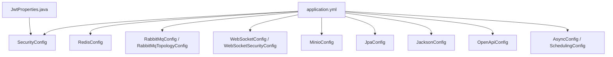
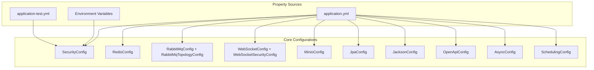
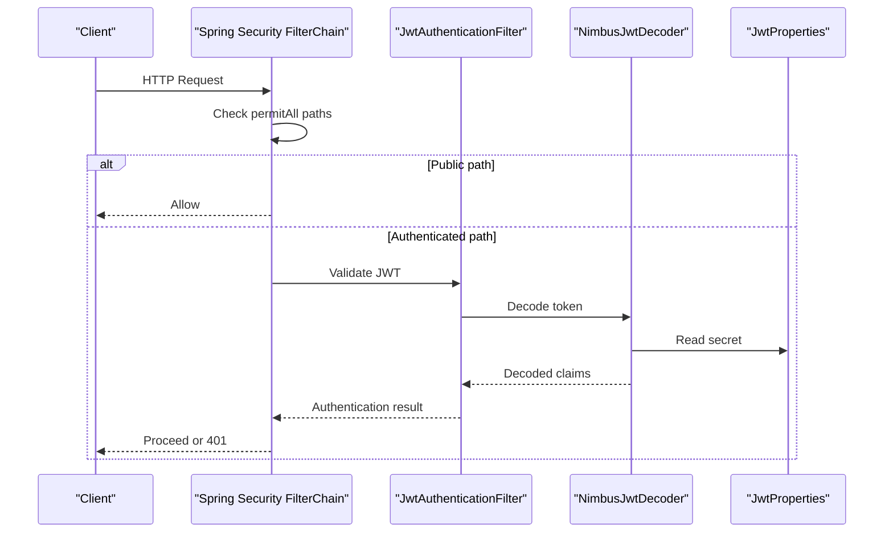
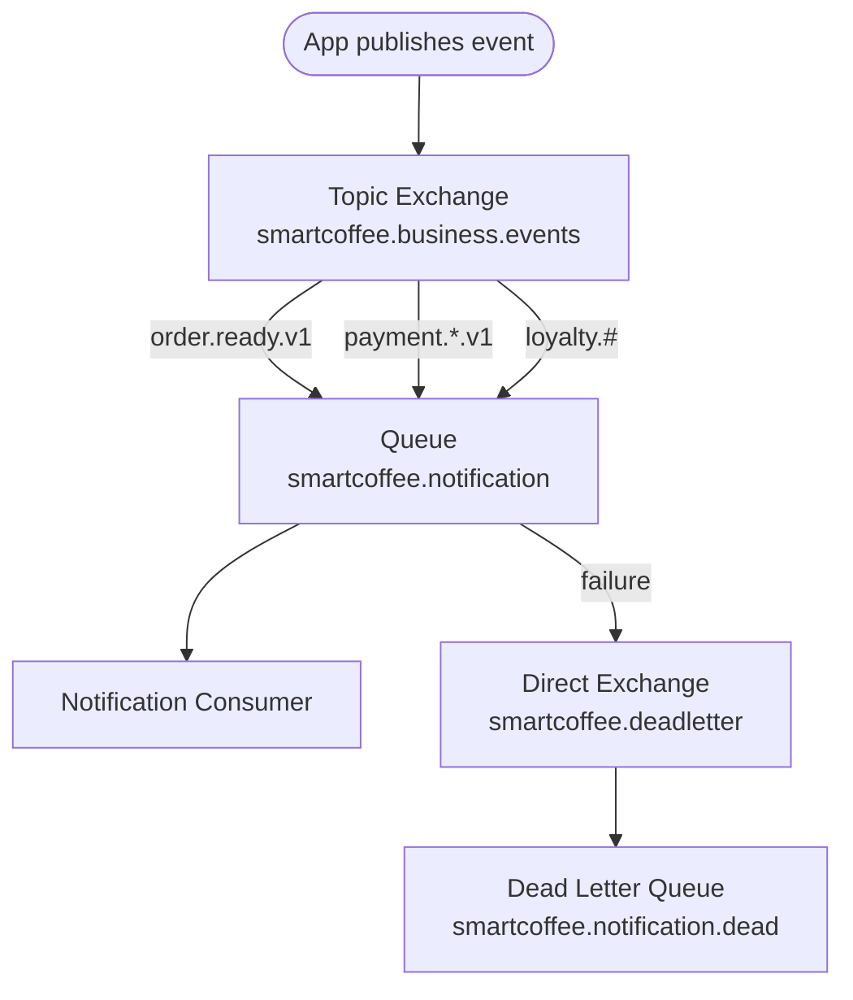
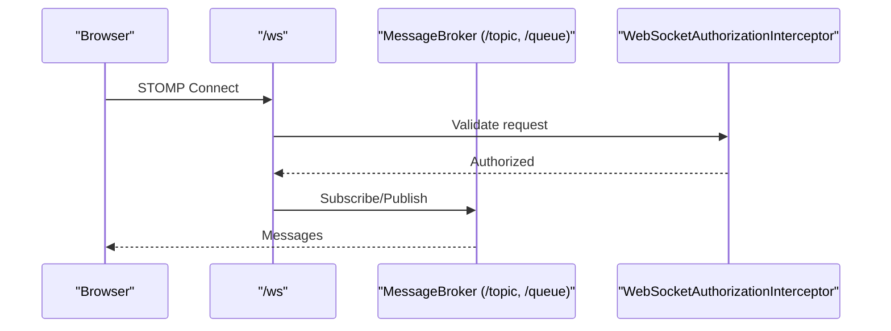
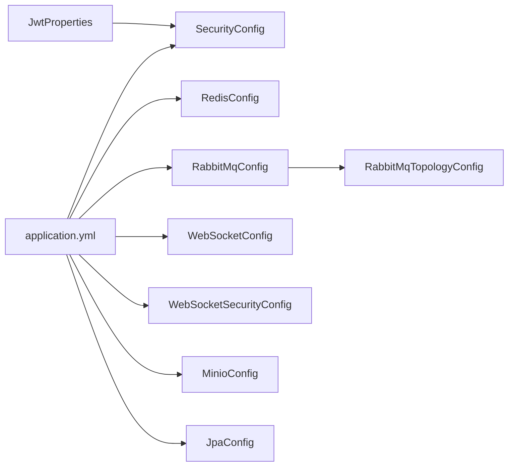

# Configuration Management

<cite>
**Referenced Files in This Document**
- [application.yml](file://src/main/resources/application.yml)
- [application-test.yml](file://src/test/resources/application-test.yml)
- [JpaConfig.java](file://src/main/java/com/smartcoffee/config/JpaConfig.java)
- [RedisConfig.java](file://src/main/java/com/smartcoffee/config/RedisConfig.java)
- [RabbitMqConfig.java](file://src/main/java/com/smartcoffee/config/RabbitMqConfig.java)
- [RabbitMqTopologyConfig.java](file://src/main/java/com/smartcoffee/config/RabbitMqTopologyConfig.java)
- [SecurityConfig.java](file://src/main/java/com/smartcoffee/config/SecurityConfig.java)
- [WebSocketConfig.java](file://src/main/java/com/smartcoffee/config/WebSocketConfig.java)
- [WebSocketSecurityConfig.java](file://src/main/java/com/smartcoffee/config/WebSocketSecurityConfig.java)
- [AsyncConfig.java](file://src/main/java/com/smartcoffee/config/AsyncConfig.java)
- [JacksonConfig.java](file://src/main/java/com/smartcoffee/config/JacksonConfig.java)
- [OpenApiConfig.java](file://src/main/java/com/smartcoffee/config/OpenApiConfig.java)
- [SchedulingConfig.java](file://src/main/java/com/smartcoffee/config/SchedulingConfig.java)
- [MinioConfig.java](file://src/main/java/com/smartcoffee/config/MinioConfig.java)
- [JwtProperties.java](file://src/main/java/com/smartcoffee/modules/auth/security/JwtProperties.java)
</cite>

## Table of Contents
1. Introduction
2. Project Structure
3. Core Components
4. Architecture Overview
5. Detailed Component Analysis
6. Dependency Analysis
7. Performance Considerations
8. Troubleshooting Guide
9. Conclusion

## Introduction
This document explains the Smart Coffee Backend configuration management, focusing on Spring Boot configuration classes and externalized properties. It covers:
- Configuration hierarchy and property sources
- Environment-specific overrides (default/local vs test)
- Security configuration (JWT decoding, password encoding, HTTP security)
- Database connection and migration setup
- Caching with Redis
- Message queue topology and publisher settings
- WebSocket configuration and authorization
- External services (MinIO), JSON serialization, OpenAPI, async/scheduling

The goal is to provide a clear map of how configuration flows into the application and how to adapt it across environments while following best practices for secret management and validation.

## Project Structure
Configuration is centralized in:
- src/main/resources/application.yml: default properties and environment variable placeholders
- src/test/resources/application-test.yml: test profile overrides
- src/main/java/com/smartcoffee/config/*: Spring configuration classes that wire infrastructure beans
- src/main/java/com/smartcoffee/modules/auth/security/JwtProperties.java: typed configuration for JWT

**Diagram sources**
- [application.yml:1-93](file://src/main/resources/application.yml#L1-L93)
- [SecurityConfig.java:22-80](file://src/main/java/com/smartcoffee/config/SecurityConfig.java#L22-L80)
- [RedisConfig.java:1-5](file://src/main/java/com/smartcoffee/config/RedisConfig.java#L1-L5)
- [RabbitMqConfig.java:1-12](file://src/main/java/com/smartcoffee/config/RabbitMqConfig.java#L1-L12)
- [RabbitMqTopologyConfig.java:1-87](file://src/main/java/com/smartcoffee/config/RabbitMqTopologyConfig.java#L1-L87)
- [WebSocketConfig.java:1-21](file://src/main/java/com/smartcoffee/config/WebSocketConfig.java#L1-L21)
- [WebSocketSecurityConfig.java:1-37](file://src/main/java/com/smartcoffee/config/WebSocketSecurityConfig.java#L1-L37)
- [MinioConfig.java:1-5](file://src/main/java/com/smartcoffee/config/MinioConfig.java#L1-L5)
- [JpaConfig.java:1-11](file://src/main/java/com/smartcoffee/config/JpaConfig.java#L1-L11)
- [JacksonConfig.java:1-15](file://src/main/java/com/smartcoffee/config/JacksonConfig.java#L1-L15)
- [OpenApiConfig.java:1-5](file://src/main/java/com/smartcoffee/config/OpenApiConfig.java#L1-L5)
- [AsyncConfig.java:1-5](file://src/main/java/com/smartcoffee/config/AsyncConfig.java#L1-L5)
- [SchedulingConfig.java:1-5](file://src/main/java/com/smartcoffee/config/SchedulingConfig.java#L1-L5)
- [JwtProperties.java:1-5](file://src/main/java/com/smartcoffee/modules/auth/security/JwtProperties.java#L1-L5)

**Section sources**
- [application.yml:1-93](file://src/main/resources/application.yml#L1-L93)
- [application-test.yml:1-19](file://src/test/resources/application-test.yml#L1-L19)

## Core Components
- Application defaults and profiles:
  - Default profile set to local; Docker compose lifecycle configured for start-only
  - Data source URL, username, password externalized via environment variables
  - Flyway migrations enabled from classpath db/migration
  - RabbitMQ publisher confirm and return enabled
  - MinIO client endpoint and credentials externalized
  - JWT secret and token lifetimes externalized
  - WebSocket allowed origins externalized
  - Actuator endpoints exposed for health, info, metrics, prometheus
- Typed configuration:
  - JwtProperties bound to app.security.jwt.*

Key responsibilities:
- SecurityConfig wires JWT decoder, password encoder, and HTTP security rules
- RedisConfig enables caching and sets default TTL and null-caching behavior
- RabbitMqConfig and RabbitMqTopologyConfig define exchange/queue names and bindings
- WebSocketConfig and WebSocketSecurityConfig configure STOMP broker and CORS
- MinioConfig creates MinIO client using externalized values
- JpaConfig enables transaction management
- JacksonConfig provides ObjectMapper bean
- OpenApiConfig defines API metadata
- AsyncConfig and SchedulingConfig enable background processing features

**Section sources**
- [application.yml:1-93](file://src/main/resources/application.yml#L1-L93)
- [JwtProperties.java:1-5](file://src/main/java/com/smartcoffee/modules/auth/security/JwtProperties.java#L1-L5)
- [SecurityConfig.java:22-80](file://src/main/java/com/smartcoffee/config/SecurityConfig.java#L22-L80)
- [RedisConfig.java:1-5](file://src/main/java/com/smartcoffee/config/RedisConfig.java#L1-L5)
- [RabbitMqConfig.java:1-12](file://src/main/java/com/smartcoffee/config/RabbitMqConfig.java#L1-L12)
- [RabbitMqTopologyConfig.java:1-87](file://src/main/java/com/smartcoffee/config/RabbitMqTopologyConfig.java#L1-L87)
- [WebSocketConfig.java:1-21](file://src/main/java/com/smartcoffee/config/WebSocketConfig.java#L1-L21)
- [WebSocketSecurityConfig.java:1-37](file://src/main/java/com/smartcoffee/config/WebSocketSecurityConfig.java#L1-L37)
- [MinioConfig.java:1-5](file://src/main/java/com/smartcoffee/config/MinioConfig.java#L1-L5)
- [JpaConfig.java:1-11](file://src/main/java/com/smartcoffee/config/JpaConfig.java#L1-L11)
- [JacksonConfig.java:1-15](file://src/main/java/com/smartcoffee/config/JacksonConfig.java#L1-L15)
- [OpenApiConfig.java:1-5](file://src/main/java/com/smartcoffee/config/OpenApiConfig.java#L1-L5)
- [AsyncConfig.java:1-5](file://src/main/java/com/smartcoffee/config/AsyncConfig.java#L1-L5)
- [SchedulingConfig.java:1-5](file://src/main/java/com/smartcoffee/config/SchedulingConfig.java#L1-L5)

## Architecture Overview
The configuration system composes multiple subsystems through Spring Boot auto-configuration and explicit @Configuration classes. Properties are resolved from application.yml and overridden by environment variables or profile-specific files.

**Diagram sources**
- [application.yml:1-93](file://src/main/resources/application.yml#L1-L93)
- [application-test.yml:1-19](file://src/test/resources/application-test.yml#L1-L19)
- [SecurityConfig.java:22-80](file://src/main/java/com/smartcoffee/config/SecurityConfig.java#L22-L80)
- [RedisConfig.java:1-5](file://src/main/java/com/smartcoffee/config/RedisConfig.java#L1-L5)
- [RabbitMqConfig.java:1-12](file://src/main/java/com/smartcoffee/config/RabbitMqConfig.java#L1-L12)
- [RabbitMqTopologyConfig.java:1-87](file://src/main/java/com/smartcoffee/config/RabbitMqTopologyConfig.java#L1-L87)
- [WebSocketConfig.java:1-21](file://src/main/java/com/smartcoffee/config/WebSocketConfig.java#L1-L21)
- [WebSocketSecurityConfig.java:1-37](file://src/main/java/com/smartcoffee/config/WebSocketSecurityConfig.java#L1-L37)
- [MinioConfig.java:1-5](file://src/main/java/com/smartcoffee/config/MinioConfig.java#L1-L5)
- [JpaConfig.java:1-11](file://src/main/java/com/smartcoffee/config/JpaConfig.java#L1-L11)
- [JacksonConfig.java:1-15](file://src/main/java/com/smartcoffee/config/JacksonConfig.java#L1-L15)
- [OpenApiConfig.java:1-5](file://src/main/java/com/smartcoffee/config/OpenApiConfig.java#L1-L5)
- [AsyncConfig.java:1-5](file://src/main/java/com/smartcoffee/config/AsyncConfig.java#L1-L5)
- [SchedulingConfig.java:1-5](file://src/main/java/com/smartcoffee/config/SchedulingConfig.java#L1-L5)

## Detailed Component Analysis

### Security Configuration
- Password encoding uses Argon2 via Spring Security defaults
- JWT decoding uses HMAC-SHA256 with a Base64-encoded secret loaded from JwtProperties
- HTTP security:
  - CSRF disabled for stateless APIs
  - Session creation policy set to STATELESS
  - Public endpoints include actuator health, OpenAPI UI/docs, auth endpoints, stores, categories, products
  - All other requests require authentication
- JwtAuthenticationFilter is added before UsernamePasswordAuthenticationFilter

**Diagram sources**
- [SecurityConfig.java:22-80](file://src/main/java/com/smartcoffee/config/SecurityConfig.java#L22-L80)
- [JwtProperties.java:1-5](file://src/main/java/com/smartcoffee/modules/auth/security/JwtProperties.java#L1-L5)

**Section sources**
- [SecurityConfig.java:22-80](file://src/main/java/com/smartcoffee/config/SecurityConfig.java#L22-L80)
- [JwtProperties.java:1-5](file://src/main/java/com/smartcoffee/modules/auth/security/JwtProperties.java#L1-L5)
- [application.yml:49-53](file://src/main/resources/application.yml#L49-L53)

### Database and Migration Configuration
- DataSource URL, username, password are externalized via environment variables
- Hibernate DDL auto is disabled; Flyway manages schema changes
- Flyway validates on migrate and clean is disabled
- JpaConfig enables transaction management

Best practices:
- Use environment variables for sensitive DB credentials
- Keep ddl-auto disabled in production; rely on Flyway
- Validate migrations early via validate-on-migrate

**Section sources**
- [application.yml:17-37](file://src/main/resources/application.yml#L17-L37)
- [JpaConfig.java:1-11](file://src/main/java/com/smartcoffee/config/JpaConfig.java#L1-L11)

### Redis Caching Configuration
- Caching is enabled globally
- Default cache TTL set to 10 minutes
- Null value caching is disabled to avoid polluting cache with nulls

Recommendations:
- Tune TTL per cache region if needed
- Consider cache eviction policies based on memory constraints

**Section sources**
- [RedisConfig.java:1-5](file://src/main/java/com/smartcoffee/config/RedisConfig.java#L1-L5)

### Message Queue (RabbitMQ) Configuration
- Publisher confirms and returns enabled for reliability
- Exchange and queue names defined in constants
- Topic exchange for business events; direct exchange for dead letter
- Notification queue binds to specific routing keys and includes a dead-letter exchange/routing key

**Diagram sources**
- [RabbitMqConfig.java:1-12](file://src/main/java/com/smartcoffee/config/RabbitMqConfig.java#L1-L12)
- [RabbitMqTopologyConfig.java:1-87](file://src/main/java/com/smartcoffee/config/RabbitMqTopologyConfig.java#L1-L87)
- [application.yml:39-41](file://src/main/resources/application.yml#L39-L41)

**Section sources**
- [RabbitMqConfig.java:1-12](file://src/main/java/com/smartcoffee/config/RabbitMqConfig.java#L1-L12)
- [RabbitMqTopologyConfig.java:1-87](file://src/main/java/com/smartcoffee/config/RabbitMqTopologyConfig.java#L1-L87)
- [application.yml:39-41](file://src/main/resources/application.yml#L39-L41)

### WebSocket Configuration and Security
- Two configurations:
  - WebSocketConfig: basic STOMP broker setup and endpoint registration
  - WebSocketSecurityConfig: adds authorization interceptor and configurable allowed origins
- Allowed origins are externalized via app.websocket.allowed-origins

**Diagram sources**
- [WebSocketConfig.java:1-21](file://src/main/java/com/smartcoffee/config/WebSocketConfig.java#L1-L21)
- [WebSocketSecurityConfig.java:1-37](file://src/main/java/com/smartcoffee/config/WebSocketSecurityConfig.java#L1-L37)
- [application.yml:75-76](file://src/main/resources/application.yml#L75-L76)

**Section sources**
- [WebSocketConfig.java:1-21](file://src/main/java/com/smartcoffee/config/WebSocketConfig.java#L1-L21)
- [WebSocketSecurityConfig.java:1-37](file://src/main/java/com/smartcoffee/config/WebSocketSecurityConfig.java#L1-L37)
- [application.yml:75-76](file://src/main/resources/application.yml#L75-L76)

### External Services and Utilities
- MinIO client created from externalized endpoint, access-key, secret-key
- Jackson ObjectMapper provided via JacksonConfig
- OpenAPI metadata defined via OpenApiConfig
- Async and scheduling features enabled via dedicated config classes

**Section sources**
- [MinioConfig.java:1-5](file://src/main/java/com/smartcoffee/config/MinioConfig.java#L1-L5)
- [application.yml:44-47](file://src/main/resources/application.yml#L44-L47)
- [JacksonConfig.java:1-15](file://src/main/java/com/smartcoffee/config/JacksonConfig.java#L1-L15)
- [OpenApiConfig.java:1-5](file://src/main/java/com/smartcoffee/config/OpenApiConfig.java#L1-L5)
- [AsyncConfig.java:1-5](file://src/main/java/com/smartcoffee/config/AsyncConfig.java#L1-L5)
- [SchedulingConfig.java:1-5](file://src/main/java/com/smartcoffee/config/SchedulingConfig.java#L1-L5)

## Dependency Analysis
Configuration dependencies and coupling:
- SecurityConfig depends on JwtProperties for secret and token lifetimes
- WebSocketSecurityConfig depends on an authorization interceptor and externalized allowed origins
- RabbitMqTopologyConfig declares durable exchanges and queues with bindings
- MinioConfig depends on externalized MinIO properties
- RedisConfig enables caching and sets default cache behavior
- JpaConfig enables transactions; actual datasource is auto-configured from application.yml

**Diagram sources**
- [JwtProperties.java:1-5](file://src/main/java/com/smartcoffee/modules/auth/security/JwtProperties.java#L1-L5)
- [SecurityConfig.java:22-80](file://src/main/java/com/smartcoffee/config/SecurityConfig.java#L22-L80)
- [application.yml:1-93](file://src/main/resources/application.yml#L1-L93)
- [RedisConfig.java:1-5](file://src/main/java/com/smartcoffee/config/RedisConfig.java#L1-L5)
- [RabbitMqConfig.java:1-12](file://src/main/java/com/smartcoffee/config/RabbitMqConfig.java#L1-L12)
- [RabbitMqTopologyConfig.java:1-87](file://src/main/java/com/smartcoffee/config/RabbitMqTopologyConfig.java#L1-L87)
- [WebSocketConfig.java:1-21](file://src/main/java/com/smartcoffee/config/WebSocketConfig.java#L1-L21)
- [WebSocketSecurityConfig.java:1-37](file://src/main/java/com/smartcoffee/config/WebSocketSecurityConfig.java#L1-L37)
- [MinioConfig.java:1-5](file://src/main/java/com/smartcoffee/config/MinioConfig.java#L1-L5)
- [JpaConfig.java:1-11](file://src/main/java/com/smartcoffee/config/JpaConfig.java#L1-L11)

**Section sources**
- [application.yml:1-93](file://src/main/resources/application.yml#L1-L93)
- [SecurityConfig.java:22-80](file://src/main/java/com/smartcoffee/config/SecurityConfig.java#L22-L80)
- [RabbitMqTopologyConfig.java:1-87](file://src/main/java/com/smartcoffee/config/RabbitMqTopologyConfig.java#L1-L87)

## Performance Considerations
- Caching:
  - Default TTL of 10 minutes may be too short for read-heavy catalog data; consider longer TTLs or cache-aside patterns
  - Disable caching nulls to reduce cache bloat
- Database:
  - Flyway validate-on-migrate prevents runtime schema drift; keep ddl-auto disabled
  - Ensure connection pooling is tuned via Spring Boot defaults or HikariCP properties if needed
- Messaging:
  - Publisher confirms and returns improve reliability but add latency; tune concurrency and prefetch accordingly
- WebSocket:
  - Limit allowed origins strictly per environment
  - Use user destination prefixes to scope messages per authenticated user

[No sources needed since this section provides general guidance]

## Troubleshooting Guide
Common issues and resolutions:
- JWT decode failures:
  - Verify app.security.jwt.secret is Base64-encoded and matches the signing algorithm used by the issuer
  - Ensure the correct HMAC-SHA256 key length and format
- Redis not caching:
  - Confirm @EnableCaching is active and caches are annotated appropriately
  - Check TTL and null-caching behavior
- RabbitMQ binding errors:
  - Verify routing keys match exchange/topic patterns
  - Inspect dead-letter flow when consumers fail
- WebSocket CORS errors:
  - Ensure app.websocket.allowed-origins includes the browser origin
  - Confirm STOMP endpoint path matches client configuration
- Actuator exposure:
  - Verify management endpoints are included and accessible as intended

**Section sources**
- [SecurityConfig.java:22-80](file://src/main/java/com/smartcoffee/config/SecurityConfig.java#L22-L80)
- [RedisConfig.java:1-5](file://src/main/java/com/smartcoffee/config/RedisConfig.java#L1-L5)
- [RabbitMqTopologyConfig.java:1-87](file://src/main/java/com/smartcoffee/config/RabbitMqTopologyConfig.java#L1-L87)
- [WebSocketSecurityConfig.java:1-37](file://src/main/java/com/smartcoffee/config/WebSocketSecurityConfig.java#L1-L37)
- [application.yml:81-89](file://src/main/resources/application.yml#L81-L89)

## Conclusion
Smart Coffee Backend’s configuration is cleanly separated between externalized properties and explicit Spring configuration classes. Secrets and environment-specific values are externalized, enabling safe deployment across development, staging, and production. Security, database, caching, messaging, and real-time communication are all wired through focused configuration components. Following the outlined best practices—environmental overrides, strict CORS, validated migrations, and reliable message delivery—will ensure robust operation at scale.

[No sources needed since this section summarizes without analyzing specific files]