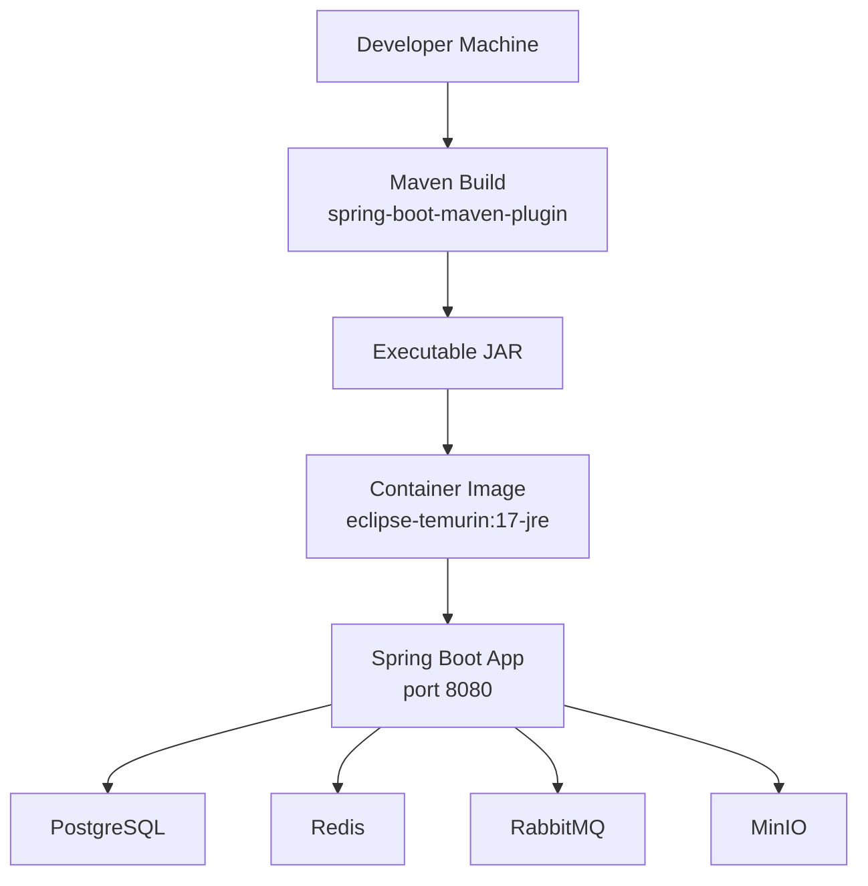
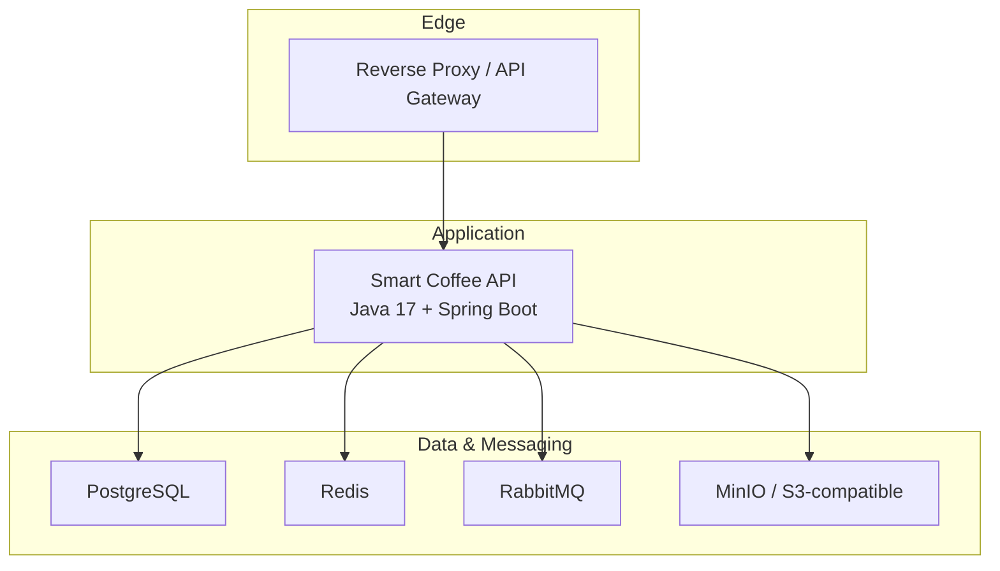
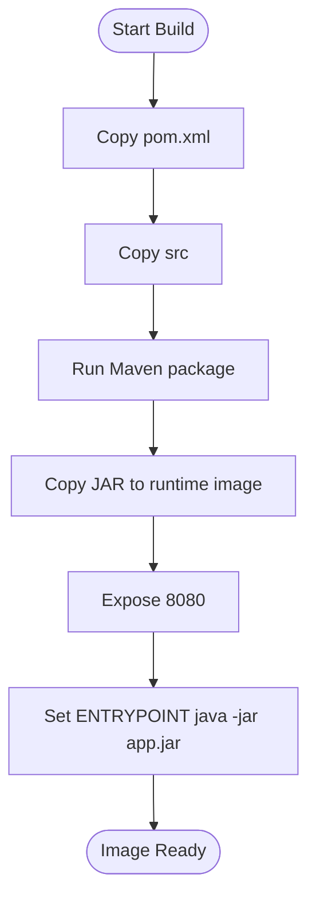
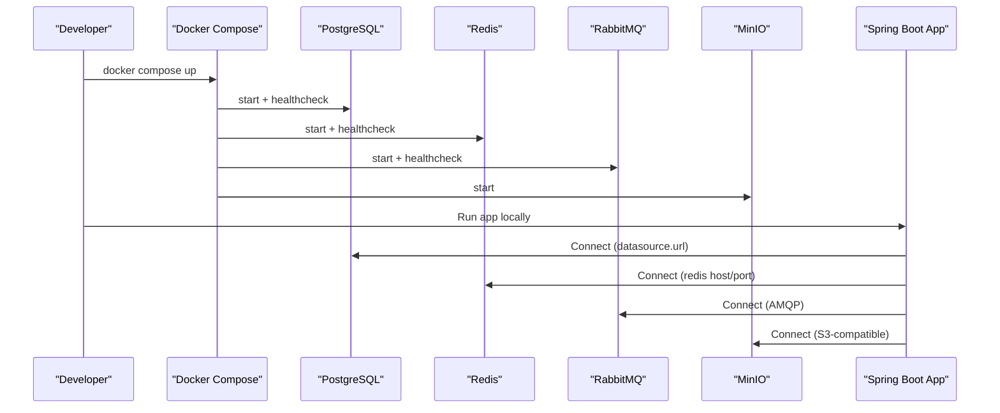
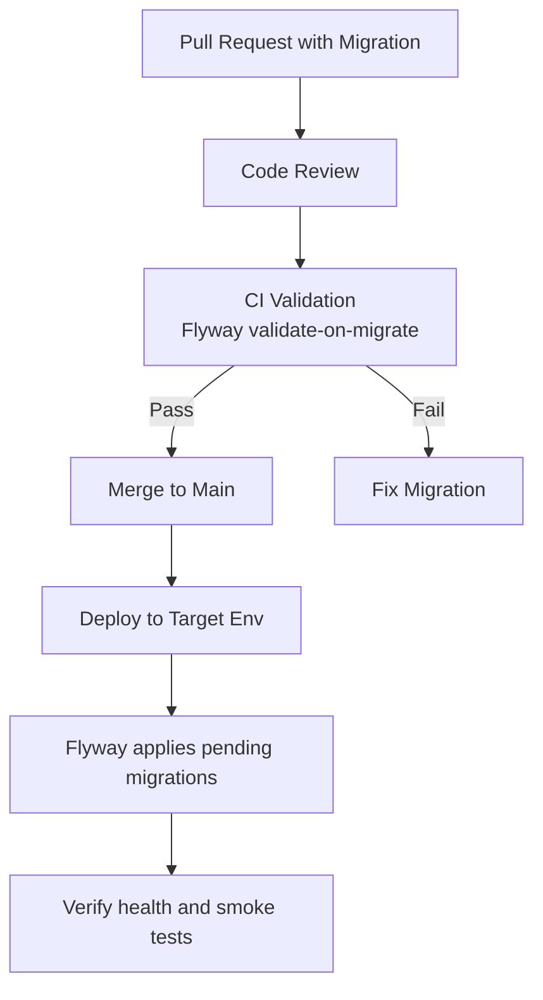
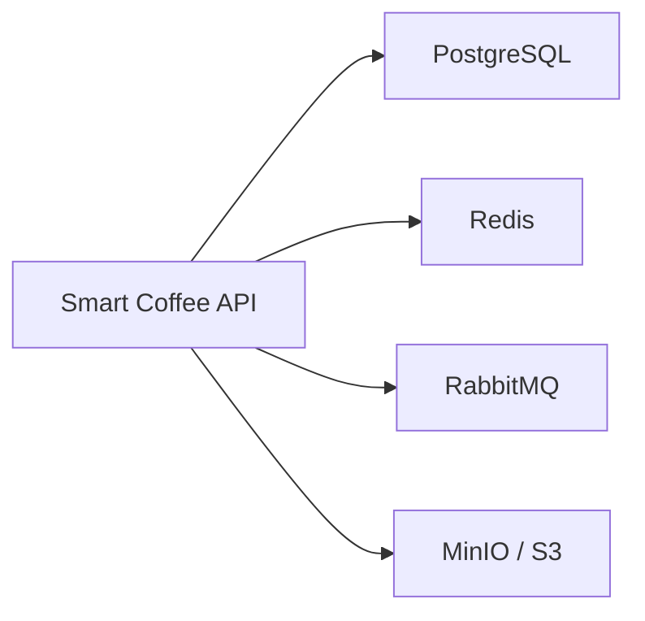

# Deployment Strategy

<cite>
**Referenced Files in This Document**
- [Dockerfile](file://Dockerfile)
- [compose.yaml](file://compose.yaml)
- [pom.xml](file://pom.xml)
- [application.yml](file://src/main/resources/application.yml)
- [application-test.yml](file://src/test/resources/application-test.yml)
- [ReadinessHealthIndicator.java](file://src/main/java/com/smartcoffee/infrastructure/observability/ReadinessHealthIndicator.java)
- [HealthIndicators.java](file://src/main/java/com/smartcoffee/infrastructure/observability/HealthIndicators.java)
- [ADR-003-rabbitmq.md](file://adr/ADR-003-rabbitmq.md)
- [IntegrationTestBase.java](file://src/test/java/com/smartcoffee/testsupport/IntegrationTestBase.java)
</cite>

## Table of Contents
1. [Introduction](#introduction)
2. [Project Structure](#project-structure)
3. [Core Components](#core-components)
4. [Architecture Overview](#architecture-overview)
5. [Detailed Component Analysis](#detailed-component-analysis)
6. [Dependency Analysis](#dependency-analysis)
7. [Performance Considerations](#performance-considerations)
8. [Troubleshooting Guide](#troubleshooting-guide)
9. [Conclusion](#conclusion)

## Introduction
This document defines the deployment strategy for the Smart Coffee backend, focusing on containerization, local orchestration, database migrations, CI/CD considerations, environment promotion, and production-grade operational concerns such as security, resource limits, and scaling. It is based on the existing Maven build, Spring Boot application configuration, Dockerfile, Docker Compose setup, Flyway migration conventions, and health indicators present in the repository.

## Project Structure
The project is a Spring Boot modular monolith with:
- A Maven-based build producing an executable JAR.
- A two-stage Dockerfile that builds the application and packages a minimal runtime image.
- A Docker Compose file defining PostgreSQL, Redis, RabbitMQ, and MinIO for local development and testing.
- Flyway-managed SQL migrations under src/main/resources/db/migration.
- Application configuration via application.yml with environment-driven settings.
- Health endpoints exposed through Spring Boot Actuator and custom readiness checks.

**Diagram sources**
- [Dockerfile:1-11](file://Dockerfile#L1-L11)
- [compose.yaml:1-71](file://compose.yaml#L1-L71)
- [pom.xml:347-400](file://pom.xml#L347-L400)

**Section sources**
- [Dockerfile:1-11](file://Dockerfile#L1-L11)
- [compose.yaml:1-71](file://compose.yaml#L1-L71)
- [pom.xml:347-400](file://pom.xml#L347-L400)

## Core Components
- Container image: Two-stage build using Maven to compile and package, then a JRE-only runtime image.
- Local services: PostgreSQL, Redis, RabbitMQ, and MinIO orchestrated via Docker Compose.
- Database migrations: Flyway enabled with validation and clean disabled; migrations stored as versioned SQL files.
- Configuration: Environment variables drive datasource, storage, security, and feature toggles.
- Observability: Actuator endpoints for health, metrics, and Prometheus scraping; custom readiness indicator for database connectivity.

**Section sources**
- [Dockerfile:1-11](file://Dockerfile#L1-L11)
- [compose.yaml:1-71](file://compose.yaml#L1-L71)
- [application.yml:17-38](file://src/main/resources/application.yml#L17-L38)
- [application.yml:81-93](file://src/main/resources/application.yml#L81-L93)
- [ReadinessHealthIndicator.java:1-28](file://src/main/java/com/smartcoffee/infrastructure/observability/ReadinessHealthIndicator.java#L1-L28)

## Architecture Overview
The runtime stack consists of the Spring Boot API behind a reverse proxy or API gateway (conceptual), with persistent and transient dependencies managed by Docker Compose locally and cloud-managed services in production.

**Diagram sources**
- [compose.yaml:1-71](file://compose.yaml#L1-L71)
- [application.yml:17-38](file://src/main/resources/application.yml#L17-L38)
- [application.yml:43-80](file://src/main/resources/application.yml#L43-L80)

## Detailed Component Analysis

### Docker Containerization and Image Optimization
- Base images:
  - Build stage uses Maven with JDK 17 to compile and package.
  - Runtime stage uses a JRE-only base image to minimize attack surface and image size.
- Build process:
  - Copies pom.xml and source code, runs Maven package without tests.
  - Produces a single executable JAR copied into the runtime image.
- Exposure:
  - Exposes port 8080 and sets the entrypoint to run the JAR.

Recommendations for optimization and hardening:
- Pin exact image digests for reproducibility.
- Use multi-stage builds with dependency caching layers.
- Add non-root user and read-only filesystem where possible.
- Scan images for vulnerabilities and enforce policies.
- Consider distroless or slim variants if compatible.

**Diagram sources**
- [Dockerfile:1-11](file://Dockerfile#L1-L11)

**Section sources**
- [Dockerfile:1-11](file://Dockerfile#L1-L11)

### Docker Compose Orchestration for Local Development and Testing
Compose defines:
- PostgreSQL with healthcheck and persistence defaults.
- Redis with append-only mode and Spring service connection label.
- RabbitMQ with management UI and healthcheck.
- MinIO with console and default credentials.

Usage patterns:
- The application starts with spring.docker.compose.lifecycle-management=start-only, allowing external lifecycle control.
- Datasource URL and credentials are configurable via environment variables.
- Test profiles disable scheduling and set safe defaults for JWT secrets.

**Diagram sources**
- [compose.yaml:1-71](file://compose.yaml#L1-L71)
- [application.yml:5-8](file://src/main/resources/application.yml#L5-L8)
- [application.yml:17-21](file://src/main/resources/application.yml#L17-L21)

**Section sources**
- [compose.yaml:1-71](file://compose.yaml#L1-L71)
- [application.yml:5-8](file://src/main/resources/application.yml#L5-L8)
- [application.yml:17-21](file://src/main/resources/application.yml#L17-L21)
- [application-test.yml:1-19](file://src/test/resources/application-test.yml#L1-L19)

### Database Migration Strategy with Flyway
- Flyway is enabled and configured to validate migrations on migrate and disallow clean operations.
- Migrations are located at classpath:db/migration and follow semantic versioning naming.
- The test profile enables Flyway and disables scheduling tasks.

Version control and rollback procedures:
- Treat migrations as immutable versioned artifacts.
- For fixes, create new forward-only migrations rather than editing applied versions.
- Validate migrations before merging to prevent schema drift.
- Maintain a changelog and review migration impact during PRs.
- Backward-compatible changes first, followed by cleanup in later versions.

**Diagram sources**
- [application.yml:33-38](file://src/main/resources/application.yml#L33-L38)
- [application-test.yml:6-10](file://src/test/resources/application-test.yml#L6-L10)

**Section sources**
- [application.yml:33-38](file://src/main/resources/application.yml#L33-L38)
- [application-test.yml:6-10](file://src/test/resources/application-test.yml#L6-L10)

### CI/CD Pipeline Considerations
Recommended pipeline stages:
- Lint and static analysis.
- Unit tests.
- Integration tests with containers (PostgreSQL, Redis, RabbitMQ, MinIO).
- Build and publish container image.
- Push image to registry with tags and SBOM.
- Deploy to staging with canary or blue-green strategy.
- Promote to production after automated validations.

Key integration points:
- Use the same Maven goals as local builds to ensure parity.
- Run Flyway validation in CI against a temporary database.
- Store secrets in a secure vault and inject them at runtime.
- Enforce image signing and vulnerability scanning.

[No sources needed since this section provides general guidance]

### Environment Promotion Strategies
- Environments: dev, staging, prod.
- Artifact immutability: promote the same image across environments.
- Configuration separation: use environment-specific config maps/secrets.
- Feature flags: gate risky features until validated in lower environments.
- Rollback policy: revert to previous known-good image and configuration.

[No sources needed since this section provides general guidance]

### Blue-Green Deployment Patterns
- Maintain two identical environments (blue and green).
- Route traffic to one environment at a time.
- Deploy updates to the idle environment.
- Validate health and smoke tests.
- Switch traffic atomically via load balancer or ingress.
- Keep the previous environment warm for fast rollback.

[No sources needed since this section provides general guidance]

### Container Security, Resource Limits, and Scaling Policies
Security:
- Run as non-root user inside the container.
- Use read-only root filesystem where feasible.
- Limit capabilities and drop unnecessary ones.
- Regularly scan images and dependencies for vulnerabilities.
- Rotate secrets and avoid embedding sensitive data in images.

Resource limits:
- Set CPU and memory requests and limits in orchestrators.
- Tune JVM options for container awareness.
- Monitor utilization and adjust limits based on metrics.

Scaling:
- Horizontal Pod Autoscaler (or equivalent) based on CPU/memory and custom metrics.
- Connection pool sizing aligned with replica count and database capacity.
- Queue consumers scaled according to backlog depth and latency targets.

[No sources needed since this section provides general guidance]

### Kubernetes Manifests and Cloud Deployment Configurations
Conceptual guidance:
- Deployment: define replicas, container image, ports, env vars, probes, and resource limits.
- Service: expose the application internally within the cluster.
- Ingress: route external HTTPS traffic to the Service.
- ConfigMap/Secret: externalize configuration and secrets.
- PersistentVolumeClaim: optional for stateful components if self-hosted.
- HPA: scale based on metrics.
- NetworkPolicy: restrict inter-pod communication.

Note: These are conceptual examples; adapt to your platform’s conventions and policies.

[No sources needed since this section provides conceptual guidance]

## Dependency Analysis
The application depends on:
- PostgreSQL for relational data.
- Redis for caching and session-like stores.
- RabbitMQ for durable messaging and background processing.
- MinIO/S3-compatible storage for object storage.

**Diagram sources**
- [compose.yaml:1-71](file://compose.yaml#L1-L71)
- [application.yml:17-21](file://src/main/resources/application.yml#L17-L21)
- [application.yml:43-80](file://src/main/resources/application.yml#L43-L80)

**Section sources**
- [compose.yaml:1-71](file://compose.yaml#L1-L71)
- [application.yml:17-21](file://src/main/resources/application.yml#L17-L21)
- [application.yml:43-80](file://src/main/resources/application.yml#L43-L80)

## Performance Considerations
- Use connection pooling tuned for expected concurrency and replica counts.
- Enable query logging only in non-production or with sampling.
- Leverage Redis for hot paths and cache invalidation strategies.
- Scale consumers horizontally for RabbitMQ workloads.
- Monitor GC behavior and tune heap sizes relative to container limits.
- Profile critical endpoints and optimize N+1 queries or heavy transformations.

[No sources needed since this section provides general guidance]

## Troubleshooting Guide
Common issues and diagnostics:
- Database connectivity: verify datasource URL, credentials, and network access.
- Flyway failures: check migration validation errors and history consistency.
- Redis/RabbitMQ connectivity: confirm host, port, and authentication.
- Object storage: validate endpoint, access keys, and bucket permissions.
- Health checks: inspect actuator health and custom readiness indicators.

Operational tips:
- Use health endpoints to detect startup and dependency readiness.
- Log and monitor queue depths, error rates, and latency percentiles.
- Keep logs structured and include correlation IDs.
- Use container logs and orchestrator dashboards for visibility.

**Section sources**
- [application.yml:81-93](file://src/main/resources/application.yml#L81-L93)
- [ReadinessHealthIndicator.java:1-28](file://src/main/java/com/smartcoffee/infrastructure/observability/ReadinessHealthIndicator.java#L1-L28)
- [HealthIndicators.java:1-16](file://src/main/java/com/smartcoffee/infrastructure/observability/HealthIndicators.java#L1-L16)

## Conclusion
The Smart Coffee backend follows a pragmatic deployment model:
- A simple two-stage Docker build produces a lean runtime image.
- Docker Compose standardizes local environments with essential infrastructure.
- Flyway ensures controlled, auditable schema evolution.
- Actuator and custom health indicators provide robust operational signals.
For production, adopt secure image practices, externalized configuration, observability, autoscaling, and safe rollout strategies such as blue-green deployments.

[No sources needed since this section summarizes without analyzing specific files]