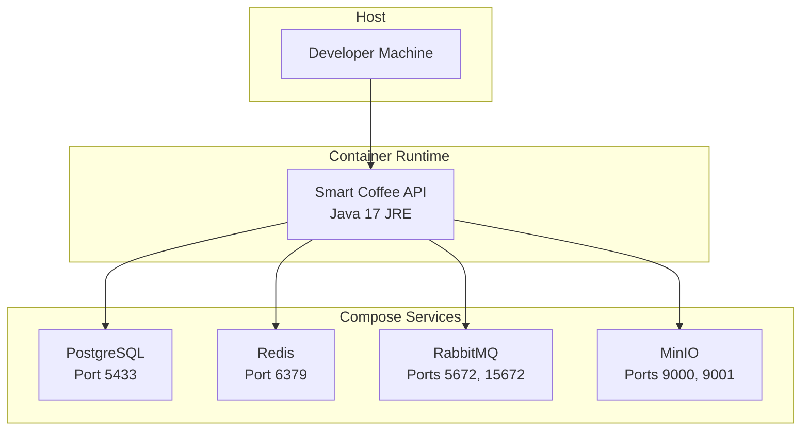
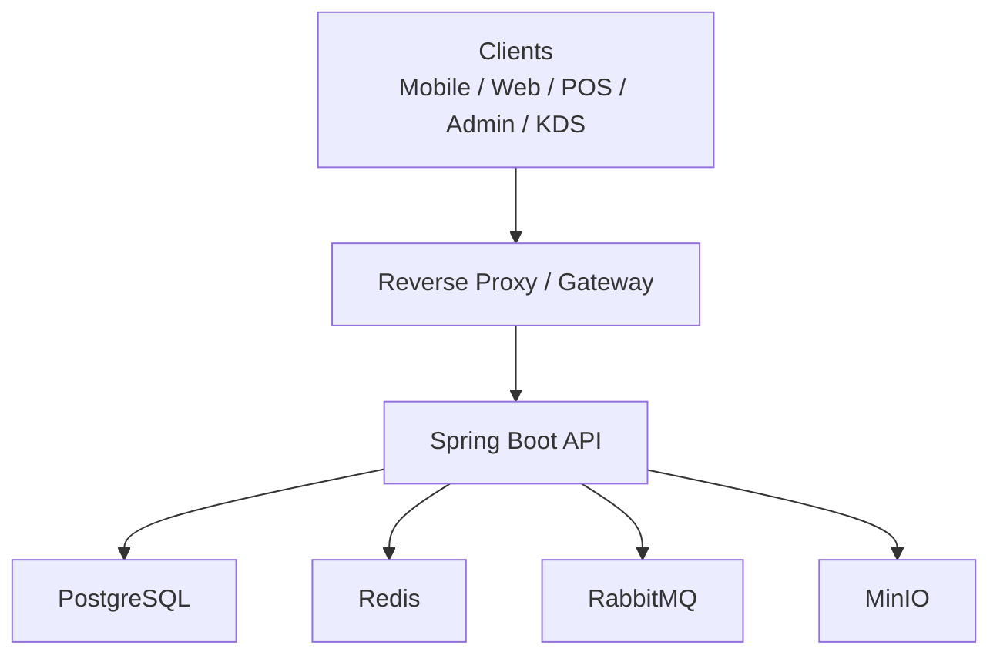
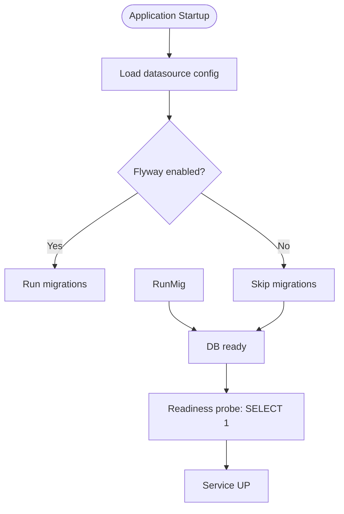
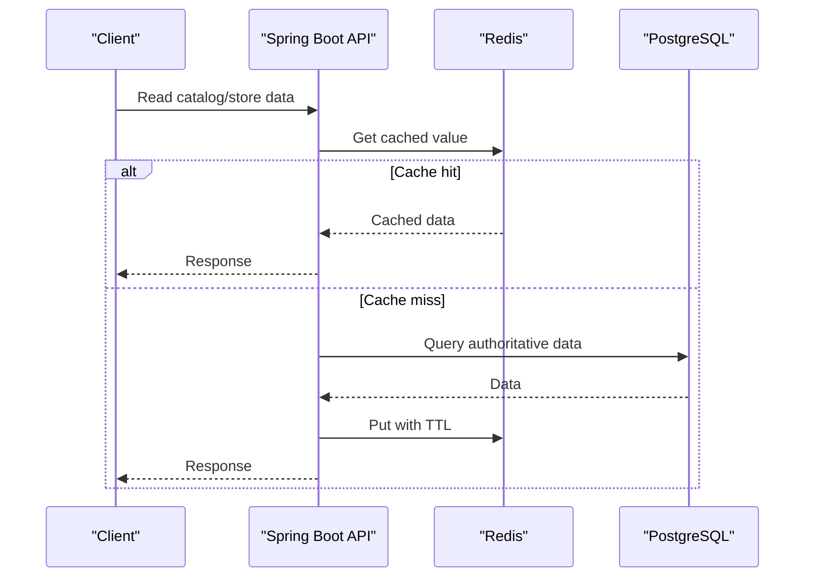
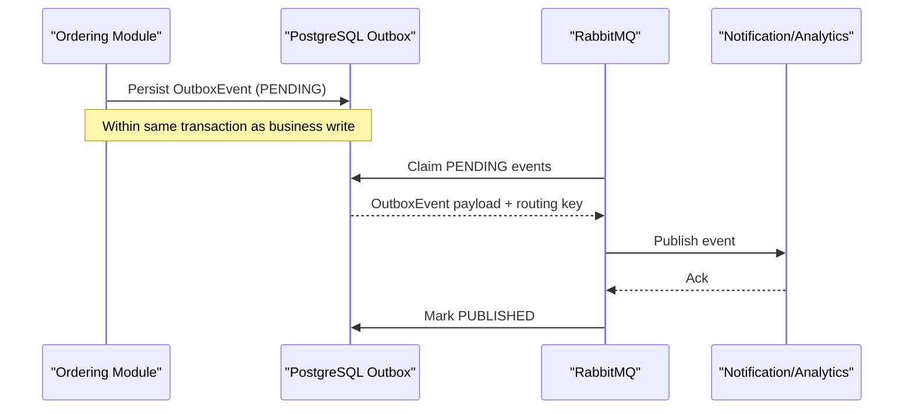
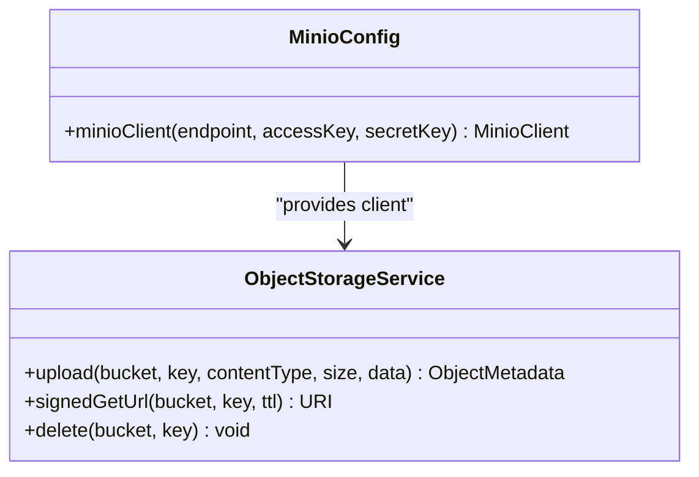
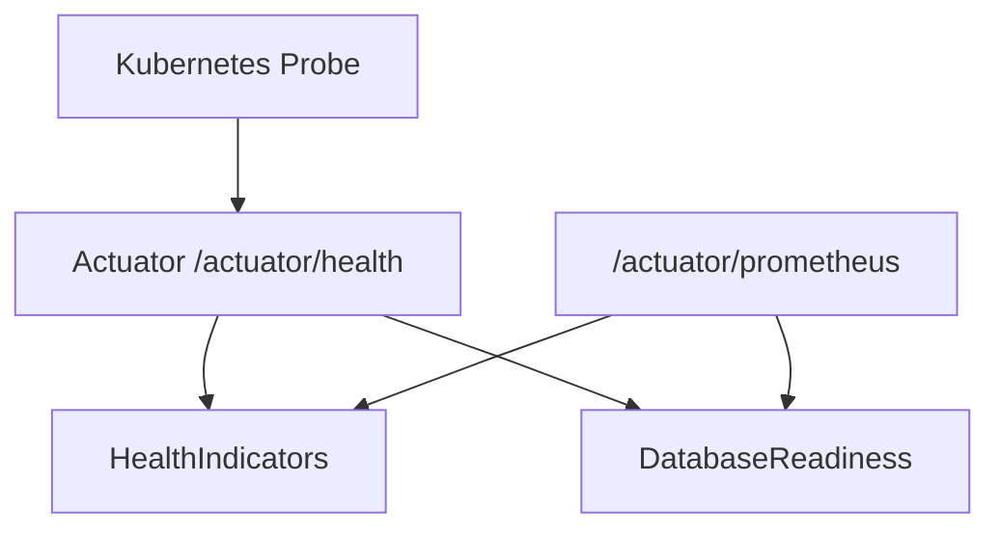
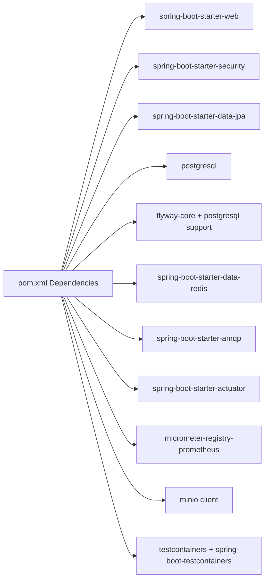

# Infrastructure Design

<cite>
**Referenced Files in This Document**
- [compose.yaml](file://compose.yaml)
- [Dockerfile](file://Dockerfile)
- [application.yml](file://src/main/resources/application.yml)
- [pom.xml](file://pom.xml)
- [SYSTEM_ARCHITECTURE.md](file://architecture/SYSTEM_ARCHITECTURE.md)
- [RedisConfig.java](file://src/main/java/com/smartcoffee/config/RedisConfig.java)
- [RabbitMqConfig.java](file://src/main/java/com/smartcoffee/config/RabbitMqConfig.java)
- [MinioConfig.java](file://src/main/java/com/smartcoffee/config/MinioConfig.java)
- [HealthIndicators.java](file://src/main/java/com/smartcoffee/infrastructure/observability/HealthIndicators.java)
- [ReadinessHealthIndicator.java](file://src/main/java/com/smartcoffee/infrastructure/observability/ReadinessHealthIndicator.java)
- [MetricsService.java](file://src/main/java/com/smartcoffee/infrastructure/observability/MetricsService.java)
- [ObjectStorageService.java](file://src/main/java/com/smartcoffee/infrastructure/storage/ObjectStorageService.java)
- [OutboxEvent.java](file://src/main/java/com/smartcoffee/infrastructure/messaging/outbox/OutboxEvent.java)
</cite>

## Table of Contents
1. Introduction
2. Project Structure
3. Core Components
4. Architecture Overview
5. Detailed Component Analysis
6. Dependency Analysis
7. Performance Considerations
8. Troubleshooting Guide
9. Conclusion
10. Appendices

## Introduction
This document describes the infrastructure design for the Smart Coffee Backend, focusing on runtime containers (Spring Boot application, PostgreSQL, Redis, RabbitMQ, MinIO), configuration management, environment-specific settings, deployment topology, monitoring and observability, scalability, performance optimization, capacity planning, and infrastructure-as-code patterns including Docker and Compose.

The backend is a modular monolith that exposes REST and WebSocket endpoints and coordinates business modules while relying on durable infrastructure services for persistence, caching, messaging, and object storage.

**Section sources**
- [SYSTEM_ARCHITECTURE.md:88-133](file://architecture/SYSTEM_ARCHITECTURE.md#L88-L133)

## Project Structure
At runtime, the application is packaged as a Spring Boot executable JAR and runs inside a container built from a multi-stage Dockerfile. Local development and testing use Docker Compose to provision PostgreSQL, Redis, RabbitMQ, and MinIO with health checks and sensible defaults.

**Diagram sources**
- [compose.yaml:1-71](file://compose.yaml#L1-L71)
- [Dockerfile:1-11](file://Dockerfile#L1-L11)

**Section sources**
- [Dockerfile:1-11](file://Dockerfile#L1-L11)
- [compose.yaml:1-71](file://compose.yaml#L1-L71)

## Core Components
- Spring Boot Application: Modular monolith exposing REST and WebSocket APIs; uses Actuator for health and metrics; integrates Flyway for schema migrations.
- PostgreSQL: Durable store for all operational data, including outbox and idempotency records.
- Redis: Cache and short-lived coordination; not the source of truth for critical state.
- RabbitMQ: Asynchronous messaging for notifications, receipts, projections, and retries; supports publisher confirms and returns.
- MinIO: Object storage for images, receipts, and documents; accessed via S3-compatible client.

Configuration is centralized in application.yml with environment variable overrides for secrets and endpoints. Profiles default to local for development.

**Section sources**
- [application.yml:1-93](file://src/main/resources/application.yml#L1-L93)
- [SYSTEM_ARCHITECTURE.md:88-133](file://architecture/SYSTEM_ARCHITECTURE.md#L88-L133)

## Architecture Overview
The system follows a modular monolith pattern with clear boundaries and durable infrastructure. Clients connect through an optional reverse proxy or gateway to the Spring Boot backend, which interacts with PostgreSQL, Redis, RabbitMQ, and MinIO.

**Diagram sources**
- [SYSTEM_ARCHITECTURE.md:53-133](file://architecture/SYSTEM_ARCHITECTURE.md#L53-L133)

## Detailed Component Analysis

### PostgreSQL Integration
- Connection and driver are configured via environment variables with sensible defaults for local development.
- Flyway manages schema migrations from classpath locations with validation enabled and clean disabled.
- Health readiness is verified by a dedicated indicator that executes a simple query.

**Diagram sources**
- [application.yml:17-37](file://src/main/resources/application.yml#L17-L37)
- [ReadinessHealthIndicator.java:1-28](file://src/main/java/com/smartcoffee/infrastructure/observability/ReadinessHealthIndicator.java#L1-L28)

**Section sources**
- [application.yml:17-37](file://src/main/resources/application.yml#L17-L37)
- [ReadinessHealthIndicator.java:1-28](file://src/main/java/com/smartcoffee/infrastructure/observability/ReadinessHealthIndicator.java#L1-L28)

### Redis Cache
- Caching is enabled with a default TTL and null-value caching disabled.
- Redis is used for bounded caches and short-lived coordination; it must never be the sole source of truth for critical aggregates.

**Diagram sources**
- [RedisConfig.java:1-5](file://src/main/java/com/smartcoffee/config/RedisConfig.java#L1-L5)
- [SYSTEM_ARCHITECTURE.md:109-117](file://architecture/SYSTEM_ARCHITECTURE.md#L109-L117)

**Section sources**
- [RedisConfig.java:1-5](file://src/main/java/com/smartcoffee/config/RedisConfig.java#L1-L5)
- [SYSTEM_ARCHITECTURE.md:109-117](file://architecture/SYSTEM_ARCHITECTURE.md#L109-L117)

### RabbitMQ Messaging
- The exchange name is defined centrally for consistent event routing.
- Publisher confirms and returns are enabled to ensure delivery reliability.
- Critical events are published using a transactional outbox to guarantee at-least-once delivery with idempotent consumers.

**Diagram sources**
- [RabbitMqConfig.java:1-12](file://src/main/java/com/smartcoffee/config/RabbitMqConfig.java#L1-L12)
- [application.yml:39-41](file://src/main/resources/application.yml#L39-L41)
- [OutboxEvent.java:15-217](file://src/main/java/com/smartcoffee/infrastructure/messaging/outbox/OutboxEvent.java#L15-L217)

**Section sources**
- [RabbitMqConfig.java:1-12](file://src/main/java/com/smartcoffee/config/RabbitMqConfig.java#L1-L12)
- [application.yml:39-41](file://src/main/resources/application.yml#L39-L41)
- [OutboxEvent.java:15-217](file://src/main/java/com/smartcoffee/infrastructure/messaging/outbox/OutboxEvent.java#L15-L217)

### MinIO Object Storage
- A MinIO client bean is created from endpoint and credentials configured via environment variables.
- An abstraction provides upload, signed URL generation, and delete operations for buckets and keys.

**Diagram sources**
- [MinioConfig.java:1-5](file://src/main/java/com/smartcoffee/config/MinioConfig.java#L1-L5)
- [ObjectStorageService.java:1-27](file://src/main/java/com/smartcoffee/infrastructure/storage/ObjectStorageService.java#L1-L27)

**Section sources**
- [MinioConfig.java:1-5](file://src/main/java/com/smartcoffee/config/MinioConfig.java#L1-L5)
- [ObjectStorageService.java:1-27](file://src/main/java/com/smartcoffee/infrastructure/storage/ObjectStorageService.java#L1-L27)

### Monitoring and Observability
- Actuator endpoints expose health, info, metrics, and Prometheus scraping.
- Probes are enabled for Kubernetes-style readiness/liveness checks.
- Custom health indicators report service status and database connectivity.
- Micrometer counters are exposed via a shared MetricsService for custom business metrics.

**Diagram sources**
- [application.yml:81-93](file://src/main/resources/application.yml#L81-L93)
- [HealthIndicators.java:1-17](file://src/main/java/com/smartcoffee/infrastructure/observability/HealthIndicators.java#L1-L17)
- [ReadinessHealthIndicator.java:1-28](file://src/main/java/com/smartcoffee/infrastructure/observability/ReadinessHealthIndicator.java#L1-L28)
- [MetricsService.java:1-5](file://src/main/java/com/smartcoffee/infrastructure/observability/MetricsService.java#L1-L5)

**Section sources**
- [application.yml:81-93](file://src/main/resources/application.yml#L81-L93)
- [HealthIndicators.java:1-17](file://src/main/java/com/smartcoffee/infrastructure/observability/HealthIndicators.java#L1-L17)
- [ReadinessHealthIndicator.java:1-28](file://src/main/java/com/smartcoffee/infrastructure/observability/ReadinessHealthIndicator.java#L1-L28)
- [MetricsService.java:1-5](file://src/main/java/com/smartcoffee/infrastructure/observability/MetricsService.java#L1-L5)

## Dependency Analysis
The build defines dependencies for web, security, JPA, PostgreSQL, Flyway, Redis, RabbitMQ, Actuator, Prometheus, MinIO, and testcontainers. These map directly to the runtime components and enable local development parity with production-like behavior.

**Diagram sources**
- [pom.xml:62-306](file://pom.xml#L62-L306)

**Section sources**
- [pom.xml:62-306](file://pom.xml#L62-L306)

## Performance Considerations
- Database
  - Use connection pooling tuned to expected concurrency and CPU cores.
  - Keep transactions small; avoid long-running work inside DB transactions.
  - Index frequently queried columns and consider read replicas for heavy reporting if needed.
- Redis
  - Set appropriate TTLs per cache type; avoid storing large payloads.
  - Monitor memory usage and eviction policies; prefer bounded caches.
- RabbitMQ
  - Use publisher confirms and returns; implement idempotent consumers.
  - Configure queue durability and prefetch limits based on consumer throughput.
  - Use dead-letter queues for failed messages and backoff strategies for retries.
- MinIO
  - Use multipart uploads for large objects; generate signed URLs for direct client uploads when possible.
  - Organize buckets and prefixes to optimize listing and access patterns.
- Application
  - Enable async processing where appropriate; keep request paths synchronous only for immediate decisions.
  - Use pagination and projection queries to reduce payload sizes.
  - Expose metrics and set alert thresholds for latency, error rates, and resource saturation.

[No sources needed since this section provides general guidance]

## Troubleshooting Guide
- Health checks
  - Verify /actuator/health reports UP; check database readiness indicator for connectivity issues.
- Database
  - Confirm Flyway migrations applied successfully; validate migration order and content.
  - Inspect connection errors and pool exhaustion via logs and metrics.
- Redis
  - Check connectivity and memory usage; ensure TTLs are set and caches are invalidated appropriately.
- RabbitMQ
  - Validate exchange and queue declarations; inspect dead-letter queues and retry counts.
  - Ensure publisher confirms are enabled and consumers acknowledge messages.
- MinIO
  - Verify endpoint, access key, and secret key; confirm bucket existence and permissions.
  - Test signed URL generation and object upload/delete flows.
- Observability
  - Scrape /actuator/prometheus and correlate spikes in error counters or latency.
  - Use structured logging and correlation IDs to trace requests across components.

**Section sources**
- [application.yml:81-93](file://src/main/resources/application.yml#L81-L93)
- [ReadinessHealthIndicator.java:1-28](file://src/main/java/com/smartcoffee/infrastructure/observability/ReadinessHealthIndicator.java#L1-L28)
- [OutboxEvent.java:15-217](file://src/main/java/com/smartcoffee/infrastructure/messaging/outbox/OutboxEvent.java#L15-L217)

## Conclusion
The Smart Coffee Backend is designed around a resilient, observable, and scalable infrastructure stack. PostgreSQL provides durable state, Redis accelerates reads and coordination, RabbitMQ enables reliable asynchronous workflows, and MinIO stores unstructured assets. Configuration is externalized and profile-aware, and Docker Compose standardizes local environments. Monitoring and health probes support automated operations and quick incident response.

[No sources needed since this section summarizes without analyzing specific files]

## Appendices

### Environment Variables and Configuration Keys
- Database
  - DATABASE_URL, DATABASE_USERNAME, DATABASE_PASSWORD
- Redis
  - Standard Spring Redis properties (host, port, password) via Spring Boot auto-configuration
- RabbitMQ
  - Standard Spring AMQP properties (host, port, username, password); publisher-confirm-type and publisher-returns are enabled
- MinIO
  - app.minio.endpoint, app.minio.access-key, app.minio.secret-key
- Security
  - JWT secret and token lifetimes under app.security.jwt.*
- Notifications
  - Queue name and poll interval under app.notification.*
- Outbox
  - Batch size and poll delay under app.outbox.*
- WebSocket
  - Allowed origins under app.websocket.allowed-origins
- Receipts
  - Bucket name under app.receipt.bucket

**Section sources**
- [application.yml:17-80](file://src/main/resources/application.yml#L17-L80)

### Deployment Topology and Containers
- Development and CI
  - Use compose.yaml to run PostgreSQL, Redis, RabbitMQ, and MinIO alongside the application.
- Production
  - Package the application into a container image using the provided Dockerfile.
  - Deploy to a container orchestrator (e.g., Kubernetes) with:
    - Liveness and readiness probes backed by Actuator health endpoints.
    - Resource requests/limits aligned with observed CPU and memory usage.
    - Persistent volumes for PostgreSQL if running managed externally; otherwise rely on managed database services.
    - Secret management for sensitive configuration (database credentials, JWT secret, MinIO keys).

**Section sources**
- [compose.yaml:1-71](file://compose.yaml#L1-L71)
- [Dockerfile:1-11](file://Dockerfile#L1-L11)
- [application.yml:81-93](file://src/main/resources/application.yml#L81-L93)