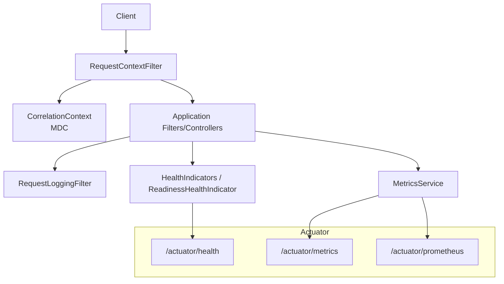
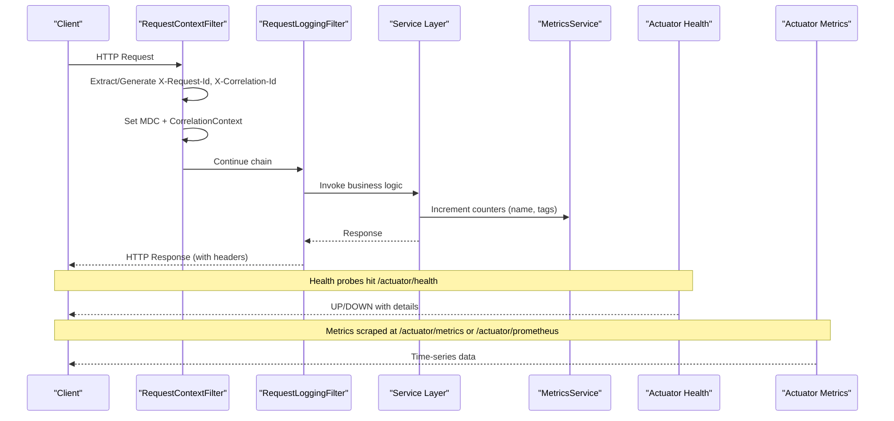
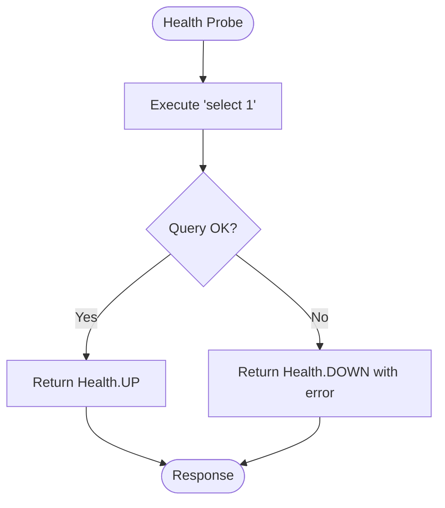
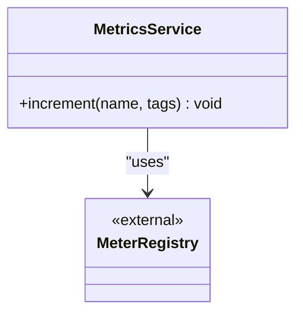
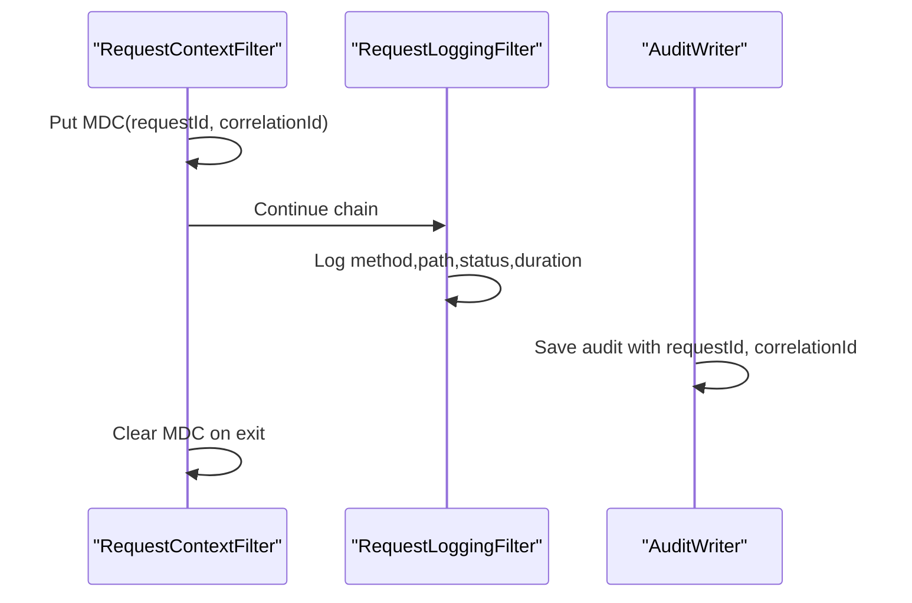
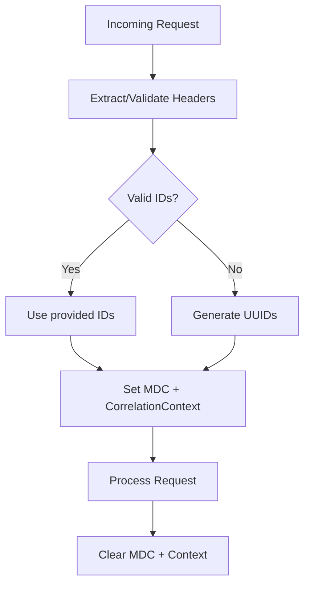
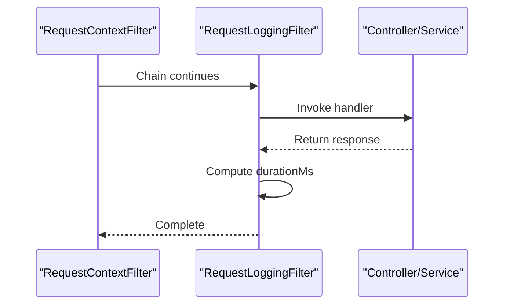
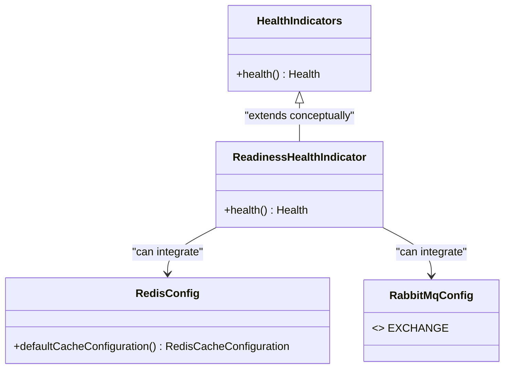
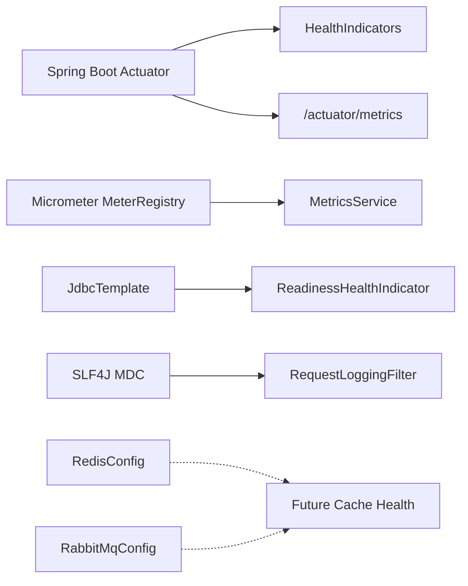

# Monitoring & Observability

<cite>
**Referenced Files in This Document**
- [HealthIndicators.java](file://src/main/java/com/smartcoffee/infrastructure/observability/HealthIndicators.java)
- [ReadinessHealthIndicator.java](file://src/main/java/com/smartcoffee/infrastructure/observability/ReadinessHealthIndicator.java)
- [MetricsService.java](file://src/main/java/com/smartcoffee/infrastructure/observability/MetricsService.java)
- [RequestLoggingFilter.java](file://src/main/java/com/smartcoffee/infrastructure/observability/RequestLoggingFilter.java)
- [CorrelationContext.java](file://src/main/java/com/smartcoffee/common/context/CorrelationContext.java)
- [RequestContext.java](file://src/main/java/com/smartcoffee/common/context/RequestContext.java)
- [RequestContextFilter.java](file://src/main/java/com/smartcoffee/common/context/RequestContextFilter.java)
- [application.yml](file://src/main/resources/application.yml)
- [AuditWriter.java](file://src/main/java/com/smartcoffee/modules/audit/application/AuditWriter.java)
- [RedisConfig.java](file://src/main/java/com/smartcoffee/config/RedisConfig.java)
- [RabbitMqConfig.java](file://src/main/java/com/smartcoffee/config/RabbitMqConfig.java)
</cite>

## Table of Contents
1. Introduction
2. Project Structure
3. Core Components
4. Architecture Overview
5. Detailed Component Analysis
6. Dependency Analysis
7. Performance Considerations
8. Troubleshooting Guide
9. Conclusion

## Introduction
This document describes the monitoring and observability infrastructure for the Smart Coffee backend. It covers health checks, metrics collection, structured logging, correlation context tracking for distributed tracing, request lifecycle monitoring, and performance metrics gathering. It also outlines strategies for custom health indicators (database, cache, message queue, external services), log aggregation patterns, alerting approaches, debugging techniques, performance profiling, and production troubleshooting methodologies.

## Project Structure
Observability is implemented across a small set of focused components:
- Health endpoints via Spring Boot Actuator with custom indicators
- Metrics exposure via Micrometer’s MeterRegistry
- Request lifecycle logging via a servlet filter
- Correlation context propagation using ThreadLocal and MDC to enrich logs and audit records
- Configuration for actuator endpoints, logging levels, and integrations (Redis, RabbitMQ)

**Diagram sources**
- [RequestContextFilter.java:11-30](file://src/main/java/com/smartcoffee/common/context/RequestContextFilter.java#L11-L30)
- [RequestLoggingFilter.java:14-23](file://src/main/java/com/smartcoffee/infrastructure/observability/RequestLoggingFilter.java#L14-L23)
- [MetricsService.java:1-4](file://src/main/java/com/smartcoffee/infrastructure/observability/MetricsService.java#L1-L4)
- [HealthIndicators.java:7-15](file://src/main/java/com/smartcoffee/infrastructure/observability/HealthIndicators.java#L7-L15)
- [ReadinessHealthIndicator.java:9-26](file://src/main/java/com/smartcoffee/infrastructure/observability/ReadinessHealthIndicator.java#L9-L26)
- [application.yml:81-93](file://src/main/resources/application.yml#L81-L93)

**Section sources**
- [application.yml:81-93](file://src/main/resources/application.yml#L81-L93)

## Core Components
- Health indicators:
  - Application-level readiness/liveness via a simple indicator reporting service identity
  - Database readiness indicator that validates connectivity by executing a lightweight query
- Metrics:
  - A thin wrapper around Micrometer’s MeterRegistry to increment counters with names and tags
- Logging:
  - A per-request filter that logs HTTP method, path, status code, and duration
  - Correlation context propagated through ThreadLocal and MDC for structured, traceable logs
- Audit integration:
  - Audit writer captures success events along with correlation identifiers from the current context

**Section sources**
- [HealthIndicators.java:7-15](file://src/main/java/com/smartcoffee/infrastructure/observability/HealthIndicators.java#L7-L15)
- [ReadinessHealthIndicator.java:9-26](file://src/main/java/com/smartcoffee/infrastructure/observability/ReadinessHealthIndicator.java#L9-L26)
- [MetricsService.java:1-4](file://src/main/java/com/smartcoffee/infrastructure/observability/MetricsService.java#L1-L4)
- [RequestLoggingFilter.java:14-23](file://src/main/java/com/smartcoffee/infrastructure/observability/RequestLoggingFilter.java#L14-L23)
- [CorrelationContext.java:3-25](file://src/main/java/com/smartcoffee/common/context/CorrelationContext.java#L3-L25)
- [RequestContext.java:1-8](file://src/main/java/com/smartcoffee/common/context/RequestContext.java#L1-L8)
- [RequestContextFilter.java:11-30](file://src/main/java/com/smartcoffee/common/context/RequestContextFilter.java#L11-L30)
- [AuditWriter.java:21-28](file://src/main/java/com/smartcoffee/modules/audit/application/AuditWriter.java#L21-L28)

## Architecture Overview
The observability architecture integrates at three layers:
- Inbound request layer: RequestContextFilter sets correlation IDs into MDC and ThreadLocal; RequestLoggingFilter measures and logs request timing and outcome.
- Service layer: Business logic uses MetricsService to emit counters and can capture audit events enriched with correlation IDs.
- Platform layer: Spring Boot Actuator exposes health and metrics endpoints configured in application configuration.

**Diagram sources**
- [RequestContextFilter.java:11-30](file://src/main/java/com/smartcoffee/common/context/RequestContextFilter.java#L11-L30)
- [RequestLoggingFilter.java:14-23](file://src/main/java/com/smartcoffee/infrastructure/observability/RequestLoggingFilter.java#L14-L23)
- [MetricsService.java:1-4](file://src/main/java/com/smartcoffee/infrastructure/observability/MetricsService.java#L1-L4)
- [application.yml:81-93](file://src/main/resources/application.yml#L81-L93)

## Detailed Component Analysis

### Health Checks
- Application health indicator reports service identity and overall status.
- Database readiness indicator executes a minimal SQL query to validate database connectivity and returns up/down accordingly.

**Diagram sources**
- [ReadinessHealthIndicator.java:18-26](file://src/main/java/com/smartcoffee/infrastructure/observability/ReadinessHealthIndicator.java#L18-L26)

**Section sources**
- [HealthIndicators.java:7-15](file://src/main/java/com/smartcoffee/infrastructure/observability/HealthIndicators.java#L7-L15)
- [ReadinessHealthIndicator.java:9-26](file://src/main/java/com/smartcoffee/infrastructure/observability/ReadinessHealthIndicator.java#L9-L26)

### Metrics Collection Strategy
- Centralized counter increments via MetricsService using Micrometer’s MeterRegistry.
- Exposed endpoints include metrics and Prometheus scraping targets.

**Diagram sources**
- [MetricsService.java:1-4](file://src/main/java/com/smartcoffee/infrastructure/observability/MetricsService.java#L1-L4)
- [application.yml:81-93](file://src/main/resources/application.yml#L81-L93)

**Section sources**
- [MetricsService.java:1-4](file://src/main/java/com/smartcoffee/infrastructure/observability/MetricsService.java#L1-L4)
- [application.yml:81-93](file://src/main/resources/application.yml#L81-L93)

### Logging Framework and Structured Logging
- Per-request logging captures HTTP method, path, status, and duration.
- Correlation IDs are injected into MDC so all logs within the request thread include requestId and correlationId automatically.
- Audit events persist correlation identifiers alongside business data for post-incident analysis.

**Diagram sources**
- [RequestContextFilter.java:11-30](file://src/main/java/com/smartcoffee/common/context/RequestContextFilter.java#L11-L30)
- [RequestLoggingFilter.java:14-23](file://src/main/java/com/smartcoffee/infrastructure/observability/RequestLoggingFilter.java#L14-L23)
- [AuditWriter.java:21-28](file://src/main/java/com/smartcoffee/modules/audit/application/AuditWriter.java#L21-L28)

**Section sources**
- [RequestLoggingFilter.java:14-23](file://src/main/java/com/smartcoffee/infrastructure/observability/RequestLoggingFilter.java#L14-L23)
- [RequestContextFilter.java:11-30](file://src/main/java/com/smartcoffee/common/context/RequestContextFilter.java#L11-L30)
- [AuditWriter.java:21-28](file://src/main/java/com/smartcoffee/modules/audit/application/AuditWriter.java#L21-L28)

### Correlation Context Tracking for Distributed Tracing
- RequestContextFilter extracts or generates X-Request-Id and X-Correlation-Id, stores them in MDC and ThreadLocal-based CorrelationContext.
- CorrelationContext provides safe accessors for requestId and correlationId used by audit and other components.
- Headers are echoed back in responses to support client-side correlation.

**Diagram sources**
- [RequestContextFilter.java:11-36](file://src/main/java/com/smartcoffee/common/context/RequestContextFilter.java#L11-L36)
- [CorrelationContext.java:3-25](file://src/main/java/com/smartcoffee/common/context/CorrelationContext.java#L3-L25)

**Section sources**
- [RequestContextFilter.java:11-36](file://src/main/java/com/smartcoffee/common/context/RequestContextFilter.java#L11-L36)
- [CorrelationContext.java:3-25](file://src/main/java/com/smartcoffee/common/context/CorrelationContext.java#L3-L25)
- [RequestContext.java:1-8](file://src/main/java/com/smartcoffee/common/context/RequestContext.java#L1-L8)

### Request Lifecycle Monitoring
- The request logging filter measures elapsed time and logs key HTTP attributes after processing completes.
- Combined with correlation IDs, this enables precise per-request performance analysis.

**Diagram sources**
- [RequestLoggingFilter.java:14-23](file://src/main/java/com/smartcoffee/infrastructure/observability/RequestLoggingFilter.java#L14-L23)
- [RequestContextFilter.java:11-30](file://src/main/java/com/smartcoffee/common/context/RequestContextFilter.java#L11-L30)

**Section sources**
- [RequestLoggingFilter.java:14-23](file://src/main/java/com/smartcoffee/infrastructure/observability/RequestLoggingFilter.java#L14-L23)

### Custom Health Indicators
- Database connectivity: Implemented via a dedicated readiness indicator that runs a lightweight query.
- Cache availability: Redis configuration exists; a readiness indicator can be added to probe cache connectivity if needed.
- Message queue status: RabbitMQ configuration is present; a readiness indicator can be added to verify broker reachability.
- External service dependencies: Extend the health composition to include remote calls with timeouts and fallbacks.

**Diagram sources**
- [HealthIndicators.java:7-15](file://src/main/java/com/smartcoffee/infrastructure/observability/HealthIndicators.java#L7-L15)
- [ReadinessHealthIndicator.java:9-26](file://src/main/java/com/smartcoffee/infrastructure/observability/ReadinessHealthIndicator.java#L9-L26)
- [RedisConfig.java:1-5](file://src/main/java/com/smartcoffee/config/RedisConfig.java#L1-L5)
- [RabbitMqConfig.java:1-12](file://src/main/java/com/smartcoffee/config/RabbitMqConfig.java#L1-L12)

**Section sources**
- [ReadinessHealthIndicator.java:9-26](file://src/main/java/com/smartcoffee/infrastructure/observability/ReadinessHealthIndicator.java#L9-L26)
- [RedisConfig.java:1-5](file://src/main/java/com/smartcoffee/config/RedisConfig.java#L1-L5)
- [RabbitMqConfig.java:1-12](file://src/main/java/com/smartcoffee/config/RabbitMqConfig.java#L1-L12)

## Dependency Analysis
Observability components depend on:
- Spring Boot Actuator for health and metrics endpoints
- Micrometer for metrics instrumentation
- SLF4J/Logback for structured logging with MDC
- JPA/JDBC for database readiness checks
- Redis and RabbitMQ configurations for potential health extensions

**Diagram sources**
- [application.yml:81-93](file://src/main/resources/application.yml#L81-L93)
- [MetricsService.java:1-4](file://src/main/java/com/smartcoffee/infrastructure/observability/MetricsService.java#L1-L4)
- [ReadinessHealthIndicator.java:9-26](file://src/main/java/com/smartcoffee/infrastructure/observability/ReadinessHealthIndicator.java#L9-L26)
- [RequestLoggingFilter.java:14-23](file://src/main/java/com/smartcoffee/infrastructure/observability/RequestLoggingFilter.java#L14-L23)
- [RedisConfig.java:1-5](file://src/main/java/com/smartcoffee/config/RedisConfig.java#L1-L5)
- [RabbitMqConfig.java:1-12](file://src/main/java/com/smartcoffee/config/RabbitMqConfig.java#L1-L12)

**Section sources**
- [application.yml:81-93](file://src/main/resources/application.yml#L81-L93)

## Performance Considerations
- Keep health checks lightweight; the database readiness check uses a minimal query.
- Use MDC judiciously; it adds minimal overhead but should not be overpopulated with large payloads.
- Prefer counters and timers for high-frequency metrics; avoid excessive tag cardinality.
- Ensure filters run early and fast; avoid heavy work in filters.
- Configure appropriate timeouts for external dependency health checks to prevent cascading delays.

[No sources needed since this section provides general guidance]

## Troubleshooting Guide
- Identify the request:
  - Use X-Request-Id and X-Correlation-Id from request/response headers and logs to correlate events across services.
- Diagnose slow requests:
  - Inspect per-request logs for durationMs and status codes; drill down using correlation IDs.
- Investigate failures:
  - Check health endpoint for component status; review metrics for error rates and latency spikes.
- Audit trail:
  - Review persisted audit entries that include correlation identifiers to reconstruct user journeys.
- Cache and messaging:
  - Validate Redis and RabbitMQ configurations; add readiness indicators to detect outages quickly.

**Section sources**
- [RequestContextFilter.java:11-30](file://src/main/java/com/smartcoffee/common/context/RequestContextFilter.java#L11-L30)
- [RequestLoggingFilter.java:14-23](file://src/main/java/com/smartcoffee/infrastructure/observability/RequestLoggingFilter.java#L14-L23)
- [AuditWriter.java:21-28](file://src/main/java/com/smartcoffee/modules/audit/application/AuditWriter.java#L21-L28)
- [application.yml:81-93](file://src/main/resources/application.yml#L81-L93)

## Conclusion
The system implements a practical observability foundation:
- Health checks expose service and database readiness
- Metrics are instrumented via Micrometer and exposed for scraping
- Structured logging with correlation IDs enables end-to-end tracing
- Audit persistence ties business actions to request contexts
To further strengthen observability, consider adding readiness indicators for cache and message brokers, expanding metrics coverage, and integrating centralized log aggregation and alerting based on the existing structured logs and metrics.

[No sources needed since this section summarizes without analyzing specific files]