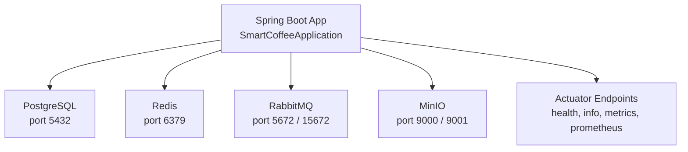
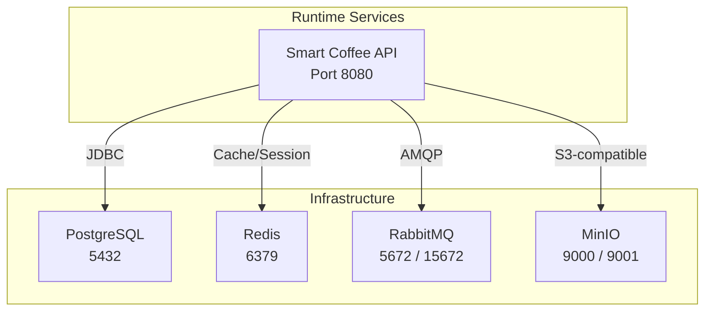
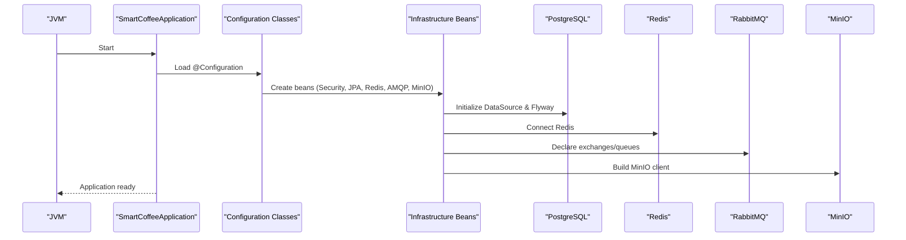
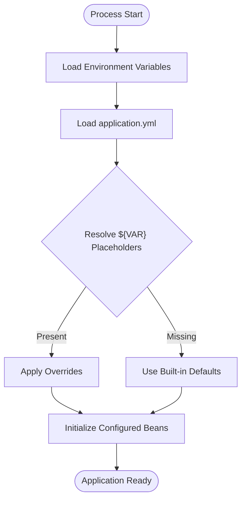
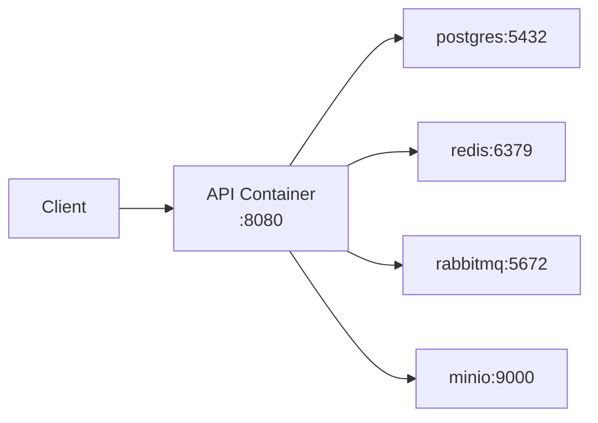
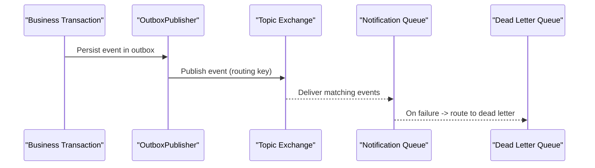
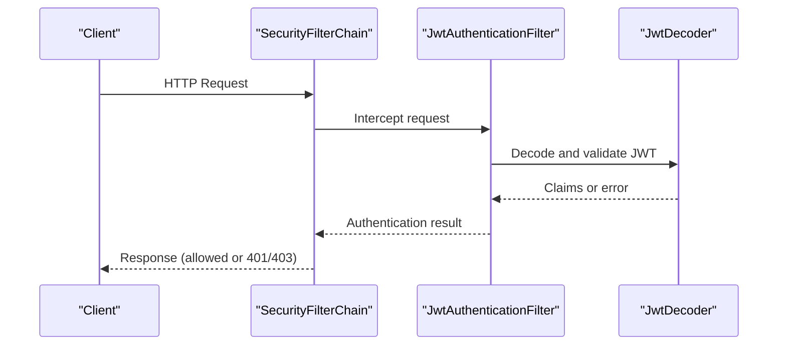
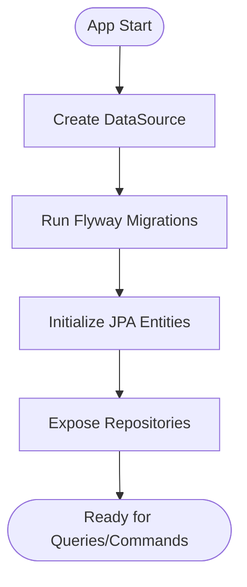
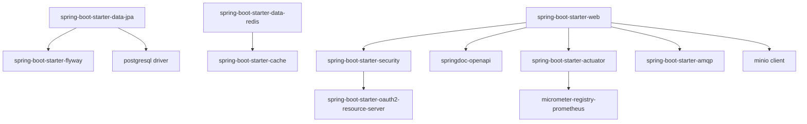

# Runtime Architecture

<cite>
**Referenced Files in This Document**
- [SmartCoffeeApplication.java](file://src/main/java/com/smartcoffee/SmartCoffeeApplication.java)
- [application.yml](file://src/main/resources/application.yml)
- [compose.yaml](file://compose.yaml)
- [Dockerfile](file://Dockerfile)
- [pom.xml](file://pom.xml)
- [SecurityConfig.java](file://src/main/java/com/smartcoffee/config/SecurityConfig.java)
- [JpaConfig.java](file://src/main/java/com/smartcoffee/config/JpaConfig.java)
- [RedisConfig.java](file://src/main/java/com/smartcoffee/config/RedisConfig.java)
- [RabbitMqConfig.java](file://src/main/java/com/smartcoffee/config/RabbitMqConfig.java)
- [RabbitMqTopologyConfig.java](file://src/main/java/com/smartcoffee/config/RabbitMqTopologyConfig.java)
- [MinioConfig.java](file://src/main/java/com/smartcoffee/config/MinioConfig.java)
- [OutboxPublisher.java](file://src/main/java/com/smartcoffee/infrastructure/messaging/outbox/OutboxPublisher.java)
</cite>

## Table of Contents
1. Introduction
2. Project Structure
3. Core Components
4. Architecture Overview
5. Detailed Component Analysis
6. Dependency Analysis
7. Performance Considerations
8. Troubleshooting Guide
9. Conclusion

## Introduction
This document describes the runtime architecture of the Smart Coffee Backend, focusing on how the Spring Boot application starts, loads configuration, initializes infrastructure components, and communicates with PostgreSQL, Redis, RabbitMQ, and MinIO. It also covers Docker Compose orchestration, container networking, port mappings, inter-service communication patterns, environment-specific configuration, secrets management, and scaling considerations for production deployments.

## Project Structure
The project is a Spring Boot application packaged as a JAR and run inside a lightweight JRE image. The runtime depends on external services defined in a Docker Compose file for local development and can be adapted to orchestrated environments (Kubernetes, etc.) for production.

Key runtime elements:
- Application entry point enables scheduling and auto-configuration.
- Configuration is centralized in application properties with environment variable overrides.
- Infrastructure configurations declare beans for security, persistence, caching, messaging, and object storage.
- Docker Compose defines PostgreSQL, Redis, RabbitMQ, and MinIO with health checks and port mappings.
- A multi-stage Dockerfile builds the app and runs it on port 8080.

**Diagram sources**
- [SmartCoffeeApplication.java:1-11](file://src/main/java/com/smartcoffee/SmartCoffeeApplication.java#L1-L11)
- [application.yml:17-41](file://src/main/resources/application.yml#L17-L41)
- [compose.yaml:1-71](file://compose.yaml#L1-L71)
- [Dockerfile:1-11](file://Dockerfile#L1-L11)

**Section sources**
- [SmartCoffeeApplication.java:1-11](file://src/main/java/com/smartcoffee/SmartCoffeeApplication.java#L1-L11)
- [application.yml:1-93](file://src/main/resources/application.yml#L1-L93)
- [compose.yaml:1-71](file://compose.yaml#L1-L71)
- [Dockerfile:1-11](file://Dockerfile#L1-L11)

## Core Components
- Application bootstrap: The main class enables Spring Boot auto-configuration and scheduling.
- Security: Stateless JWT-based authentication with a custom filter and permissive public endpoints for auth, docs, and actuator.
- Persistence: JPA with Flyway migrations against PostgreSQL; transaction management enabled.
- Caching: Redis-backed cache with TTL and null-value caching disabled.
- Messaging: RabbitMQ exchange and queue topology declared; scheduled outbox publisher publishes events reliably.
- Storage: MinIO client configured via properties for object storage operations.
- Observability: Actuator endpoints exposed for health, info, metrics, and Prometheus scraping.

**Section sources**
- [SmartCoffeeApplication.java:1-11](file://src/main/java/com/smartcoffee/SmartCoffeeApplication.java#L1-L11)
- [SecurityConfig.java:22-81](file://src/main/java/com/smartcoffee/config/SecurityConfig.java#L22-L81)
- [JpaConfig.java:6-9](file://src/main/java/com/smartcoffee/config/JpaConfig.java#L6-L9)
- [RedisConfig.java:1-5](file://src/main/java/com/smartcoffee/config/RedisConfig.java#L1-L5)
- [RabbitMqConfig.java:1-12](file://src/main/java/com/smartcoffee/config/RabbitMqConfig.java#L1-L12)
- [RabbitMqTopologyConfig.java:13-87](file://src/main/java/com/smartcoffee/config/RabbitMqTopologyConfig.java#L13-L87)
- [MinioConfig.java:1-5](file://src/main/java/com/smartcoffee/config/MinioConfig.java#L1-L5)
- [application.yml:81-93](file://src/main/resources/application.yml#L81-L93)

## Architecture Overview
The runtime consists of the Smart Coffee API service and four infrastructure services: PostgreSQL (data store), Redis (cache), RabbitMQ (messaging), and MinIO (object storage). The application connects to these services using standard protocols and ports. Health checks are defined in Docker Compose to ensure readiness before traffic is routed.

**Diagram sources**
- [compose.yaml:1-71](file://compose.yaml#L1-L71)
- [application.yml:17-41](file://src/main/resources/application.yml#L17-L41)
- [Dockerfile:6-10](file://Dockerfile#L6-L10)

## Detailed Component Analysis

### Application Startup and Lifecycle
- Entry point: The main method bootstraps the Spring Boot application and enables scheduling.
- Auto-configuration: Spring Boot scans configuration classes and wires beans based on dependencies and properties.
- Scheduling: Enables @Scheduled tasks such as the outbox publisher.
- Profiles: Default profile set to local; additional profiles can be activated via environment variables or command-line arguments.

**Diagram sources**
- [SmartCoffeeApplication.java:1-11](file://src/main/java/com/smartcoffee/SmartCoffeeApplication.java#L1-L11)
- [application.yml:17-41](file://src/main/resources/application.yml#L17-L41)
- [RabbitMqTopologyConfig.java:13-87](file://src/main/java/com/smartcoffee/config/RabbitMqTopologyConfig.java#L13-L87)
- [MinioConfig.java:1-5](file://src/main/java/com/smartcoffee/config/MinioConfig.java#L1-L5)

**Section sources**
- [SmartCoffeeApplication.java:1-11](file://src/main/java/com/smartcoffee/SmartCoffeeApplication.java#L1-L11)
- [application.yml:1-11](file://src/main/resources/application.yml#L1-L11)

### Configuration Loading and Environment Variables
- Centralized properties: application.yml defines datasource, JPA/Hibernate, Flyway, RabbitMQ publisher settings, app-specific toggles, and actuator exposure.
- Secrets and environment overrides: Database credentials, MinIO keys, JWT secret, WebSocket origins, and bucket names are loaded from environment variables with safe defaults for local development.
- Profile usage: Default profile is local; activate other profiles via SPRING_PROFILES_ACTIVE or command line.

**Diagram sources**
- [application.yml:17-80](file://src/main/resources/application.yml#L17-L80)

**Section sources**
- [application.yml:17-80](file://src/main/resources/application.yml#L17-L80)

### Container Orchestration and Networking
- Docker Compose services: PostgreSQL, Redis, RabbitMQ, and MinIO are defined with images, environment variables, health checks, and restart policies.
- Port mappings: Host ports expose services for local access (e.g., 5433:5432, 6379:6379, 5672:5672, 9000:9000).
- Service discovery: Within the compose network, services communicate by service name (e.g., postgres, redis, rabbitmq, minio).
- Health checks: Each service includes a health check to signal readiness to orchestrators.

**Diagram sources**
- [compose.yaml:1-71](file://compose.yaml#L1-L71)

**Section sources**
- [compose.yaml:1-71](file://compose.yaml#L1-L71)

### Inter-Service Communication Patterns
- Outbound events: The application publishes business events to a topic exchange via an outbox pattern, ensuring reliable delivery even under failures.
- Inbound notifications: A dedicated queue consumes order-ready and payment-related events to trigger notifications.
- Dead-letter handling: Failed messages are routed to a dead-letter exchange and queue for inspection and reprocessing.

**Diagram sources**
- [OutboxPublisher.java:11-36](file://src/main/java/com/smartcoffee/infrastructure/messaging/outbox/OutboxPublisher.java#L11-L36)
- [RabbitMqTopologyConfig.java:13-87](file://src/main/java/com/smartcoffee/config/RabbitMqTopologyConfig.java#L13-L87)
- [RabbitMqConfig.java:1-12](file://src/main/java/com/smartcoffee/config/RabbitMqConfig.java#L1-L12)

**Section sources**
- [OutboxPublisher.java:11-36](file://src/main/java/com/smartcoffee/infrastructure/messaging/outbox/OutboxPublisher.java#L11-L36)
- [RabbitMqTopologyConfig.java:13-87](file://src/main/java/com/smartcoffee/config/RabbitMqTopologyConfig.java#L13-L87)
- [RabbitMqConfig.java:1-12](file://src/main/java/com/smartcoffee/config/RabbitMqConfig.java#L1-L12)

### Security and Authentication Flow
- Stateless JWT: Requests are authenticated using stateless sessions and JWT decoding with a symmetric HMAC key loaded from configuration.
- Public endpoints: Auth, OpenAPI/Swagger, and actuator endpoints are permitted without authentication.
- Filter chain: A custom JWT filter is added before the default authentication filter to validate tokens.

**Diagram sources**
- [SecurityConfig.java:22-81](file://src/main/java/com/smartcoffee/config/SecurityConfig.java#L22-L81)

**Section sources**
- [SecurityConfig.java:22-81](file://src/main/java/com/smartcoffee/config/SecurityConfig.java#L22-L81)

### Data Access and Migrations
- JPA and transactions: Transaction management is enabled; repositories participate in transactions managed by Spring.
- Schema migrations: Flyway runs SQL migrations from the classpath on startup with validation enabled and clean disabled.
- Time zone: Hibernate JDBC time zone is set to UTC for consistent timestamps.

**Diagram sources**
- [application.yml:17-37](file://src/main/resources/application.yml#L17-L37)
- [JpaConfig.java:6-9](file://src/main/java/com/smartcoffee/config/JpaConfig.java#L6-L9)

**Section sources**
- [application.yml:17-37](file://src/main/resources/application.yml#L17-L37)
- [JpaConfig.java:6-9](file://src/main/java/com/smartcoffee/config/JpaConfig.java#L6-L9)

### Caching with Redis
- Cache configuration: Redis cache is enabled with a default TTL and null values not cached.
- Integration: Spring Cache annotations can be used across modules to improve read performance.

**Section sources**
- [RedisConfig.java:1-5](file://src/main/java/com/smartcoffee/config/RedisConfig.java#L1-L5)
- [application.yml:12-15](file://src/main/resources/application.yml#L12-L15)

### Object Storage with MinIO
- Client configuration: MinIO client is built from endpoint and credentials provided via configuration.
- Usage: Uploads, signed URL generation, and deletions are abstracted behind a storage service interface.

**Section sources**
- [MinioConfig.java:1-5](file://src/main/java/com/smartcoffee/config/MinioConfig.java#L1-L5)
- [application.yml:43-47](file://src/main/resources/application.yml#L43-L47)

## Dependency Analysis
The application’s runtime dependencies include web stack, security, data access, caching, messaging, observability, and storage. These are declared in the build descriptor and wired at runtime by Spring Boot auto-configuration.

**Diagram sources**
- [pom.xml:62-245](file://pom.xml#L62-L245)

**Section sources**
- [pom.xml:62-245](file://pom.xml#L62-L245)

## Performance Considerations
- Connection pooling: Ensure HikariCP pool sizing matches database capacity and workload characteristics.
- Caching strategy: Use Redis caches judiciously to reduce database load; tune TTLs based on data volatility.
- Messaging throughput: Adjust outbox batch size and poll delay to balance latency and throughput; monitor RabbitMQ queues and consumer lag.
- Observability: Expose Prometheus metrics and use them to identify bottlenecks; enable detailed logging selectively in production.
- Resource limits: Set JVM memory and CPU limits appropriate for container orchestration platforms.

[No sources needed since this section provides general guidance]

## Troubleshooting Guide
- Startup failures:
  - Database connectivity: Verify DATABASE_URL, USERNAME, PASSWORD and that PostgreSQL is reachable on the expected host/port.
  - Redis connectivity: Confirm Redis is running and accessible; check cache-related errors if caching is enabled.
  - RabbitMQ connectivity: Validate connection settings and that exchanges/queues are created; inspect dead-letter queues for failed messages.
  - MinIO connectivity: Ensure endpoint and credentials are correct; verify bucket existence and permissions.
- Health checks:
  - Use actuator health endpoints to verify component status; integrate with orchestrator probes.
- Logging:
  - Increase log levels for specific packages during debugging; review migration logs for schema issues.

**Section sources**
- [application.yml:17-41](file://src/main/resources/application.yml#L17-L41)
- [application.yml:81-93](file://src/main/resources/application.yml#L81-L93)
- [compose.yaml:10-17](file://compose.yaml#L10-L17)
- [compose.yaml:27-37](file://compose.yaml#L27-L37)
- [compose.yaml:47-56](file://compose.yaml#L47-L56)

## Conclusion
The Smart Coffee Backend follows a modular, infrastructure-driven runtime design. Spring Boot manages lifecycle and dependency injection, while Docker Compose defines a consistent environment for development and testing. Reliability is enhanced through Flyway-managed schemas, Redis caching, and a transactional outbox pattern over RabbitMQ. For production, replace local services with managed equivalents, secure secrets via environment variables or secret managers, and scale horizontally behind a reverse proxy or ingress controller.

[No sources needed since this section summarizes without analyzing specific files]