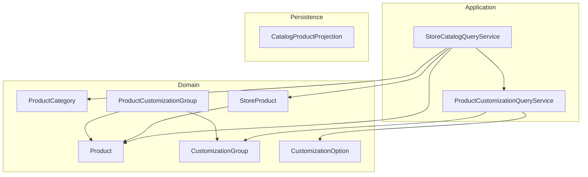
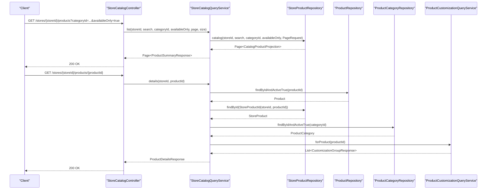
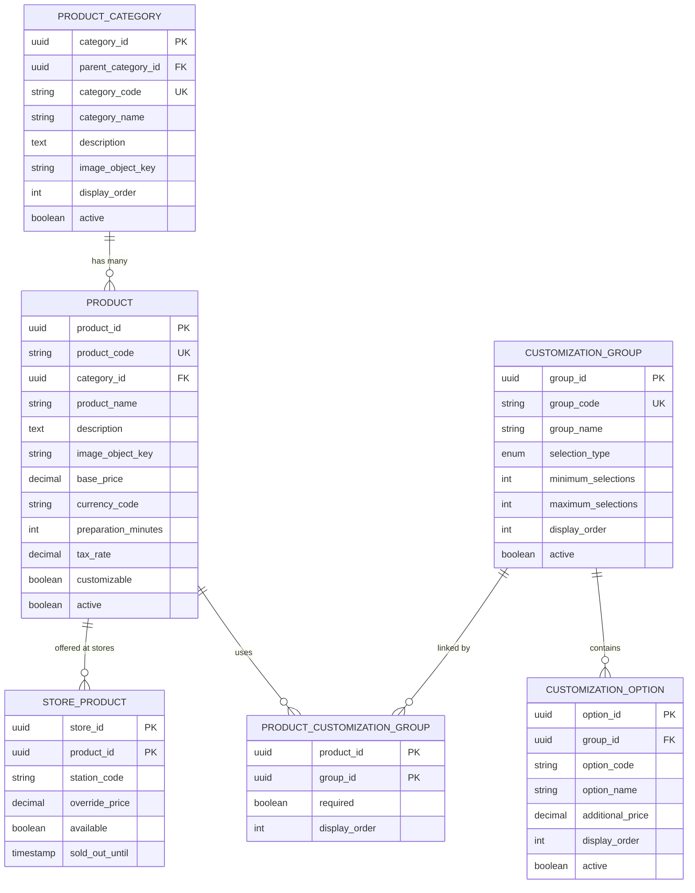
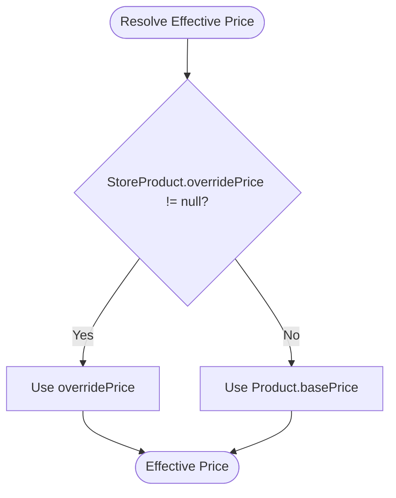
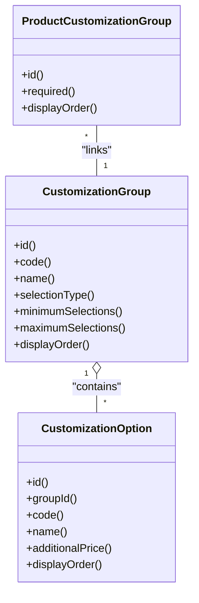
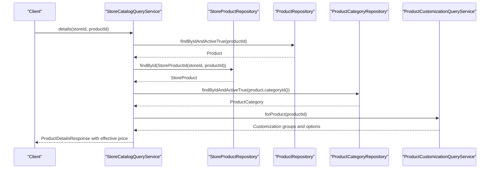
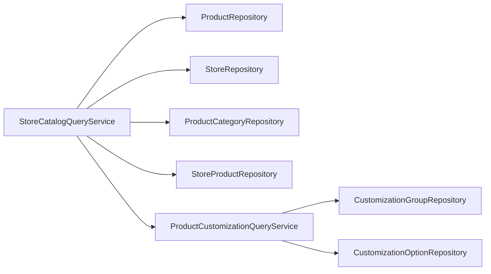

# Catalog & Customization Module

<cite>
**Referenced Files in This Document**
- [ProductCategory.java](file://src/main/java/com/smartcoffee/modules/catalog/domain/ProductCategory.java)
- [Product.java](file://src/main/java/com/smartcoffee/modules/catalog/domain/Product.java)
- [CustomizationGroup.java](file://src/main/java/com/smartcoffee/modules/catalog/domain/CustomizationGroup.java)
- [CustomizationOption.java](file://src/main/java/com/smartcoffee/modules/catalog/domain/CustomizationOption.java)
- [StoreProduct.java](file://src/main/java/com/smartcoffee/modules/catalog/domain/StoreProduct.java)
- [ProductCustomizationGroup.java](file://src/main/java/com/smartcoffee/modules/catalog/domain/ProductCustomizationGroup.java)
- [ProductCustomizationGroupId.java](file://src/main/java/com/smartcoffee/modules/catalog/domain/ProductCustomizationGroupId.java)
- [StoreProductId.java](file://src/main/java/com/smartcoffee/modules/catalog/domain/StoreProductId.java)
- [SelectionType.java](file://src/main/java/com/smartcoffee/modules/catalog/domain/SelectionType.java)
- [CatalogProductProjection.java](file://src/main/java/com/smartcoffee/modules/catalog/persistence/CatalogProductProjection.java)
- [StoreCatalogQueryService.java](file://src/main/java/com/smartcoffee/modules/catalog/application/StoreCatalogQueryService.java)
- [ProductCustomizationQueryService.java](file://src/main/java/com/smartcoffee/modules/catalog/application/ProductCustomizationQueryService.java)
- [V003__catalog_categories_products_customizations.sql](file://src/main/resources/db/migration/V003__catalog_categories_products_customizations.sql)
</cite>

## Table of Contents
1. Introduction
2. Project Structure
3. Core Components
4. Architecture Overview
5. Detailed Component Analysis
6. Dependency Analysis
7. Performance Considerations
8. Troubleshooting Guide
9. Conclusion

## Introduction
This document defines the boundaries and ownership of the Catalog & Customization module. It explains how the module owns categories, products, store-specific product availability, effective prices, customization groups, and customization options. It also documents the critical rule that ordering captures immutable snapshots of product, price, tax, and customization details at order time so historical orders never depend on current catalog values. Finally, it provides examples of server-authoritative pricing and proper catalog querying patterns.

## Project Structure
The Catalog & Customization module is organized by domain entities, application services, and persistence projections:
- Domain layer: ProductCategory, Product, StoreProduct, CustomizationGroup, CustomizationOption, ProductCustomizationGroup, and supporting IDs/enums.
- Application layer: Query services for store catalog and product customizations.
- Persistence layer: JPA repositories and a read projection used for efficient catalog listing.

**Diagram sources**
- [StoreCatalogQueryService.java:13-67](file://src/main/java/com/smartcoffee/modules/catalog/application/StoreCatalogQueryService.java#L13-L67)
- [ProductCustomizationQueryService.java:9-32](file://src/main/java/com/smartcoffee/modules/catalog/application/ProductCustomizationQueryService.java#L9-L32)
- [CatalogProductProjection.java:1-9](file://src/main/java/com/smartcoffee/modules/catalog/persistence/CatalogProductProjection.java#L1-L9)
- [ProductCategory.java:5-23](file://src/main/java/com/smartcoffee/modules/catalog/domain/ProductCategory.java#L5-L23)
- [Product.java:5-29](file://src/main/java/com/smartcoffee/modules/catalog/domain/Product.java#L5-L29)
- [StoreProduct.java:8-53](file://src/main/java/com/smartcoffee/modules/catalog/domain/StoreProduct.java#L8-L53)
- [CustomizationGroup.java:5-22](file://src/main/java/com/smartcoffee/modules/catalog/domain/CustomizationGroup.java#L5-L22)
- [CustomizationOption.java:5-22](file://src/main/java/com/smartcoffee/modules/catalog/domain/CustomizationOption.java#L5-L22)
- [ProductCustomizationGroup.java:3-11](file://src/main/java/com/smartcoffee/modules/catalog/domain/ProductCustomizationGroup.java#L3-L11)

**Section sources**
- [StoreCatalogQueryService.java:13-67](file://src/main/java/com/smartcoffee/modules/catalog/application/StoreCatalogQueryService.java#L13-L67)
- [ProductCustomizationQueryService.java:9-32](file://src/main/java/com/smartcoffee/modules/catalog/application/ProductCustomizationQueryService.java#L9-L32)
- [CatalogProductProjection.java:1-9](file://src/main/java/com/smartcoffee/modules/catalog/persistence/CatalogProductProjection.java#L1-L9)

## Core Components
- ProductCategory: Owns hierarchical category definitions with code, name, description, image key, display order, and active flag.
- Product: Owns canonical product definition including base price, currency, preparation time, tax rate, and whether it supports customizations.
- StoreProduct: Owns store-specific availability and optional price override per product; includes sold-out until date and computed availability.
- CustomizationGroup: Owns reusable customization group definitions (e.g., “Milk”, “Sweetness”) with selection rules (single or multiple), minimum/maximum selections, and display order.
- CustomizationOption: Owns individual options within a group (e.g., “Oat Milk”, “Extra Shot”) with additional price and display order.
- ProductCustomizationGroup: Links products to customization groups with required/optional semantics and display order.

Ownership rules:
- Categories and products are global catalog entities.
- StoreProduct is the authoritative source for store-level availability and effective price overrides.
- CustomizationGroups and CustomizationOptions are global catalogs reused across products via ProductCustomizationGroup.

**Section sources**
- [ProductCategory.java:5-23](file://src/main/java/com/smartcoffee/modules/catalog/domain/ProductCategory.java#L5-L23)
- [Product.java:5-29](file://src/main/java/com/smartcoffee/modules/catalog/domain/Product.java#L5-L29)
- [StoreProduct.java:8-53](file://src/main/java/com/smartcoffee/modules/catalog/domain/StoreProduct.java#L8-L53)
- [CustomizationGroup.java:5-22](file://src/main/java/com/smartcoffee/modules/catalog/domain/CustomizationGroup.java#L5-L22)
- [CustomizationOption.java:5-22](file://src/main/java/com/smartcoffee/modules/catalog/domain/CustomizationOption.java#L5-L22)
- [ProductCustomizationGroup.java:3-11](file://src/main/java/com/smartcoffee/modules/catalog/domain/ProductCustomizationGroup.java#L3-L11)

## Architecture Overview
The module exposes read-only queries for storefronts and admin UIs. StoreCatalogQueryService composes data from Product, StoreProduct, ProductCategory, and ProductCustomizationQueryService to build summaries and details. Effective price resolution is server-authoritative: if a store overrides the price, that value is used; otherwise, the product’s base price applies.

**Diagram sources**
- [StoreCatalogQueryService.java:33-59](file://src/main/java/com/smartcoffee/modules/catalog/application/StoreCatalogQueryService.java#L33-L59)
- [ProductCustomizationQueryService.java:20-29](file://src/main/java/com/smartcoffee/modules/catalog/application/ProductCustomizationQueryService.java#L20-L29)
- [CatalogProductProjection.java:4-7](file://src/main/java/com/smartcoffee/modules/catalog/persistence/CatalogProductProjection.java#L4-L7)

**Section sources**
- [StoreCatalogQueryService.java:33-59](file://src/main/java/com/smartcoffee/modules/catalog/application/StoreCatalogQueryService.java#L33-L59)
- [ProductCustomizationQueryService.java:20-29](file://src/main/java/com/smartcoffee/modules/catalog/application/ProductCustomizationQueryService.java#L20-L29)

## Detailed Component Analysis

### Entity Model and Relationships
The catalog model centers around ProductCategory, Product, StoreProduct, CustomizationGroup, CustomizationOption, and their associations.

**Diagram sources**
- [ProductCategory.java:5-23](file://src/main/java/com/smartcoffee/modules/catalog/domain/ProductCategory.java#L5-L23)
- [Product.java:5-29](file://src/main/java/com/smartcoffee/modules/catalog/domain/Product.java#L5-L29)
- [StoreProduct.java:8-53](file://src/main/java/com/smartcoffee/modules/catalog/domain/StoreProduct.java#L8-L53)
- [CustomizationGroup.java:5-22](file://src/main/java/com/smartcoffee/modules/catalog/domain/CustomizationGroup.java#L5-L22)
- [CustomizationOption.java:5-22](file://src/main/java/com/smartcoffee/modules/catalog/domain/CustomizationOption.java#L5-L22)
- [ProductCustomizationGroup.java:3-11](file://src/main/java/com/smartcoffee/modules/catalog/domain/ProductCustomizationGroup.java#L3-L11)
- [ProductCustomizationGroupId.java:5-8](file://src/main/java/com/smartcoffee/modules/catalog/domain/ProductCustomizationGroupId.java#L5-L8)
- [StoreProductId.java:7-13](file://src/main/java/com/smartcoffee/modules/catalog/domain/StoreProductId.java#L7-L13)
- [SelectionType.java:3-5](file://src/main/java/com/smartcoffee/modules/catalog/domain/SelectionType.java#L3-L5)

**Section sources**
- [ProductCategory.java:5-23](file://src/main/java/com/smartcoffee/modules/catalog/domain/ProductCategory.java#L5-L23)
- [Product.java:5-29](file://src/main/java/com/smartcoffee/modules/catalog/domain/Product.java#L5-L29)
- [StoreProduct.java:8-53](file://src/main/java/com/smartcoffee/modules/catalog/domain/StoreProduct.java#L8-L53)
- [CustomizationGroup.java:5-22](file://src/main/java/com/smartcoffee/modules/catalog/domain/CustomizationGroup.java#L5-L22)
- [CustomizationOption.java:5-22](file://src/main/java/com/smartcoffee/modules/catalog/domain/CustomizationOption.java#L5-L22)
- [ProductCustomizationGroup.java:3-11](file://src/main/java/com/smartcoffee/modules/catalog/domain/ProductCustomizationGroup.java#L3-L11)
- [ProductCustomizationGroupId.java:5-8](file://src/main/java/com/smartcoffee/modules/catalog/domain/ProductCustomizationGroupId.java#L5-L8)
- [StoreProductId.java:7-13](file://src/main/java/com/smartcoffee/modules/catalog/domain/StoreProductId.java#L7-L13)
- [SelectionType.java:3-5](file://src/main/java/com/smartcoffee/modules/catalog/domain/SelectionType.java#L3-L5)

### Store-Specific Availability and Effective Pricing
- StoreProduct determines availability using both an explicit available flag and a sold-out period. A product is considered available only when the flag is true and either no sold-out period exists or the current time is past the sold-out until timestamp.
- Effective price is resolved server-authoritatively: if StoreProduct has an override price, use it; otherwise, fall back to Product.basePrice. This ensures consistent pricing regardless of client input.

**Diagram sources**
- [StoreProduct.java:15-16](file://src/main/java/com/smartcoffee/modules/catalog/domain/StoreProduct.java#L15-L16)
- [Product.java:15-16](file://src/main/java/com/smartcoffee/modules/catalog/domain/Product.java#L15-L16)
- [StoreCatalogQueryService.java:55-58](file://src/main/java/com/smartcoffee/modules/catalog/application/StoreCatalogQueryService.java#L55-L58)

**Section sources**
- [StoreProduct.java:15-20](file://src/main/java/com/smartcoffee/modules/catalog/domain/StoreProduct.java#L15-L20)
- [StoreProduct.java:46-48](file://src/main/java/com/smartcoffee/modules/catalog/domain/StoreProduct.java#L46-L48)
- [StoreCatalogQueryService.java:55-58](file://src/main/java/com/smartcoffee/modules/catalog/application/StoreCatalogQueryService.java#L55-L58)

### Customization Groups and Options
- CustomizationGroup defines reusable sets of options with selection constraints (single or multiple) and minimum/maximum counts.
- CustomizationOption belongs to a group and carries an additional price impact.
- ProductCustomizationGroup links products to groups, marking them required or optional and controlling presentation order.

**Diagram sources**
- [CustomizationGroup.java:5-22](file://src/main/java/com/smartcoffee/modules/catalog/domain/CustomizationGroup.java#L5-L22)
- [CustomizationOption.java:5-22](file://src/main/java/com/smartcoffee/modules/catalog/domain/CustomizationOption.java#L5-L22)
- [ProductCustomizationGroup.java:3-11](file://src/main/java/com/smartcoffee/modules/catalog/domain/ProductCustomizationGroup.java#L3-L11)

**Section sources**
- [CustomizationGroup.java:5-22](file://src/main/java/com/smartcoffee/modules/catalog/domain/CustomizationGroup.java#L5-L22)
- [CustomizationOption.java:5-22](file://src/main/java/com/smartcoffee/modules/catalog/domain/CustomizationOption.java#L5-L22)
- [ProductCustomizationGroup.java:3-11](file://src/main/java/com/smartcoffee/modules/catalog/domain/ProductCustomizationGroup.java#L3-L11)

### Server-Authoritative Pricing and Catalog Queries
- Listing endpoint uses a read-only transaction and a dedicated projection to efficiently fetch paginated results filtered by store, search term, category, and availability.
- Details endpoint validates store existence, loads active product and store assignment, resolves category, computes effective price, and attaches customization groups for the product.

**Diagram sources**
- [StoreCatalogQueryService.java:46-59](file://src/main/java/com/smartcoffee/modules/catalog/application/StoreCatalogQueryService.java#L46-L59)
- [ProductCustomizationQueryService.java:20-29](file://src/main/java/com/smartcoffee/modules/catalog/application/ProductCustomizationQueryService.java#L20-L29)

**Section sources**
- [StoreCatalogQueryService.java:33-59](file://src/main/java/com/smartcoffee/modules/catalog/application/StoreCatalogQueryService.java#L33-L59)
- [CatalogProductProjection.java:4-7](file://src/main/java/com/smartcoffee/modules/catalog/persistence/CatalogProductProjection.java#L4-L7)

### Ordering Snapshot Rule
Critical rule: When an order is created, the system must capture immutable snapshots of product identity, effective price, tax rate, and selected customizations. Historical orders must not depend on subsequent catalog changes. This ensures auditability and financial correctness.

- Capture at order creation:
  - Product identifier and name snapshot
  - Effective price (store override or base price)
  - Tax rate snapshot
  - Selected customization options and their additional prices
- Do not recompute from live catalog at order time or for historical reporting.

[No sources needed since this section codifies a business rule derived from module design]

## Dependency Analysis
- StoreCatalogQueryService depends on:
  - StoreRepository for store validation
  - ProductRepository for product lookup
  - ProductCategoryRepository for category lookup
  - StoreProductRepository for store-specific availability and pricing
  - ProductCustomizationQueryService for customization metadata
- ProductCustomizationQueryService depends on:
  - CustomizationGroupRepository
  - CustomizationOptionRepository
- Domain entities are decoupled from application logic; repositories provide persistence access.

**Diagram sources**
- [StoreCatalogQueryService.java:13-31](file://src/main/java/com/smartcoffee/modules/catalog/application/StoreCatalogQueryService.java#L13-L31)
- [ProductCustomizationQueryService.java:9-18](file://src/main/java/com/smartcoffee/modules/catalog/application/ProductCustomizationQueryService.java#L9-L18)

**Section sources**
- [StoreCatalogQueryService.java:13-31](file://src/main/java/com/smartcoffee/modules/catalog/application/StoreCatalogQueryService.java#L13-L31)
- [ProductCustomizationQueryService.java:9-18](file://src/main/java/com/smartcoffee/modules/catalog/application/ProductCustomizationQueryService.java#L9-L18)

## Performance Considerations
- Use read-only transactions for catalog queries to avoid unnecessary write locks.
- Prefer projection-based listing to minimize object mapping overhead and reduce N+1 queries.
- Enforce pagination limits to prevent large result sets.
- Cache stable catalog reads where appropriate (e.g., categories, customization groups) with invalidation on updates.

[No sources needed since this section provides general guidance]

## Troubleshooting Guide
Common issues and resolutions:
- Product not found: Ensure the product exists and is active; verify product ID and active flags.
- Product not offered by store: Confirm StoreProduct entry exists for the store-product pair and that the store is active.
- Category not found: Validate category association and active status.
- Availability appears incorrect: Check StoreProduct.available and soldOutUntil; ensure sold-out periods are set correctly.
- Unexpected price: Verify whether StoreProduct.overridePrice is set; effective price uses override when present.

**Section sources**
- [StoreCatalogQueryService.java:46-64](file://src/main/java/com/smartcoffee/modules/catalog/application/StoreCatalogQueryService.java#L46-L64)
- [StoreProduct.java:46-48](file://src/main/java/com/smartcoffee/modules/catalog/domain/StoreProduct.java#L46-L48)

## Conclusion
The Catalog & Customization module owns the canonical definitions of categories, products, store-specific availability, and reusable customization structures. Effective pricing is resolved server-authoritatively using store overrides when present. The module exposes efficient, read-only queries for storefronts while ensuring that ordering captures immutable snapshots of all relevant details at purchase time. This separation guarantees consistent customer experiences and reliable historical records.