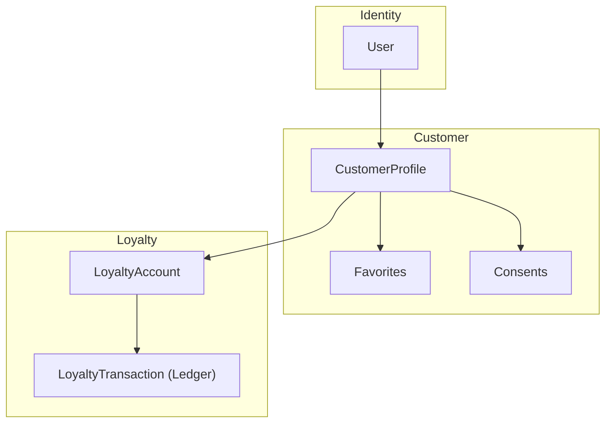
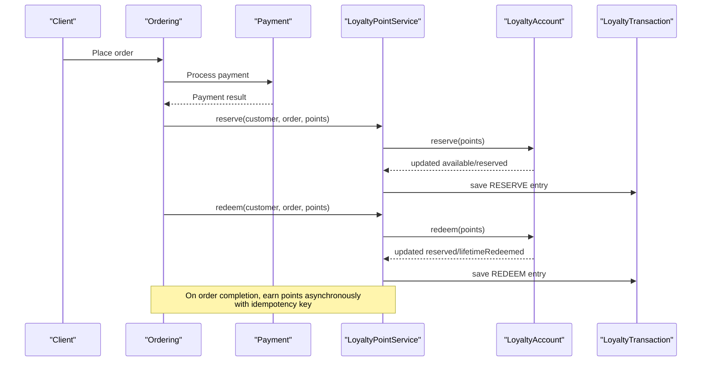
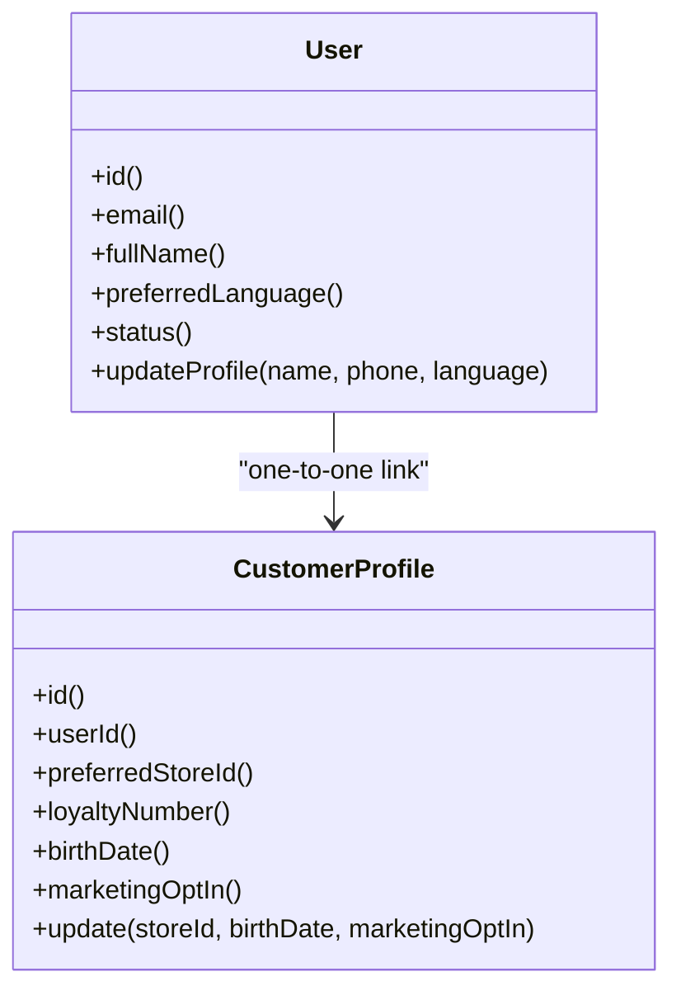
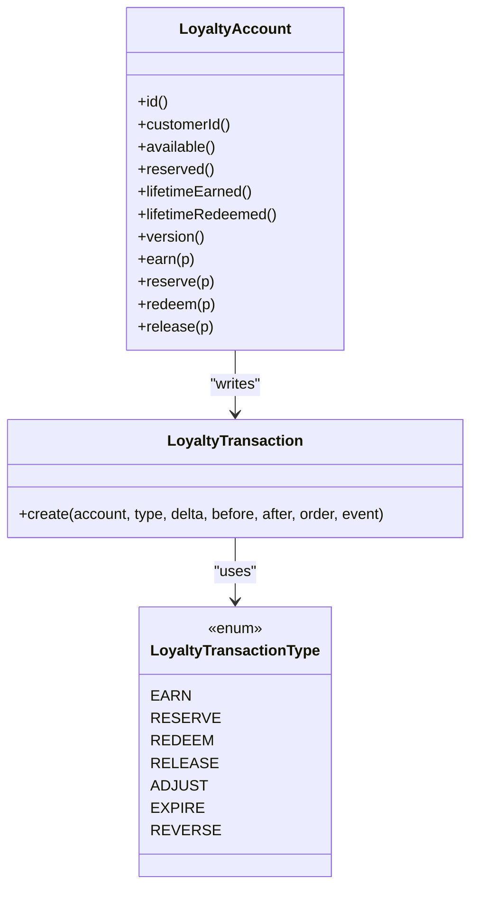
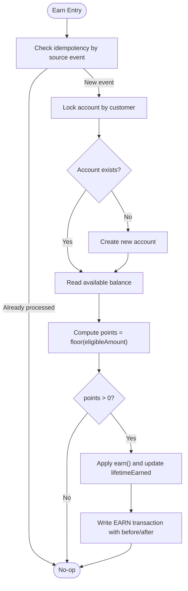
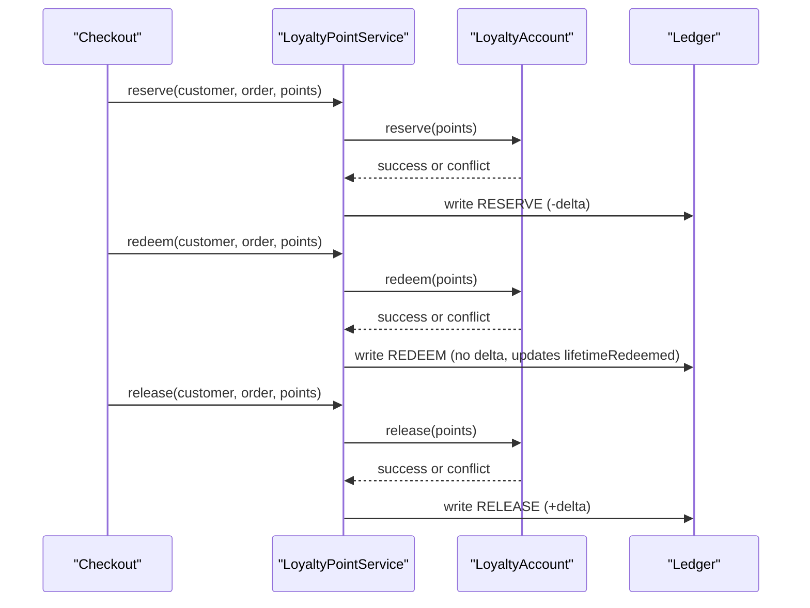
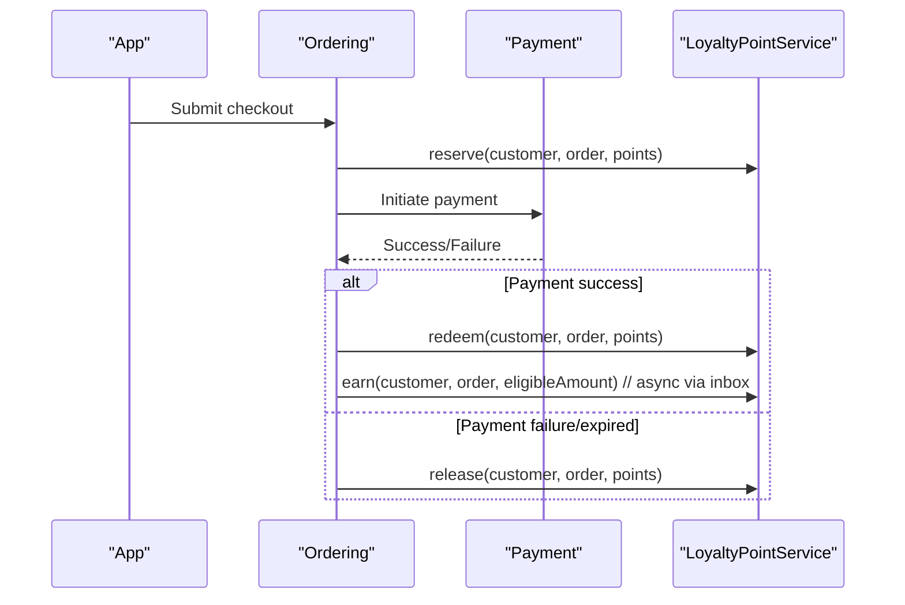
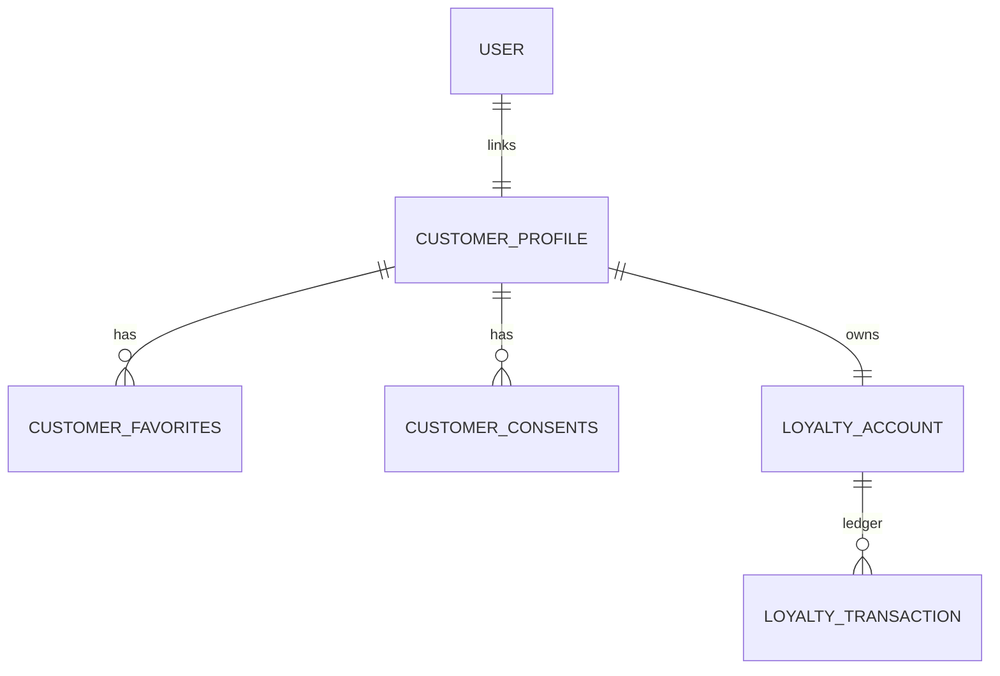
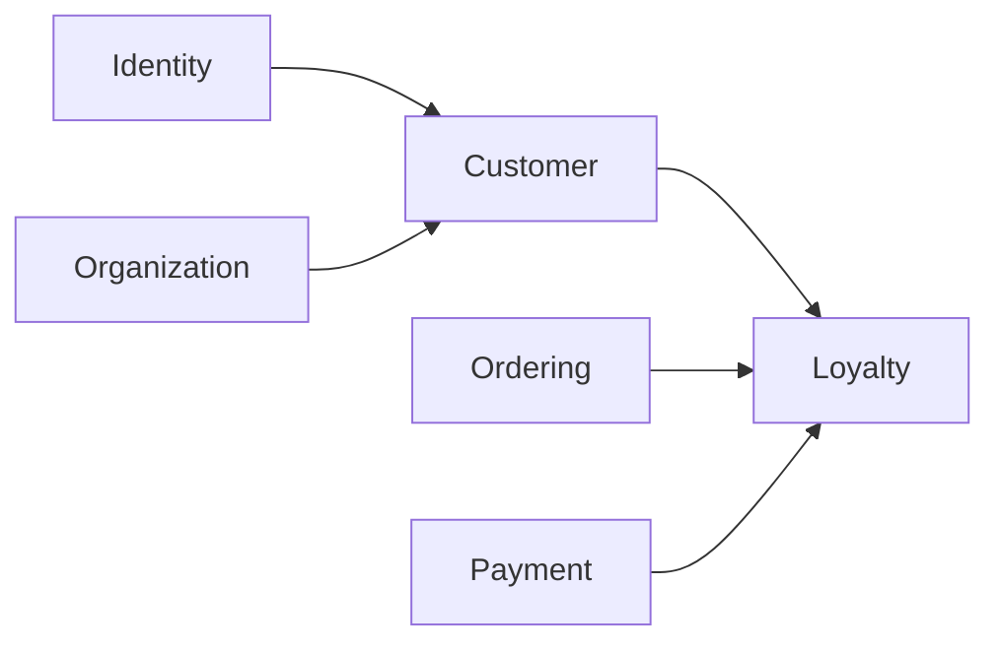

# Customer & Loyalty Module

<cite>
**Referenced Files in This Document**
- [CustomerProfile.java](file://src/main/java/com/smartcoffee/modules/customer/domain/CustomerProfile.java)
- [CustomerProfileService.java](file://src/main/java/com/smartcoffee/modules/customer/application/CustomerProfileService.java)
- [CustomerProfileController.java](file://src/main/java/com/smartcoffee/modules/customer/api/CustomerProfileController.java)
- [LoyaltyAccount.java](file://src/main/java/com/smartcoffee/modules/loyalty/domain/LoyaltyAccount.java)
- [LoyaltyTransaction.java](file://src/main/java/com/smartcoffee/modules/loyalty/domain/LoyaltyTransaction.java)
- [LoyaltyTransactionType.java](file://src/main/java/com/smartcoffee/modules/loyalty/domain/LoyaltyTransactionType.java)
- [LoyaltyPointService.java](file://src/main/java/com/smartcoffee/modules/loyalty/application/LoyaltyPointService.java)
- [LoyaltyQueryService.java](file://src/main/java/com/smartcoffee/modules/loyalty/application/LoyaltyQueryService.java)
- [LoyaltyController.java](file://src/main/java/com/smartcoffee/modules/loyalty/api/LoyaltyController.java)
- [User.java](file://src/main/java/com/smartcoffee/modules/identity/domain/User.java)
- [smart-coffee-logical.dbml](file://database/smart-coffee-logical.dbml)
- [CHECKOUT_PROMOTION_LOYALTY_PATCH.md](file://CHECKOUT_PROMOTION_LOYALTY_PATCH.md)
- [PAYMENT_LOYALTY_PATCH.md](file://PAYMENT_LOYALTY_PATCH.md)
</cite>

## Table of Contents
1. Introduction
2. Project Structure
3. Core Components
4. Architecture Overview
5. Detailed Component Analysis
6. Dependency Analysis
7. Performance Considerations
8. Troubleshooting Guide
9. Conclusion

## Introduction
This document defines the boundaries and ownership of the Customer and Loyalty modules, clarifying how customer identity is separated from loyalty accounting. It explains that Customer owns profile data, consent records, and favorites, while Loyalty owns an immutable points ledger and any cached balance projection. It also documents loyalty transaction types, point accumulation rules, and redemption processes, and shows how Ordering and Payment interact with Loyalty through application interfaces while preserving the immutable ledger pattern.

## Project Structure
The Customer module manages customer-facing preferences and marketing consent under the customer schema. The Loyalty module owns the immutable ledger and account state under the loyalty schema. Identity (users) is separate and linked to customers via a one-to-one relationship.

**Diagram sources**
- [User.java:1-85](file://src/main/java/com/smartcoffee/modules/identity/domain/User.java#L1-L85)
- [CustomerProfile.java:1-46](file://src/main/java/com/smartcoffee/modules/customer/domain/CustomerProfile.java#L1-L46)
- [LoyaltyAccount.java:1-107](file://src/main/java/com/smartcoffee/modules/loyalty/domain/LoyaltyAccount.java#L1-L107)
- [LoyaltyTransaction.java:1-53](file://src/main/java/com/smartcoffee/modules/loyalty/domain/LoyaltyTransaction.java#L1-L53)
- [smart-coffee-logical.dbml:163-210](file://database/smart-coffee-logical.dbml#L163-L210)

**Section sources**
- [CustomerProfile.java:1-46](file://src/main/java/com/smartcoffee/modules/customer/domain/CustomerProfile.java#L1-L46)
- [smart-coffee-logical.dbml:163-210](file://database/smart-coffee-logical.dbml#L163-L210)

## Core Components
- Customer Profile: Stores user-linked profile attributes such as preferred store, birth date, marketing opt-in, and a loyalty number. Owned by the Customer module.
- Consents and Favorites: Stored under the customer schema; owned by Customer.
- Loyalty Account: Holds available and reserved points plus lifetime earned/redeemed counters. Owned by Loyalty.
- Immutable Ledger: Each change to points is recorded as a transaction row with before/after balances and type. Owned by Loyalty.
- Query Service: Reads current account state for UI display.

Ownership summary:
- Customer owns: profile, consents, favorites, and a cached balance projection field on the profile if used for fast reads.
- Loyalty owns: the authoritative points ledger and account state. Any cached balance must be derived or synchronized from the ledger.

**Section sources**
- [CustomerProfile.java:1-46](file://src/main/java/com/smartcoffee/modules/customer/domain/CustomerProfile.java#L1-L46)
- [LoyaltyAccount.java:1-107](file://src/main/java/com/smartcoffee/modules/loyalty/domain/LoyaltyAccount.java#L1-L107)
- [LoyaltyTransaction.java:1-53](file://src/main/java/com/smartcoffee/modules/loyalty/domain/LoyaltyTransaction.java#L1-L53)
- [smart-coffee-logical.dbml:163-210](file://database/smart-coffee-logical.dbml#L163-L210)

## Architecture Overview
The system separates identity, customer preferences, and loyalty accounting. Ordering and Payment call into Loyalty through application services to reserve, redeem, or release points. Earning points is driven by order completion events and uses idempotency to prevent duplicates.

**Diagram sources**
- [LoyaltyPointService.java:20-59](file://src/main/java/com/smartcoffee/modules/loyalty/application/LoyaltyPointService.java#L20-L59)
- [LoyaltyAccount.java:46-76](file://src/main/java/com/smartcoffee/modules/loyalty/domain/LoyaltyAccount.java#L46-L76)
- [LoyaltyTransaction.java:36-50](file://src/main/java/com/smartcoffee/modules/loyalty/domain/LoyaltyTransaction.java#L36-L50)
- [CHECKOUT_PROMOTION_LOYALTY_PATCH.md:1-3](file://CHECKOUT_PROMOTION_LOYALTY_PATCH.md#L1-L3)
- [PAYMENT_LOYALTY_PATCH.md:1-3](file://PAYMENT_LOYALTY_PATCH.md#L1-L3)

## Detailed Component Analysis

### Customer Ownership: Profile, Consent, Favorites
- Profile entity links a user to customer-specific preferences and a loyalty number. Updates are validated against store existence and persist changes atomically.
- Consents and favorites are stored under the customer schema and are fully owned by the Customer module.
- A cached balance projection may exist on the profile for read performance but must not be the source of truth; the authoritative state lives in Loyalty.

**Diagram sources**
- [CustomerProfile.java:1-46](file://src/main/java/com/smartcoffee/modules/customer/domain/CustomerProfile.java#L1-L46)
- [User.java:1-85](file://src/main/java/com/smartcoffee/modules/identity/domain/User.java#L1-L85)

**Section sources**
- [CustomerProfileService.java:20-38](file://src/main/java/com/smartcoffee/modules/customer/application/CustomerProfileService.java#L20-L38)
- [CustomerProfileController.java:17-25](file://src/main/java/com/smartcoffee/modules/customer/api/CustomerProfileController.java#L17-L25)
- [smart-coffee-logical.dbml:163-188](file://database/smart-coffee-logical.dbml#L163-L188)

### Loyalty Ownership: Immutable Ledger and Account State
- LoyaltyAccount enforces point transitions (earn, reserve, redeem, release) with validation and versioning.
- LoyaltyTransaction records every change immutably with before/after balances, type, order linkage, and optional event id for idempotency.
- Transaction types include EARN, RESERVE, REDEEM, RELEASE, ADJUST, EXPIRE, REVERSE.

**Diagram sources**
- [LoyaltyAccount.java:1-107](file://src/main/java/com/smartcoffee/modules/loyalty/domain/LoyaltyAccount.java#L1-L107)
- [LoyaltyTransaction.java:1-53](file://src/main/java/com/smartcoffee/modules/loyalty/domain/LoyaltyTransaction.java#L1-L53)
- [LoyaltyTransactionType.java:1-7](file://src/main/java/com/smartcoffee/modules/loyalty/domain/LoyaltyTransactionType.java#L1-L7)

**Section sources**
- [LoyaltyAccount.java:46-76](file://src/main/java/com/smartcoffee/modules/loyalty/domain/LoyaltyAccount.java#L46-L76)
- [LoyaltyTransaction.java:36-50](file://src/main/java/com/smartcoffee/modules/loyalty/domain/LoyaltyTransaction.java#L36-L50)
- [LoyaltyTransactionType.java:1-7](file://src/main/java/com/smartcoffee/modules/loyalty/domain/LoyaltyTransactionType.java#L1-L7)

### Point Accumulation Rules
- Eligible amount is converted to integer points using floor rounding to avoid fractional points.
- Earning is idempotent per source event; duplicate events are ignored.
- If computed points are zero or less, no transaction is written.

**Diagram sources**
- [LoyaltyPointService.java:20-32](file://src/main/java/com/smartcoffee/modules/loyalty/application/LoyaltyPointService.java#L20-L32)
- [LoyaltyAccount.java:46-52](file://src/main/java/com/smartcoffee/modules/loyalty/domain/LoyaltyAccount.java#L46-L52)
- [LoyaltyTransaction.java:36-50](file://src/main/java/com/smartcoffee/modules/loyalty/domain/LoyaltyTransaction.java#L36-L50)

**Section sources**
- [LoyaltyPointService.java:20-32](file://src/main/java/com/smartcoffee/modules/loyalty/application/LoyaltyPointService.java#L20-L32)

### Redemption Processes and Reservation Lifecycle
- Reserve: Moves points from available to reserved when checkout evaluates loyalty usage. Fails if insufficient available points.
- Redeem: Consumes reserved points upon successful payment confirmation. Fails if insufficient reserved points.
- Release: Returns reserved points to available when checkout rolls back or payment expires.

**Diagram sources**
- [LoyaltyPointService.java:34-59](file://src/main/java/com/smartcoffee/modules/loyalty/application/LoyaltyPointService.java#L34-L59)
- [LoyaltyAccount.java:54-76](file://src/main/java/com/smartcoffee/modules/loyalty/domain/LoyaltyAccount.java#L54-L76)
- [CHECKOUT_PROMOTION_LOYALTY_PATCH.md:1-3](file://CHECKOUT_PROMOTION_LOYALTY_PATCH.md#L1-L3)

**Section sources**
- [LoyaltyPointService.java:34-59](file://src/main/java/com/smartcoffee/modules/loyalty/application/LoyaltyPointService.java#L34-L59)
- [LoyaltyAccount.java:54-76](file://src/main/java/com/smartcoffee/modules/loyalty/domain/LoyaltyAccount.java#L54-L76)

### Interaction Examples: Ordering and Payment
- Checkout reserves points before finalizing order totals. If checkout rolls back, points are released automatically within the same transactional boundary.
- After payment success, promotions are redeemed and loyalty redemption is confirmed. Earning points should be handled asynchronously via an OrderCompleted consumer using Consumer Inbox to ensure idempotency and decoupling.

**Diagram sources**
- [CHECKOUT_PROMOTION_LOYALTY_PATCH.md:1-3](file://CHECKOUT_PROMOTION_LOYALTY_PATCH.md#L1-L3)
- [PAYMENT_LOYALTY_PATCH.md:1-3](file://PAYMENT_LOYALTY_PATCH.md#L1-L3)
- [LoyaltyPointService.java:20-59](file://src/main/java/com/smartcoffee/modules/loyalty/application/LoyaltyPointService.java#L20-L59)

**Section sources**
- [CHECKOUT_PROMOTION_LOYALTY_PATCH.md:1-3](file://CHECKOUT_PROMOTION_LOYALTY_PATCH.md#L1-L3)
- [PAYMENT_LOYALTY_PATCH.md:1-3](file://PAYMENT_LOYALTY_PATCH.md#L1-L3)

### Data Model Relationships

**Diagram sources**
- [smart-coffee-logical.dbml:163-210](file://database/smart-coffee-logical.dbml#L163-L210)

**Section sources**
- [smart-coffee-logical.dbml:163-210](file://database/smart-coffee-logical.dbml#L163-L210)

## Dependency Analysis
- Customer module depends on Identity for user linkage and on Organization for store validation during profile updates.
- Loyalty module depends on persistence repositories for accounts and ledger entries. It does not depend on Ordering or Payment directly; integration occurs via application service calls and events.
- Query flows use read-only transactions to serve current account state.

**Diagram sources**
- [CustomerProfileService.java:13-33](file://src/main/java/com/smartcoffee/modules/customer/application/CustomerProfileService.java#L13-L33)
- [LoyaltyPointService.java:11-18](file://src/main/java/com/smartcoffee/modules/loyalty/application/LoyaltyPointService.java#L11-L18)

**Section sources**
- [CustomerProfileService.java:13-33](file://src/main/java/com/smartcoffee/modules/customer/application/CustomerProfileService.java#L13-L33)
- [LoyaltyPointService.java:11-18](file://src/main/java/com/smartcoffee/modules/loyalty/application/LoyaltyPointService.java#L11-L18)

## Performance Considerations
- Use account locking at the repository level to serialize concurrent modifications per customer.
- Keep earning asynchronous to avoid blocking checkout/payment paths.
- Prefer reading from the query service for UI responses; avoid heavy aggregation in write paths.
- Ensure indexes on idempotency keys and occurred_at for high-throughput event processing.

[No sources needed since this section provides general guidance]

## Troubleshooting Guide
Common issues and resolutions:
- Insufficient points during reservation: Validate available points before reserving; surface clear error codes to clients.
- Reserved points insufficient during redemption: Ensure reserve was successful and not rolled back; check for concurrent releases.
- Duplicate earnings: Verify idempotency checks by source event; confirm consumer inbox deduplication.
- Stale cache: If a cached balance exists on the profile, invalidate or recompute it after ledger writes.

**Section sources**
- [LoyaltyAccount.java:54-76](file://src/main/java/com/smartcoffee/modules/loyalty/domain/LoyaltyAccount.java#L54-L76)
- [LoyaltyPointService.java:20-32](file://src/main/java/com/smartcoffee/modules/loyalty/application/LoyaltyPointService.java#L20-L32)

## Conclusion
Customer and Loyalty are cleanly separated: Customer owns identity-adjacent preferences and consent data, while Loyalty owns the authoritative, immutable points ledger and account state. Ordering and Payment integrate with Loyalty through well-defined application interfaces to reserve, redeem, and release points, ensuring consistency and auditability. Asynchronous earning with idempotency guarantees reliable point accrual without impacting critical paths.

[No sources needed since this section summarizes without analyzing specific files]