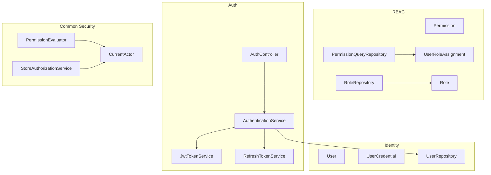
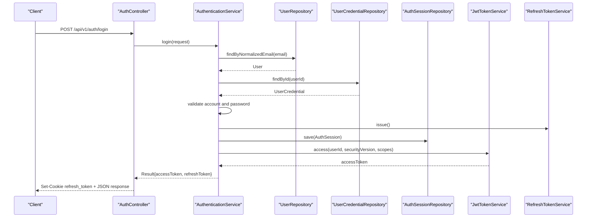
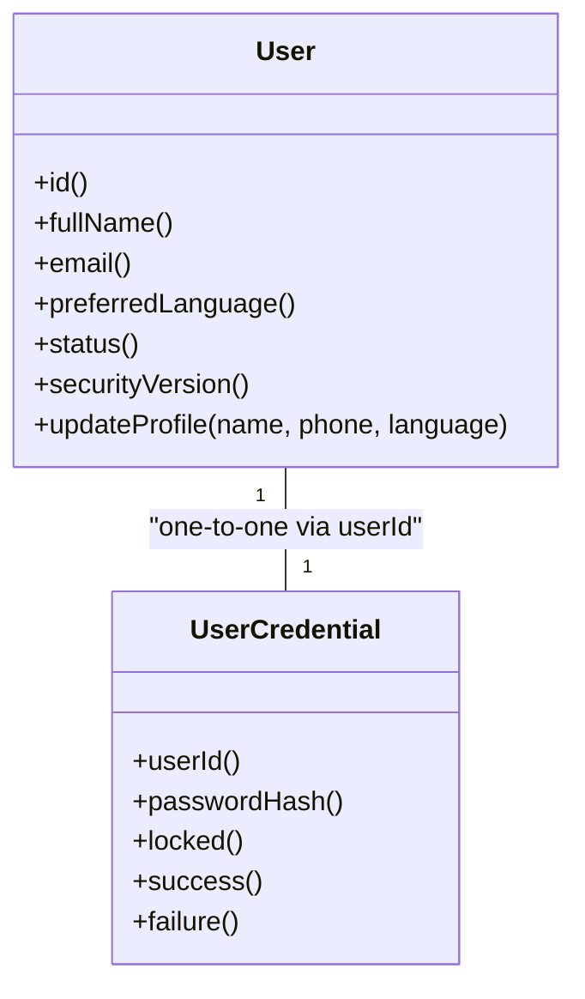
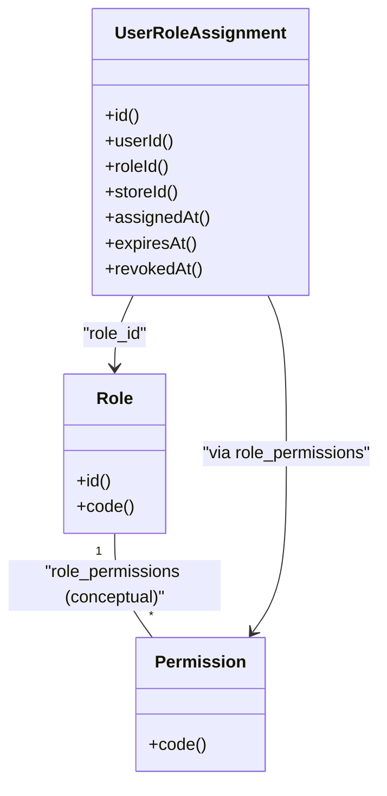
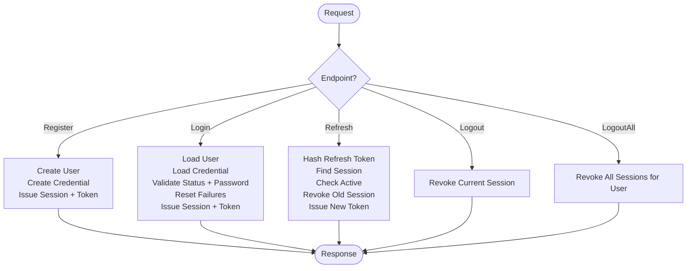
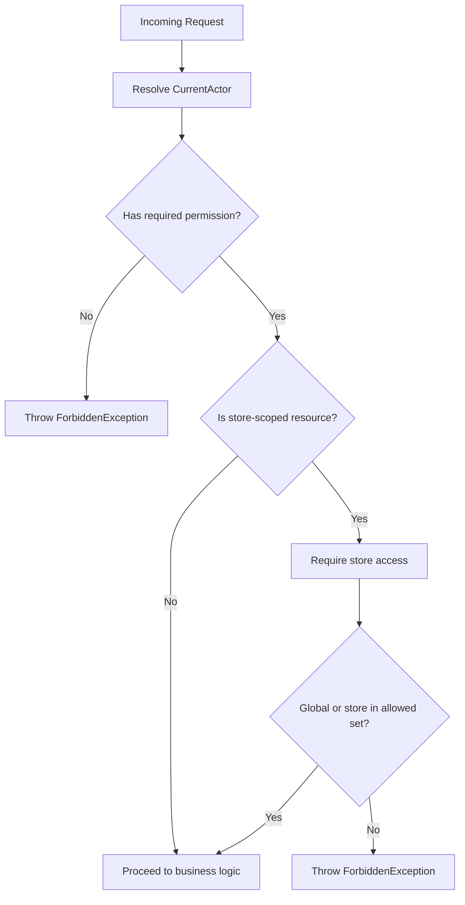
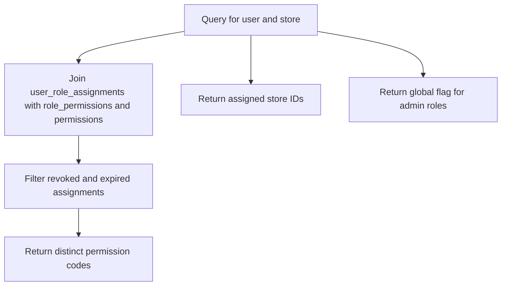
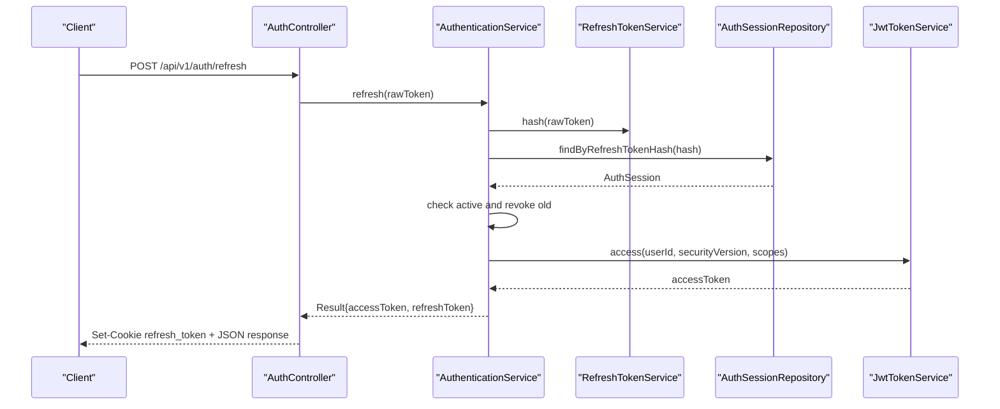
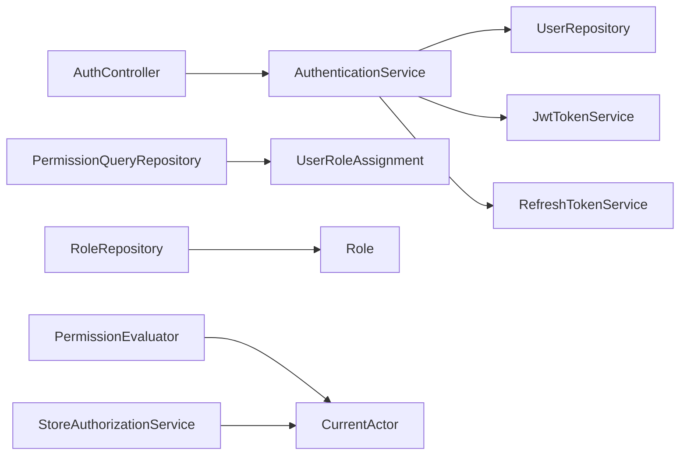

# Identity & Access Module

<cite>
**Referenced Files in This Document**
- [ADR-006-authentication-model.md](file://adr/ADR-006-authentication-model.md)
- [User.java](file://src/main/java/com/smartcoffee/modules/identity/domain/User.java)
- [UserCredential.java](file://src/main/java/com/smartcoffee/modules/identity/domain/UserCredential.java)
- [UserRepository.java](file://src/main/java/com/smartcoffee/modules/identity/persistence/UserRepository.java)
- [Permission.java](file://src/main/java/com/smartcoffee/modules/rbac/domain/Permission.java)
- [Role.java](file://src/main/java/com/smartcoffee/modules/rbac/domain/Role.java)
- [UserRoleAssignment.java](file://src/main/java/com/smartcoffee/modules/rbac/domain/UserRoleAssignment.java)
- [PermissionQueryRepository.java](file://src/main/java/com/smartcoffee/modules/rbac/persistence/PermissionQueryRepository.java)
- [RoleRepository.java](file://src/main/java/com/smartcoffee/modules/rbac/persistence/RoleRepository.java)
- [JwtTokenService.java](file://src/main/java/com/smartcoffee/modules/auth/security/JwtTokenService.java)
- [RefreshTokenService.java](file://src/main/java/com/smartcoffee/modules/auth/security/RefreshTokenService.java)
- [AuthenticationService.java](file://src/main/java/com/smartcoffee/modules/auth/application/AuthenticationService.java)
- [AuthController.java](file://src/main/java/com/smartcoffee/modules/auth/api/AuthController.java)
- [CurrentActor.java](file://src/main/java/com/smartcoffee/common/security/CurrentActor.java)
- [PermissionEvaluator.java](file://src/main/java/com/smartcoffee/common/security/PermissionEvaluator.java)
- [StoreAuthorizationService.java](file://src/main/java/com/smartcoffee/common/security/StoreAuthorizationService.java)
</cite>

## Table of Contents
1. [Introduction](#introduction)
2. [Project Structure](#project-structure)
3. [Core Components](#core-components)
4. [Architecture Overview](#architecture-overview)
5. [Detailed Component Analysis](#detailed-component-analysis)
6. [Dependency Analysis](#dependency-analysis)
7. [Performance Considerations](#performance-considerations)
8. [Troubleshooting Guide](#troubleshooting-guide)
9. [Conclusion](#conclusion)

## Introduction
This document defines the boundaries, ownership, and responsibilities of the Identity & Access module. It owns users, credentials, sessions, roles, permissions, and store-scoped role assignments. It explicitly does not own Stores, Orders, Payments, or Inventory; those domains are owned by their respective modules and must be accessed through well-defined application interfaces.

The Identity & Access module provides:
- User registration and profile management
- Credential storage and login validation
- JWT access tokens and refresh token session lifecycle
- Role-based access control with Permission, Role, and UserRoleAssignment
- Store-scoped authorization enforcement via CurrentActor and supporting services

## Project Structure
The Identity & Access functionality spans three related areas:
- Identity domain and persistence for users and credentials
- RBAC domain and query repositories for permissions, roles, and user-role assignments
- Auth security components for JWT and refresh token handling, plus the authentication application service and controller

**Diagram sources**
- [User.java:1-85](file://src/main/java/com/smartcoffee/modules/identity/domain/User.java#L1-L85)
- [UserCredential.java:1-16](file://src/main/java/com/smartcoffee/modules/identity/domain/UserCredential.java#L1-L16)
- [UserRepository.java:1-5](file://src/main/java/com/smartcoffee/modules/identity/persistence/UserRepository.java#L1-L5)
- [Permission.java:1-23](file://src/main/java/com/smartcoffee/modules/rbac/domain/Permission.java#L1-L23)
- [Role.java:1-29](file://src/main/java/com/smartcoffee/modules/rbac/domain/Role.java#L1-L29)
- [UserRoleAssignment.java:1-30](file://src/main/java/com/smartcoffee/modules/rbac/domain/UserRoleAssignment.java#L1-L30)
- [PermissionQueryRepository.java:1-21](file://src/main/java/com/smartcoffee/modules/rbac/persistence/PermissionQueryRepository.java#L1-L21)
- [RoleRepository.java:1-11](file://src/main/java/com/smartcoffee/modules/rbac/persistence/RoleRepository.java#L1-L11)
- [AuthController.java:1-73](file://src/main/java/com/smartcoffee/modules/auth/api/AuthController.java#L1-L73)
- [AuthenticationService.java:1-103](file://src/main/java/com/smartcoffee/modules/auth/application/AuthenticationService.java#L1-L103)
- [JwtTokenService.java:1-105](file://src/main/java/com/smartcoffee/modules/auth/security/JwtTokenService.java#L1-L105)
- [RefreshTokenService.java:1-5](file://src/main/java/com/smartcoffee/modules/auth/security/RefreshTokenService.java#L1-L5)
- [CurrentActor.java:1-17](file://src/main/java/com/smartcoffee/common/security/CurrentActor.java#L1-L17)
- [PermissionEvaluator.java:1-14](file://src/main/java/com/smartcoffee/common/security/PermissionEvaluator.java#L1-L14)
- [StoreAuthorizationService.java:1-15](file://src/main/java/com/smartcoffee/common/security/StoreAuthorizationService.java#L1-L15)

**Section sources**
- [User.java:1-85](file://src/main/java/com/smartcoffee/modules/identity/domain/User.java#L1-L85)
- [UserCredential.java:1-16](file://src/main/java/com/smartcoffee/modules/identity/domain/UserCredential.java#L1-L16)
- [Permission.java:1-23](file://src/main/java/com/smartcoffee/modules/rbac/domain/Permission.java#L1-L23)
- [Role.java:1-29](file://src/main/java/com/smartcoffee/modules/rbac/domain/Role.java#L1-L29)
- [UserRoleAssignment.java:1-30](file://src/main/java/com/smartcoffee/modules/rbac/domain/UserRoleAssignment.java#L1-L30)
- [PermissionQueryRepository.java:1-21](file://src/main/java/com/smartcoffee/modules/rbac/persistence/PermissionQueryRepository.java#L1-L21)
- [RoleRepository.java:1-11](file://src/main/java/com/smartcoffee/modules/rbac/persistence/RoleRepository.java#L1-L11)
- [AuthController.java:1-73](file://src/main/java/com/smartcoffee/modules/auth/api/AuthController.java#L1-L73)
- [AuthenticationService.java:1-103](file://src/main/java/com/smartcoffee/modules/auth/application/AuthenticationService.java#L1-L103)
- [JwtTokenService.java:1-105](file://src/main/java/com/smartcoffee/modules/auth/security/JwtTokenService.java#L1-L105)
- [RefreshTokenService.java:1-5](file://src/main/java/com/smartcoffee/modules/auth/security/RefreshTokenService.java#L1-L5)
- [CurrentActor.java:1-17](file://src/main/java/com/smartcoffee/common/security/CurrentActor.java#L1-L17)
- [PermissionEvaluator.java:1-14](file://src/main/java/com/smartcoffee/common/security/PermissionEvaluator.java#L1-L14)
- [StoreAuthorizationService.java:1-15](file://src/main/java/com/smartcoffee/common/security/StoreAuthorizationService.java#L1-L15)

## Core Components
- Identity entities:
  - User: represents a system user with identity attributes and status.
  - UserCredential: stores password hash and lockout state per user.
- RBAC entities:
  - Permission: a named permission code.
  - Role: a named role code and display name.
  - UserRoleAssignment: assigns roles to users, optionally scoped to a store, with time-bounded validity.
- Auth security:
  - JwtTokenService: issues short-lived signed JWT access tokens with subject, security version, and scopes.
  - RefreshTokenService: generates opaque refresh tokens and hashes them for storage.
  - AuthenticationService: orchestrates registration, login, refresh, logout, and session revocation.
  - AuthController: exposes public endpoints for register, login, refresh, logout, and logout-all.
- Common security:
  - CurrentActor: runtime representation of authenticated user, granted permissions, allowed stores, and global access.
  - PermissionEvaluator: enforces required permissions.
  - StoreAuthorizationService: enforces store-scoped access.

Ownership rules:
- Identity & Access owns:
  - Users, credentials, sessions, roles, permissions, and user-role assignments.
- Identity & Access does not own:
  - Stores, Orders, Payments, or Inventory. Other modules must interact with Identity only through application interfaces and never directly manipulate Identity’s internal persistence from outside the module.

**Section sources**
- [User.java:1-85](file://src/main/java/com/smartcoffee/modules/identity/domain/User.java#L1-L85)
- [UserCredential.java:1-16](file://src/main/java/com/smartcoffee/modules/identity/domain/UserCredential.java#L1-L16)
- [Permission.java:1-23](file://src/main/java/com/smartcoffee/modules/rbac/domain/Permission.java#L1-L23)
- [Role.java:1-29](file://src/main/java/com/smartcoffee/modules/rbac/domain/Role.java#L1-L29)
- [UserRoleAssignment.java:1-30](file://src/main/java/com/smartcoffee/modules/rbac/domain/UserRoleAssignment.java#L1-L30)
- [JwtTokenService.java:1-105](file://src/main/java/com/smartcoffee/modules/auth/security/JwtTokenService.java#L1-L105)
- [RefreshTokenService.java:1-5](file://src/main/java/com/smartcoffee/modules/auth/security/RefreshTokenService.java#L1-L5)
- [AuthenticationService.java:1-103](file://src/main/java/com/smartcoffee/modules/auth/application/AuthenticationService.java#L1-L103)
- [AuthController.java:1-73](file://src/main/java/com/smartcoffee/modules/auth/api/AuthController.java#L1-L73)
- [CurrentActor.java:1-17](file://src/main/java/com/smartcoffee/common/security/CurrentActor.java#L1-L17)
- [PermissionEvaluator.java:1-14](file://src/main/java/com/smartcoffee/common/security/PermissionEvaluator.java#L1-L14)
- [StoreAuthorizationService.java:1-15](file://src/main/java/com/smartcoffee/common/security/StoreAuthorizationService.java#L1-L15)

## Architecture Overview
The authentication flow uses short-lived JWT access tokens and hashed refresh tokens stored as sessions. The AuthController delegates to AuthenticationService, which coordinates Identity persistence and token issuance. Authorization is enforced at runtime using CurrentActor, PermissionEvaluator, and StoreAuthorizationService.

**Diagram sources**
- [AuthController.java:33-38](file://src/main/java/com/smartcoffee/modules/auth/api/AuthController.java#L33-L38)
- [AuthenticationService.java:48-62](file://src/main/java/com/smartcoffee/modules/auth/application/AuthenticationService.java#L48-L62)
- [UserRepository.java:1-5](file://src/main/java/com/smartcoffee/modules/identity/persistence/UserRepository.java#L1-L5)
- [JwtTokenService.java:66-85](file://src/main/java/com/smartcoffee/modules/auth/security/JwtTokenService.java#L66-L85)
- [RefreshTokenService.java:1-5](file://src/main/java/com/smartcoffee/modules/auth/security/RefreshTokenService.java#L1-L5)

## Detailed Component Analysis

### Identity Domain: User and UserCredential
- User encapsulates identity attributes and includes a security_version used to invalidate tokens after sensitive changes.
- UserCredential tracks password hash, failed login attempts, lockout state, and last password change timestamp.

**Diagram sources**
- [User.java:1-85](file://src/main/java/com/smartcoffee/modules/identity/domain/User.java#L1-L85)
- [UserCredential.java:1-16](file://src/main/java/com/smartcoffee/modules/identity/domain/UserCredential.java#L1-L16)

**Section sources**
- [User.java:1-85](file://src/main/java/com/smartcoffee/modules/identity/domain/User.java#L1-L85)
- [UserCredential.java:1-16](file://src/main/java/com/smartcoffee/modules/identity/domain/UserCredential.java#L1-L16)

### RBAC Domain: Permission, Role, and UserRoleAssignment
- Permission is a unique permission code.
- Role is a unique role code with a human-readable name.
- UserRoleAssignment links a user to a role, optionally scoped to a store, with assignment timestamps and optional expiry or revocation.

**Diagram sources**
- [Permission.java:1-23](file://src/main/java/com/smartcoffee/modules/rbac/domain/Permission.java#L1-L23)
- [Role.java:1-29](file://src/main/java/com/smartcoffee/modules/rbac/domain/Role.java#L1-L29)
- [UserRoleAssignment.java:1-30](file://src/main/java/com/smartcoffee/modules/rbac/domain/UserRoleAssignment.java#L1-L30)

**Section sources**
- [Permission.java:1-23](file://src/main/java/com/smartcoffee/modules/rbac/domain/Permission.java#L1-L23)
- [Role.java:1-29](file://src/main/java/com/smartcoffee/modules/rbac/domain/Role.java#L1-L29)
- [UserRoleAssignment.java:1-30](file://src/main/java/com/smartcoffee/modules/rbac/domain/UserRoleAssignment.java#L1-L30)

### Authentication Flow: Login, Register, Refresh, Logout
- Register creates a User and UserCredential, then issues an initial session and access token.
- Login validates user status, credential lockout, and password, resets failure counters on success, and issues a new session and access token.
- Refresh validates the hashed refresh token against stored sessions, rotates the session, and issues a new access token.
- Logout revokes the current session; logout-all revokes all active sessions for the user.

**Diagram sources**
- [AuthController.java:25-59](file://src/main/java/com/smartcoffee/modules/auth/api/AuthController.java#L25-L59)
- [AuthenticationService.java:38-100](file://src/main/java/com/smartcoffee/modules/auth/application/AuthenticationService.java#L38-L100)
- [RefreshTokenService.java:1-5](file://src/main/java/com/smartcoffee/modules/auth/security/RefreshTokenService.java#L1-L5)
- [JwtTokenService.java:58-104](file://src/main/java/com/smartcoffee/modules/auth/security/JwtTokenService.java#L58-L104)

**Section sources**
- [AuthController.java:1-73](file://src/main/java/com/smartcoffee/modules/auth/api/AuthController.java#L1-L73)
- [AuthenticationService.java:1-103](file://src/main/java/com/smartcoffee/modules/auth/application/AuthenticationService.java#L1-L103)
- [JwtTokenService.java:1-105](file://src/main/java/com/smartcoffee/modules/auth/security/JwtTokenService.java#L1-L105)
- [RefreshTokenService.java:1-5](file://src/main/java/com/smartcoffee/modules/auth/security/RefreshTokenService.java#L1-L5)

### Store-Scoped Authorization Enforcement
- CurrentActor carries the authenticated user ID, actor type, granted permission codes, allowed store IDs, and whether the actor has global access.
- PermissionEvaluator requires a specific permission and throws a forbidden exception if missing.
- StoreAuthorizationService requires that the current actor can access the requested store ID, throwing a forbidden exception otherwise.

**Diagram sources**
- [CurrentActor.java:1-17](file://src/main/java/com/smartcoffee/common/security/CurrentActor.java#L1-L17)
- [PermissionEvaluator.java:1-14](file://src/main/java/com/smartcoffee/common/security/PermissionEvaluator.java#L1-L14)
- [StoreAuthorizationService.java:1-15](file://src/main/java/com/smartcoffee/common/security/StoreAuthorizationService.java#L1-L15)

**Section sources**
- [CurrentActor.java:1-17](file://src/main/java/com/smartcoffee/common/security/CurrentActor.java#L1-L17)
- [PermissionEvaluator.java:1-14](file://src/main/java/com/smartcoffee/common/security/PermissionEvaluator.java#L1-L14)
- [StoreAuthorizationService.java:1-15](file://src/main/java/com/smartcoffee/common/security/StoreAuthorizationService.java#L1-L15)

### RBAC Querying and Effective Permissions
- PermissionQueryRepository computes effective permissions for a user and store by joining user-role assignments, role-permission mappings, and permissions.
- It also returns the set of store IDs assigned to the user and whether the user has global administrative privileges.

**Diagram sources**
- [PermissionQueryRepository.java:10-18](file://src/main/java/com/smartcoffee/modules/rbac/persistence/PermissionQueryRepository.java#L10-L18)

**Section sources**
- [PermissionQueryRepository.java:1-21](file://src/main/java/com/smartcoffee/modules/rbac/persistence/PermissionQueryRepository.java#L1-L21)

### JWT and Refresh Token Lifecycle
- JwtTokenService builds HS256-signed JWTs with issuer, subject, security version, and scopes.
- RefreshTokenService generates cryptographically random tokens and hashes them before storage.
- AuthenticationService manages AuthSession records, rotating refresh tokens on successful refresh and issuing new access tokens.

**Diagram sources**
- [AuthController.java:40-45](file://src/main/java/com/smartcoffee/modules/auth/api/AuthController.java#L40-L45)
- [AuthenticationService.java:64-74](file://src/main/java/com/smartcoffee/modules/auth/application/AuthenticationService.java#L64-L74)
- [RefreshTokenService.java:1-5](file://src/main/java/com/smartcoffee/modules/auth/security/RefreshTokenService.java#L1-L5)
- [JwtTokenService.java:66-85](file://src/main/java/com/smartcoffee/modules/auth/security/JwtTokenService.java#L66-L85)

**Section sources**
- [JwtTokenService.java:1-105](file://src/main/java/com/smartcoffee/modules/auth/security/JwtTokenService.java#L1-L105)
- [RefreshTokenService.java:1-5](file://src/main/java/com/smartcoffee/modules/auth/security/RefreshTokenService.java#L1-L5)
- [AuthenticationService.java:64-100](file://src/main/java/com/smartcoffee/modules/auth/application/AuthenticationService.java#L64-L100)

### Module Boundaries and Ownership Rules
- Identity & Access owns:
  - Users, credentials, sessions, roles, permissions, and user-role assignments.
- Identity & Access does not own:
  - Stores, Orders, Payments, or Inventory. These belong to their respective modules.
- Cross-module interaction rule:
  - Other modules must use application interfaces provided by Identity & Access. They must not import or call Identity persistence classes directly.
  - Authorization decisions must be made using CurrentActor, PermissionEvaluator, and StoreAuthorizationService inside the resource-owning module.

Examples of proper authorization checks:
- Before updating a user profile, require the appropriate permission and ensure the actor can access the relevant store when applicable.
- Before reading inventory balances, require the store-scoped permission and verify store access.

Common anti-patterns to avoid:
- Direct repository access from other modules to Identity tables.
- Trusting store IDs from request headers or paths without checking CurrentActor.storeIds or globalAccess.
- Performing authorization only at the API gateway; always enforce within the application service.
- Storing raw refresh tokens in the database; always store hashed values.
- Using long-lived JWTs without refresh rotation and revocation.

**Section sources**
- [ADR-006-authentication-model.md:94-127](file://adr/ADR-006-authentication-model.md#L94-L127)
- [CurrentActor.java:1-17](file://src/main/java/com/smartcoffee/common/security/CurrentActor.java#L1-L17)
- [PermissionEvaluator.java:1-14](file://src/main/java/com/smartcoffee/common/security/PermissionEvaluator.java#L1-L14)
- [StoreAuthorizationService.java:1-15](file://src/main/java/com/smartcoffee/common/security/StoreAuthorizationService.java#L1-L15)

## Dependency Analysis
The following diagram shows how Identity, RBAC, Auth, and Common Security components depend on each other.

**Diagram sources**
- [AuthController.java:1-73](file://src/main/java/com/smartcoffee/modules/auth/api/AuthController.java#L1-L73)
- [AuthenticationService.java:1-103](file://src/main/java/com/smartcoffee/modules/auth/application/AuthenticationService.java#L1-L103)
- [UserRepository.java:1-5](file://src/main/java/com/smartcoffee/modules/identity/persistence/UserRepository.java#L1-L5)
- [JwtTokenService.java:1-105](file://src/main/java/com/smartcoffee/modules/auth/security/JwtTokenService.java#L1-L105)
- [RefreshTokenService.java:1-5](file://src/main/java/com/smartcoffee/modules/auth/security/RefreshTokenService.java#L1-L5)
- [PermissionQueryRepository.java:1-21](file://src/main/java/com/smartcoffee/modules/rbac/persistence/PermissionQueryRepository.java#L1-L21)
- [RoleRepository.java:1-11](file://src/main/java/com/smartcoffee/modules/rbac/persistence/RoleRepository.java#L1-L11)
- [Role.java:1-29](file://src/main/java/com/smartcoffee/modules/rbac/domain/Role.java#L1-L29)
- [UserRoleAssignment.java:1-30](file://src/main/java/com/smartcoffee/modules/rbac/domain/UserRoleAssignment.java#L1-L30)
- [CurrentActor.java:1-17](file://src/main/java/com/smartcoffee/common/security/CurrentActor.java#L1-L17)
- [PermissionEvaluator.java:1-14](file://src/main/java/com/smartcoffee/common/security/PermissionEvaluator.java#L1-L14)
- [StoreAuthorizationService.java:1-15](file://src/main/java/com/smartcoffee/common/security/StoreAuthorizationService.java#L1-L15)

**Section sources**
- [AuthController.java:1-73](file://src/main/java/com/smartcoffee/modules/auth/api/AuthController.java#L1-L73)
- [AuthenticationService.java:1-103](file://src/main/java/com/smartcoffee/modules/auth/application/AuthenticationService.java#L1-L103)
- [PermissionQueryRepository.java:1-21](file://src/main/java/com/smartcoffee/modules/rbac/persistence/PermissionQueryRepository.java#L1-L21)
- [RoleRepository.java:1-11](file://src/main/java/com/smartcoffee/modules/rbac/persistence/RoleRepository.java#L1-L11)
- [CurrentActor.java:1-17](file://src/main/java/com/smartcoffee/common/security/CurrentActor.java#L1-L17)
- [PermissionEvaluator.java:1-14](file://src/main/java/com/smartcoffee/common/security/PermissionEvaluator.java#L1-L14)
- [StoreAuthorizationService.java:1-15](file://src/main/java/com/smartcoffee/common/security/StoreAuthorizationService.java#L1-L15)

## Performance Considerations
- Keep JWT access tokens short-lived to limit exposure and reduce stale claims risk.
- Use hashed refresh tokens and rotate on every successful refresh to minimize theft impact.
- Cache effective permissions and store scope sets where appropriate, but ensure invalidation on role changes or security version updates.
- Avoid loading unnecessary personal data into JWT claims.
- Ensure database queries for permissions and store scopes are indexed appropriately on user_id, store_id, and timestamps.

[No sources needed since this section provides general guidance]

## Troubleshooting Guide
Common issues and resolutions:
- Invalid credentials:
  - Verify user exists, is active, and credentials are not locked.
  - Check failed login count and lockout window.
- Account unavailable:
  - Confirm user status is active and credential is not locked.
- Invalid refresh session:
  - Ensure the refresh token matches a stored hash and the session is still active.
- Store access denied:
  - Verify CurrentActor.storeIds contains the requested store or globalAccess is true.
- Missing required permission:
  - Ensure the user has an active, non-expired, non-revoked role assignment granting the required permission.

Operational recommendations:
- Log correlation IDs for authentication flows.
- Audit registration, login failures, role assignments, and session revocations.
- Rotate signing keys and rehash passwords according to policy.

**Section sources**
- [AuthenticationService.java:48-87](file://src/main/java/com/smartcoffee/modules/auth/application/AuthenticationService.java#L48-L87)
- [StoreAuthorizationService.java:8-12](file://src/main/java/com/smartcoffee/common/security/StoreAuthorizationService.java#L8-L12)
- [PermissionEvaluator.java:7-11](file://src/main/java/com/smartcoffee/common/security/PermissionEvaluator.java#L7-L11)
- [ADR-006-authentication-model.md:85-127](file://adr/ADR-006-authentication-model.md#L85-L127)

## Conclusion
The Identity & Access module centralizes authentication, session management, and authorization while maintaining clear ownership boundaries. It owns users, credentials, sessions, roles, permissions, and store-scoped role assignments, and it does not own Stores, Orders, Payments, or Inventory. Other modules must interact with Identity through application interfaces and enforce authorization using CurrentActor, PermissionEvaluator, and StoreAuthorizationService. The design supports secure, short-lived JWT access tokens, hashed and rotated refresh tokens, and robust store-scoped authorization suitable for multi-store operations.

[No sources needed since this section summarizes without analyzing specific files]