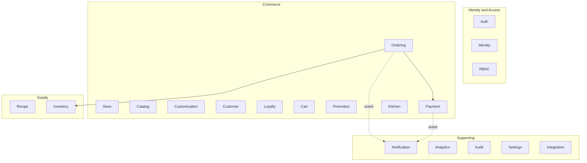
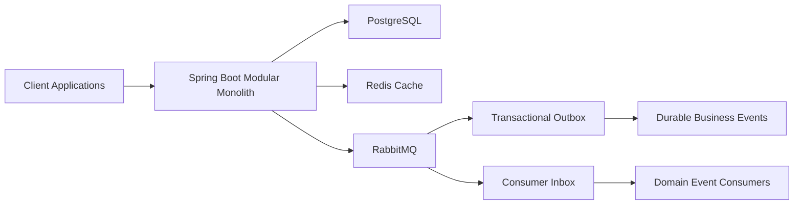
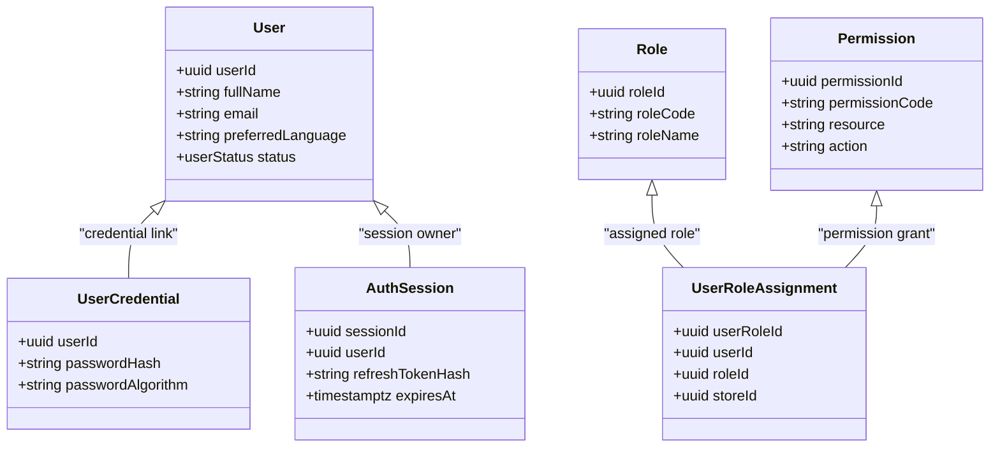
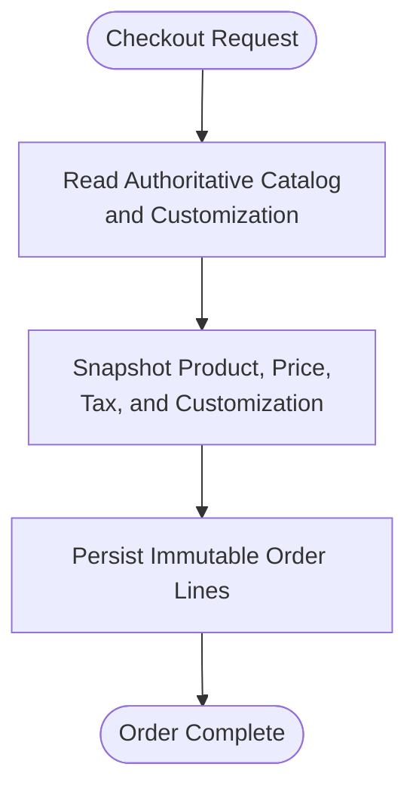
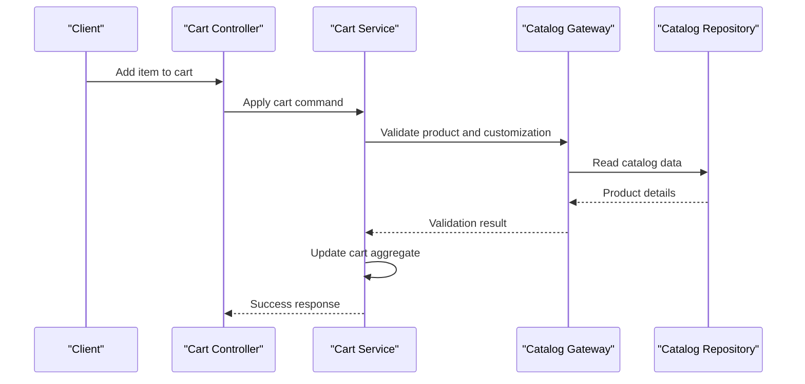
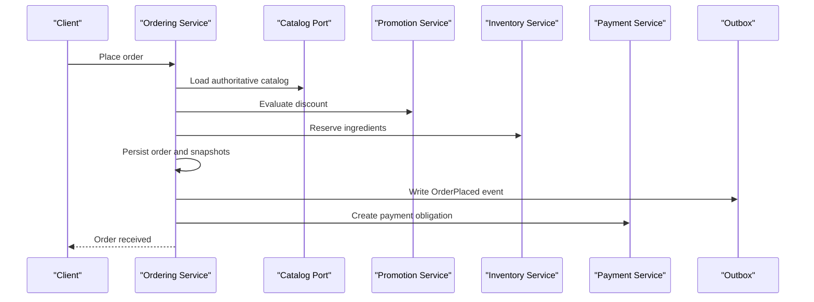
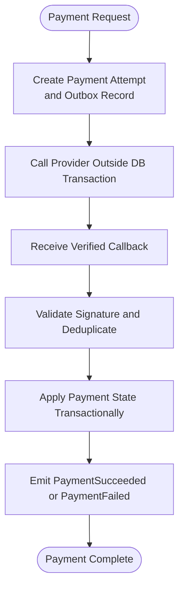
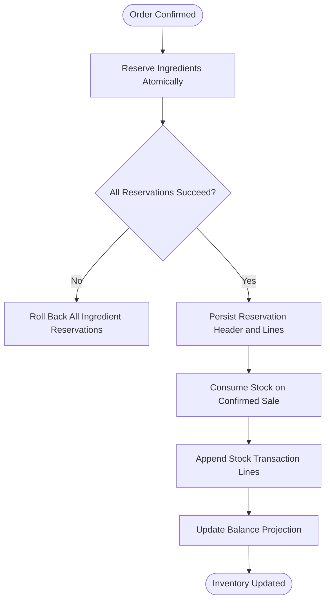
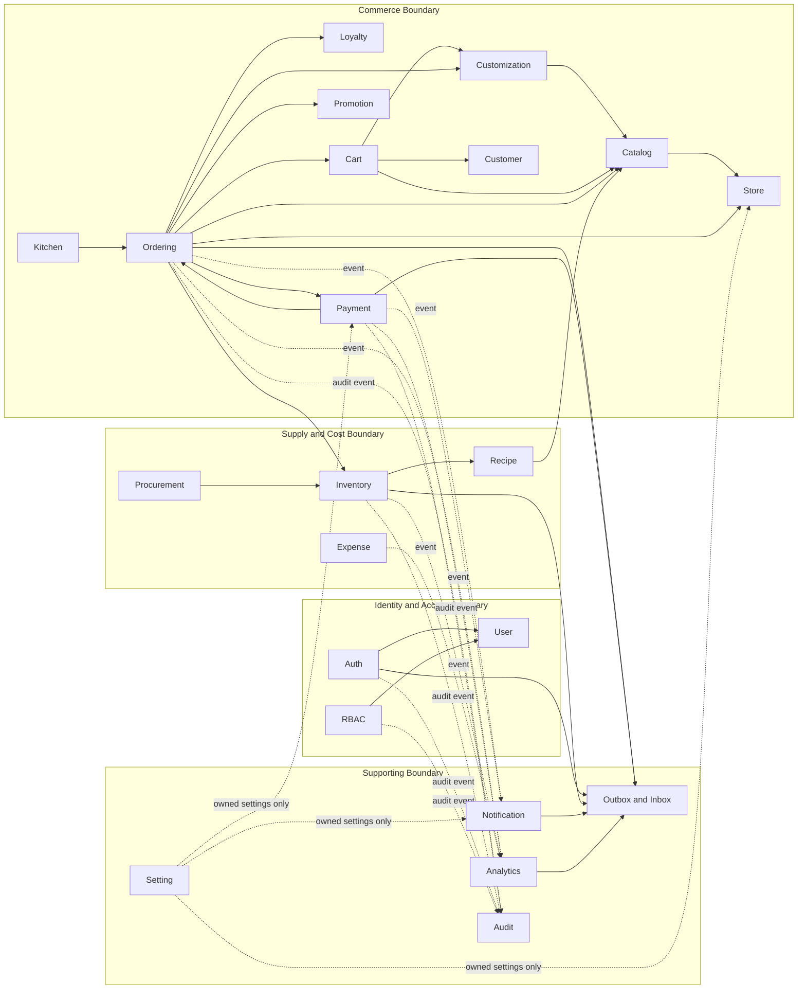

# Module Boundaries & Ownership

<cite>
**Referenced Files in This Document**   
- [ADR-001-modular-monolith.md](file://adr/ADR-001-modular-monolith.md)
- [ADR-002-postgresql-ownership.md](file://adr/ADR-002-postgresql-ownership.md)
- [ADR-003-rabbitmq.md](file://adr/ADR-003-rabbitmq.md)
- [ADR-004-transactional-outbox.md](file://adr/ADR-004-transactional-outbox.md)
- [DB_OWNERSHIP_MATRIX.md](file://database/DB_OWNERSHIP_MATRIX.md)
- [smart-coffee-logical.dbml](file://database/smart-coffee-logical.dbml)
- [MODULE_DEPENDENCIES.mermaid](file://architecture/MODULE_DEPENDENCIES.mermaid)
- [SYSTEM_ARCHITECTURE.md](file://architecture/SYSTEM_ARCHITECTURE.md)
- [CartService.java](file://src/main/java/com/smartcoffee/modules/cart/application/CartService.java)
- [JpaCartCatalogGateway.java](file://src/main/java/com/smartcoffee/modules/cart/application/JpaCartCatalogGateway.java)
- [CurrentCustomerResolver.java](file://src/main/java/com/smartcoffee/modules/cart/application/CurrentCustomerResolver.java)
- [StoreCatalogQueryService.java](file://src/main/java/com/smartcoffee/modules/catalog/application/StoreCatalogQueryService.java)
- [AuthenticationService.java](file://src/main/java/com/smartcoffee/modules/auth/application/AuthenticationService.java)
- [IdempotencyService.java](file://src/main/java/com/smartcoffee/infrastructure/idempotency/IdempotencyService.java)
</cite>

## Table of Contents
1. [Introduction](#introduction)
2. [Project Structure](#project-structure)
3. [Core Components](#core-components)
4. [Architecture Overview](#architecture-overview)
5. [Detailed Component Analysis](#detailed-component-analysis)
6. [Dependency Analysis](#dependency-analysis)
7. [Performance Considerations](#performance-considerations)
8. [Troubleshooting Guide](#troubleshooting-guide)
9. [Conclusion](#conclusion)

## Introduction
This document defines the module boundaries, data ownership rules, and communication patterns for the Smart Coffee Backend. The system is a modular monolith that must remain microservice-ready. Each domain module owns its tables and aggregates, communicates through explicit application interfaces or documented events, and never directly injects another module’s JPA repository.

The goal is to make it clear:
- Which module owns which data.
- Which operations are allowed across module boundaries.
- How synchronous calls, in-process events, and durable events should be used.
- What inter-module anti-patterns must be avoided.

## Project Structure
The backend is organized as a Spring Boot modular monolith with domain modules under `modules`, shared infrastructure under `infrastructure`, configuration under `config`, and API contracts under each module’s `api` package.

**Diagram sources**
- [MODULE_DEPENDENCIES.mermaid:1-93](file://architecture/MODULE_DEPENDENCIES.mermaid#L1-L93)
- [SYSTEM_ARCHITECTURE.md:29-47](file://architecture/SYSTEM_ARCHITECTURE.md#L29-L47)

**Section sources**
- [SYSTEM_ARCHITECTURE.md:15-47](file://architecture/SYSTEM_ARCHITECTURE.md#L15-L47)
- [ADR-001-modular-monolith.md:16-49](file://adr/ADR-001-modular-monolith.md#L16-L49)

## Core Components
The Smart Coffee Backend is divided into clearly owned domains. Each domain has responsibility, data ownership, and interaction rules.

| Domain | Responsibility | Primary Data Ownership | Allowed Cross-Module Interactions |
|---|---|---|---|
| Identity & Access | Users, credentials, sessions, roles, permissions, store-scoped assignments | `identity.users`, `identity.user_credentials`, `identity.auth_sessions`, `identity.roles`, `identity.permissions`, `identity.role_permissions`, `identity.user_roles`, `identity.staff_profiles` | Provides authentication context; enforces store-scoped authorization. Other modules read identity only through authorized queries or claims. |
| Store | Stores and opening hours | `store.stores`, `store.store_opening_hours` | Exposes store availability, timezone, currency policy, and active status. |
| Catalog & Customization | Categories, products, store product availability, effective prices, customization groups and options | `catalog.product_categories`, `catalog.products`, `catalog.store_products`, `catalog.store_product_prices`, `catalog.customization_groups`, `catalog.customization_options`, `catalog.product_customization_groups`, `catalog.product_customization_options` | Serves authoritative catalog data to cart and ordering. |
| Customer & Loyalty | Customer profiles, favorites, consents, loyalty accounts, immutable points ledger | `customer.customer_profiles`, `customer.customer_favorites`, `customer.customer_consents`, `customer.loyalty_accounts`, `customer.loyalty_ledger` | Owns customer identity linkage and loyalty accounting. |
| Cart | Active customer/store carts and cart lines | `cart.carts`, `cart.cart_items`, `cart.cart_item_customizations` | Reads catalog and customization through an interface; does not own pricing authority. |
| Ordering | Orders, order items, snapshots, status history, idempotency results | `ordering.orders`, `ordering.order_items`, `ordering.order_item_customizations`, `ordering.order_status_history` | Coordinates checkout, promotion evaluation, inventory reservation, payment creation, and kitchen notifications. |
| Payment | Payment obligations, attempts, provider callbacks, refunds, reconciliation, receipts | `payment.payment_methods`, `payment.payments`, `payment.payment_attempts`, `payment.payment_provider_callbacks`, `payment.refunds`, `payment.refund_items`, `payment.payment_reconciliations`, `payment.receipts` | Owns payment state and trusted settlement evidence. |
| Promotion | Promotion rules, eligibility, redemption records, usage limits | `promotion.promotions`, `promotion.promotion_products`, `promotion.promotion_categories`, `promotion.promotion_redemptions` | Evaluates discounts transactionally during checkout. |
| Recipe & Inventory | Product recipes, ingredient requirements, balances, reservations, lots, stock ledger | `inventory.units_of_measure`, `inventory.ingredients`, `inventory.recipe_versions`, `inventory.recipe_version_lines`, `inventory.inventory_balances`, `inventory.inventory_reservations`, `inventory.inventory_reservation_lines`, `inventory.ingredient_lots`, `inventory.stock_transactions`, `inventory.stock_transaction_lines` | Owns recipe versions and immutable stock movements. |
| Notification | Notifications, recipients, delivery attempts, device tokens | `notification.notifications`, `notification.user_notifications`, `notification.notification_delivery_attempts`, `notification.device_tokens` | Consumes business events and delivers messages without rolling back operational transactions. |
| Analytics | Reporting projections | Downstream projections only | Reads from events or replicated read models; never updates operational records. |
| Audit | Append-only security and business audit records | `audit.audit_logs` | Observes critical operations; ordinary code cannot delete audit history. |
| Settings | Scoped system settings | `setting.system_settings` | Owns settings by module scope; other modules read their owned settings. |

**Section sources**
- [DB_OWNERSHIP_MATRIX.md:16-102](file://database/DB_OWNERSHIP_MATRIX.md#L16-L102)
- [smart-coffee-logical.dbml:28-825](file://database/smart-coffee-logical.dbml#L28-L825)
- [SYSTEM_ARCHITECTURE.md:136-196](file://architecture/SYSTEM_ARCHITECTURE.md#L136-L196)

## Architecture Overview
The architecture follows a modular monolith first approach. Modules communicate synchronously when immediate decisions are required, use Spring application events for non-critical in-process reactions, and use RabbitMQ with a transactional outbox and consumer inbox for durable cross-module workflows.

**Diagram sources**
- [SYSTEM_ARCHITECTURE.md:88-132](file://architecture/SYSTEM_ARCHITECTURE.md#L88-L132)
- [ADR-003-rabbitmq.md:14-21](file://adr/ADR-003-rabbitmq.md#L14-L21)
- [ADR-004-transactional-outbox.md:14-20](file://adr/ADR-004-transactional-outbox.md#L14-L20)

### Communication Rules Summary
| Communication Type | When to Use | Example |
|---|---|---|
| Synchronous application call | Immediate decision needed inside one process | Checkout reads authoritative catalog data; ordering requests inventory reservation. |
| In-process Spring event | Non-critical reaction within one process | Internal logging, optional cache invalidation. |
| Durable event via outbox | Work must survive process failure or cross deployable boundaries | Order placed, payment succeeded, inventory reserved, notification requested. |

**Section sources**
- [SYSTEM_ARCHITECTURE.md:198-229](file://architecture/SYSTEM_ARCHITECTURE.md#L198-L229)
- [ADR-001-modular-monolith.md:49-91](file://adr/ADR-001-modular-monolith.md#L49-L91)
- [ADR-003-rabbitmq.md:63-85](file://adr/ADR-003-rabbitmq.md#L63-L85)
- [ADR-004-transactional-outbox.md:49-70](file://adr/ADR-004-transactional-outbox.md#L49-L70)

## Detailed Component Analysis

### Identity & Access Module
**Responsibility:** Authentication, authorization, user lifecycle, role and permission management, and store-scoped access control.

**Data ownership:**
- `identity.users`
- `identity.user_credentials`
- `identity.auth_sessions`
- `identity.roles`
- `identity.permissions`
- `identity.role_permissions`
- `identity.user_roles`
- `identity.staff_profiles`

**Allowed interactions:**
- Other modules may read authenticated actor context and store-scoped roles.
- Identity must not own orders, payments, inventory, or store master data.
- After extraction, `store_id` becomes a logical external reference.

**Anti-patterns:**
- Do not let other modules write users or credentials.
- Do not bypass RBAC checks in downstream modules.
- Do not treat client-supplied roles or store IDs as authoritative.

**Diagram sources**
- [smart-coffee-logical.dbml:28-134](file://database/smart-coffee-logical.dbml#L28-L134)

**Section sources**
- [DB_OWNERSHIP_MATRIX.md:18-30](file://database/DB_OWNERSHIP_MATRIX.md#L18-L30)
- [SYSTEM_ARCHITECTURE.md:138-146](file://architecture/SYSTEM_ARCHITECTURE.md#L138-L146)
- [ADR-002-postgresql-ownership.md:18-49](file://adr/ADR-002-postgresql-ownership.md#L18-L49)

### Store Module
**Responsibility:** Store master data, opening hours, timezone, currency policy, and operational availability.

**Data ownership:**
- `store.stores`
- `store.store_opening_hours`

**Allowed interactions:**
- Catalog, cart, ordering, inventory, and production depend on store context.
- Store itself should not own catalog pricing or order state.

**Anti-patterns:**
- Do not allow store changes to silently alter historical order totals.
- Do not let clients set store context without server-side authorization.

**Section sources**
- [DB_OWNERSHIP_MATRIX.md:18-21](file://database/DB_OWNERSHIP_MATRIX.md#L18-L21)
- [smart-coffee-logical.dbml:136-161](file://database/smart-coffee-logical.dbml#L136-L161)
- [SYSTEM_ARCHITECTURE.md:144-146](file://architecture/SYSTEM_ARCHITECTURE.md#L144-L146)

### Catalog & Customization Module
**Responsibility:** Categories, products, store-specific product availability, effective-dated store pricing, customization groups, and customization options.

**Data ownership:**
- `catalog.product_categories`
- `catalog.products`
- `catalog.store_products`
- `catalog.store_product_prices`
- `catalog.customization_groups`
- `catalog.customization_options`
- `catalog.product_customization_groups`
- `catalog.product_customization_options`

**Allowed interactions:**
- Cart and ordering read authoritative catalog data.
- Customization depends on catalog.
- Recipe references products but does not own catalog pricing.

**Anti-patterns:**
- Do not let cart or ordering trust client-provided prices.
- Do not mutate catalog data from ordering or payment flows.

**Diagram sources**
- [SYSTEM_ARCHITECTURE.md:232-250](file://architecture/SYSTEM_ARCHITECTURE.md#L232-L250)
- [smart-coffee-logical.dbml:212-309](file://database/smart-coffee-logical.dbml#L212-L309)

**Section sources**
- [DB_OWNERSHIP_MATRIX.md:31-37](file://database/DB_OWNERSHIP_MATRIX.md#L31-L37)
- [smart-coffee-logical.dbml:212-309](file://database/smart-coffee-logical.dbml#L212-L309)
- [SYSTEM_ARCHITECTURE.md:148-153](file://architecture/SYSTEM_ARCHITECTURE.md#L148-L153)

### Customer & Loyalty Module
**Responsibility:** Customer profile, consent, favorites, loyalty account, and immutable points ledger.

**Data ownership:**
- `customer.customer_profiles`
- `customer.customer_favorites`
- `customer.customer_consents`
- `customer.loyalty_accounts`
- `customer.loyalty_ledger`

**Allowed interactions:**
- Ordering may earn or redeem loyalty points through a controlled service.
- Customer module owns point movement; balance cache is derived.

**Anti-patterns:**
- Do not update loyalty balance directly without ledger entries.
- Do not allow duplicate point postings without idempotency keys.

**Section sources**
- [DB_OWNERSHIP_MATRIX.md:29-30](file://database/DB_OWNERSHIP_MATRIX.md#L29-L30)
- [DB_OWNERSHIP_MATRIX.md:85-86](file://database/DB_OWNERSHIP_MATRIX.md#L85-L86)
- [smart-coffee-logical.dbml:163-210](file://database/smart-coffee-logical.dbml#L163-L210)
- [SYSTEM_ARCHITECTURE.md:154-156](file://architecture/SYSTEM_ARCHITECTURE.md#L154-L156)

### Cart Module
**Responsibility:** Active customer/store carts and cart lines. Cart values are estimates; checkout recalculates authoritatively.

**Data ownership:**
- `cart.carts`
- `cart.cart_items`
- `cart.cart_item_customizations`

**Allowed interactions:**
- Reads catalog and customization through an application interface.
- Does not own pricing authority.

**Anti-patterns:**
- Do not persist final order totals in cart.
- Do not bypass catalog validation when adding items.

**Diagram sources**
- [CartService.java:23-23](file://src/main/java/com/smartcoffee/modules/cart/application/CartService.java#L23-L23)
- [JpaCartCatalogGateway.java:10-11](file://src/main/java/com/smartcoffee/modules/cart/application/JpaCartCatalogGateway.java#L10-L11)

**Section sources**
- [DB_OWNERSHIP_MATRIX.md:41-43](file://database/DB_OWNERSHIP_MATRIX.md#L41-L43)
- [smart-coffee-logical.dbml:351-384](file://database/smart-coffee-logical.dbml#L351-L384)
- [SYSTEM_ARCHITECTURE.md:158-162](file://architecture/SYSTEM_ARCHITECTURE.md#L158-L162)

### Ordering Module
**Responsibility:** Order lifecycle, order line snapshots, status history, and checkout coordination.

**Data ownership:**
- `ordering.orders`
- `ordering.order_items`
- `ordering.order_item_customizations`
- `ordering.order_status_history`

**Allowed interactions:**
- Synchronously validates store, catalog, customization, promotion, and inventory.
- Creates payment obligation.
- Emits durable events after successful persistence.

**Anti-patterns:**
- Do not accept client price totals.
- Do not mark external payments successful without trusted evidence.
- Do not perform external payment calls while holding the order database transaction open.

**Diagram sources**
- [SYSTEM_ARCHITECTURE.md:232-250](file://architecture/SYSTEM_ARCHITECTURE.md#L232-L250)
- [DB_OWNERSHIP_MATRIX.md:44-47](file://database/DB_OWNERSHIP_MATRIX.md#L44-L47)

**Section sources**
- [DB_OWNERSHIP_MATRIX.md:44-47](file://database/DB_OWNERSHIP_MATRIX.md#L44-L47)
- [smart-coffee-logical.dbml:386-458](file://database/smart-coffee-logical.dbml#L386-L458)
- [SYSTEM_ARCHITECTURE.md:164-168](file://architecture/SYSTEM_ARCHITECTURE.md#L164-L168)

### Payment Module
**Responsibility:** Payment aggregates, attempts, provider callbacks, refunds, reconciliation, and receipts.

**Data ownership:**
- `payment.payment_methods`
- `payment.payments`
- `payment.payment_attempts`
- `payment.payment_provider_callbacks`
- `payment.refunds`
- `payment.refund_items`
- `payment.payment_reconciliations`
- `payment.receipts`

**Allowed interactions:**
- Queries order balance through an interface.
- Accepts trusted cash acceptance or verified provider evidence.
- Emits durable payment events.

**Anti-patterns:**
- Do not let ordering decide payment success.
- Do not retry non-idempotent provider operations blindly.
- Do not expose raw secrets or unnecessary PII in event payloads.

**Diagram sources**
- [SYSTEM_ARCHITECTURE.md:252-254](file://architecture/SYSTEM_ARCHITECTURE.md#L252-L254)
- [ADR-004-transactional-outbox.md:49-70](file://adr/ADR-004-transactional-outbox.md#L49-L70)

**Section sources**
- [DB_OWNERSHIP_MATRIX.md:48-50](file://database/DB_OWNERSHIP_MATRIX.md#L48-L50)
- [DB_OWNERSHIP_MATRIX.md:76-80](file://database/DB_OWNERSHIP_MATRIX.md#L76-L80)
- [smart-coffee-logical.dbml:460-567](file://database/smart-coffee-logical.dbml#L460-L567)
- [SYSTEM_ARCHITECTURE.md:170-174](file://architecture/SYSTEM_ARCHITECTURE.md#L170-L174)

### Promotion Module
**Responsibility:** Promotion rules, eligibility, redemption records, and usage limits.

**Data ownership:**
- `promotion.promotions`
- `promotion.promotion_products`
- `promotion.promotion_categories`
- `promotion.promotion_redemptions`

**Allowed interactions:**
- Evaluation during checkout.
- Redemption reservation applied transactionally.

**Anti-patterns:**
- Do not apply discounts without transactional redemption records.
- Do not allow multiple redemptions for the same order without idempotency.

**Section sources**
- [DB_OWNERSHIP_MATRIX.md:38-40](file://database/DB_OWNERSHIP_MATRIX.md#L38-L40)
- [DB_OWNERSHIP_MATRIX.md:84-84](file://database/DB_OWNERSHIP_MATRIX.md#L84-L84)
- [smart-coffee-logical.dbml:311-349](file://database/smart-coffee-logical.dbml#L311-L349)
- [SYSTEM_ARCHITECTURE.md:176-178](file://architecture/SYSTEM_ARCHITECTURE.md#L176-L178)

### Recipe & Inventory Module
**Responsibility:** Product-to-ingredient requirements, versioned recipes, current balances, reservations, lots, and immutable stock movements.

**Data ownership:**
- `inventory.units_of_measure`
- `inventory.ingredients`
- `inventory.recipe_versions`
- `inventory.recipe_version_lines`
- `inventory.inventory_balances`
- `inventory.inventory_reservations`
- `inventory.inventory_reservation_lines`
- `inventory.ingredient_lots`
- `inventory.stock_transactions`
- `inventory.stock_transaction_lines`

**Allowed interactions:**
- Ordering reserves ingredients atomically.
- Consumption occurs after confirmed order flow.
- Balance is a projection; ledger is authoritative.

**Anti-patterns:**
- Do not decrement balance without stock transaction lines.
- Do not allow partial reservations for an order.
- Do not treat balance as immutable history.

**Diagram sources**
- [SYSTEM_ARCHITECTURE.md:256-258](file://architecture/SYSTEM_ARCHITECTURE.md#L256-L258)
- [smart-coffee-logical.dbml:569-677](file://database/smart-coffee-logical.dbml#L569-L677)

**Section sources**
- [DB_OWNERSHIP_MATRIX.md:51-56](file://database/DB_OWNERSHIP_MATRIX.md#L51-L56)
- [DB_OWNERSHIP_MATRIX.md:81-83](file://database/DB_OWNERSHIP_MATRIX.md#L81-L83)
- [smart-coffee-logical.dbml:569-677](file://database/smart-coffee-logical.dbml#L569-L677)
- [SYSTEM_ARCHITECTURE.md:180-182](file://architecture/SYSTEM_ARCHITECTURE.md#L180-L182)

### Notification Module
**Responsibility:** Notification requests, recipients, delivery attempts, device tokens, and retry state.

**Data ownership:**
- `notification.notifications`
- `notification.user_notifications`
- `notification.notification_delivery_attempts`
- `notification.device_tokens`

**Allowed interactions:**
- Consumes durable events such as order and payment events.
- Delivery failures must not roll back operational transactions.

**Anti-patterns:**
- Do not block order placement on notification delivery.
- Do not retry permanent business failures.
- Do not store sensitive payloads unnecessarily.

**Section sources**
- [DB_OWNERSHIP_MATRIX.md:62-64](file://database/DB_OWNERSHIP_MATRIX.md#L62-L64)
- [DB_OWNERSHIP_MATRIX.md:87-87](file://database/DB_OWNERSHIP_MATRIX.md#L87-L87)
- [smart-coffee-logical.dbml:708-756](file://database/smart-coffee-logical.dbml#L708-L756)
- [SYSTEM_ARCHITECTURE.md:184-186](file://architecture/SYSTEM_ARCHITECTURE.md#L184-L186)

### Analytics Module
**Responsibility:** Reporting projections built from events or replicated read models.

**Data ownership:**
- Downstream projections only.

**Allowed interactions:**
- Reads events and operational data through approved read paths.

**Anti-patterns:**
- Never update operational records from analytics.
- Never treat dashboards as source of truth.

**Section sources**
- [SYSTEM_ARCHITECTURE.md:188-190](file://architecture/SYSTEM_ARCHITECTURE.md#L188-L190)
- [DB_OWNERSHIP_MATRIX.md:14](file://database/DB_OWNERSHIP_MATRIX.md#L14)

### Audit Module
**Responsibility:** Append-only security and business audit records.

**Data ownership:**
- `audit.audit_logs`

**Allowed interactions:**
- Observes authentication, ordering, payment, inventory, and RBAC actions.
- Ordinary application code cannot update or delete audit history.

**Anti-patterns:**
- Do not silence audit failures at the cost of missing compliance records.
- Do not allow normal writes to modify audit rows.

**Section sources**
- [DB_OWNERSHIP_MATRIX.md:61-61](file://database/DB_OWNERSHIP_MATRIX.md#L61-L61)
- [smart-coffee-logical.dbml:772-787](file://database/smart-coffee-logical.dbml#L772-L787)
- [SYSTEM_ARCHITECTURE.md:192-194](file://architecture/SYSTEM_ARCHITECTURE.md#L192-L194)

### Settings Module
**Responsibility:** Scoped system settings by owner module.

**Data ownership:**
- `setting.system_settings`

**Allowed interactions:**
- Each owning module manages its own settings namespace.
- Other modules read only what they are authorized to access.

**Anti-patterns:**
- Do not allow arbitrary modules to overwrite another module’s settings.
- Do not store secrets in plain editable settings.

**Section sources**
- [DB_OWNERSHIP_MATRIX.md:59-59](file://database/DB_OWNERSHIP_MATRIX.md#L59-L59)
- [smart-coffee-logical.dbml:758-770](file://database/smart-coffee-logical.dbml#L758-L770)

## Dependency Analysis
The dependency diagram shows synchronous application dependencies as solid arrows and event-driven dependencies as dashed arrows. It also emphasizes that no module may inject another module’s JPA repository.

**Diagram sources**
- [MODULE_DEPENDENCIES.mermaid:1-93](file://architecture/MODULE_DEPENDENCIES.mermaid#L1-L93)

### Proper Inter-Module Communication Examples
| Scenario | Correct Pattern | Why |
|---|---|---|
| Cart validates product | Cart calls catalog query port | Keeps catalog ownership and pricing authority centralized. |
| Checkout reserves stock | Ordering calls inventory reservation service | Ensures all ingredient reservations succeed or fail together. |
| Order completion notifies users | Ordering emits durable event | Survives process failure and avoids blocking the caller. |
| Payment settles order | Payment consumes trusted callback and updates payment aggregate | Prevents untrusted clients from marking payments successful. |

### Anti-Patterns to Avoid
| Anti-Pattern | Problem | Correct Alternative |
|---|---|---|
| Injecting another module’s JPA repository | Breaks module ownership and makes extraction hard | Use an application interface or port. |
| Direct table joins across modules | Couples deployment and prevents service extraction | Use APIs or events. |
| Trusting client prices or totals | Allows tampering | Recalculate server-authoritatively. |
| Publishing RabbitMQ events directly from controllers | Risks inconsistent state if business transaction rolls back | Write to transactional outbox. |
| Acknowledging events before committing business effects | Can lose work on failure | Commit first, then acknowledge. |
| Deleting historical order, payment, stock, loyalty, or audit records | Violates immutability and compliance | Use append-only ledgers and soft state transitions. |

**Section sources**
- [ADR-001-modular-monolith.md:49-91](file://adr/ADR-001-modular-monolith.md#L49-L91)
- [SYSTEM_ARCHITECTURE.md:198-229](file://architecture/SYSTEM_ARCHITECTURE.md#L198-L229)
- [ADR-004-transactional-outbox.md:105-112](file://adr/ADR-004-transactional-outbox.md#L105-L112)

## Performance Considerations
- Keep long-running external calls outside database transactions.
- Use bounded pagination for background jobs such as cart expiration and outbox publishing.
- Prefer append-only ledgers for high-volume history.
- Use Redis only for bounded caches, rate limiting, and short-lived coordination.
- Monitor outbox age, consumer inbox duplicates, dead-letter queues, and oldest-message age.
- Design consumers to tolerate duplicates and delayed events.

[No sources needed since this section provides general guidance]

## Troubleshooting Guide
Common boundary-related issues and how to resolve them:

| Symptom | Likely Cause | Resolution |
|---|---|---|
| Another module can change my data | Direct repository injection or shared entity misuse | Replace direct repository access with an application interface. |
| Events are lost after restart | Not using transactional outbox | Write events to outbox inside the same transaction as business state. |
| Duplicate processing | At-least-once delivery without deduplication | Use consumer inbox with `(consumer_name, event_id)` uniqueness. |
| Order created but notification never sent | Notification failure rolled back order | Move notification delivery to asynchronous durable workflow. |
| Payment marked paid by client | Untrusted client input accepted | Require trusted cash acceptance or verified provider callback. |
| Inventory balance inconsistent | Balance updated without ledger | Ensure all changes go through stock transaction lines. |
| Audit record missing | Audit failure ignored or suppressed | Treat audit writes as important side effects; do not swallow errors silently. |

**Section sources**
- [ADR-003-rabbitmq.md:63-85](file://adr/ADR-003-rabbitmq.md#L63-L85)
- [ADR-004-transactional-outbox.md:89-112](file://adr/ADR-004-transactional-outbox.md#L89-L112)
- [SYSTEM_ARCHITECTURE.md:232-289](file://architecture/SYSTEM_ARCHITECTURE.md#L232-L289)

## Conclusion
Smart Coffee Backend’s module boundaries are defined by clear data ownership, strict communication rules, and durable event handling. During the modular monolith phase, local PostgreSQL transactions protect correctness. Across module boundaries, synchronous application interfaces handle immediate decisions, while durable events through transactional outbox and consumer inbox handle eventual consistency.

The most important rule remains: every table has exactly one write-owning module, and no module may inject another module’s JPA repository. This design keeps the system maintainable now and ready for future microservice extraction.

[No sources needed since this section summarizes without analyzing specific files]