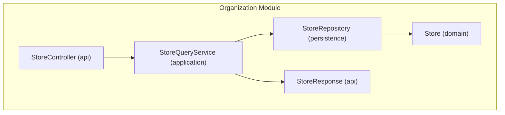
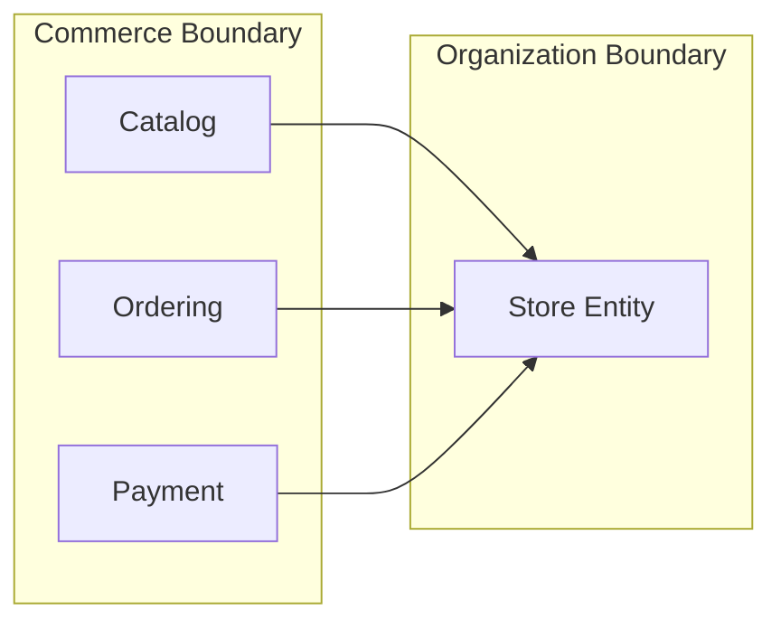
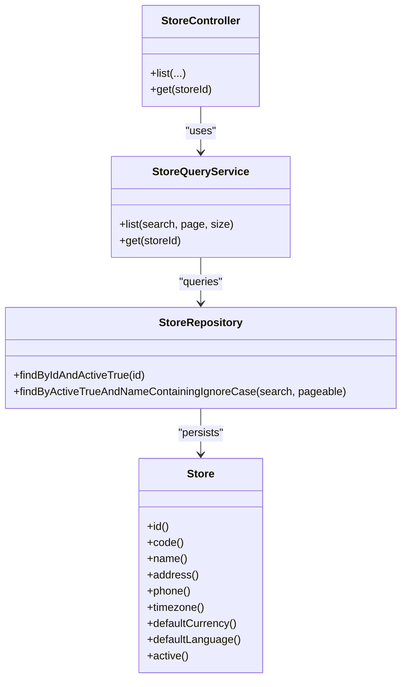
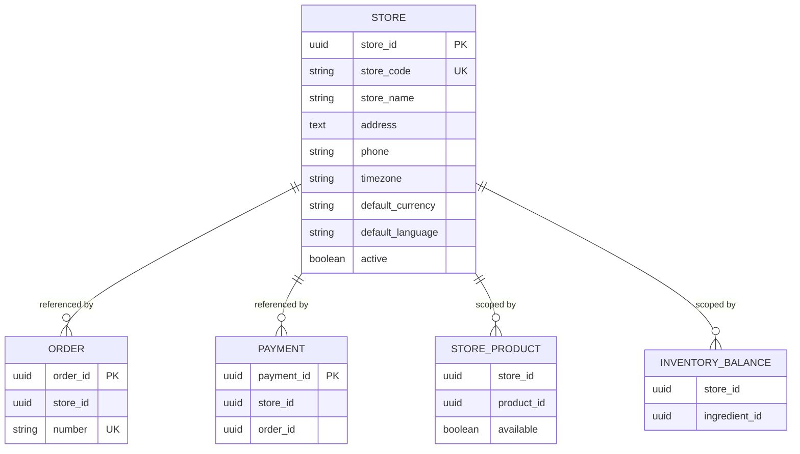
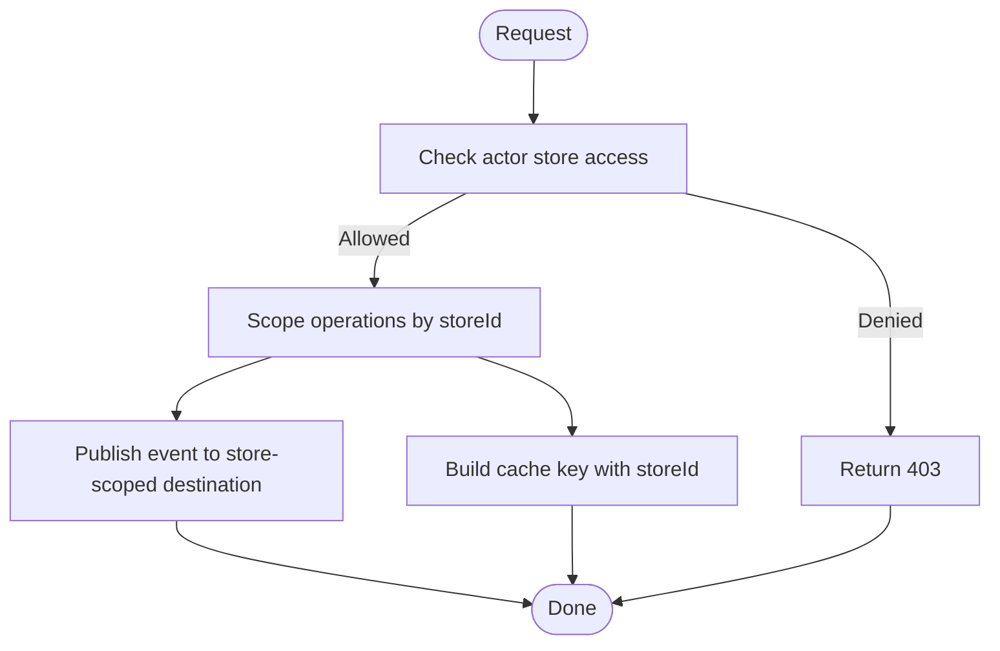
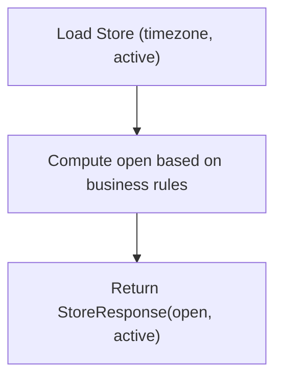
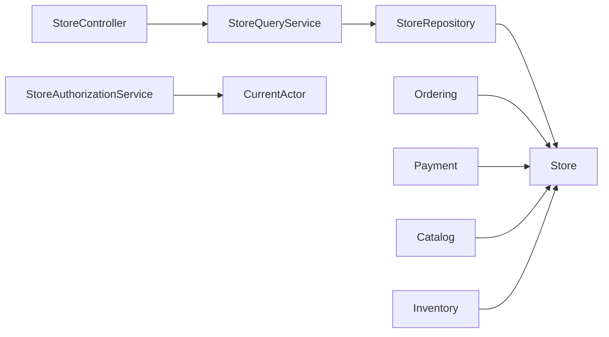

# Store & Organization Module

<cite>
**Referenced Files in This Document**
- [Store.java](file://src/main/java/com/smartcoffee/modules/organization/domain/Store.java)
- [StoreRepository.java](file://src/main/java/com/smartcoffee/modules/organization/persistence/StoreRepository.java)
- [StoreQueryService.java](file://src/main/java/com/smartcoffee/modules/organization/application/StoreQueryService.java)
- [StoreController.java](file://src/main/java/com/smartcoffee/modules/organization/api/StoreController.java)
- [StoreResponse.java](file://src/main/java/com/smartcoffee/modules/organization/api/StoreResponse.java)
- [V002__organization_customer_and_role_seed.sql](file://src/main/resources/db/migration/V002__organization_customer_and_role_seed.sql)
- [MODULE_DEPENDENCIES.mermaid](file://architecture/MODULE_DEPENDENCIES.mermaid)
- [CurrentActor.java](file://src/main/java/com/smartcoffee/common/security/CurrentActor.java)
- [CurrentActorProvider.java](file://src/main/java/com/smartcoffee/common/security/CurrentActorProvider.java)
- [StoreAuthorizationService.java](file://src/main/java/com/smartcoffee/common/security/StoreAuthorizationService.java)
- [Order.java](file://src/main/java/com/smartcoffee/modules/ordering/domain/Order.java)
- [Payment.java](file://src/main/java/com/smartcoffee/modules/payment/domain/Payment.java)
- [StoreProduct.java](file://src/main/java/com/smartcoffee/modules/catalog/domain/StoreProduct.java)
- [StoreProductId.java](file://src/main/java/com/smartcoffee/modules/catalog/domain/StoreProductId.java)
- [InventoryBalanceId.java](file://src/main/java/com/smartcoffee/modules/inventory/domain/InventoryBalanceId.java)
- [RealtimeDestinationResolver.java](file://src/main/java/com/smartcoffee/infrastructure/realtime/RealtimeDestinationResolver.java)
- [WebSocketRealtimePublisher.java](file://src/main/java/com/smartcoffee/infrastructure/realtime/WebSocketRealtimePublisher.java)
- [CacheKeyFactory.java](file://src/main/java/com/smartcoffee/infrastructure/cache/CacheKeyFactory.java)
</cite>

## Table of Contents
1. [Introduction](#introduction)
2. [Project Structure](#project-structure)
3. [Core Components](#core-components)
4. [Architecture Overview](#architecture-overview)
5. [Detailed Component Analysis](#detailed-component-analysis)
6. [Dependency Analysis](#dependency-analysis)
7. [Performance Considerations](#performance-considerations)
8. [Troubleshooting Guide](#troubleshooting-guide)
9. [Conclusion](#conclusion)

## Introduction
This document defines the boundaries and ownership of the Store & Organization module. It explains how the module owns store master data, including timezone, default currency policy, active status, and operational availability signals. It also documents how other modules reference stores as logical external references (store identifiers) rather than direct foreign keys, enabling multi-store isolation and context propagation across the application.

## Project Structure
The Store & Organization module is organized by layered concerns:
- Domain: core entity representing a store with its attributes.
- Persistence: repository interface for querying stores.
- Application: read-only service exposing store listing and retrieval.
- API: REST controller exposing store endpoints.



**Diagram sources**
- [Store.java:7-46](file://src/main/java/com/smartcoffee/modules/organization/domain/Store.java#L7-L46)
- [StoreRepository.java:10-13](file://src/main/java/com/smartcoffee/modules/organization/persistence/StoreRepository.java#L10-L13)
- [StoreQueryService.java:14-37](file://src/main/java/com/smartcoffee/modules/organization/application/StoreQueryService.java#L14-L37)
- [StoreController.java:11-31](file://src/main/java/com/smartcoffee/modules/organization/api/StoreController.java#L11-L31)
- [StoreResponse.java:5-15](file://src/main/java/com/smartcoffee/modules/organization/api/StoreResponse.java#L5-L15)

**Section sources**
- [Store.java:7-46](file://src/main/java/com/smartcoffee/modules/organization/domain/Store.java#L7-L46)
- [StoreRepository.java:10-13](file://src/main/java/com/smartcoffee/modules/organization/persistence/StoreRepository.java#L10-L13)
- [StoreQueryService.java:14-37](file://src/main/java/com/smartcoffee/modules/organization/application/StoreQueryService.java#L14-L37)
- [StoreController.java:11-31](file://src/main/java/com/smartcoffee/modules/organization/api/StoreController.java#L11-L31)
- [StoreResponse.java:5-15](file://src/main/java/com/smartcoffee/modules/organization/api/StoreResponse.java#L5-L15)

## Core Components
- Store domain entity:
  - Owns store identity, code, name, address, phone, timezone, default currency, default language, active flag, audit timestamps, and optimistic version.
  - Timezone and default currency are part of the store’s configuration and define per-store operational context.
- Repository:
  - Provides safe access to active stores only via dedicated queries.
- Query service:
  - Encapsulates list and get operations, enforcing pagination safety and returning a response DTO that includes an open flag alongside active status.
- Controller:
  - Exposes paginated listing and single-store retrieval, wrapping results in a standard API envelope.

Operational availability:
- Active status indicates whether a store is enabled.
- The response exposes an open flag; this can be used by consumers to determine if a store is operationally available at request time. Opening hours logic is not implemented here but can be integrated using the store’s timezone and business rules.

**Section sources**
- [Store.java:7-46](file://src/main/java/com/smartcoffee/modules/organization/domain/Store.java#L7-L46)
- [StoreRepository.java:10-13](file://src/main/java/com/smartcoffee/modules/organization/persistence/StoreRepository.java#L10-L13)
- [StoreQueryService.java:20-37](file://src/main/java/com/smartcoffee/modules/organization/application/StoreQueryService.java#L20-L37)
- [StoreController.java:17-31](file://src/main/java/com/smartcoffee/modules/organization/api/StoreController.java#L17-L31)
- [StoreResponse.java:5-15](file://src/main/java/com/smartcoffee/modules/organization/api/StoreResponse.java#L5-L15)

## Architecture Overview
The Store & Organization module is owned by the organization boundary and referenced by commerce and supply modules through logical store identifiers. Other modules do not hold direct foreign-key relationships to the organization schema; instead, they carry storeId fields and enforce authorization against the current actor’s allowed stores.



**Diagram sources**
- [MODULE_DEPENDENCIES.mermaid:10-35](file://architecture/MODULE_DEPENDENCIES.mermaid#L10-L35)
- [Store.java:7-46](file://src/main/java/com/smartcoffee/modules/organization/domain/Store.java#L7-L46)

## Detailed Component Analysis

### Store Ownership Model
- Attributes:
  - Timezone: per-store timezone for localizing time-based operations.
  - Default currency: per-store currency policy for pricing and totals.
  - Active: enables or disables the store globally.
  - Open flag: exposed via response to indicate operational availability.
- Data isolation:
  - All cross-module references use UUID store identifiers.
  - Authorization enforces that the current actor can access the requested store.



**Diagram sources**
- [Store.java:7-46](file://src/main/java/com/smartcoffee/modules/organization/domain/Store.java#L7-L46)
- [StoreRepository.java:10-13](file://src/main/java/com/smartcoffee/modules/organization/persistence/StoreRepository.java#L10-L13)
- [StoreQueryService.java:14-37](file://src/main/java/com/smartcoffee/modules/organization/application/StoreQueryService.java#L14-L37)
- [StoreController.java:11-31](file://src/main/java/com/smartcoffee/modules/organization/api/StoreController.java#L11-L31)

**Section sources**
- [Store.java:7-46](file://src/main/java/com/smartcoffee/modules/organization/domain/Store.java#L7-L46)
- [StoreRepository.java:10-13](file://src/main/java/com/smartcoffee/modules/organization/persistence/StoreRepository.java#L10-L13)
- [StoreQueryService.java:14-37](file://src/main/java/com/smartcoffee/modules/organization/application/StoreQueryService.java#L14-L37)
- [StoreController.java:11-31](file://src/main/java/com/smartcoffee/modules/organization/api/StoreController.java#L11-L31)

### Multi-Store Context Flow
- Current actor carries allowed store IDs and global access flags.
- Store authorization service validates that the actor can access the requested store.
- Real-time destinations and cache keys include store scope to isolate events and cached data per store.

```mermaid
sequenceDiagram
participant Client as "Client"
participant API as "StoreController"
participant Service as "StoreQueryService"
participant Repo as "StoreRepository"
participant Auth as "StoreAuthorizationService"
participant Actor as "CurrentActor"
Client->>API : GET /api/v1/stores/{storeId}
API->>Auth : requireStore(actor, storeId)
Auth->>Actor : canAccessStore(storeId)
Actor-->>Auth : true/false
alt Access denied
Auth-->>API : ForbiddenException
API-->>Client : 403
else Authorized
API->>Service : get(storeId)
Service->>Repo : findByIdAndActiveTrue(storeId)
Repo-->>Service : Store or empty
Service-->>API : StoreResponse
API-->>Client : 200 StoreResponse
end
```

**Diagram sources**
- [StoreController.java:28-31](file://src/main/java/com/smartcoffee/modules/organization/api/StoreController.java#L28-L31)
- [StoreAuthorizationService.java:8-12](file://src/main/java/com/smartcoffee/common/security/StoreAuthorizationService.java#L8-L12)
- [CurrentActor.java:6-14](file://src/main/java/com/smartcoffee/common/security/CurrentActor.java#L6-L14)
- [StoreQueryService.java:28-32](file://src/main/java/com/smartcoffee/modules/organization/application/StoreQueryService.java#L28-L32)
- [StoreRepository.java:10-13](file://src/main/java/com/smartcoffee/modules/organization/persistence/StoreRepository.java#L10-L13)

**Section sources**
- [CurrentActor.java:6-14](file://src/main/java/com/smartcoffee/common/security/CurrentActor.java#L6-L14)
- [StoreAuthorizationService.java:8-12](file://src/main/java/com/smartcoffee/common/security/StoreAuthorizationService.java#L8-L12)
- [StoreController.java:28-31](file://src/main/java/com/smartcoffee/modules/organization/api/StoreController.java#L28-L31)
- [StoreQueryService.java:28-32](file://src/main/java/com/smartcoffee/modules/organization/application/StoreQueryService.java#L28-L32)
- [StoreRepository.java:10-13](file://src/main/java/com/smartcoffee/modules/organization/persistence/StoreRepository.java#L10-L13)

### Logical External References (No Direct Foreign Keys)
Other modules reference stores via UUID fields and embed storeId into composite keys where needed:
- Ordering: Order.storeId and Payment.storeId.
- Catalog: StoreProduct uses StoreProductId composite key containing storeId.
- Inventory: InventoryBalanceId composite key contains storeId.



**Diagram sources**
- [Store.java:7-46](file://src/main/java/com/smartcoffee/modules/organization/domain/Store.java#L7-L46)
- [Order.java:17-18](file://src/main/java/com/smartcoffee/modules/ordering/domain/Order.java#L17-L18)
- [Payment.java:19-20](file://src/main/java/com/smartcoffee/modules/payment/domain/Payment.java#L19-L20)
- [StoreProduct.java:11-12](file://src/main/java/com/smartcoffee/modules/catalog/domain/StoreProduct.java#L11-L12)
- [StoreProductId.java:7-13](file://src/main/java/com/smartcoffee/modules/catalog/domain/StoreProductId.java#L7-L13)
- [InventoryBalanceId.java:7-9](file://src/main/java/com/smartcoffee/modules/inventory/domain/InventoryBalanceId.java#L7-L9)

**Section sources**
- [Order.java:17-18](file://src/main/java/com/smartcoffee/modules/ordering/domain/Order.java#L17-L18)
- [Payment.java:19-20](file://src/main/java/com/smartcoffee/modules/payment/domain/Payment.java#L19-L20)
- [StoreProduct.java:11-12](file://src/main/java/com/smartcoffee/modules/catalog/domain/StoreProduct.java#L11-L12)
- [StoreProductId.java:7-13](file://src/main/java/com/smartcoffee/modules/catalog/domain/StoreProductId.java#L7-L13)
- [InventoryBalanceId.java:7-9](file://src/main/java/com/smartcoffee/modules/inventory/domain/InventoryBalanceId.java#L7-L9)

### Store-Scoped Operations and Data Isolation Patterns
- Authorization:
  - Require store access before processing requests.
- Event routing:
  - Real-time destinations scoped by store channel.
- Caching:
  - Cache keys include store identifier to avoid cross-store leakage.
- Query scoping:
  - Repository methods filter by active stores.



**Diagram sources**
- [StoreAuthorizationService.java:8-12](file://src/main/java/com/smartcoffee/common/security/StoreAuthorizationService.java#L8-L12)
- [RealtimeDestinationResolver.java:3](file://src/main/java/com/smartcoffee/infrastructure/realtime/RealtimeDestinationResolver.java#L3)
- [WebSocketRealtimePublisher.java:3](file://src/main/java/com/smartcoffee/infrastructure/realtime/WebSocketRealtimePublisher.java#L3)
- [CacheKeyFactory.java:3](file://src/main/java/com/smartcoffee/infrastructure/cache/CacheKeyFactory.java#L3)
- [StoreRepository.java:10-13](file://src/main/java/com/smartcoffee/modules/organization/persistence/StoreRepository.java#L10-L13)

**Section sources**
- [StoreAuthorizationService.java:8-12](file://src/main/java/com/smartcoffee/common/security/StoreAuthorizationService.java#L8-L12)
- [RealtimeDestinationResolver.java:3](file://src/main/java/com/smartcoffee/infrastructure/realtime/RealtimeDestinationResolver.java#L3)
- [WebSocketRealtimePublisher.java:3](file://src/main/java/com/smartcoffee/infrastructure/realtime/WebSocketRealtimePublisher.java#L3)
- [CacheKeyFactory.java:3](file://src/main/java/com/smartcoffee/infrastructure/cache/CacheKeyFactory.java#L3)
- [StoreRepository.java:10-13](file://src/main/java/com/smartcoffee/modules/organization/persistence/StoreRepository.java#L10-L13)

### Opening Hours and Operational Availability
- The Store entity provides timezone and active status.
- The StoreResponse exposes an open flag to indicate operational availability.
- Opening hours policies can be computed using the store’s timezone and business rules; the module exposes the necessary context (timezone, active, open) for downstream services to implement opening checks.



[No sources needed since this section synthesizes existing fields and response shape]

## Dependency Analysis
- Intra-module dependencies:
  - Controller depends on QueryService.
  - QueryService depends on Repository.
  - Repository maps to Store entity.
- Cross-module dependencies:
  - Commerce and supply modules reference stores via UUID fields and composite keys.
  - Authorization infrastructure enforces store access for all cross-module operations.



**Diagram sources**
- [StoreController.java:11-31](file://src/main/java/com/smartcoffee/modules/organization/api/StoreController.java#L11-L31)
- [StoreQueryService.java:14-37](file://src/main/java/com/smartcoffee/modules/organization/application/StoreQueryService.java#L14-L37)
- [StoreRepository.java:10-13](file://src/main/java/com/smartcoffee/modules/organization/persistence/StoreRepository.java#L10-L13)
- [Store.java:7-46](file://src/main/java/com/smartcoffee/modules/organization/domain/Store.java#L7-L46)
- [Order.java:17-18](file://src/main/java/com/smartcoffee/modules/ordering/domain/Order.java#L17-L18)
- [Payment.java:19-20](file://src/main/java/com/smartcoffee/modules/payment/domain/Payment.java#L19-L20)
- [StoreProduct.java:11-12](file://src/main/java/com/smartcoffee/modules/catalog/domain/StoreProduct.java#L11-L12)
- [InventoryBalanceId.java:7-9](file://src/main/java/com/smartcoffee/modules/inventory/domain/InventoryBalanceId.java#L7-L9)
- [StoreAuthorizationService.java:8-12](file://src/main/java/com/smartcoffee/common/security/StoreAuthorizationService.java#L8-L12)
- [CurrentActor.java:6-14](file://src/main/java/com/smartcoffee/common/security/CurrentActor.java#L6-L14)

**Section sources**
- [MODULE_DEPENDENCIES.mermaid:10-35](file://architecture/MODULE_DEPENDENCIES.mermaid#L10-L35)
- [StoreController.java:11-31](file://src/main/java/com/smartcoffee/modules/organization/api/StoreController.java#L11-L31)
- [StoreQueryService.java:14-37](file://src/main/java/com/smartcoffee/modules/organization/application/StoreQueryService.java#L14-L37)
- [StoreRepository.java:10-13](file://src/main/java/com/smartcoffee/modules/organization/persistence/StoreRepository.java#L10-L13)
- [Store.java:7-46](file://src/main/java/com/smartcoffee/modules/organization/domain/Store.java#L7-L46)
- [Order.java:17-18](file://src/main/java/com/smartcoffee/modules/ordering/domain/Order.java#L17-L18)
- [Payment.java:19-20](file://src/main/java/com/smartcoffee/modules/payment/domain/Payment.java#L19-L20)
- [StoreProduct.java:11-12](file://src/main/java/com/smartcoffee/modules/catalog/domain/StoreProduct.java#L11-L12)
- [InventoryBalanceId.java:7-9](file://src/main/java/com/smartcoffee/modules/inventory/domain/InventoryBalanceId.java#L7-L9)
- [StoreAuthorizationService.java:8-12](file://src/main/java/com/smartcoffee/common/security/StoreAuthorizationService.java#L8-L12)
- [CurrentActor.java:6-14](file://src/main/java/com/smartcoffee/common/security/CurrentActor.java#L6-L14)

## Performance Considerations
- Pagination safety:
  - Query service clamps page size to prevent excessive loads.
- Read-only transactions:
  - Store query methods are marked read-only to optimize database behavior.
- Store scoping:
  - Using storeId in cache keys and event destinations reduces cross-store contention.
- Active filtering:
  - Repository queries restrict results to active stores, reducing noise and improving performance.

**Section sources**
- [StoreQueryService.java:20-26](file://src/main/java/com/smartcoffee/modules/organization/application/StoreQueryService.java#L20-L26)
- [StoreRepository.java:10-13](file://src/main/java/com/smartcoffee/modules/organization/persistence/StoreRepository.java#L10-L13)
- [CacheKeyFactory.java:3](file://src/main/java/com/smartcoffee/infrastructure/cache/CacheKeyFactory.java#L3)
- [RealtimeDestinationResolver.java:3](file://src/main/java/com/smartcoffee/infrastructure/realtime/RealtimeDestinationResolver.java#L3)

## Troubleshooting Guide
Common issues and resolutions:
- Store not found:
  - Occurs when requesting a non-active or missing store. Ensure the store exists and is active.
- Store access denied:
  - Occurs when the current actor lacks permission for the requested store. Verify actor permissions and store assignment.
- Incorrect store context:
  - Ensure storeId is passed consistently across APIs and matches the actor’s allowed stores.

**Section sources**
- [StoreQueryService.java:28-32](file://src/main/java/com/smartcoffee/modules/organization/application/StoreQueryService.java#L28-L32)
- [StoreAuthorizationService.java:8-12](file://src/main/java/com/smartcoffee/common/security/StoreAuthorizationService.java#L8-L12)

## Conclusion
The Store & Organization module owns store master data and exposes it through a clean API. It provides essential per-store context such as timezone and default currency, while maintaining strict data isolation through logical store references. Authorization ensures that only permitted actors can access stores, and cross-module components reference stores via UUID fields and composite keys. This design supports a robust multi-store architecture with clear boundaries and scalable context flow.