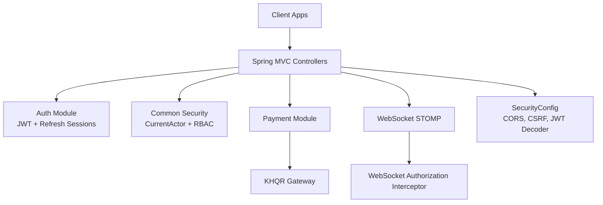
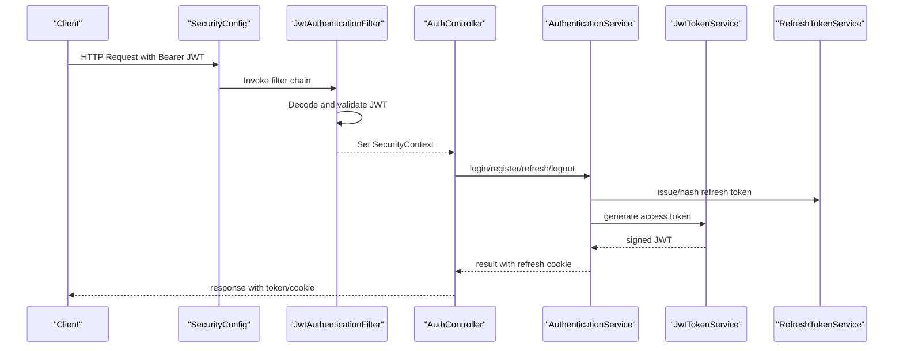
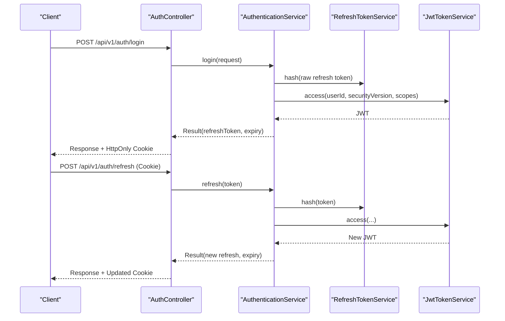
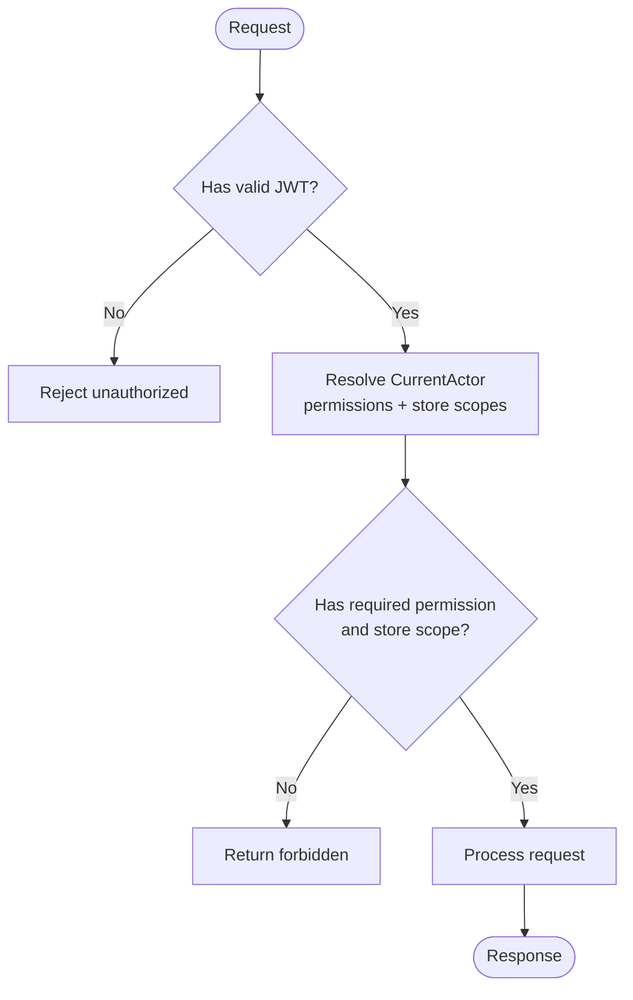
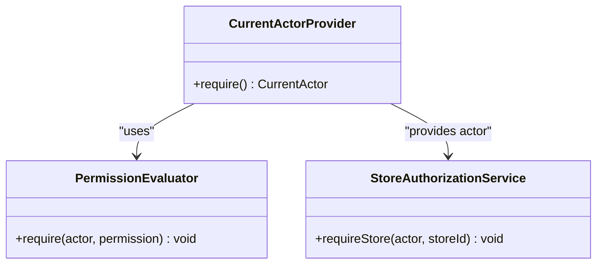
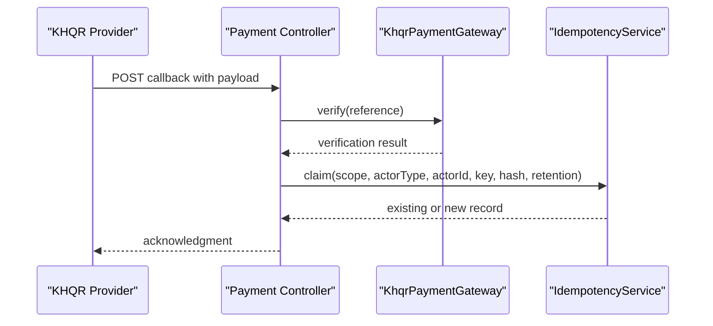
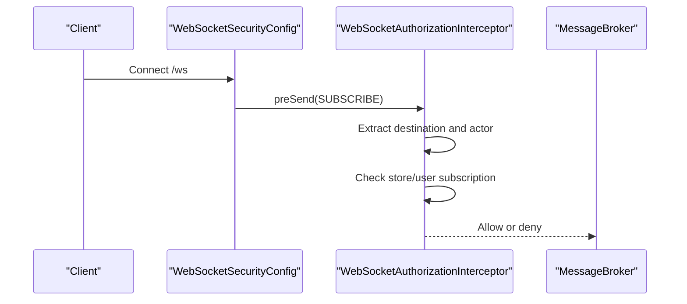
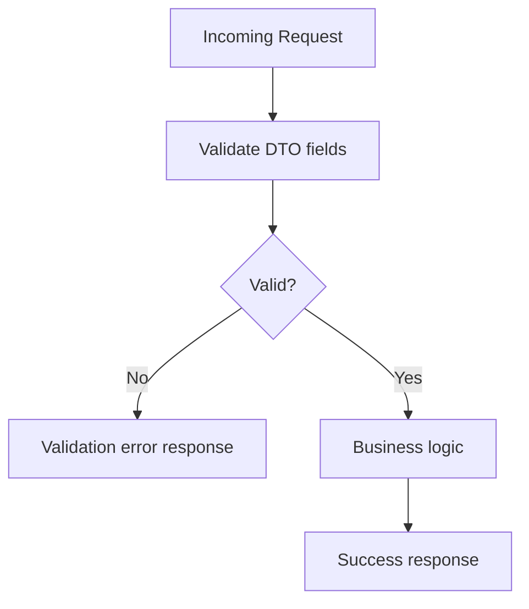
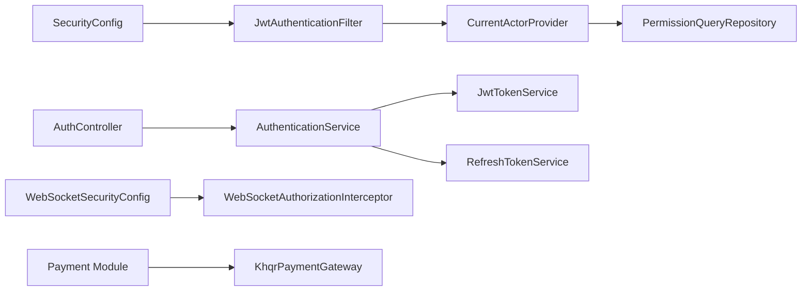

# Security Architecture

<cite>
**Referenced Files in This Document**
- [SecurityConfig.java](file://src/main/java/com/smartcoffee/config/SecurityConfig.java)
- [JwtAuthenticationFilter.java](file://src/main/java/com/smartcoffee/modules/auth/security/JwtAuthenticationFilter.java)
- [JwtTokenService.java](file://src/main/java/com/smartcoffee/modules/auth/security/JwtTokenService.java)
- [RefreshTokenService.java](file://src/main/java/com/smartcoffee/modules/auth/security/RefreshTokenService.java)
- [AuthenticationService.java](file://src/main/java/com/smartcoffee/modules/auth/application/AuthenticationService.java)
- [AuthController.java](file://src/main/java/com/smartcoffee/modules/auth/api/AuthController.java)
- [CurrentActorProvider.java](file://src/main/java/com/smartcoffee/common/security/CurrentActorProvider.java)
- [PermissionEvaluator.java](file://src/main/java/com/smartcoffee/common/security/PermissionEvaluator.java)
- [StoreAuthorizationService.java](file://src/main/java/com/smartcoffee/common/security/StoreAuthorizationService.java)
- [WebSocketSecurityConfig.java](file://src/main/java/com/smartcoffee/config/WebSocketSecurityConfig.java)
- [WebSocketAuthorizationInterceptor.java](file://src/main/java/com/smartcoffee/infrastructure/realtime/WebSocketAuthorizationInterceptor.java)
- [KhqrPaymentGateway.java](file://src/main/java/com/smartcoffee/infrastructure/payment/KhqrPaymentGateway.java)
- [application.yml](file://src/main/resources/application.yml)
- [GlobalExceptionHandler.java](file://src/main/java/com/smartcoffee/common/api/GlobalExceptionHandler.java)
- [IdempotencyService.java](file://src/main/java/com/smartcoffee/infrastructure/idempotency/IdempotencyService.java)
- [ADR-006-authentication-model.md](file://adr/ADR-006-authentication-model.md)
</cite>

## Table of Contents
1. Introduction
2. Project Structure
3. Core Components
4. Architecture Overview
5. Detailed Component Analysis
6. Dependency Analysis
7. Performance Considerations
8. Troubleshooting Guide
9. Conclusion
10. Appendices

## Introduction
This document describes the security architecture of the Smart Coffee Backend, focusing on trust boundaries, authentication and authorization mechanisms, external integration security, WebSocket security, rate limiting considerations, input validation, and best practices tailored to a coffee shop management platform. It consolidates design decisions from the codebase and the Authentication Model ADR to guide secure implementation and operations.

## Project Structure
The backend is organized into modules (auth, identity, catalog, ordering, payment, etc.), shared common utilities, infrastructure services, and configuration. Security-related components are primarily located under:
- config: Spring Security and WebSocket security configuration
- modules/auth: authentication endpoints, token issuance, refresh sessions
- common/security: current actor resolution, permission checks, store-scoped authorization
- infrastructure/realtime: WebSocket authorization interceptor
- infrastructure/payment: payment gateway adapters (e.g., KHQR)

**Diagram sources**
- [SecurityConfig.java:46-79](file://src/main/java/com/smartcoffee/config/SecurityConfig.java#L46-L79)
- [AuthController.java:13-71](file://src/main/java/com/smartcoffee/modules/auth/api/AuthController.java#L13-L71)
- [WebSocketSecurityConfig.java:9-35](file://src/main/java/com/smartcoffee/config/WebSocketSecurityConfig.java#L9-L35)
- [WebSocketAuthorizationInterceptor.java:10-36](file://src/main/java/com/smartcoffee/infrastructure/realtime/WebSocketAuthorizationInterceptor.java#L10-L36)
- [KhqrPaymentGateway.java:1-9](file://src/main/java/com/smartcoffee/infrastructure/payment/KhqrPaymentGateway.java#L1-L9)

**Section sources**
- [SecurityConfig.java:46-79](file://src/main/java/com/smartcoffee/config/SecurityConfig.java#L46-L79)
- [application.yml:49-53](file://src/main/resources/application.yml#L49-L53)

## Core Components
- Stateless HTTP security with JWT bearer tokens and explicit public endpoint allow-listing.
- JWT access tokens signed with HS256 using a configured secret; short-lived by default.
- Opaque refresh tokens stored as hashes with rotation and revocation support.
- Current actor resolution combining user identity, granted permissions, and store scopes.
- Store-scoped authorization helpers to enforce multi-store isolation.
- WebSocket authorization interceptors for topic and user destinations.
- Payment gateway adapter interface with placeholder for KHQR provider integration.

Key responsibilities:
- Authentication: login, register, refresh, logout, logout-all
- Authorization: permission checks and store-scoped resource checks
- Token lifecycle: issuance, rotation, revocation
- Real-time channels: authenticated subscriptions and per-store scoping

**Section sources**
- [JwtTokenService.java:23-104](file://src/main/java/com/smartcoffee/modules/auth/security/JwtTokenService.java#L23-L104)
- [RefreshTokenService.java:1-5](file://src/main/java/com/smartcoffee/modules/auth/security/RefreshTokenService.java#L1-L5)
- [AuthenticationService.java:38-100](file://src/main/java/com/smartcoffee/modules/auth/application/AuthenticationService.java#L38-L100)
- [CurrentActorProvider.java:12-41](file://src/main/java/com/smartcoffee/common/security/CurrentActorProvider.java#L12-L41)
- [StoreAuthorizationService.java:7-13](file://src/main/java/com/smartcoffee/common/security/StoreAuthorizationService.java#L7-L13)
- [PermissionEvaluator.java:6-12](file://src/main/java/com/smartcoffee/common/security/PermissionEvaluator.java#L6-L12)

## Architecture Overview
Trust boundaries:
- Clients (mobile/web/POS) authenticate via /api/v1/auth and receive short-lived JWTs.
- The API layer validates JWTs and resolves the current actor with permissions and store scopes.
- Internal services and modules enforce authorization at service boundaries using CurrentActor and store-scoped checks.
- External integrations (payment providers) are reached through adapters with strict validation and idempotency controls.

**Diagram sources**
- [SecurityConfig.java:46-79](file://src/main/java/com/smartcoffee/config/SecurityConfig.java#L46-L79)
- [JwtAuthenticationFilter.java:1-5](file://src/main/java/com/smartcoffee/modules/auth/security/JwtAuthenticationFilter.java#L1-L5)
- [AuthController.java:13-71](file://src/main/java/com/smartcoffee/modules/auth/api/AuthController.java#L13-L71)
- [AuthenticationService.java:38-100](file://src/main/java/com/smartcoffee/modules/auth/application/AuthenticationService.java#L38-L100)
- [JwtTokenService.java:23-104](file://src/main/java/com/smartcoffee/modules/auth/security/JwtTokenService.java#L23-L104)
- [RefreshTokenService.java:1-5](file://src/main/java/com/smartcoffee/modules/auth/security/RefreshTokenService.java#L1-L5)

## Detailed Component Analysis

### Authentication Flow (Login, Register, Refresh, Logout)
- Login/Register: Validate inputs, persist credentials or create user, issue access token and refresh session, set HttpOnly cookie.
- Refresh: Accept only at dedicated endpoint, verify hashed refresh token, rotate session, issue new access token.
- Logout: Revoke current session; logout-all revokes all active sessions for the user.

**Diagram sources**
- [AuthController.java:25-59](file://src/main/java/com/smartcoffee/modules/auth/api/AuthController.java#L25-L59)
- [AuthenticationService.java:38-100](file://src/main/java/com/smartcoffee/modules/auth/application/AuthenticationService.java#L38-L100)
- [RefreshTokenService.java:1-5](file://src/main/java/com/smartcoffee/modules/auth/security/RefreshTokenService.java#L1-L5)
- [JwtTokenService.java:58-104](file://src/main/java/com/smartcoffee/modules/auth/security/JwtTokenService.java#L58-L104)

**Section sources**
- [AuthController.java:25-59](file://src/main/java/com/smartcoffee/modules/auth/api/AuthController.java#L25-L59)
- [AuthenticationService.java:38-100](file://src/main/java/com/smartcoffee/modules/auth/application/AuthenticationService.java#L38-L100)
- [application.yml:49-53](file://src/main/resources/application.yml#L49-L53)
- [ADR-006-authentication-model.md:30-127](file://adr/ADR-006-authentication-model.md#L30-L127)

### JWT and Session Management
- Access tokens: HS256 signed, short-lived, include issuer, subject, security version, and optional scopes.
- Refresh tokens: opaque random values, hashed before storage, rotated on use, with family-based reuse detection and revocation.
- Password hashing: Argon2id used by Spring Security configuration.
- Session persistence: refresh sessions stored with expiration and revocation support.

**Diagram sources**
- [JwtAuthenticationFilter.java:1-5](file://src/main/java/com/smartcoffee/modules/auth/security/JwtAuthenticationFilter.java#L1-L5)
- [CurrentActorProvider.java:20-41](file://src/main/java/com/smartcoffee/common/security/CurrentActorProvider.java#L20-L41)
- [PermissionEvaluator.java:6-12](file://src/main/java/com/smartcoffee/common/security/PermissionEvaluator.java#L6-L12)
- [StoreAuthorizationService.java:7-13](file://src/main/java/com/smartcoffee/common/security/StoreAuthorizationService.java#L7-L13)

**Section sources**
- [JwtTokenService.java:23-104](file://src/main/java/com/smartcoffee/modules/auth/security/JwtTokenService.java#L23-L104)
- [RefreshTokenService.java:1-5](file://src/main/java/com/smartcoffee/modules/auth/security/RefreshTokenService.java#L1-L5)
- [SecurityConfig.java:26-44](file://src/main/java/com/smartcoffee/config/SecurityConfig.java#L26-L44)
- [ADR-006-authentication-model.md:30-92](file://adr/ADR-006-authentication-model.md#L30-L92)

### Authorization Patterns (RBAC and Store-Scoped Permissions)
- Permission checks: Use PermissionEvaluator to require specific permissions for sensitive actions.
- Store-scoped authorization: Enforce that actors can only access resources within their assigned stores.
- CurrentActor aggregates user ID, roles, permissions, store IDs, and global permissions for consistent checks across modules.

**Diagram sources**
- [CurrentActorProvider.java:12-41](file://src/main/java/com/smartcoffee/common/security/CurrentActorProvider.java#L12-L41)
- [PermissionEvaluator.java:6-12](file://src/main/java/com/smartcoffee/common/security/PermissionEvaluator.java#L6-L12)
- [StoreAuthorizationService.java:7-13](file://src/main/java/com/smartcoffee/common/security/StoreAuthorizationService.java#L7-L13)

**Section sources**
- [CurrentActorProvider.java:20-41](file://src/main/java/com/smartcoffee/common/security/CurrentActorProvider.java#L20-L41)
- [PermissionEvaluator.java:6-12](file://src/main/java/com/smartcoffee/common/security/PermissionEvaluator.java#L6-L12)
- [StoreAuthorizationService.java:7-13](file://src/main/java/com/smartcoffee/common/security/StoreAuthorizationService.java#L7-L13)
- [ADR-006-authentication-model.md:94-109](file://adr/ADR-006-authentication-model.md#L94-L109)

### External Integrations: KHQR Payment Callbacks
- Payment gateway abstraction isolates provider-specific logic.
- Production profile uses a placeholder KHQR gateway; real provider must implement signature validation, replay protection, and idempotent processing.
- Idempotency service prevents duplicate processing of callbacks by tracking request keys and statuses.

**Diagram sources**
- [KhqrPaymentGateway.java:1-9](file://src/main/java/com/smartcoffee/infrastructure/payment/KhqrPaymentGateway.java#L1-L9)
- [IdempotencyService.java:1-6](file://src/main/java/com/smartcoffee/infrastructure/idempotency/IdempotencyService.java#L1-L6)

**Section sources**
- [KhqrPaymentGateway.java:1-9](file://src/main/java/com/smartcoffee/infrastructure/payment/KhqrPaymentGateway.java#L1-L9)
- [IdempotencyService.java:1-6](file://src/main/java/com/smartcoffee/infrastructure/idempotency/IdempotencyService.java#L1-L6)

### WebSocket Security
- STOMP over WebSocket secured via ChannelInterceptor that validates subscriptions against CurrentActor store scopes and user destinations.
- Allowed origins are configurable; broker prefixes and user destination prefixes are explicitly set.

**Diagram sources**
- [WebSocketSecurityConfig.java:9-35](file://src/main/java/com/smartcoffee/config/WebSocketSecurityConfig.java#L9-L35)
- [WebSocketAuthorizationInterceptor.java:10-36](file://src/main/java/com/smartcoffee/infrastructure/realtime/WebSocketAuthorizationInterceptor.java#L10-L36)

**Section sources**
- [WebSocketSecurityConfig.java:9-35](file://src/main/java/com/smartcoffee/config/WebSocketSecurityConfig.java#L9-L35)
- [WebSocketAuthorizationInterceptor.java:10-36](file://src/main/java/com/smartcoffee/infrastructure/realtime/WebSocketAuthorizationInterceptor.java#L10-L36)

### Rate Limiting and Input Validation
- Input validation: Controllers use Jakarta Bean Validation annotations on request DTOs; GlobalExceptionHandler maps validation failures to structured error responses.
- Rate limiting: Not implemented in the provided files; recommend adding application-level or gateway-level rate limiting for login, refresh, and payment endpoints to mitigate brute-force and abuse.

**Diagram sources**
- [GlobalExceptionHandler.java:11-25](file://src/main/java/com/smartcoffee/common/api/GlobalExceptionHandler.java#L11-L25)

**Section sources**
- [GlobalExceptionHandler.java:11-25](file://src/main/java/com/smartcoffee/common/api/GlobalExceptionHandler.java#L11-L25)

## Dependency Analysis
Security-related dependencies and interactions:
- SecurityConfig wires JWT decoder, password encoder, and filters.
- JwtAuthenticationFilter depends on JwtDecoder to populate SecurityContext.
- AuthenticationService composes JwtTokenService and RefreshTokenService for token lifecycle.
- CurrentActorProvider queries permissions and store scopes for authorization.
- WebSocketSecurityConfig integrates WebSocketAuthorizationInterceptor for channel-level checks.
- Payment module abstracts external providers via interfaces; KHQR gateway is profiled for production.

**Diagram sources**
- [SecurityConfig.java:46-79](file://src/main/java/com/smartcoffee/config/SecurityConfig.java#L46-L79)
- [JwtAuthenticationFilter.java:1-5](file://src/main/java/com/smartcoffee/modules/auth/security/JwtAuthenticationFilter.java#L1-L5)
- [AuthenticationService.java:16-36](file://src/main/java/com/smartcoffee/modules/auth/application/AuthenticationService.java#L16-L36)
- [JwtTokenService.java:23-48](file://src/main/java/com/smartcoffee/modules/auth/security/JwtTokenService.java#L23-L48)
- [RefreshTokenService.java:1-5](file://src/main/java/com/smartcoffee/modules/auth/security/RefreshTokenService.java#L1-L5)
- [CurrentActorProvider.java:12-41](file://src/main/java/com/smartcoffee/common/security/CurrentActorProvider.java#L12-L41)
- [WebSocketSecurityConfig.java:9-35](file://src/main/java/com/smartcoffee/config/WebSocketSecurityConfig.java#L9-L35)
- [KhqrPaymentGateway.java:1-9](file://src/main/java/com/smartcoffee/infrastructure/payment/KhqrPaymentGateway.java#L1-L9)

**Section sources**
- [SecurityConfig.java:46-79](file://src/main/java/com/smartcoffee/config/SecurityConfig.java#L46-L79)
- [AuthenticationService.java:16-36](file://src/main/java/com/smartcoffee/modules/auth/application/AuthenticationService.java#L16-L36)
- [WebSocketSecurityConfig.java:9-35](file://src/main/java/com/smartcoffee/config/WebSocketSecurityConfig.java#L9-L35)

## Performance Considerations
- Short-lived JWTs reduce exposure and limit the impact of token theft; ensure clients handle token refresh gracefully.
- Refresh token rotation adds database writes; batch or optimize where possible without compromising security.
- WebSocket authorization checks are lightweight but should be tuned for high-frequency subscriptions.
- Avoid logging sensitive data (tokens, passwords, headers); rely on correlation IDs for tracing.

[No sources needed since this section provides general guidance]

## Troubleshooting Guide
Common issues and mitigations:
- Unauthorized requests: Ensure Bearer token is present and valid; check JWT secret configuration and token expiry.
- Forbidden errors: Verify actor has required permission and store scope; confirm role assignments and store memberships.
- Invalid refresh session: Confirm refresh token exists, is active, and not revoked; ensure client sends correct cookie.
- WebSocket subscription denied: Validate destination pattern and actor’s store/user permissions; check allowed origins configuration.
- Payment callback duplicates: Ensure idempotency key is unique per callback and retention is sufficient; verify status transitions.

Operational tips:
- Use GlobalExceptionHandler to standardize error responses and include correlation IDs.
- Monitor failed authentication attempts and consider implementing rate limiting at the application or gateway level.
- Audit authentication and authorization events for compliance and incident response.

**Section sources**
- [GlobalExceptionHandler.java:11-25](file://src/main/java/com/smartcoffee/common/api/GlobalExceptionHandler.java#L11-L25)
- [AuthenticationService.java:64-87](file://src/main/java/com/smartcoffee/modules/auth/application/AuthenticationService.java#L64-L87)
- [WebSocketAuthorizationInterceptor.java:18-36](file://src/main/java/com/smartcoffee/infrastructure/realtime/WebSocketAuthorizationInterceptor.java#L18-L36)
- [IdempotencyService.java:1-6](file://src/main/java/com/smartcoffee/infrastructure/idempotency/IdempotencyService.java#L1-L6)

## Conclusion
The Smart Coffee Backend implements a robust security model centered on stateless JWTs, hashed refresh sessions, RBAC, and store-scoped authorization. WebSocket connections are protected via interceptors, and external integrations are isolated behind adapters with idempotency safeguards. To strengthen production readiness, add rate limiting, enforce strict CORS policies, centralize audit logging, and consider migrating to a managed identity solution if complexity grows.

[No sources needed since this section summarizes without analyzing specific files]

## Appendices

### Security Configuration Summary
- CSRF disabled for token-based APIs; stateless sessions enforced.
- Public endpoints explicitly allow-listed; all other requests require authentication.
- JWT secret and token lifetimes configured via application properties.
- WebSocket origins configurable; broker prefixes defined for topics and queues.

**Section sources**
- [SecurityConfig.java:46-79](file://src/main/java/com/smartcoffee/config/SecurityConfig.java#L46-L79)
- [application.yml:49-53](file://src/main/resources/application.yml#L49-L53)
- [WebSocketSecurityConfig.java:22-35](file://src/main/java/com/smartcoffee/config/WebSocketSecurityConfig.java#L22-L35)

### Best Practices and Mitigations
- Keep JWT secrets in secure secret management; rotate regularly.
- Enforce least privilege: grant minimal permissions per role and store.
- Validate all external inputs; reject malformed or unexpected payloads.
- Protect sensitive endpoints with both authentication and authorization checks.
- Implement idempotency for external callbacks to prevent replay attacks.
- Log correlation IDs and avoid logging secrets; monitor anomalies.

[No sources needed since this section provides general guidance]