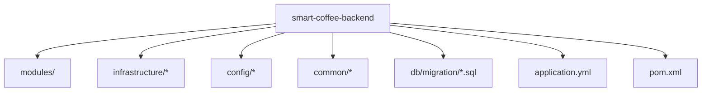
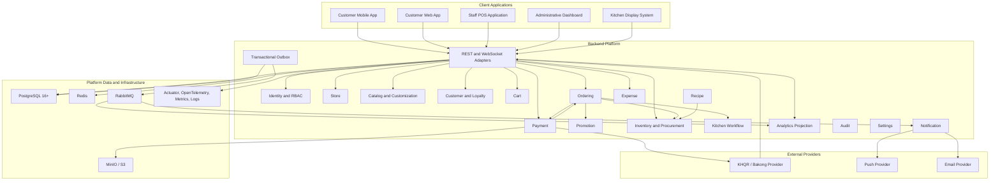
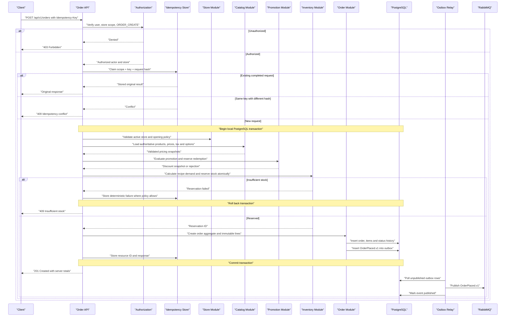
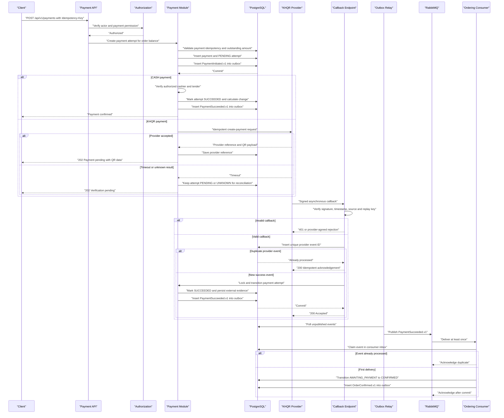
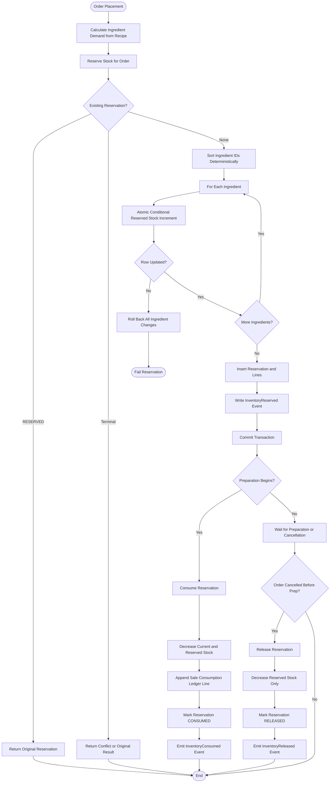
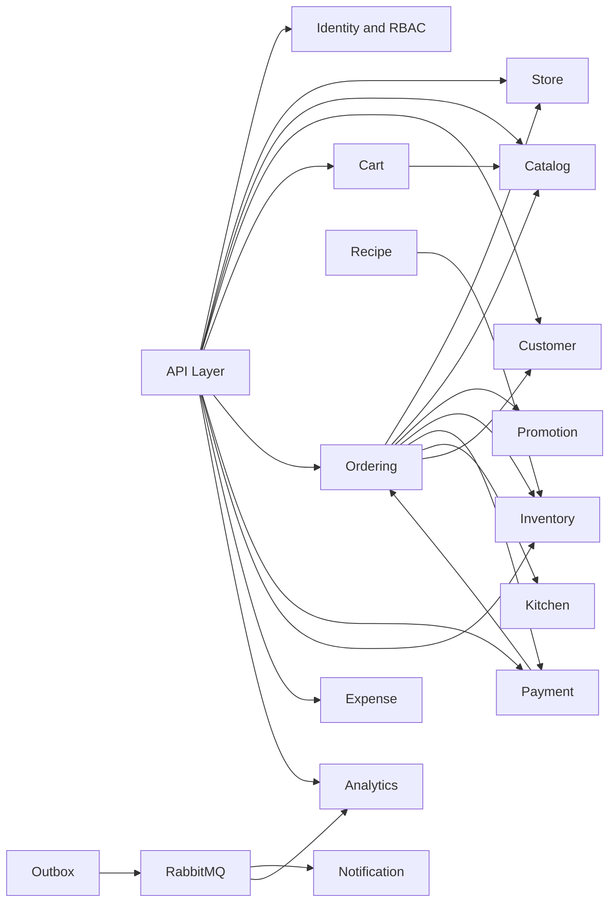

# System Overview

<cite>
**Referenced Files in This Document**
- [ADR-001-modular-monolith.md](file://adr/ADR-001-modular-monolith.md)
- [SYSTEM_ARCHITECTURE.md](file://architecture/SYSTEM_ARCHITECTURE.md)
- [ArchitectureDiagram.mermaid](file://architecture/ArchitectureDiagram.mermaid)
- [ORDER_FLOW.mermaid](file://architecture/ORDER_FLOW.mermaid)
- [PAYMENT_FLOW.mermaid](file://architecture/PAYMENT_FLOW.mermaid)
- [INVENTORY_FLOW.mermaid](file://architecture/INVENTORY_FLOW.mermaid)
- [DB_OWNERSHIP_MATRIX.md](file://database/DB_OWNERSHIP_MATRIX.md)
- [pom.xml](file://pom.xml)
- [application.yml](file://src/main/resources/application.yml)
</cite>

## Table of Contents
1. [Introduction](#introduction)
2. [Project Structure](#project-structure)
3. [Core Components](#core-components)
4. [Architecture Overview](#architecture-overview)
5. [Detailed Component Analysis](#detailed-component-analysis)
6. [Dependency Analysis](#dependency-analysis)
7. [Performance Considerations](#performance-considerations)
8. [Troubleshooting Guide](#troubleshooting-guide)
9. [Conclusion](#conclusion)

## Introduction
Smart Coffee Backend is a coffee shop and bakery management platform that supports customers, staff, administrators, and kitchen operators. It provides server-authoritative ordering, payment processing, inventory reservation and consumption, recipe-based demand calculation, promotion and loyalty accounting, kitchen workflow coordination, notifications, audit trails, and reporting projections.

The system is designed as a modular monolith initially, with clear module boundaries and database ownership so it can later be extracted into microservices when scaling, team ownership, security isolation, or release cadence require it.

**Section sources**
- [SYSTEM_ARCHITECTURE.md:15-85](file://architecture/SYSTEM_ARCHITECTURE.md#L15-L85)
- [ADR-001-modular-monolith.md:8-18](file://adr/ADR-001-modular-monolith.md#L8-L18)

## Project Structure
The repository is a Spring Boot application organized by domain modules under `modules`, shared infrastructure under `infrastructure`, configuration under `config`, common types under `common`, and database migrations under `src/main/resources/db/migration`. The Maven project declares the backend artifact as `identity-service`, but the architecture documents explicitly state this is a transitional name for a full operational backend rather than a dedicated identity service.

**Diagram sources**
- [pom.xml:25-30](file://pom.xml#L25-L30)
- [application.yml:1-10](file://src/main/resources/application.yml#L1-L10)

**Section sources**
- [pom.xml:25-30](file://pom.xml#L25-L30)
- [SYSTEM_ARCHITECTURE.md:23-49](file://architecture/SYSTEM_ARCHITECTURE.md#L23-L49)

## Core Components
The platform’s core business capabilities are grouped into domain modules:

| Capability | Responsibility | Target Users |
|---|---|---|
| Identity and Access | Authentication, authorization, roles, permissions, store-scoped access | Staff, Administrators |
| Store | Store metadata, opening hours, availability | Staff, Administrators |
| Catalog and Customization | Categories, products, store product availability, effective pricing, customization groups and options | Customers, Staff |
| Customer and Loyalty | Customer profiles, favorites, immutable points ledger | Customers, Staff |
| Cart | Active customer/store cart lines and customizations | Customers |
| Ordering | Order creation, checkout orchestration, order snapshots, status history | Customers, Staff |
| Payment | Payment attempts, provider callbacks, refunds, reconciliation, receipts | Customers, Staff |
| Promotion | Promotion rules, eligibility, redemption limits | Customers, Staff |
| Recipe and Inventory | Recipe versions, ingredient requirements, stock balances, reservations, stock ledger | Staff, Kitchen |
| Kitchen Workflow | Production tickets, station state, preparation flow | Kitchen Operators |
| Notification | Notification requests, recipients, delivery attempts, device tokens | Customers, Staff |
| Analytics | Reporting projections consumed from events | Administrators |
| Audit | Append-only security and business audit records | Administrators, Compliance |
| Settings | Scoped system settings | Administrators |

These capabilities support the primary business flows:
- A customer adds items to a cart, checks out, pays through cash or KHQR, and receives an order confirmation and receipt.
- Staff manage stores, catalog items, promotions, and orders.
- Kitchen operators prepare orders using production tickets driven by order state and inventory consumption.
- Administrators monitor analytics, audit logs, and system health.

**Section sources**
- [SYSTEM_ARCHITECTURE.md:136-195](file://architecture/SYSTEM_ARCHITECTURE.md#L136-L195)
- [DB_OWNERSHIP_MATRIX.md:16-65](file://database/DB_OWNERSHIP_MATRIX.md#L16-L65)

## Architecture Overview
The Smart Coffee Backend follows a **modular monolith first** architecture. Clients connect through HTTPS, optionally behind an API gateway, to a single Spring Boot 4 backend that exposes REST APIs and secured WebSocket destinations. The backend owns PostgreSQL as its durable system of record, uses Redis for bounded caching and ephemeral coordination, RabbitMQ for durable asynchronous work, and MinIO or S3-compatible storage for images, receipts, and authorized documents.

**Diagram sources**
- [ArchitectureDiagram.mermaid:1-117](file://architecture/ArchitectureDiagram.mermaid#L1-L117)
- [SYSTEM_ARCHITECTURE.md:53-133](file://architecture/SYSTEM_ARCHITECTURE.md#L53-L133)

### Why Modular Monolith Instead of Microservices Initially
The decision to begin with a modular monolith is driven by the tight coupling between store availability, catalog pricing, customization rules, promotion eligibility, recipe requirements, and inventory availability during checkout. Splitting these domains into independently deployed services too early would introduce distributed transactions, network failure modes, event ordering concerns, compensation logic, and additional operational cost before stable boundaries and traffic patterns are known.

A modular monolith preserves local PostgreSQL transactions for checkout correctness, simplifies development and testing, enables architectural validation before extraction, reduces initial operational cost, and makes end-to-end debugging easier.

**Section sources**
- [ADR-001-modular-monolith.md:8-18](file://adr/ADR-001-modular-monolith.md#L8-L18)
- [ADR-001-modular-monolith.md:51-80](file://adr/ADR-001-modular-monolith.md#L51-L80)

### Technology Stack Decisions
| Technology | Role | Rationale |
|---|---|---|
| Java 26 + Spring Boot 4 | Backend runtime and framework | Modern enterprise Java stack with web, security, JPA, cache, AMQP, actuator, and test support. |
| PostgreSQL 16+ | Primary database | Strong ACID guarantees, JSON, indexing, and migration tooling for financial and operational data. |
| Redis | Cache and ephemeral state | Bounded catalog/store cache, rate limiting, optional session revocation cache, short-lived coordination. |
| RabbitMQ | Durable messaging | Asynchronous notification delivery, receipt generation, reporting projection updates, retryable integrations. |
| MinIO / S3 | Object storage | Product images, receipts, and authorized uploaded documents; database stores keys and metadata only. |
| Flyway | Database migrations | Versioned, validated schema changes. |
| Springdoc OpenAPI | API documentation | Developer-friendly API discovery. |
| Actuator + Prometheus | Observability | Health probes, metrics, and monitoring integration. |

**Section sources**
- [pom.xml:14-56](file://pom.xml#L14-L56)
- [pom.xml:69-245](file://pom.xml#L69-L245)
- [application.yml:17-42](file://src/main/resources/application.yml#L17-L42)
- [SYSTEM_ARCHITECTURE.md:88-133](file://architecture/SYSTEM_ARCHITECTURE.md#L88-L133)

## Detailed Component Analysis

### Ordering and Checkout Flow
Order placement is a strongly consistent transaction inside the modular monolith. The client never sends authoritative prices, tax, discount, or total. The backend validates store policy, loads server-authoritative catalog data, evaluates promotions, reserves inventory atomically, creates immutable order snapshots, writes an outbox event, and commits.

**Diagram sources**
- [ORDER_FLOW.mermaid:1-60](file://architecture/ORDER_FLOW.mermaid#L1-L60)
- [SYSTEM_ARCHITECTURE.md:232-260](file://architecture/SYSTEM_ARCHITECTURE.md#L232-L260)

**Section sources**
- [ORDER_FLOW.mermaid:1-60](file://architecture/ORDER_FLOW.mermaid#L1-L60)
- [SYSTEM_ARCHITECTURE.md:232-260](file://architecture/SYSTEM_ARCHITECTURE.md#L232-L260)

### Payment Processing Flow
Payment handling separates internal payment state from external provider evidence. Cash payments are confirmed server-side after cashier verification. KHQR payments create an idempotent provider request, return pending status while awaiting a signed callback, and apply provider success only after signature, timestamp, source, replay protection, and unique provider event validation.

**Diagram sources**
- [PAYMENT_FLOW.mermaid:1-73](file://architecture/PAYMENT_FLOW.mermaid#L1-L73)
- [SYSTEM_ARCHITECTURE.md:252-260](file://architecture/SYSTEM_ARCHITECTURE.md#L252-L260)

**Section sources**
- [PAYMENT_FLOW.mermaid:1-73](file://architecture/PAYMENT_FLOW.mermaid#L1-L73)
- [SYSTEM_ARCHITECTURE.md:252-260](file://architecture/SYSTEM_ARCHITECTURE.md#L252-L260)

### Inventory Reservation and Consumption Flow
Inventory is modeled with current balances, reservations, and an append-only stock ledger. Recipe demand is calculated from order snapshots, then ingredients are reserved atomically. When preparation begins, the reservation is consumed, reducing both current and reserved stock and recording immutable ledger lines. If an order is canceled before preparation, reserved stock is released.

**Diagram sources**
- [INVENTORY_FLOW.mermaid:1-76](file://architecture/INVENTORY_FLOW.mermaid#L1-L76)
- [SYSTEM_ARCHITECTURE.md:256-260](file://architecture/SYSTEM_ARCHITECTURE.md#L256-L260)

**Section sources**
- [INVENTORY_FLOW.mermaid:1-76](file://architecture/INVENTORY_FLOW.mermaid#L1-L76)
- [SYSTEM_ARCHITECTURE.md:256-260](file://architecture/SYSTEM_ARCHITECTURE.md#L256-L260)

### Database Ownership and Module Boundaries
Every table has exactly one write-owning module. During the modular monolith phase, foreign keys may exist between schemas in the same PostgreSQL database, but cross-service foreign keys must be removed after extraction. Historical order, payment, inventory, loyalty, and audit data must not be cascade-deleted. Reporting owns projections only and never modifies operational records.

| Area | Ownership Rule |
|---|---|
| Identity and Access | Owns users, credentials, sessions, roles, permissions, and store-scoped role assignments. |
| Store | Owns stores and opening hours. |
| Catalog and Customization | Owns categories, products, store product availability, effective prices, customization groups, and options. |
| Customer and Loyalty | Owns customer profiles and immutable points ledger. |
| Cart | Owns active customer/store carts and cart lines. |
| Ordering | Owns orders, order items, snapshots, status history, and order idempotency results. |
| Payment | Owns payment aggregates, attempts, provider callbacks, refunds, reconciliation, and receipts. |
| Promotion | Owns promotion rules and redemption records. |
| Recipe and Inventory | Owns recipe requirements and inventory balances, reservations, lots, and stock movements. |
| Notification | Owns notification requests, recipients, delivery attempts, device tokens, and retry state. |
| Analytics | Owns reporting projections and consumes events without updating operational records. |
| Audit | Owns append-only security and business audit records. |

**Section sources**
- [DB_OWNERSHIP_MATRIX.md:1-15](file://database/DB_OWNERSHIP_MATRIX.md#L1-L15)
- [DB_OWNERSHIP_MATRIX.md:16-65](file://database/DB_OWNERSHIP_MATRIX.md#L16-L65)
- [SYSTEM_ARCHITECTURE.md:136-195](file://architecture/SYSTEM_ARCHITECTURE.md#L136-L195)

## Dependency Analysis
The backend is a single deployable process containing multiple domain modules. Internal dependencies follow explicit application interfaces rather than direct repository injection. Critical cross-module interactions include:

- Cart depends on Catalog for product and customization data.
- Ordering depends on Store, Catalog, Promotion, Inventory, Payment, Kitchen, and Customer.
- Recipe depends on Inventory for ingredient definitions.
- Payment depends on Order for balance and state queries.
- Outbox publishes events to RabbitMQ for downstream consumers such as Notification and Analytics.

**Diagram sources**
- [ArchitectureDiagram.mermaid:22-68](file://architecture/ArchitectureDiagram.mermaid#L22-L68)

**Section sources**
- [ArchitectureDiagram.mermaid:22-68](file://architecture/ArchitectureDiagram.mermaid#L22-L68)
- [SYSTEM_ARCHITECTURE.md:198-229](file://architecture/SYSTEM_ARCHITECTURE.md#L198-L229)

## Performance Considerations
- Use local PostgreSQL transactions for checkout, payment state transitions, promotion usage, and inventory reservation to avoid distributed consistency complexity.
- Keep Redis as a bounded cache or ephemeral coordination layer; never treat it as the sole source of truth for financial or inventory correctness.
- Publish critical events through a transactional outbox and consume them with durable deduplication via an inbox.
- Avoid long-running database transactions that hold locks across external provider calls.
- Design consumers to be idempotent because RabbitMQ delivery is at-least-once.
- Separate strong consistency requirements from eventual consistency use cases such as notifications, analytics dashboards, search indexes, and non-authoritative WebSocket updates.

[No sources needed since this section provides general guidance]

## Troubleshooting Guide
Common operational issues and their architectural safeguards:

| Issue | Symptom | Recommended Investigation |
|---|---|---|
| Duplicate order creation | Multiple identical orders for the same request | Verify idempotency key claim, request hash, and stored idempotency result. |
| Partial inventory reservation | Some ingredients reserved, others not | Confirm all ingredient reservations succeed or fail together within one transaction. |
| Payment marked paid without provider evidence | Frontend reports success but backend lacks trusted evidence | Reject client-reported success; require server-side cash acceptance or verified provider callback. |
| Stale catalog price used in order | Order reflects outdated price | Ensure checkout loads server-authoritative catalog data and captures immutable snapshots. |
| Notification failure rolls back order | Order creation fails due to notification delivery | Notifications must be decoupled and failures must not roll back committed orders. |
| Event delivered twice | Consumer processes same event multiple times | Implement consumer inbox or equivalent durable deduplication. |
| Redis outage affects financial state | Orders, payments, or stock become inconsistent | Redis must not be the only source of truth for financial or inventory correctness. |

**Section sources**
- [SYSTEM_ARCHITECTURE.md:232-300](file://architecture/SYSTEM_ARCHITECTURE.md#L232-L300)
- [ADR-001-modular-monolith.md:82-92](file://adr/ADR-001-modular-monolith.md#L82-L92)

## Conclusion
Smart Coffee Backend is a coffee shop and bakery management platform built as a modular monolith to safely coordinate ordering, payment, inventory, recipes, promotions, kitchen workflow, and notifications. The architecture prioritizes strong consistency for critical business operations, clear module and database ownership, and durable asynchronous communication.

The modular monolith was chosen over microservices initially because checkout and related capabilities require tightly coordinated transactions and predictable failure behavior. Once stable APIs, events, database ownership, scaling needs, team boundaries, and security isolation requirements are proven, the system is ready for extraction into independent services following the documented future extraction strategy.

[No sources needed since this section summarizes without analyzing specific files]