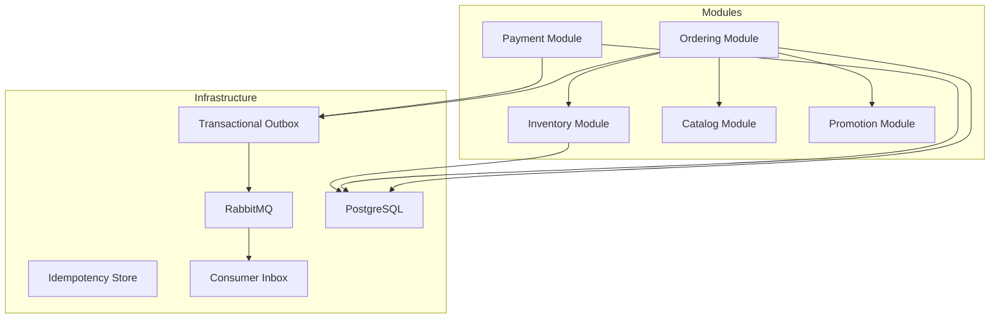
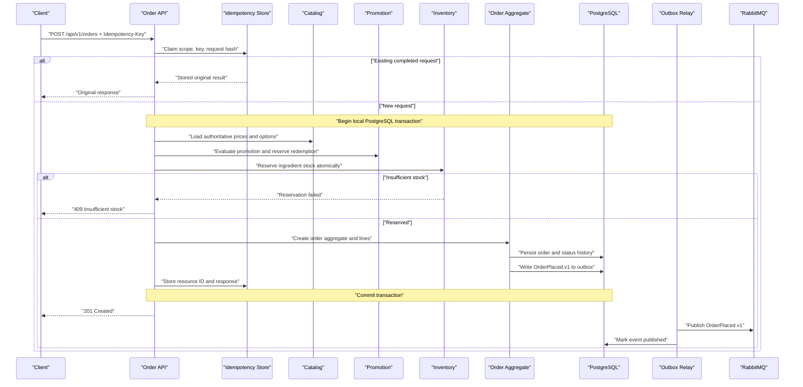
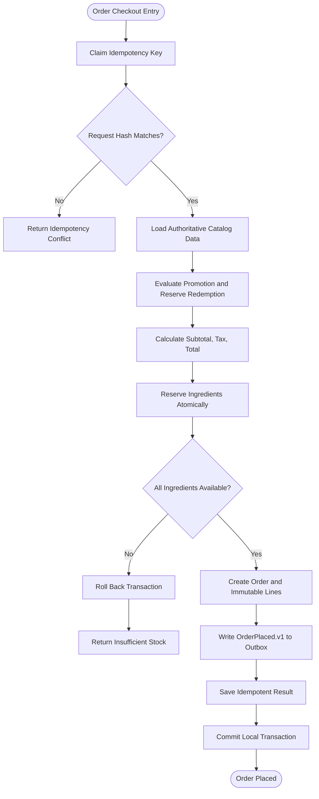
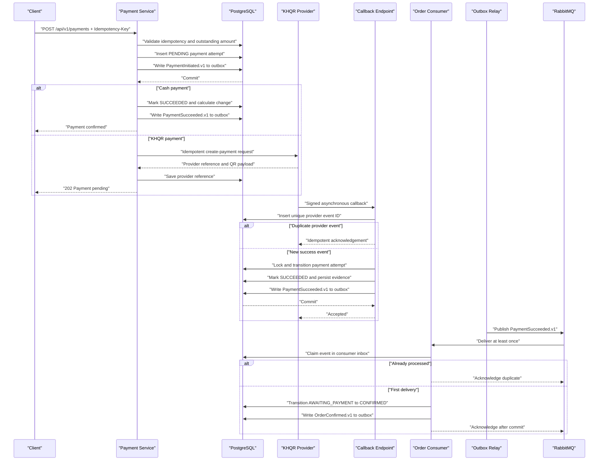
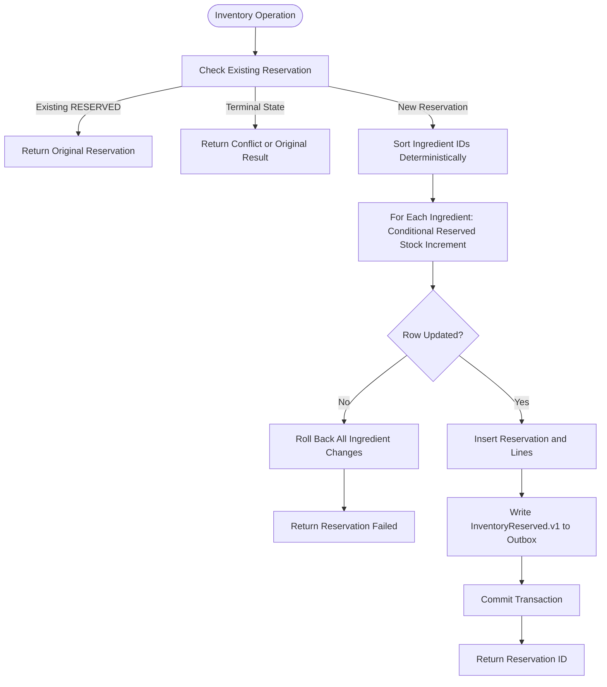
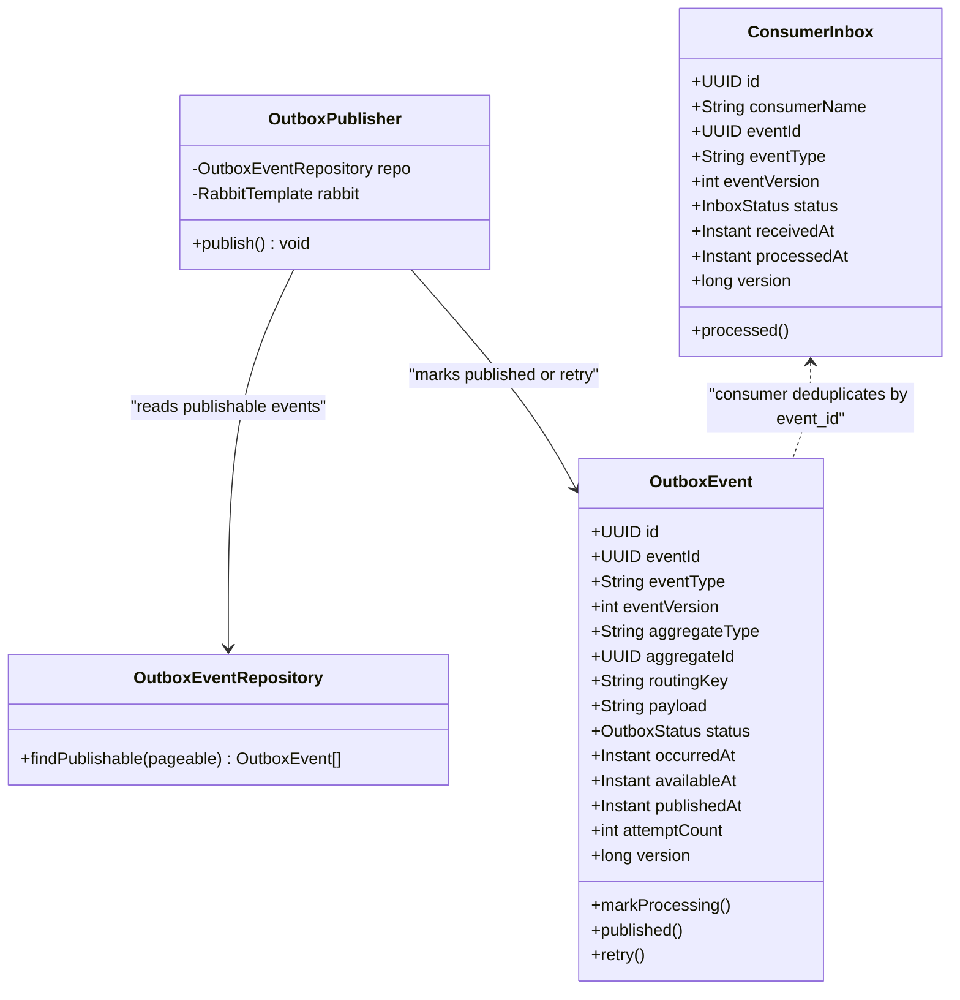
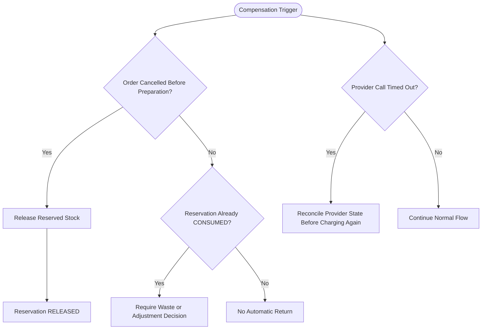
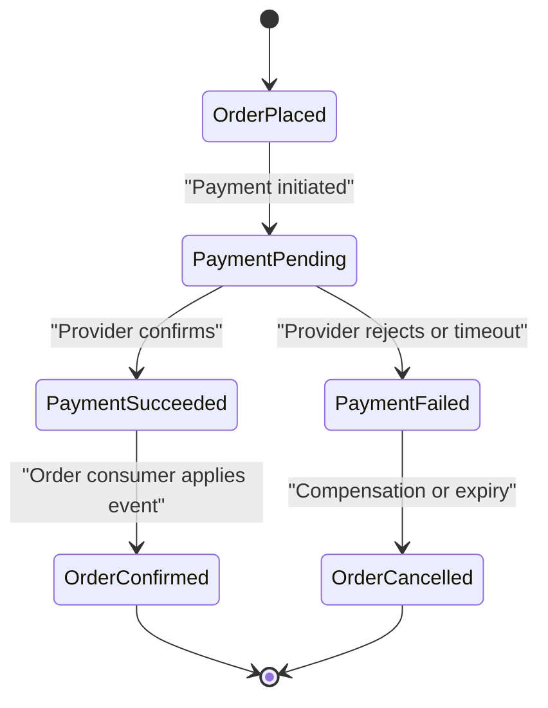
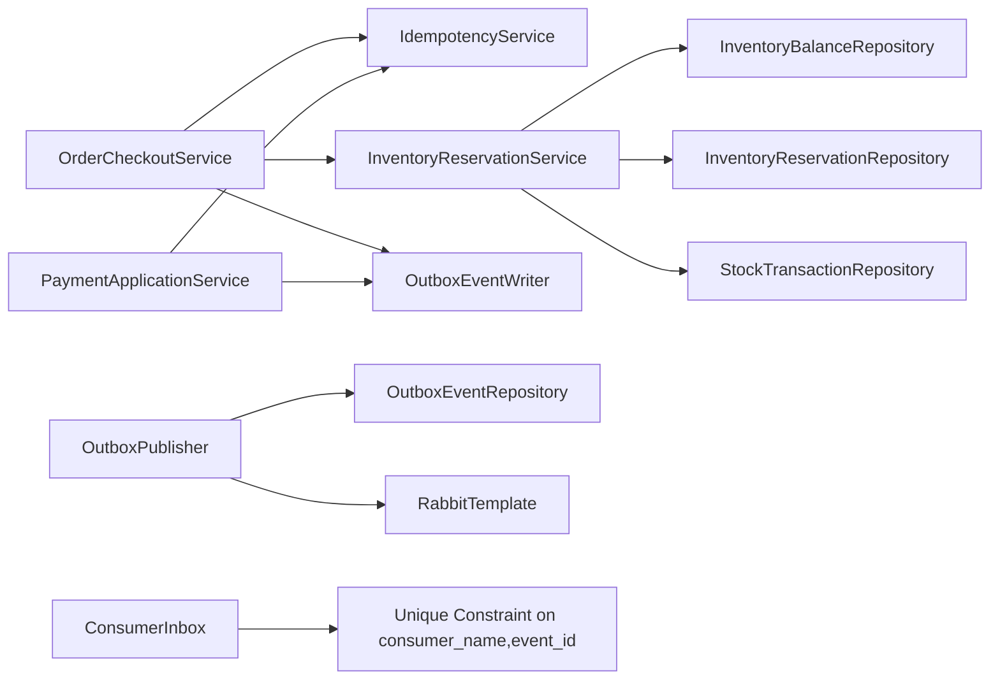

# Transaction & Consistency Model

<cite>
**Referenced Files in This Document**
- [ADR-004-transactional-outbox.md](file://adr/ADR-004-transactional-outbox.md)
- [ORDER_FLOW.mermaid](file://architecture/ORDER_FLOW.mermaid)
- [PAYMENT_FLOW.mermaid](file://architecture/PAYMENT_FLOW.mermaid)
- [INVENTORY_FLOW.mermaid](file://architecture/INVENTORY_FLOW.mermaid)
- [SYSTEM_ARCHITECTURE.md](file://architecture/SYSTEM_ARCHITECTURE.md)
- [OutboxEvent.java](file://src/main/java/com/smartcoffee/infrastructure/messaging/outbox/OutboxEvent.java)
- [OutboxEventRepository.java](file://src/main/java/com/smartcoffee/infrastructure/messaging/outbox/OutboxEventRepository.java)
- [OutboxPublisher.java](file://src/main/java/com/smartcoffee/infrastructure/messaging/outbox/OutboxPublisher.java)
- [ConsumerInbox.java](file://src/main/java/com/smartcoffee/infrastructure/messaging/inbox/ConsumerInbox.java)
- [IdempotencyService.java](file://src/main/java/com/smartcoffee/infrastructure/idempotency/IdempotencyService.java)
- [OrderCheckoutService.java](file://src/main/java/com/smartcoffee/modules/ordering/application/OrderCheckoutService.java)
- [PaymentApplicationService.java](file://src/main/java/com/smartcoffee/modules/payment/application/PaymentApplicationService.java)
- [InventoryReservationService.java](file://src/main/java/com/smartcoffee/modules/inventory/application/InventoryReservationService.java)
</cite>

## Table of Contents
1. [Introduction](#introduction)
2. [Project Structure](#project-structure)
3. [Core Components](#core-components)
4. [Architecture Overview](#architecture-overview)
5. [Detailed Component Analysis](#detailed-component-analysis)
6. [Dependency Analysis](#dependency-analysis)
7. [Performance Considerations](#performance-considerations)
8. [Troubleshooting Guide](#troubleshooting-guide)
9. [Conclusion](#conclusion)

## Introduction
This document explains the transaction and consistency model for the Smart Coffee Backend. It focuses on strong consistency requirements for critical operations, eventual consistency patterns for side effects, transaction boundaries across ordering, payment, and inventory, and the reliable event publishing strategy using a transactional outbox and consumer inbox. It also provides guidance for distributed transaction challenges, compensation strategies, reconciliation processes, and saga-style cross-service workflows.

## Project Structure
The backend is organized as a modular monolith with clear module boundaries:
- Ordering handles order creation, checkout, and integration with catalog, promotions, and inventory.
- Payment manages payment attempts, provider interactions, receipts, and order confirmation.
- Inventory manages stock balances, reservations, consumption, and stock ledger entries.
- Infrastructure provides idempotency, messaging (outbox and inbox), caching, notifications, and observability.

**Diagram sources**
- [ORDER_FLOW.mermaid:1-60](file://architecture/ORDER_FLOW.mermaid#L1-L60)
- [PAYMENT_FLOW.mermaid:1-73](file://architecture/PAYMENT_FLOW.mermaid#L1-L73)
- [INVENTORY_FLOW.mermaid:1-76](file://architecture/INVENTORY_FLOW.mermaid#L1-L76)

**Section sources**
- [SYSTEM_ARCHITECTURE.md:232-290](file://architecture/SYSTEM_ARCHITECTURE.md#L232-L290)

## Core Components
This section summarizes the core components that implement the transaction and consistency model.

- Idempotency service: Claims request keys, validates request hashes, prevents duplicate processing, and stores deterministic responses.
- Order checkout service: Performs server-authoritative pricing, promotion evaluation, inventory reservation, order persistence, and outbox event writing within one local database transaction.
- Payment application service: Creates payment attempts, interacts with external providers outside long-running transactions, transitions payment state, confirms orders, and writes outbox events.
- Inventory reservation service: Reserves ingredients atomically, consumes or releases reservations, and records immutable stock ledger entries.
- Transactional outbox: Persists integration events with business changes and publishes them reliably after broker confirmation.
- Consumer inbox: Deduplicates durable event consumption within the same transaction as the business effect.

**Section sources**
- [IdempotencyService.java:1-7](file://src/main/java/com/smartcoffee/infrastructure/idempotency/IdempotencyService.java#L1-L7)
- [OrderCheckoutService.java:62-133](file://src/main/java/com/smartcoffee/modules/ordering/application/OrderCheckoutService.java#L62-L133)
- [PaymentApplicationService.java:48-108](file://src/main/java/com/smartcoffee/modules/payment/application/PaymentApplicationService.java#L48-L108)
- [InventoryReservationService.java:43-97](file://src/main/java/com/smartcoffee/modules/inventory/application/InventoryReservationService.java#L43-L97)
- [OutboxEvent.java:15-216](file://src/main/java/com/smartcoffee/infrastructure/messaging/outbox/OutboxEvent.java#L15-L216)
- [OutboxPublisher.java:21-33](file://src/main/java/com/smartcoffee/infrastructure/messaging/outbox/OutboxPublisher.java#L21-L33)
- [ConsumerInbox.java:7-46](file://src/main/java/com/smartcoffee/infrastructure/messaging/inbox/ConsumerInbox.java#L7-L46)

## Architecture Overview
The system uses strong consistency for financially and operationally critical state, and eventual consistency for downstream consumers such as notifications, analytics, and caches.

**Diagram sources**
- [ORDER_FLOW.mermaid:16-54](file://architecture/ORDER_FLOW.mermaid#L16-L54)

**Section sources**
- [ORDER_FLOW.mermaid:1-60](file://architecture/ORDER_FLOW.mermaid#L1-L60)
- [SYSTEM_ARCHITECTURE.md:232-290](file://architecture/SYSTEM_ARCHITECTURE.md#L232-L290)

## Detailed Component Analysis

### Strong Consistency Requirements
Strong consistency is required for:
- Credential and refresh-token rotation
- Order idempotency
- Server-authoritative price calculation
- Promotion usage and redemption
- Payment state transitions
- Refund limits
- Inventory reservation and stock ledger
- Loyalty ledger entries
- Store-scoped authorization decisions

These guarantees are enforced by local PostgreSQL transactions, unique constraints, versioned entities, conditional updates, and explicit state transition methods.

**Section sources**
- [SYSTEM_ARCHITECTURE.md:262-290](file://architecture/SYSTEM_ARCHITECTURE.md#L262-L290)

### Eventual Consistency Patterns
Eventual consistency is acceptable for:
- Notification delivery
- Analytics dashboards
- Search indexes
- Catalog cache invalidation
- Receipt rendering after payment persistence
- Non-authoritative WebSocket updates

These side effects are driven by outbox events and consumer inbox deduplication.

**Section sources**
- [SYSTEM_ARCHITECTURE.md:278-290](file://architecture/SYSTEM_ARCHITECTURE.md#L278-L290)
- [ADR-004-transactional-outbox.md:14-20](file://adr/ADR-004-transactional-outbox.md#L14-L20)

### Transaction Boundaries

#### Order Placement Transaction
The order placement boundary includes:
1. Claim idempotency key and validate request hash.
2. Validate store and authorization.
3. Load server-authoritative catalog data.
4. Evaluate promotion and reserve redemption.
5. Calculate subtotal, discount, tax, rounding, and total.
6. Reserve inventory atomically.
7. Persist order and immutable line snapshots.
8. Write outbox event.
9. Store idempotent result.
10. Commit.

External payment requests must not execute while this database transaction remains open.

**Diagram sources**
- [ORDER_FLOW.mermaid:31-54](file://architecture/ORDER_FLOW.mermaid#L31-L54)
- [OrderCheckoutService.java:62-133](file://src/main/java/com/smartcoffee/modules/ordering/application/OrderCheckoutService.java#L62-L133)

**Section sources**
- [ORDER_FLOW.mermaid:16-54](file://architecture/ORDER_FLOW.mermaid#L16-L54)
- [OrderCheckoutService.java:62-133](file://src/main/java/com/smartcoffee/modules/ordering/application/OrderCheckoutService.java#L62-L133)
- [SYSTEM_ARCHITECTURE.md:234-250](file://architecture/SYSTEM_ARCHITECTURE.md#L234-L250)

#### Payment Processing Transaction
The payment boundary separates short-lived database work from external provider calls:
- A payment attempt and outbox record are created transactionally.
- External provider calls occur outside the database transaction.
- Provider callbacks are verified, deduplicated, and applied transactionally.
- Order confirmation occurs only after successful payment evidence.

**Diagram sources**
- [PAYMENT_FLOW.mermaid:14-69](file://architecture/PAYMENT_FLOW.mermaid#L14-L69)

**Section sources**
- [PAYMENT_FLOW.mermaid:14-73](file://architecture/PAYMENT_FLOW.mermaid#L14-L73)
- [PaymentApplicationService.java:48-108](file://src/main/java/com/smartcoffee/modules/payment/application/PaymentApplicationService.java#L48-L108)
- [SYSTEM_ARCHITECTURE.md:252-254](file://architecture/SYSTEM_ARCHITECTURE.md#L252-L254)

#### Inventory Management Transaction
Inventory operations ensure all ingredient reservations succeed or fail together:
- Reservation checks available stock deterministically.
- Partial reservations roll back.
- Consumption converts reserved stock into immutable ledger entries.
- Release returns reserved stock when an order is cancelled before preparation.

**Diagram sources**
- [INVENTORY_FLOW.mermaid:15-39](file://architecture/INVENTORY_FLOW.mermaid#L15-L39)
- [InventoryReservationService.java:43-54](file://src/main/java/com/smartcoffee/modules/inventory/application/InventoryReservationService.java#L43-L54)

**Section sources**
- [INVENTORY_FLOW.mermaid:15-68](file://architecture/INVENTORY_FLOW.mermaid#L15-L68)
- [InventoryReservationService.java:43-97](file://src/main/java/com/smartcoffee/modules/inventory/application/InventoryReservationService.java#L43-L97)
- [SYSTEM_ARCHITECTURE.md:256-258](file://architecture/SYSTEM_ARCHITECTURE.md#L256-L258)

### Transactional Outbox Pattern Implementation
The transactional outbox ensures that every business change and its corresponding integration event are committed atomically in PostgreSQL. A scheduled relay publishes unpublished events to RabbitMQ and marks them published only after broker confirmation. Consumers use a consumer inbox to deduplicate durable events within the same transaction as their business effect.

**Diagram sources**
- [OutboxEvent.java:15-216](file://src/main/java/com/smartcoffee/infrastructure/messaging/outbox/OutboxEvent.java#L15-L216)
- [OutboxEventRepository.java:8-11](file://src/main/java/com/smartcoffee/infrastructure/messaging/outbox/OutboxEventRepository.java#L8-L11)
- [OutboxPublisher.java:11-33](file://src/main/java/com/smartcoffee/infrastructure/messaging/outbox/OutboxPublisher.java#L11-L33)
- [ConsumerInbox.java:7-46](file://src/main/java/com/smartcoffee/infrastructure/messaging/inbox/ConsumerInbox.java#L7-L46)

**Section sources**
- [ADR-004-transactional-outbox.md:14-20](file://adr/ADR-004-transactional-outbox.md#L14-L20)
- [ADR-004-transactional-outbox.md:49-69](file://adr/ADR-004-transactional-outbox.md#L49-L69)
- [ADR-004-transactional-outbox.md:105-112](file://adr/ADR-004-transactional-outbox.md#L105-L112)
- [OutboxEvent.java:15-216](file://src/main/java/com/smartcoffee/infrastructure/messaging/outbox/OutboxEvent.java#L15-L216)
- [OutboxPublisher.java:21-33](file://src/main/java/com/smartcoffee/infrastructure/messaging/outbox/OutboxPublisher.java#L21-L33)
- [ConsumerInbox.java:7-46](file://src/main/java/com/smartcoffee/infrastructure/messaging/inbox/ConsumerInbox.java#L7-L46)

### Idempotency and Atomic Operations
Order and payment endpoints use idempotency keys with request hashing to prevent duplicate execution. The idempotency service enforces:
- Same key with different request hash results in a conflict.
- In-progress requests are rejected.
- Completed requests return stored responses.

Atomic operations include:
- Order placement with inventory reservation in one transaction.
- Payment state transitions guarded by existing paid checks.
- Inventory reservation with deterministic ingredient ordering and conditional stock updates.

**Section sources**
- [IdempotencyService.java:1-7](file://src/main/java/com/smartcoffee/infrastructure/idempotency/IdempotencyService.java#L1-L7)
- [OrderCheckoutService.java:62-133](file://src/main/java/com/smartcoffee/modules/ordering/application/OrderCheckoutService.java#L62-L133)
- [PaymentApplicationService.java:48-108](file://src/main/java/com/smartcoffee/modules/payment/application/PaymentApplicationService.java#L48-L108)
- [InventoryReservationService.java:43-54](file://src/main/java/com/smartcoffee/modules/inventory/application/InventoryReservationService.java#L43-L54)

### Compensation Strategies
Compensation is needed when a step fails after partial progress:
- If inventory reservation fails during order placement, the entire order transaction rolls back.
- If an order is cancelled before preparation, inventory reservations are released.
- If a reservation has already been consumed, automatic return is not allowed; waste or adjustment decisions are required.
- If a payment provider call times out, the system keeps the attempt pending or unknown and performs reconciliation rather than creating duplicate charges.

**Diagram sources**
- [INVENTORY_FLOW.mermaid:55-67](file://architecture/INVENTORY_FLOW.mermaid#L55-L67)
- [PAYMENT_FLOW.mermaid:34-38](file://architecture/PAYMENT_FLOW.mermaid#L34-L38)

**Section sources**
- [INVENTORY_FLOW.mermaid:55-67](file://architecture/INVENTORY_FLOW.mermaid#L55-L67)
- [PAYMENT_FLOW.mermaid:34-38](file://architecture/PAYMENT_FLOW.mermaid#L34-L38)

### Reconciliation Processes
Reconciliation is essential for external integrations:
- KHQR callbacks must be verified, signed, timestamped, and deduplicated by provider event ID.
- Duplicate provider events return idempotent acknowledgements.
- Successful callbacks lock the payment attempt, mark it succeeded, persist external evidence, and emit outbox events.
- Pending or unknown states require periodic verification and reconciliation before issuing new charges.

**Section sources**
- [PAYMENT_FLOW.mermaid:41-56](file://architecture/PAYMENT_FLOW.mermaid#L41-L56)
- [PAYMENT_FLOW.mermaid:71-73](file://architecture/PAYMENT_FLOW.mermaid#L71-L73)

### Distributed Transaction Challenges and Saga Pattern
The system avoids XA or two-phase commit due to operational complexity and coupling. Instead, it uses:
- Local transactions for atomic business state.
- Transactional outbox for reliable event publication.
- Consumer inbox for idempotent event consumption.
- Saga-like orchestration through domain events and compensating actions.

Saga-style workflow example:
1. Order placed emits `OrderPlaced.v1`.
2. Payment service consumes the event, creates a payment attempt, and emits `PaymentCompleted.v1` or failure events.
3. Inventory service reserves stock on order placement and consumes or releases stock based on later outcomes.
4. Notifications, analytics, and receipts react to these events eventually.

**Diagram sources**
- [ORDER_FLOW.mermaid:47-53](file://architecture/ORDER_FLOW.mermaid#L47-L53)
- [PAYMENT_FLOW.mermaid:59-69](file://architecture/PAYMENT_FLOW.mermaid#L59-L69)
- [ADR-004-transactional-outbox.md:14-20](file://adr/ADR-004-transactional-outbox.md#L14-L20)

**Section sources**
- [ADR-004-transactional-outbox.md:71-87](file://adr/ADR-004-transactional-outbox.md#L71-L87)
- [ADR-004-transactional-outbox.md:89-103](file://adr/ADR-004-transactional-outbox.md#L89-L103)

## Dependency Analysis
The following diagram shows how modules depend on infrastructure services for consistency and reliability.

**Diagram sources**
- [OrderCheckoutService.java:28-60](file://src/main/java/com/smartcoffee/modules/ordering/application/OrderCheckoutService.java#L28-L60)
- [PaymentApplicationService.java:20-46](file://src/main/java/com/smartcoffee/modules/payment/application/PaymentApplicationService.java#L20-L46)
- [InventoryReservationService.java:30-41](file://src/main/java/com/smartcoffee/modules/inventory/application/InventoryReservationService.java#L30-L41)
- [OutboxPublisher.java:11-18](file://src/main/java/com/smartcoffee/infrastructure/messaging/outbox/OutboxPublisher.java#L11-L18)
- [OutboxEventRepository.java:8-11](file://src/main/java/com/smartcoffee/infrastructure/messaging/outbox/OutboxEventRepository.java#L8-L11)
- [ConsumerInbox.java:7-9](file://src/main/java/com/smartcoffee/infrastructure/messaging/inbox/ConsumerInbox.java#L7-L9)

**Section sources**
- [OrderCheckoutService.java:28-60](file://src/main/java/com/smartcoffee/modules/ordering/application/OrderCheckoutService.java#L28-L60)
- [PaymentApplicationService.java:20-46](file://src/main/java/com/smartcoffee/modules/payment/application/PaymentApplicationService.java#L20-L46)
- [InventoryReservationService.java:30-41](file://src/main/java/com/smartcoffee/modules/inventory/application/InventoryReservationService.java#L30-L41)
- [OutboxPublisher.java:11-33](file://src/main/java/com/smartcoffee/infrastructure/messaging/outbox/OutboxPublisher.java#L11-L33)
- [OutboxEventRepository.java:8-11](file://src/main/java/com/smartcoffee/infrastructure/messaging/outbox/OutboxEventRepository.java#L8-L11)
- [ConsumerInbox.java:7-46](file://src/main/java/com/smartcoffee/infrastructure/messaging/inbox/ConsumerInbox.java#L7-L46)

## Performance Considerations
- Keep database transactions short. Avoid external HTTP calls inside long-running transactions.
- Use deterministic ordering for multi-ingredient reservations to reduce deadlocks.
- Batch outbox polling with bounded page sizes.
- Use exponential backoff for outbox retries.
- Monitor outbox age and consumer inbox lag.
- Prefer append-only stock ledger rows instead of mutating historical records.

[No sources needed since this section provides general guidance]

## Troubleshooting Guide
Common issues and resolutions:
- Idempotency conflicts: Occur when the same key is reused with a different request hash. Ensure clients send stable idempotency keys per intended operation.
- Duplicate events: Expected due to at-least-once delivery. Rely on consumer inbox deduplication and idempotent handlers.
- Stuck outbox events: Check publisher retries, broker connectivity, and error logs. Verify that events are marked published only after broker confirmation.
- Inventory conflicts: Occur when concurrent reservations compete for the same ingredients. Verify deterministic ingredient ordering and conditional updates.
- Payment reconciliation failures: Verify provider signatures, timestamps, and replay keys. Do not create duplicate charges without reconciling provider state.

**Section sources**
- [ADR-004-transactional-outbox.md:105-112](file://adr/ADR-004-transactional-outbox.md#L105-L112)
- [IdempotencyService.java:1-7](file://src/main/java/com/smartcoffee/infrastructure/idempotency/IdempotencyService.java#L1-L7)
- [OutboxPublisher.java:21-33](file://src/main/java/com/smartcoffee/infrastructure/messaging/outbox/OutboxPublisher.java#L21-L33)
- [InventoryReservationService.java:43-97](file://src/main/java/com/smartcoffee/modules/inventory/application/InventoryReservationService.java#L43-L97)
- [PAYMENT_FLOW.mermaid:41-56](file://architecture/PAYMENT_FLOW.mermaid#L41-L56)

## Conclusion
The Smart Coffee Backend enforces strong consistency for critical financial and operational state using local PostgreSQL transactions, idempotency controls, and explicit state transitions. Eventual consistency is used safely for notifications, analytics, and caches through a transactional outbox and consumer inbox. Order placement, payment processing, and inventory management have clearly defined transaction boundaries. Compensation strategies and reconciliation processes handle failures gracefully. For cross-service workflows, the system favors saga-style coordination via durable events rather than distributed transactions.

[No sources needed since this section summarizes without analyzing specific files]