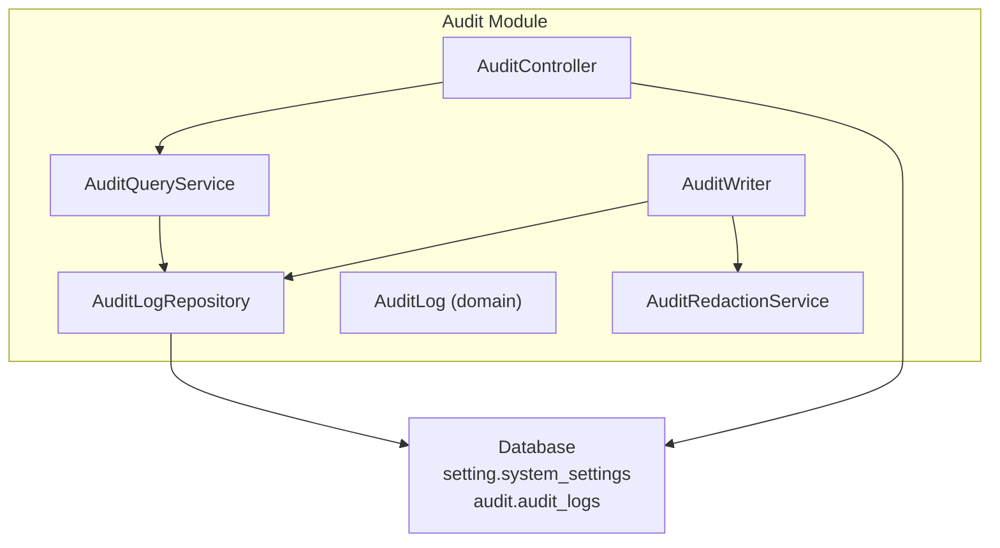
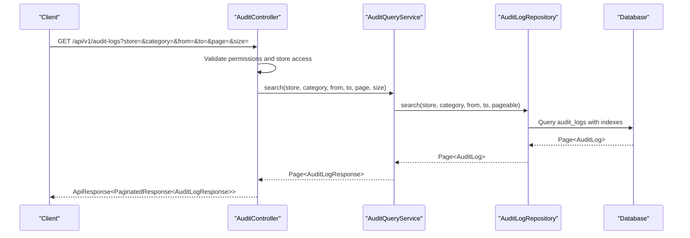
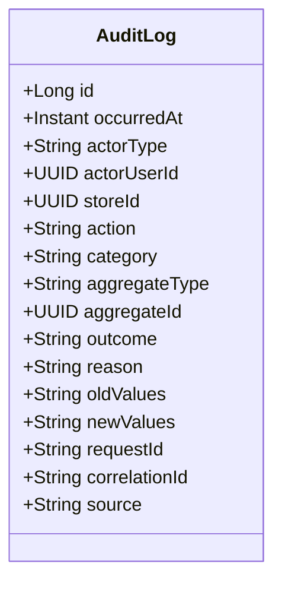
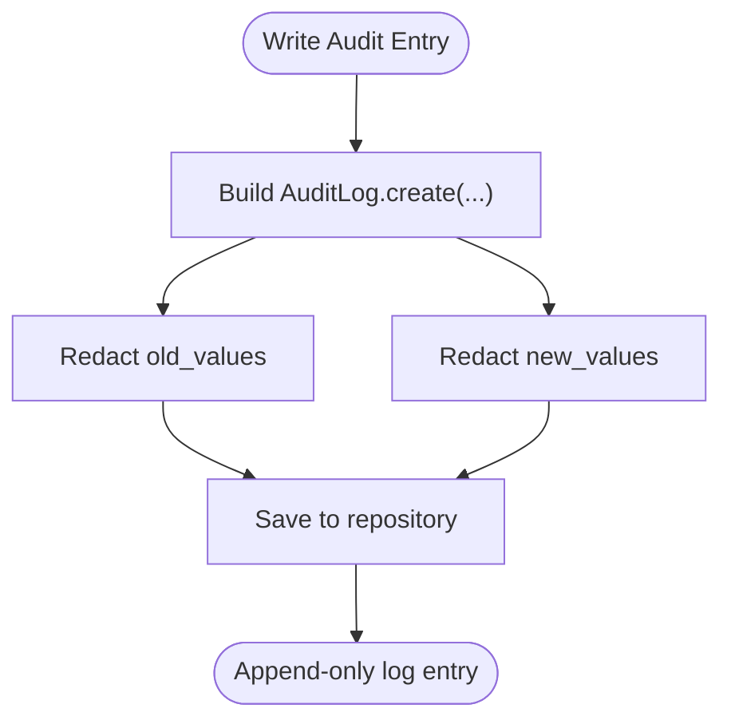
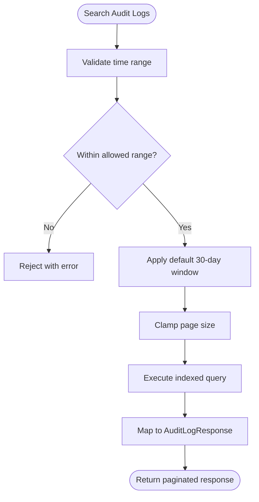
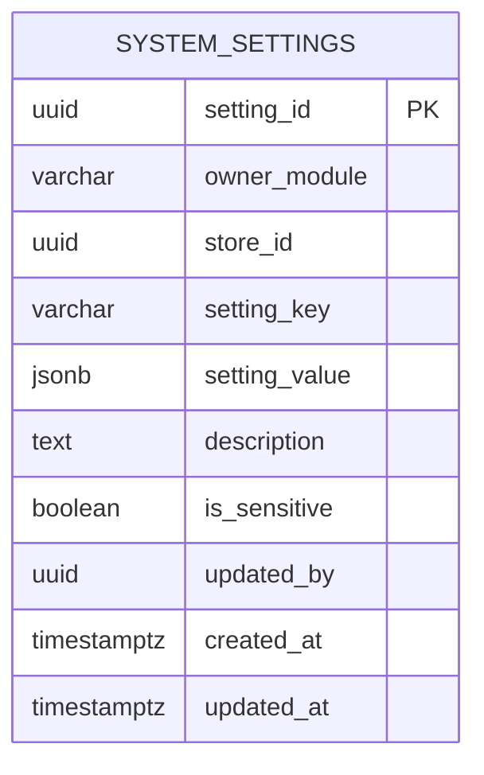
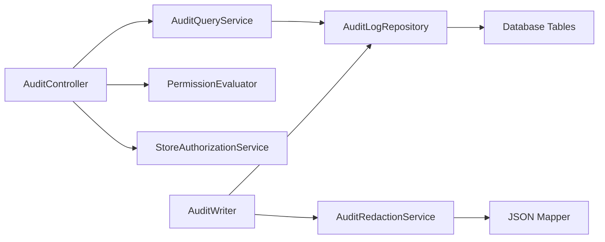

# Audit & Settings Schema

<cite>
**Referenced Files in This Document**
- [smart-coffee-logical.dbml](file://database/smart-coffee-logical.dbml)
- [AuditLog.java](file://src/main/java/com/smartcoffee/modules/audit/domain/AuditLog.java)
- [AuditLogRepository.java](file://src/main/java/com/smartcoffee/modules/audit/persistence/AuditLogRepository.java)
- [AuditWriter.java](file://src/main/java/com/smartcoffee/modules/audit/application/AuditWriter.java)
- [AuditQueryService.java](file://src/main/java/com/smartcoffee/modules/audit/application/AuditQueryService.java)
- [AuditController.java](file://src/main/java/com/smartcoffee/modules/audit/api/AuditController.java)
- [AuditLogResponse.java](file://src/main/java/com/smartcoffee/modules/audit/api/AuditLogResponse.java)
- [AuditRedactionService.java](file://src/main/java/com/smartcoffee/modules/audit/application/AuditRedactionService.java)
</cite>

## Table of Contents
1. [Introduction](#introduction)
2. [Project Structure](#project-structure)
3. [Core Components](#core-components)
4. [Architecture Overview](#architecture-overview)
5. [Detailed Component Analysis](#detailed-component-analysis)
6. [Dependency Analysis](#dependency-analysis)
7. [Performance Considerations](#performance-considerations)
8. [Troubleshooting Guide](#troubleshooting-guide)
9. [Conclusion](#conclusion)

## Introduction
This document defines the data model and operational behavior for two core areas:
- Audit trail for compliance tracking, including actor identity, action classification, entity change snapshots, and request correlation.
- System settings for configuration management with module scoping and optional store-level overrides.

The audit schema is implemented as an append-only log with redacted sensitive values. The settings schema stores JSON payloads keyed by owner module and optionally scoped to a store.

## Project Structure
The audit functionality is implemented under the audit module with clear separation between domain, persistence, application services, and API. The system settings table exists in the database logical model but has no dedicated Java implementation in this repository snapshot.

**Diagram sources**
- [AuditController.java:12-41](file://src/main/java/com/smartcoffee/modules/audit/api/AuditController.java#L12-L41)
- [AuditQueryService.java:19-30](file://src/main/java/com/smartcoffee/modules/audit/application/AuditQueryService.java#L19-L30)
- [AuditWriter.java:21-28](file://src/main/java/com/smartcoffee/modules/audit/application/AuditWriter.java#L21-L28)
- [AuditRedactionService.java:31-40](file://src/main/java/com/smartcoffee/modules/audit/application/AuditRedactionService.java#L31-L40)
- [AuditLog.java:7-43](file://src/main/java/com/smartcoffee/modules/audit/domain/AuditLog.java#L7-L43)
- [AuditLogRepository.java:10-23](file://src/main/java/com/smartcoffee/modules/audit/persistence/AuditLogRepository.java#L10-L23)
- [smart-coffee-logical.dbml:758-787](file://database/smart-coffee-logical.dbml#L758-L787)

**Section sources**
- [AuditController.java:12-41](file://src/main/java/com/smartcoffee/modules/audit/api/AuditController.java#L12-L41)
- [AuditQueryService.java:19-30](file://src/main/java/com/smartcoffee/modules/audit/application/AuditQueryService.java#L19-L30)
- [AuditWriter.java:21-28](file://src/main/java/com/smartcoffee/modules/audit/application/AuditWriter.java#L21-L28)
- [AuditRedactionService.java:31-40](file://src/main/java/com/smartcoffee/modules/audit/application/AuditRedactionService.java#L31-L40)
- [AuditLog.java:7-43](file://src/main/java/com/smartcoffee/modules/audit/domain/AuditLog.java#L7-L43)
- [AuditLogRepository.java:10-23](file://src/main/java/com/smartcoffee/modules/audit/persistence/AuditLogRepository.java#L10-L23)
- [smart-coffee-logical.dbml:758-787](file://database/smart-coffee-logical.dbml#L758-L787)

## Core Components
- Audit logs capture who did what, when, where, and why, with before/after snapshots and request correlation identifiers.
- System settings provide key-value configuration per owner module, optionally scoped to a store, with a flag indicating sensitivity.

Key responsibilities:
- AuditController exposes read-only audit queries with authorization checks.
- AuditQueryService enforces safe time ranges and pagination.
- AuditWriter records successful changes within a mandatory transaction context.
- AuditRedactionService removes sensitive fields from stored snapshots.
- AuditLogRepository provides append-only semantics and search queries.
- Database tables define the canonical schema and indexes.

**Section sources**
- [AuditController.java:12-41](file://src/main/java/com/smartcoffee/modules/audit/api/AuditController.java#L12-L41)
- [AuditQueryService.java:19-30](file://src/main/java/com/smartcoffee/modules/audit/application/AuditQueryService.java#L19-L30)
- [AuditWriter.java:21-28](file://src/main/java/com/smartcoffee/modules/audit/application/AuditWriter.java#L21-L28)
- [AuditRedactionService.java:31-40](file://src/main/java/com/smartcoffee/modules/audit/application/AuditRedactionService.java#L31-L40)
- [AuditLogRepository.java:10-23](file://src/main/java/com/smartcoffee/modules/audit/persistence/AuditLogRepository.java#L10-L23)
- [smart-coffee-logical.dbml:758-787](file://database/smart-coffee-logical.dbml#L758-L787)

## Architecture Overview
The audit flow integrates request context, authorization, and secure payload handling.

**Diagram sources**
- [AuditController.java:28-41](file://src/main/java/com/smartcoffee/modules/audit/api/AuditController.java#L28-L41)
- [AuditQueryService.java:19-30](file://src/main/java/com/smartcoffee/modules/audit/application/AuditQueryService.java#L19-L30)
- [AuditLogRepository.java:10-13](file://src/main/java/com/smartcoffee/modules/audit/persistence/AuditLogRepository.java#L10-L13)
- [smart-coffee-logical.dbml:772-787](file://database/smart-coffee-logical.dbml#L772-L787)

## Detailed Component Analysis

### Audit Logs Data Model
The audit log captures compliance-critical events with rich metadata and change snapshots.

- Primary key: auto-incrementing integer identifier.
- Timestamps: occurrence timestamp with default current time.
- Actor: user identifier and type; store scope for multi-tenant filtering.
- Action and category: classify the operation and business area.
- Aggregate: target aggregate type and identifier for cross-entity tracing.
- Outcome and reason: result and human-readable explanation.
- Change tracking: old_values and new_values as JSONB snapshots.
- Correlation: request_id and correlation_id for distributed tracing.
- Request context: ip_address and user_agent for forensics.
- Indexes: optimized for time-based scans and actor/store filters.

Notes on field alignment:
- The domain class includes additional fields such as actor_type, category, aggregate_type, aggregate_id, outcome, reason, source, and uses string types for request_id and correlation_id.
- The database model includes entity_type, entity_id, ip_address, and user_agent, which are not present in the domain class.
- Consumers should treat the domain and database models as complementary: the domain drives write/query behavior, while the database model defines storage layout and indexes.

**Diagram sources**
- [AuditLog.java:7-43](file://src/main/java/com/smartcoffee/modules/audit/domain/AuditLog.java#L7-L43)

**Section sources**
- [smart-coffee-logical.dbml:772-787](file://database/smart-coffee-logical.dbml#L772-L787)
- [AuditLog.java:7-43](file://src/main/java/com/smartcoffee/modules/audit/domain/AuditLog.java#L7-L43)

### Audit Writer and Redaction
Audit entries are created through a service that enforces transactional boundaries and redacts sensitive data before persistence.

- Transaction policy: writes require an existing transaction to ensure consistency with business operations.
- Context propagation: request_id and correlation_id are pulled from the current correlation context.
- Payload safety: before/after objects are converted to JSON and redacted using a predefined sensitive-field list.
- Source tagging: entries are tagged with a source label for provenance.

**Diagram sources**
- [AuditWriter.java:21-28](file://src/main/java/com/smartcoffee/modules/audit/application/AuditWriter.java#L21-L28)
- [AuditRedactionService.java:31-40](file://src/main/java/com/smartcoffee/modules/audit/application/AuditRedactionService.java#L31-L40)

**Section sources**
- [AuditWriter.java:21-28](file://src/main/java/com/smartcoffee/modules/audit/application/AuditWriter.java#L21-L28)
- [AuditRedactionService.java:14-23](file://src/main/java/com/smartcoffee/modules/audit/application/AuditRedactionService.java#L14-L23)
- [AuditRedactionService.java:31-40](file://src/main/java/com/smartcoffee/modules/audit/application/AuditRedactionService.java#L31-L40)

### Audit Query API
The audit query API supports filtered, paginated retrieval with strict range enforcement and authorization.

- Authorization: requires audit read permission and optional store authorization.
- Range validation: defaults to last 30 days if unspecified and rejects ranges exceeding 366 days.
- Pagination: enforces minimum page and clamps page size to a maximum.
- Response shape: returns a paginated response with correlation ID.

**Diagram sources**
- [AuditQueryService.java:19-30](file://src/main/java/com/smartcoffee/modules/audit/application/AuditQueryService.java#L19-L30)
- [AuditController.java:28-41](file://src/main/java/com/smartcoffee/modules/audit/api/AuditController.java#L28-L41)

**Section sources**
- [AuditQueryService.java:19-30](file://src/main/java/com/smartcoffee/modules/audit/application/AuditQueryService.java#L19-L30)
- [AuditController.java:28-41](file://src/main/java/com/smartcoffee/modules/audit/api/AuditController.java#L28-L41)
- [AuditLogResponse.java:6-8](file://src/main/java/com/smartcoffee/modules/audit/api/AuditLogResponse.java#L6-L8)

### System Settings Data Model
System settings provide module-scoped configuration with optional store-level overrides.

- Owner module: identifies the owning subsystem or feature.
- Store scope: null indicates global scope; non-null indicates store-specific override.
- Setting key: unique per owner_module and store_id combination.
- Setting value: JSON payload for flexible configuration structures.
- Description: human-readable documentation for the setting.
- Sensitivity flag: marks whether the value contains secrets requiring protection.
- Updated by: tracks the last modifier.
- Timestamps: creation and update timestamps.
- Unique index: ensures one effective value per module/store/key.

**Diagram sources**
- [smart-coffee-logical.dbml:758-770](file://database/smart-coffee-logical.dbml#L758-L770)

**Section sources**
- [smart-coffee-logical.dbml:758-770](file://database/smart-coffee-logical.dbml#L758-L770)

## Dependency Analysis
- AuditController depends on AuditQueryService, CurrentActorProvider, PermissionEvaluator, and StoreAuthorizationService for authorization and store scoping.
- AuditQueryService depends on AuditLogRepository for data access.
- AuditWriter depends on AuditLogRepository and AuditRedactionService for secure persistence.
- AuditRedactionService depends on a JSON mapper to traverse and mask sensitive fields.
- All persistence operations target the database tables defined in the logical model.

**Diagram sources**
- [AuditController.java:12-41](file://src/main/java/com/smartcoffee/modules/audit/api/AuditController.java#L12-L41)
- [AuditQueryService.java:19-30](file://src/main/java/com/smartcoffee/modules/audit/application/AuditQueryService.java#L19-L30)
- [AuditWriter.java:21-28](file://src/main/java/com/smartcoffee/modules/audit/application/AuditWriter.java#L21-L28)
- [AuditRedactionService.java:31-40](file://src/main/java/com/smartcoffee/modules/audit/application/AuditRedactionService.java#L31-L40)
- [AuditLogRepository.java:10-23](file://src/main/java/com/smartcoffee/modules/audit/persistence/AuditLogRepository.java#L10-L23)

**Section sources**
- [AuditController.java:12-41](file://src/main/java/com/smartcoffee/modules/audit/api/AuditController.java#L12-L41)
- [AuditQueryService.java:19-30](file://src/main/java/com/smartcoffee/modules/audit/application/AuditQueryService.java#L19-L30)
- [AuditWriter.java:21-28](file://src/main/java/com/smartcoffee/modules/audit/application/AuditWriter.java#L21-L28)
- [AuditRedactionService.java:31-40](file://src/main/java/com/smartcoffee/modules/audit/application/AuditRedactionService.java#L31-L40)
- [AuditLogRepository.java:10-23](file://src/main/java/com/smartcoffee/modules/audit/persistence/AuditLogRepository.java#L10-L23)

## Performance Considerations
- Append-only design: delete operations are disabled at the repository level to preserve integrity and simplify retention strategies.
- Index usage: queries filter by store, category, and time range, leveraging composite and column indexes for efficient scanning.
- Pagination limits: page size is clamped to prevent excessive memory consumption.
- Time range constraints: default windows and maximum range limits reduce scan sizes.
- JSONB payloads: use targeted queries and indexing strategies at the database layer for frequent JSONB predicates.
- Redaction cost: redaction traverses JSON trees; consider limiting snapshot size or pre-selecting fields to reduce overhead.

[No sources needed since this section provides general guidance]

## Troubleshooting Guide
Common issues and resolutions:
- Missing correlation IDs: ensure the correlation context is populated before writing audit entries so request_id and correlation_id are captured.
- Unauthorized audit access: verify that the caller has the required audit read permission and store authorization when filtering by store.
- Invalid time ranges: requests outside the allowed range will be rejected; adjust from/to parameters or rely on defaults.
- Excessive page sizes: page size is clamped; clients should respect the returned pagination metadata.
- Sensitive data leakage: confirm that payloads passed to the writer are compatible with the redaction rules and do not contain unexpected secret fields.

**Section sources**
- [AuditWriter.java:21-28](file://src/main/java/com/smartcoffee/modules/audit/application/AuditWriter.java#L21-L28)
- [AuditController.java:28-41](file://src/main/java/com/smartcoffee/modules/audit/api/AuditController.java#L28-L41)
- [AuditQueryService.java:19-30](file://src/main/java/com/smartcoffee/modules/audit/application/AuditQueryService.java#L19-L30)
- [AuditLogRepository.java:15-23](file://src/main/java/com/smartcoffee/modules/audit/persistence/AuditLogRepository.java#L15-L23)
- [AuditRedactionService.java:14-23](file://src/main/java/com/smartcoffee/modules/audit/application/AuditRedactionService.java#L14-L23)

## Conclusion
The audit schema provides a robust, append-only compliance trail with strong controls around correlation, authorization, and sensitive data handling. The system settings schema offers flexible, module-scoped configuration with optional store overrides and a sensitivity marker. Together, these models support secure operations, traceability, and maintainable configuration management.

[No sources needed since this section summarizes without analyzing specific files]