# Catalog & Product Schema

<cite>
**Referenced Files in This Document**
- [smart-coffee-logical.dbml](file://database/smart-coffee-logical.dbml)
- [V003__catalog_categories_products_customizations.sql](file://src/main/resources/db/migration/V003__catalog_categories_products_customizations.sql)
- [Product.java](file://src/main/java/com/smartcoffee/modules/catalog/domain/Product.java)
- [ProductCategory.java](file://src/main/java/com/smartcoffee/modules/catalog/domain/ProductCategory.java)
- [StoreProduct.java](file://src/main/java/com/smartcoffee/modules/catalog/domain/StoreProduct.java)
- [CustomizationGroup.java](file://src/main/java/com/smartcoffee/modules/catalog/domain/CustomizationGroup.java)
- [CustomizationOption.java](file://src/main/java/com/smartcoffee/modules/catalog/domain/CustomizationOption.java)
- [ProductCustomizationGroup.java](file://src/main/java/com/smartcoffee/modules/catalog/domain/ProductCustomizationGroup.java)
- [SelectionType.java](file://src/main/java/com/smartcoffee/modules/catalog/domain/SelectionType.java)
- [StoreProductRepository.java](file://src/main/java/com/smartcoffee/modules/catalog/persistence/StoreProductRepository.java)
- [ProductRepository.java](file://src/main/java/com/smartcoffee/modules/catalog/persistence/ProductRepository.java)
- [ProductCategoryRepository.java](file://src/main/java/com/smartcoffee/modules/catalog/persistence/ProductCategoryRepository.java)
- [CustomizationGroupRepository.java](file://src/main/java/com/smartcoffee/modules/catalog/persistence/CustomizationGroupRepository.java)
- [CustomizationOptionRepository.java](file://src/main/java/com/smartcoffee/modules/catalog/persistence/CustomizationOptionRepository.java)
</cite>

## Table of Contents
1. [Introduction](#introduction)
2. [Project Structure](#project-structure)
3. [Core Components](#core-components)
4. [Architecture Overview](#architecture-overview)
5. [Detailed Component Analysis](#detailed-component-analysis)
6. [Dependency Analysis](#dependency-analysis)
7. [Performance Considerations](#performance-considerations)
8. [Troubleshooting Guide](#troubleshooting-guide)
9. [Conclusion](#conclusion)

## Introduction
This document defines the data model for the Catalog and Product domain, focusing on:
- Product categories hierarchy
- Products with pricing and availability
- Store-specific product configurations
- Customization groups and options
- Relationships between products, categories, and customizations (single and multiple selection types)
- Store-product mappings
- Price history tracking
- Product availability management
- Field definitions, validation rules, and performance indexes

The schema is implemented using JPA entities and SQL migrations, with repository queries optimized for catalog browsing and filtering.

## Project Structure
The catalog domain spans database schema definitions, JPA entities, and repositories:
- Logical schema definition in DBML
- Migration script defining tables, constraints, and indexes
- Domain entities mapping to tables
- Repositories exposing query methods and native projections

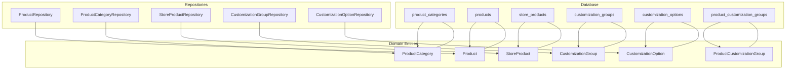

**Diagram sources**
- [smart-coffee-logical.dbml:212-309](file://database/smart-coffee-logical.dbml#L212-L309)
- [ProductCategory.java:1-25](file://src/main/java/com/smartcoffee/modules/catalog/domain/ProductCategory.java#L1-L25)
- [Product.java:1-31](file://src/main/java/com/smartcoffee/modules/catalog/domain/Product.java#L1-L31)
- [StoreProduct.java:1-55](file://src/main/java/com/smartcoffee/modules/catalog/domain/StoreProduct.java#L1-L55)
- [CustomizationGroup.java:1-24](file://src/main/java/com/smartcoffee/modules/catalog/domain/CustomizationGroup.java#L1-L24)
- [CustomizationOption.java:1-24](file://src/main/java/com/smartcoffee/modules/catalog/domain/CustomizationOption.java#L1-L24)
- [ProductCustomizationGroup.java:1-13](file://src/main/java/com/smartcoffee/modules/catalog/domain/ProductCustomizationGroup.java#L1-L13)
- [ProductRepository.java:1-7](file://src/main/java/com/smartcoffee/modules/catalog/persistence/ProductRepository.java#L1-L7)
- [ProductCategoryRepository.java:1-7](file://src/main/java/com/smartcoffee/modules/catalog/persistence/ProductCategoryRepository.java#L1-L7)
- [StoreProductRepository.java:1-33](file://src/main/java/com/smartcoffee/modules/catalog/persistence/StoreProductRepository.java#L1-L33)
- [CustomizationGroupRepository.java:1-29](file://src/main/java/com/smartcoffee/modules/catalog/persistence/CustomizationGroupRepository.java#L1-L29)
- [CustomizationOptionRepository.java:1-7](file://src/main/java/com/smartcoffee/modules/catalog/persistence/CustomizationOptionRepository.java#L1-L7)

**Section sources**
- [smart-coffee-logical.dbml:212-309](file://database/smart-coffee-logical.dbml#L212-L309)
- [V003__catalog_categories_products_customizations.sql:1-128](file://src/main/resources/db/migration/V003__catalog_categories_products_customizations.sql#L1-L128)

## Core Components
- ProductCategory: hierarchical category with parent reference, code/name/description, image key, display order, active flag, versioning.
- Product: belongs to a category; includes base price, currency, preparation time, tax rate, customizable flag, active flag, versioning.
- StoreProduct: maps a product to a store with station code, optional override price, availability, sold-out window, versioning.
- CustomizationGroup: reusable customization group with selection type (SINGLE/MULTIPLE), min/max selections, display order, active flag, versioning.
- CustomizationOption: option within a group with additional price, display order, active flag, unique code per group, versioning.
- ProductCustomizationGroup: links a product to a customization group with required flag and display order.

Key relationships:
- Product → ProductCategory (many-to-one)
- StoreProduct ↔ Product (many-to-one via composite key)
- CustomizationOption → CustomizationGroup (many-to-one)
- ProductCustomizationGroup → Product and CustomizationGroup (join table)

Validation highlights:
- Category cannot be its own parent
- Display orders are non-negative
- Selection types restricted to SINGLE or MULTIPLE
- Min/max selections validated
- Prices non-negative where applicable

Indexes:
- Category active + ordering
- Product by category + active + name
- Store product by store + availability + product
- Option by group + active + order

**Section sources**
- [ProductCategory.java:1-25](file://src/main/java/com/smartcoffee/modules/catalog/domain/ProductCategory.java#L1-L25)
- [Product.java:1-31](file://src/main/java/com/smartcoffee/modules/catalog/domain/Product.java#L1-L31)
- [StoreProduct.java:1-55](file://src/main/java/com/smartcoffee/modules/catalog/domain/StoreProduct.java#L1-L55)
- [CustomizationGroup.java:1-24](file://src/main/java/com/smartcoffee/modules/catalog/domain/CustomizationGroup.java#L1-L24)
- [CustomizationOption.java:1-24](file://src/main/java/com/smartcoffee/modules/catalog/domain/CustomizationOption.java#L1-L24)
- [ProductCustomizationGroup.java:1-13](file://src/main/java/com/smartcoffee/modules/catalog/domain/ProductCustomizationGroup.java#L1-L13)
- [V003__catalog_categories_products_customizations.sql:3-128](file://src/main/resources/db/migration/V003__catalog_categories_products_customizations.sql#L3-L128)

## Architecture Overview
The catalog data model supports:
- Hierarchical categories enabling nested product organization
- Product-level attributes including pricing and tax configuration
- Store-specific product availability and optional price overrides
- Reusable customization groups with single or multiple selection semantics
- Product-to-customization-group associations controlling required groups and ordering

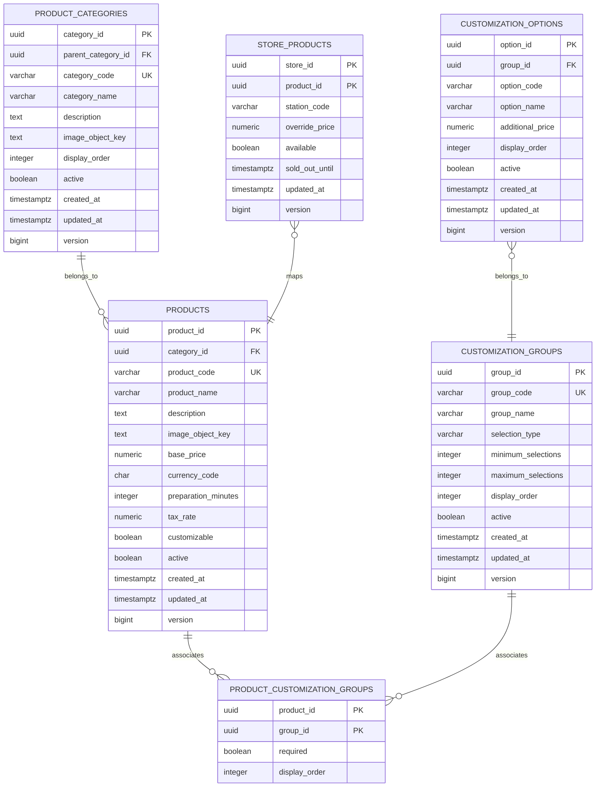

**Diagram sources**
- [smart-coffee-logical.dbml:212-309](file://database/smart-coffee-logical.dbml#L212-L309)
- [V003__catalog_categories_products_customizations.sql:3-128](file://src/main/resources/db/migration/V003__catalog_categories_products_customizations.sql#L3-L128)

## Detailed Component Analysis

### Product Categories Hierarchy
- Fields: id, parentCategoryId, code, name, description, imageObjectKey, displayOrder, active, timestamps, version
- Validation:
  - Parent cannot equal self
  - Display order must be non-negative
- Indexes:
  - Active + display order + name for efficient listing
- Usage:
  - Products reference a category
  - Category tree can be traversed via parentCategoryId

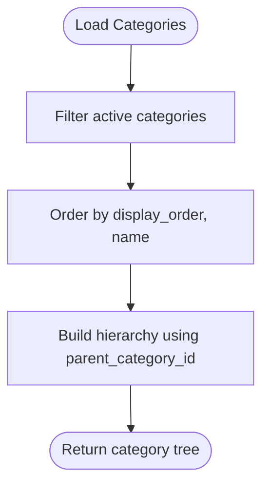

**Diagram sources**
- [ProductCategoryRepository.java:1-7](file://src/main/java/com/smartcoffee/modules/catalog/persistence/ProductCategoryRepository.java#L1-L7)
- [V003__catalog_categories_products_customizations.sql:3-26](file://src/main/resources/db/migration/V003__catalog_categories_products_customizations.sql#L3-L26)

**Section sources**
- [ProductCategory.java:1-25](file://src/main/java/com/smartcoffee/modules/catalog/domain/ProductCategory.java#L1-L25)
- [ProductCategoryRepository.java:1-7](file://src/main/java/com/smartcoffee/modules/catalog/persistence/ProductCategoryRepository.java#L1-L7)
- [V003__catalog_categories_products_customizations.sql:3-26](file://src/main/resources/db/migration/V003__catalog_categories_products_customizations.sql#L3-L26)

### Products with Pricing and Availability
- Fields: id, code, categoryId, name, description, imageObjectKey, basePrice, currencyCode, preparationMinutes, taxRate, customizable, active, timestamps, version
- Validation:
  - Base price non-negative
  - Preparation minutes non-negative
  - Tax rate non-negative
- Indexes:
  - Category + active + name for catalog listings
  - Lowercased product name for search
- Availability:
  - Product-level active flag controls visibility
  - Store-level availability controlled by StoreProduct

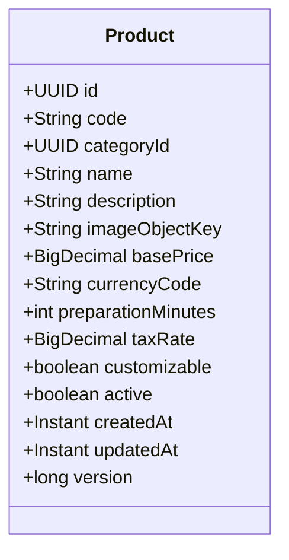

**Diagram sources**
- [Product.java:1-31](file://src/main/java/com/smartcoffee/modules/catalog/domain/Product.java#L1-L31)
- [V003__catalog_categories_products_customizations.sql:28-56](file://src/main/resources/db/migration/V003__catalog_categories_products_customizations.sql#L28-L56)

**Section sources**
- [Product.java:1-31](file://src/main/java/com/smartcoffee/modules/catalog/domain/Product.java#L1-L31)
- [ProductRepository.java:1-7](file://src/main/java/com/smartcoffee/modules/catalog/persistence/ProductRepository.java#L1-L7)
- [V003__catalog_categories_products_customizations.sql:28-56](file://src/main/resources/db/migration/V003__catalog_categories_products_customizations.sql#L28-L56)

### Store-Specific Product Configurations
- Fields: storeId, productId, stationCode, overridePrice, available, soldOutUntil, updatedAt, version
- Behavior:
  - Composite primary key (store_id, product_id)
  - Override price replaces base price when present
  - Available computed as available AND (soldOutUntil is null OR before now)
- Indexes:
  - Store + available + product for fast filtering
- Mappings:
  - Links products to stores with operational details

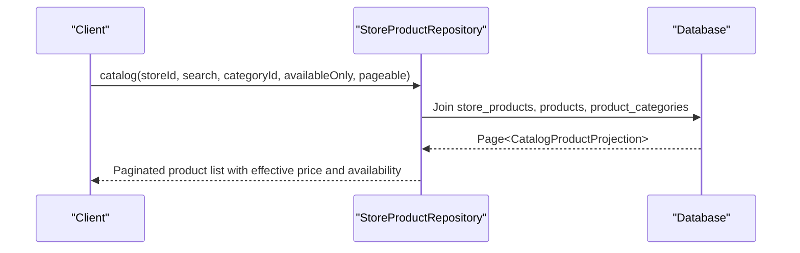

**Diagram sources**
- [StoreProductRepository.java:8-29](file://src/main/java/com/smartcoffee/modules/catalog/persistence/StoreProductRepository.java#L8-L29)
- [StoreProduct.java:1-55](file://src/main/java/com/smartcoffee/modules/catalog/domain/StoreProduct.java#L1-L55)
- [V003__catalog_categories_products_customizations.sql:57-77](file://src/main/resources/db/migration/V003__catalog_categories_products_customizations.sql#L57-L77)

**Section sources**
- [StoreProduct.java:1-55](file://src/main/java/com/smartcoffee/modules/catalog/domain/StoreProduct.java#L1-L55)
- [StoreProductRepository.java:1-33](file://src/main/java/com/smartcoffee/modules/catalog/persistence/StoreProductRepository.java#L1-L33)
- [V003__catalog_categories_products_customizations.sql:57-77](file://src/main/resources/db/migration/V003__catalog_categories_products_customizations.sql#L57-L77)

### Customization Groups and Options
- CustomizationGroup:
  - Fields: id, code, name, selectionType (SINGLE/MULTIPLE), minimumSelections, maximumSelections, displayOrder, active, timestamps, version
  - Validation:
    - selection_type restricted to SINGLE or MULTIPLE
    - minimum_selections >= 0
    - maximum_selections >= minimum_selections if provided
- CustomizationOption:
  - Fields: id, groupId, code, name, additionalPrice, displayOrder, active, timestamps, version
  - Unique constraint: (group_id, option_code)
  - Validation: additional_price >= 0
- ProductCustomizationGroup:
  - Fields: productId, groupId, required, displayOrder
  - Primary key: (product_id, group_id)

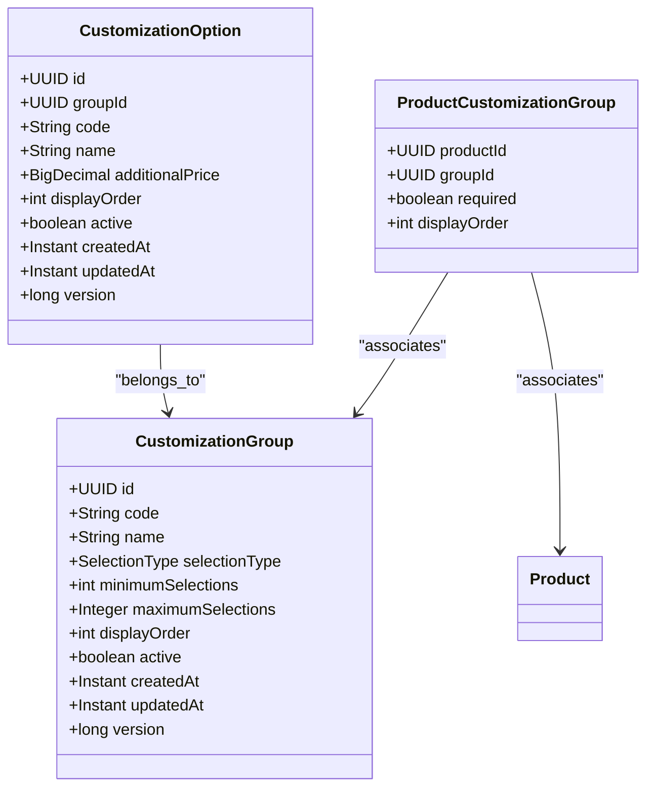

**Diagram sources**
- [CustomizationGroup.java:1-24](file://src/main/java/com/smartcoffee/modules/catalog/domain/CustomizationGroup.java#L1-L24)
- [CustomizationOption.java:1-24](file://src/main/java/com/smartcoffee/modules/catalog/domain/CustomizationOption.java#L1-L24)
- [ProductCustomizationGroup.java:1-13](file://src/main/java/com/smartcoffee/modules/catalog/domain/ProductCustomizationGroup.java#L1-L13)
- [V003__catalog_categories_products_customizations.sql:79-128](file://src/main/resources/db/migration/V003__catalog_categories_products_customizations.sql#L79-L128)

**Section sources**
- [CustomizationGroup.java:1-24](file://src/main/java/com/smartcoffee/modules/catalog/domain/CustomizationGroup.java#L1-L24)
- [CustomizationOption.java:1-24](file://src/main/java/com/smartcoffee/modules/catalog/domain/CustomizationOption.java#L1-L24)
- [ProductCustomizationGroup.java:1-13](file://src/main/java/com/smartcoffee/modules/catalog/domain/ProductCustomizationGroup.java#L1-L13)
- [CustomizationGroupRepository.java:1-29](file://src/main/java/com/smartcoffee/modules/catalog/persistence/CustomizationGroupRepository.java#L1-L29)
- [CustomizationOptionRepository.java:1-7](file://src/main/java/com/smartcoffee/modules/catalog/persistence/CustomizationOptionRepository.java#L1-L7)
- [V003__catalog_categories_products_customizations.sql:79-128](file://src/main/resources/db/migration/V003__catalog_categories_products_customizations.sql#L79-L128)

### Relationship Between Products, Categories, and Customizations
- Product → Category: Many-to-one via categoryId
- Product ↔ CustomizationGroup: Many-to-many via ProductCustomizationGroup
- CustomizationGroup → Options: One-to-many via CustomizationOption.groupId
- Selection semantics:
  - SINGLE: choose exactly one option (min=1, max=1 typically)
  - MULTIPLE: choose zero or more options up to maximum_selections

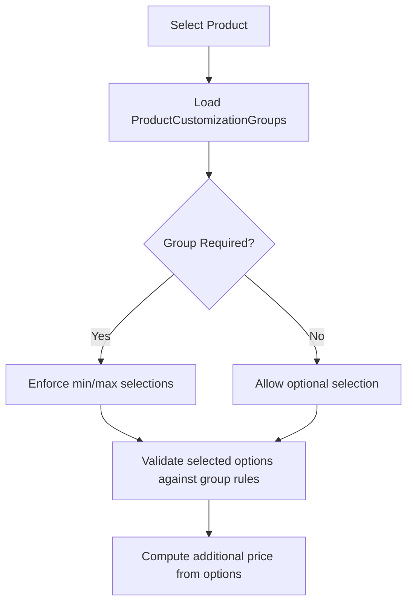

**Diagram sources**
- [ProductCustomizationGroup.java:1-13](file://src/main/java/com/smartcoffee/modules/catalog/domain/ProductCustomizationGroup.java#L1-L13)
- [CustomizationGroup.java:1-24](file://src/main/java/com/smartcoffee/modules/catalog/domain/CustomizationGroup.java#L1-L24)
- [CustomizationOption.java:1-24](file://src/main/java/com/smartcoffee/modules/catalog/domain/CustomizationOption.java#L1-L24)
- [V003__catalog_categories_products_customizations.sql:122-128](file://src/main/resources/db/migration/V003__catalog_categories_products_customizations.sql#L122-L128)

**Section sources**
- [Product.java:1-31](file://src/main/java/com/smartcoffee/modules/catalog/domain/Product.java#L1-L31)
- [ProductCategory.java:1-25](file://src/main/java/com/smartcoffee/modules/catalog/domain/ProductCategory.java#L1-L25)
- [ProductCustomizationGroup.java:1-13](file://src/main/java/com/smartcoffee/modules/catalog/domain/ProductCustomizationGroup.java#L1-L13)
- [CustomizationGroup.java:1-24](file://src/main/java/com/smartcoffee/modules/catalog/domain/CustomizationGroup.java#L1-L24)
- [CustomizationOption.java:1-24](file://src/main/java/com/smartcoffee/modules/catalog/domain/CustomizationOption.java#L1-L24)

### Store-Product Mappings
- Mapping table: store_products
- Purpose:
  - Associate products with stores
  - Provide station assignment
  - Allow store-level price override
  - Control availability and temporary sold-out windows
- Query support:
  - Native projection joins store_products, products, and product_categories
  - Filters by store, category, search term, and availability

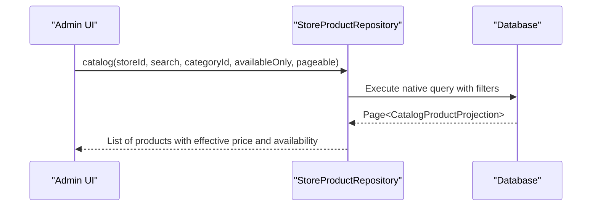

**Diagram sources**
- [StoreProductRepository.java:8-29](file://src/main/java/com/smartcoffee/modules/catalog/persistence/StoreProductRepository.java#L8-L29)
- [V003__catalog_categories_products_customizations.sql:57-77](file://src/main/resources/db/migration/V003__catalog_categories_products_customizations.sql#L57-L77)

**Section sources**
- [StoreProductRepository.java:1-33](file://src/main/java/com/smartcoffee/modules/catalog/persistence/StoreProductRepository.java#L1-L33)
- [V003__catalog_categories_products_customizations.sql:57-77](file://src/main/resources/db/migration/V003__catalog_categories_products_customizations.sql#L57-L77)

### Price History Tracking
- The logical DBML defines a table catalog.store_product_prices for historical pricing:
  - Fields include store_id, product_id, amount, currency_code, effective_from, effective_to, created_by, timestamps
  - Unique index on (store_id, product_id, effective_from)
- Note: The migration V003 does not create this table; it exists only in the logical model. If used, ensure the corresponding DDL is applied.

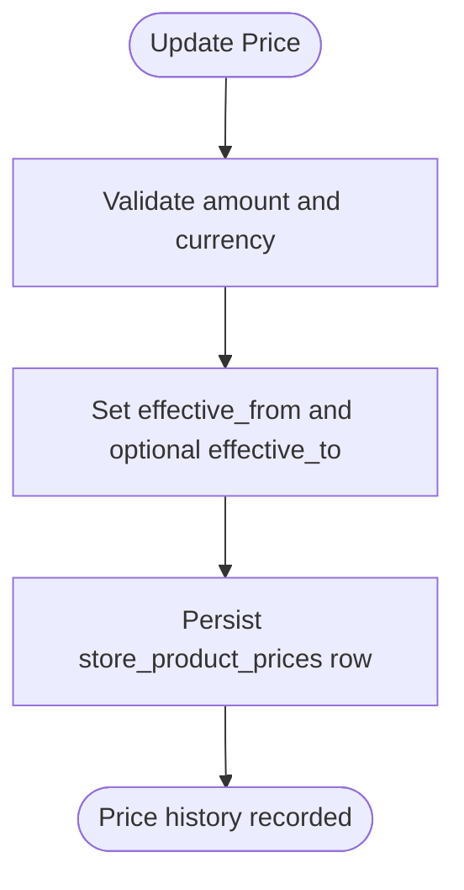

**Diagram sources**
- [smart-coffee-logical.dbml:255-266](file://database/smart-coffee-logical.dbml#L255-L266)

**Section sources**
- [smart-coffee-logical.dbml:255-266](file://database/smart-coffee-logical.dbml#L255-L266)

### Product Availability Management
- Two-layer control:
  - Product.active: global visibility
  - StoreProduct.available + soldOutUntil: store-level availability
- Effective availability:
  - Computed as available AND (soldOutUntil is null OR before current timestamp)
- Query integration:
  - Catalog query filters by store, category, search, and availability

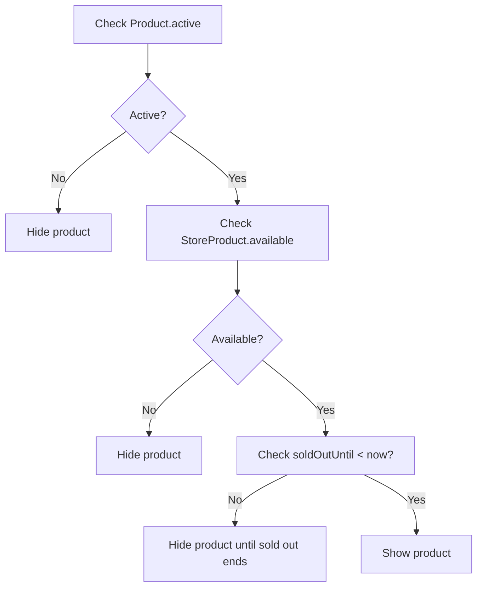

**Diagram sources**
- [StoreProduct.java:46-48](file://src/main/java/com/smartcoffee/modules/catalog/domain/StoreProduct.java#L46-L48)
- [StoreProductRepository.java:12-18](file://src/main/java/com/smartcoffee/modules/catalog/persistence/StoreProductRepository.java#L12-L18)
- [V003__catalog_categories_products_customizations.sql:57-77](file://src/main/resources/db/migration/V003__catalog_categories_products_customizations.sql#L57-L77)

**Section sources**
- [StoreProduct.java:1-55](file://src/main/java/com/smartcoffee/modules/catalog/domain/StoreProduct.java#L1-L55)
- [StoreProductRepository.java:1-33](file://src/main/java/com/smartcoffee/modules/catalog/persistence/StoreProductRepository.java#L1-L33)
- [V003__catalog_categories_products_customizations.sql:57-77](file://src/main/resources/db/migration/V003__catalog_categories_products_customizations.sql#L57-L77)

## Dependency Analysis
- Entities depend on JPA annotations and map directly to catalog schema tables
- Repositories depend on Spring Data JPA and provide:
  - Simple CRUD and finder methods
  - Native queries for catalog browsing with joins and filters
- Cross-entity dependencies:
  - Product depends on ProductCategory
  - StoreProduct depends on Product
  - CustomizationOption depends on CustomizationGroup
  - ProductCustomizationGroup depends on both Product and CustomizationGroup

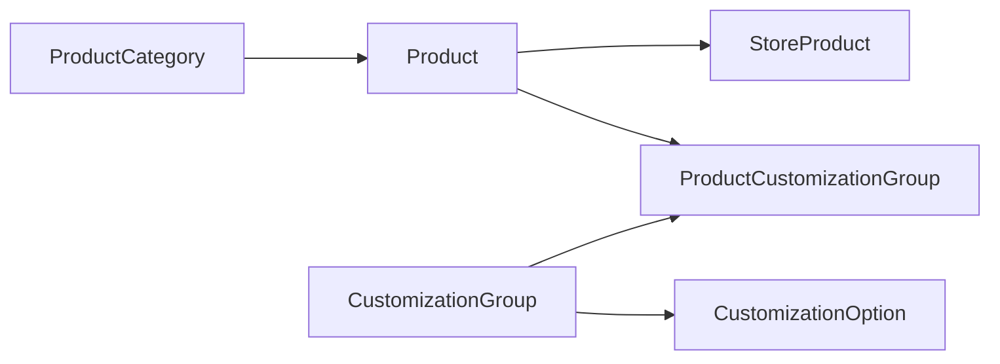

**Diagram sources**
- [ProductCategory.java:1-25](file://src/main/java/com/smartcoffee/modules/catalog/domain/ProductCategory.java#L1-L25)
- [Product.java:1-31](file://src/main/java/com/smartcoffee/modules/catalog/domain/Product.java#L1-L31)
- [StoreProduct.java:1-55](file://src/main/java/com/smartcoffee/modules/catalog/domain/StoreProduct.java#L1-L55)
- [CustomizationGroup.java:1-24](file://src/main/java/com/smartcoffee/modules/catalog/domain/CustomizationGroup.java#L1-L24)
- [CustomizationOption.java:1-24](file://src/main/java/com/smartcoffee/modules/catalog/domain/CustomizationOption.java#L1-L24)
- [ProductCustomizationGroup.java:1-13](file://src/main/java/com/smartcoffee/modules/catalog/domain/ProductCustomizationGroup.java#L1-L13)

**Section sources**
- [ProductRepository.java:1-7](file://src/main/java/com/smartcoffee/modules/catalog/persistence/ProductRepository.java#L1-L7)
- [ProductCategoryRepository.java:1-7](file://src/main/java/com/smartcoffee/modules/catalog/persistence/ProductCategoryRepository.java#L1-L7)
- [StoreProductRepository.java:1-33](file://src/main/java/com/smartcoffee/modules/catalog/persistence/StoreProductRepository.java#L1-L33)
- [CustomizationGroupRepository.java:1-29](file://src/main/java/com/smartcoffee/modules/catalog/persistence/CustomizationGroupRepository.java#L1-L29)
- [CustomizationOptionRepository.java:1-7](file://src/main/java/com/smartcoffee/modules/catalog/persistence/CustomizationOptionRepository.java#L1-L7)

## Performance Considerations
- Index usage:
  - Category listing uses active + display_order + name
  - Product listing uses category_id + active + product_name
  - Store product filtering uses store_id + available + product_id
  - Option listing uses group_id + active + display_order
- Query optimization:
  - Native catalog query joins store_products, products, and product_categories with filters for store, category, search, and availability
  - Use pagination to limit result sets
- Recommendations:
  - Keep search terms short and leverage lower(product_name) index
  - Avoid broad full-text searches without limits
  - Ensure soldOutUntil is maintained accurately to avoid unnecessary scans

[No sources needed since this section provides general guidance]

## Troubleshooting Guide
Common issues and resolutions:
- Category self-parent violation:
  - Ensure parent_category_id is null or different from category_id
- Invalid selection constraints:
  - For SINGLE groups, set minimum_selections = 1 and maximum_selections = 1
  - For MULTIPLE groups, ensure maximum_selections >= minimum_selections
- Negative prices:
  - Validate base_price, override_price, and additional_price are non-negative
- Availability not showing:
  - Check Product.active and StoreProduct.available
  - Verify soldOutUntil is either null or in the past
- Search returns no results:
  - Confirm product_name and product_code contain the search substring
  - Ensure store filter matches an active store mapping

**Section sources**
- [V003__catalog_categories_products_customizations.sql:15-19](file://src/main/resources/db/migration/V003__catalog_categories_products_customizations.sql#L15-L19)
- [V003__catalog_categories_products_customizations.sql:44-46](file://src/main/resources/db/migration/V003__catalog_categories_products_customizations.sql#L44-L46)
- [V003__catalog_categories_products_customizations.sql:67-70](file://src/main/resources/db/migration/V003__catalog_categories_products_customizations.sql#L67-L70)
- [V003__catalog_categories_products_customizations.sql:91-98](file://src/main/resources/db/migration/V003__catalog_categories_products_customizations.sql#L91-L98)
- [V003__catalog_categories_products_customizations.sql:113-113](file://src/main/resources/db/migration/V003__catalog_categories_products_customizations.sql#L113-L113)
- [StoreProductRepository.java:12-18](file://src/main/java/com/smartcoffee/modules/catalog/persistence/StoreProductRepository.java#L12-L18)

## Conclusion
The catalog and product schema provides a robust foundation for managing hierarchical categories, products with pricing and tax configuration, store-specific availability and pricing, and flexible customization groups supporting both single and multiple selection types. Proper use of indexes and repository queries ensures efficient catalog browsing and filtering. For advanced scenarios like price history, align application logic with the logical model’s store_product_prices structure and ensure corresponding DDL is applied.

[No sources needed since this section summarizes without analyzing specific files]