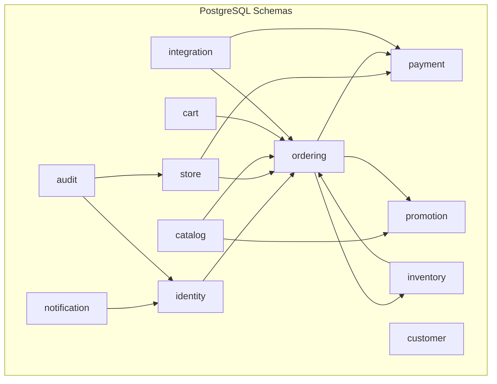
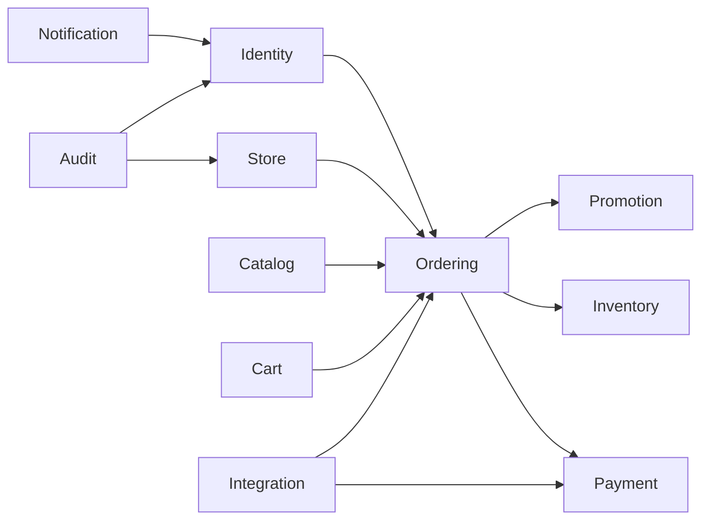

# Data Models & Database Schema

<cite>
**Referenced Files in This Document**
- [smart-coffee-logical.dbml](file://database/smart-coffee-logical.dbml)
- [DB_OWNERSHIP_MATRIX.md](file://database/DB_OWNERSHIP_MATRIX.md)
- [SCHEMA_CHANGELOG.md](file://database/SCHEMA_CHANGELOG.md)
- [V001__identity_auth_rbac.sql](file://src/main/resources/db/migration/V001__identity_auth_rbac.sql)
- [V003__catalog_categories_products_customizations.sql](file://src/main/resources/db/migration/V003__catalog_categories_products_customizations.sql)
- [V005__recipe_inventory_uom_reservation_ledger.sql](file://src/main/resources/db/migration/V005__recipe_inventory_uom_reservation_ledger.sql)
- [V006__orders_checkout.sql](file://src/main/resources/db/migration/V006__orders_checkout.sql)
- [V007__payments_receipts.sql](file://src/main/resources/db/migration/V007__payments_receipts.sql)
- [V009__promotions_loyalty.sql](file://src/main/resources/db/migration/V009__promotions_loyalty.sql)
- [V010__notifications_audit.sql](file://src/main/resources/db/migration/V010__notifications_audit.sql)
- [V011__infrastructure_hardening.sql](file://src/main/resources/db/migration/V011__infrastructure_hardening.sql)
- [ADR-002-postgresql-ownership.md](file://adr/ADR-002-postgresql-ownership.md)
</cite>

## Table of Contents
1. Introduction
2. Project Structure
3. Core Components
4. Architecture Overview
5. Detailed Component Analysis
6. Dependency Analysis
7. Performance Considerations
8. Troubleshooting Guide
9. Conclusion
10. Appendices

## Introduction
This document provides comprehensive data model documentation for the Smart Coffee Backend database schema. It covers entity relationships, field definitions, data types, primary and foreign keys, indexes, constraints, multi-tenant store-scoped isolation strategy, ownership matrix, validation rules, referential integrity policies, schema diagrams, sample data structures, lifecycle management, migration strategies with Flyway, backward compatibility considerations, security and privacy requirements, and access control mechanisms.

The system is designed as a modular monolith using PostgreSQL schemas aligned to domain ownership. Each table has exactly one write owner, enabling future extraction into independent services while preserving strong relational constraints during the initial phase.

## Project Structure
The database schema is defined through:
- A logical DBML model describing tables, enums, and relationships.
- A set of Flyway SQL migrations that implement the schema incrementally.
- Ownership and changelog documents guiding evolution and service boundaries.



**Diagram sources**
- [V001__identity_auth_rbac.sql:1-135](file://src/main/resources/db/migration/V001__identity_auth_rbac.sql#L1-L135)
- [V003__catalog_categories_products_customizations.sql:1-300](file://src/main/resources/db/migration/V003__catalog_categories_products_customizations.sql#L1-L300)
- [V005__recipe_inventory_uom_reservation_ledger.sql:1-318](file://src/main/resources/db/migration/V005__recipe_inventory_uom_reservation_ledger.sql#L1-L318)
- [V006__orders_checkout.sql:261-509](file://src/main/resources/db/migration/V006__orders_checkout.sql#L261-L509)
- [V007__payments_receipts.sql:1-121](file://src/main/resources/db/migration/V007__payments_receipts.sql#L1-L121)
- [V009__promotions_loyalty.sql:1-201](file://src/main/resources/db/migration/V009__promotions_loyalty.sql#L1-L201)
- [V010__notifications_audit.sql:1-152](file://src/main/resources/db/migration/V010__notifications_audit.sql#L1-L152)
- [V011__infrastructure_hardening.sql:1-183](file://src/main/resources/db/migration/V011__infrastructure_hardening.sql#L1-L183)

**Section sources**
- [smart-coffee-logical.dbml:28-800](file://database/smart-coffee-logical.dbml#L28-L800)
- [SCHEMA_CHANGELOG.md:108-128](file://database/SCHEMA_CHANGELOG.md#L108-L128)

## Core Components
The platform organizes persistent data by domain schemas:
- Identity and RBAC: users, credentials, roles, permissions, sessions, role assignments.
- Store: stores and opening hours.
- Customer: profiles, favorites, consents, loyalty accounts and ledger.
- Catalog: categories, products, store availability, customization groups/options, product-customization mappings.
- Cart: carts, items, customizations.
- Ordering: orders, order items, customizations, status history.
- Payment: methods, payments, receipts; plus infrastructure tables for attempts, callbacks, refunds, reconciliations.
- Inventory: units of measure, ingredients, recipe versions and lines, balances, reservations, stock transactions.
- Promotion: promotions, eligibility links, redemptions.
- Notification: notifications, recipients, deliveries, device tokens, preferences.
- Audit: append-only audit logs.
- Integration: outbox events and consumer inbox for reliable messaging.

Key design principles:
- UUID primary keys for business entities.
- timestamptz for timestamps; local time only for opening hours interpreted with store timezone.
- Exact numeric types for money and quantities; non-negative checks enforced.
- Append-only ledgers for stock, loyalty, and audit.
- One write owner per table; cross-schema foreign keys allowed within the same database during modular monolith phase.

**Section sources**
- [ADR-002-postgresql-ownership.md:14-93](file://adr/ADR-002-postgresql-ownership.md#L14-L93)
- [DB_OWNERSHIP_MATRIX.md:16-117](file://database/DB_OWNERSHIP_MATRIX.md#L16-L117)

## Architecture Overview
The database architecture follows a schema-per-domain approach with clear ownership and strict constraints. The logical model defines enumerations and relationships across modules, while migrations implement concrete tables, constraints, and indexes.

```mermaid
erDiagram
identity.users ||--o| identity.user_credentials : "has"
identity.users ||--o| identity.auth_sessions : "owns"
identity.roles ||--o{ identity.role_permissions : "grants"
identity.permissions ||--o{ identity.role_permissions : "belongs_to"
identity.users ||--o{ identity.user_role_assignments : "assigned"
organization.stores ||--o{ inventory.inventory_balances : "holds"
catalog.products ||--o{ ordering.order_items : "ordered_as"
catalog.product_categories ||--o{ catalog.products : "contains"
catalog.customization_groups ||--o{ catalog.customization_options : "defines"
catalog.products ||--o{ promotion.promotion_products : "eligible_for"
catalog.product_categories ||--o{ promotion.promotion_categories : "eligible_for"
customer.customer_profiles ||--o| loyalty.loyalty_accounts : "has"
customer.customer_profiles ||--o{ promotion.promotion_redemptions : "redeems"
ordering.orders ||--o{ ordering.order_items : "contains"
ordering.orders ||--o{ payment.payments : "paid_by"
ordering.orders ||--o{ promotion.promotion_redemptions : "uses"
ordering.orders ||--o{ inventory.inventory_reservations : "reserves"
inventory.ingredients ||--o{ inventory.recipe_version_lines : "required_by"
inventory.stock_transactions ||--o{ inventory.stock_transaction_lines : "composed_of"
notification.notifications ||--o{ notification.notification_recipients : "sent_to"
notification.notification_recipients ||--o{ notification.notification_deliveries : "delivered_via"
audit.audit_logs }--|| identity.users : "actor"
audit.audit_logs }--|| organization.stores : "scoped"
```

**Diagram sources**
- [smart-coffee-logical.dbml:28-800](file://database/smart-coffee-logical.dbml#L28-L800)
- [V001__identity_auth_rbac.sql:1-135](file://src/main/resources/db/migration/V001__identity_auth_rbac.sql#L1-L135)
- [V003__catalog_categories_products_customizations.sql:1-300](file://src/main/resources/db/migration/V003__catalog_categories_products_customizations.sql#L1-L300)
- [V005__recipe_inventory_uom_reservation_ledger.sql:1-318](file://src/main/resources/db/migration/V005__recipe_inventory_uom_reservation_ledger.sql#L1-L318)
- [V006__orders_checkout.sql:261-509](file://src/main/resources/db/migration/V006__orders_checkout.sql#L261-L509)
- [V007__payments_receipts.sql:1-121](file://src/main/resources/db/migration/V007__payments_receipts.sql#L1-L121)
- [V009__promotions_loyalty.sql:1-201](file://src/main/resources/db/migration/V009__promotions_loyalty.sql#L1-L201)
- [V010__notifications_audit.sql:1-152](file://src/main/resources/db/migration/V010__notifications_audit.sql#L1-L152)

## Detailed Component Analysis

### Identity and RBAC
- Users: unique normalized email and phone; status constrained; security versioning; timestamps.
- Credentials: password hash, algorithm, failed login count, lockout timestamp.
- Roles and Permissions: canonical catalogs; role-permission grants.
- User Role Assignments: store-scoped assignment with expiry and revocation; index on active assignments.
- Auth Sessions: token family, refresh token hash uniqueness, expiry constraints, active session index.

Validation and constraints:
- Status values restricted via check constraints.
- Expiry must be after assigned time.
- Session expiry must be after creation.

Indexes:
- Unique normalized email and phone.
- Active assignment index filtered by revoked_at.
- Active session index filtered by revoked_at.

**Section sources**
- [V001__identity_auth_rbac.sql:1-135](file://src/main/resources/db/migration/V001__identity_auth_rbac.sql#L1-L135)
- [smart-coffee-logical.dbml:28-134](file://database/smart-coffee-logical.dbml#L28-L134)

### Store
- Stores: code, name, address, coordinates, timezone, default currency, flags.
- Opening Hours: day-of-week scoped; unique per store-day; open/close times; closed flag.

Constraints:
- Latitude/longitude ranges enforced at application level or via constraints if added.
- Day-of-week uniqueness per store.

**Section sources**
- [smart-coffee-logical.dbml:136-161](file://database/smart-coffee-logical.dbml#L136-L161)
- [SCHEMA_CHANGELOG.md:31-36](file://database/SCHEMA_CHANGELOG.md#L31-L36)

### Catalog and Customization
- Categories: hierarchical with parent reference; display order; active flag.
- Products: category link; base price; currency; preparation minutes; tax rate; customizable flag; active flag.
- Store Products: per-store availability and optional override price; sold-out until timestamp.
- Customization Groups: selection type (single/multiple), min/max selections, active flag.
- Customization Options: group-scoped codes; additional price; active flag.
- Product-Group and Option Mappings: required flags, display order, availability overrides.

Constraints:
- Non-negative prices and taxes; preparation minutes non-negative.
- Self-parent prevention; display order non-negative.
- Selection type restricted; min/max consistency.

Indexes:
- Category active ordering index.
- Product category active index.
- Option group active index.

**Section sources**
- [V003__catalog_categories_products_customizations.sql:1-300](file://src/main/resources/db/migration/V003__catalog_categories_products_customizations.sql#L1-L300)
- [smart-coffee-logical.dbml:212-309](file://database/smart-coffee-logical.dbml#L212-L309)

### Cart
- Carts: customer-scoped, store-scoped, status, currency, expiration, versioned.
- Cart Items: product snapshot pricing; quantity; note.
- Cart Item Customizations: option snapshots; additional price snapshots; quantity.

Constraints:
- Positive quantities; non-negative monetary snapshots.
- Status restricted to cart states.

Indexes:
- Composite index on customer/store/status for efficient queries.

**Section sources**
- [smart-coffee-logical.dbml:351-384](file://database/smart-coffee-logical.dbml#L351-L384)

### Ordering
- Orders: store-scoped; source and fulfillment type; status; totals; currency; timestamps; version.
- Order Items: product and recipe snapshots; line totals; notes.
- Order Item Customizations: group and option snapshots; additional price; quantity.
- Order Status History: from/to status transitions; actor; reason; request correlation.

Constraints:
- Source and fulfillment type restricted.
- Monetary fields non-negative; total quantity positive.
- Status restricted to order states.

Indexes:
- Customer-time index for order history.
- Store-status-time index for operational queries.
- Reservation linkage to orders.

**Section sources**
- [V006__orders_checkout.sql:261-509](file://src/main/resources/db/migration/V006__orders_checkout.sql#L261-L509)
- [smart-coffee-logical.dbml:386-458](file://database/smart-coffee-logical.dbml#L386-L458)

### Payment
- Payment Methods: method code/name/type; active; display order.
- Payments: order-scoped; store-scoped; method; status; amounts; provider references; timestamps; version.
- Receipts: linked to payment and order; status; snapshot payload; object key; issued timestamp.

Constraints:
- Payment status restricted; amounts non-negative; cash fields validated.
- Unique paid payment per order; unique provider reference when present.

Indexes:
- Paid payment per order filter.
- Provider reference uniqueness filter.
- Order-time index; expiry index for pending/processing.

**Section sources**
- [V007__payments_receipts.sql:1-121](file://src/main/resources/db/migration/V007__payments_receipts.sql#L1-L121)
- [smart-coffee-logical.dbml:460-567](file://database/smart-coffee-logical.dbml#L460-L567)

### Inventory and Recipe
- Units of Measure: code, name, type, scale, conversion factor, base unit flag.
- Ingredients: base unit; standard cost; tracking flag; active.
- Recipe Versions: product-scoped; version number; status; effective period.
- Recipe Version Lines: ingredient requirement; wastage percent; uniqueness per recipe-version/ingredient.
- Inventory Balances: store/ingredient composite key; current/reserved/minimum stock; average unit cost; version.
- Inventory Reservations: store/order-scoped; status; expiry; consumed/released/expired timestamps.
- Reservation Lines: ingredient quantity reserved/consumed; uniqueness per reservation/ingredient.
- Stock Transactions: transaction number unique per store; type; reference; recorded user; occurrence time.
- Stock Transaction Lines: ingredient lot optional; delta; unit cost; balance before/after.

Constraints:
- Unit type restricted; scale range; conversion factor positive.
- Ingredient cost non-negative.
- Recipe status restricted; effective period valid.
- Quantity positive; wastage between 0 and 100.
- Balance non-negative; reserved <= current; minimum non-negative; cost non-negative.
- Reservation status restricted; expiry after creation.
- Reserved quantity positive; consumed <= reserved.
- Transaction type restricted; delta non-zero; cost non-negative; balances non-negative.

Indexes:
- Active recipe index.
- Reservation expiry index filtered by active.
- Stock transaction store-time index.
- Transaction line transaction index.

**Section sources**
- [V005__recipe_inventory_uom_reservation_ledger.sql:1-318](file://src/main/resources/db/migration/V005__recipe_inventory_uom_reservation_ledger.sql#L1-L318)
- [smart-coffee-logical.dbml:569-677](file://database/smart-coffee-logical.dbml#L569-L677)

### Promotion and Loyalty
- Promotions: discount type/value; minimum order amount; maximum discount; currency; validity period; status; usage limits; stackable/automatic/priority flags; version.
- Promotion Eligibility: product/category/store links.
- Redemptions: promotion/order/customer/store-scoped; status; discount amount; reserved/redeemed/released timestamps; version.
- Loyalty Accounts: available/reserved/lifetime points; status; join date; version.
- Loyalty Transactions: transaction number unique; type; delta; balance before/after; order/event linkage; occurrence time.

Constraints:
- Discount value positive; minimum order amount non-negative; max discount non-negative; ends after starts.
- Usage limits positive when present; usage count non-negative.
- Redemption status restricted; discount non-negative.
- Loyalty points non-negative; transaction type restricted; balances non-negative.

Indexes:
- Active promotions index by status and time window.
- Redemption customer/promotion/status index.
- Redemption expiry index filtered by reserved.
- Loyalty account time index.

**Section sources**
- [V009__promotions_loyalty.sql:1-201](file://src/main/resources/db/migration/V009__promotions_loyalty.sql#L1-L201)
- [smart-coffee-logical.dbml:311-349](file://database/smart-coffee-logical.dbml#L311-L349)
- [smart-coffee-logical.dbml:190-210](file://database/smart-coffee-logical.dbml#L190-L210)

### Notification and Audit
- Notifications: source event id; type/category/message key; template arguments; action URL; related entity; priority; expiry; version.
- Recipients: per notification/user; locale; read/archived timestamps; version.
- Deliveries: recipient/channel-scoped; status; provider info; attempt count; next attempt; delivered timestamp; version.
- Device Tokens: user-scoped; token hash; encrypted token; platform; active; version.
- Preferences: user/category/channel enabled flags; version.
- Audit Logs: actor type/user; store scope; action/category; aggregate type/id; outcome; reason; old/new values; request/correlation IDs; source.

Constraints:
- Delivery channel and status restricted; attempt count non-negative.
- Unique source_event_id + notification_type to prevent duplicates.
- Unique recipient per notification/user.
- Unique delivery per recipient/channel.
- Preference uniqueness per user/category/channel.

Indexes:
- User-time index for recipients.
- Unread index filtered by read/archived nulls.
- Pending delivery index by status and next attempt.
- Audit store-time index; aggregate index; request index.

**Section sources**
- [V010__notifications_audit.sql:1-152](file://src/main/resources/db/migration/V010__notifications_audit.sql#L1-L152)
- [smart-coffee-logical.dbml:708-787](file://database/smart-coffee-logical.dbml#L708-L787)

### Integration Reliability
- Outbox Events: event id/type/version; aggregate type/id; routing key; payload JSONB; status; occurrence/available/published timestamps; attempt count; claim info; error info; version.
- Consumer Inbox: consumer name; event id/type/version; status; received/processed timestamps; attempt count; error info; version.

Constraints:
- Event id unique; event version positive; status restricted; published_at required when published.
- Consumer event uniqueness per consumer; event version positive; status restricted; processed_at required when processed.

Indexes:
- Ready outbox index by status and availability.
- Claim index for processing.
- Stale processing index for recovery.
- Aggregate and routing key indices.
- Consumer inbox event index; status index; processed index.

**Section sources**
- [V011__infrastructure_hardening.sql:1-183](file://src/main/resources/db/migration/V011__infrastructure_hardening.sql#L1-L183)
- [smart-coffee-logical.dbml:789-800](file://database/smart-coffee-logical.dbml#L789-L800)

## Dependency Analysis
Cross-module dependencies are enforced via foreign keys where appropriate and logical UUID references otherwise. During the modular monolith phase, cross-schema foreign keys are permitted within the same PostgreSQL instance. After extraction:
- Remove physical foreign keys across services.
- Maintain UUID references validated by application logic or replicated reference data.
- Ensure no write access from other services to owned tables.

Ownership matrix clarifies which module owns each table and its purpose, guiding future extraction and boundary enforcement.



**Diagram sources**
- [DB_OWNERSHIP_MATRIX.md:16-117](file://database/DB_OWNERSHIP_MATRIX.md#L16-L117)
- [V006__orders_checkout.sql:261-509](file://src/main/resources/db/migration/V006__orders_checkout.sql#L261-L509)
- [V007__payments_receipts.sql:1-121](file://src/main/resources/db/migration/V007__payments_receipts.sql#L1-L121)
- [V011__infrastructure_hardening.sql:1-183](file://src/main/resources/db/migration/V011__infrastructure_hardening.sql#L1-L183)

**Section sources**
- [DB_OWNERSHIP_MATRIX.md:103-117](file://database/DB_OWNERSHIP_MATRIX.md#L103-L117)
- [ADR-002-postgresql-ownership.md:40-93](file://adr/ADR-002-postgresql-ownership.md#L40-L93)

## Performance Considerations
- Use targeted indexes for high-frequency queries:
  - Order customer-time and store-status-time.
  - Reservation expiry filtered by active.
  - Outbox ready and stale indices for reliable publishing.
  - Consumer inbox status and processed indices for deduplication.
- Avoid cascade deletes on historical aggregates (orders, payments, stock, loyalty, audit).
- Keep monetary fields as exact numeric types; enforce non-negative constraints.
- Partition large append-only tables (e.g., audit logs, stock transactions) when volume grows.
- Use jsonb for structured payloads to enable querying without denormalization.

[No sources needed since this section provides general guidance]

## Troubleshooting Guide
Common issues and resolutions:
- Duplicate event processing:
  - Check integration.consumer_inbox for unique consumer_name + event_id.
  - Review last_error_code and last_error_message for failures.
- Outbox not published:
  - Inspect integration.outbox_events status and available_at.
  - Use claim indices to detect stuck processing; recover stale claims.
- Payment conflicts:
  - Verify unique paid payment per order constraint.
  - Check provider_reference uniqueness when present.
- Inventory reservation expiry:
  - Monitor inventory.inventory_reservations expires_at with active status index.
  - Ensure consumption or release occurs before expiry.
- Promotion redemption limits:
  - Validate promotion_redemptions status transitions and usage counts.
  - Check per-customer limits and reservation expiry.

**Section sources**
- [V011__infrastructure_hardening.sql:1-183](file://src/main/resources/db/migration/V011__infrastructure_hardening.sql#L1-L183)
- [V007__payments_receipts.sql:1-121](file://src/main/resources/db/migration/V007__payments_receipts.sql#L1-L121)
- [V005__recipe_inventory_uom_reservation_ledger.sql:104-144](file://src/main/resources/db/migration/V005__recipe_inventory_uom_reservation_ledger.sql#L104-L144)
- [V009__promotions_loyalty.sql:83-117](file://src/main/resources/db/migration/V009__promotions_loyalty.sql#L83-L117)

## Conclusion
The Smart Coffee Backend database schema enforces strong correctness through explicit ownership, strict constraints, and append-only ledgers for critical domains. The modular monolith design enables safe local transactions while preparing for future service extraction. Migration strategy via Flyway ensures additive changes and backward compatibility. Security and privacy are supported through hashed tokens, encrypted device tokens, consent tracking, and audit logging. Access control is enforced via RBAC and store-scoped assignments, with clear boundaries for cross-service interactions.

[No sources needed since this section summarizes without analyzing specific files]

## Appendices

### Multi-Tenant Store-Scoped Isolation Strategy
- Store scoping is applied to orders, payments, inventory balances, reservations, expenses, and settings.
- Role assignments include store_id to scope permissions per store.
- Cross-service logical references remain UUIDs; physical foreign keys are removed upon service extraction.

**Section sources**
- [DB_OWNERSHIP_MATRIX.md:103-117](file://database/DB_OWNERSHIP_MATRIX.md#L103-L117)
- [V001__identity_auth_rbac.sql:72-105](file://src/main/resources/db/migration/V001__identity_auth_rbac.sql#L72-L105)

### Data Validation Rules and Business Constraints
- Money fields use numeric types with non-negative checks.
- Quantities are positive where applicable.
- Status fields are restricted via check constraints.
- Temporal constraints ensure valid periods (effective dates, expiry after creation).
- Idempotency keys and unique constraints prevent duplicate operations.

**Section sources**
- [V003__catalog_categories_products_customizations.sql:28-128](file://src/main/resources/db/migration/V003__catalog_categories_products_customizations.sql#L28-L128)
- [V005__recipe_inventory_uom_reservation_ledger.sql:85-187](file://src/main/resources/db/migration/V005__recipe_inventory_uom_reservation_ledger.sql#L85-L187)
- [V006__orders_checkout.sql:263-362](file://src/main/resources/db/migration/V006__orders_checkout.sql#L263-L362)
- [V007__payments_receipts.sql:22-78](file://src/main/resources/db/migration/V007__payments_receipts.sql#L22-L78)
- [V009__promotions_loyalty.sql:5-117](file://src/main/resources/db/migration/V009__promotions_loyalty.sql#L5-L117)

### Referential Integrity Policies
- Foreign keys enforce relationships where safe within the same database.
- Historical aggregates are not cascade-deleted.
- Logical UUID references persist across service boundaries post-extraction.

**Section sources**
- [V006__orders_checkout.sql:305-315](file://src/main/resources/db/migration/V006__orders_checkout.sql#L305-L315)
- [V007__payments_receipts.sql:22-38](file://src/main/resources/db/migration/V007__payments_receipts.sql#L22-L38)
- [ADR-002-postgresql-ownership.md:40-93](file://adr/ADR-002-postgresql-ownership.md#L40-L93)

### Database Schema Diagrams

```mermaid
erDiagram
identity.users {
uuid user_id PK
varchar full_name
varchar email
varchar normalized_email UK
varchar phone
varchar preferred_language
varchar status
bigint security_version
timestamptz created_at
timestamptz updated_at
}
identity.user_credentials {
uuid user_id PK
text password_hash
varchar password_algorithm
timestamptz password_changed_at
integer failed_login_count
timestamptz locked_until
}
identity.roles {
uuid role_id PK
varchar role_code UK
varchar role_name
}
identity.permissions {
uuid permission_id PK
varchar permission_code UK
}
identity.role_permissions {
uuid role_id PK
uuid permission_id PK
}
identity.user_role_assignments {
uuid assignment_id PK
uuid user_id FK
uuid role_id FK
uuid store_id
timestamptz assigned_at
timestamptz expires_at
timestamptz revoked_at
}
organization.stores {
uuid store_id PK
varchar store_code UK
varchar store_name
text address
decimal latitude
decimal longitude
varchar timezone
char default_currency
boolean allow_negative_stock
boolean is_active
}
catalog.product_categories {
uuid category_id PK
uuid parent_category_id FK
varchar category_code UK
varchar category_name
text description
text image_object_key
integer display_order
boolean active
}
catalog.products {
uuid product_id PK
varchar product_code UK
uuid category_id FK
varchar product_name
text description
text image_object_key
numeric base_price
char currency_code
integer preparation_minutes
numeric tax_rate
boolean customizable
boolean active
}
ordering.orders {
uuid order_id PK
varchar order_number UK
uuid store_id FK
uuid customer_id FK
uuid cart_id FK
varchar source
varchar fulfillment_type
varchar status
char currency_code
numeric subtotal
numeric discount_amount
numeric tax_amount
numeric delivery_fee
numeric rounding_amount
numeric total_amount
integer total_quantity
timestamptz ordered_at
timestamptz updated_at
}
payment.payments {
uuid payment_id PK
varchar payment_reference UK
uuid order_id FK
uuid store_id FK
uuid payment_method_id FK
varchar status
char currency_code
numeric amount
numeric amount_received
numeric change_amount
varchar provider_name
varchar provider_reference
timestamptz expires_at
timestamptz paid_at
timestamptz failed_at
}
inventory.inventory_balances {
uuid store_id FK
uuid ingredient_id FK
numeric current_stock
numeric reserved_stock
numeric minimum_stock
numeric average_unit_cost
}
inventory.stock_transactions {
uuid stock_transaction_id PK
varchar transaction_number UK
uuid store_id FK
varchar transaction_type
varchar reference_type
uuid reference_id
uuid recorded_by_user_id FK
timestamptz occurred_at
}
notification.notifications {
uuid notification_id PK
uuid source_event_id
varchar notification_type
varchar category
varchar message_key
jsonb template_arguments
text action_url
varchar related_entity_type
uuid related_entity_id
varchar priority
}
audit.audit_logs {
bigint audit_log_id PK
timestamptz occurred_at
varchar actor_type
uuid actor_user_id FK
uuid store_id FK
varchar action
varchar category
varchar aggregate_type
uuid aggregate_id
varchar outcome
text reason
jsonb old_values
jsonb new_values
varchar request_id
varchar correlation_id
varchar source
}
```


**Diagram sources**
- [V001__identity_auth_rbac.sql:1-135](file://src/main/resources/db/migration/V001__identity_auth_rbac.sql#L1-L135)
- [V003__catalog_categories_products_customizations.sql:1-300](file://src/main/resources/db/migration/V003__catalog_categories_products_customizations.sql#L1-L300)
- [V005__recipe_inventory_uom_reservation_ledger.sql:1-318](file://src/main/resources/db/migration/V005__recipe_inventory_uom_reservation_ledger.sql#L1-L318)
- [V006__orders_checkout.sql:261-509](file://src/main/resources/db/migration/V006__orders_checkout.sql#L261-L509)
- [V007__payments_receipts.sql:1-121](file://src/main/resources/db/migration/V007__payments_receipts.sql#L1-L121)
- [V010__notifications_audit.sql:1-152](file://src/main/resources/db/migration/V010__notifications_audit.sql#L1-L152)

### Sample Data Structures
- Seed categories, products, store products, customization groups/options, and mappings are included in migrations.
- Units of measure, ingredients, and initial inventory balances are seeded for testing.
- Payment methods and a welcome promotion are seeded to bootstrap functionality.

**Section sources**
- [V003__catalog_categories_products_customizations.sql:130-300](file://src/main/resources/db/migration/V003__catalog_categories_products_customizations.sql#L130-L300)
- [V005__recipe_inventory_uom_reservation_ledger.sql:191-318](file://src/main/resources/db/migration/V005__recipe_inventory_uom_reservation_ledger.sql#L191-L318)
- [V007__payments_receipts.sql:97-121](file://src/main/resources/db/migration/V007__payments_receipts.sql#L97-L121)
- [V009__promotions_loyalty.sql:171-201](file://src/main/resources/db/migration/V009__promotions_loyalty.sql#L171-L201)

### Data Lifecycle Management
- Orders transition through statuses with immutable history entries.
- Payments maintain state with provider evidence and reconciliation records.
- Inventory reservations expire or are consumed; stock transactions record deltas with balance snapshots.
- Promotions have validity windows; redemptions track reserved/redeemed/released states.
- Loyalty transactions are append-only; accounts reflect available/reserved/lifetime metrics.
- Notifications are created once and delivered via multiple channels with retry logic.
- Audit logs capture actor actions with old/new values for traceability.

**Section sources**
- [V006__orders_checkout.sql:472-509](file://src/main/resources/db/migration/V006__orders_checkout.sql#L472-L509)
- [V007__payments_receipts.sql:22-95](file://src/main/resources/db/migration/V007__payments_receipts.sql#L22-L95)
- [V005__recipe_inventory_uom_reservation_ledger.sql:104-187](file://src/main/resources/db/migration/V005__recipe_inventory_uom_reservation_ledger.sql#L104-L187)
- [V009__promotions_loyalty.sql:83-169](file://src/main/resources/db/migration/V009__promotions_loyalty.sql#L83-L169)
- [V010__notifications_audit.sql:5-136](file://src/main/resources/db/migration/V010__notifications_audit.sql#L5-L136)

### Migration Strategies and Backward Compatibility
- Additive migrations preferred; never modify applied migrations.
- Expand-and-contract for breaking changes; backfill before making columns mandatory.
- Validate constraints after cleanup when legacy data exists.
- Test migrations against production-like PostgreSQL containers.
- Planned sequence aligns with domain boundaries and reliability infrastructure.

**Section sources**
- [SCHEMA_CHANGELOG.md:99-128](file://database/SCHEMA_CHANGELOG.md#L99-L128)
- [ADR-002-postgresql-ownership.md:95-103](file://adr/ADR-002-postgresql-ownership.md#L95-L103)

### Security, Privacy, and Access Control
- Password hashes stored securely; failed login counts and lockout timestamps protect accounts.
- Refresh token hashes unique; sessions tracked with device and IP metadata.
- Device tokens stored as hashes with encrypted tokens for push notifications.
- Consent history tracks marketing opt-in and policy versions.
- Audit logs capture actor actions with request and correlation IDs for traceability.
- RBAC enforces permissions; store-scoped role assignments limit access per tenant.

**Section sources**
- [V001__identity_auth_rbac.sql:25-135](file://src/main/resources/db/migration/V001__identity_auth_rbac.sql#L25-L135)
- [V010__notifications_audit.sql:89-136](file://src/main/resources/db/migration/V010__notifications_audit.sql#L89-L136)
- [DB_OWNERSHIP_MATRIX.md:16-65](file://database/DB_OWNERSHIP_MATRIX.md#L16-L65)