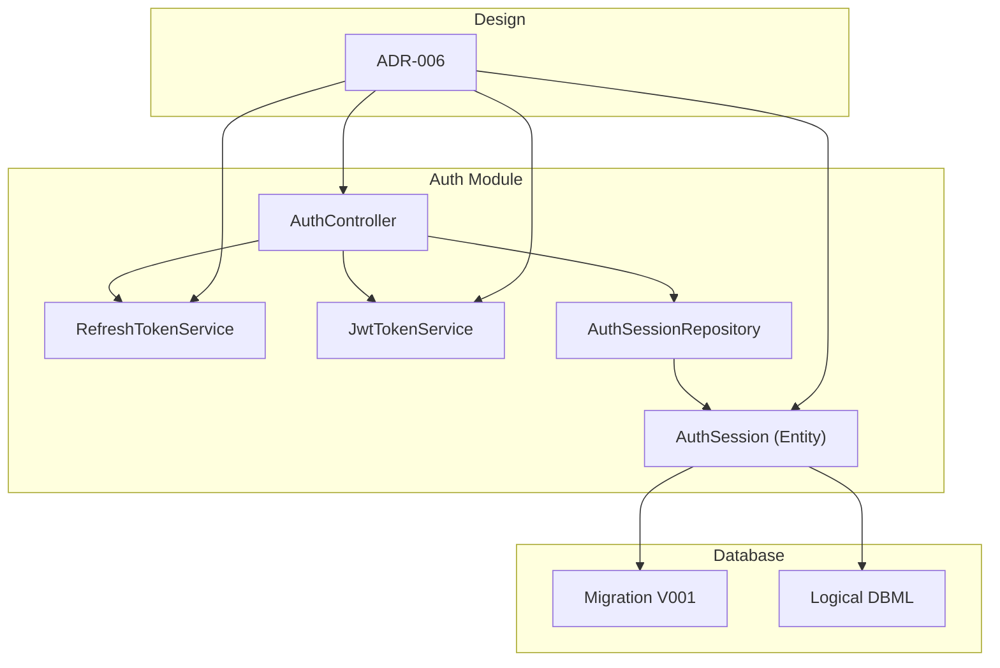
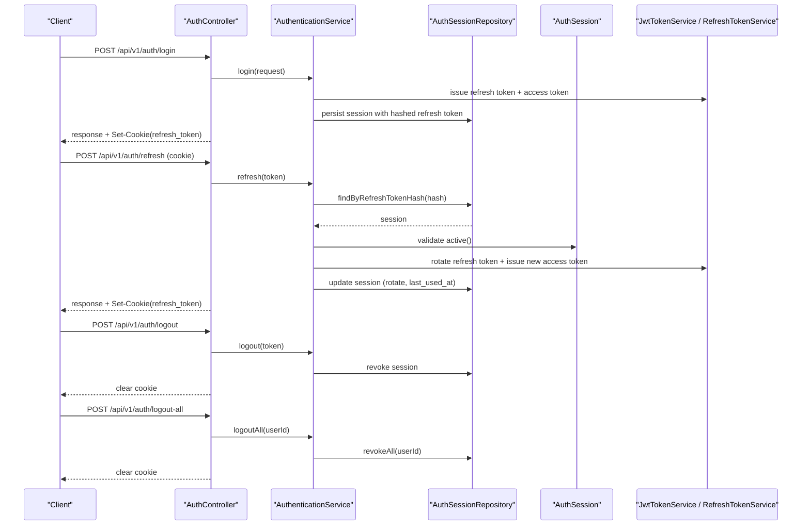
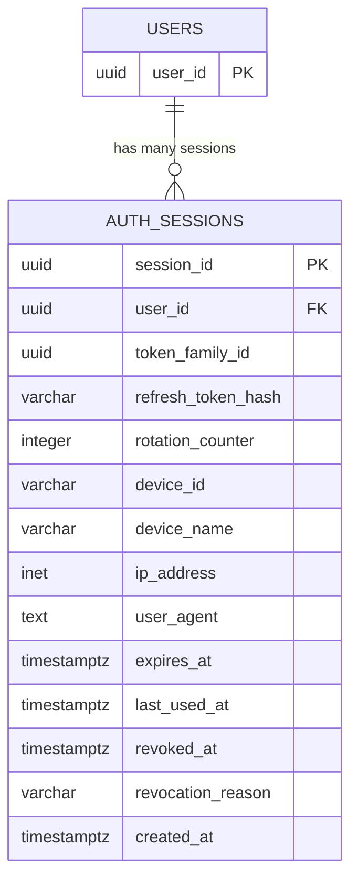
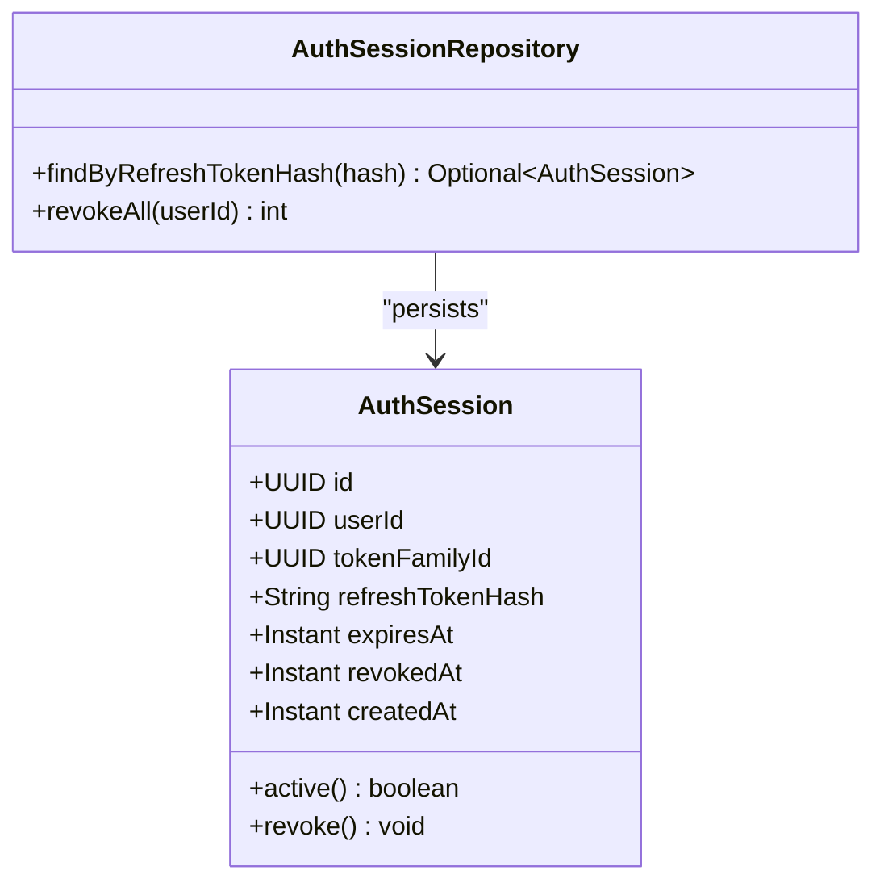
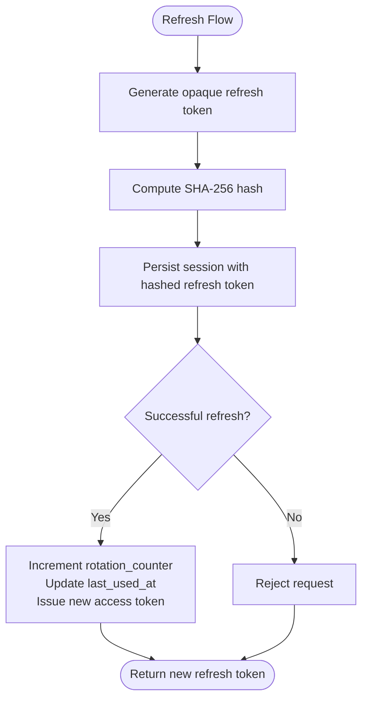
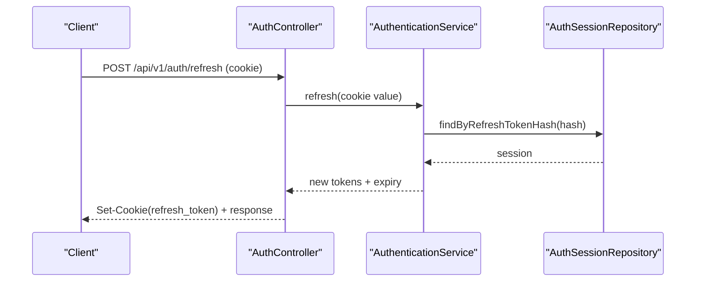
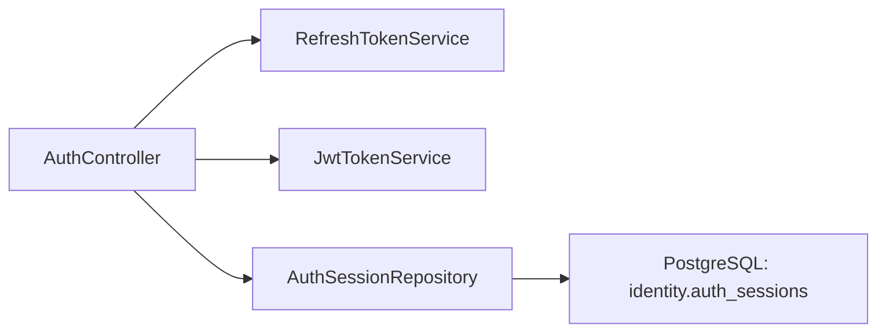

# Authentication Sessions Table

<cite>
**Referenced Files in This Document**
- [AuthSession.java](file://src/main/java/com/smartcoffee/modules/auth/domain/AuthSession.java)
- [AuthSessionRepository.java](file://src/main/java/com/smartcoffee/modules/auth/persistence/AuthSessionRepository.java)
- [RefreshTokenService.java](file://src/main/java/com/smartcoffee/modules/auth/security/RefreshTokenService.java)
- [JwtTokenService.java](file://src/main/java/com/smartcoffee/modules/auth/security/JwtTokenService.java)
- [AuthController.java](file://src/main/java/com/smartcoffee/modules/auth/api/AuthController.java)
- [V001__identity_auth_rbac.sql](file://src/main/resources/db/migration/V001__identity_auth_rbac.sql)
- [smart-coffee-logical.dbml](file://database/smart-coffee-logical.dbml)
- [ADR-006-authentication-model.md](file://adr/ADR-006-authentication-model.md)
</cite>

## Table of Contents
1. [Introduction](#introduction)
2. [Project Structure](#project-structure)
3. [Core Components](#core-components)
4. [Architecture Overview](#architecture-overview)
5. [Detailed Component Analysis](#detailed-component-analysis)
6. [Dependency Analysis](#dependency-analysis)
7. [Performance Considerations](#performance-considerations)
8. [Troubleshooting Guide](#troubleshooting-guide)
9. [Conclusion](#conclusion)

## Introduction
This document provides comprehensive data model documentation for the authentication sessions table used by the application’s identity module. It explains the session record structure, indexes, relationships, and how sessions integrate with JWT access tokens and refresh token rotation. It also covers session lifecycle management and security considerations aligned with the project’s authentication architecture decisions.

## Project Structure
The authentication sessions feature spans domain entities, persistence repositories, security services, API controllers, database migrations, and architectural design records:
- Domain entity defines the JPA mapping for the session record.
- Repository exposes query methods for lookup and bulk revocation.
- Security services generate and hash refresh tokens and produce short-lived JWTs.
- API controller orchestrates login, refresh, logout, and logout-all flows.
- Database migration defines the initial schema and constraints.
- Logical DBML documents the intended full schema including additional fields and indexes.
- ADR captures design decisions around token families, rotation, reuse detection, and revocation.

**Diagram sources**
- [AuthController.java:13-71](file://src/main/java/com/smartcoffee/modules/auth/api/AuthController.java#L13-L71)
- [RefreshTokenService.java:1-5](file://src/main/java/com/smartcoffee/modules/auth/security/RefreshTokenService.java#L1-L5)
- [JwtTokenService.java:23-105](file://src/main/java/com/smartcoffee/modules/auth/security/JwtTokenService.java#L23-L105)
- [AuthSession.java:7-53](file://src/main/java/com/smartcoffee/modules/auth/domain/AuthSession.java#L7-L53)
- [AuthSessionRepository.java:1-5](file://src/main/java/com/smartcoffee/modules/auth/persistence/AuthSessionRepository.java#L1-L5)
- [V001__identity_auth_rbac.sql:107-135](file://src/main/resources/db/migration/V001__identity_auth_rbac.sql#L107-L135)
- [smart-coffee-logical.dbml:65-86](file://database/smart-coffee-logical.dbml#L65-L86)
- [ADR-006-authentication-model.md:14-83](file://adr/ADR-006-authentication-model.md#L14-L83)

**Section sources**
- [AuthSession.java:7-53](file://src/main/java/com/smartcoffee/modules/auth/domain/AuthSession.java#L7-L53)
- [AuthSessionRepository.java:1-5](file://src/main/java/com/smartcoffee/modules/auth/persistence/AuthSessionRepository.java#L1-L5)
- [RefreshTokenService.java:1-5](file://src/main/java/com/smartcoffee/modules/auth/security/RefreshTokenService.java#L1-L5)
- [JwtTokenService.java:23-105](file://src/main/java/com/smartcoffee/modules/auth/security/JwtTokenService.java#L23-L105)
- [AuthController.java:13-71](file://src/main/java/com/smartcoffee/modules/auth/api/AuthController.java#L13-L71)
- [V001__identity_auth_rbac.sql:107-135](file://src/main/resources/db/migration/V001__identity_auth_rbac.sql#L107-L135)
- [smart-coffee-logical.dbml:65-86](file://database/smart-coffee-logical.dbml#L65-L86)
- [ADR-006-authentication-model.md:14-83](file://adr/ADR-006-authentication-model.md#L14-L83)

## Core Components
- AuthSession entity maps to the auth_sessions table and models a signed-in session with expiration and revocation semantics.
- AuthSessionRepository provides lookup by refresh token hash and bulk revocation by user.
- RefreshTokenService generates opaque refresh tokens and stores only their hashes.
- JwtTokenService produces short-lived access tokens and manages TTLs.
- AuthController exposes endpoints for register, login, refresh, logout, and logout-all, handling cookie-based refresh token transport.

Key responsibilities:
- Session creation on login with hashed refresh token and expiry.
- Token rotation on successful refresh using family-aware logic.
- Revocation of single or all sessions for a user.
- Enforcement of active/expired status via entity method.

**Section sources**
- [AuthSession.java:7-53](file://src/main/java/com/smartcoffee/modules/auth/domain/AuthSession.java#L7-L53)
- [AuthSessionRepository.java:1-5](file://src/main/java/com/smartcoffee/modules/auth/persistence/AuthSessionRepository.java#L1-L5)
- [RefreshTokenService.java:1-5](file://src/main/java/com/smartcoffee/modules/auth/security/RefreshTokenService.java#L1-L5)
- [JwtTokenService.java:23-105](file://src/main/java/com/smartcoffee/modules/auth/security/JwtTokenService.java#L23-L105)
- [AuthController.java:13-71](file://src/main/java/com/smartcoffee/modules/auth/api/AuthController.java#L13-L71)

## Architecture Overview
The authentication flow uses short-lived JWT access tokens and long-lived refresh sessions persisted in the database. The refresh token is never stored in plaintext; only its hash is persisted. Successful refresh rotates the token and updates the session. Logout revokes the current session; logout-all revokes all active sessions for the user.

**Diagram sources**
- [AuthController.java:25-59](file://src/main/java/com/smartcoffee/modules/auth/api/AuthController.java#L25-L59)
- [AuthSessionRepository.java:1-5](file://src/main/java/com/smartcoffee/modules/auth/persistence/AuthSessionRepository.java#L1-L5)
- [AuthSession.java:46-52](file://src/main/java/com/smartcoffee/modules/auth/domain/AuthSession.java#L46-L52)
- [RefreshTokenService.java:1-5](file://src/main/java/com/smartcoffee/modules/auth/security/RefreshTokenService.java#L1-L5)
- [JwtTokenService.java:58-105](file://src/main/java/com/smartcoffee/modules/auth/security/JwtTokenService.java#L58-L105)

## Detailed Component Analysis

### Data Model: auth_sessions
The logical model defines the following fields and constraints for the auth_sessions table:
- session_id: UUID primary key identifying each session.
- user_id: UUID foreign key referencing users(user_id), linking the session to an account.
- token_family_id: UUID grouping related refresh tokens for family-based operations and reuse detection.
- refresh_token_hash: Unique hash of the refresh token; ensures uniqueness and prevents storing raw secrets.
- rotation_counter: Integer counter incremented per rotation to detect reuse within a family.
- device_id, device_name: Optional identifiers for the originating device.
- ip_address: Network address where the session was created or last used.
- user_agent: Client software string captured at creation/use.
- expires_at: Timestamp after which the session is no longer valid.
- last_used_at: Timestamp updated on activity to support monitoring and cleanup.
- revoked_at: Timestamp when the session was explicitly revoked.
- revocation_reason: Short text describing why the session was revoked.
- created_at: Timestamp when the session was created.

Indexes:
- Unique index on refresh_token_hash to prevent duplicate entries and enable fast lookup by hash.
- Composite index on (user_id, revoked_at, expires_at) optimized for queries that list active sessions per user.
- Index on token_family_id to support family-based operations such as rotation and reuse detection.

Constraints and checks:
- Foreign key constraint from user_id to users(user_id).
- Check constraint ensuring expires_at is greater than created_at.

Notes on implementation variance:
- The initial migration includes core fields and a partial composite index on (user_id, expires_at) filtered by revoked_at IS NULL.
- The logical DBML extends the model with additional fields (rotation_counter, device_id, device_name, ip_address, user_agent, last_used_at, revocation_reason) and a more complete set of indexes.

**Diagram sources**
- [smart-coffee-logical.dbml:65-86](file://database/smart-coffee-logical.dbml#L65-L86)
- [V001__identity_auth_rbac.sql:107-135](file://src/main/resources/db/migration/V001__identity_auth_rbac.sql#L107-L135)

**Section sources**
- [smart-coffee-logical.dbml:65-86](file://database/smart-coffee-logical.dbml#L65-L86)
- [V001__identity_auth_rbac.sql:107-135](file://src/main/resources/db/migration/V001__identity_auth_rbac.sql#L107-L135)

### Entity and Repository
- AuthSession entity maps to the auth_sessions table and provides:
  - Active check based on revocation and expiration.
  - Revoke operation setting revocation timestamp.
- AuthSessionRepository provides:
  - Lookup by refresh token hash.
  - Bulk revocation by user ID for logout-all scenarios.

**Diagram sources**
- [AuthSession.java:7-53](file://src/main/java/com/smartcoffee/modules/auth/domain/AuthSession.java#L7-L53)
- [AuthSessionRepository.java:1-5](file://src/main/java/com/smartcoffee/modules/auth/persistence/AuthSessionRepository.java#L1-L5)

**Section sources**
- [AuthSession.java:7-53](file://src/main/java/com/smartcoffee/modules/auth/domain/AuthSession.java#L7-L53)
- [AuthSessionRepository.java:1-5](file://src/main/java/com/smartcoffee/modules/auth/persistence/AuthSessionRepository.java#L1-L5)

### Security Services
- RefreshTokenService:
  - Issues cryptographically secure random refresh tokens.
  - Computes SHA-256 hash for storage to avoid persisting raw tokens.
- JwtTokenService:
  - Produces short-lived access tokens with configurable TTL.
  - Encodes claims such as subject, issuer, issued_at, and expires_at.

**Diagram sources**
- [RefreshTokenService.java:1-5](file://src/main/java/com/smartcoffee/modules/auth/security/RefreshTokenService.java#L1-L5)
- [JwtTokenService.java:58-105](file://src/main/java/com/smartcoffee/modules/auth/security/JwtTokenService.java#L58-L105)

**Section sources**
- [RefreshTokenService.java:1-5](file://src/main/java/com/smartcoffee/modules/auth/security/RefreshTokenService.java#L1-L5)
- [JwtTokenService.java:23-105](file://src/main/java/com/smartcoffee/modules/auth/security/JwtTokenService.java#L23-L105)

### API Endpoints and Cookie Handling
- AuthController exposes:
  - Register: creates user and issues tokens.
  - Login: authenticates and issues tokens.
  - Refresh: accepts refresh token via cookie and returns new tokens.
  - Logout: revokes current session and clears cookie.
  - Logout-all: revokes all active sessions for the user and clears cookie.
- Cookie configuration sets httpOnly and path scoping for the refresh token cookie.

**Diagram sources**
- [AuthController.java:25-59](file://src/main/java/com/smartcoffee/modules/auth/api/AuthController.java#L25-L59)
- [AuthSessionRepository.java:1-5](file://src/main/java/com/smartcoffee/modules/auth/persistence/AuthSessionRepository.java#L1-L5)

**Section sources**
- [AuthController.java:13-71](file://src/main/java/com/smartcoffee/modules/auth/api/AuthController.java#L13-L71)

## Dependency Analysis
- AuthController depends on AuthenticationService (not shown here) and CurrentActorProvider for context.
- AuthenticationService coordinates RefreshTokenService, JwtTokenService, and AuthSessionRepository.
- AuthSessionRepository depends on JPA and the underlying database schema defined by migrations and logical model.
- RefreshTokenService and JwtTokenService are independent utilities used by the authentication flow.

**Diagram sources**
- [AuthController.java:13-71](file://src/main/java/com/smartcoffee/modules/auth/api/AuthController.java#L13-L71)
- [AuthSessionRepository.java:1-5](file://src/main/java/com/smartcoffee/modules/auth/persistence/AuthSessionRepository.java#L1-L5)
- [V001__identity_auth_rbac.sql:107-135](file://src/main/resources/db/migration/V001__identity_auth_rbac.sql#L107-L135)

**Section sources**
- [AuthController.java:13-71](file://src/main/java/com/smartcoffee/modules/auth/api/AuthController.java#L13-L71)
- [AuthSessionRepository.java:1-5](file://src/main/java/com/smartcoffee/modules/auth/persistence/AuthSessionRepository.java#L1-L5)
- [V001__identity_auth_rbac.sql:107-135](file://src/main/resources/db/migration/V001__identity_auth_rbac.sql#L107-L135)

## Performance Considerations
- Use the unique index on refresh_token_hash for O(log N) lookups during refresh validation.
- Leverage the composite index on (user_id, revoked_at, expires_at) to efficiently enumerate active sessions per user for UI and administrative features.
- Maintain the token_family_id index to optimize family-based rotation and reuse detection queries.
- Avoid scanning large tables without filters; always scope queries by user_id or token_family_id where applicable.
- Keep refresh token rotation atomic to prevent race conditions and ensure consistent rotation_counter increments.

[No sources needed since this section provides general guidance]

## Troubleshooting Guide
Common issues and resolutions:
- Duplicate refresh token errors: Ensure hashing is applied before persistence and that the unique constraint on refresh_token_hash is enforced.
- Stale sessions appearing active: Verify expires_at > now() and revoked_at IS NULL checks; confirm entity.active() logic aligns with business rules.
- Inability to revoke all sessions: Confirm revokeAll(userId) executes and updates rows; check transaction boundaries and isolation levels.
- Rotation not detected: Validate rotation_counter increments and that reuse detection compares counters within the same token_family_id.
- Cookie not cleared: Ensure logout and logout-all endpoints set maxAge=0 for the refresh_token cookie.

**Section sources**
- [AuthSessionRepository.java:1-5](file://src/main/java/com/smartcoffee/modules/auth/persistence/AuthSessionRepository.java#L1-L5)
- [AuthSession.java:46-52](file://src/main/java/com/smartcoffee/modules/auth/domain/AuthSession.java#L46-L52)
- [AuthController.java:47-69](file://src/main/java/com/smartcoffee/modules/auth/api/AuthController.java#L47-L69)

## Conclusion
The auth_sessions table underpins secure, auditable, and manageable sign-in sessions. By combining hashed refresh tokens, token families, rotation counters, and robust indexes, the system supports safe token rotation, reuse detection, and efficient session queries. The entity and repository provide clear lifecycle controls, while the API endpoints enforce proper cookie handling and revocation semantics. Adhering to the ADR’s principles ensures strong security posture and scalability for multi-device environments.

[No sources needed since this section summarizes without analyzing specific files]