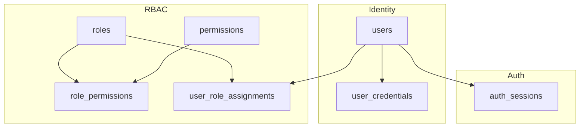
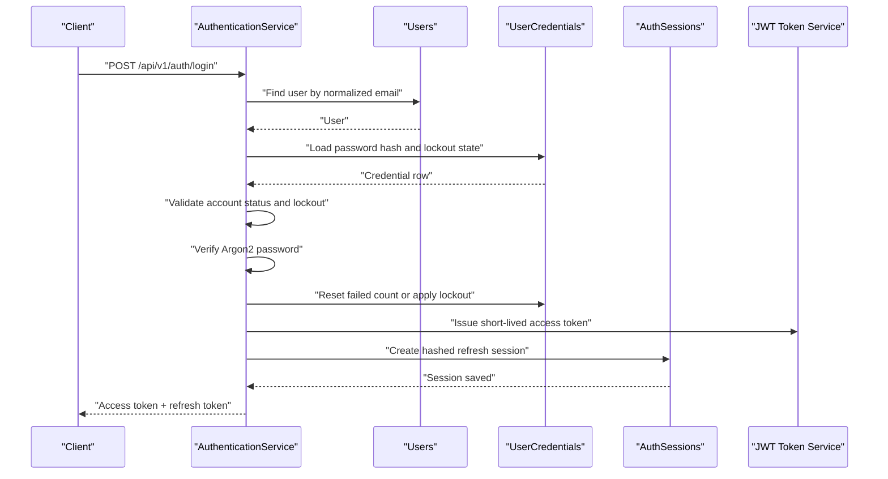
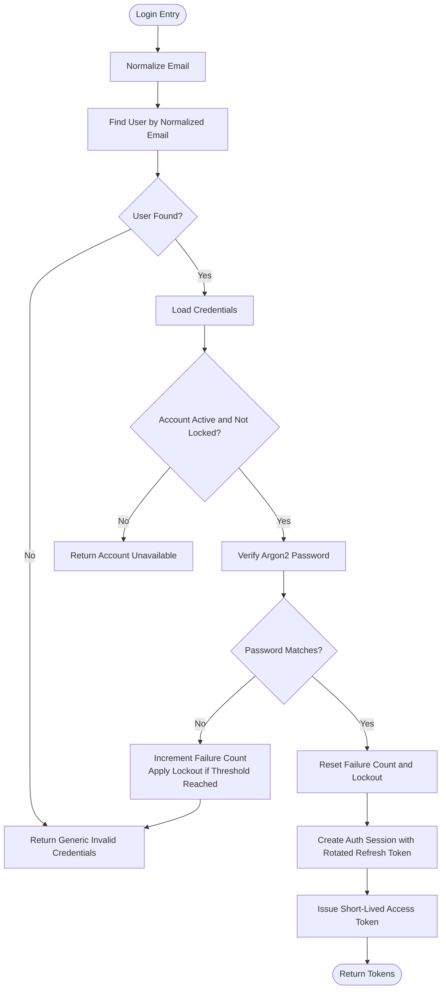
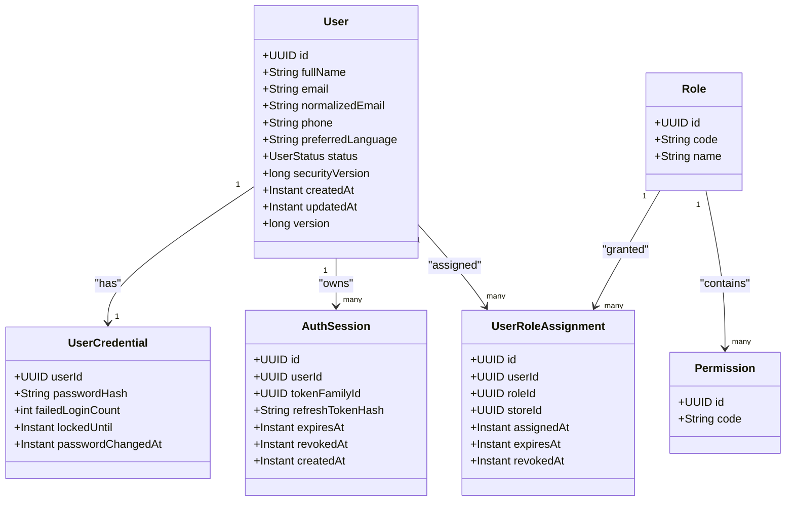

# Identity & Authentication Schema

<cite>
**Referenced Files in This Document**
- [smart-coffee-logical.dbml](file://database/smart-coffee-logical.dbml)
- [V001__identity_auth_rbac.sql](file://src/main/resources/db/migration/V001__identity_auth_rbac.sql)
- [ADR-006-authentication-model.md](file://adr/ADR-006-authentication-model.md)
- [User.java](file://src/main/java/com/smartcoffee/modules/identity/domain/User.java)
- [UserCredential.java](file://src/main/java/com/smartcoffee/modules/identity/domain/UserCredential.java)
- [AuthSession.java](file://src/main/java/com/smartcoffee/modules/auth/domain/AuthSession.java)
- [Role.java](file://src/main/java/com/smartcoffee/modules/rbac/domain/Role.java)
- [Permission.java](file://src/main/java/com/smartcoffee/modules/rbac/domain/Permission.java)
- [UserRoleAssignment.java](file://src/main/java/com/smartcoffee/modules/rbac/domain/UserRoleAssignment.java)
- [AuthenticationService.java](file://src/main/java/com/smartcoffee/modules/auth/application/AuthenticationService.java)
</cite>

## Table of Contents
1. [Introduction](#introduction)
2. [Project Structure](#project-structure)
3. [Core Components](#core-components)
4. [Architecture Overview](#architecture-overview)
5. [Detailed Component Analysis](#detailed-component-analysis)
6. [Dependency Analysis](#dependency-analysis)
7. [Performance Considerations](#performance-considerations)
8. [Troubleshooting Guide](#troubleshooting-guide)
9. [Conclusion](#conclusion)

## Introduction
This document describes the identity and authentication data model for the Smart Coffee backend. It focuses on users, credentials, sessions, roles, permissions, and store-scoped role assignments. It also explains the JWT-based authentication flow, refresh token rotation, session tracking, security versioning, password hashing with Argon2, failed login tracking, and account lockout behavior.

The schema is implemented under the `identity` database schema, with logical relationships defined in the DBML model and enforced by a Flyway migration. The application uses JPA entities to represent core identity and RBAC concepts, while an authentication service implements login, registration, refresh, logout, and all-device logout.

## Project Structure
The identity and authentication domain spans several modules:

- Identity module: user profiles and credential storage.
- Auth module: authentication flows, session management, and refresh token handling.
- RBAC module: roles, permissions, and user-role assignments.
- Database layer: PostgreSQL schema, constraints, indexes, and foreign keys.
- Architecture decision record: design rationale for tokens, sessions, and store-scoped authorization.

**Diagram sources**
- [smart-coffee-logical.dbml:28-124](file://database/smart-coffee-logical.dbml#L28-L124)
- [V001__identity_auth_rbac.sql:3-135](file://src/main/resources/db/migration/V001__identity_auth_rbac.sql#L3-L135)

**Section sources**
- [smart-coffee-logical.dbml:28-124](file://database/smart-coffee-logical.dbml#L28-L124)
- [V001__identity_auth_rbac.sql:3-135](file://src/main/resources/db/migration/V001__identity_auth_rbac.sql#L3-L135)

## Core Components
The identity and authentication system centers on six primary tables:

| Entity | Purpose | Key Fields | Important Constraints | Indexes |
|---|---|---|---|---|
| `users` | Core identity profile | `user_id`, `full_name`, `email`, `normalized_email`, `phone`, `preferred_language`, `status`, `security_version`, timestamps | Primary key on `user_id`; unique constraint on `normalized_email`; status check constraint | Unique on `normalized_email`; composite `(status, created_at)` |
| `user_credentials` | Password secrets and lockout state | `user_id`, `password_hash`, `failed_login_count`, `locked_until`, `password_changed_at` | Primary key on `user_id`; foreign key to `users(user_id)` | None beyond PK/FK |
| `auth_sessions` | Refresh-token sessions | `session_id`, `user_id`, `token_family_id`, `refresh_token_hash`, `expires_at`, `revoked_at`, `created_at` | Primary key on `session_id`; unique on `refresh_token_hash`; foreign key to `users(user_id)`; expiry check constraint | Unique on `refresh_token_hash`; index on `(user_id, expires_at)` where not revoked |
| `roles` | Role definitions | `role_id`, `role_code`, `role_name` | Primary key on `role_id`; unique on `role_code` | None beyond PK/unique |
| `permissions` | Permission definitions | `permission_id`, `permission_code` | Primary key on `permission_id`; unique on `permission_code` | None beyond PK/unique |
| `role_permissions` | Role-to-permission mapping | `role_id`, `permission_id` | Composite primary key; foreign keys to `roles` and `permissions` | None beyond PK |
| `user_role_assignments` | Store-scoped role grants | `assignment_id`, `user_id`, `role_id`, `store_id`, `assigned_at`, `expires_at`, `revoked_at` | Primary key on `assignment_id`; foreign keys to `users`, `roles`, optional `stores`; expiry check constraint | Partial index on `(user_id, store_id)` where not revoked |

Additional related tables include `staff_profiles` and `store.stores`, which participate in multi-tenant store scoping through foreign-key references.

**Section sources**
- [smart-coffee-logical.dbml:28-124](file://database/smart-coffee-logical.dbml#L28-L124)
- [V001__identity_auth_rbac.sql:3-135](file://src/main/resources/db/migration/V001__identity_auth_rbac.sql#L3-L135)

## Architecture Overview
The authentication architecture follows OAuth 2.1/OpenID Connect principles:

- Short-lived signed JWT access tokens carry claims such as subject, session identifier, security version, roles, permissions, store scopes, issuer, audience, and expiration.
- Opaque random refresh tokens are returned only to authenticated clients.
- Only the hash of the refresh token is stored in PostgreSQL.
- Every successful refresh rotates the token and updates the session.
- Reuse of an older token in the same family can trigger family revocation.
- Logout revokes one session; logout-all revokes all active sessions.
- Security changes may increment the user’s `security_version`, causing stale access tokens to be rejected.

**Diagram sources**
- [ADR-006-authentication-model.md:30-92](file://adr/ADR-006-authentication-model.md#L30-L92)
- [AuthenticationService.java:38-62](file://src/main/java/com/smartcoffee/modules/auth/application/AuthenticationService.java#L38-L62)

**Section sources**
- [ADR-006-authentication-model.md:30-127](file://adr/ADR-006-authentication-model.md#L30-L127)
- [AuthenticationService.java:38-102](file://src/main/java/com/smartcoffee/modules/auth/application/AuthenticationService.java#L38-L102)

## Detailed Component Analysis

### User Profile Model
The `users` table stores identity attributes and security metadata.

| Field | Type | Constraint | Meaning |
|---|---|---|---|
| `user_id` | UUID | Primary key | Stable identity reference |
| `full_name` | VARCHAR(150) | Not null | Display name |
| `email` | VARCHAR(320) | Not null | Human-readable email |
| `normalized_email` | VARCHAR(320) | Not null, unique | Lowercased email used for lookups and uniqueness |
| `phone` | VARCHAR(30) | Nullable | Optional phone number |
| `preferred_language` | VARCHAR(10) | Not null, default `'en'` | Locale preference |
| `status` | Enum-like string | Not null, default `'ACTIVE'` | Account lifecycle state |
| `security_version` | Integer/BIGINT | Not null, default `0` | Version used to invalidate stale access tokens |
| `created_at` | TIMESTAMPTZ | Not null | Creation timestamp |
| `updated_at` | TIMESTAMPTZ | Not null | Last update timestamp |
| `deleted_at` | TIMESTAMPTZ | Nullable | Soft-delete marker in logical model |

Indexes:
- Unique index on `normalized_email`.
- Composite index on `(status, created_at)`.

Relationships:
- One-to-one with `user_credentials`.
- One-to-many with `auth_sessions`.
- Many-to-many via `user_role_assignments`.

JPA entity notes:
- Uses `@Version` for optimistic concurrency control.
- Exposes `securityVersion` for inclusion in JWT claims.

**Section sources**
- [smart-coffee-logical.dbml:28-52](file://database/smart-coffee-logical.dbml#L28-L52)
- [V001__identity_auth_rbac.sql:3-23](file://src/main/resources/db/migration/V001__identity_auth_rbac.sql#L3-L23)
- [User.java:7-34](file://src/main/java/com/smartcoffee/modules/identity/domain/User.java#L7-L34)
- [User.java:50-83](file://src/main/java/com/smartcoffee/modules/identity/domain/User.java#L50-L83)

### Credential and Password Security Model
The `user_credentials` table stores password hashes and lockout state.

| Field | Type | Constraint | Meaning |
|---|---|---|---|
| `user_id` | UUID | Primary key, foreign key to `users(user_id)` | Links credentials to identity |
| `password_hash` | TEXT | Not null | Argon2id-hashed password |
| `failed_login_count` | INTEGER | Not null, default `0` | Tracks consecutive failed logins |
| `locked_until` | TIMESTAMPTZ | Nullable | Lockout expiration time |
| `password_changed_at` | TIMESTAMPTZ | Not null | Last password change time |

Constraints:
- Foreign key ensures credentials cannot exist without a user.

Behavioral rules:
- Failed login increments `failed_login_count`.
- After five failures, the account locks until a fixed timeout.
- Successful login resets failure count and clears lockout.

Security guidance:
- Use Argon2id.
- Store algorithm/version metadata when needed for future rehashing.
- Never log raw passwords or tokens.

**Section sources**
- [smart-coffee-logical.dbml:54-63](file://database/smart-coffee-logical.dbml#L54-L63)
- [V001__identity_auth_rbac.sql:25-39](file://src/main/resources/db/migration/V001__identity_auth_rbac.sql#L25-L39)
- [UserCredential.java:3-14](file://src/main/java/com/smartcoffee/modules/identity/domain/UserCredential.java#L3-L14)
- [ADR-006-authentication-model.md:85-92](file://adr/ADR-006-authentication-model.md#L85-L92)

### Session and Refresh Token Model
The `auth_sessions` table tracks refresh-token sessions.

| Field | Type | Constraint | Meaning |
|---|---|---|---|
| `session_id` | UUID | Primary key | Session identifier |
| `user_id` | UUID | Not null, foreign key to `users(user_id)` | Owning user |
| `token_family_id` | UUID | Not null | Grouping identifier for related refresh tokens |
| `refresh_token_hash` | VARCHAR(64)/CHAR(64) | Not null, unique | Hashed refresh token |
| `rotation_counter` | Integer | Default `0` | Rotation counter in logical model |
| `device_id` | VARCHAR(200) | Nullable | Device identifier |
| `device_name` | VARCHAR(200) | Nullable | Device display name |
| `ip_address` | INET | Nullable | Client IP |
| `user_agent` | TEXT | Nullable | Client user agent |
| `expires_at` | TIMESTAMPTZ | Not null | Session expiration |
| `last_used_at` | TIMESTAMPTZ | Nullable | Last refresh usage time |
| `revoked_at` | TIMESTAMPTZ | Nullable | Revocation timestamp |
| `revocation_reason` | VARCHAR(100) | Nullable | Reason for revocation |
| `created_at` | TIMESTAMPTZ | Not null | Session creation time |

Constraints:
- Unique refresh token hash prevents duplicate active sessions.
- Expiration must be after creation.

Indexes:
- Unique index on `refresh_token_hash`.
- Composite index on `(user_id, revoked_at, expires_at)` in logical model.
- Partial index on `(user_id, expires_at)` where not revoked in migration.

Refresh token policy:
- Generate cryptographically secure random tokens.
- Return only to authenticated clients.
- Store only strong hashes.
- Rotate on every successful refresh.
- Detect reuse of older tokens within the same family.
- Revoke the entire family after suspected reuse.

Logout behavior:
- Single logout revokes the current session.
- All-device logout revokes all active sessions.

**Section sources**
- [smart-coffee-logical.dbml:65-86](file://database/smart-coffee-logical.dbml#L65-L86)
- [V001__identity_auth_rbac.sql:107-135](file://src/main/resources/db/migration/V001__identity_auth_rbac.sql#L107-L135)
- [AuthSession.java:7-52](file://src/main/java/com/smartcoffee/modules/auth/domain/AuthSession.java#L7-L52)
- [ADR-006-authentication-model.md:53-83](file://adr/ADR-006-authentication-model.md#L53-L83)

### Role, Permission, and Assignment Model
Roles and permissions form a classic RBAC foundation. Assignments add store scoping.

#### Roles
| Field | Type | Constraint | Meaning |
|---|---|---|---|
| `role_id` | UUID | Primary key | Role identifier |
| `role_code` | VARCHAR(50/60) | Not null, unique | Machine-readable role code |
| `role_name` | VARCHAR(100/120) | Not null, unique in logical model | Human-readable role name |

#### Permissions
| Field | Type | Constraint | Meaning |
|---|---|---|---|
| `permission_id` | UUID | Primary key | Permission identifier |
| `permission_code` | VARCHAR(100/120) | Not null, unique | Machine-readable permission code |
| `resource` | VARCHAR(60) | Not null in logical model | Target resource |
| `action` | VARCHAR(40) | Not null in logical model | Allowed action |
| `description` | TEXT | Nullable | Documentation |

Logical model adds a unique composite index on `(resource, action)`.

#### Role-to-Permission Mapping
| Field | Type | Constraint | Meaning |
|---|---|---|---|
| `role_id` | UUID | Part of composite primary key | Role |
| `permission_id` | UUID | Part of composite primary key | Permission |
| `granted_at` | TIMESTAMPTZ | Not null in logical model | Audit timestamp |

Foreign keys enforce referential integrity between roles and permissions.

#### Store-Scoped User Role Assignments
| Field | Type | Constraint | Meaning |
|---|---|---|---|
| `assignment_id` | UUID | Primary key | Assignment identifier |
| `user_id` | UUID | Not null, foreign key to `users(user_id)` | Assigned user |
| `role_id` | UUID | Not null, foreign key to `roles(role_id)` | Granted role |
| `store_id` | UUID | Nullable, foreign key to `store.stores(store_id)` | Scope tenant |
| `assigned_by` | UUID | Nullable, foreign key to `users(user_id)` | Auditor |
| `assigned_at` | TIMESTAMPTZ | Not null | Grant time |
| `expires_at` | TIMESTAMPTZ | Nullable | Expiration |
| `revoked_at` | TIMESTAMPTZ | Nullable | Revocation time |

Constraints:
- Expiration must be after assignment time when present.
- Partial index optimizes queries for active assignments per user and store.

Multi-tenant authorization rule:
- A request must verify the authenticated user, requested store, required permission, active role assignment, assignment expiry or revocation, and resource ownership.
- Store identifiers from requests are untrusted until validated against granted scopes.

**Section sources**
- [smart-coffee-logical.dbml:88-124](file://database/smart-coffee-logical.dbml#L88-L124)
- [V001__identity_auth_rbac.sql:41-105](file://src/main/resources/db/migration/V001__identity_auth_rbac.sql#L41-L105)
- [Role.java:6-27](file://src/main/java/com/smartcoffee/modules/rbac/domain/Role.java#L6-L27)
- [Permission.java:6-21](file://src/main/java/com/smartcoffee/modules/rbac/domain/Permission.java#L6-L21)
- [UserRoleAssignment.java:7-28](file://src/main/java/com/smartcoffee/modules/rbac/domain/UserRoleAssignment.java#L7-L28)
- [ADR-006-authentication-model.md:94-109](file://adr/ADR-006-authentication-model.md#L94-L109)

### Authentication Flow Implementation
The authentication service coordinates registration, login, refresh, logout, and all-device logout.

Key behaviors:
- Registration creates a user and credential row, then issues a session.
- Login validates account status, lockout state, and Argon2 password match.
- Failed login increments failure count and may lock the account.
- Successful login resets failure count and lockout.
- Refresh locates the session by hashed refresh token, checks activity, revokes the old session, and issues a new session with a rotated refresh token.
- Logout revokes the session associated with the provided refresh token.
- Logout-all revokes all active sessions for a user.

**Diagram sources**
- [AuthenticationService.java:38-62](file://src/main/java/com/smartcoffee/modules/auth/application/AuthenticationService.java#L38-L62)
- [UserCredential.java:12-14](file://src/main/java/com/smartcoffee/modules/identity/domain/UserCredential.java#L12-L14)

**Section sources**
- [AuthenticationService.java:38-102](file://src/main/java/com/smartcoffee/modules/auth/application/AuthenticationService.java#L38-L102)
- [UserCredential.java:12-14](file://src/main/java/com/smartcoffee/modules/identity/domain/UserCredential.java#L12-L14)

## Dependency Analysis
The identity and authentication entities have clear dependency boundaries.

**Diagram sources**
- [User.java:7-34](file://src/main/java/com/smartcoffee/modules/identity/domain/User.java#L7-L34)
- [UserCredential.java:3-14](file://src/main/java/com/smartcoffee/modules/identity/domain/UserCredential.java#L3-L14)
- [AuthSession.java:7-52](file://src/main/java/com/smartcoffee/modules/auth/domain/AuthSession.java#L7-L52)
- [Role.java:6-27](file://src/main/java/com/smartcoffee/modules/rbac/domain/Role.java#L6-L27)
- [Permission.java:6-21](file://src/main/java/com/smartcoffee/modules/rbac/domain/Permission.java#L6-L21)
- [UserRoleAssignment.java:7-28](file://src/main/java/com/smartcoffee/modules/rbac/domain/UserRoleAssignment.java#L7-L28)

Database-level relationships:
- `user_credentials.user_id` references `users.user_id`.
- `auth_sessions.user_id` references `users.user_id`.
- `role_permissions.role_id` references `roles.role_id`.
- `role_permissions.permission_id` references `permissions.permission_id`.
- `user_role_assignments.user_id` references `users.user_id`.
- `user_role_assignments.role_id` references `roles.role_id`.
- `user_role_assignments.store_id` references `store.stores.store_id`.

**Section sources**
- [smart-coffee-logical.dbml:850-859](file://database/smart-coffee-logical.dbml#L850-L859)
- [V001__identity_auth_rbac.sql:36-105](file://src/main/resources/db/migration/V001__identity_auth_rbac.sql#L36-L105)

## Performance Considerations
- Unique constraints on `normalized_email` and `refresh_token_hash` prevent duplicates but require indexed lookups.
- Partial indexes on active assignments and active sessions reduce scan cost for common queries.
- Short-lived access tokens limit exposure and reduce the impact of stale claims.
- Refresh-token rotation introduces write contention; ensure transactional correctness and avoid race conditions during concurrent refresh attempts.
- Avoid logging sensitive fields such as passwords, raw tokens, or authorization headers.
- Cache read-heavy RBAC data carefully and invalidate on role or permission changes.

[No sources needed since this section provides general guidance]

## Troubleshooting Guide
Common issues and their data-model implications:

- Duplicate email registration:
  - Cause: Attempting to register with an existing `normalized_email`.
  - Resolution: Reject duplicate emails at the application layer and return a conflict response.

- Invalid credentials:
  - Cause: Missing user, missing credentials, inactive/disabled/locked account, or incorrect password.
  - Resolution: Use generic error messages to avoid account enumeration; inspect logs securely.

- Account lockout:
  - Cause: Five consecutive failed login attempts.
  - Resolution: Wait until `locked_until` passes or reset lockout through administrative controls.

- Expired or revoked refresh session:
  - Cause: Session expired, revoked, or reused.
  - Resolution: Require re-authentication; revoke token family if reuse is detected.

- Stale JWT claims after role changes:
  - Cause: Access token issued before role or security-version change.
  - Resolution: Increment `security_version` on critical changes and rely on short token lifetime.

- Cross-store access violation:
  - Cause: Request targets a store not included in the user’s active role assignments.
  - Resolution: Enforce store scope in application services and reject unauthorized requests.

**Section sources**
- [AuthenticationService.java:38-102](file://src/main/java/com/smartcoffee/modules/auth/application/AuthenticationService.java#L38-L102)
- [UserCredential.java:12-14](file://src/main/java/com/smartcoffee/modules/identity/domain/UserCredential.java#L12-L14)
- [ADR-006-authentication-model.md:94-127](file://adr/ADR-006-authentication-model.md#L94-L127)

## Conclusion
The Smart Coffee identity and authentication schema combines a robust relational model with a secure token strategy. Users and credentials separate identity from secrets. Sessions track refresh tokens using hashed values, families, rotation, and revocation. Roles, permissions, and store-scoped assignments provide fine-grained, tenant-aware authorization. The authentication flow enforces Argon2 password hashing, failed-login tracking, and lockout behavior, while JWT security versioning helps invalidate stale authorizations. For production, continue enforcing short-lived tokens, strict store scoping, auditability, and careful handling of refresh-token rotation and revocation.

[No sources needed since this section summarizes without analyzing specific files]