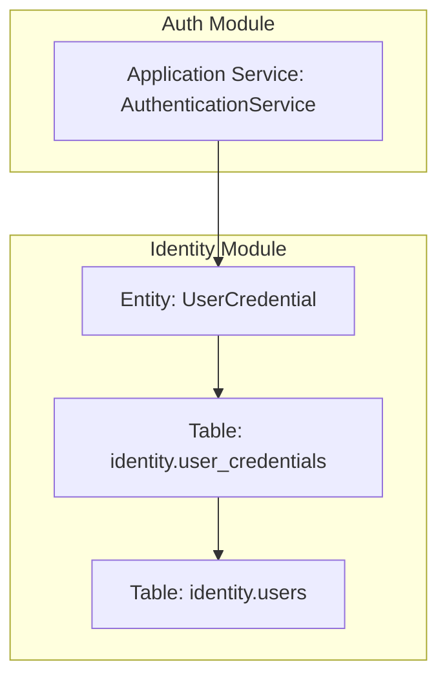
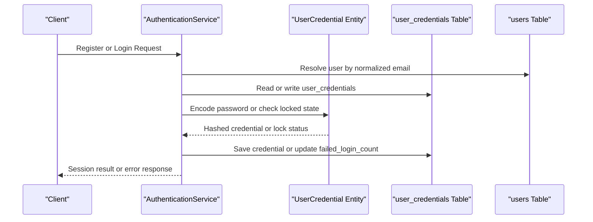
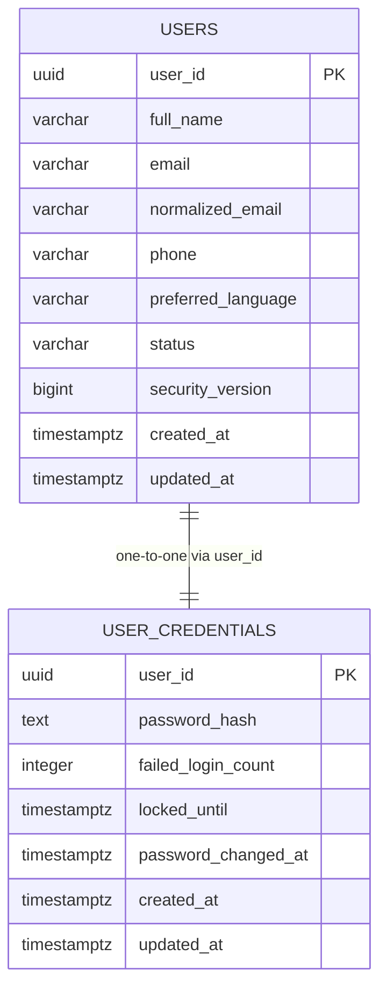
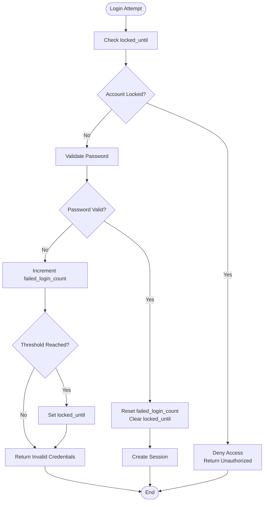
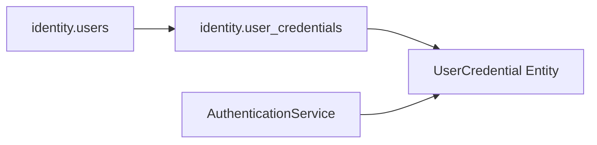

# User Credentials Table

<cite>
**Referenced Files in This Document**
- [UserCredential.java](file://src/main/java/com/smartcoffee/modules/identity/domain/UserCredential.java)
- [V001__identity_auth_rbac.sql](file://src/main/resources/db/migration/V001__identity_auth_rbac.sql)
- [smart-coffee-logical.dbml](file://database/smart-coffee-logical.dbml)
- [AuthenticationService.java](file://src/main/java/com/smartcoffee/modules/auth/application/AuthenticationService.java)
- [ADR-006-authentication-model.md](file://adr/ADR-006-authentication-model.md)
</cite>

## Table of Contents
1. [Introduction](#introduction)
2. [Project Structure](#project-structure)
3. [Core Components](#core-components)
4. [Architecture Overview](#architecture-overview)
5. [Detailed Component Analysis](#detailed-component-analysis)
6. [Dependency Analysis](#dependency-analysis)
7. [Performance Considerations](#performance-considerations)
8. [Troubleshooting Guide](#troubleshooting-guide)
9. [Conclusion](#conclusion)

## Introduction
This document provides detailed data model documentation for the `user_credentials` table used by the Smart Coffee backend identity module. It explains how credentials are stored, how they relate to users, and how security controls such as password hashing, versioning, failed login tracking, and account lockout are modeled and enforced.

The current implementation stores a single credential record per user, uses a one-to-one relationship with the `users` table, and implements basic brute-force protection through a failure counter and temporary lockout window. The design also includes a timestamp for password changes to support security versioning and rotation policies.

## Project Structure
The `user_credentials` table is part of the identity schema and is mapped to a JPA entity. Its definition exists both in the database migration and in the logical database model. Authentication logic that reads and updates this table lives in the auth application service.

**Diagram sources**
- [V001__identity_auth_rbac.sql:25-39](file://src/main/resources/db/migration/V001__identity_auth_rbac.sql#L25-L39)
- [smart-coffee-logical.dbml:28-63](file://database/smart-coffee-logical.dbml#L28-L63)
- [UserCredential.java:3-14](file://src/main/java/com/smartcoffee/modules/identity/domain/UserCredential.java#L3-L14)
- [AuthenticationService.java:38-62](file://src/main/java/com/smartcoffee/modules/auth/application/AuthenticationService.java#L38-L62)

**Section sources**
- [V001__identity_auth_rbac.sql:25-39](file://src/main/resources/db/migration/V001__identity_auth_rbac.sql#L25-L39)
- [smart-coffee-logical.dbml:28-63](file://database/smart-coffee-logical.dbml#L28-L63)
- [UserCredential.java:3-14](file://src/main/java/com/smartcoffee/modules/identity/domain/UserCredential.java#L3-L14)
- [AuthenticationService.java:38-62](file://src/main/java/com/smartcoffee/modules/auth/application/AuthenticationService.java#L38-L62)

## Core Components
The core components related to `user_credentials` include:

- **Database table**: Defines columns, constraints, defaults, and foreign key relationships.
- **JPA entity**: Maps the table to a domain object with behavior for success and failure handling.
- **Authentication service**: Uses the entity during registration and login to create, validate, and update credentials.
- **Security architecture decision**: Documents the intended use of Argon2id for password hashing.

Key responsibilities:
- Store hashed passwords securely.
- Track failed login attempts.
- Temporarily lock accounts after repeated failures.
- Record when credentials were last changed.
- Enforce referential integrity with the `users` table.

**Section sources**
- [V001__identity_auth_rbac.sql:25-39](file://src/main/resources/db/migration/V001__identity_auth_rbac.sql#L25-L39)
- [smart-coffee-logical.dbml:54-63](file://database/smart-coffee-logical.dbml#L54-L63)
- [UserCredential.java:3-14](file://src/main/java/com/smartcoffee/modules/identity/domain/UserCredential.java#L3-L14)
- [AuthenticationService.java:38-62](file://src/main/java/com/smartcoffee/modules/auth/application/AuthenticationService.java#L38-L62)
- [ADR-006-authentication-model.md:24-28](file://adr/ADR-006-authentication-model.md#L24-L28)

## Architecture Overview
The credential flow centers on authentication operations that read or write `user_credentials`. Registration creates a new credential row; login validates the password and updates failure counters and lockout state.

**Diagram sources**
- [AuthenticationService.java:38-62](file://src/main/java/com/smartcoffee/modules/auth/application/AuthenticationService.java#L38-L62)
- [UserCredential.java:11-14](file://src/main/java/com/smartcoffee/modules/identity/domain/UserCredential.java#L11-L14)
- [V001__identity_auth_rbac.sql:25-39](file://src/main/resources/db/migration/V001__identity_auth_rbac.sql#L25-L39)

## Detailed Component Analysis

### Data Model Definition
The `user_credentials` table stores one credential record per user. The primary key is `user_id`, which is also a foreign key referencing `identity.users(user_id)`.

| Column | Type | Constraints | Purpose and Security Implications |
|---|---|---|---|
| `user_id` | UUID | Primary key, not null | Links the credential to exactly one user. Ensures one-to-one mapping between user and credential. |
| `password_hash` | TEXT | Not null | Stores the hashed password. Must never store plaintext. Supports secure algorithms such as Argon2id. |
| `failed_login_count` | INTEGER | Not null, default 0 | Tracks consecutive failed login attempts. Used for brute-force protection. |
| `locked_until` | TIMESTAMPTZ | Nullable | Indicates temporary account lockout until the specified time. Prevents further login attempts while locked. |
| `password_changed_at` | TIMESTAMPTZ | Not null, default now() | Records when the password was last changed. Enables security versioning and rotation policy enforcement. |
| `created_at` | TIMESTAMPTZ | Not null, default now() | Audit timestamp for credential record creation. |
| `updated_at` | TIMESTAMPTZ | Not null, default now() | Audit timestamp for credential record updates. |

Notes:
- The logical model defines a default algorithm value of `argon2id` for `password_algorithm`, but the current SQL migration does not include that column.
- The current SQL migration does not include indexes on `failed_login_count` or `locked_until`; consider adding indexes if querying these fields frequently.

**Section sources**
- [V001__identity_auth_rbac.sql:25-39](file://src/main/resources/db/migration/V001__identity_auth_rbac.sql#L25-L39)
- [smart-coffee-logical.dbml:54-63](file://database/smart-coffee-logical.dbml#L54-L63)

### Foreign Key Relationship to Users
The `user_id` column is both the primary key of `user_credentials` and a foreign key to `identity.users(user_id)`. This enforces referential integrity: a credential cannot exist without a corresponding user, and deleting a user cascades according to database configuration.

Security implications:
- Prevents orphaned credential records.
- Ensures credential access is always scoped to a valid user.
- Supports auditability by linking credential changes to user lifecycle events.

**Diagram sources**
- [V001__identity_auth_rbac.sql:3-39](file://src/main/resources/db/migration/V001__identity_auth_rbac.sql#L3-L39)
- [smart-coffee-logical.dbml:28-63](file://database/smart-coffee-logical.dbml#L28-L63)

**Section sources**
- [V001__identity_auth_rbac.sql:3-39](file://src/main/resources/db/migration/V001__identity_auth_rbac.sql#L3-L39)
- [smart-coffee-logical.dbml:28-63](file://database/smart-coffee-logical.dbml#L28-L63)

### Password Hash Field and Algorithm Support
The `password_hash` field stores the output of a secure password hashing function. The project’s security architecture decision specifies Argon2id as the intended algorithm.

Current implementation details:
- The JPA entity stores `passwordHash` as a string.
- Registration encodes the password before saving the credential.
- Login compares the provided password against the stored hash using a password encoder.

Security implications:
- Plaintext passwords must never be stored.
- Argon2id provides strong resistance against GPU-based attacks due to memory-hard properties.
- Algorithm agility should be supported by storing the algorithm identifier alongside the hash when migrating from legacy algorithms.

Recommended validation rules:
- Reject empty or excessively long passwords at the input layer.
- Ensure the configured encoder matches the expected algorithm.
- Rotate hashes when upgrading algorithms by re-hashing on successful login.

**Section sources**
- [UserCredential.java:5-11](file://src/main/java/com/smartcoffee/modules/identity/domain/UserCredential.java#L5-L11)
- [AuthenticationService.java:38-45](file://src/main/java/com/smartcoffee/modules/auth/application/AuthenticationService.java#L38-L45)
- [ADR-006-authentication-model.md:24-28](file://adr/ADR-006-authentication-model.md#L24-L28)

### Password Rotation Policies
The `password_changed_at` timestamp enables rotation policies such as:
- Forcing periodic password changes based on age.
- Detecting stale credentials after security incidents.
- Triggering re-hashing when upgrading hashing algorithms.

Policy recommendations:
- Define maximum password age based on risk profile.
- Require password change after sensitive operations such as role escalation.
- Invalidate sessions when security version changes.

Operational considerations:
- Do not expose `password_changed_at` in public APIs unless required.
- Use it for internal security checks and audit reporting.

**Section sources**
- [smart-coffee-logical.dbml:54-63](file://database/smart-coffee-logical.dbml#L54-L63)
- [UserCredential.java:9-11](file://src/main/java/com/smartcoffee/modules/identity/domain/UserCredential.java#L9-L11)

### Failed Login Count for Brute Force Protection
The `failed_login_count` field tracks consecutive failed login attempts. The domain entity increments the counter on each failed attempt and resets it on successful authentication.

Behavior:
- Increment on invalid password.
- Reset to zero on successful login.
- Lock account after reaching a threshold.

Security implications:
- Reduces automated brute-force attack effectiveness.
- Must be combined with rate limiting and monitoring.
- Should not be exposed directly to clients.

Validation rules:
- Never allow negative values.
- Cap the counter at a safe maximum to prevent overflow.
- Treat non-zero counts as a signal for additional verification or temporary restrictions.

**Section sources**
- [UserCredential.java:7-13](file://src/main/java/com/smartcoffee/modules/identity/domain/UserCredential.java#L7-L13)
- [AuthenticationService.java:48-62](file://src/main/java/com/smartcoffee/modules/auth/application/AuthenticationService.java#L48-L62)

### Locked Until Timestamp for Account Lockout
The `locked_until` field represents a temporary lockout window. The domain entity marks an account as locked when the lock time has not yet passed.

Lockout strategy:
- Set `locked_until` when `failed_login_count` reaches the configured threshold.
- Block login attempts while locked.
- Clear lock and reset counter on successful authentication.

Security implications:
- Protects against credential stuffing and brute-force attacks.
- May cause denial-of-service for legitimate users under sustained attack; consider progressive delays and CAPTCHA integration.
- Should be accompanied by alerting and admin override capabilities.

**Diagram sources**
- [UserCredential.java:12-13](file://src/main/java/com/smartcoffee/modules/identity/domain/UserCredential.java#L12-L13)
- [AuthenticationService.java:48-62](file://src/main/java/com/smartcoffee/modules/auth/application/AuthenticationService.java#L48-L62)

**Section sources**
- [UserCredential.java:7-13](file://src/main/java/com/smartcoffee/modules/identity/domain/UserCredential.java#L7-L13)
- [AuthenticationService.java:48-62](file://src/main/java/com/smartcoffee/modules/auth/application/AuthenticationService.java#L48-L62)

### Constraints and Validation Rules
Database-level constraints:
- `user_id` is the primary key and foreign key to `users(user_id)`.
- `password_hash` is not null.
- `failed_login_count` is not null with a default of zero.
- `password_changed_at` is not null with a default of the current timestamp.

Application-level validation rules:
- Reject duplicate emails during registration.
- Reject login for inactive or locked accounts.
- Compare passwords using a secure encoder.
- Update failure counters and lockout state atomically within transactions.

Recommended enhancements:
- Add explicit algorithm column if supporting multiple hashing algorithms.
- Add unique constraint on `user_id` if not already enforced by primary key semantics.
- Add indexes on `locked_until` and `failed_login_count` for efficient queries.
- Add database-level checks for non-negative counters and future lock times.

**Section sources**
- [V001__identity_auth_rbac.sql:25-39](file://src/main/resources/db/migration/V001__identity_auth_rbac.sql#L25-L39)
- [AuthenticationService.java:38-62](file://src/main/java/com/smartcoffee/modules/auth/application/AuthenticationService.java#L38-L62)

## Dependency Analysis
The `user_credentials` table depends on the `users` table through a foreign key. The application code depends on the JPA entity and repository to perform credential operations.

**Diagram sources**
- [V001__identity_auth_rbac.sql:3-39](file://src/main/resources/db/migration/V001__identity_auth_rbac.sql#L3-L39)
- [UserCredential.java:3-14](file://src/main/java/com/smartcoffee/modules/identity/domain/UserCredential.java#L3-L14)
- [AuthenticationService.java:38-62](file://src/main/java/com/smartcoffee/modules/auth/application/AuthenticationService.java#L38-L62)

**Section sources**
- [V001__identity_auth_rbac.sql:3-39](file://src/main/resources/db/migration/V001__identity_auth_rbac.sql#L3-L39)
- [UserCredential.java:3-14](file://src/main/java/com/smartcoffee/modules/identity/domain/UserCredential.java#L3-L14)
- [AuthenticationService.java:38-62](file://src/main/java/com/smartcoffee/modules/auth/application/AuthenticationService.java#L38-L62)

## Performance Considerations
- Credential lookup is typically fast because `user_id` is indexed as a primary key.
- Frequent updates to `failed_login_count` and `locked_until` occur during login attempts; ensure transaction boundaries are tight.
- Consider indexing `locked_until` if scanning for locked accounts is common.
- Avoid logging sensitive credential data in application logs or audit trails.

[No sources needed since this section provides general guidance]

## Troubleshooting Guide
Common issues and resolutions:
- Duplicate email during registration:
  - Cause: Email already exists.
  - Resolution: Normalize email comparison and return a conflict response.
- Invalid credentials:
  - Cause: Wrong password or missing credential record.
  - Resolution: Verify user existence and increment failure counter.
- Account unavailable:
  - Cause: User status is not active or credential is locked.
  - Resolution: Check user status and `locked_until` before allowing login.
- Stale lockout state:
  - Cause: Application restart or inconsistent state.
  - Resolution: Ensure lockout logic uses current time and clears locks on success.

Operational recommendations:
- Monitor failed login spikes.
- Alert on repeated lockouts.
- Provide admin tools to reset counters and clear locks after investigation.

**Section sources**
- [AuthenticationService.java:38-62](file://src/main/java/com/smartcoffee/modules/auth/application/AuthenticationService.java#L38-L62)
- [UserCredential.java:12-13](file://src/main/java/com/smartcoffee/modules/identity/domain/UserCredential.java#L12-L13)

## Conclusion
The `user_credentials` table provides a focused, secure foundation for password storage and basic account protection. It enforces referential integrity with users, supports secure password hashing, tracks failed login attempts, and implements temporary lockout. To strengthen the model further, consider adding an explicit algorithm column, refining indexes, and integrating rate limiting and monitoring around credential operations. These measures improve resilience against brute-force attacks and support robust password rotation and security versioning policies.

[No sources needed since this section summarizes without analyzing specific files]