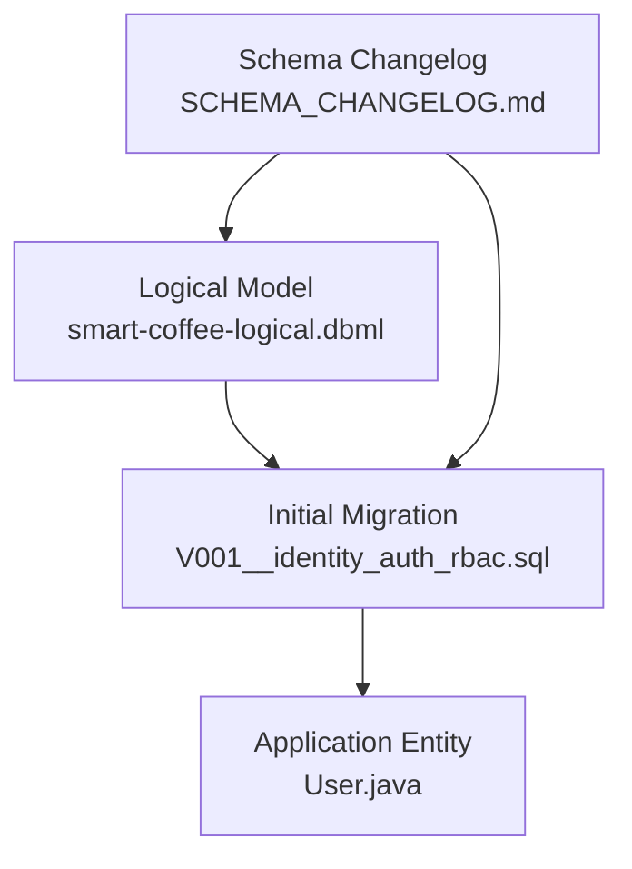
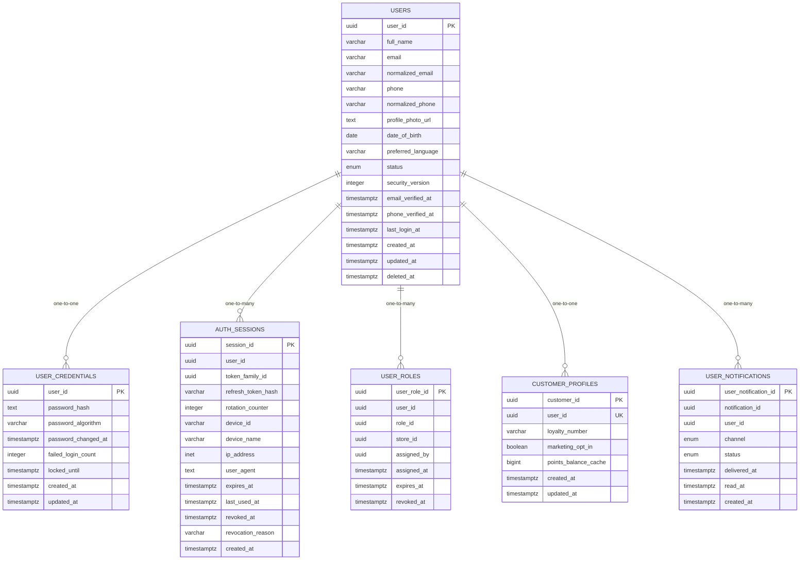
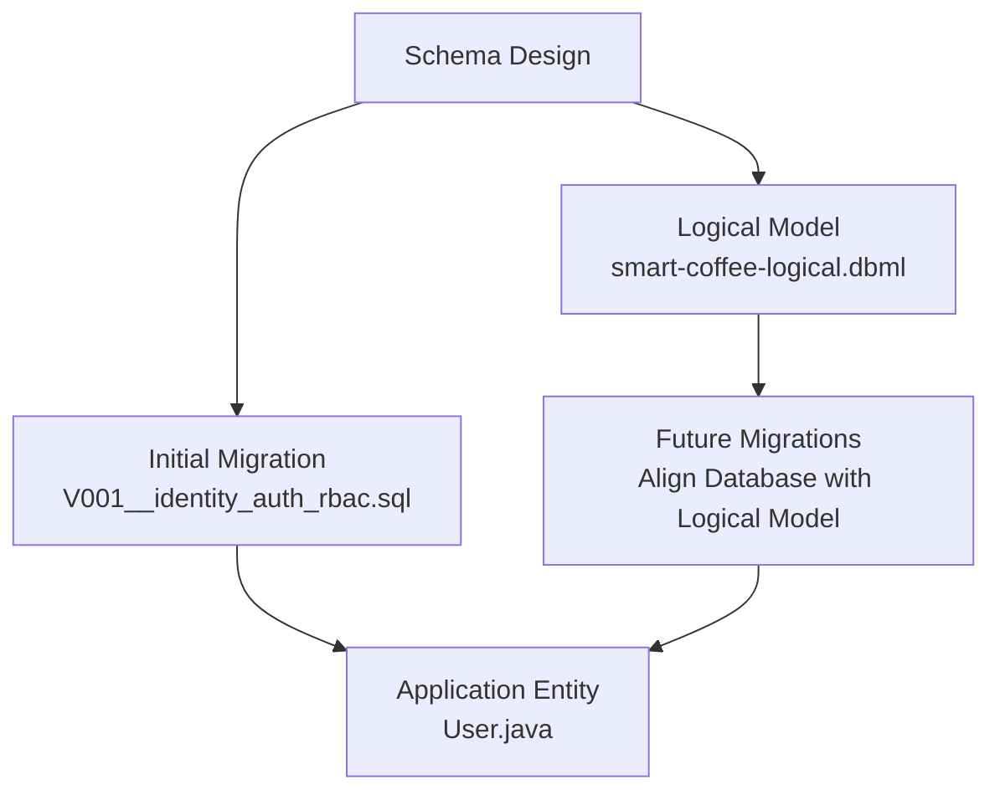
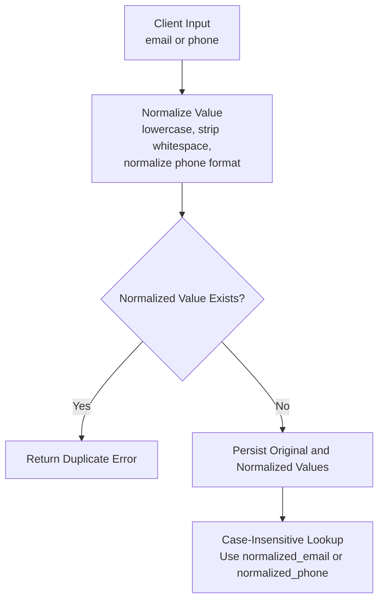
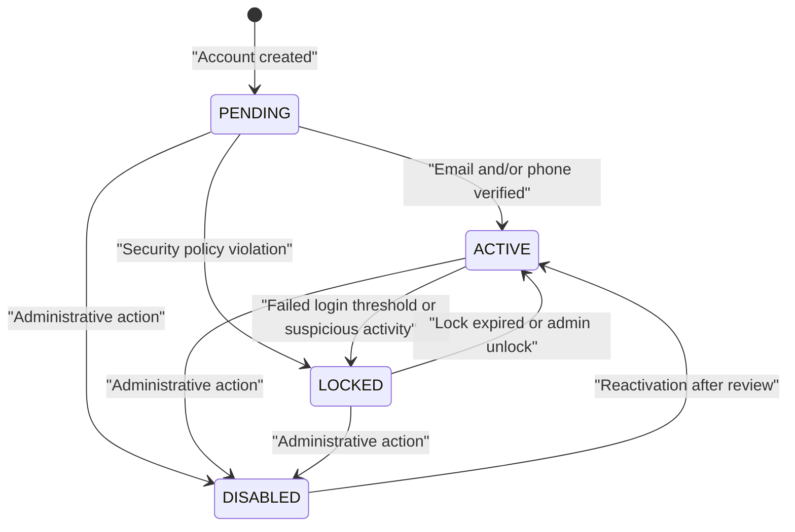
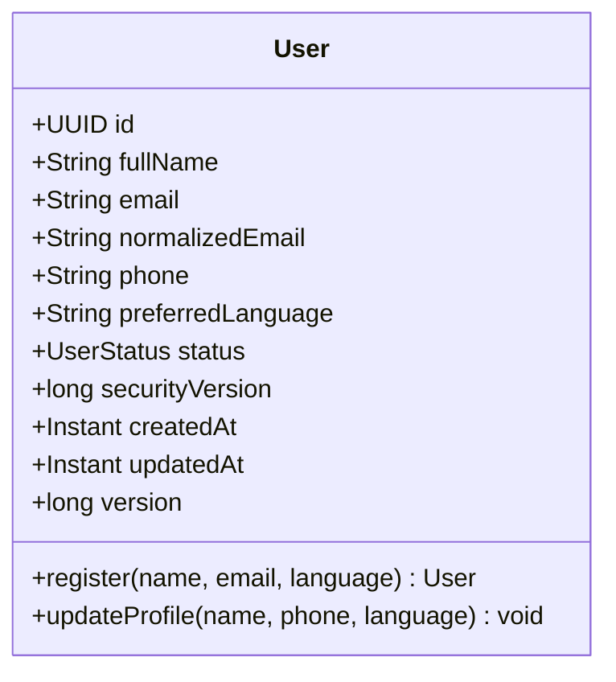
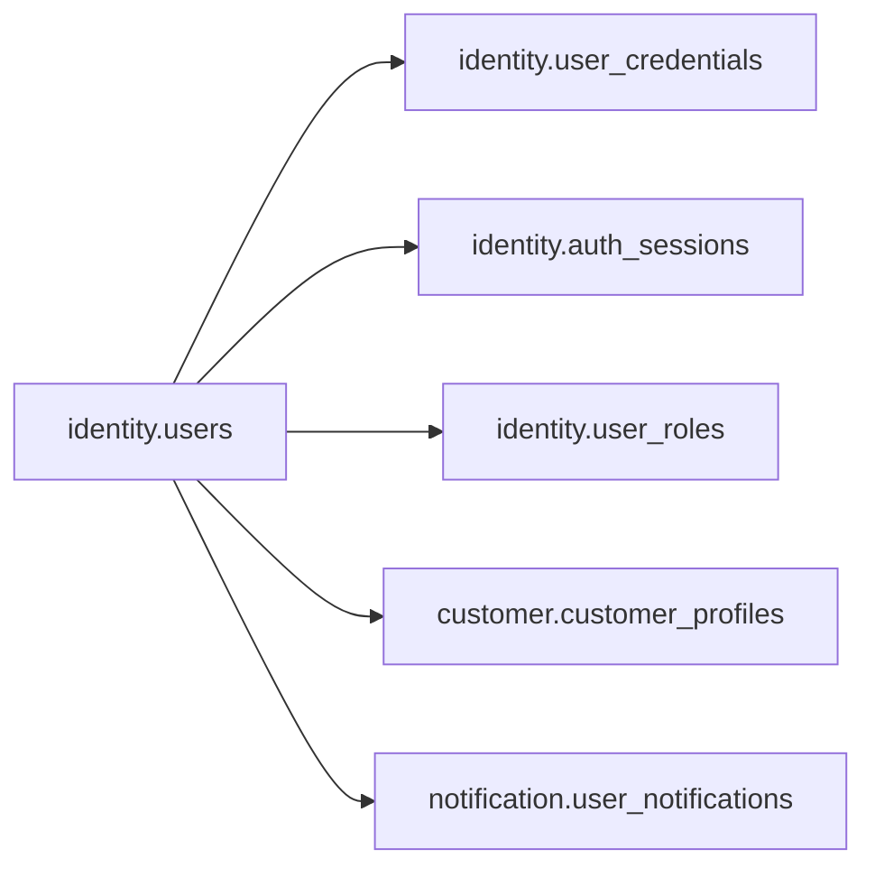

# Users Table

<cite>
**Referenced Files in This Document**
- [smart-coffee-logical.dbml](file://database/smart-coffee-logical.dbml)
- [V001__identity_auth_rbac.sql](file://src/main/resources/db/migration/V001__identity_auth_rbac.sql)
- [User.java](file://src/main/java/com/smartcoffee/modules/identity/domain/User.java)
- [SCHEMA_CHANGELOG.md](file://database/SCHEMA_CHANGELOG.md)
</cite>

## Table of Contents
1. [Introduction](#introduction)
2. [Project Structure](#project-structure)
3. [Core Components](#core-components)
4. [Architecture Overview](#architecture-overview)
5. [Detailed Component Analysis](#detailed-component-analysis)
6. [Dependency Analysis](#dependency-analysis)
7. [Performance Considerations](#performance-considerations)
8. [Troubleshooting Guide](#troubleshooting-guide)
9. [Conclusion](#conclusion)

## Introduction
This document provides comprehensive data model documentation for the `users` table under the `identity` schema. It explains every field, index, constraint, and business rule relevant to user identity, normalization, verification timestamps, security versioning, audit fields, status lifecycle, and multi-language support. The documentation reconciles differences between the current Flyway migration, the application entity mapping, and the approved logical database model.

## Project Structure
The `users` table is part of the Identity module:
- Logical model definition: `database/smart-coffee-logical.dbml`
- Initial migration: `src/main/resources/db/migration/V001__identity_auth_rbac.sql`
- Application entity mapping: `src/main/java/com/smartcoffee/modules/identity/domain/User.java`
- Schema evolution guidance: `database/SCHEMA_CHANGELOG.md`

**Diagram sources**
- [smart-coffee-logical.dbml:28-52](file://database/smart-coffee-logical.dbml#L28-L52)
- [V001__identity_auth_rbac.sql:3-23](file://src/main/resources/db/migration/V001__identity_auth_rbac.sql#L3-L23)
- [User.java:7-34](file://src/main/java/com/smartcoffee/modules/identity/domain/User.java#L7-L34)
- [SCHEMA_CHANGELOG.md:24-29](file://database/SCHEMA_CHANGELOG.md#L24-L29)

**Section sources**
- [smart-coffee-logical.dbml:28-52](file://database/smart-coffee-logical.dbml#L28-L52)
- [V001__identity_auth_rbac.sql:3-23](file://src/main/resources/db/migration/V001__identity_auth_rbac.sql#L3-L23)
- [User.java:7-34](file://src/main/java/com/smartcoffee/modules/identity/domain/User.java#L7-L34)
- [SCHEMA_CHANGELOG.md:24-29](file://database/SCHEMA_CHANGELOG.md#L24-L29)

## Core Components
The `users` table represents a core identity aggregate with the following responsibilities:
- Unique user identification via UUID primary key
- Display name and contact information
- Normalized email and phone for case-insensitive and format-insensitive lookups
- Optional profile photo URL and date of birth
- Preferred language for localization
- Account status lifecycle control
- Security version tracking for password-related operations
- Verification timestamps for email and phone
- Audit timestamps and soft-delete marker
- Composite filtering index for efficient status-based queries

### Field Reference

| Field | Type / Constraint | Purpose and Behavior |
|---|---|---|
| `user_id` | UUID, PRIMARY KEY | Immutable unique identifier for the user. |
| `full_name` | VARCHAR(100), NOT NULL | Human-readable display name. |
| `email` | VARCHAR(320), nullable in logical model | Original email address as provided by the client. |
| `normalized_email` | VARCHAR(320), UNIQUE | Lowercased and normalized email used for case-insensitive uniqueness and lookup. |
| `phone` | VARCHAR(30), nullable | Original phone number as provided by the client. |
| `normalized_phone` | VARCHAR(30), UNIQUE | Normalized phone used for deduplication and case-insensitive lookup. |
| `profile_photo_url` | TEXT, nullable | URL or object reference to the user’s profile photo. |
| `date_of_birth` | DATE, nullable | User’s date of birth when provided. |
| `preferred_language` | VARCHAR(10), NOT NULL, default `'en'` | ISO-style language code used for localized responses. |
| `status` | Enum `user_status`, NOT NULL, default `'ACTIVE'` | Account lifecycle state. |
| `security_version` | INTEGER, NOT NULL, default `0` | Version counter incremented when credentials change; used to invalidate sessions or tokens tied to older passwords. |
| `email_verified_at` | TIMESTAMPTZ, nullable | Timestamp when email verification completed successfully. |
| `phone_verified_at` | TIMESTAMPTZ, nullable | Timestamp when phone verification completed successfully. |
| `last_login_at` | TIMESTAMPTZ, nullable | Timestamp of the most recent successful login. |
| `created_at` | TIMESTAMPTZ, NOT NULL, default `now()` | Record creation timestamp. |
| `updated_at` | TIMESTAMPTZ, NOT NULL, default `now()` | Last modification timestamp. |
| `deleted_at` | TIMESTAMPTZ, nullable | Soft-delete marker; rows are logically removed rather than physically deleted. |

**Section sources**
- [smart-coffee-logical.dbml:28-52](file://database/smart-coffee-logical.dbml#L28-L52)

### Indexes

| Index | Columns | Uniqueness | Purpose |
|---|---|---:|---|
| Primary Key | `user_id` | Yes | Fast identity lookup and foreign-key references. |
| Unique Index | `normalized_email` | Yes | Prevents duplicate normalized emails and enables case-insensitive email lookup. |
| Unique Index | `normalized_phone` | Yes | Prevents duplicate normalized phones and enables case-insensitive phone lookup. |
| Composite Index | `(status, created_at)` | No | Optimizes queries that filter users by account status and sort or paginate by creation time. |

**Section sources**
- [smart-coffee-logical.dbml:47-51](file://database/smart-coffee-logical.dbml#L47-L51)

### Status Enum

The logical model defines the `user_status` enum with these values:
- `PENDING`: Account exists but is not yet fully active.
- `ACTIVE`: Account is active and can authenticate and use services.
- `LOCKED`: Account is temporarily locked, typically due to security policy such as failed login attempts.
- `DISABLED`: Account is disabled, usually by an administrator or compliance action.

The initial migration currently enforces a string check constraint with `ACTIVE`, `DISABLED`, and `LOCKED`. The logical model adds `PENDING` as the intended fourth state. Application code should treat `PENDING` as valid once the database schema is aligned with the logical model.

**Section sources**
- [smart-coffee-logical.dbml:5](file://database/smart-coffee-logical.dbml#L5)
- [smart-coffee-logical.dbml:38](file://database/smart-coffee-logical.dbml#L38)
- [V001__identity_auth_rbac.sql:21-23](file://src/main/resources/db/migration/V001__identity_auth_rbac.sql#L21-L23)

## Architecture Overview
The `users` table sits at the center of identity management:
- It stores canonical user identity and preferences.
- It is referenced by authentication sessions, role assignments, customer profiles, notifications, and other modules.
- Normalized columns ensure reliable identity resolution across different input formats.
- Status and audit fields support secure, auditable user lifecycle management.

**Diagram sources**
- [smart-coffee-logical.dbml:28-52](file://database/smart-coffee-logical.dbml#L28-L52)
- [smart-coffee-logical.dbml:54-63](file://database/smart-coffee-logical.dbml#L54-L63)
- [smart-coffee-logical.dbml:65-86](file://database/smart-coffee-logical.dbml#L65-L86)
- [smart-coffee-logical.dbml:114-124](file://database/smart-coffee-logical.dbml#L114-L124)
- [smart-coffee-logical.dbml:163-171](file://database/smart-coffee-logical.dbml#L163-L171)
- [smart-coffee-logical.dbml:722-732](file://database/smart-coffee-logical.dbml#L722-L732)

## Detailed Component Analysis

### Data Model Alignment Across Sources
There are three layers to consider:
1. **Logical model**: Defines the authoritative schema, including additional fields like `normalized_phone`, `profile_photo_url`, `date_of_birth`, verification timestamps, and composite indexes.
2. **Initial migration**: Creates the first working version of the table with basic identity fields, status check constraint, and credential relationship.
3. **Application entity**: Maps selected fields into the Java domain object, including normalization behavior during registration.

**Diagram sources**
- [smart-coffee-logical.dbml:28-52](file://database/smart-coffee-logical.dbml#L28-L52)
- [V001__identity_auth_rbac.sql:3-23](file://src/main/resources/db/migration/V001__identity_auth_rbac.sql#L3-L23)
- [User.java:7-34](file://src/main/java/com/smartcoffee/modules/identity/domain/User.java#L7-L34)

**Section sources**
- [smart-coffee-logical.dbml:28-52](file://database/smart-coffee-logical.dbml#L28-L52)
- [V001__identity_auth_rbac.sql:3-23](file://src/main/resources/db/migration/V001__identity_auth_rbac.sql#L3-L23)
- [User.java:7-34](file://src/main/java/com/smartcoffee/modules/identity/domain/User.java#L7-L34)

### Field-Level Business Rules

#### User Identification
- `user_id` is the immutable primary key.
- It should be generated at creation time and never reused.

#### Name and Contact Information
- `full_name` is required and represents the display name.
- `email` stores the original value; `normalized_email` stores the normalized value used for uniqueness and lookup.
- `phone` stores the original value; `normalized_phone` stores the normalized value used for uniqueness and lookup.

#### Profile Metadata
- `profile_photo_url` is optional and may be null.
- `date_of_birth` is optional and may be null.

#### Multi-Language Support
- `preferred_language` defaults to `'en'` in the logical model.
- The initial migration uses `'en-US'` as the default.
- Application code should validate language codes against supported locales before persisting.

#### Account Status Lifecycle
- Valid states include `PENDING`, `ACTIVE`, `LOCKED`, and `DISABLED`.
- Default state is `ACTIVE` in the logical model.
- The initial migration restricts status to `ACTIVE`, `DISABLED`, and `LOCKED`; `PENDING` must be added through a future migration.

#### Security Versioning
- `security_version` starts at `0`.
- Increment it whenever password or credential material changes.
- Use it to invalidate sessions, refresh tokens, or cached authentication contexts associated with older credentials.

#### Verification Timestamps
- `email_verified_at` records successful email verification.
- `phone_verified_at` records successful phone verification.
- These fields remain null until verification succeeds.

#### Audit Fields
- `created_at` is set on insert.
- `updated_at` is updated on modifications.
- `deleted_at` supports soft deletion.
- Other systems can rely on these timestamps for auditing, retention, and cleanup jobs.

**Section sources**
- [smart-coffee-logical.dbml:28-52](file://database/smart-coffee-logical.dbml#L28-L52)
- [V001__identity_auth_rbac.sql:3-23](file://src/main/resources/db/migration/V001__identity_auth_rbac.sql#L3-L23)
- [User.java:10-34](file://src/main/java/com/smartcoffee/modules/identity/domain/User.java#L10-L34)

### Normalization and Lookup Strategy

**Diagram sources**
- [smart-coffee-logical.dbml:31-34](file://database/smart-coffee-logical.dbml#L31-L34)
- [smart-coffee-logical.dbml:47-51](file://database/smart-coffee-logical.dbml#L47-L51)
- [SCHEMA_CHANGELOG.md:24-29](file://database/SCHEMA_CHANGELOG.md#L24-L29)

Key rules:
- Always normalize before checking uniqueness.
- Store both original and normalized values.
- Use normalized columns for all lookups and uniqueness checks.
- Do not expose normalized values directly as public identifiers unless explicitly required.

**Section sources**
- [smart-coffee-logical.dbml:31-34](file://database/smart-coffee-logical.dbml#L31-L34)
- [smart-coffee-logical.dbml:47-51](file://database/smart-coffee-logical.dbml#L47-L51)
- [SCHEMA_CHANGELOG.md:24-29](file://database/SCHEMA_CHANGELOG.md#L24-L29)

### Status Transitions

Business constraints:
- `PENDING` indicates incomplete onboarding.
- `ACTIVE` allows normal access.
- `LOCKED` is temporary and security-driven.
- `DISABLED` is administrative or compliance-driven.
- Transitions should be enforced by application logic and validated by database constraints once the schema aligns with the logical model.

**Section sources**
- [smart-coffee-logical.dbml:5](file://database/smart-coffee-logical.dbml#L5)
- [smart-coffee-logical.dbml:38](file://database/smart-coffee-logical.dbml#L38)
- [V001__identity_auth_rbac.sql:21-23](file://src/main/resources/db/migration/V001__identity_auth_rbac.sql#L21-L23)

### Application Entity Mapping Notes
The `User` entity maps several fields from the `identity.users` table:
- `user_id`
- `full_name`
- `email`
- `normalized_email`
- `phone`
- `preferred_language`
- `status`
- `security_version`
- `created_at`
- `updated_at`
- A JPA `version` column for optimistic concurrency control

Registration behavior normalizes the email by trimming and lowercasing it before storing the normalized value. Profile updates allow changing the display name, phone, and preferred language while updating the modification timestamp.

**Diagram sources**
- [User.java:7-34](file://src/main/java/com/smartcoffee/modules/identity/domain/User.java#L7-L34)
- [User.java:39-52](file://src/main/java/com/smartcoffee/modules/identity/domain/User.java#L39-L52)
- [User.java:78-83](file://src/main/java/com/smartcoffee/modules/identity/domain/User.java#L78-L83)

**Section sources**
- [User.java:7-34](file://src/main/java/com/smartcoffee/modules/identity/domain/User.java#L7-L34)
- [User.java:39-52](file://src/main/java/com/smartcoffee/modules/identity/domain/User.java#L39-L52)
- [User.java:78-83](file://src/main/java/com/smartcoffee/modules/identity/domain/User.java#L78-L83)

## Dependency Analysis
The `users` table participates in multiple relationships:
- One-to-one with `user_credentials` for password and lockout state.
- One-to-many with `auth_sessions` for active authentication context.
- One-to-many with `user_roles` for RBAC assignments.
- One-to-one with `customer_profiles` for customer-specific extensions.
- One-to-many with `user_notifications` for delivery targeting.

**Diagram sources**
- [smart-coffee-logical.dbml:28-52](file://database/smart-coffee-logical.dbml#L28-L52)
- [smart-coffee-logical.dbml:54-63](file://database/smart-coffee-logical.dbml#L54-L63)
- [smart-coffee-logical.dbml:65-86](file://database/smart-coffee-logical.dbml#L65-L86)
- [smart-coffee-logical.dbml:114-124](file://database/smart-coffee-logical.dbml#L114-L124)
- [smart-coffee-logical.dbml:163-171](file://database/smart-coffee-logical.dbml#L163-L171)
- [smart-coffee-logical.dbml:722-732](file://database/smart-coffee-logical.dbml#L722-L732)

**Section sources**
- [smart-coffee-logical.dbml:28-52](file://database/smart-coffee-logical.dbml#L28-L52)
- [smart-coffee-logical.dbml:54-63](file://database/smart-coffee-logical.dbml#L54-L63)
- [smart-coffee-logical.dbml:65-86](file://database/smart-coffee-logical.dbml#L65-L86)
- [smart-coffee-logical.dbml:114-124](file://database/smart-coffee-logical.dbml#L114-L124)
- [smart-coffee-logical.dbml:163-171](file://database/smart-coffee-logical.dbml#L163-L171)
- [smart-coffee-logical.dbml:722-732](file://database/smart-coffee-logical.dbml#L722-L732)

## Performance Considerations
- Use `normalized_email` and `normalized_phone` for all identity lookups to leverage unique indexes.
- Avoid querying on raw `email` or `phone` for uniqueness; always normalize in application code.
- Prefer queries using `(status, created_at)` for paginated user lists filtered by account state.
- Keep `deleted_at` queries selective; avoid scanning large soft-deleted sets without proper indexing or partitioning strategies.
- Monitor index usage for normalized columns if normalization logic changes.

[No sources needed since this section provides general guidance]

## Troubleshooting Guide

### Duplicate Email or Phone Errors
- Cause: Insert or update violates the unique constraint on `normalized_email` or `normalized_phone`.
- Resolution:
  - Verify normalization logic matches the expected format.
  - Confirm the client did not send duplicate normalized values.
  - Check whether the original value differs only in case or formatting.

**Section sources**
- [smart-coffee-logical.dbml:31-34](file://database/smart-coffee-logical.dbml#L31-L34)
- [smart-coffee-logical.dbml:47-51](file://database/smart-coffee-logical.dbml#L47-L51)

### Invalid Status Values
- Cause: The initial migration check constraint does not include `PENDING`.
- Resolution:
  - Align the database schema with the logical model through a new migration.
  - Update application validation to accept `PENDING` only after the database constraint is extended.

**Section sources**
- [V001__identity_auth_rbac.sql:21-23](file://src/main/resources/db/migration/V001__identity_auth_rbac.sql#L21-L23)
- [smart-coffee-logical.dbml:5](file://database/smart-coffee-logical.dbml#L5)
- [smart-coffee-logical.dbml:38](file://database/smart-coffee-logical.dbml#L38)

### Language Default Inconsistency
- Cause: Logical model defaults to `'en'`, while the initial migration defaults to `'en-US'`.
- Resolution:
  - Decide on a consistent language code strategy.
  - Apply a migration that aligns defaults and validates supported locale codes.

**Section sources**
- [smart-coffee-logical.dbml:37](file://database/smart-coffee-logical.dbml#L37)
- [V001__identity_auth_rbac.sql:10](file://src/main/resources/db/migration/V001__identity_auth_rbac.sql#L10)

### Missing Verification Timestamps
- Symptom: Users appear active but lack `email_verified_at` or `phone_verified_at`.
- Resolution:
  - Ensure verification workflows set these timestamps only after successful provider confirmation.
  - Add application-level validation requiring verification for sensitive actions.

**Section sources**
- [smart-coffee-logical.dbml:40-42](file://database/smart-coffee-logical.dbml#L40-L42)

### Security Version Not Incremented
- Symptom: Old sessions or tokens remain valid after password change.
- Resolution:
  - Increment `security_version` whenever credentials change.
  - Invalidate existing sessions or tokens based on the previous security version.

**Section sources**
- [smart-coffee-logical.dbml:39](file://database/smart-coffee-logical.dbml#L39)

## Conclusion
The `users` table is the foundational identity entity in the system. Its design emphasizes:
- Reliable identity resolution through normalized email and phone.
- Clear account lifecycle states.
- Security versioning for credential safety.
- Verification timestamps for trust signals.
- Audit fields for traceability.
- Composite indexing for efficient filtering.

Before production rollout, ensure the database schema is migrated to match the logical model so that `PENDING` status, normalized phone, profile metadata, verification timestamps, and composite indexes are available. Application code should continue enforcing normalization, validation, and safe status transitions around these database guarantees.

[No sources needed since this section summarizes without analyzing specific files]