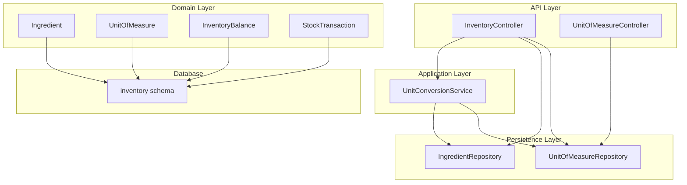
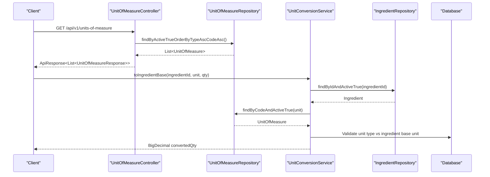
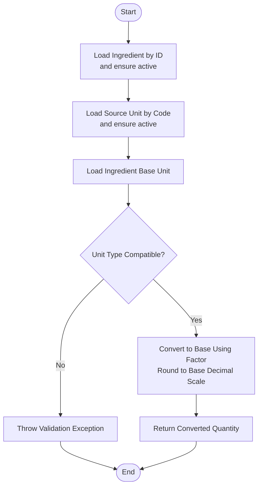
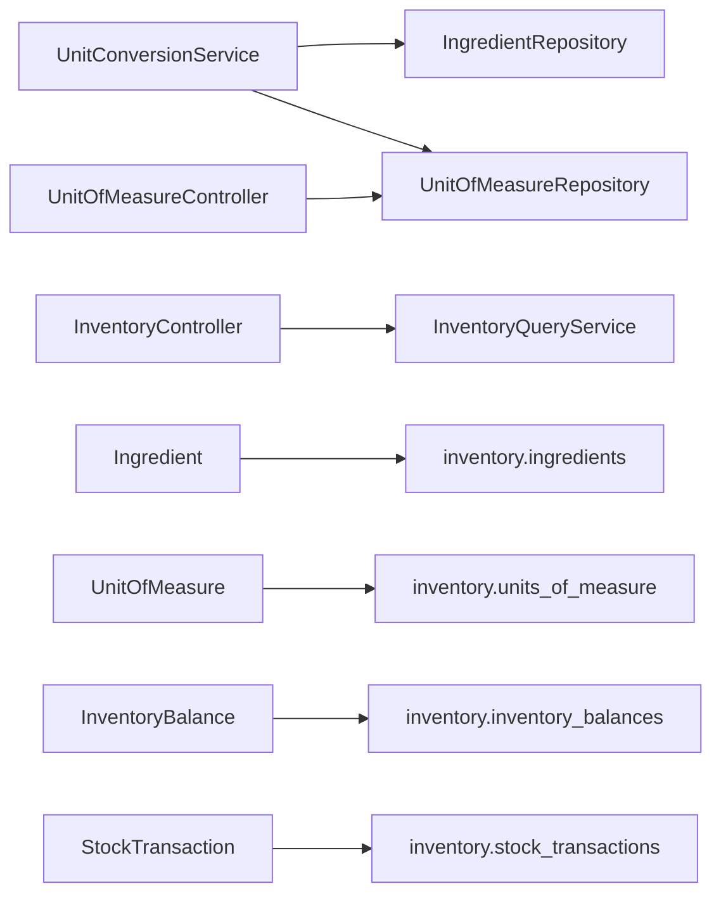

# Core Inventory Models

<cite>
**Referenced Files in This Document**
- [Ingredient.java](file://src/main/java/com/smartcoffee/modules/inventory/domain/Ingredient.java)
- [UnitOfMeasure.java](file://src/main/java/com/smartcoffee/modules/inventory/domain/UnitOfMeasure.java)
- [UnitType.java](file://src/main/java/com/smartcoffee/modules/inventory/domain/UnitType.java)
- [InventoryBalance.java](file://src/main/java/com/smartcoffee/modules/inventory/domain/InventoryBalance.java)
- [StockTransaction.java](file://src/main/java/com/smartcoffee/modules/inventory/domain/StockTransaction.java)
- [StockTransactionType.java](file://src/main/java/com/smartcoffee/modules/inventory/domain/StockTransactionType.java)
- [IngredientRepository.java](file://src/main/java/com/smartcoffee/modules/inventory/persistence/IngredientRepository.java)
- [UnitOfMeasureRepository.java](file://src/main/java/com/smartcoffee/modules/inventory/persistence/UnitOfMeasureRepository.java)
- [UnitConversionService.java](file://src/main/java/com/smartcoffee/modules/inventory/application/UnitConversionService.java)
- [V005__recipe_inventory_uom_reservation_ledger.sql](file://src/main/resources/db/migration/V005__recipe_inventory_uom_reservation_ledger.sql)
- [smart-coffee-logical.dbml](file://database/smart-coffee-logical.dbml)
- [AuditableEntity.java](file://src/main/java/com/smartcoffee/common/persistence/AuditableEntity.java)
- [InventoryController.java](file://src/main/java/com/smartcoffee/modules/inventory/api/InventoryController.java)
- [UnitOfMeasureController.java](file://src/main/java/com/smartcoffee/modules/inventory/api/UnitOfMeasureController.java)
</cite>

## Table of Contents
1. Introduction
2. Project Structure
3. Core Components
4. Architecture Overview
5. Detailed Component Analysis
6. Dependency Analysis
7. Performance Considerations
8. Troubleshooting Guide
9. Conclusion

## Introduction
This document provides comprehensive data model documentation for core inventory entities, focusing on Ingredient and UnitOfMeasure. It explains field definitions, validation rules, business constraints, unit conversion relationships, cost accounting integration, soft deletion patterns, and audit trail requirements. Examples are provided to guide ingredient setup, unit configuration, and integration with inventory balances and stock transactions.

## Project Structure
The inventory domain is implemented as a modular component within the application:
- Domain models define entities and value semantics (e.g., Ingredient, UnitOfMeasure, InventoryBalance, StockTransaction).
- Persistence layer exposes repositories for JPA access.
- Application services orchestrate operations such as unit conversions.
- API controllers expose read endpoints for inventory balances and units of measure.
- Database schema is defined via SQL migrations and a logical DBML model.

**Diagram sources**
- [InventoryController.java:10-32](file://src/main/java/com/smartcoffee/modules/inventory/api/InventoryController.java#L10-L32)
- [UnitOfMeasureController.java:9-24](file://src/main/java/com/smartcoffee/modules/inventory/api/UnitOfMeasureController.java#L9-L24)
- [UnitConversionService.java:11-32](file://src/main/java/com/smartcoffee/modules/inventory/application/UnitConversionService.java#L11-L32)
- [Ingredient.java:8-31](file://src/main/java/com/smartcoffee/modules/inventory/domain/Ingredient.java#L8-L31)
- [UnitOfMeasure.java:8-34](file://src/main/java/com/smartcoffee/modules/inventory/domain/UnitOfMeasure.java#L8-L34)
- [InventoryBalance.java:7-23](file://src/main/java/com/smartcoffee/modules/inventory/domain/InventoryBalance.java#L7-L23)
- [StockTransaction.java:7-31](file://src/main/java/com/smartcoffee/modules/inventory/domain/StockTransaction.java#L7-L31)

**Section sources**
- [InventoryController.java:10-32](file://src/main/java/com/smartcoffee/modules/inventory/api/InventoryController.java#L10-L32)
- [UnitOfMeasureController.java:9-24](file://src/main/java/com/smartcoffee/modules/inventory/api/UnitOfMeasureController.java#L9-L24)
- [UnitConversionService.java:11-32](file://src/main/java/com/smartcoffee/modules/inventory/application/UnitConversionService.java#L11-L32)
- [Ingredient.java:8-31](file://src/main/java/com/smartcoffee/modules/inventory/domain/Ingredient.java#L8-L31)
- [UnitOfMeasure.java:8-34](file://src/main/java/com/smartcoffee/modules/inventory/domain/UnitOfMeasure.java#L8-L34)
- [InventoryBalance.java:7-23](file://src/main/java/com/smartcoffee/modules/inventory/domain/InventoryBalance.java#L7-L23)
- [StockTransaction.java:7-31](file://src/main/java/com/smartcoffee/modules/inventory/domain/StockTransaction.java#L7-L31)

## Core Components
- Ingredient: Represents a raw material or consumable item used in recipes and production. Includes code, name, base unit association, standard cost, inventory tracking flag, and lifecycle flags.
- UnitOfMeasure: Defines measurement units with type, decimal precision, conversion factor to base unit, and active status. Provides methods to convert quantities to/from base units with rounding.
- InventoryBalance: Tracks per-store stock levels, reserved quantities, minimum thresholds, and average unit cost.
- StockTransaction: Immutable ledger of inventory movements with lines detailing deltas, costs, and balances before/after.

Key responsibilities:
- Ingredient anchors cost and unit semantics for recipe consumption and costing.
- UnitOfMeasure ensures consistent quantity handling across different units and types.
- InventoryBalance provides real-time availability and reorder signals.
- StockTransaction records all changes for auditability and reconciliation.

**Section sources**
- [Ingredient.java:8-31](file://src/main/java/com/smartcoffee/modules/inventory/domain/Ingredient.java#L8-L31)
- [UnitOfMeasure.java:8-34](file://src/main/java/com/smartcoffee/modules/inventory/domain/UnitOfMeasure.java#L8-L34)
- [InventoryBalance.java:7-23](file://src/main/java/com/smartcoffee/modules/inventory/domain/InventoryBalance.java#L7-L23)
- [StockTransaction.java:7-31](file://src/main/java/com/smartcoffee/modules/inventory/domain/StockTransaction.java#L7-L31)

## Architecture Overview
The inventory data model integrates with application services and database constraints to enforce business rules:
- Unit conversion validates unit compatibility and applies correct rounding based on base unit precision.
- Inventory balances constrain reserved stock to not exceed current stock and maintain non-negative values.
- Stock transactions record immutable changes with balance snapshots for full traceability.

**Diagram sources**
- [UnitOfMeasureController.java:18-24](file://src/main/java/com/smartcoffee/modules/inventory/api/UnitOfMeasureController.java#L18-L24)
- [UnitConversionService.java:21-32](file://src/main/java/com/smartcoffee/modules/inventory/application/UnitConversionService.java#L21-L32)
- [IngredientRepository.java:7-9](file://src/main/java/com/smartcoffee/modules/inventory/persistence/IngredientRepository.java#L7-L9)
- [UnitOfMeasureRepository.java:7-11](file://src/main/java/com/smartcoffee/modules/inventory/persistence/UnitOfMeasureRepository.java#L7-L11)

## Detailed Component Analysis

### Ingredient Entity
Purpose:
- Central definition of an ingredient with identification, naming, unit association, cost, and operational flags.

Field definitions and constraints:
- ingredient_id: Primary key (UUID).
- ingredient_code: Unique identifier; required; max length 50.
- ingredient_name: Display name; required; max length 150.
- base_unit_id: Required reference to a UnitOfMeasure defining the base unit for this ingredient.
- standard_cost: Cost per base unit; required; numeric(14,4); must be non-negative.
- track_inventory: Boolean indicating whether inventory should be tracked for this ingredient.
- active: Soft-delete-like flag; only active ingredients are considered by default queries.
- created_at, updated_at: Audit timestamps managed by persistence auditing.
- version: Optimistic concurrency control.

Business rules:
- Only active ingredients are returned by repository queries that filter by active=true.
- Standard cost must be non-negative (enforced at DB level).
- Base unit must exist and be valid for the ingredient’s usage context.

Soft deletion pattern:
- The entity uses an active flag rather than physical deletion. Repository methods query only active records.

Audit trail:
- Timestamps are automatically managed by Spring Data Auditing via AuditableEntity.

Examples:
- Setup coffee bean ingredient with base unit gram and standard cost per gram.
- Configure fresh milk with milliliter base unit and appropriate cost.

**Section sources**
- [Ingredient.java:8-31](file://src/main/java/com/smartcoffee/modules/inventory/domain/Ingredient.java#L8-L31)
- [IngredientRepository.java:7-9](file://src/main/java/com/smartcoffee/modules/inventory/persistence/IngredientRepository.java#L7-L9)
- [V005__recipe_inventory_uom_reservation_ledger.sql:29-41](file://src/main/resources/db/migration/V005__recipe_inventory_uom_reservation_ledger.sql#L29-L41)
- [smart-coffee-logical.dbml:577-588](file://database/smart-coffee-logical.dbml#L577-L588)
- [AuditableEntity.java:8-16](file://src/main/java/com/smartcoffee/common/persistence/AuditableEntity.java#L8-L16)

### UnitOfMeasure Entity
Purpose:
- Defines measurement units with type, precision, conversion factors, and activation state.

Field definitions and constraints:
- unit_id: Primary key (UUID).
- unit_code: Unique code; required; max length 20.
- unit_name: Human-readable name; required; max length 60.
- unit_type: Enumerated type; one of MASS, VOLUME, COUNT, PACKAGE.
- decimal_scale: Precision for rounding; constrained between 0 and 6.
- conversion_factor_to_base: Factor to convert from this unit to base unit; must be positive.
- base_unit: Flag indicating if this unit is the base unit for its type.
- active: Soft-delete-like flag; only active units are exposed by default.
- created_at, updated_at: Audit timestamps.
- version: Optimistic concurrency control.

Validation and behavior:
- toBase(quantity): Converts a quantity to base unit using the factor and rounds to decimal_scale.
- fromBase(quantity): Converts from base unit to this unit with rounding.
- Unit type must match ingredient base unit type during conversions.

Examples:
- Define GRAM as base unit for MASS with scale 4 and factor 1.
- Define KILOGRAM with factor 1000 relative to GRAM.
- Define MILLILITER and LITER for VOLUME with appropriate factors.

**Section sources**
- [UnitOfMeasure.java:8-34](file://src/main/java/com/smartcoffee/modules/inventory/domain/UnitOfMeasure.java#L8-L34)
- [UnitOfMeasure.java:71-79](file://src/main/java/com/smartcoffee/modules/inventory/domain/UnitOfMeasure.java#L71-L79)
- [UnitType.java:3-5](file://src/main/java/com/smartcoffee/modules/inventory/domain/UnitType.java#L3-L5)
- [V005__recipe_inventory_uom_reservation_ledger.sql:5-27](file://src/main/resources/db/migration/V005__recipe_inventory_uom_reservation_ledger.sql#L5-L27)
- [smart-coffee-logical.dbml:569-575](file://database/smart-coffee-logical.dbml#L569-L575)

### Inventory Balance
Purpose:
- Tracks per-store stock levels, reservations, minimum thresholds, and average unit cost.

Field definitions and constraints:
- store_id, ingredient_id: Composite primary key.
- current_stock: Current available quantity; must be non-negative.
- reserved_stock: Quantity reserved for pending orders; must be non-negative and cannot exceed current_stock.
- minimum_stock: Reorder threshold; must be non-negative.
- average_unit_cost: Weighted average cost per base unit; must be non-negative.
- updated_at: Last update timestamp.
- version: Optimistic concurrency control.

Business rules:
- Reserved stock cannot exceed current stock.
- All stock fields must remain non-negative.

Integration points:
- Used by inventory queries to report availability and low-stock alerts.
- Updated by stock transactions and reservation workflows.

**Section sources**
- [InventoryBalance.java:7-23](file://src/main/java/com/smartcoffee/modules/inventory/domain/InventoryBalance.java#L7-L23)
- [V005__recipe_inventory_uom_reservation_ledger.sql:85-102](file://src/main/resources/db/migration/V005__recipe_inventory_uom_reservation_ledger.sql#L85-L102)
- [smart-coffee-logical.dbml:607-616](file://database/smart-coffee-logical.dbml#L607-L616)

### Stock Transaction
Purpose:
- Immutable ledger recording inventory movements with detailed lines and balance snapshots.

Field definitions and constraints:
- stock_transaction_id: Primary key (UUID).
- transaction_number: Unique identifier for the transaction.
- store_id: Store context for the transaction.
- transaction_type: Enumerated type (e.g., STOCK_IN, ADJUSTMENT, SALE_CONSUMPTION, RETURN, DAMAGED).
- reference_type, reference_id: Contextual references (e.g., order, receipt).
- recorded_by_user_id: Actor who recorded the transaction.
- occurred_at, created_at: Timestamps.
- lines: One-to-many relationship to StockTransactionLine with deltas, costs, and balances.

Business rules:
- Each line must have a non-zero delta.
- Unit cost must be non-negative when present.
- Balances before and after must be non-negative.

Usage:
- Ensures full auditability of inventory changes and supports cost accounting through unit_cost and balance snapshots.

**Section sources**
- [StockTransaction.java:7-31](file://src/main/java/com/smartcoffee/modules/inventory/domain/StockTransaction.java#L7-L31)
- [StockTransactionType.java:3-5](file://src/main/java/com/smartcoffee/modules/inventory/domain/StockTransactionType.java#L3-L5)
- [V005__recipe_inventory_uom_reservation_ledger.sql:146-187](file://src/main/resources/db/migration/V005__recipe_inventory_uom_reservation_ledger.sql#L146-L187)
- [smart-coffee-logical.dbml:653-677](file://database/smart-coffee-logical.dbml#L653-L677)

### Unit Conversion Flow
Purpose:
- Convert submitted quantities to ingredient base units while enforcing type compatibility and precision.

Flow:
- Retrieve ingredient and ensure it is active.
- Resolve source unit by code and ensure it is active.
- Resolve ingredient base unit.
- Validate unit type compatibility.
- Convert quantity to base unit using source unit’s factor and round to base unit’s decimal scale.

**Diagram sources**
- [UnitConversionService.java:21-32](file://src/main/java/com/smartcoffee/modules/inventory/application/UnitConversionService.java#L21-L32)
- [IngredientRepository.java:7-9](file://src/main/java/com/smartcoffee/modules/inventory/persistence/IngredientRepository.java#L7-L9)
- [UnitOfMeasureRepository.java:7-11](file://src/main/java/com/smartcoffee/modules/inventory/persistence/UnitOfMeasureRepository.java#L7-L11)

**Section sources**
- [UnitConversionService.java:21-32](file://src/main/java/com/smartcoffee/modules/inventory/application/UnitConversionService.java#L21-L32)

## Dependency Analysis
Component relationships:
- UnitConversionService depends on IngredientRepository and UnitOfMeasureRepository to resolve entities and validate constraints.
- InventoryController depends on InventoryQueryService to list balances for a store.
- UnitOfMeasureController depends on UnitOfMeasureRepository to list active units.
- Entities rely on database constraints for integrity and on JPA mappings for persistence.

**Diagram sources**
- [UnitConversionService.java:11-32](file://src/main/java/com/smartcoffee/modules/inventory/application/UnitConversionService.java#L11-L32)
- [InventoryController.java:10-32](file://src/main/java/com/smartcoffee/modules/inventory/api/InventoryController.java#L10-L32)
- [UnitOfMeasureController.java:9-24](file://src/main/java/com/smartcoffee/modules/inventory/api/UnitOfMeasureController.java#L9-L24)
- [Ingredient.java:8-31](file://src/main/java/com/smartcoffee/modules/inventory/domain/Ingredient.java#L8-L31)
- [UnitOfMeasure.java:8-34](file://src/main/java/com/smartcoffee/modules/inventory/domain/UnitOfMeasure.java#L8-L34)
- [InventoryBalance.java:7-23](file://src/main/java/com/smartcoffee/modules/inventory/domain/InventoryBalance.java#L7-L23)
- [StockTransaction.java:7-31](file://src/main/java/com/smartcoffee/modules/inventory/domain/StockTransaction.java#L7-L31)

**Section sources**
- [UnitConversionService.java:11-32](file://src/main/java/com/smartcoffee/modules/inventory/application/UnitConversionService.java#L11-L32)
- [InventoryController.java:10-32](file://src/main/java/com/smartcoffee/modules/inventory/api/InventoryController.java#L10-L32)
- [UnitOfMeasureController.java:9-24](file://src/main/java/com/smartcoffee/modules/inventory/api/UnitOfMeasureController.java#L9-L24)

## Performance Considerations
- Use repository queries that filter by active flags to avoid unnecessary joins and reduce result sets.
- Ensure indexes on frequently queried columns (e.g., store_id, ingredient_id, unit_code) are present as defined in migrations.
- Avoid excessive conversions; cache unit lookup results where appropriate to reduce DB calls.
- Batch operations for inventory updates to minimize transaction overhead.
- Monitor optimistic locking conflicts via version fields to handle concurrent updates gracefully.

[No sources needed since this section provides general guidance]

## Troubleshooting Guide
Common issues and resolutions:
- Unknown unit of measure: Occurs when submitting a unit code not found or inactive. Ensure the unit exists and is active.
- Unit type incompatibility: Occurs when the submitted unit type does not match the ingredient’s base unit type. Align unit types or adjust ingredient base unit.
- Negative or invalid quantities: Ensure quantities are positive and respect decimal scales.
- Reserved stock exceeds current stock: Adjust reservations or increase stock to satisfy constraints.
- Non-negative cost violations: Verify standard cost and unit cost values are non-negative.

Operational checks:
- Verify active flags on ingredients and units.
- Confirm conversion factors are positive and correctly set.
- Review stock transaction lines for zero deltas or negative balances.

**Section sources**
- [UnitConversionService.java:21-32](file://src/main/java/com/smartcoffee/modules/inventory/application/UnitConversionService.java#L21-L32)
- [V005__recipe_inventory_uom_reservation_ledger.sql:85-102](file://src/main/resources/db/migration/V005__recipe_inventory_uom_reservation_ledger.sql#L85-L102)
- [V005__recipe_inventory_uom_reservation_ledger.sql:146-187](file://src/main/resources/db/migration/V005__recipe_inventory_uom_reservation_ledger.sql#L146-L187)

## Conclusion
The core inventory data model centers on Ingredient and UnitOfMeasure, providing robust support for unit conversions, cost accounting, and inventory tracking. Constraints enforced at both application and database layers ensure data integrity, while audit trails and soft deletion patterns support compliance and operational flexibility. Integration with inventory balances and stock transactions enables accurate stock visibility and historical traceability.

[No sources needed since this section summarizes without analyzing specific files]