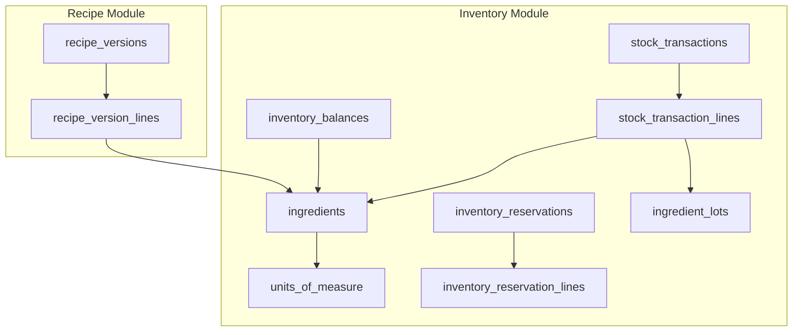
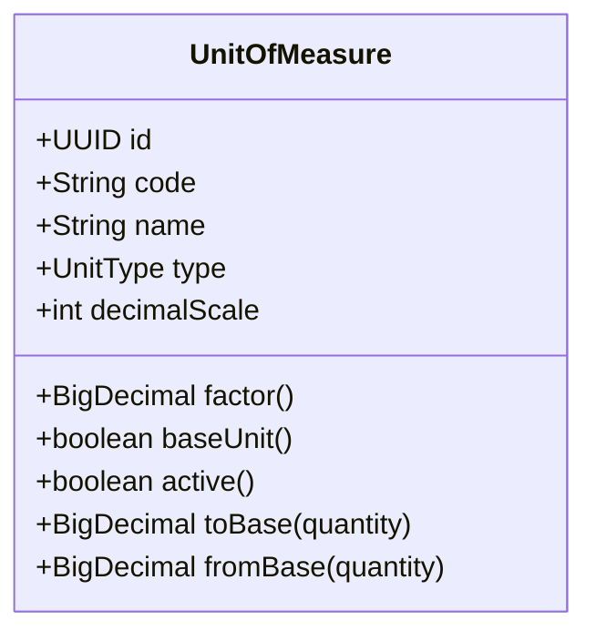
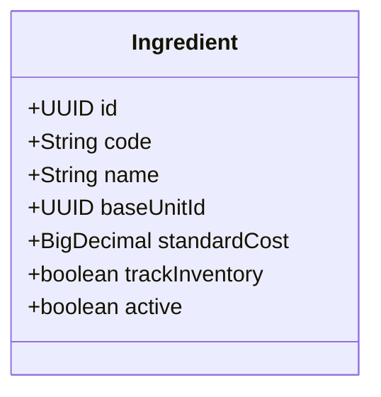
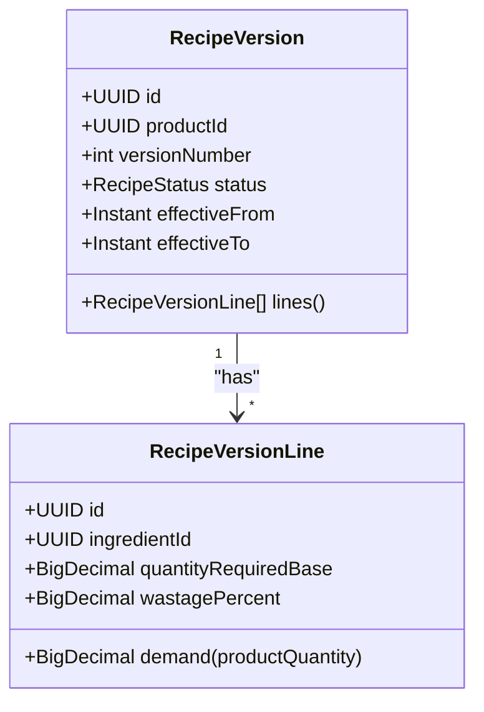
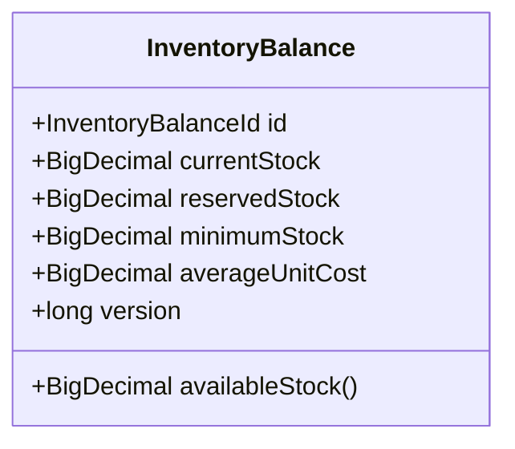
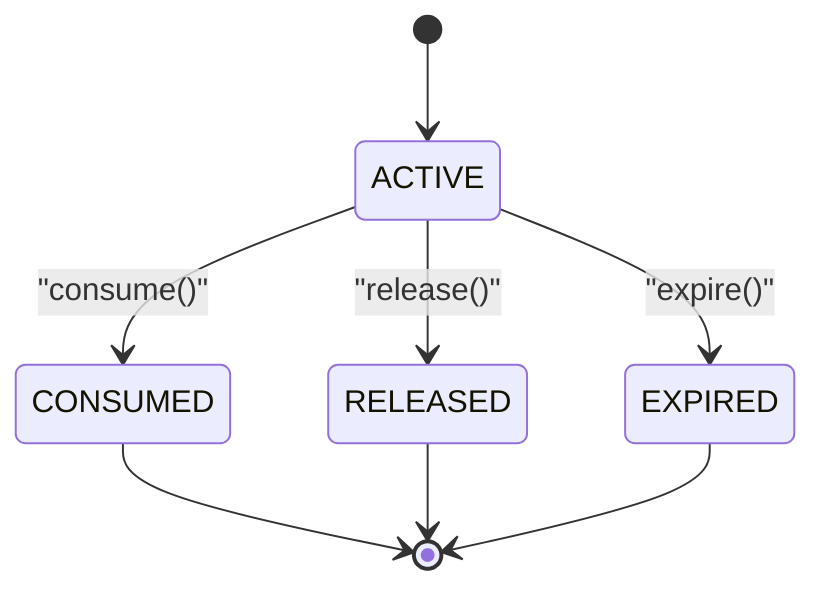
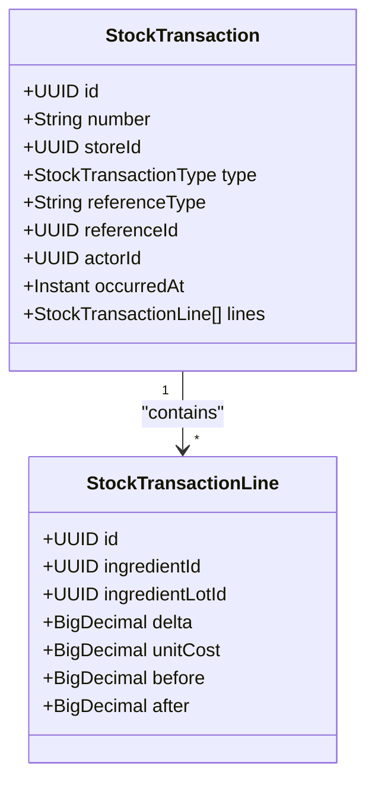
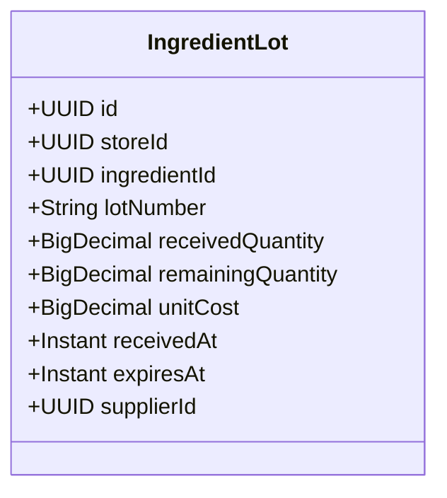
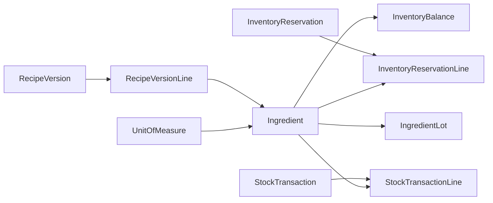

# Inventory & Recipe Schema

<cite>
**Referenced Files in This Document**
- [smart-coffee-logical.dbml](file://database/smart-coffee-logical.dbml)
- [INVENTORY_FLOW.mermaid](file://architecture/INVENTORY_FLOW.mermaid)
- [Ingredient.java](file://src/main/java/com/smartcoffee/modules/inventory/domain/Ingredient.java)
- [UnitOfMeasure.java](file://src/main/java/com/smartcoffee/modules/inventory/domain/UnitOfMeasure.java)
- [InventoryBalance.java](file://src/main/java/com/smartcoffee/modules/inventory/domain/InventoryBalance.java)
- [InventoryReservation.java](file://src/main/java/com/smartcoffee/modules/inventory/domain/InventoryReservation.java)
- [InventoryReservationLine.java](file://src/main/java/com/smartcoffee/modules/inventory/domain/InventoryReservationLine.java)
- [StockTransaction.java](file://src/main/java/com/smartcoffee/modules/inventory/domain/StockTransaction.java)
- [StockTransactionLine.java](file://src/main/java/com/smartcoffee/modules/inventory/domain/StockTransactionLine.java)
- [ReservationStatus.java](file://src/main/java/com/smartcoffee/modules/inventory/domain/ReservationStatus.java)
- [StockTransactionType.java](file://src/main/java/com/smartcoffee/modules/inventory/domain/StockTransactionType.java)
- [UnitType.java](file://src/main/java/com/smartcoffee/modules/inventory/domain/UnitType.java)
- [RecipeVersion.java](file://src/main/java/com/smartcoffee/modules/recipe/domain/RecipeVersion.java)
- [RecipeVersionLine.java](file://src/main/java/com/smartcoffee/modules/recipe/domain/RecipeVersionLine.java)
- [RecipeStatus.java](file://src/main/java/com/smartcoffee/modules/recipe/domain/RecipeStatus.java)
</cite>

## Table of Contents
1. [Introduction](#introduction)
2. [Project Structure](#project-structure)
3. [Core Components](#core-components)
4. [Architecture Overview](#architecture-overview)
5. [Detailed Component Analysis](#detailed-component-analysis)
6. [Dependency Analysis](#dependency-analysis)
7. [Performance Considerations](#performance-considerations)
8. [Troubleshooting Guide](#troubleshooting-guide)
9. [Conclusion](#conclusion)

## Introduction
This document describes the Inventory and Recipe data model used by the system to manage ingredients, units of measure, recipe versions with lines, inventory balances, reservations, stock transactions, and ingredient lots. It explains how demand is calculated from recipes, how orders reserve and consume inventory, and how stock levels are tracked through an append-only ledger. The reservation system supports order fulfillment and consumption tracking, while recipe versioning enables accurate cost accounting and wastage modeling.

## Project Structure
The relevant schema spans two modules:
- Inventory module: ingredients, units of measure, balances, reservations, stock transactions, and ingredient lots.
- Recipe module: recipe versions and their lines.



**Diagram sources**
- [smart-coffee-logical.dbml:569-677](file://database/smart-coffee-logical.dbml#L569-L677)
- [smart-coffee-logical.dbml:590-605](file://database/smart-coffee-logical.dbml#L590-L605)

**Section sources**
- [smart-coffee-logical.dbml:569-677](file://database/smart-coffee-logical.dbml#L569-L677)
- [smart-coffee-logical.dbml:590-605](file://database/smart-coffee-logical.dbml#L590-L605)

## Core Components
This section summarizes the primary entities and their responsibilities.

- Units of Measure: Define measurement types, decimal precision, conversion factors to a base unit, and active status.
- Ingredients: Master records for raw materials, including standard cost, tracking flags, and lifecycle state.
- Recipe Versions and Lines: Versioned definitions of products, mapping ingredients to required quantities and wastage percentages.
- Inventory Balances: Per-store per-ingredient aggregates for current stock, reserved stock, minimum stock, and average unit cost.
- Reservations and Reservation Lines: Order-driven holds on inventory that transition through states (active, consumed, released, expired).
- Stock Transactions and Lines: Append-only ledger entries capturing quantity deltas, unit costs, and before/after balances.
- Ingredient Lots: Batch-level tracking with received and remaining quantities, unit cost, expiration dates, and supplier references.

Key field semantics:
- Quantity fields use high-precision decimals to support fractional units and avoid rounding drift.
- Cost fields use fixed-point decimals for consistent financial calculations.
- Wastage percent is applied multiplicatively to base requirements to compute effective demand.
- Lot tracking supports expiration management and potential FIFO/LIFO allocation at transaction time.

**Section sources**
- [UnitOfMeasure.java:1-82](file://src/main/java/com/smartcoffee/modules/inventory/domain/UnitOfMeasure.java#L1-L82)
- [Ingredient.java:1-61](file://src/main/java/com/smartcoffee/modules/inventory/domain/Ingredient.java#L1-L61)
- [RecipeVersion.java:1-43](file://src/main/java/com/smartcoffee/modules/recipe/domain/RecipeVersion.java#L1-L43)
- [RecipeVersionLine.java:1-36](file://src/main/java/com/smartcoffee/modules/recipe/domain/RecipeVersionLine.java#L1-L36)
- [InventoryBalance.java:1-57](file://src/main/java/com/smartcoffee/modules/inventory/domain/InventoryBalance.java#L1-L57)
- [InventoryReservation.java:1-106](file://src/main/java/com/smartcoffee/modules/inventory/domain/InventoryReservation.java#L1-L106)
- [InventoryReservationLine.java:1-55](file://src/main/java/com/smartcoffee/modules/inventory/domain/InventoryReservationLine.java#L1-L55)
- [StockTransaction.java:1-56](file://src/main/java/com/smartcoffee/modules/inventory/domain/StockTransaction.java#L1-L56)
- [StockTransactionLine.java:1-49](file://src/main/java/com/smartcoffee/modules/inventory/domain/StockTransactionLine.java#L1-L49)

## Architecture Overview
The inventory flow integrates ordering, recipe demand calculation, and inventory reservation/consumption.

```mermaid
sequenceDiagram
participant Order as "Ordering Module"
participant Recipe as "Recipe Module"
participant Inv as "Inventory Module"
participant DB as "PostgreSQL"
participant Outbox as "Outbox Relay"
participant MQ as "RabbitMQ"
Order->>Recipe : Calculate ingredient demand from order snapshots
Recipe-->>Order : Ingredient quantities and recipe version
Order->>Inv : Reserve(storeId, orderId, demand)
Note over Inv,DB : Begin local transaction
Inv->>DB : Find existing reservation by orderId
alt Existing RESERVED reservation
DB-->>Inv : Return original reservation
Inv-->>Order : Idempotent success
else New reservation
Inv->>DB : Sort ingredient IDs deterministically
loop Each ingredient
Inv->>DB : Atomic conditional reserved_stock increment
alt Updated row count is 0
DB-->>Inv : Insufficient available stock
Note over Inv,DB : Roll back all ingredient changes
Inv-->>Order : Reservation failed
else Row updated
DB-->>Inv : Ingredient reserved
end
end
Inv->>DB : Insert reservation and reservation lines
Inv->>DB : Insert InventoryReserved.v1 into outbox
Note over Inv,DB : Commit transaction
Inv-->>Order : Reservation ID
end
Order->>Inv : Consume(reservationId) when preparation begins
Inv->>DB : Lock reservation
alt Reservation is ACTIVE
Inv->>DB : Decrease current_stock and reserved_stock
Inv->>DB : Insert immutable SALE_CONSUMPTION ledger lines
Inv->>DB : Mark reservation CONSUMED
Inv->>DB : Insert InventoryConsumed.v1 into outbox
DB-->>Inv : Commit
else Reservation already CONSUMED
Inv-->>Order : Idempotent success
else Reservation not consumable
Inv-->>Order : 409 Invalid reservation state
end
opt Order cancelled before preparation
Order->>Inv : Release(reservationId)
Inv->>DB : Lock reservation
alt Reservation is ACTIVE
Inv->>DB : Decrease reserved_stock only
Inv->>DB : Mark reservation RELEASED
Inv->>DB : Insert InventoryReleased.v1 into outbox
DB-->>Inv : Commit
else Reservation already RELEASED
Inv-->>Order : Idempotent success
else Reservation already CONSUMED
Inv-->>Order : No automatic return; require waste or adjustment decision
end
end
Outbox->>MQ : Publish inventory events
MQ->>Analytics : Deliver event
Analytics->>DB : Deduplicate with consumer inbox and update projection
Note over Inv,DB : Available stock equals current_stock minus reserved_stock
Note over Inv,DB : Stock ledger rows are append-only and are not edited or deleted
```

**Diagram sources**
- [INVENTORY_FLOW.mermaid:1-76](file://architecture/INVENTORY_FLOW.mermaid#L1-L76)

## Detailed Component Analysis

### Units of Measure
Units of measure define measurement categories, precision, and conversions to a base unit. They include:
- Unique code and human-readable name.
- Unit type classification.
- Decimal scale for rounding behavior.
- Conversion factor to base unit and whether it is the base unit.
- Active flag and audit timestamps.

Conversion helpers convert between base and display units using configured scales and rounding.



**Diagram sources**
- [UnitOfMeasure.java:1-82](file://src/main/java/com/smartcoffee/modules/inventory/domain/UnitOfMeasure.java#L1-L82)

**Section sources**
- [UnitOfMeasure.java:1-82](file://src/main/java/com/smartcoffee/modules/inventory/domain/UnitOfMeasure.java#L1-L82)
- [smart-coffee-logical.dbml:569-575](file://database/smart-coffee-logical.dbml#L569-L575)
- [UnitType.java:1-7](file://src/main/java/com/smartcoffee/modules/inventory/domain/UnitType.java#L1-L7)

### Ingredients
Ingredients represent raw materials with:
- Unique code and name.
- Base unit reference.
- Standard cost used as a baseline for costing.
- Flags for inventory tracking and active status.
- Audit timestamps and optimistic concurrency control.



**Diagram sources**
- [Ingredient.java:1-61](file://src/main/java/com/smartcoffee/modules/inventory/domain/Ingredient.java#L1-L61)

**Section sources**
- [Ingredient.java:1-61](file://src/main/java/com/smartcoffee/modules/inventory/domain/Ingredient.java#L1-L61)
- [smart-coffee-logical.dbml:577-588](file://database/smart-coffee-logical.dbml#L577-L588)

### Recipe Versions and Lines
Recipe versions provide versioned product definitions with:
- Product association and version number.
- Status lifecycle (draft, active, retired).
- Effective date range for validity.
- One-to-many lines linking ingredients to required quantities and wastage.

Recipe version lines calculate demand by multiplying the base requirement by product quantity and applying wastage percentage.



**Diagram sources**
- [RecipeVersion.java:1-43](file://src/main/java/com/smartcoffee/modules/recipe/domain/RecipeVersion.java#L1-L43)
- [RecipeVersionLine.java:1-36](file://src/main/java/com/smartcoffee/modules/recipe/domain/RecipeVersionLine.java#L1-L36)

**Section sources**
- [RecipeVersion.java:1-43](file://src/main/java/com/smartcoffee/modules/recipe/domain/RecipeVersion.java#L1-L43)
- [RecipeVersionLine.java:1-36](file://src/main/java/com/smartcoffee/modules/recipe/domain/RecipeVersionLine.java#L1-L36)
- [RecipeStatus.java:1-6](file://src/main/java/com/smartcoffee/modules/recipe/domain/RecipeStatus.java#L1-L6)
- [smart-coffee-logical.dbml:590-605](file://database/smart-coffee-logical.dbml#L590-L605)

### Inventory Balances
Inventory balances maintain per-store per-ingredient aggregates:
- Current stock and reserved stock.
- Minimum stock threshold for low-stock alerts.
- Average unit cost for valuation.
- Optimistic concurrency versioning.

Available stock is derived as current stock minus reserved stock.



**Diagram sources**
- [InventoryBalance.java:1-57](file://src/main/java/com/smartcoffee/modules/inventory/domain/InventoryBalance.java#L1-L57)

**Section sources**
- [InventoryBalance.java:1-57](file://src/main/java/com/smartcoffee/modules/inventory/domain/InventoryBalance.java#L1-L57)
- [smart-coffee-logical.dbml:607-616](file://database/smart-coffee-logical.dbml#L607-L616)

### Reservations and Reservation Lines
Reservations capture order-driven holds on inventory:
- Store and order identifiers.
- Lifecycle status transitions (active, consumed, released, expired).
- Expiration timestamp and audit timestamps.
- Lines per ingredient with reserved and consumed quantities.

State transitions enforce business rules:
- Consumed: move from active to consumed, decrement current and reserved stock, record ledger line.
- Released: move from active to released, decrement reserved stock only.
- Expired: move from active to expired without consuming stock.



**Diagram sources**
- [InventoryReservation.java:1-106](file://src/main/java/com/smartcoffee/modules/inventory/domain/InventoryReservation.java#L1-L106)
- [ReservationStatus.java:1-7](file://src/main/java/com/smartcoffee/modules/inventory/domain/ReservationStatus.java#L1-L7)

**Section sources**
- [InventoryReservation.java:1-106](file://src/main/java/com/smartcoffee/modules/inventory/domain/InventoryReservation.java#L1-L106)
- [InventoryReservationLine.java:1-55](file://src/main/java/com/smartcoffee/modules/inventory/domain/InventoryReservationLine.java#L1-L55)
- [ReservationStatus.java:1-7](file://src/main/java/com/smartcoffee/modules/inventory/domain/ReservationStatus.java#L1-L7)
- [smart-coffee-logical.dbml:618-636](file://database/smart-coffee-logical.dbml#L618-L636)

### Stock Transactions and Lines
Stock transactions form an append-only ledger:
- Transaction header includes store, type, reference metadata, actor, and occurrence time.
- Lines capture ingredient, optional lot, delta, unit cost, and before/after balances.
- Types include stock-in, adjustment, sale-consumption, return, and damaged.



**Diagram sources**
- [StockTransaction.java:1-56](file://src/main/java/com/smartcoffee/modules/inventory/domain/StockTransaction.java#L1-L56)
- [StockTransactionLine.java:1-49](file://src/main/java/com/smartcoffee/modules/inventory/domain/StockTransactionLine.java#L1-L49)

**Section sources**
- [StockTransaction.java:1-56](file://src/main/java/com/smartcoffee/modules/inventory/domain/StockTransaction.java#L1-L56)
- [StockTransactionLine.java:1-49](file://src/main/java/com/smartcoffee/modules/inventory/domain/StockTransactionLine.java#L1-L49)
- [StockTransactionType.java:1-7](file://src/main/java/com/smartcoffee/modules/inventory/domain/StockTransactionType.java#L1-L7)
- [smart-coffee-logical.dbml:653-677](file://database/smart-coffee-logical.dbml#L653-L677)

### Ingredient Lots
Ingredient lots enable batch-level tracking:
- Store and ingredient associations.
- Lot number, received and remaining quantities.
- Unit cost and receipt/expiry timestamps.
- Optional supplier reference.

Lots support expiration monitoring and can be used to allocate stock based on policy (e.g., FIFO or LIFO) during stock-out events.



**Diagram sources**
- [smart-coffee-logical.dbml:638-651](file://database/smart-coffee-logical.dbml#L638-L651)

**Section sources**
- [smart-coffee-logical.dbml:638-651](file://database/smart-coffee-logical.dbml#L638-L651)

## Dependency Analysis
The following diagram maps key dependencies among domain entities and their persistence tables.



**Diagram sources**
- [smart-coffee-logical.dbml:569-677](file://database/smart-coffee-logical.dbml#L569-L677)
- [smart-coffee-logical.dbml:590-605](file://database/smart-coffee-logical.dbml#L590-L605)

**Section sources**
- [smart-coffee-logical.dbml:569-677](file://database/smart-coffee-logical.dbml#L569-L677)
- [smart-coffee-logical.dbml:590-605](file://database/smart-coffee-logical.dbml#L590-L605)

## Performance Considerations
- Deterministic ordering of ingredient IDs during reservation prevents deadlocks under concurrent order processing.
- Conditional atomic updates to reserved stock ensure fast failure detection when stock is insufficient.
- Append-only stock ledger avoids expensive updates and supports efficient auditing and projections.
- Use of optimistic concurrency (version fields) reduces locking contention on balance rows.
- Indexes on store-scoped columns and timestamps improve query performance for reporting and alerting.

[No sources needed since this section provides general guidance]

## Troubleshooting Guide
Common issues and resolutions:
- Reservation conflicts: Occur when attempting to modify a reservation outside its allowed state. Validate reservation status before calling state-changing methods.
- Insufficient stock: Reservation fails if any ingredient cannot increment reserved stock atomically. Review minimum stock thresholds and replenishment workflows.
- Consumption errors: Attempting to consume a non-active reservation returns a conflict. Ensure orders transition to preparation before consumption.
- Release semantics: Releasing a consumed reservation is not automatic; handle waste or adjustments explicitly.
- Low stock alerts: Monitor minimum stock on inventory balances and trigger procurement or substitution workflows when available stock falls below thresholds.

**Section sources**
- [InventoryReservation.java:58-79](file://src/main/java/com/smartcoffee/modules/inventory/domain/InventoryReservation.java#L58-L79)
- [InventoryBalance.java:40-49](file://src/main/java/com/smartcoffee/modules/inventory/domain/InventoryBalance.java#L40-L49)
- [INVENTORY_FLOW.mermaid:15-68](file://architecture/INVENTORY_FLOW.mermaid#L15-L68)

## Conclusion
The Inventory and Recipe schemas provide a robust foundation for managing ingredient usage, cost accounting, and stock levels. Recipe versioning and wastage modeling enable precise demand calculation, while reservations and an append-only stock ledger ensure reliable order fulfillment and auditability. Lot tracking supports expiration management and flexible allocation strategies such as FIFO or LIFO. Together, these components support scalable operations across stores with clear state transitions, strong consistency guarantees, and actionable insights for low stock and cost analysis.

[No sources needed since this section summarizes without analyzing specific files]