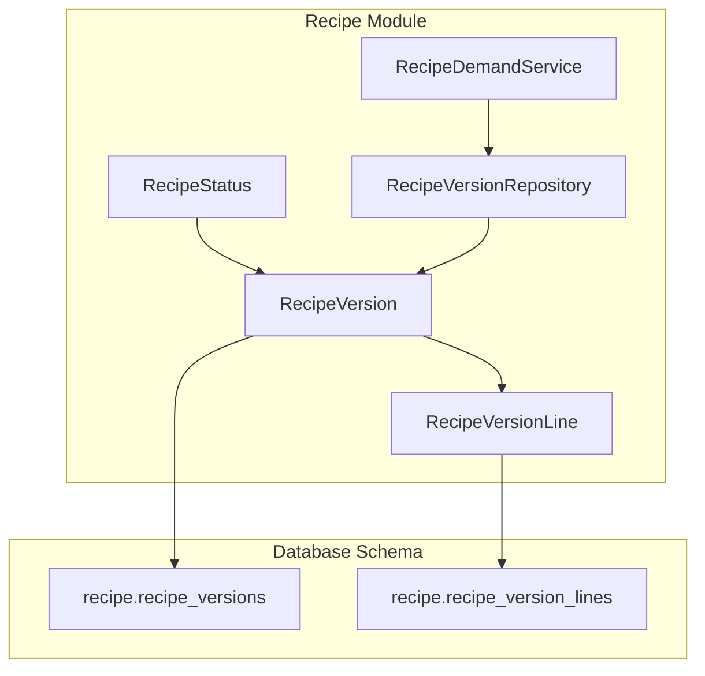
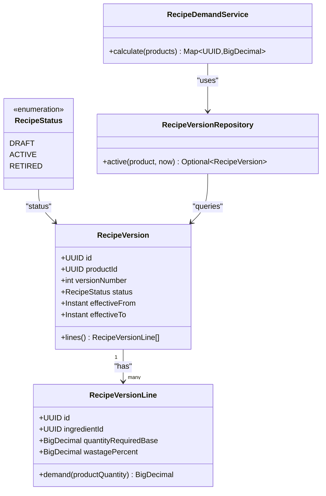
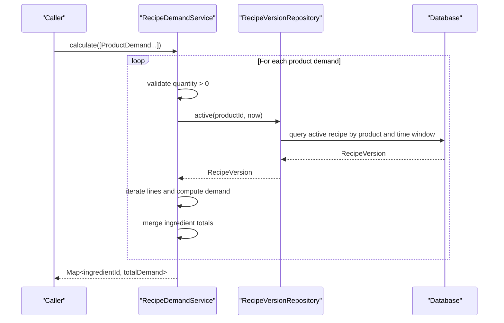
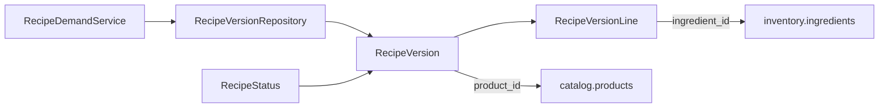

# Recipe Versioning System

<cite>
**Referenced Files in This Document**
- [RecipeVersion.java](file://src/main/java/com/smartcoffee/modules/recipe/domain/RecipeVersion.java)
- [RecipeVersionLine.java](file://src/main/java/com/smartcoffee/modules/recipe/domain/RecipeVersionLine.java)
- [RecipeStatus.java](file://src/main/java/com/smartcoffee/modules/recipe/domain/RecipeStatus.java)
- [RecipeDemandService.java](file://src/main/java/com/smartcoffee/modules/recipe/application/RecipeDemandService.java)
- [RecipeVersionRepository.java](file://src/main/java/com/smartcoffee/modules/recipe/persistence/RecipeVersionRepository.java)
- [V005__recipe_inventory_uom_reservation_ledger.sql](file://src/main/resources/db/migration/V005__recipe_inventory_uom_reservation_ledger.sql)
</cite>

## Table of Contents
1. [Introduction](#introduction)
2. [Project Structure](#project-structure)
3. [Core Components](#core-components)
4. [Architecture Overview](#architecture-overview)
5. [Detailed Component Analysis](#detailed-component-analysis)
6. [Dependency Analysis](#dependency-analysis)
7. [Performance Considerations](#performance-considerations)
8. [Troubleshooting Guide](#troubleshooting-guide)
9. [Conclusion](#conclusion)

## Introduction
This document explains the recipe versioning system that models product recipes as time-bound, versioned entities with ingredient requirements and wastage handling. It covers:
- RecipeVersion for product associations, version numbers, effective date ranges, and lifecycle status.
- RecipeVersionLine for ingredient requirements, wastage percentages, and quantity calculations.
- Version control strategies, including active version selection by time and status.
- Historical recipe access via version number and effective periods.
- Demand calculation integration across multiple products to aggregate ingredient needs.
- Approval workflow concepts and change management processes aligned with DRAFT/ACTIVE/RETIRED states.

## Project Structure
The recipe module is organized into domain, application, and persistence layers:
- Domain: RecipeVersion, RecipeVersionLine, RecipeStatus
- Application: RecipeDemandService
- Persistence: RecipeVersionRepository
- Database schema: migration V005 defines tables and constraints

**Diagram sources**
- [RecipeVersion.java:7-25](file://src/main/java/com/smartcoffee/modules/recipe/domain/RecipeVersion.java#L7-L25)
- [RecipeVersionLine.java:7-21](file://src/main/java/com/smartcoffee/modules/recipe/domain/RecipeVersionLine.java#L7-L21)
- [RecipeStatus.java:3-5](file://src/main/java/com/smartcoffee/modules/recipe/domain/RecipeStatus.java#L3-L5)
- [RecipeDemandService.java:11-16](file://src/main/java/com/smartcoffee/modules/recipe/application/RecipeDemandService.java#L11-L16)
- [RecipeVersionRepository.java:9-12](file://src/main/java/com/smartcoffee/modules/recipe/persistence/RecipeVersionRepository.java#L9-L12)
- [V005__recipe_inventory_uom_reservation_ledger.sql:43-76](file://src/main/resources/db/migration/V005__recipe_inventory_uom_reservation_ledger.sql#L43-L76)

**Section sources**
- [RecipeVersion.java:1-42](file://src/main/java/com/smartcoffee/modules/recipe/domain/RecipeVersion.java#L1-L42)
- [RecipeVersionLine.java:1-36](file://src/main/java/com/smartcoffee/modules/recipe/domain/RecipeVersionLine.java#L1-L36)
- [RecipeStatus.java:1-6](file://src/main/java/com/smartcoffee/modules/recipe/domain/RecipeStatus.java#L1-L6)
- [RecipeDemandService.java:1-63](file://src/main/java/com/smartcoffee/modules/recipe/application/RecipeDemandService.java#L1-L63)
- [RecipeVersionRepository.java:1-15](file://src/main/java/com/smartcoffee/modules/recipe/persistence/RecipeVersionRepository.java#L1-L15)
- [V005__recipe_inventory_uom_reservation_ledger.sql:43-83](file://src/main/resources/db/migration/V005__recipe_inventory_uom_reservation_ledger.sql#L43-L83)

## Core Components
- RecipeVersion: Represents a specific version of a product’s recipe with an effective period and lifecycle status. It associates with a product and contains multiple lines.
- RecipeVersionLine: Represents one ingredient requirement within a recipe version, including base quantity and wastage percentage.
- RecipeStatus: Enumerates lifecycle states (DRAFT, ACTIVE, RETIRED).
- RecipeDemandService: Calculates total ingredient demand for a set of products using the active recipe at the current time.
- RecipeVersionRepository: Provides query methods to retrieve the active recipe for a product at a given time.

Key responsibilities:
- Maintain versioned, time-bounded recipe definitions.
- Enforce data integrity through database constraints.
- Compute ingredient demands with wastage included.
- Support historical lookups via version number and effective dates.

**Section sources**
- [RecipeVersion.java:7-40](file://src/main/java/com/smartcoffee/modules/recipe/domain/RecipeVersion.java#L7-L40)
- [RecipeVersionLine.java:7-33](file://src/main/java/com/smartcoffee/modules/recipe/domain/RecipeVersionLine.java#L7-L33)
- [RecipeStatus.java:3-5](file://src/main/java/com/smartcoffee/modules/recipe/domain/RecipeStatus.java#L3-L5)
- [RecipeDemandService.java:11-59](file://src/main/java/com/smartcoffee/modules/recipe/application/RecipeDemandService.java#L11-L59)
- [RecipeVersionRepository.java:9-12](file://src/main/java/com/smartcoffee/modules/recipe/persistence/RecipeVersionRepository.java#L9-L12)

## Architecture Overview
The system uses a layered design:
- Domain layer defines entities and enumerations.
- Application layer orchestrates business logic for demand calculation.
- Persistence layer provides JPA repository queries.
- Database enforces referential integrity, uniqueness, and validation constraints.

**Diagram sources**
- [RecipeVersion.java:7-40](file://src/main/java/com/smartcoffee/modules/recipe/domain/RecipeVersion.java#L7-L40)
- [RecipeVersionLine.java:7-33](file://src/main/java/com/smartcoffee/modules/recipe/domain/RecipeVersionLine.java#L7-L33)
- [RecipeStatus.java:3-5](file://src/main/java/com/smartcoffee/modules/recipe/domain/RecipeStatus.java#L3-L5)
- [RecipeDemandService.java:11-59](file://src/main/java/com/smartcoffee/modules/recipe/application/RecipeDemandService.java#L11-L59)
- [RecipeVersionRepository.java:9-12](file://src/main/java/com/smartcoffee/modules/recipe/persistence/RecipeVersionRepository.java#L9-L12)

## Detailed Component Analysis

### RecipeVersion
- Product association: Links to a product via productId.
- Versioning: versionNumber identifies sequential versions per product.
- Lifecycle: status indicates DRAFT, ACTIVE, or RETIRED.
- Effective date range: effectiveFrom and optional effectiveTo define validity windows.
- Composition: Contains multiple RecipeVersionLine entries.

Design notes:
- The entity exposes lines as an immutable list view.
- Status and effective dates are used to select the correct version at runtime.

Operational implications:
- Only ACTIVE versions within the current time window are considered “active.”
- Retired or future-dated versions are not selected by the active query.

**Section sources**
- [RecipeVersion.java:7-40](file://src/main/java/com/smartcoffee/modules/recipe/domain/RecipeVersion.java#L7-L40)
- [V005__recipe_inventory_uom_reservation_ledger.sql:43-60](file://src/main/resources/db/migration/V005__recipe_inventory_uom_reservation_ledger.sql#L43-L60)

### RecipeVersionLine
- Ingredient requirement: ingredientId references an inventory ingredient.
- Base quantity: quantityRequiredBase specifies the amount needed per single product unit.
- Wastage: wastagePercent allows adding expected waste during production.
- Quantity calculation: demand(productQuantity) computes total required amount including wastage.

Calculation behavior:
- For each line, total demand equals base quantity multiplied by product quantity, then increased by the wastage percentage.
- Results are rounded up to four decimal places when aggregated by the service.

Constraints:
- quantity_required_base must be positive.
- wastage_percent must be between 0 and 100.

**Section sources**
- [RecipeVersionLine.java:7-33](file://src/main/java/com/smartcoffee/modules/recipe/domain/RecipeVersionLine.java#L7-L33)
- [V005__recipe_inventory_uom_reservation_ledger.sql:62-76](file://src/main/resources/db/migration/V005__recipe_inventory_uom_reservation_ledger.sql#L62-L76)

### RecipeStatus
- States: DRAFT, ACTIVE, RETIRED.
- Used to enforce lifecycle transitions and filtering of active recipes.

Validation:
- Database constraint ensures only allowed statuses are stored.

**Section sources**
- [RecipeStatus.java:3-5](file://src/main/java/com/smartcoffee/modules/recipe/domain/RecipeStatus.java#L3-L5)
- [V005__recipe_inventory_uom_reservation_ledger.sql:53-55](file://src/main/resources/db/migration/V005__recipe_inventory_uom_reservation_ledger.sql#L53-L55)

### RecipeDemandService
Responsibilities:
- Accepts a list of product demands (productId and quantity).
- Validates quantities are positive.
- Retrieves the active recipe for each product at the current time.
- Aggregates ingredient demands across all products and lines.

Algorithm overview:
- Iterate over requested products.
- Validate quantity > 0.
- Fetch active recipe by product and current timestamp.
- For each line, compute demand and round up to four decimals.
- Merge ingredient totals into a map keyed by ingredientId.

Error handling:
- Throws an argument exception for invalid quantities.
- Throws a resource not found exception if no active recipe exists for a product.

**Diagram sources**
- [RecipeDemandService.java:22-59](file://src/main/java/com/smartcoffee/modules/recipe/application/RecipeDemandService.java#L22-L59)
- [RecipeVersionRepository.java:9-12](file://src/main/java/com/smartcoffee/modules/recipe/persistence/RecipeVersionRepository.java#L9-L12)

**Section sources**
- [RecipeDemandService.java:11-59](file://src/main/java/com/smartcoffee/modules/recipe/application/RecipeDemandService.java#L11-L59)

### RecipeVersionRepository
- Provides a method to fetch the active recipe for a product at a given time.
- Uses an EntityGraph to eagerly load lines for efficient processing.
- Query filters by:
  - Matching productId
  - status = ACTIVE
  - effectiveFrom <= now
  - effectiveTo is null OR effectiveTo > now

Indexing:
- A composite index on product_id, status, effective_from, effective_to supports efficient active recipe lookup.

**Section sources**
- [RecipeVersionRepository.java:9-12](file://src/main/java/com/smartcoffee/modules/recipe/persistence/RecipeVersionRepository.java#L9-L12)
- [V005__recipe_inventory_uom_reservation_ledger.sql:78-83](file://src/main/resources/db/migration/V005__recipe_inventory_uom_reservation_ledger.sql#L78-L83)

## Dependency Analysis
Internal dependencies:
- RecipeDemandService depends on RecipeVersionRepository.
- RecipeVersionRepository depends on RecipeVersion entity.
- RecipeVersion aggregates RecipeVersionLine.
- RecipeStatus is referenced by RecipeVersion.

External dependencies:
- Database schema enforces referential integrity between recipe versions and lines, and links product_id to catalog.products and ingredient_id to inventory.ingredients.

**Diagram sources**
- [RecipeDemandService.java:11-16](file://src/main/java/com/smartcoffee/modules/recipe/application/RecipeDemandService.java#L11-L16)
- [RecipeVersionRepository.java:9-12](file://src/main/java/com/smartcoffee/modules/recipe/persistence/RecipeVersionRepository.java#L9-L12)
- [RecipeVersion.java:13-25](file://src/main/java/com/smartcoffee/modules/recipe/domain/RecipeVersion.java#L13-L25)
- [RecipeVersionLine.java:13-21](file://src/main/java/com/smartcoffee/modules/recipe/domain/RecipeVersionLine.java#L13-L21)
- [V005__recipe_inventory_uom_reservation_ledger.sql:43-76](file://src/main/resources/db/migration/V005__recipe_inventory_uom_reservation_ledger.sql#L43-L76)

**Section sources**
- [RecipeDemandService.java:11-59](file://src/main/java/com/smartcoffee/modules/recipe/application/RecipeDemandService.java#L11-L59)
- [RecipeVersionRepository.java:9-12](file://src/main/java/com/smartcoffee/modules/recipe/persistence/RecipeVersionRepository.java#L9-L12)
- [RecipeVersion.java:7-40](file://src/main/java/com/smartcoffee/modules/recipe/domain/RecipeVersion.java#L7-L40)
- [RecipeVersionLine.java:7-33](file://src/main/java/com/smartcoffee/modules/recipe/domain/RecipeVersionLine.java#L7-L33)
- [V005__recipe_inventory_uom_reservation_ledger.sql:43-83](file://src/main/resources/db/migration/V005__recipe_inventory_uom_reservation_ledger.sql#L43-L83)

## Performance Considerations
- Active recipe lookup:
  - Use the provided composite index on product_id, status, effective_from, effective_to to optimize queries.
- Eager loading:
  - EntityGraph loads lines with the recipe to avoid N+1 queries during demand calculation.
- Numerical precision:
  - Demands are rounded up to four decimal places to prevent underestimation of ingredient needs.
- Concurrency:
  - Read-only transactional boundary around demand calculation avoids contention.

[No sources needed since this section provides general guidance]

## Troubleshooting Guide
Common issues and resolutions:
- No active recipe found:
  - Ensure there is an ACTIVE recipe for the product where effectiveFrom <= now and (effectiveTo is null or effectiveTo > now).
  - Verify status is ACTIVE and effective dates are correctly set.
- Invalid product quantity:
  - Ensure all requested product quantities are positive; otherwise, an argument exception will be thrown.
- Data integrity errors:
  - Check database constraints:
    - quantity_required_base must be positive.
    - wastage_percent must be between 0 and 100.
    - effective_to must be greater than effective_from if present.

Operational checks:
- Confirm indexes exist for active recipe queries.
- Validate that product_id and ingredient_id references point to valid catalog and inventory records.

**Section sources**
- [RecipeDemandService.java:29-41](file://src/main/java/com/smartcoffee/modules/recipe/application/RecipeDemandService.java#L29-L41)
- [V005__recipe_inventory_uom_reservation_ledger.sql:53-76](file://src/main/resources/db/migration/V005__recipe_inventory_uom_reservation_ledger.sql#L53-L76)
- [V005__recipe_inventory_uom_reservation_ledger.sql:78-83](file://src/main/resources/db/migration/V005__recipe_inventory_uom_reservation_ledger.sql#L78-L83)

## Conclusion
The recipe versioning system provides robust support for managing product recipes over time:
- Versioned, time-bounded recipe definitions ensure accurate ingredient planning.
- Wastage-aware demand calculations improve supply accuracy.
- Clear lifecycle states enable controlled evolution and approval workflows.
- Indexed queries and eager loading support efficient demand aggregation.

Adopting these patterns helps maintain traceability, consistency, and reliability across recipe changes and production planning.

[No sources needed since this section summarizes without analyzing specific files]