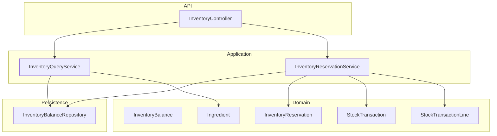
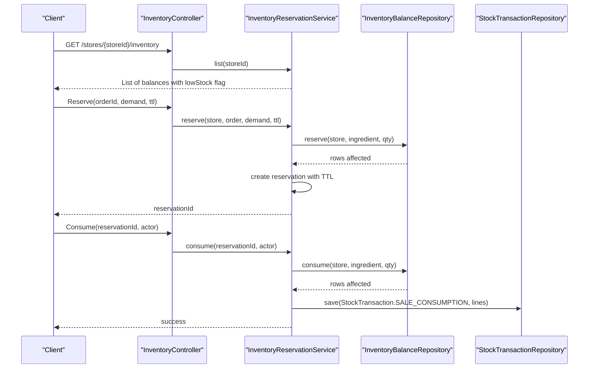
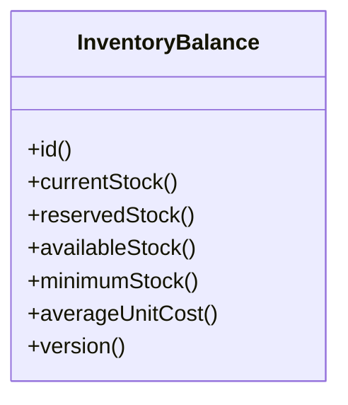
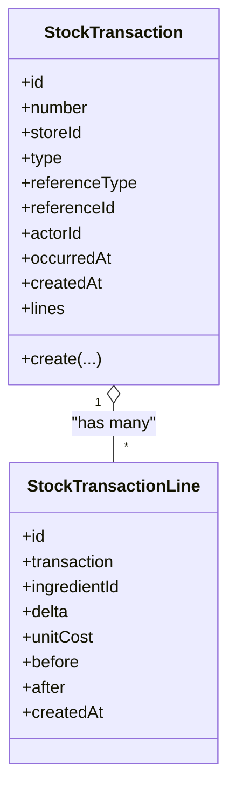
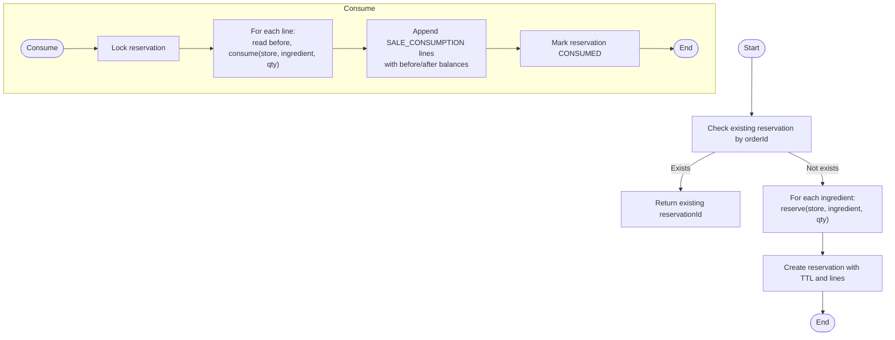
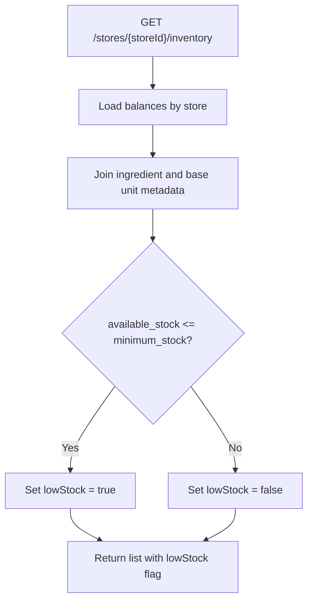
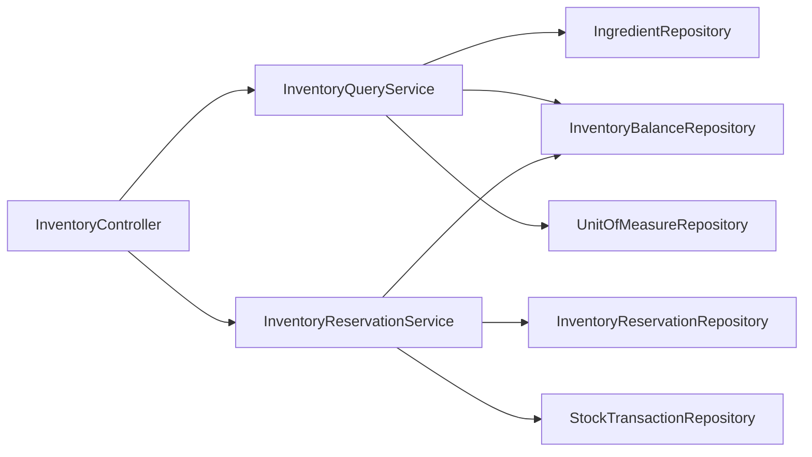

# Stock Management System

<cite>
**Referenced Files in This Document**
- [InventoryBalance.java](file://src/main/java/com/smartcoffee/modules/inventory/domain/InventoryBalance.java)
- [StockTransaction.java](file://src/main/java/com/smartcoffee/modules/inventory/domain/StockTransaction.java)
- [StockTransactionLine.java](file://src/main/java/com/smartcoffee/modules/inventory/domain/StockTransactionLine.java)
- [StockTransactionType.java](file://src/main/java/com/smartcoffee/modules/inventory/domain/StockTransactionType.java)
- [InventoryReservation.java](file://src/main/java/com/smartcoffee/modules/inventory/domain/InventoryReservation.java)
- [InventoryReservationService.java](file://src/main/java/com/smartcoffee/modules/inventory/application/InventoryReservationService.java)
- [InventoryBalanceRepository.java](file://src/main/java/com/smartcoffee/modules/inventory/persistence/InventoryBalanceRepository.java)
- [InventoryQueryService.java](file://src/main/java/com/smartcoffee/modules/inventory/application/InventoryQueryService.java)
- [InventoryController.java](file://src/main/java/com/smartcoffee/modules/inventory/api/InventoryController.java)
- [InventoryBalanceResponse.java](file://src/main/java/com/smartcoffee/modules/inventory/api/InventoryBalanceResponse.java)
- [Ingredient.java](file://src/main/java/com/smartcoffee/modules/inventory/domain/Ingredient.java)
- [V005__recipe_inventory_uom_reservation_ledger.sql](file://src/main/resources/db/migration/V005__recipe_inventory_uom_reservation_ledger.sql)
- [INVENTORY_FLOW.mermaid](file://architecture/INVENTORY_FLOW.mermaid)
</cite>

## Table of Contents
1. Introduction
2. Project Structure
3. Core Components
4. Architecture Overview
5. Detailed Component Analysis
6. Dependency Analysis
7. Performance Considerations
8. Troubleshooting Guide
9. Conclusion
10. Appendices

## Introduction
This document explains the stock management system for ingredients, focusing on how current stock levels, reserved quantities, minimum thresholds, and average unit costs are tracked and updated. It documents the immutable stock ledger (StockTransaction and StockTransactionLine), reservation-based consumption, low-stock alerts, and concurrency controls. It also clarifies where FIFO/LIFO costing is implemented and what is missing from the codebase today.

## Project Structure
The inventory capability is organized as a module with domain entities, application services, persistence repositories, and API endpoints:
- Domain: InventoryBalance, Ingredient, StockTransaction, StockTransactionLine, StockTransactionType, InventoryReservation
- Application: InventoryReservationService (reserve/consume/release/expire), InventoryQueryService (read-only queries)
- Persistence: InventoryBalanceRepository (atomic updates), plus other repositories
- API: InventoryController exposes read access to balances

**Diagram sources**
- [InventoryController.java:1-35](file://src/main/java/com/smartcoffee/modules/inventory/api/InventoryController.java#L1-L35)
- [InventoryQueryService.java:1-3](file://src/main/java/com/smartcoffee/modules/inventory/application/InventoryQueryService.java#L1-L3)
- [InventoryReservationService.java:1-100](file://src/main/java/com/smartcoffee/modules/inventory/application/InventoryReservationService.java#L1-L100)
- [InventoryBalanceRepository.java:1-26](file://src/main/java/com/smartcoffee/modules/inventory/persistence/InventoryBalanceRepository.java#L1-L26)
- [InventoryBalance.java:1-57](file://src/main/java/com/smartcoffee/modules/inventory/domain/InventoryBalance.java#L1-L57)
- [InventoryReservation.java:1-106](file://src/main/java/com/smartcoffee/modules/inventory/domain/InventoryReservation.java#L1-L106)
- [StockTransaction.java:1-56](file://src/main/java/com/smartcoffee/modules/inventory/domain/StockTransaction.java#L1-L56)
- [StockTransactionLine.java:1-49](file://src/main/java/com/smartcoffee/modules/inventory/domain/StockTransactionLine.java#L1-L49)
- [Ingredient.java:1-61](file://src/main/java/com/smartcoffee/modules/inventory/domain/Ingredient.java#L1-L61)

**Section sources**
- [InventoryController.java:1-35](file://src/main/java/com/smartcoffee/modules/inventory/api/InventoryController.java#L1-L35)
- [InventoryQueryService.java:1-3](file://src/main/java/com/smartcoffee/modules/inventory/application/InventoryQueryService.java#L1-L3)
- [InventoryReservationService.java:1-100](file://src/main/java/com/smartcoffee/modules/inventory/application/InventoryReservationService.java#L1-L100)
- [InventoryBalanceRepository.java:1-26](file://src/main/java/com/smartcoffee/modules/inventory/persistence/InventoryBalanceRepository.java#L1-L26)

## Core Components
- InventoryBalance: Tracks per-store, per-ingredient current_stock, reserved_stock, minimum_stock, average_unit_cost, and provides available_stock = current_stock - reserved_stock. Uses optimistic locking via version.
- StockTransaction: Immutable ledger header with transaction_number, store_id, type, reference_type/id, actor_id, occurred_at, created_at, and lines.
- StockTransactionLine: Per-ingredient line with delta, unit_cost, balance_before, balance_after, and creation timestamp.
- StockTransactionType: Enumerates STOCK_IN, ADJUSTMENT, SALE_CONSUMPTION, RETURN, DAMAGED.
- InventoryReservation: Represents a time-bounded reservation for an order with status transitions (ACTIVE -> CONSUMED/RELEASED/EXPIRED).
- InventoryReservationService: Orchestrates reserve, consume, release, expire with atomic DB operations and immutable ledger writes.
- InventoryQueryService: Provides read-only listing of balances with low-stock flag derived from available_stock vs minimum_stock.

**Section sources**
- [InventoryBalance.java:1-57](file://src/main/java/com/smartcoffee/modules/inventory/domain/InventoryBalance.java#L1-L57)
- [StockTransaction.java:1-56](file://src/main/java/com/smartcoffee/modules/inventory/domain/StockTransaction.java#L1-L56)
- [StockTransactionLine.java:1-49](file://src/main/java/com/smartcoffee/modules/inventory/domain/StockTransactionLine.java#L1-L49)
- [StockTransactionType.java:1-7](file://src/main/java/com/smartcoffee/modules/inventory/domain/StockTransactionType.java#L1-L7)
- [InventoryReservation.java:1-106](file://src/main/java/com/smartcoffee/modules/inventory/domain/InventoryReservation.java#L1-L106)
- [InventoryReservationService.java:1-100](file://src/main/java/com/smartcoffee/modules/inventory/application/InventoryReservationService.java#L1-L100)
- [InventoryQueryService.java:1-3](file://src/main/java/com/smartcoffee/modules/inventory/application/InventoryQueryService.java#L1-L3)

## Architecture Overview
The flow uses reservations to prevent overselling and an append-only ledger to record all changes. Consumption converts a reservation into sale-consumption ledger entries and decrements both current_stock and reserved_stock atomically.

**Diagram sources**
- [InventoryController.java:1-35](file://src/main/java/com/smartcoffee/modules/inventory/api/InventoryController.java#L1-L35)
- [InventoryReservationService.java:43-85](file://src/main/java/com/smartcoffee/modules/inventory/application/InventoryReservationService.java#L43-L85)
- [InventoryBalanceRepository.java:10-20](file://src/main/java/com/smartcoffee/modules/inventory/persistence/InventoryBalanceRepository.java#L10-L20)
- [INVENTORY_FLOW.mermaid:41-75](file://architecture/INVENTORY_FLOW.mermaid#L41-L75)

## Detailed Component Analysis

### InventoryBalance
- Purpose: Current snapshot of stock per store and ingredient.
- Key fields: current_stock, reserved_stock, minimum_stock, average_unit_cost, updated_at, version.
- Derived metric: available_stock = current_stock - reserved_stock.
- Concurrency: Optimistic locking via version ensures safe concurrent updates.
- Low stock alert: The query service compares available_stock to minimum_stock to produce a boolean lowStock flag.

**Diagram sources**
- [InventoryBalance.java:1-57](file://src/main/java/com/smartcoffee/modules/inventory/domain/InventoryBalance.java#L1-L57)

**Section sources**
- [InventoryBalance.java:1-57](file://src/main/java/com/smartcoffee/modules/inventory/domain/InventoryBalance.java#L1-L57)
- [InventoryQueryService.java:1-3](file://src/main/java/com/smartcoffee/modules/inventory/application/InventoryQueryService.java#L1-L3)

### StockTransaction and StockTransactionLine
- StockTransaction: Immutable ledger header with unique transaction_number, store context, type, references, actor, timestamps, and ordered lines.
- StockTransactionLine: Per-ingredient change with delta, unit_cost, before/after balances, and creation timestamp.
- Immutability: Once saved, ledger rows are not edited or deleted; they provide an audit trail.

**Diagram sources**
- [StockTransaction.java:1-56](file://src/main/java/com/smartcoffee/modules/inventory/domain/StockTransaction.java#L1-L56)
- [StockTransactionLine.java:1-49](file://src/main/java/com/smartcoffee/modules/inventory/domain/StockTransactionLine.java#L1-L49)

**Section sources**
- [StockTransaction.java:1-56](file://src/main/java/com/smartcoffee/modules/inventory/domain/StockTransaction.java#L1-L56)
- [StockTransactionLine.java:1-49](file://src/main/java/com/smartcoffee/modules/inventory/domain/StockTransactionLine.java#L1-L49)

### Reservation-Based Consumption Flow
- Reserve: Checks availability and increments reserved_stock atomically; creates a reservation with TTL.
- Consume: Locks reservation, decrements current_stock and reserved_stock atomically, records SALE_CONSUMPTION ledger lines with before/after balances.
- Release/Expire: Decreases reserved_stock only when reservation is released or expired.

**Diagram sources**
- [InventoryReservationService.java:43-85](file://src/main/java/com/smartcoffee/modules/inventory/application/InventoryReservationService.java#L43-L85)
- [InventoryBalanceRepository.java:10-20](file://src/main/java/com/smartcoffee/modules/inventory/persistence/InventoryBalanceRepository.java#L10-L20)

**Section sources**
- [InventoryReservationService.java:43-85](file://src/main/java/com/smartcoffee/modules/inventory/application/InventoryReservationService.java#L43-L85)
- [InventoryReservation.java:41-79](file://src/main/java/com/smartcoffee/modules/inventory/domain/InventoryReservation.java#L41-L79)

### Low Stock Alerts
- The query service computes lowStock by comparing available_stock to minimum_stock and returns it in the response payload.
- Consumers can use this flag to trigger alerts or UI warnings.

**Diagram sources**
- [InventoryQueryService.java:1-3](file://src/main/java/com/smartcoffee/modules/inventory/application/InventoryQueryService.java#L1-L3)
- [InventoryBalanceResponse.java:1-11](file://src/main/java/com/smartcoffee/modules/inventory/api/InventoryBalanceResponse.java#L1-L11)

**Section sources**
- [InventoryQueryService.java:1-3](file://src/main/java/com/smartcoffee/modules/inventory/application/InventoryQueryService.java#L1-L3)
- [InventoryBalanceResponse.java:1-11](file://src/main/java/com/smartcoffee/modules/inventory/api/InventoryBalanceResponse.java#L1-L11)

### Costing Methods (FIFO/LIFO)
- Average Unit Cost: InventoryBalance stores average_unit_cost, which is typically updated on stock-in events using weighted averaging.
- FIFO/LIFO: Not implemented in the current codebase. There is no lot-level tracking or batch-specific cost layers. An architecture note explicitly identifies missing stock lots and expiry, indicating that FEFO/FIFO/LIFO allocation is out of scope for the current implementation.

Practical implication:
- With average costing, each stock-in updates the running average; consumption uses the stored average at the time of write.
- To support FIFO/LIFO, future work should add lot/batch records with received quantity, remaining quantity, dates, supplier, and unit cost, then allocate consumption against oldest (or newest) lots first.

**Section sources**
- [InventoryBalance.java:1-57](file://src/main/java/com/smartcoffee/modules/inventory/domain/InventoryBalance.java#L1-L57)
- [Download ARCHITECTURE_AUDIT.md:386-396](file://Download%20ARCHITECTURE_AUDIT.md#L386-L396)

### Examples of Stock Movements
- Stock-In: Increase current_stock and update average_unit_cost; append STOCK_IN ledger lines.
- Sale-Consumption: Decrease current_stock and reserved_stock; append SALE_CONSUMPTION ledger lines with before/after balances.
- Adjustment: Adjust current_stock without sales context; append ADJUSTMENT ledger lines.
- Damaged: Reduce current_stock due to waste; append DAMAGED ledger lines.
- Return: Increase current_stock; append RETURN ledger lines.

These movements are recorded immutably in the ledger and reflected in the balance through atomic updates.

**Section sources**
- [StockTransactionType.java:1-7](file://src/main/java/com/smartcoffee/modules/inventory/domain/StockTransactionType.java#L1-L7)
- [StockTransactionLine.java:1-49](file://src/main/java/com/smartcoffee/modules/inventory/domain/StockTransactionLine.java#L1-L49)
- [INVENTORY_FLOW.mermaid:41-75](file://architecture/INVENTORY_FLOW.mermaid#L41-L75)

## Dependency Analysis
- InventoryReservationService depends on:
  - InventoryBalanceRepository for atomic reserve/consume/release SQL updates
  - InventoryReservationRepository for reservation state machine
  - StockTransactionRepository for appending immutable ledger entries
- InventoryQueryService depends on:
  - InventoryBalanceRepository for reading balances
  - IngredientRepository and UnitOfMeasureRepository for metadata enrichment
- API layer enforces authorization and maps responses

**Diagram sources**
- [InventoryReservationService.java:1-100](file://src/main/java/com/smartcoffee/modules/inventory/application/InventoryReservationService.java#L1-L100)
- [InventoryQueryService.java:1-3](file://src/main/java/com/smartcoffee/modules/inventory/application/InventoryQueryService.java#L1-L3)
- [InventoryController.java:1-35](file://src/main/java/com/smartcoffee/modules/inventory/api/InventoryController.java#L1-L35)

**Section sources**
- [InventoryReservationService.java:1-100](file://src/main/java/com/smartcoffee/modules/inventory/application/InventoryReservationService.java#L1-L100)
- [InventoryQueryService.java:1-3](file://src/main/java/com/smartcoffee/modules/inventory/application/InventoryQueryService.java#L1-L3)
- [InventoryController.java:1-35](file://src/main/java/com/smartcoffee/modules/inventory/api/InventoryController.java#L1-L35)

## Performance Considerations
- Atomic SQL updates: reserve, release, and consume use single UPDATE statements with conditions and version bumps to avoid race conditions and reduce lock contention.
- Optimistic locking: InventoryBalance.version prevents lost updates under concurrency.
- Append-only ledger: StockTransactionLines are never modified, enabling efficient reads and auditing.
- Read path: Query service performs a single store-scoped select and joins metadata; consider indexing store_id and ingredient_id if needed.

[No sources needed since this section provides general guidance]

## Troubleshooting Guide
Common issues and resolutions:
- Insufficient stock during reservation:
  - Symptom: ConflictException thrown when reserving.
  - Cause: current_stock - reserved_stock < requested quantity.
  - Resolution: Reduce demand or increase stock; check pending orders consuming the same ingredients.
- Inventory balance conflict during consume/release/expire:
  - Symptom: ConflictException when updating balances.
  - Cause: Concurrent modification or inconsistent state.
  - Resolution: Retry with backoff; ensure idempotent calls; verify reservation state transitions.
- Reservation not found:
  - Symptom: ResourceNotFoundException when consuming or releasing.
  - Cause: Expired or already consumed reservation.
  - Resolution: Validate lifecycle; handle idempotency on client side.
- Low stock alerts:
  - Use the lowStock flag from the inventory list endpoint to trigger notifications or dashboards.

**Section sources**
- [InventoryReservationService.java:43-97](file://src/main/java/com/smartcoffee/modules/inventory/application/InventoryReservationService.java#L43-L97)
- [InventoryQueryService.java:1-3](file://src/main/java/com/smartcoffee/modules/inventory/application/InventoryQueryService.java#L1-L3)

## Conclusion
The system provides robust, concurrent stock management using reservations and an immutable ledger. InventoryBalance tracks current and reserved stock with minimum thresholds and average unit cost. StockTransaction and StockTransactionLine form an auditable history of all movements. Low stock detection is exposed via the query API. FIFO/LIFO costing and lot tracking are not yet implemented but are identified as future enhancements.

[No sources needed since this section summarizes without analyzing specific files]

## Appendices

### Database Schema Highlights
- Tables include inventory_balances, stock_transactions, stock_transaction_lines, ingredients, units_of_measure, and related indexes.
- Seed data demonstrates initial balances and standard costs.

**Section sources**
- [V005__recipe_inventory_uom_reservation_ledger.sql:189-254](file://src/main/resources/db/migration/V005__recipe_inventory_uom_reservation_ledger.sql#L189-L254)
- [V005__recipe_inventory_uom_reservation_ledger.sql:256-318](file://src/main/resources/db/migration/V005__recipe_inventory_uom_reservation_ledger.sql#L256-L318)

### API Surface
- GET /api/v1/stores/{storeId}/inventory: Returns balances with lowStock flag and version for optimistic concurrency.

**Section sources**
- [InventoryController.java:26-32](file://src/main/java/com/smartcoffee/modules/inventory/api/InventoryController.java#L26-L32)
- [InventoryBalanceResponse.java:1-11](file://src/main/java/com/smartcoffee/modules/inventory/api/InventoryBalanceResponse.java#L1-L11)