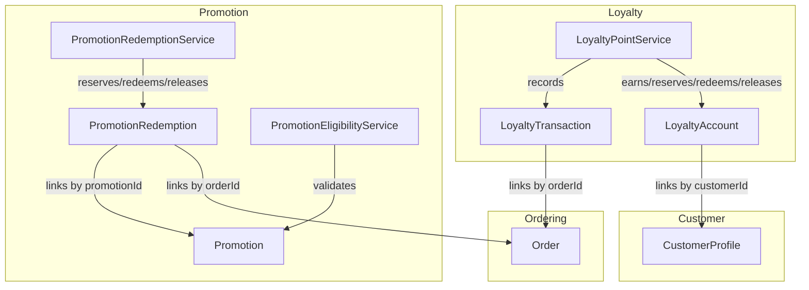
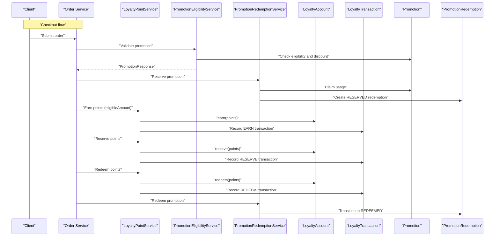
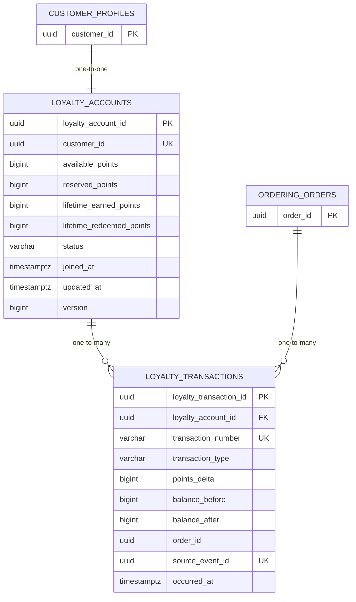
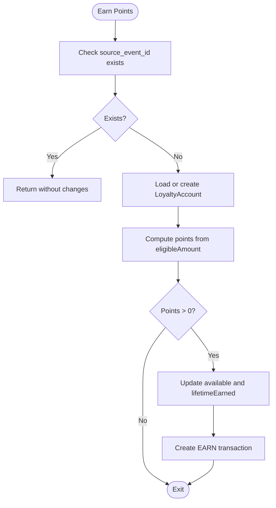
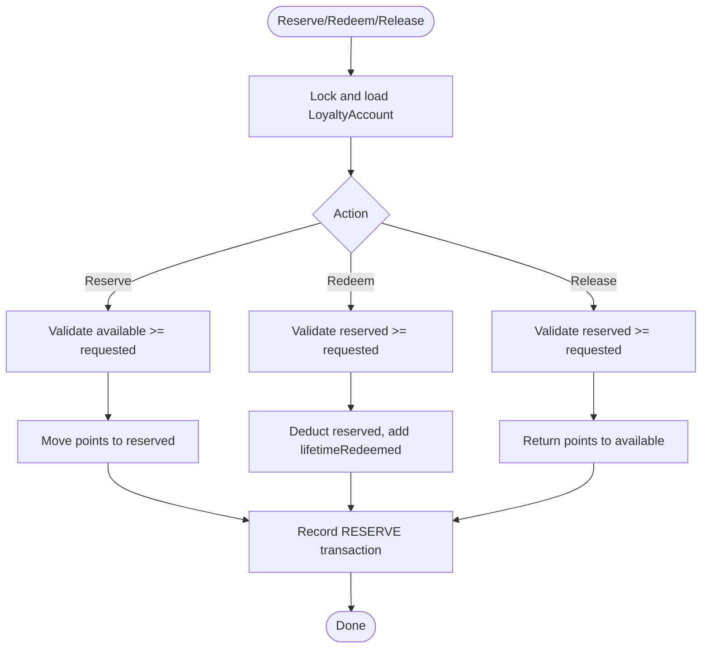
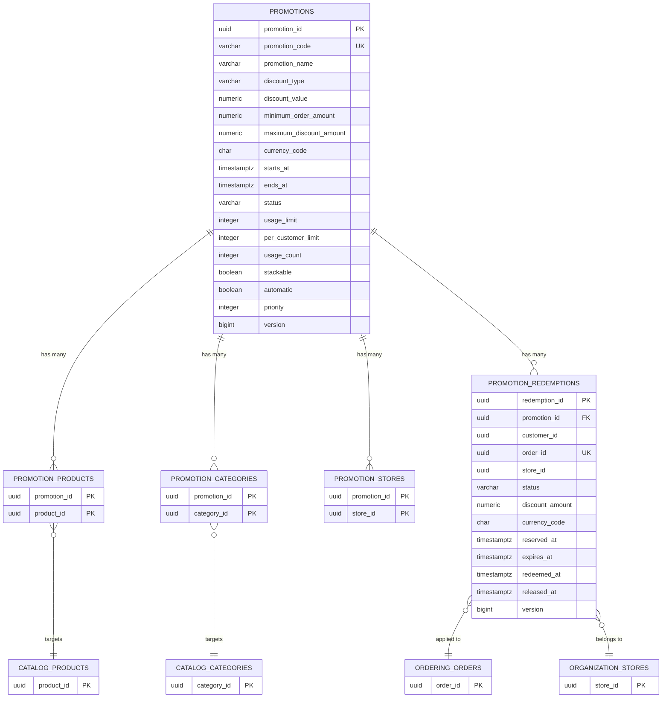
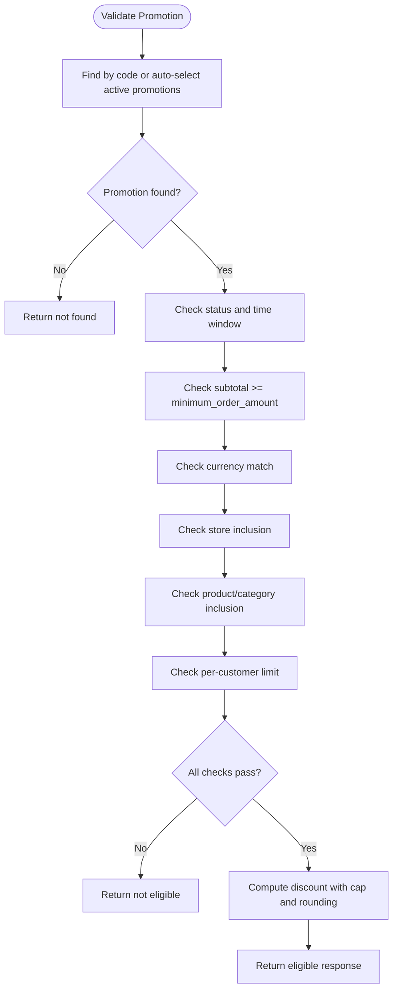
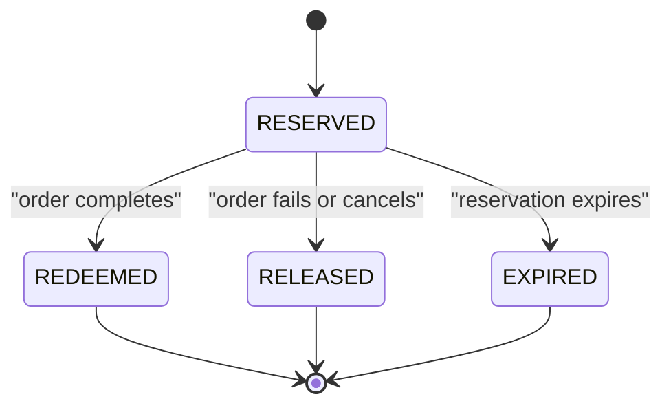
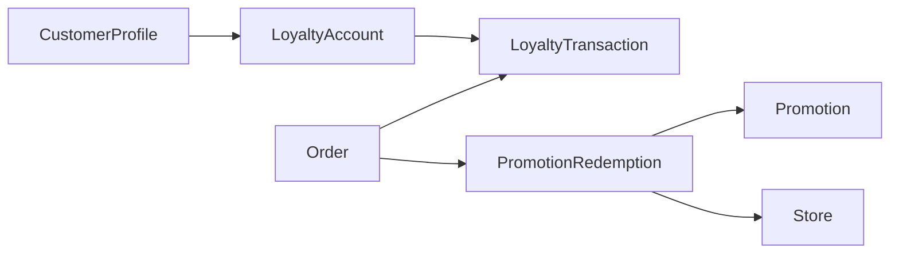
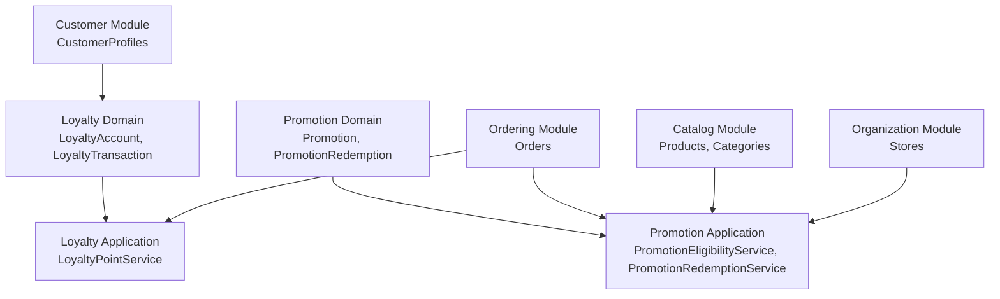

# Loyalty & Promotion Schema

<cite>
**Referenced Files in This Document**   
- [LoyaltyAccount.java](file://src/main/java/com/smartcoffee/modules/loyalty/domain/LoyaltyAccount.java)
- [LoyaltyTransaction.java](file://src/main/java/com/smartcoffee/modules/loyalty/domain/LoyaltyTransaction.java)
- [LoyaltyTransactionType.java](file://src/main/java/com/smartcoffee/modules/loyalty/domain/LoyaltyTransactionType.java)
- [LoyaltyPointService.java](file://src/main/java/com/smartcoffee/modules/loyalty/application/LoyaltyPointService.java)
- [Promotion.java](file://src/main/java/com/smartcoffee/modules/promotion/domain/Promotion.java)
- [PromotionRedemption.java](file://src/main/java/com/smartcoffee/modules/promotion/domain/PromotionRedemption.java)
- [DiscountType.java](file://src/main/java/com/smartcoffee/modules/promotion/domain/DiscountType.java)
- [PromotionStatus.java](file://src/main/java/com/smartcoffee/modules/promotion/domain/PromotionStatus.java)
- [RedemptionStatus.java](file://src/main/java/com/smartcoffee/modules/promotion/domain/RedemptionStatus.java)
- [PromotionEligibilityService.java](file://src/main/java/com/smartcoffee/modules/promotion/application/PromotionEligibilityService.java)
- [PromotionRedemptionService.java](file://src/main/java/com/smartcoffee/modules/promotion/application/PromotionRedemptionService.java)
- [V009__promotions_loyalty.sql](file://src/main/resources/db/migration/V009__promotions_loyalty.sql)
- [smart-coffee-logical.dbml](file://database/smart-coffee-logical.dbml)
</cite>

## Table of Contents
1. [Introduction](#introduction)
2. [Project Structure](#project-structure)
3. [Core Components](#core-components)
4. [Architecture Overview](#architecture-overview)
5. [Detailed Component Analysis](#detailed-component-analysis)
6. [Dependency Analysis](#dependency-analysis)
7. [Performance Considerations](#performance-considerations)
8. [Troubleshooting Guide](#troubleshooting-guide)
9. [Conclusion](#conclusion)

## Introduction
This document describes the data model and processing logic for the Loyalty and Promotion subsystems. It covers:
- Loyalty accounts, point balances, and ledger entries
- Promotions with discount rules, eligibility checks, and usage limits
- Redemption tracking for promotions
- Points earning and redemption flows
- Relationships between customers, orders, loyalty transactions, and promotion redemptions
- Idempotency considerations for point transactions and promotion application

The goal is to make the schema and workflows understandable for both technical and non-technical readers while remaining grounded in the actual implementation.

## Project Structure
The Loyalty and Promotion features are implemented as modular domain components:
- Loyalty domain entities and services manage customer points and transactional ledgers
- Promotion domain entities and services manage discount rules, eligibility, and redemption lifecycle
- Database migrations define persistent tables and constraints
- The logical DBML model provides a cross-module view of related tables

**Diagram sources**
- [LoyaltyAccount.java:8-31](file://src/main/java/com/smartcoffee/modules/loyalty/domain/LoyaltyAccount.java#L8-L31)
- [LoyaltyTransaction.java:7-31](file://src/main/java/com/smartcoffee/modules/loyalty/domain/LoyaltyTransaction.java#L7-L31)
- [LoyaltyPointService.java:10-60](file://src/main/java/com/smartcoffee/modules/loyalty/application/LoyaltyPointService.java#L10-L60)
- [Promotion.java:8-49](file://src/main/java/com/smartcoffee/modules/promotion/domain/Promotion.java#L8-L49)
- [PromotionRedemption.java:9-40](file://src/main/java/com/smartcoffee/modules/promotion/domain/PromotionRedemption.java#L9-L40)
- [PromotionEligibilityService.java:12-22](file://src/main/java/com/smartcoffee/modules/promotion/application/PromotionEligibilityService.java#L12-L22)
- [PromotionRedemptionService.java:12-23](file://src/main/java/com/smartcoffee/modules/promotion/application/PromotionRedemptionService.java#L12-L23)

**Section sources**
- [V009__promotions_loyalty.sql:5-164](file://src/main/resources/db/migration/V009__promotions_loyalty.sql#L5-L164)
- [smart-coffee-logical.dbml:190-349](file://database/smart-coffee-logical.dbml#L190-L349)

## Core Components
This section summarizes the primary data models and their responsibilities.

### Loyalty Account
A loyalty account represents a customer’s points balance and state. It tracks:
- Available points that can be reserved or redeemed
- Reserved points held during pending order lifecycles
- Lifetime earned and lifetime redeemed totals
- Status and timestamps

Key behaviors:
- Earn points safely (non-negative delta)
- Reserve points before redemption
- Redeem reserved points
- Release reserved points when an order fails or is cancelled

**Section sources**
- [LoyaltyAccount.java:8-31](file://src/main/java/com/smartcoffee/modules/loyalty/domain/LoyaltyAccount.java#L8-L31)
- [LoyaltyAccount.java:46-76](file://src/main/java/com/smartcoffee/modules/loyalty/domain/LoyaltyAccount.java#L46-L76)
- [V009__promotions_loyalty.sql:119-136](file://src/main/resources/db/migration/V009__promotions_loyalty.sql#L119-L136)

### Loyalty Transaction Ledger
Each point movement is recorded as a ledger entry with:
- A unique transaction number
- Transaction type (earn, reserve, redeem, release, adjust, expire, reverse)
- Delta points applied
- Balance before and after
- Associated order and source event identifiers
- Occurred timestamp

This ledger ensures auditability and supports idempotent point posting via source event deduplication.

**Section sources**
- [LoyaltyTransaction.java:7-31](file://src/main/java/com/smartcoffee/modules/loyalty/domain/LoyaltyTransaction.java#L7-L31)
- [LoyaltyTransactionType.java:3-5](file://src/main/java/com/smartcoffee/modules/loyalty/domain/LoyaltyTransactionType.java#L3-L5)
- [V009__promotions_loyalty.sql:138-164](file://src/main/resources/db/migration/V009__promotions_loyalty.sql#L138-L164)

### Promotion Rule
A promotion defines:
- Discount type (percentage or fixed amount)
- Discount value and optional maximum discount cap
- Minimum order amount requirement
- Currency code
- Valid time window
- Status (draft, active, paused, expired, cancelled)
- Global usage limit and per-customer limit
- Stackable flag and automatic flag
- Priority for selection among multiple eligible promotions

It also includes methods to check eligibility at a given time and compute the discount amount based on subtotal and caps.

**Section sources**
- [Promotion.java:8-49](file://src/main/java/com/smartcoffee/modules/promotion/domain/Promotion.java#L8-L49)
- [Promotion.java:66-75](file://src/main/java/com/smartcoffee/modules/promotion/domain/Promotion.java#L66-L75)
- [DiscountType.java:3-5](file://src/main/java/com/smartcoffee/modules/promotion/domain/DiscountType.java#L3-L5)
- [PromotionStatus.java:3-5](file://src/main/java/com/smartcoffee/modules/promotion/domain/PromotionStatus.java#L3-L5)
- [V009__promotions_loyalty.sql:5-56](file://src/main/resources/db/migration/V009__promotions_loyalty.sql#L5-L56)

### Promotion Redemption
A redemption records the reservation, application, and lifecycle of a promotion against an order:
- Links to promotion, customer, order, and store
- Status transitions: reserved → redeemed or released
- Discount amount and currency snapshot
- Timestamps for reserved, expires, redeemed, and released events
- Versioning for optimistic concurrency control

**Section sources**
- [PromotionRedemption.java:9-40](file://src/main/java/com/smartcoffee/modules/promotion/domain/PromotionRedemption.java#L9-L40)
- [PromotionRedemption.java:45-76](file://src/main/java/com/smartcoffee/modules/promotion/domain/PromotionRedemption.java#L45-L76)
- [RedemptionStatus.java:3-5](file://src/main/java/com/smartcoffee/modules/promotion/domain/RedemptionStatus.java#L3-L5)
- [V009__promotions_loyalty.sql:83-117](file://src/main/resources/db/migration/V009__promotions_loyalty.sql#L83-L117)

## Architecture Overview
The following diagram maps the runtime interactions between services and domain entities for points and promotions.

**Diagram sources**
- [LoyaltyPointService.java:20-59](file://src/main/java/com/smartcoffee/modules/loyalty/application/LoyaltyPointService.java#L20-L59)
- [PromotionEligibilityService.java:24-58](file://src/main/java/com/smartcoffee/modules/promotion/application/PromotionEligibilityService.java#L24-L58)
- [PromotionRedemptionService.java:25-52](file://src/main/java/com/smartcoffee/modules/promotion/application/PromotionRedemptionService.java#L25-L52)
- [LoyaltyAccount.java:46-76](file://src/main/java/com/smartcoffee/modules/loyalty/domain/LoyaltyAccount.java#L46-L76)
- [Promotion.java:66-75](file://src/main/java/com/smartcoffee/modules/promotion/domain/Promotion.java#L66-L75)
- [PromotionRedemption.java:45-76](file://src/main/java/com/smartcoffee/modules/promotion/domain/PromotionRedemption.java#L45-L76)

## Detailed Component Analysis

### Loyalty Data Model

#### Entity Relationship Diagram

**Diagram sources**
- [V009__promotions_loyalty.sql:119-164](file://src/main/resources/db/migration/V009__promotions_loyalty.sql#L119-L164)
- [smart-coffee-logical.dbml:190-210](file://database/smart-coffee-logical.dbml#L190-L210)

#### Field Definitions

| Entity | Field | Type | Description | Constraints / Notes |
|---|---|---|---|---|
| LoyaltyAccount | loyalty_account_id | UUID | Primary key | Unique identifier |
| LoyaltyAccount | customer_id | UUID | Customer reference | Unique per customer |
| LoyaltyAccount | available_points | Long | Points available for use | Non-negative |
| LoyaltyAccount | reserved_points | Long | Points held for pending redemption | Non-negative |
| LoyaltyAccount | lifetime_earned_points | Long | Cumulative points earned | Non-negative |
| LoyaltyAccount | lifetime_redeemed_points | Long | Cumulative points redeemed | Non-negative |
| LoyaltyAccount | status | String | Account status | Default ACTIVE |
| LoyaltyAccount | joined_at | Instant | Account creation time | Not null |
| LoyaltyAccount | updated_at | Instant | Last update time | Not null |
| LoyaltyAccount | version | Long | Optimistic lock | Prevents concurrent writes |
| LoyaltyTransaction | loyalty_transaction_id | UUID | Primary key | Unique identifier |
| LoyaltyTransaction | loyalty_account_id | UUID | Parent account | Foreign key |
| LoyaltyTransaction | transaction_number | String | Human-readable ID | Unique |
| LoyaltyTransaction | transaction_type | Enum | EARN, RESERVE, REDEEM, RELEASE, ADJUST, EXPIRE, REVERSE | Enforced by constraint |
| LoyaltyTransaction | points_delta | Long | Change in points | Can be negative for reserves |
| LoyaltyTransaction | balance_before | Long | Available balance before change | Non-negative |
| LoyaltyTransaction | balance_after | Long | Available balance after change | Non-negative |
| LoyaltyTransaction | order_id | UUID | Related order | Optional |
| LoyaltyTransaction | source_event_id | UUID | Idempotency key for external events | Unique |
| LoyaltyTransaction | occurred_at | Instant | Event timestamp | Not null |

**Section sources**
- [LoyaltyAccount.java:8-31](file://src/main/java/com/smartcoffee/modules/loyalty/domain/LoyaltyAccount.java#L8-L31)
- [LoyaltyTransaction.java:7-31](file://src/main/java/com/smartcoffee/modules/loyalty/domain/LoyaltyTransaction.java#L7-L31)
- [LoyaltyTransactionType.java:3-5](file://src/main/java/com/smartcoffee/modules/loyalty/domain/LoyaltyTransactionType.java#L3-L5)
- [V009__promotions_loyalty.sql:119-164](file://src/main/resources/db/migration/V009__promotions_loyalty.sql#L119-L164)

#### Point Balances and Delta Calculations
- Available points represent spendable balance.
- Reserved points are deducted from available but not yet converted to lifetime redeemed.
- Lifetime earned accumulates all positive deltas.
- Lifetime redeemed accumulates confirmed redemptions.
- Each transaction stores before/after balances to enable reconciliation and auditing.

**Section sources**
- [LoyaltyAccount.java:46-76](file://src/main/java/com/smartcoffee/modules/loyalty/domain/LoyaltyAccount.java#L46-L76)
- [LoyaltyTransaction.java:36-50](file://src/main/java/com/smartcoffee/modules/loyalty/domain/LoyaltyTransaction.java#L36-L50)

#### Points Earning Flow

**Diagram sources**
- [LoyaltyPointService.java:20-32](file://src/main/java/com/smartcoffee/modules/loyalty/application/LoyaltyPointService.java#L20-L32)
- [LoyaltyAccount.java:46-52](file://src/main/java/com/smartcoffee/modules/loyalty/domain/LoyaltyAccount.java#L46-L52)
- [LoyaltyTransaction.java:36-50](file://src/main/java/com/smartcoffee/modules/loyalty/domain/LoyaltyTransaction.java#L36-L50)

**Section sources**
- [LoyaltyPointService.java:20-32](file://src/main/java/com/smartcoffee/modules/loyalty/application/LoyaltyPointService.java#L20-L32)

#### Points Reservation, Redemption, and Release Flow

**Diagram sources**
- [LoyaltyPointService.java:34-59](file://src/main/java/com/smartcoffee/modules/loyalty/application/LoyaltyPointService.java#L34-L59)
- [LoyaltyAccount.java:54-76](file://src/main/java/com/smartcoffee/modules/loyalty/domain/LoyaltyAccount.java#L54-L76)
- [LoyaltyTransaction.java:36-50](file://src/main/java/com/smartcoffee/modules/loyalty/domain/LoyaltyTransaction.java#L36-L50)

**Section sources**
- [LoyaltyPointService.java:34-59](file://src/main/java/com/smartcoffee/modules/loyalty/application/LoyaltyPointService.java#L34-L59)

### Promotion Data Model

#### Entity Relationship Diagram

**Diagram sources**
- [V009__promotions_loyalty.sql:5-117](file://src/main/resources/db/migration/V009__promotions_loyalty.sql#L5-L117)
- [smart-coffee-logical.dbml:311-349](file://database/smart-coffee-logical.dbml#L311-L349)

#### Field Definitions

| Entity | Field | Type | Description | Constraints / Notes |
|---|---|---|---|---|
| Promotion | promotion_id | UUID | Primary key | Unique identifier |
| Promotion | promotion_code | String | Optional promo code | Unique if provided |
| Promotion | promotion_name | String | Display name | Not null |
| Promotion | discount_type | Enum | PERCENTAGE or FIXED_AMOUNT | Enforced by constraint |
| Promotion | discount_value | BigDecimal | Percentage or fixed value | Greater than zero |
| Promotion | minimum_order_amount | BigDecimal | Minimum subtotal required | Non-negative |
| Promotion | maximum_discount_amount | BigDecimal | Cap on discount | Optional, non-negative |
| Promotion | currency_code | String | Allowed currency | Optional |
| Promotion | starts_at | Instant | Promotion start time | Not null |
| Promotion | ends_at | Instant | Promotion end time | Not null; must be after starts_at |
| Promotion | status | Enum | DRAFT, ACTIVE, PAUSED, EXPIRED, CANCELLED | Enforced by constraint |
| Promotion | usage_limit | Integer | Global usage cap | Optional, positive if set |
| Promotion | per_customer_limit | Integer | Per-customer cap | Optional, positive if set |
| Promotion | usage_count | Integer | Current usage count | Non-negative |
| Promotion | stackable | Boolean | Whether multiple promotions apply | Default false |
| Promotion | automatic | Boolean | Auto-applied if eligible | Default false |
| Promotion | priority | Integer | Selection priority | Higher values preferred |
| Promotion | version | Long | Optimistic lock | Prevents concurrent updates |
| PromotionRedemption | redemption_id | UUID | Primary key | Unique identifier |
| PromotionRedemption | promotion_id | UUID | Parent promotion | Foreign key |
| PromotionRedemption | customer_id | UUID | Optional customer reference | Nullable |
| PromotionRedemption | order_id | UUID | Order reference | Unique per promotion |
| PromotionRedemption | store_id | UUID | Store reference | Not null |
| PromotionRedemption | status | Enum | RESERVED, REDEEMED, RELEASED, EXPIRED | Enforced by constraint |
| PromotionRedemption | discount_amount | BigDecimal | Applied discount | Non-negative |
| PromotionRedemption | currency_code | String | Snapshot currency | Not null |
| PromotionRedemption | reserved_at | Instant | Reservation time | Not null |
| PromotionRedemption | expires_at | Instant | Expiration time | Optional |
| PromotionRedemption | redeemed_at | Instant | Application time | Optional |
| PromotionRedemption | released_at | Instant | Release time | Optional |
| PromotionRedemption | version | Long | Optimistic lock | Prevents concurrent updates |

**Section sources**
- [Promotion.java:8-49](file://src/main/java/com/smartcoffee/modules/promotion/domain/Promotion.java#L8-L49)
- [PromotionRedemption.java:9-40](file://src/main/java/com/smartcoffee/modules/promotion/domain/PromotionRedemption.java#L9-L40)
- [V009__promotions_loyalty.sql:5-117](file://src/main/resources/db/migration/V009__promotions_loyalty.sql#L5-L117)

#### Promotion Eligibility Checking
Eligibility validation considers:
- Promotion status and time window
- Subtotal vs minimum order amount
- Currency match
- Store inclusion
- Product or category inclusion
- Per-customer usage limit

Automatic promotions are selected by querying active promotions ordered by priority.

**Diagram sources**
- [PromotionEligibilityService.java:24-58](file://src/main/java/com/smartcoffee/modules/promotion/application/PromotionEligibilityService.java#L24-L58)
- [Promotion.java:66-75](file://src/main/java/com/smartcoffee/modules/promotion/domain/Promotion.java#L66-L75)

**Section sources**
- [PromotionEligibilityService.java:24-58](file://src/main/java/com/smartcoffee/modules/promotion/application/PromotionEligibilityService.java#L24-L58)

#### Promotion Usage Limits and Claiming
- Global usage limit is tracked via usage_count and claimed atomically.
- Per-customer limit is enforced by counting existing reservations and redemptions for the same customer and promotion.
- If the global limit is exhausted, claiming fails and the system returns a usage-exhausted error.

**Section sources**
- [Promotion.java:36-47](file://src/main/java/com/smartcoffee/modules/promotion/domain/Promotion.java#L36-L47)
- [PromotionEligibilityService.java:40-58](file://src/main/java/com/smartcoffee/modules/promotion/application/PromotionEligibilityService.java#L40-L58)
- [PromotionRedemptionService.java:25-36](file://src/main/java/com/smartcoffee/modules/promotion/application/PromotionRedemptionService.java#L25-L36)

#### Redemption Lifecycle

**Diagram sources**
- [PromotionRedemption.java:45-76](file://src/main/java/com/smartcoffee/modules/promotion/domain/PromotionRedemption.java#L45-L76)
- [RedemptionStatus.java:3-5](file://src/main/java/com/smartcoffee/modules/promotion/domain/RedemptionStatus.java#L3-L5)

**Section sources**
- [PromotionRedemption.java:45-76](file://src/main/java/com/smartcoffee/modules/promotion/domain/PromotionRedemption.java#L45-L76)

### Relationship Between Customers, Orders, and Transactions

- Customers link to loyalty accounts one-to-one.
- Orders link to loyalty transactions via order_id for traceability.
- Orders link to promotion redemptions via order_id uniqueness per promotion.
- Promotion redemptions link back to promotions and stores.

**Diagram sources**
- [V009__promotions_loyalty.sql:119-164](file://src/main/resources/db/migration/V009__promotions_loyalty.sql#L119-L164)
- [V009__promotions_loyalty.sql:83-117](file://src/main/resources/db/migration/V009__promotions_loyalty.sql#L83-L117)

**Section sources**
- [V009__promotions_loyalty.sql:119-164](file://src/main/resources/db/migration/V009__promotions_loyalty.sql#L119-L164)
- [V009__promotions_loyalty.sql:83-117](file://src/main/resources/db/migration/V009__promotions_loyalty.sql#L83-L117)

## Dependency Analysis
The following diagram shows module-level dependencies relevant to loyalty and promotions.

**Diagram sources**
- [LoyaltyPointService.java:10-60](file://src/main/java/com/smartcoffee/modules/loyalty/application/LoyaltyPointService.java#L10-L60)
- [PromotionEligibilityService.java:12-22](file://src/main/java/com/smartcoffee/modules/promotion/application/PromotionEligibilityService.java#L12-L22)
- [PromotionRedemptionService.java:12-23](file://src/main/java/com/smartcoffee/modules/promotion/application/PromotionRedemptionService.java#L12-L23)

**Section sources**
- [LoyaltyPointService.java:10-60](file://src/main/java/com/smartcoffee/modules/loyalty/application/LoyaltyPointService.java#L10-L60)
- [PromotionEligibilityService.java:12-22](file://src/main/java/com/smartcoffee/modules/promotion/application/PromotionEligibilityService.java#L12-L22)
- [PromotionRedemptionService.java:12-23](file://src/main/java/com/smartcoffee/modules/promotion/application/PromotionRedemptionService.java#L12-L23)

## Performance Considerations
- Use indexes on frequently queried columns:
  - Active promotions by status and time window
  - Redemption counts by customer and promotion
  - Loyalty transactions by account and timestamp
- Prefer optimistic locking (version fields) to avoid expensive row locks where possible.
- Keep point calculations simple and deterministic to reduce CPU overhead.
- Avoid unnecessary joins by using precomputed aggregates only when needed.

[No sources needed since this section provides general guidance]

## Troubleshooting Guide
Common issues and resolutions:
- Insufficient points: Ensure sufficient available points before reserving.
- Reserved points insufficient: Confirm that points were reserved before attempting redemption.
- Promotion not found: Verify promotion code and status.
- Promotion not eligible: Check time window, minimum order amount, currency, store, product/category inclusion, and per-customer limits.
- Promotion usage exhausted: Global usage limit reached; no further claims allowed.
- Duplicate point posting: Deduplicate by source_event_id to ensure idempotency.
- Duplicate promotion application: Enforce uniqueness by promotion_id and order_id.

**Section sources**
- [LoyaltyAccount.java:54-76](file://src/main/java/com/smartcoffee/modules/loyalty/domain/LoyaltyAccount.java#L54-L76)
- [PromotionEligibilityService.java:24-58](file://src/main/java/com/smartcoffee/modules/promotion/application/PromotionEligibilityService.java#L24-L58)
- [PromotionRedemptionService.java:25-52](file://src/main/java/com/smartcoffee/modules/promotion/application/PromotionRedemptionService.java#L25-L52)
- [LoyaltyPointService.java:20-32](file://src/main/java/com/smartcoffee/modules/loyalty/application/LoyaltyPointService.java#L20-L32)

## Conclusion
The Loyalty and Promotion schemas provide robust, auditable mechanisms for rewarding customers and applying discounts. Loyalty accounts track point balances with a detailed ledger, while promotions enforce eligibility rules and usage limits. Redemption tracking ensures consistent application of discounts across order lifecycles. Idempotency safeguards protect against duplicate point postings and duplicate promotion applications, ensuring reliable behavior under retries and concurrent operations.

[No sources needed since this section summarizes without analyzing specific files]