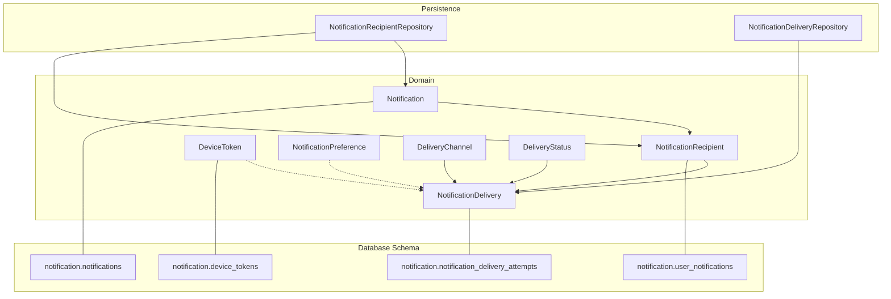
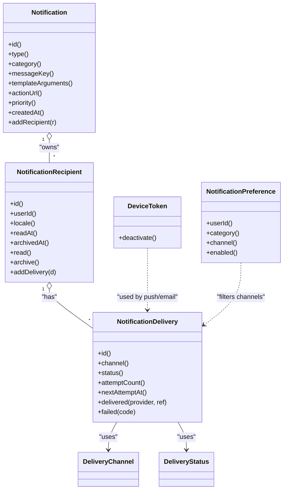
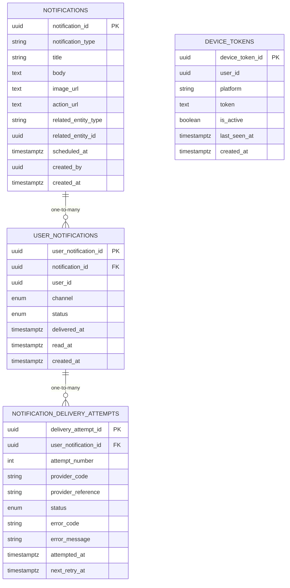
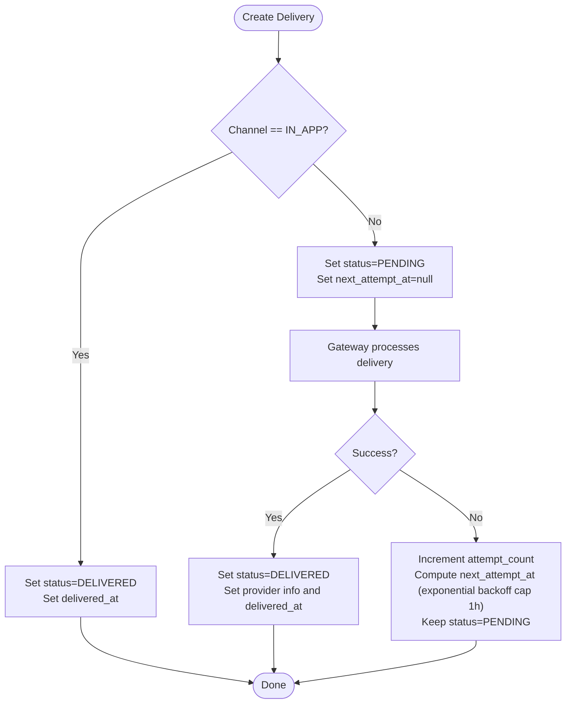
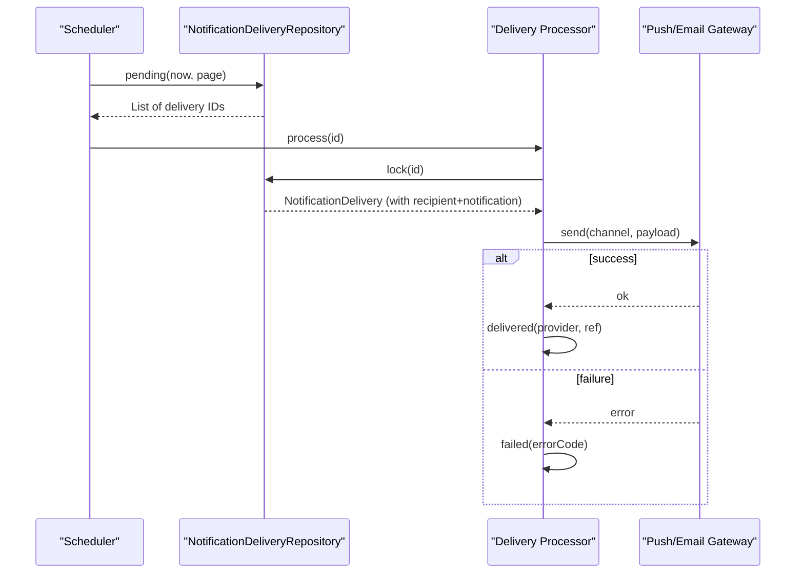
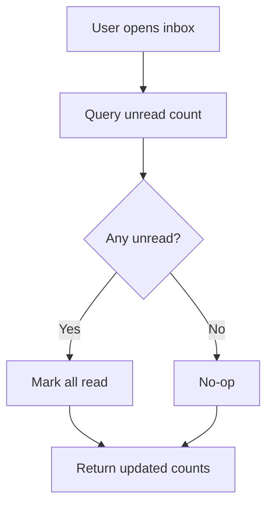
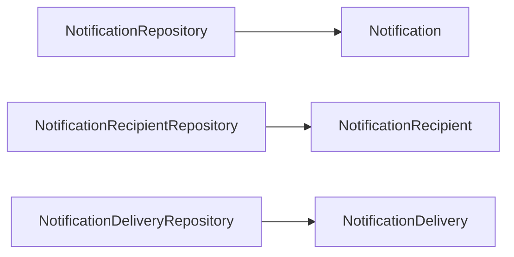

# Notification System Schema

<cite>
**Referenced Files in This Document**
- [Notification.java](file://src/main/java/com/smartcoffee/modules/notification/domain/Notification.java)
- [NotificationRecipient.java](file://src/main/java/com/smartcoffee/modules/notification/domain/NotificationRecipient.java)
- [NotificationDelivery.java](file://src/main/java/com/smartcoffee/modules/notification/domain/NotificationDelivery.java)
- [DeviceToken.java](file://src/main/java/com/smartcoffee/modules/notification/domain/DeviceToken.java)
- [NotificationPreference.java](file://src/main/java/com/smartcoffee/modules/notification/domain/NotificationPreference.java)
- [DeliveryChannel.java](file://src/main/java/com/smartcoffee/modules/notification/domain/DeliveryChannel.java)
- [DeliveryStatus.java](file://src/main/java/com/smartcoffee/modules/notification/domain/DeliveryStatus.java)
- [NotificationRepository.java](file://src/main/java/com/smartcoffee/modules/notification/persistence/NotificationRepository.java)
- [NotificationRecipientRepository.java](file://src/main/java/com/smartcoffee/modules/notification/persistence/NotificationRecipientRepository.java)
- [NotificationDeliveryRepository.java](file://src/main/java/com/smartcoffee/modules/notification/persistence/NotificationDeliveryRepository.java)
- [smart-coffee-logical.dbml](file://database/smart-coffee-logical.dbml)
</cite>

## Table of Contents
1. [Introduction](#introduction)
2. [Project Structure](#project-structure)
3. [Core Components](#core-components)
4. [Architecture Overview](#architecture-overview)
5. [Detailed Component Analysis](#detailed-component-analysis)
6. [Dependency Analysis](#dependency-analysis)
7. [Performance Considerations](#performance-considerations)
8. [Troubleshooting Guide](#troubleshooting-guide)
9. [Conclusion](#conclusion)

## Introduction
This document describes the data model and delivery mechanics for the Notification System. It covers notifications, per-user recipients, delivery attempts, device tokens, and notification preferences. It explains multi-channel delivery (IN_APP, PUSH, EMAIL), delivery status tracking, retry mechanisms, failure handling, and read/unread status management. It also clarifies differences between the domain entities and the logical database schema.

## Project Structure
The notification subsystem is organized into domain entities, repositories, and application services under modules.notification. The logical database schema is defined in a DBML file.

**Diagram sources**
- [Notification.java:7-38](file://src/main/java/com/smartcoffee/modules/notification/domain/Notification.java#L7-L38)
- [NotificationRecipient.java:7-30](file://src/main/java/com/smartcoffee/modules/notification/domain/NotificationRecipient.java#L7-L30)
- [NotificationDelivery.java:7-40](file://src/main/java/com/smartcoffee/modules/notification/domain/NotificationDelivery.java#L7-L40)
- [DeviceToken.java:7-28](file://src/main/java/com/smartcoffee/modules/notification/domain/DeviceToken.java#L7-L28)
- [NotificationPreference.java:6-23](file://src/main/java/com/smartcoffee/modules/notification/domain/NotificationPreference.java#L6-L23)
- [DeliveryChannel.java:3-5](file://src/main/java/com/smartcoffee/modules/notification/domain/DeliveryChannel.java#L3-L5)
- [DeliveryStatus.java:3-5](file://src/main/java/com/smartcoffee/modules/notification/domain/DeliveryStatus.java#L3-L5)
- [NotificationRepository.java:7-9](file://src/main/java/com/smartcoffee/modules/notification/persistence/NotificationRepository.java#L7-L9)
- [NotificationRecipientRepository.java:9-21](file://src/main/java/com/smartcoffee/modules/notification/persistence/NotificationRecipientRepository.java#L9-L21)
- [NotificationDeliveryRepository.java:11-18](file://src/main/java/com/smartcoffee/modules/notification/persistence/NotificationDeliveryRepository.java#L11-L18)
- [smart-coffee-logical.dbml:708-756](file://database/smart-coffee-logical.dbml#L708-L756)

**Section sources**
- [Notification.java:7-38](file://src/main/java/com/smartcoffee/modules/notification/domain/Notification.java#L7-L38)
- [NotificationRecipient.java:7-30](file://src/main/java/com/smartcoffee/modules/notification/domain/NotificationRecipient.java#L7-L30)
- [NotificationDelivery.java:7-40](file://src/main/java/com/smartcoffee/modules/notification/domain/NotificationDelivery.java#L7-L40)
- [DeviceToken.java:7-28](file://src/main/java/com/smartcoffee/modules/notification/domain/DeviceToken.java#L7-L28)
- [NotificationPreference.java:6-23](file://src/main/java/com/smartcoffee/modules/notification/domain/NotificationPreference.java#L6-L23)
- [DeliveryChannel.java:3-5](file://src/main/java/com/smartcoffee/modules/notification/domain/DeliveryChannel.java#L3-L5)
- [DeliveryStatus.java:3-5](file://src/main/java/com/smartcoffee/modules/notification/domain/DeliveryStatus.java#L3-L5)
- [NotificationRepository.java:7-9](file://src/main/java/com/smartcoffee/modules/notification/persistence/NotificationRepository.java#L7-L9)
- [NotificationRecipientRepository.java:9-21](file://src/main/java/com/smartcoffee/modules/notification/persistence/NotificationRecipientRepository.java#L9-L21)
- [NotificationDeliveryRepository.java:11-18](file://src/main/java/com/smartcoffee/modules/notification/persistence/NotificationDeliveryRepository.java#L11-L18)
- [smart-coffee-logical.dbml:708-756](file://database/smart-coffee-logical.dbml#L708-L756)

## Core Components
This section defines the core entities and their responsibilities.

- Notification: Represents a system-wide notification with type, category, message key, template arguments, optional action URL, related entity reference, priority, creation time, expiry, and versioning. It owns multiple NotificationRecipient entries.
- NotificationRecipient: Per-user record for a notification, including locale, read timestamp, archive timestamp, and list of deliveries. Supports read and archive operations.
- NotificationDelivery: Tracks delivery per channel per recipient, including channel, status, provider info, attempt count, next retry time, delivered timestamp, last error code, timestamps, and versioning. Implements retry scheduling on failure.
- DeviceToken: Stores hashed token identifier, encrypted token payload, platform, active flag, and timestamps. Supports deactivation.
- NotificationPreference: User-level preference per category and channel indicating whether that channel is enabled.
- DeliveryChannel: Enumerates supported channels (IN_APP, WEBSOCKET, PUSH, EMAIL).
- DeliveryStatus: Enumerates delivery lifecycle states (PENDING, PROCESSING, DELIVERED, FAILED, SKIPPED, CANCELLED).

Key behaviors:
- IN_APP deliveries are considered delivered immediately upon creation; other channels start as PENDING.
- On failure, delivery records increment attempt count and compute next retry time using exponential backoff capped at one hour.
- Read and archive timestamps are set once and never cleared.

**Section sources**
- [Notification.java:7-38](file://src/main/java/com/smartcoffee/modules/notification/domain/Notification.java#L7-L38)
- [NotificationRecipient.java:7-30](file://src/main/java/com/smartcoffee/modules/notification/domain/NotificationRecipient.java#L7-L30)
- [NotificationDelivery.java:7-40](file://src/main/java/com/smartcoffee/modules/notification/domain/NotificationDelivery.java#L7-L40)
- [DeviceToken.java:7-28](file://src/main/java/com/smartcoffee/modules/notification/domain/DeviceToken.java#L7-L28)
- [NotificationPreference.java:6-23](file://src/main/java/com/smartcoffee/modules/notification/domain/NotificationPreference.java#L6-L23)
- [DeliveryChannel.java:3-5](file://src/main/java/com/smartcoffee/modules/notification/domain/DeliveryChannel.java#L3-L5)
- [DeliveryStatus.java:3-5](file://src/main/java/com/smartcoffee/modules/notification/domain/DeliveryStatus.java#L3-L5)

## Architecture Overview
The notification system separates concerns across domain entities and persistence interfaces. The domain models encapsulate business rules such as immediate delivery for in-app messages and exponential backoff retries. Repositories provide query capabilities for listing pending deliveries, counting unread notifications, and marking all as read.

**Diagram sources**
- [Notification.java:7-38](file://src/main/java/com/smartcoffee/modules/notification/domain/Notification.java#L7-L38)
- [NotificationRecipient.java:7-30](file://src/main/java/com/smartcoffee/modules/notification/domain/NotificationRecipient.java#L7-L30)
- [NotificationDelivery.java:7-40](file://src/main/java/com/smartcoffee/modules/notification/domain/NotificationDelivery.java#L7-L40)
- [DeviceToken.java:7-28](file://src/main/java/com/smartcoffee/modules/notification/domain/DeviceToken.java#L7-L28)
- [NotificationPreference.java:6-23](file://src/main/java/com/smartcoffee/modules/notification/domain/NotificationPreference.java#L6-L23)
- [DeliveryChannel.java:3-5](file://src/main/java/com/smartcoffee/modules/notification/domain/DeliveryChannel.java#L3-L5)
- [DeliveryStatus.java:3-5](file://src/main/java/com/smartcoffee/modules/notification/domain/DeliveryStatus.java#L3-L5)

## Detailed Component Analysis

### Entity Model and Relationships
- Notification to NotificationRecipient: One-to-many relationship. Each recipient represents a user’s receipt of a notification, with locale and read/archive state.
- NotificationRecipient to NotificationDelivery: One-to-many relationship. Each delivery tracks a single channel attempt for a recipient.
- DeviceToken: Independent entity storing device registration details used by push/email gateways.
- NotificationPreference: Independent entity controlling which channels are enabled per category per user.

**Diagram sources**
- [smart-coffee-logical.dbml:708-756](file://database/smart-coffee-logical.dbml#L708-L756)

**Section sources**
- [smart-coffee-logical.dbml:708-756](file://database/smart-coffee-logical.dbml#L708-L756)

### Domain Entities vs Logical Schema
There are two parallel representations:
- Domain entities (JPA): Notification, NotificationRecipient, NotificationDelivery, DeviceToken, NotificationPreference, plus enums DeliveryChannel and DeliveryStatus.
- Logical schema (DBML): Tables notifications, user_notifications, notification_delivery_attempts, device_tokens.

Important differences:
- Domain NotificationRecipient maps to logical user_notifications.
- Domain NotificationDelivery maps to logical notification_delivery_attempts.
- Domain DeliveryChannel includes WEBSOCKET; logical schema enumerates IN_APP, PUSH, EMAIL.
- Domain DeliveryStatus includes SKIPPED and CANCELLED; logical schema enumerates PENDING, PROCESSING, DELIVERED, FAILED, CANCELLED.
- Logical schema fields include title/body/image_url/scheduled_at/created_by; domain Notification uses type/category/message_key/template_arguments/action_url/relatedEntityType/relatedEntityId/priority/createdAt/expiresAt.

Recommendation: Align domain and schema definitions to avoid ambiguity in reporting and integration.

**Section sources**
- [Notification.java:7-38](file://src/main/java/com/smartcoffee/modules/notification/domain/Notification.java#L7-L38)
- [NotificationRecipient.java:7-30](file://src/main/java/com/smartcoffee/modules/notification/domain/NotificationRecipient.java#L7-L30)
- [NotificationDelivery.java:7-40](file://src/main/java/com/smartcoffee/modules/notification/domain/NotificationDelivery.java#L7-L40)
- [DeliveryChannel.java:3-5](file://src/main/java/com/smartcoffee/modules/notification/domain/DeliveryChannel.java#L3-L5)
- [DeliveryStatus.java:3-5](file://src/main/java/com/smartcoffee/modules/notification/domain/DeliveryStatus.java#L3-L5)
- [smart-coffee-logical.dbml:708-756](file://database/smart-coffee-logical.dbml#L708-L756)

### Multi-Channel Delivery Mechanics
Channels:
- IN_APP: Delivered immediately upon creation of the delivery record.
- PUSH/EMAIL: Start as PENDING and are processed asynchronously.
- WEBSOCKET: Supported in domain but not present in logical schema enumeration.

Delivery lifecycle:
- Creation: For non-IN_APP channels, status is PENDING; for IN_APP, status is DELIVERED and delivered timestamp is set.
- Processing: External gateways update status to DELIVERED with provider metadata.
- Failure: Status remains PENDING, attempt_count increments, next_attempt_at is computed via exponential backoff capped at one hour.

**Diagram sources**
- [NotificationDelivery.java:45-71](file://src/main/java/com/smartcoffee/modules/notification/domain/NotificationDelivery.java#L45-L71)

**Section sources**
- [NotificationDelivery.java:45-71](file://src/main/java/com/smartcoffee/modules/notification/domain/NotificationDelivery.java#L45-L71)

### Delivery Status Tracking and Retry Mechanism
- Status values: PENDING, PROCESSING, DELIVERED, FAILED, SKIPPED, CANCELLED (domain); PENDING, PROCESSING, DELIVERED, FAILED, CANCELLED (schema).
- Retry policy: On failure, attempt_count increases and next_attempt_at is scheduled using exponential backoff with a maximum interval of one hour.
- Querying pending work: A repository method selects pending deliveries whose next_attempt_at is null or due, ordered by creation time.
- Concurrency control: A pessimistic lock query loads a delivery with its recipient and parent notification to safely update state during processing.

**Diagram sources**
- [NotificationDeliveryRepository.java:11-18](file://src/main/java/com/smartcoffee/modules/notification/persistence/NotificationDeliveryRepository.java#L11-L18)
- [NotificationDelivery.java:58-71](file://src/main/java/com/smartcoffee/modules/notification/domain/NotificationDelivery.java#L58-L71)

**Section sources**
- [NotificationDeliveryRepository.java:11-18](file://src/main/java/com/smartcoffee/modules/notification/persistence/NotificationDeliveryRepository.java#L11-L18)
- [NotificationDelivery.java:58-71](file://src/main/java/com/smartcoffee/modules/notification/domain/NotificationDelivery.java#L58-L71)

### Read/Unread Status Management
- Unread count: Repository provides a count of recipients where read_at is null and archived_at is null for a given user.
- Mark all read: Repository supports bulk update to set read_at to current timestamp for all unread recipients of a user.
- Single read: Recipient.read sets read_at if not already set.

**Diagram sources**
- [NotificationRecipientRepository.java:13-18](file://src/main/java/com/smartcoffee/modules/notification/persistence/NotificationRecipientRepository.java#L13-L18)
- [NotificationRecipient.java:51-54](file://src/main/java/com/smartcoffee/modules/notification/domain/NotificationRecipient.java#L51-L54)

**Section sources**
- [NotificationRecipientRepository.java:13-18](file://src/main/java/com/smartcoffee/modules/notification/persistence/NotificationRecipientRepository.java#L13-L18)
- [NotificationRecipient.java:51-54](file://src/main/java/com/smartcoffee/modules/notification/domain/NotificationRecipient.java#L51-L54)

### Device Registration and Channel Preferences
- Device registration: DeviceToken stores hashed token identifier, encrypted token payload, platform, active flag, and timestamps. Deactivation marks a token inactive.
- Channel preferences: NotificationPreference enables/disables specific channels per category per user.

Operational notes:
- Use DeviceToken.active to filter out inactive devices when sending push notifications.
- Use NotificationPreference.enabled to skip channels disabled by the user for a category.

**Section sources**
- [DeviceToken.java:7-36](file://src/main/java/com/smartcoffee/modules/notification/domain/DeviceToken.java#L7-L36)
- [NotificationPreference.java:6-42](file://src/main/java/com/smartcoffee/modules/notification/domain/NotificationPreference.java#L6-L42)

### Field Definitions and Semantics

#### Notifications (Logical Schema)
- notification_id: Primary key (UUID).
- notification_type: Type code for the notification.
- title: Human-readable title.
- body: Main content text.
- image_url: Optional media attachment link.
- action_url: Optional deep link or redirect URL.
- related_entity_type: Reference entity type (e.g., order, payment).
- related_entity_id: Reference entity identifier.
- scheduled_at: Optional scheduled delivery time.
- created_by: Creator user identifier.
- created_at: Creation timestamp.

#### User Notifications (Logical Schema)
- user_notification_id: Primary key (UUID).
- notification_id: Foreign key to notifications.
- user_id: Target user identifier.
- channel: Delivery channel (IN_APP, PUSH, EMAIL).
- status: Delivery status (PENDING, PROCESSING, DELIVERED, FAILED, CANCELLED).
- delivered_at: When successfully delivered.
- read_at: When user marked as read.
- created_at: Creation timestamp.

#### Delivery Attempts (Logical Schema)
- delivery_attempt_id: Primary key (UUID).
- user_notification_id: Parent user notification.
- attempt_number: Sequential attempt number.
- provider_code: Provider identifier.
- provider_reference: Provider-side reference.
- status: Attempt status.
- error_code: Error code on failure.
- error_message: Human-readable error message.
- attempted_at: Time of attempt.
- next_retry_at: Scheduled retry time.

#### Device Tokens (Logical Schema)
- device_token_id: Primary key (UUID).
- user_id: Owner user identifier.
- platform: Platform name (e.g., iOS, Android).
- token: Encrypted token value.
- is_active: Whether the token is active.
- last_seen_at: Last seen timestamp.
- created_at: Creation timestamp.

**Section sources**
- [smart-coffee-logical.dbml:708-756](file://database/smart-coffee-logical.dbml#L708-L756)

### Domain Entity Fields and Semantics

#### Notification
- id: UUID primary key.
- sourceEventId: Correlation to originating event.
- type: Notification type.
- category: Category for routing and preferences.
- messageKey: Message template key.
- templateArguments: JSONB payload for template rendering.
- actionUrl: Optional action URL.
- relatedEntityType: Related entity type.
- relatedEntityId: Related entity ID.
- priority: Priority level.
- createdAt: Creation timestamp.
- expiresAt: Expiration timestamp.
- version: Optimistic concurrency version.

#### NotificationRecipient
- id: UUID primary key.
- userId: Target user.
- locale: Preferred language/locale.
- readAt: Read timestamp.
- archivedAt: Archive timestamp.
- createdAt: Creation timestamp.
- version: Optimistic concurrency version.

#### NotificationDelivery
- id: UUID primary key.
- recipient: Link to NotificationRecipient.
- channel: DeliveryChannel.
- status: DeliveryStatus.
- providerName: Provider display name.
- providerReference: Provider-side reference.
- attemptCount: Number of attempts.
- nextAttemptAt: Next scheduled retry.
- deliveredAt: Delivery timestamp.
- lastErrorCode: Last error code.
- createdAt/updatedAt: Timestamps.
- version: Optimistic concurrency version.

#### DeviceToken
- id: UUID primary key.
- userId: Owner user.
- tokenHash: Hashed token for lookup.
- encryptedToken: Encrypted token payload.
- platform: Platform name.
- active: Active flag.
- createdAt/updatedAt: Timestamps.
- version: Optimistic concurrency version.

#### NotificationPreference
- id: UUID primary key.
- userId: Owner user.
- category: Category.
- channel: DeliveryChannel.
- enabled: Enabled flag.
- version: Optimistic concurrency version.

**Section sources**
- [Notification.java:7-38](file://src/main/java/com/smartcoffee/modules/notification/domain/Notification.java#L7-L38)
- [NotificationRecipient.java:7-30](file://src/main/java/com/smartcoffee/modules/notification/domain/NotificationRecipient.java#L7-L30)
- [NotificationDelivery.java:7-40](file://src/main/java/com/smartcoffee/modules/notification/domain/NotificationDelivery.java#L7-L40)
- [DeviceToken.java:7-28](file://src/main/java/com/smartcoffee/modules/notification/domain/DeviceToken.java#L7-L28)
- [NotificationPreference.java:6-23](file://src/main/java/com/smartcoffee/modules/notification/domain/NotificationPreference.java#L6-L23)

## Dependency Analysis
Repositories define access patterns and constraints:
- NotificationRepository: Exists-by-source-event-and-type check to prevent duplicates.
- NotificationRecipientRepository: Pagination for user’s non-archived notifications, unread count, mark-all-read, and identity lookup.
- NotificationDeliveryRepository: Pending delivery selection with ordering and pessimistic locking for safe updates.

**Diagram sources**
- [NotificationRepository.java:7-9](file://src/main/java/com/smartcoffee/modules/notification/persistence/NotificationRepository.java#L7-L9)
- [NotificationRecipientRepository.java:9-21](file://src/main/java/com/smartcoffee/modules/notification/persistence/NotificationRecipientRepository.java#L9-L21)
- [NotificationDeliveryRepository.java:11-18](file://src/main/java/com/smartcoffee/modules/notification/persistence/NotificationDeliveryRepository.java#L11-L18)

**Section sources**
- [NotificationRepository.java:7-9](file://src/main/java/com/smartcoffee/modules/notification/persistence/NotificationRepository.java#L7-L9)
- [NotificationRecipientRepository.java:9-21](file://src/main/java/com/smartcoffee/modules/notification/persistence/NotificationRecipientRepository.java#L9-L21)
- [NotificationDeliveryRepository.java:11-18](file://src/main/java/com/smartcoffee/modules/notification/persistence/NotificationDeliveryRepository.java#L11-L18)

## Performance Considerations
- Indexes: Logical schema indexes on user_notifications and notification_delivery_attempts support efficient queries for unread counts and retry scheduling.
- Batch operations: Mark-all-read reduces round-trips compared to per-record updates.
- Locking: Pessimistic write locks on delivery processing prevent concurrent updates.
- Backoff: Exponential backoff with a one-hour cap limits retry storms while ensuring eventual delivery.

[No sources needed since this section provides general guidance]

## Troubleshooting Guide
Common issues and resolutions:
- Duplicate notifications: Ensure source event deduplication using existsBySourceEventIdAndType before creating new notifications.
- Stuck deliveries: Check next_attempt_at and attempt_count; verify gateway connectivity and provider references.
- Missing reads: Confirm read_at is set via markAllRead or read operations; validate UI triggers.
- Inactive devices: Filter out DeviceToken rows where is_active is false before sending push notifications.
- Channel mismatches: Align DeliveryChannel usage with logical schema enumerations; consider removing WEBSOCKET from domain if unsupported by schema.

**Section sources**
- [NotificationRepository.java:7-9](file://src/main/java/com/smartcoffee/modules/notification/persistence/NotificationRepository.java#L7-L9)
- [NotificationDeliveryRepository.java:11-18](file://src/main/java/com/smartcoffee/modules/notification/persistence/NotificationDeliveryRepository.java#L11-L18)
- [NotificationRecipientRepository.java:13-18](file://src/main/java/com/smartcoffee/modules/notification/persistence/NotificationRecipientRepository.java#L13-L18)
- [DeviceToken.java:33-36](file://src/main/java/com/smartcoffee/modules/notification/domain/DeviceToken.java#L33-L36)
- [DeliveryChannel.java:3-5](file://src/main/java/com/smartcoffee/modules/notification/domain/DeliveryChannel.java#L3-L5)
- [smart-coffee-logical.dbml:22-23](file://database/smart-coffee-logical.dbml#L22-L23)

## Conclusion
The Notification System provides a robust, multi-channel delivery model with clear separation between domain logic and persistence. It supports immediate in-app delivery, asynchronous push/email delivery with exponential backoff retries, and comprehensive read/unread tracking. Alignment between domain entities and the logical schema is recommended to ensure consistency across reporting and integrations.

[No sources needed since this section summarizes without analyzing specific files]