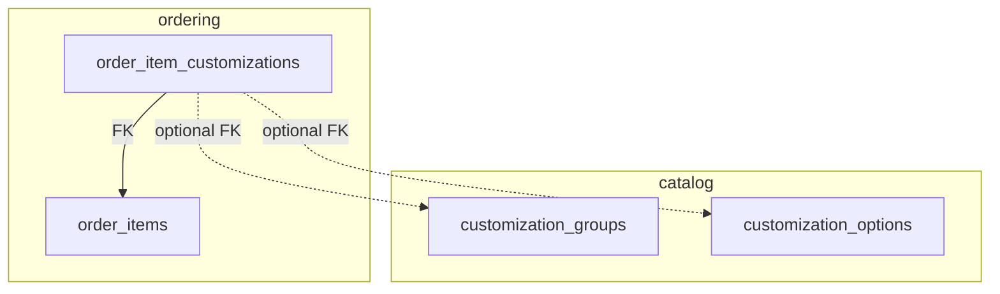
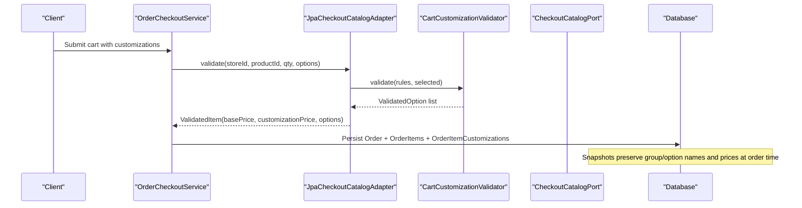
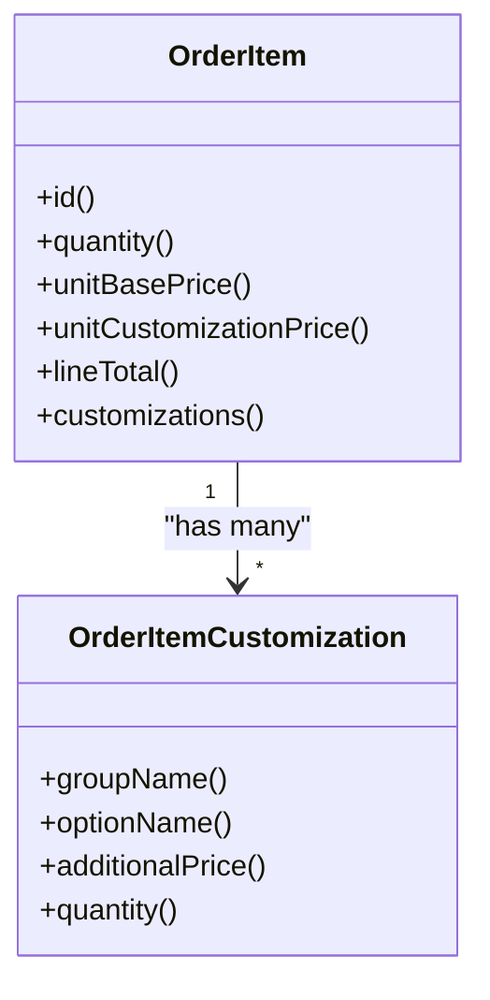
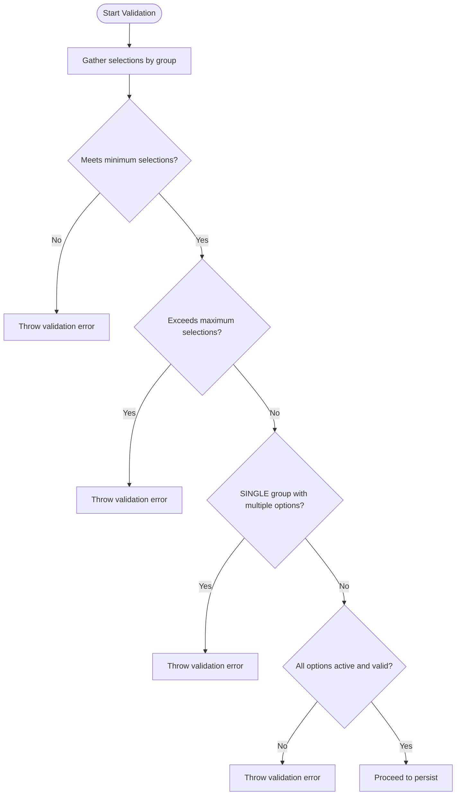
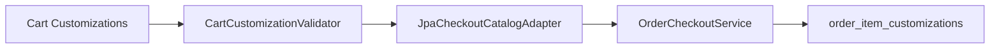

# Order Item Customizations Table

<cite>
**Referenced Files in This Document**
- [V006__orders_checkout.sql](file://src/main/resources/db/migration/V006__orders_checkout.sql)
- [smart-coffee-logical.dbml](file://database/smart-coffee-logical.dbml)
- [OrderItemCustomization.java](file://src/main/java/com/smartcoffee/modules/ordering/domain/OrderItemCustomization.java)
- [OrderItem.java](file://src/main/java/com/smartcoffee/modules/ordering/domain/OrderItem.java)
- [CartCustomizationValidator.java](file://src/main/java/com/smartcoffee/modules/cart/application/CartCustomizationValidator.java)
- [CheckoutCatalogPort.java](file://src/main/java/com/smartcoffee/modules/ordering/application/CheckoutCatalogPort.java)
- [JpaCheckoutCatalogAdapter.java](file://src/main/java/com/smartcoffee/modules/ordering/application/JpaCheckoutCatalogAdapter.java)
- [OrderCheckoutService.java](file://src/main/java/com/smartcoffee/modules/ordering/application/OrderCheckoutService.java)
- [CustomizationGroup.java](file://src/main/java/com/smartcoffee/modules/catalog/domain/CustomizationGroup.java)
- [CustomizationOption.java](file://src/main/java/com/smartcoffee/modules/catalog/domain/CustomizationOption.java)
- [ProductCustomizationGroup.java](file://src/main/java/com/smartcoffee/modules/catalog/domain/ProductCustomizationGroup.java)
- [SelectionType.java](file://src/main/java/com/smartcoffee/modules/catalog/domain/SelectionType.java)
- [CartItemCustomization.java](file://src/main/java/com/smartcoffee/modules/cart/domain/CartItemCustomization.java)
</cite>

## Table of Contents
1. Introduction
2. Project Structure
3. Core Components
4. Architecture Overview
5. Detailed Component Analysis
6. Dependency Analysis
7. Performance Considerations
8. Troubleshooting Guide
9. Conclusion

## Introduction
This document provides comprehensive data model documentation for the order_item_customizations table and its role in capturing product customizations at order time. It explains how snapshots preserve exact customization details (group names, option names, prices, quantities) even if catalog definitions change later, and how these customizations relate to order items and catalog entities. It also documents validation rules for customization selections, pricing calculations, and business logic for required vs optional customizations and their impact on order totals.

## Project Structure
The order_item_customizations table is part of the ordering module and persists per-item customization choices made during checkout. It references:
- The owning order item via a foreign key
- Optional links to catalog customization groups and options by ID
- Snapshot fields that store human-readable group and option names as they were at order time
- Pricing and quantity captured at selection time

**Diagram sources**
- [V006__orders_checkout.sql:430-470](file://src/main/resources/db/migration/V006__orders_checkout.sql#L430-L470)
- [smart-coffee-logical.dbml:437-446](file://database/smart-coffee-logical.dbml#L437-L446)

**Section sources**
- [V006__orders_checkout.sql:430-470](file://src/main/resources/db/migration/V006__orders_checkout.sql#L430-L470)
- [smart-coffee-logical.dbml:437-446](file://database/smart-coffee-logical.dbml#L437-L446)

## Core Components
- OrderItemCustomization entity maps to the order_item_customizations table and stores:
  - order_item_customization_id: primary key
  - order_item_id: link to the parent order item
  - customization_group_id: optional reference to catalog.customization_groups.group_id
  - customization_option_id: optional reference to catalog.customization_options.option_id
  - group_name_snapshot: snapshot of the group name at order time
  - option_name_snapshot: snapshot of the option name at order time
  - additional_price: price impact of this customization line at order time
  - quantity: number of units of this customization applied to the order item
  - created_at: timestamp when persisted

- OrderItem holds a collection of OrderItemCustomization entries and aggregates unit-level customization pricing into unit_customization_price and line_total.

- Catalog entities define available customization groups and options, including selection constraints and pricing.

**Section sources**
- [OrderItemCustomization.java:8-45](file://src/main/java/com/smartcoffee/modules/ordering/domain/OrderItemCustomization.java#L8-L45)
- [OrderItem.java:95-101](file://src/main/java/com/smartcoffee/modules/ordering/domain/OrderItem.java#L95-L101)
- [CustomizationGroup.java:5-22](file://src/main/java/com/smartcoffee/modules/catalog/domain/CustomizationGroup.java#L5-L22)
- [CustomizationOption.java:6-22](file://src/main/java/com/smartcoffee/modules/catalog/domain/CustomizationOption.java#L6-L22)

## Architecture Overview
During checkout, selected customizations are validated against catalog rules, then transformed into OrderItemCustomization records with snapshot values. These records ensure historical accuracy for receipts, reporting, and production while allowing catalog evolution.

**Diagram sources**
- [OrderCheckoutService.java:85-120](file://src/main/java/com/smartcoffee/modules/ordering/application/OrderCheckoutService.java#L85-L120)
- [JpaCheckoutCatalogAdapter.java:1-18](file://src/main/java/com/smartcoffee/modules/ordering/application/JpaCheckoutCatalogAdapter.java#L1-L18)
- [CartCustomizationValidator.java:1-53](file://src/main/java/com/smartcoffee/modules/cart/application/CartCustomizationValidator.java#L1-L53)
- [CheckoutCatalogPort.java:1-20](file://src/main/java/com/smartcoffee/modules/ordering/application/CheckoutCatalogPort.java#L1-L20)

## Detailed Component Analysis

### Data Model: order_item_customizations
- Primary Key
  - order_item_customization_id: UUID unique identifier for each customization line
- Foreign Keys
  - order_item_id: NOT NULL; references ordering.order_items(order_item_id)
  - group_id: nullable; references catalog.customization_groups(group_id)
  - option_id: nullable; references catalog.customization_options(option_id)
- Snapshot Fields
  - group_name_snapshot: VARCHAR(100), NOT NULL; preserves group name at order time
  - option_name_snapshot: VARCHAR(100), NOT NULL; preserves option name at order time
- Pricing and Quantity
  - additional_price: NUMERIC(14,4), NOT NULL; price impact for this customization line at order time
  - quantity: INTEGER, NOT NULL; number of units of this customization applied to the order item
- Audit
  - created_at: TIMESTAMPTZ, NOT NULL; persistence timestamp
- Constraints
  - CHECK(additional_price >= 0 AND quantity > 0)
- Indexes
  - ix_order_customization_item on order_item_id for efficient retrieval per order item

These fields ensure that even if catalog definitions change later, the order record retains the exact customization details chosen by the customer at purchase time.

**Section sources**
- [V006__orders_checkout.sql:430-470](file://src/main/resources/db/migration/V006__orders_checkout.sql#L430-L470)
- [smart-coffee-logical.dbml:437-446](file://database/smart-coffee-logical.dbml#L437-L446)

### Entity Mapping: OrderItemCustomization
- Maps to ordering.order_item_customizations
- Stores IDs for group and option plus snapshot names and price
- Associates with an OrderItem via ManyToOne relationship
- Provides accessors for groupName, optionName, additionalPrice, quantity

**Section sources**
- [OrderItemCustomization.java:8-45](file://src/main/java/com/smartcoffee/modules/ordering/domain/OrderItemCustomization.java#L8-L45)

### Relationship with Order Items
- OrderItem has a OneToMany relationship to OrderItemCustomization
- During order creation, each ValidatedOption becomes an OrderItemCustomization
- OrderItem.unit_customization_price aggregates customization pricing across all customizations for that item

**Diagram sources**
- [OrderItem.java:95-101](file://src/main/java/com/smartcoffee/modules/ordering/domain/OrderItem.java#L95-L101)
- [OrderItemCustomization.java:8-45](file://src/main/java/com/smartcoffee/modules/ordering/domain/OrderItemCustomization.java#L8-L45)

**Section sources**
- [OrderItem.java:95-101](file://src/main/java/com/smartcoffee/modules/ordering/domain/OrderItem.java#L95-L101)
- [OrderItemCustomization.java:8-45](file://src/main/java/com/smartcoffee/modules/ordering/domain/OrderItemCustomization.java#L8-L45)

### Validation Rules for Customization Selections
- Quantity must be positive
- Required minimum selections enforced per group
- Maximum selections enforced per group
- SINGLE selection type allows only one option per group
- Duplicate option selections within a group are rejected
- Only active options belonging to the product’s allowed groups are accepted

These rules are enforced before persisting customizations, ensuring valid and consistent order data.

**Section sources**
- [CartCustomizationValidator.java:11-50](file://src/main/java/com/smartcoffee/modules/cart/application/CartCustomizationValidator.java#L11-L50)

### Pricing Calculations and Impact on Order Totals
- Each customization carries an additional_price captured at selection time
- OrderItem.unit_customization_price aggregates customization prices for the item
- Line total calculation:
  - line_before_tax = (base_price + customization_price) * quantity
  - line_tax = line_before_tax * tax_rate (rounded)
  - line_total = line_before_tax + line_tax
- Order totals aggregate line totals across items

This ensures that order totals reflect the exact customization pricing at the time of purchase.

**Section sources**
- [OrderCheckoutService.java:91-114](file://src/main/java/com/smartcoffee/modules/ordering/application/OrderCheckoutService.java#L91-L114)
- [CartItemCustomization.java:106-118](file://src/main/java/com/smartcoffee/modules/cart/domain/CartItemCustomization.java#L106-L118)

### Business Logic: Required vs Optional Customizations
- Product-to-group mapping includes a required flag indicating whether a group must be selected
- Minimum selections from the group definition further constrain requirements
- During validation:
  - If a group is required or minimum selections > 0, missing selections trigger a validation error
  - If maximum selections is set, exceeding it triggers a validation error
- Snapshotting ensures that even if required flags or availability change later, the order remains accurate

**Diagram sources**
- [CartCustomizationValidator.java:11-50](file://src/main/java/com/smartcoffee/modules/cart/application/CartCustomizationValidator.java#L11-L50)
- [ProductCustomizationGroup.java:1-12](file://src/main/java/com/smartcoffee/modules/catalog/domain/ProductCustomizationGroup.java#L1-L12)
- [CustomizationGroup.java:5-22](file://src/main/java/com/smartcoffee/modules/catalog/domain/CustomizationGroup.java#L5-L22)
- [SelectionType.java:1-7](file://src/main/java/com/smartcoffee/modules/catalog/domain/SelectionType.java#L1-L7)

**Section sources**
- [CartCustomizationValidator.java:11-50](file://src/main/java/com/smartcoffee/modules/cart/application/CartCustomizationValidator.java#L11-L50)
- [ProductCustomizationGroup.java:1-12](file://src/main/java/com/smartcoffee/modules/catalog/domain/ProductCustomizationGroup.java#L1-L12)
- [CustomizationGroup.java:5-22](file://src/main/java/com/smartcoffee/modules/catalog/domain/CustomizationGroup.java#L5-L22)
- [SelectionType.java:1-7](file://src/main/java/com/smartcoffee/modules/catalog/domain/SelectionType.java#L1-L7)

### Snapshot Strategy: Preserving Exact Customization Details
- group_name_snapshot and option_name_snapshot capture display names at order time
- additional_price captures the price impact at order time
- IDs may optionally reference current catalog entities, but snapshots ensure readability and stability regardless of catalog changes
- This approach supports accurate receipts, audits, and reporting even after catalog updates

**Section sources**
- [OrderItemCustomization.java:17-30](file://src/main/java/com/smartcoffee/modules/ordering/domain/OrderItemCustomization.java#L17-L30)
- [V006__orders_checkout.sql:430-470](file://src/main/resources/db/migration/V006__orders_checkout.sql#L430-L470)

## Dependency Analysis
- Ordering depends on Cart for initial customization selection and on Catalog for rule validation
- JpaCheckoutCatalogAdapter orchestrates validation using CartCustomizationValidator and returns validated options
- OrderCheckoutService creates OrderItemCustomization instances from validated options and persists them alongside Order and OrderItem

**Diagram sources**
- [CartCustomizationValidator.java:1-53](file://src/main/java/com/smartcoffee/modules/cart/application/CartCustomizationValidator.java#L1-L53)
- [JpaCheckoutCatalogAdapter.java:1-18](file://src/main/java/com/smartcoffee/modules/ordering/application/JpaCheckoutCatalogAdapter.java#L1-L18)
- [OrderCheckoutService.java:85-120](file://src/main/java/com/smartcoffee/modules/ordering/application/OrderCheckoutService.java#L85-L120)

**Section sources**
- [CartCustomizationValidator.java:1-53](file://src/main/java/com/smartcoffee/modules/cart/application/CartCustomizationValidator.java#L1-L53)
- [JpaCheckoutCatalogAdapter.java:1-18](file://src/main/java/com/smartcoffee/modules/ordering/application/JpaCheckoutCatalogAdapter.java#L1-L18)
- [OrderCheckoutService.java:85-120](file://src/main/java/com/smartcoffee/modules/ordering/application/OrderCheckoutService.java#L85-L120)

## Performance Considerations
- Index on order_item_id enables fast retrieval of customizations per order item
- Snapshot fields avoid expensive joins to catalog tables for display purposes
- Validation runs once during checkout; subsequent reads rely on persisted snapshots
- Numeric precision (NUMERIC(14,4)) ensures accurate monetary calculations without floating-point drift

[No sources needed since this section provides general guidance]

## Troubleshooting Guide
Common issues and resolutions:
- Missing required customization: Ensure minimum selections are met for required groups; validator will throw a validation error if not satisfied
- Too many selections: Respect maximum selections configured per group
- Invalid option: Only active options belonging to the product’s allowed groups are accepted; duplicates are rejected
- Price mismatch at checkout: Base price or customization price changed in catalog; checkout validates and rejects inconsistent prices
- Currency mismatch: Store currency must match cart currency; otherwise checkout fails

Where to look:
- Validation exceptions thrown by CartCustomizationValidator
- Conflict exceptions raised by OrderCheckoutService for price or currency mismatches
- Database constraints on order_item_customizations (non-negative price, positive quantity)

**Section sources**
- [CartCustomizationValidator.java:11-50](file://src/main/java/com/smartcoffee/modules/cart/application/CartCustomizationValidator.java#L11-L50)
- [OrderCheckoutService.java:91-114](file://src/main/java/com/smartcoffee/modules/ordering/application/OrderCheckoutService.java#L91-L114)
- [V006__orders_checkout.sql:462-467](file://src/main/resources/db/migration/V006__orders_checkout.sql#L462-L467)

## Conclusion
The order_item_customizations table captures a precise snapshot of product customizations at order time, preserving group and option names, pricing, and quantities. It integrates tightly with OrderItem and leverages catalog-defined rules to enforce valid selections. By snapshotting critical details, the system maintains historical accuracy for orders, receipts, and analytics, even as catalog configurations evolve. Validation and pricing logic ensure consistency and correctness throughout the checkout process.