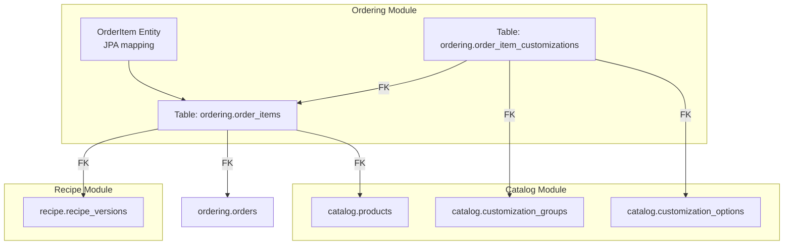
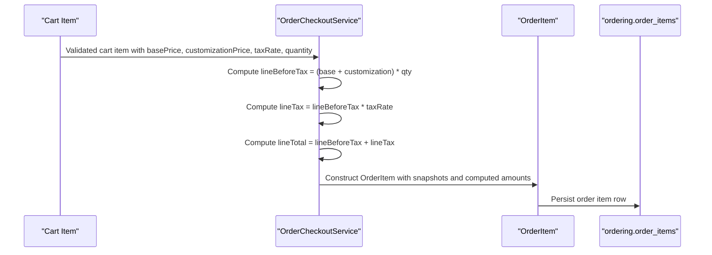
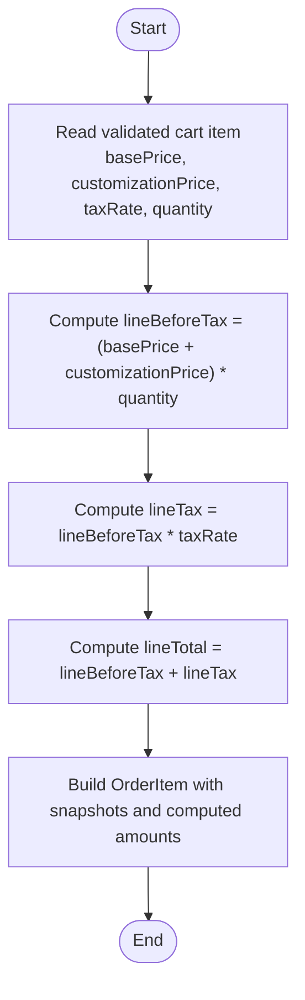
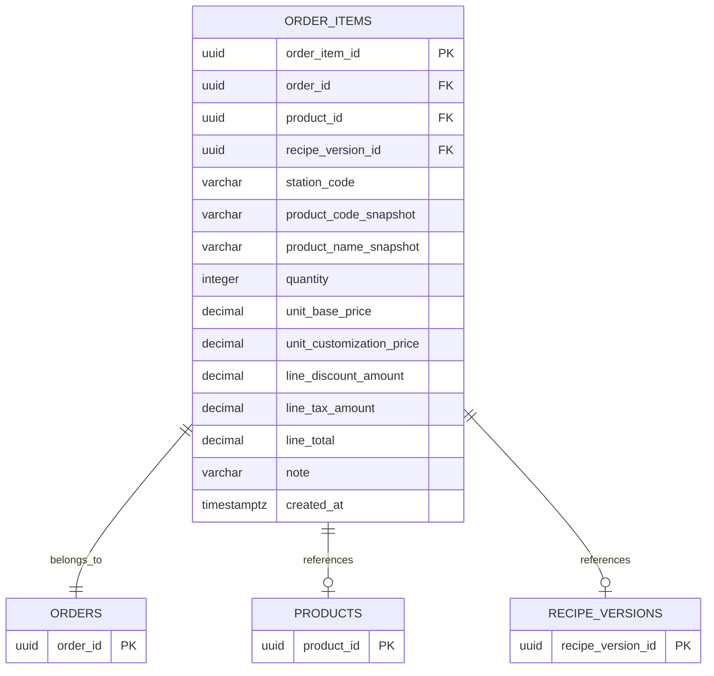
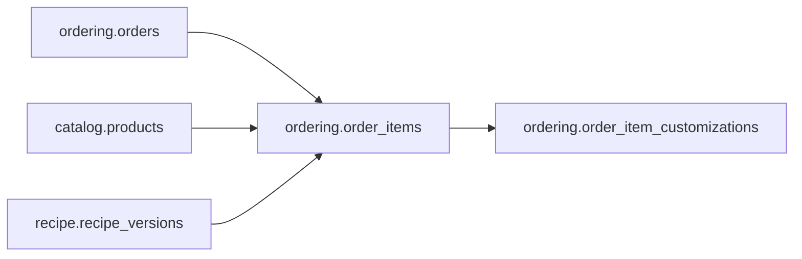

# Order Items Table

<cite>
**Referenced Files in This Document**
- [OrderItem.java](file://src/main/java/com/smartcoffee/modules/ordering/domain/OrderItem.java)
- [V006__orders_checkout.sql](file://src/main/resources/db/migration/V006__orders_checkout.sql)
- [smart-coffee-logical.dbml](file://database/smart-coffee-logical.dbml)
- [OrderCheckoutService.java](file://src/main/java/com/smartcoffee/modules/ordering/application/OrderCheckoutService.java)
- [CartItem.java](file://src/main/java/com/smartcoffee/modules/cart/domain/CartItem.java)
</cite>

## Table of Contents
1. [Introduction](#introduction)
2. [Project Structure](#project-structure)
3. [Core Components](#core-components)
4. [Architecture Overview](#architecture-overview)
5. [Detailed Component Analysis](#detailed-component-analysis)
6. [Dependency Analysis](#dependency-analysis)
7. [Performance Considerations](#performance-considerations)
8. [Troubleshooting Guide](#troubleshooting-guide)
9. [Conclusion](#conclusion)

## Introduction
This document provides detailed data model documentation for the `order_items` table and its domain entity. It explains how order items capture product snapshots at the time of checkout to preserve historical pricing and details, documents the calculation logic for line totals including base price, customization adjustments, and discounts or taxes, and clarifies relationships with orders, products, and recipes. It also covers indexing strategy and performance considerations for order item queries.

## Project Structure
The `order_items` table is part of the ordering module and is defined by a database migration and mapped to a JPA entity. The logical schema is also documented in the project’s DBML file. Checkout logic that creates order items resides in the ordering application service and uses cart-derived values to compute line totals.

**Diagram sources**
- [V006__orders_checkout.sql:370-428](file://src/main/resources/db/migration/V006__orders_checkout.sql#L370-L428)
- [smart-coffee-logical.dbml:418-446](file://database/smart-coffee-logical.dbml#L418-L446)

**Section sources**
- [V006__orders_checkout.sql:370-428](file://src/main/resources/db/migration/V006__orders_checkout.sql#L370-L428)
- [smart-coffee-logical.dbml:418-446](file://database/smart-coffee-logical.dbml#L418-L446)

## Core Components
- Domain entity: `OrderItem` maps to `ordering.order_items`.
- Database schema: created by migration `V006__orders_checkout.sql`.
- Logical model: documented in `smart-coffee-logical.dbml`.
- Creation flow: `OrderCheckoutService` constructs `OrderItem` instances from validated cart items during checkout.

Key responsibilities:
- Persist immutable snapshot of product identity and pricing at order time.
- Record per-line monetary components (base price, customization price, discount/tax, total).
- Link to parent order and optional product/recipe references.
- Store optional notes and creation timestamp.

**Section sources**
- [OrderItem.java:19-93](file://src/main/java/com/smartcoffee/modules/ordering/domain/OrderItem.java#L19-L93)
- [V006__orders_checkout.sql:370-428](file://src/main/resources/db/migration/V006__orders_checkout.sql#L370-L428)
- [smart-coffee-logical.dbml:418-435](file://database/smart-coffee-logical.dbml#L418-L435)
- [OrderCheckoutService.java:103-112](file://src/main/java/com/smartcoffee/modules/ordering/application/OrderCheckoutService.java#L103-L112)

## Architecture Overview
At checkout, each cart item is transformed into an `OrderItem`. The system captures:
- Product identifiers and descriptive snapshots (code and name).
- Pricing at the moment of purchase (base price and customization price).
- Monetary adjustments (discounts and taxes) and the final line total.
- Optional recipe version reference for production and cost estimation.

**Diagram sources**
- [OrderCheckoutService.java:103-112](file://src/main/java/com/smartcoffee/modules/ordering/application/OrderCheckoutService.java#L103-L112)
- [OrderItem.java:106-139](file://src/main/java/com/smartcoffee/modules/ordering/domain/OrderItem.java#L106-L139)

## Detailed Component Analysis

### Data Model Fields
The following fields are persisted in `ordering.order_items`:

- `order_item_id`
  - Type: UUID
  - Purpose: Primary key for the order line.
  - Notes: Generated when creating the entity.

- `order_id`
  - Type: UUID
  - Purpose: Foreign key to the parent order.
  - Constraint: Not null; indexed for efficient retrieval by order.

- `product_id`
  - Type: UUID
  - Purpose: Reference to the catalog product at order time.
  - Notes: Nullable in some flows; product identity is preserved via snapshots.

- `recipe_version_id`
  - Type: UUID
  - Purpose: Reference to the recipe version used for production and cost estimation.
  - Notes: Nullable if no recipe applies.

- `station_code`
  - Type: VARCHAR(40)
  - Purpose: Indicates the station responsible for preparing the item.
  - Notes: Present in the migration and entity but not present in the logical DBML definition.

- `product_code_snapshot`
  - Type: VARCHAR(50)
  - Purpose: Immutable product code captured at order time.

- `product_name_snapshot`
  - Type: VARCHAR(150)
  - Purpose: Immutable product name captured at order time.

- `category_id_snapshot`
  - Type: UUID
  - Purpose: Intended to capture product category at order time.
  - Notes: Defined in the logical DBML but not present in the current migration or entity. Treat as planned or legacy field.

- `quantity`
  - Type: INTEGER
  - Purpose: Number of units ordered.
  - Constraint: Must be greater than zero.

- `unit_base_price`
  - Type: NUMERIC(14,4)
  - Purpose: Base unit price of the product at order time.

- `unit_customization_price`
  - Type: NUMERIC(14,4)
  - Purpose: Sum of additional prices for selected customizations on this line.

- `unit_discount_amount`
  - Type: NUMERIC(14,4)
  - Purpose: Intended to capture per-unit discount amount.
  - Notes: Defined in the logical DBML but not present in the current migration or entity.

- `line_total`
  - Type: NUMERIC(14,4)
  - Purpose: Final charge for the line after applying base price, customization adjustments, and applicable taxes/discounts.

- `estimated_unit_cost`
  - Type: NUMERIC(14,4)
  - Purpose: Intended to store estimated cost per unit for profitability analysis.
  - Notes: Defined in the logical DBML but not present in the current migration or entity.

- `note`
  - Type: VARCHAR(500)
  - Purpose: Free-form note attached to the order line.

- `created_at`
  - Type: TIMESTAMPTZ
  - Purpose: Timestamp when the order item was created.

Notes on discrepancies between logical DBML and actual migration/entity:
- The logical DBML includes `category_id_snapshot`, `unit_discount_amount`, and `estimated_unit_cost`, which are not present in the active migration or entity.
- The migration and entity include `station_code`, `line_discount_amount`, and `line_tax_amount`, which are not present in the logical DBML.
- For implementation purposes, rely on the migration and entity definitions.

**Section sources**
- [OrderItem.java:23-93](file://src/main/java/com/smartcoffee/modules/ordering/domain/OrderItem.java#L23-L93)
- [V006__orders_checkout.sql:370-428](file://src/main/resources/db/migration/V006__orders_checkout.sql#L370-L428)
- [smart-coffee-logical.dbml:418-435](file://database/smart-coffee-logical.dbml#L418-L435)

### Historical Snapshots and Price Preservation
Order items preserve historical product information using snapshot fields:
- `product_code_snapshot` and `product_name_snapshot` ensure that changes to product metadata after the order do not alter historical records.
- `product_id` and `recipe_version_id` provide referential anchors to catalog and recipe versions at order time.
- Pricing fields (`unit_base_price`, `unit_customization_price`) freeze the price composition at checkout.

This design guarantees that financial reporting and receipts remain accurate even if catalog data evolves.

**Section sources**
- [OrderItem.java:40-63](file://src/main/java/com/smartcoffee/modules/ordering/domain/OrderItem.java#L40-L63)
- [V006__orders_checkout.sql:382-390](file://src/main/resources/db/migration/V006__orders_checkout.sql#L382-L390)

### Line Total Calculation Logic
Line totals are computed during checkout based on validated cart data:
- Per-line subtotal before tax: `(unit_base_price + unit_customization_price) * quantity`.
- Tax amount: `line_before_tax * tax_rate`.
- Line total: `line_before_tax + line_tax`.

Customization contributions are aggregated from selected options and added to the base price before multiplying by quantity. Discounts may be represented at the line level through dedicated fields depending on business rules; in the current implementation, the entity exposes both discount and tax fields, while the migration defines separate columns for line-level discount and tax.

**Diagram sources**
- [OrderCheckoutService.java:103-112](file://src/main/java/com/smartcoffee/modules/ordering/application/OrderCheckoutService.java#L103-L112)
- [CartItem.java:110-118](file://src/main/java/com/smartcoffee/modules/cart/domain/CartItem.java#L110-L118)

**Section sources**
- [OrderCheckoutService.java:103-112](file://src/main/java/com/smartcoffee/modules/ordering/application/OrderCheckoutService.java#L103-L112)
- [CartItem.java:110-118](file://src/main/java/com/smartcoffee/modules/cart/domain/CartItem.java#L110-L118)

### Relationships with Orders, Products, and Recipes
- Order relationship: Each order item belongs to exactly one order via `order_id`.
- Product relationship: `product_id` optionally references `catalog.products`.
- Recipe relationship: `recipe_version_id` optionally references `recipe.recipe_versions`.

These foreign keys enable traceability from sales lines back to catalog and production data.

**Diagram sources**
- [V006__orders_checkout.sql:370-428](file://src/main/resources/db/migration/V006__orders_checkout.sql#L370-L428)

**Section sources**
- [V006__orders_checkout.sql:402-412](file://src/main/resources/db/migration/V006__orders_checkout.sql#L402-L412)

### Indexing Strategy and Performance Considerations
Current index:
- `ix_order_item_order` on `ordering.order_items(order_id)` supports fast lookups of all items for a given order.

Recommended indexes for common query patterns:
- Composite index on `(order_id, product_id)` for order detail reports filtered by product.
- Composite index on `(order_id, created_at DESC)` for chronological listing of order lines.
- Index on `product_code_snapshot` if frequent searches by product code across orders are required.
- Index on `recipe_version_id` if analytics frequently aggregate by recipe version.

Performance guidance:
- Prefer querying by `order_id` first to leverage the existing index.
- Avoid scanning large ranges without filters; use pagination where appropriate.
- Keep snapshot fields narrow and indexed only when necessary to balance write overhead.

**Section sources**
- [V006__orders_checkout.sql:427-428](file://src/main/resources/db/migration/V006__orders_checkout.sql#L427-L428)

## Dependency Analysis
The `order_items` table depends on:
- `ordering.orders` for order linkage.
- `catalog.products` for product identity.
- `recipe.recipe_versions` for recipe linkage.
- `ordering.order_item_customizations` for detailed customization breakdown.

**Diagram sources**
- [V006__orders_checkout.sql:402-412](file://src/main/resources/db/migration/V006__orders_checkout.sql#L402-L412)
- [V006__orders_checkout.sql:430-470](file://src/main/resources/db/migration/V006__orders_checkout.sql#L430-L470)

**Section sources**
- [V006__orders_checkout.sql:402-412](file://src/main/resources/db/migration/V006__orders_checkout.sql#L402-L412)
- [V006__orders_checkout.sql:430-470](file://src/main/resources/db/migration/V006__orders_checkout.sql#L430-L470)

## Performance Considerations
- Use the existing `order_id` index for order-scoped queries.
- Add composite indexes judiciously based on access patterns (e.g., filtering by product or date).
- Snapshot fields are read-heavy and should not be over-indexed unless required by specific queries.
- Ensure numeric fields use consistent precision and scale to avoid conversion overhead.

[No sources needed since this section provides general guidance]

## Troubleshooting Guide
Common issues and resolutions:
- Missing `order_id` index: Verify that `ix_order_item_order` exists; absence will degrade order detail queries.
- Inconsistent money fields: Validate that `unit_base_price`, `unit_customization_price`, `line_discount_amount`, `line_tax_amount`, and `line_total` are non-negative per constraints.
- Quantity validation: Ensure `quantity > 0`; violations indicate invalid input during checkout.
- Snapshot mismatches: If product names or codes differ from catalog, confirm that snapshots were captured at checkout time rather than referencing live catalog data.

**Section sources**
- [V006__orders_checkout.sql:414-424](file://src/main/resources/db/migration/V006__orders_checkout.sql#L414-L424)
- [V006__orders_checkout.sql:427-428](file://src/main/resources/db/migration/V006__orders_checkout.sql#L427-L428)

## Conclusion
The `order_items` table implements a robust snapshot-based design that preserves product identity, pricing, and customization details at the time of order. It integrates cleanly with orders, products, and recipes, and supports accurate financial reporting despite subsequent catalog changes. The current indexing strategy optimizes order-scoped reads, and additional indexes can be introduced based on analytical needs. Careful alignment between logical DBML and actual migration/entity definitions is recommended to avoid confusion during development and maintenance.

[No sources needed since this section summarizes without analyzing specific files]