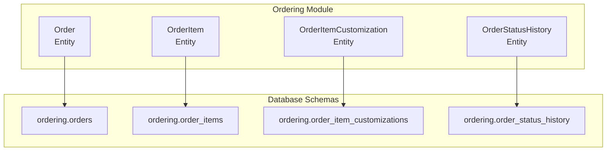
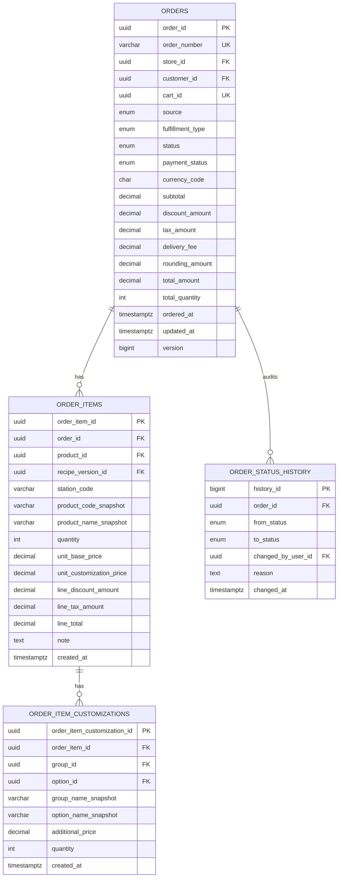
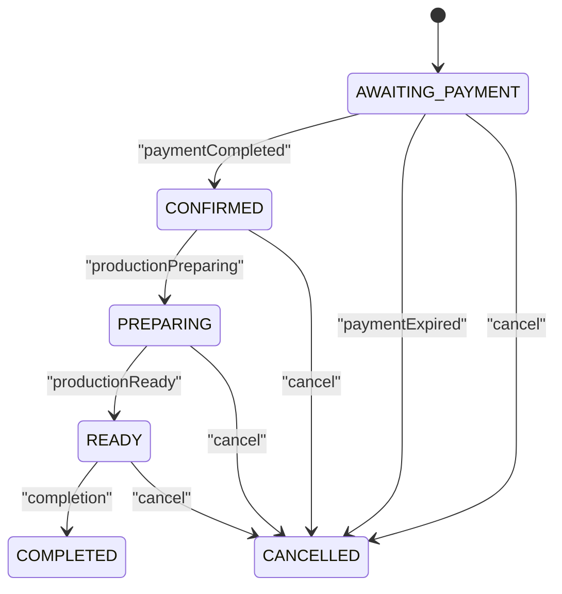
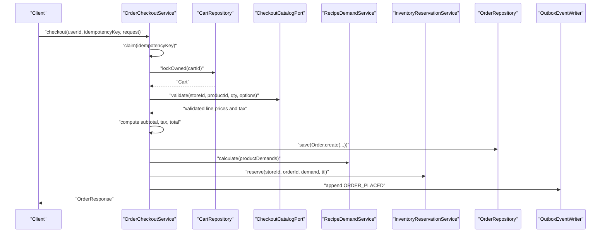
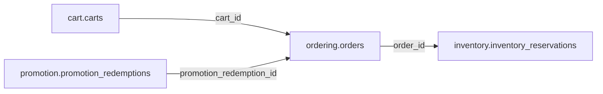
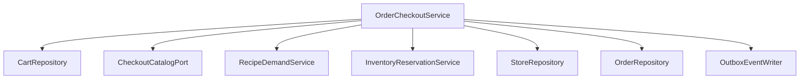

# Order Management Schema

<cite>
**Referenced Files in This Document**
- [Order.java](file://src/main/java/com/smartcoffee/modules/ordering/domain/Order.java)
- [OrderItem.java](file://src/main/java/com/smartcoffee/modules/ordering/domain/OrderItem.java)
- [OrderItemCustomization.java](file://src/main/java/com/smartcoffee/modules/ordering/domain/OrderItemCustomization.java)
- [OrderStatusHistory.java](file://src/main/java/com/smartcoffee/modules/ordering/domain/OrderStatusHistory.java)
- [OrderSource.java](file://src/main/java/com/smartcoffee/modules/ordering/domain/OrderSource.java)
- [FulfillmentType.java](file://src/main/java/com/smartcoffee/modules/ordering/domain/FulfillmentType.java)
- [OrderStatus.java](file://src/main/java/com/smartcoffee/modules/ordering/domain/OrderStatus.java)
- [PaymentStatus.java](file://src/main/java/com/smartcoffee/modules/ordering/domain/PaymentStatus.java)
- [OrderNumberGenerator.java](file://src/main/java/com/smartcoffee/modules/ordering/application/OrderNumberGenerator.java)
- [OrderCheckoutService.java](file://src/main/java/com/smartcoffee/modules/ordering/application/OrderCheckoutService.java)
- [smart-coffee-logical.dbml](file://database/smart-coffee-logical.dbml)
- [V006__orders_checkout.sql](file://src/main/resources/db/migration/V006__orders_checkout.sql)
</cite>

## Table of Contents
1. [Introduction](#introduction)
2. [Project Structure](#project-structure)
3. [Core Components](#core-components)
4. [Architecture Overview](#architecture-overview)
5. [Detailed Component Analysis](#detailed-component-analysis)
6. [Dependency Analysis](#dependency-analysis)
7. [Performance Considerations](#performance-considerations)
8. [Troubleshooting Guide](#troubleshooting-guide)
9. [Conclusion](#conclusion)

## Introduction
This document describes the Order Management schema and its runtime behavior for creating, pricing, reserving inventory, and tracking order lifecycle events. It focuses on the following database entities:

- `ordering.orders`
- `ordering.order_items`
- `ordering.order_item_customizations`
- `ordering.order_status_history`

It also explains how orders relate to carts, promotions, and inventory reservations, and documents field definitions for calculations, source tracking, fulfillment details, order number generation, currency handling, and multi-store support.

## Project Structure
The ordering module is implemented as a domain-driven Java package under `modules/ordering`, with persistence mapped by JPA entities and enforced by PostgreSQL migrations. The logical model is defined in DBML and materialized through Flyway migration V006.

**Diagram sources**
- [Order.java:9-61](file://src/main/java/com/smartcoffee/modules/ordering/domain/Order.java#L9-L61)
- [OrderItem.java:19-101](file://src/main/java/com/smartcoffee/modules/ordering/domain/OrderItem.java#L19-L101)
- [OrderItemCustomization.java:8-30](file://src/main/java/com/smartcoffee/modules/ordering/domain/OrderItemCustomization.java#L8-L30)
- [OrderStatusHistory.java:7-28](file://src/main/java/com/smartcoffee/modules/ordering/domain/OrderStatusHistory.java#L7-L28)
- [V006__orders_checkout.sql:261-503](file://src/main/resources/db/migration/V006__orders_checkout.sql#L261-L503)

**Section sources**
- [Order.java:9-61](file://src/main/java/com/smartcoffee/modules/ordering/domain/Order.java#L9-L61)
- [OrderItem.java:19-101](file://src/main/java/com/smartcoffee/modules/ordering/domain/OrderItem.java#L19-L101)
- [OrderItemCustomization.java:8-30](file://src/main/java/com/smartcoffee/modules/ordering/domain/OrderItemCustomization.java#L8-L30)
- [OrderStatusHistory.java:7-28](file://src/main/java/com/smartcoffee/modules/ordering/domain/OrderStatusHistory.java#L7-L28)
- [V006__orders_checkout.sql:261-503](file://src/main/resources/db/migration/V006__orders_checkout.sql#L261-L503)

## Core Components
This section defines the core data models used by the ordering system.

### Orders
- Purpose: Represents a finalized customer order at a specific store, including financial totals, fulfillment type, source, and lifecycle state.
- Key fields:
  - `order_id`: Primary key (UUID).
  - `order_number`: Human-readable unique identifier per store.
  - `store_id`: Multi-store tenant boundary.
  - `customer_id`: Optional customer reference.
  - `cart_id`: Source cart, unique per order.
  - `source`: Origin channel (for example, web or POS).
  - `fulfillment_type`: Dine-in, pickup, or delivery.
  - `status`: Business workflow status.
  - `payment_status`: Payment lifecycle status.
  - `currency_code`: ISO currency code for all monetary values.
  - Monetary fields: `subtotal`, `discount_amount`, `tax_amount`, `delivery_fee`, `rounding_amount`, `total_amount`.
  - `total_quantity`: Sum of item quantities.
  - Timestamps: `ordered_at`, `updated_at`; optimistic lock `version`.

- Calculations:
  - Subtotal is the sum of line amounts before tax.
  - Tax is computed per line using catalog tax rate and aggregated.
  - Total equals subtotal plus tax, with optional delivery fee and rounding adjustments applied at checkout.

- Lifecycle entry point:
  - Created via `Order.create(...)`, which initializes statuses to awaiting payment and records an initial history entry.

**Section sources**
- [Order.java:9-95](file://src/main/java/com/smartcoffee/modules/ordering/domain/Order.java#L9-L95)
- [Order.java:174-286](file://src/main/java/com/smartcoffee/modules/ordering/domain/Order.java#L174-L286)
- [V006__orders_checkout.sql:263-362](file://src/main/resources/db/migration/V006__orders_checkout.sql#L263-L362)

### Order Items
- Purpose: Captures each product line within an order, including snapshots of product identity, pricing, taxes, and customizations.
- Key fields:
  - `order_item_id`: Primary key (UUID).
  - `order_id`: Foreign key to order.
  - `product_id`, `recipe_version_id`: Catalog references where applicable.
  - `station_code`: Production station hint.
  - Snapshots: `product_code_snapshot`, `product_name_snapshot`.
  - Quantity and pricing: `quantity`, `unit_base_price`, `unit_customization_price`, `line_discount_amount`, `line_tax_amount`, `line_total`.
  - Optional note and creation timestamp.

- Relationships:
  - One-to-many with `order_item_customizations`.

**Section sources**
- [OrderItem.java:19-139](file://src/main/java/com/smartcoffee/modules/ordering/domain/OrderItem.java#L19-L139)
- [V006__orders_checkout.sql:370-428](file://src/main/resources/db/migration/V006__orders_checkout.sql#L370-L428)

### Order Item Customizations
- Purpose: Records selected customization options for an order item, preserving group and option names and additional price impact.
- Key fields:
  - `order_item_customization_id`: Primary key (UUID).
  - `order_item_id`: Parent item.
  - `group_id`, `option_id`: Catalog references.
  - Snapshots: `group_name_snapshot`, `option_name_snapshot`.
  - `additional_price`, `quantity`, creation timestamp.

**Section sources**
- [OrderItemCustomization.java:8-45](file://src/main/java/com/smartcoffee/modules/ordering/domain/OrderItemCustomization.java#L8-L45)
- [V006__orders_checkout.sql:430-470](file://src/main/resources/db/migration/V006__orders_checkout.sql#L430-L470)

### Order Status History
- Purpose: Audit trail for every business status transition on an order.
- Key fields:
  - `history_id`: Auto-increment primary key.
  - `order_id`: Parent order.
  - `from_status`, `to_status`: Transition boundaries.
  - `changed_by_user_id`: Actor who triggered the change.
  - `reason`: Optional explanation.
  - `changed_at`: Timestamp.

**Section sources**
- [OrderStatusHistory.java:7-40](file://src/main/java/com/smartcoffee/modules/ordering/domain/OrderStatusHistory.java#L7-L40)
- [V006__orders_checkout.sql:472-503](file://src/main/resources/db/migration/V006__orders_checkout.sql#L472-L503)

## Architecture Overview
The order lifecycle spans checkout, payment, production, and completion. The following diagram maps the main entities and their relationships.

**Diagram sources**
- [smart-coffee-logical.dbml:386-458](file://database/smart-coffee-logical.dbml#L386-L458)
- [V006__orders_checkout.sql:263-503](file://src/main/resources/db/migration/V006__orders_checkout.sql#L263-L503)

## Detailed Component Analysis

### Order Lifecycle and Status Transitions
Orders begin in `AWAITING_PAYMENT`. The domain enforces valid transitions and records audit entries.

- Valid transitions are enforced by domain methods that validate current state and throw conflicts when invalid.
- Each transition appends an `OrderStatusHistory` record with actor and reason.

**Diagram sources**
- [Order.java:174-286](file://src/main/java/com/smartcoffee/modules/ordering/domain/Order.java#L174-L286)
- [OrderStatus.java:3-5](file://src/main/java/com/smartcoffee/modules/ordering/domain/OrderStatus.java#L3-L5)

**Section sources**
- [Order.java:66-95](file://src/main/java/com/smartcoffee/modules/ordering/domain/Order.java#L66-L95)
- [Order.java:174-286](file://src/main/java/com/smartcoffee/modules/ordering/domain/Order.java#L174-L286)
- [OrderStatusHistory.java:33-40](file://src/main/java/com/smartcoffee/modules/ordering/domain/OrderStatusHistory.java#L33-L40)

### Checkout Flow and Data Creation
The checkout service orchestrates validation, pricing, order creation, inventory reservation, and event publishing.

- Idempotency: The checkout endpoint uses an idempotency key to prevent duplicate order creation.
- Validation: Catalog prices and tax rates are re-validated at checkout; mismatches fail fast.
- Pricing: Line totals include base price, customization price, and tax; order totals aggregate lines.
- Inventory: Recipe-based ingredient demands are reserved for a short TTL after order placement.
- Events: An outbox event is appended to notify downstream consumers.

**Diagram sources**
- [OrderCheckoutService.java:62-133](file://src/main/java/com/smartcoffee/modules/ordering/application/OrderCheckoutService.java#L62-L133)

**Section sources**
- [OrderCheckoutService.java:62-133](file://src/main/java/com/smartcoffee/modules/ordering/application/OrderCheckoutService.java#L62-L133)

### Order Number Generation
Order numbers are generated per store and include date and a random sequence.

- Format: `{storeCode}-{YYYYMMDD}-{000000..999999}`
- Generator: `OrderNumberGenerator.next(storeCode)`
- Uniqueness: Enforced by database constraint on `order_number`.

**Section sources**
- [OrderNumberGenerator.java:8-13](file://src/main/java/com/smartcoffee/modules/ordering/application/OrderNumberGenerator.java#L8-L13)
- [V006__orders_checkout.sql:263-268](file://src/main/resources/db/migration/V006__orders_checkout.sql#L263-L268)

### Currency Handling
- Orders carry a `currency_code` set from the cart at checkout.
- Catalog validation ensures currency consistency; mismatched currency aborts checkout.
- All monetary fields use fixed precision decimals to avoid floating-point issues.

**Section sources**
- [Order.java:35-48](file://src/main/java/com/smartcoffee/modules/ordering/domain/Order.java#L35-L48)
- [OrderCheckoutService.java:91-114](file://src/main/java/com/smartcoffee/modules/ordering/application/OrderCheckoutService.java#L91-L114)

### Multi-Store Support
- Orders belong to a `store_id`, enabling multi-tenant operations.
- Store lookup occurs during checkout to ensure the store exists and is active.
- Order numbers incorporate the store code for human readability and uniqueness.

**Section sources**
- [Order.java:17-18](file://src/main/java/com/smartcoffee/modules/ordering/domain/Order.java#L17-L18)
- [OrderCheckoutService.java:87-88](file://src/main/java/com/smartcoffee/modules/ordering/application/OrderCheckoutService.java#L87-L88)
- [OrderNumberGenerator.java:10-12](file://src/main/java/com/smartcoffee/modules/ordering/application/OrderNumberGenerator.java#L10-L12)

### Relationship Between Orders, Cart Items, Promotions, and Inventory Reservations
- Orders link to the originating cart via `cart_id`.
- Promotion redemptions can be associated with orders conceptually; the logical model includes `promotion_redemption_id` on orders.
- Inventory reservations are linked to orders via a foreign key added in the migration.

**Diagram sources**
- [smart-coffee-logical.dbml:351-384](file://database/smart-coffee-logical.dbml#L351-L384)
- [smart-coffee-logical.dbml:386-394](file://database/smart-coffee-logical.dbml#L386-L394)
- [smart-coffee-logical.dbml:618-628](file://database/smart-coffee-logical.dbml#L618-L628)
- [V006__orders_checkout.sql:505-508](file://src/main/resources/db/migration/V006__orders_checkout.sql#L505-L508)

**Section sources**
- [smart-coffee-logical.dbml:351-384](file://database/smart-coffee-logical.dbml#L351-L384)
- [smart-coffee-logical.dbml:386-394](file://database/smart-coffee-logical.dbml#L386-L394)
- [smart-coffee-logical.dbml:618-628](file://database/smart-coffee-logical.dbml#L618-L628)
- [V006__orders_checkout.sql:505-508](file://src/main/resources/db/migration/V006__orders_checkout.sql#L505-L508)

### Field Definitions for Order Calculations
- Subtotal: Sum of line amounts before tax.
- Discount amount: Applied at order level; initialized to zero at creation.
- Tax amount: Aggregated from per-line tax calculations based on catalog tax rate.
- Delivery fee: Separate charge; initialized to zero at creation.
- Rounding amount: Adjustment to reach final total; initialized to zero at creation.
- Total amount: Final payable amount after subtotal, discounts, taxes, fees, and rounding.

These fields are persisted as high-precision decimals and validated to be non-negative.

**Section sources**
- [Order.java:37-48](file://src/main/java/com/smartcoffee/modules/ordering/domain/Order.java#L37-L48)
- [Order.java:66-95](file://src/main/java/com/smartcoffee/modules/ordering/domain/Order.java#L66-L95)
- [V006__orders_checkout.sql:329-336](file://src/main/resources/db/migration/V006__orders_checkout.sql#L329-L336)

### Source Tracking and Fulfillment Details
- Source: Indicates origin channel such as web or POS.
- Fulfillment type: Dine-in, pickup, or delivery.
- These fields constrain allowed values via enums and database checks.

**Section sources**
- [OrderSource.java:3-5](file://src/main/java/com/smartcoffee/modules/ordering/domain/OrderSource.java#L3-L5)
- [FulfillmentType.java:3-5](file://src/main/java/com/smartcoffee/modules/ordering/domain/FulfillmentType.java#L3-L5)
- [V006__orders_checkout.sql:317-327](file://src/main/resources/db/migration/V006__orders_checkout.sql#L317-L327)

## Dependency Analysis
The ordering entities depend on other modules for catalog validation, recipe demand calculation, inventory reservation, and store information.

**Diagram sources**
- [OrderCheckoutService.java:28-60](file://src/main/java/com/smartcoffee/modules/ordering/application/OrderCheckoutService.java#L28-L60)

**Section sources**
- [OrderCheckoutService.java:28-60](file://src/main/java/com/smartcoffee/modules/ordering/application/OrderCheckoutService.java#L28-L60)

## Performance Considerations
- Use indexes on frequently queried columns:
  - `ordering.orders(customer_id, ordered_at DESC, order_id DESC)`
  - `ordering.orders(store_id, status, ordered_at)`
  - `ordering.order_items(order_id)`
  - `ordering.order_item_customizations(order_item_id)`
  - `ordering.order_status_history(order_id, changed_at, history_id)`
- Keep monetary computations deterministic with fixed-scale decimals.
- Avoid unnecessary eager loading of large collections; rely on lazy fetching where appropriate.

[No sources needed since this section provides general guidance]

## Troubleshooting Guide
Common issues and resolutions:

- Duplicate order creation:
  - Cause: Missing or reused idempotency key.
  - Resolution: Ensure clients generate unique idempotency keys per checkout attempt.

- Price or currency mismatch:
  - Cause: Catalog prices or currency changed between cart build and checkout.
  - Resolution: Refresh catalog data and retry checkout.

- Invalid status transitions:
  - Cause: Calling domain methods out of order.
  - Resolution: Follow the documented state machine; inspect `OrderStatusHistory` for context.

- Inventory reservation failures:
  - Cause: Insufficient stock or expired reservation window.
  - Resolution: Replenish inventory or adjust reservation TTL; review reservation logs.

**Section sources**
- [OrderCheckoutService.java:62-133](file://src/main/java/com/smartcoffee/modules/ordering/application/OrderCheckoutService.java#L62-L133)
- [Order.java:174-286](file://src/main/java/com/smartcoffee/modules/ordering/domain/Order.java#L174-L286)

## Conclusion
The Order Management schema captures complete order data, including items, customizations, and an auditable status history. The checkout process validates catalog data, computes accurate totals, reserves inventory, and emits events for downstream processing. The design supports multi-store operations, explicit currency handling, and robust lifecycle management through domain-enforced state transitions.

[No sources needed since this section summarizes without analyzing specific files]