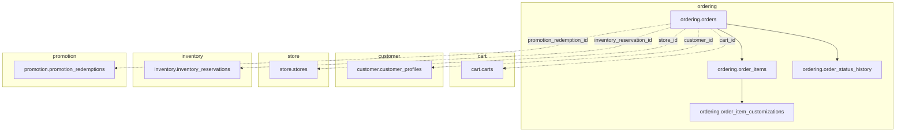
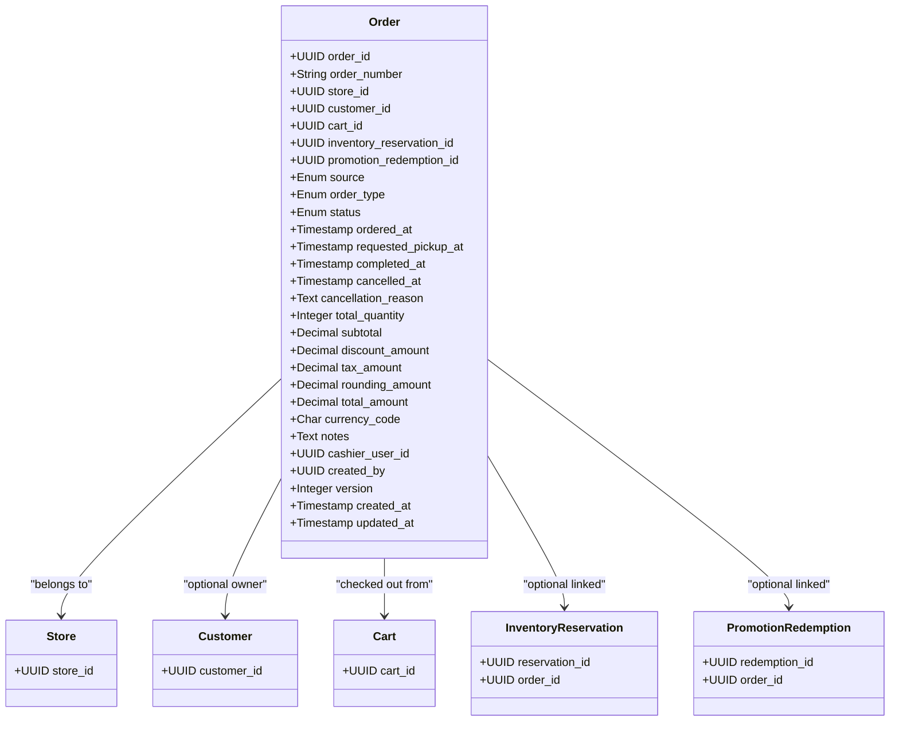
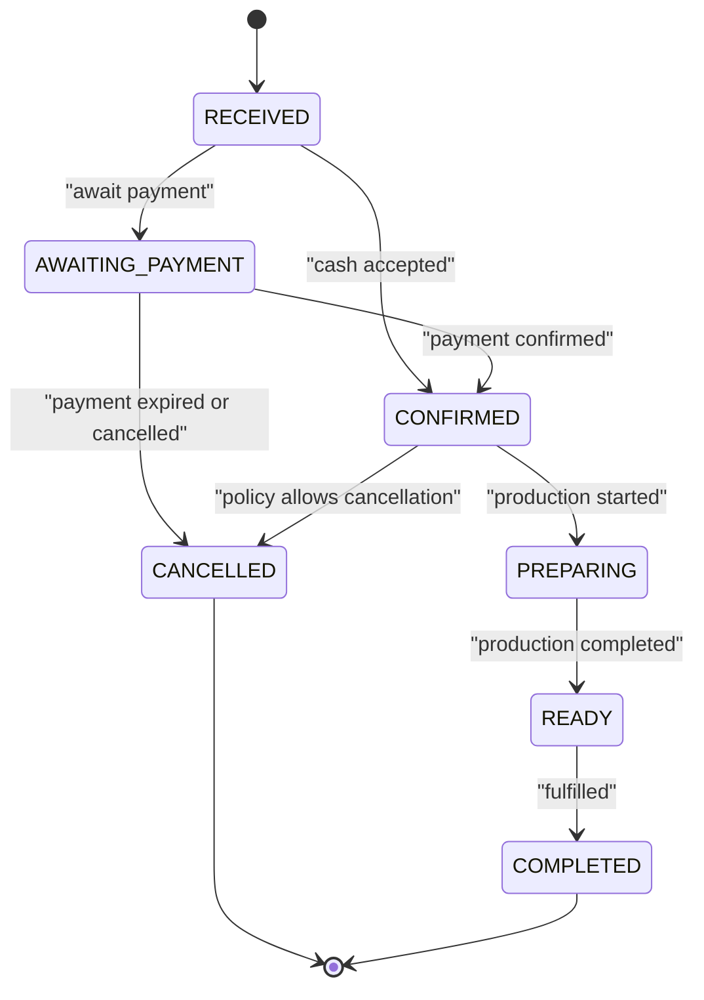
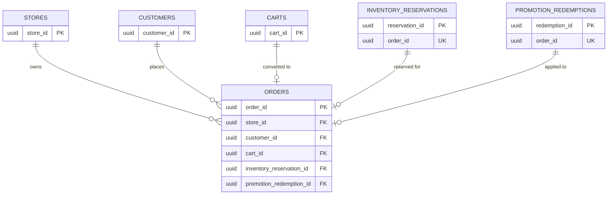
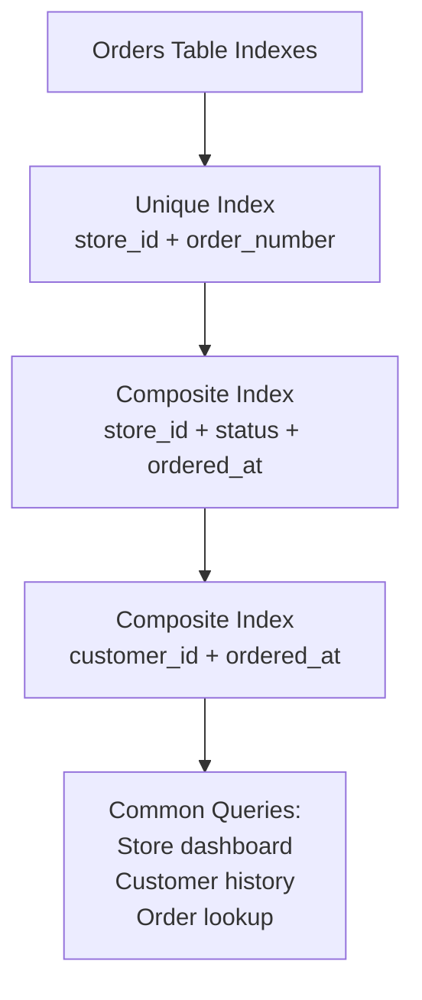
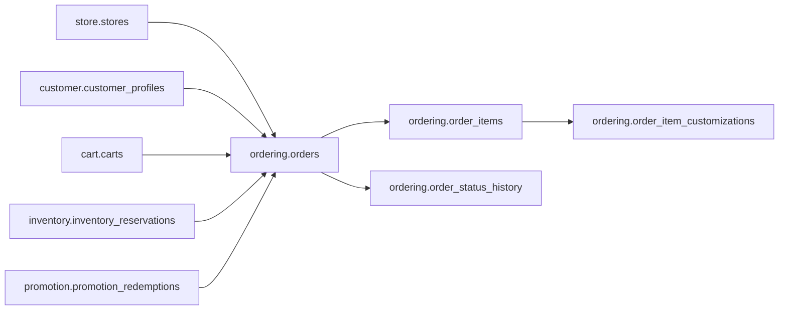

# Orders Table

<cite>
**Referenced Files in This Document**   
- [smart-coffee-logical.dbml](file://database/smart-coffee-logical.dbml)
- [V006__orders_checkout.sql](file://src/main/resources/db/migration/V006__orders_checkout.sql)
- [Order.java](file://src/main/java/com/smartcoffee/modules/ordering/domain/Order.java)
- [OrderStatus.java](file://src/main/java/com/smartcoffee/modules/ordering/domain/OrderStatus.java)
- [OrderSource.java](file://src/main/java/com/smartcoffee/modules/ordering/domain/OrderSource.java)
- [FulfillmentType.java](file://src/main/java/com/smartcoffee/modules/ordering/domain/FulfillmentType.java)
- [InventoryReservation.java](file://src/main/java/com/smartcoffee/modules/inventory/domain/InventoryReservation.java)
- [ORDER_PRODUCTION_PATCH.md](file://ORDER_PRODUCTION_PATCH.md)
- [ORDER_DOMAIN_PATCH.md](file://ORDER_DOMAIN_PATCH.md)
- [Download ARCHITECTURE_AUDIT.md](file://Download ARCHITECTURE_AUDIT.md)
</cite>

## Table of Contents
1. [Introduction](#introduction)
2. [Project Structure](#project-structure)
3. [Core Components](#core-components)
4. [Architecture Overview](#architecture-overview)
5. [Detailed Component Analysis](#detailed-component-analysis)
6. [Dependency Analysis](#dependency-analysis)
7. [Performance Considerations](#performance-considerations)
8. [Troubleshooting Guide](#troubleshooting-guide)
9. [Conclusion](#conclusion)

## Introduction
This document provides comprehensive data model documentation for the orders table used by the Smart Coffee backend. It explains every field, validation rules, business constraints, lifecycle states, transitions, and relationships with stores, customers, carts, inventory reservations, and promotions. It also documents indexing strategy and performance considerations based on the logical database model, migration scripts, domain entities, and architecture guidance.

The current repository contains two relevant order models:
- A newer logical model in the DBML file that includes fields such as `inventory_reservation_id`, `promotion_redemption_id`, `order_type`, `requested_pickup_at`, `completed_at`, `cancelled_at`, `cancellation_reason`, `notes`, `cashier_user_id`, and `created_by`.
- An older migration script that defines a simpler `ordering.orders` table with legacy fields like `fulfillment_type`, `payment_status`, and different status values.

The authoritative source for the requested fields is the DBML logical model; the migration script is included to explain historical differences and existing database constraints.

## Project Structure
The orders table belongs to the `ordering` schema and is part of the ordering module. Related tables include:
- `ordering.order_items`
- `ordering.order_item_customizations`
- `ordering.order_status_history`
- `cart.carts`
- `customer.customer_profiles`
- `store.stores`
- `inventory.inventory_reservations`
- `promotion.promotion_redemptions`

**Diagram sources**
- [smart-coffee-logical.dbml:386-416](file://database/smart-coffee-logical.dbml#L386-L416)
- [smart-coffee-logical.dbml:351-384](file://database/smart-coffee-logical.dbml#L351-L384)
- [smart-coffee-logical.dbml:136-151](file://database/smart-coffee-logical.dbml#L136-L151)
- [smart-coffee-logical.dbml:163-171](file://database/smart-coffee-logical.dbml#L163-L171)
- [smart-coffee-logical.dbml:618-636](file://database/smart-coffee-logical.dbml#L618-L636)
- [smart-coffee-logical.dbml:335-349](file://database/smart-coffee-logical.dbml#L335-L349)

**Section sources**
- [smart-coffee-logical.dbml:386-416](file://database/smart-coffee-logical.dbml#L386-L416)
- [V006__orders_checkout.sql:261-368](file://src/main/resources/db/migration/V006__orders_checkout.sql#L261-L368)

## Core Components
The orders table represents a finalized checkout snapshot of an order. It captures store context, customer context, cart linkage, fulfillment metadata, financial totals, timestamps, audit information, and references to related inventory and promotion records.

Key responsibilities:
- Store immutable order totals and quantities at checkout time.
- Track order lifecycle state through `status`.
- Record operational timestamps such as creation, pickup request, completion, and cancellation.
- Link to related entities such as cart, inventory reservation, and promotion redemption.
- Provide audit fields such as `version`, `created_by`, `created_at`, and `updated_at`.

Important note about field alignment:
- The DBML logical model includes the exact fields requested in the documentation objective.
- The Java `Order` entity maps to a slightly different legacy schema from the migration script, including `fulfillment_type`, `payment_status`, and missing fields such as `inventory_reservation_id`, `promotion_redemption_id`, `order_type`, `requested_pickup_at`, `completed_at`, `cancelled_at`, `cancellation_reason`, `notes`, `cashier_user_id`, and `created_by`.
- For this documentation, the DBML logical model is treated as the canonical definition for the requested fields.

**Section sources**
- [smart-coffee-logical.dbml:386-416](file://database/smart-coffee-logical.dbml#L386-L416)
- [Order.java:9-56](file://src/main/java/com/smartcoffee/modules/ordering/domain/Order.java#L9-L56)
- [V006__orders_checkout.sql:263-303](file://src/main/resources/db/migration/V006__orders_checkout.sql#L263-L303)

## Architecture Overview
The orders table sits at the center of the ordering workflow. It connects to:
- Stores: identifies the location fulfilling the order.
- Customers: optional link to a registered customer.
- Carts: one-to-one mapping from a checked-out cart to an order.
- Inventory reservations: optional reference to reserved ingredients.
- Promotion redemptions: optional reference to applied promotion discount.
- Order items and customizations: line-level details.
- Order status history: audit trail of state changes.

**Diagram sources**
- [smart-coffee-logical.dbml:386-416](file://database/smart-coffee-logical.dbml#L386-L416)
- [smart-coffee-logical.dbml:136-151](file://database/smart-coffee-logical.dbml#L136-L151)
- [smart-coffee-logical.dbml:163-171](file://database/smart-coffee-logical.dbml#L163-L171)
- [smart-coffee-logical.dbml:351-362](file://database/smart-coffee-logical.dbml#L351-L362)
- [smart-coffee-logical.dbml:618-628](file://database/smart-coffee-logical.dbml#L618-L628)
- [smart-coffee-logical.dbml:335-349](file://database/smart-coffee-logical.dbml#L335-L349)

## Detailed Component Analysis

### Orders Table Field Reference
| Field | Type / Constraint | Purpose | Validation Rules & Business Notes |
|---|---|---|---|
| `order_id` | UUID, primary key | Unique identifier for the order | Required; generated at creation. |
| `order_number` | VARCHAR(40), not null | Human-readable or system-generated order number | Must be unique per store scope according to index `(store_id, order_number)` uniqueness. |
| `store_id` | UUID, not null | Store responsible for the order | Required; links to `store.stores.store_id`. |
| `customer_id` | UUID, nullable | Customer who placed the order | Optional; links to `customer.customer_profiles.customer_id`. |
| `cart_id` | UUID, nullable | Original cart converted into the order | Optional; typically one-to-one with a checked-out cart. |
| `inventory_reservation_id` | UUID, nullable | Reservation of ingredients for the order | Optional; links to `inventory.inventory_reservations.reservation_id`. |
| `promotion_redemption_id` | UUID, nullable | Applied promotion redemption for the order | Optional; links to `promotion.promotion_redemptions.redemption_id`. |
| `source` | Enum `source_type`, not null | Channel where the order originated | Allowed values: `CUSTOMER_APP`, `CUSTOMER_WEB`, `POS`, `DASHBOARD`, `PARTNER`. |
| `order_type` | Enum `order_type`, not null | Fulfillment type for the order | Allowed values: `DINE_IN`, `TAKEAWAY`. |
| `status` | Enum `order_status`, not null, default `RECEIVED` | Current order lifecycle state | See lifecycle section below. |
| `ordered_at` | Timestamp, not null, default now() | Time when the order was created | Always set at creation. |
| `requested_pickup_at` | Timestamp, nullable | Desired pickup time | Optional; useful for pickup scheduling. |
| `completed_at` | Timestamp, nullable | Time when the order was fulfilled | Set when reaching terminal fulfillment state. |
| `cancelled_at` | Timestamp, nullable | Time when the order was cancelled | Set when transitioning to `CANCELLED`. |
| `cancellation_reason` | Text, nullable | Explanation for cancellation | Optional but recommended for auditability. |
| `total_quantity` | Integer, not null | Sum of item quantities | Must be greater than zero. |
| `subtotal` | Decimal(14,4), not null | Pre-discount, pre-tax total | Non-negative monetary value. |
| `discount_amount` | Decimal(14,4), not null, default 0 | Total discount applied | Non-negative monetary value. |
| `tax_amount` | Decimal(14,4), not null, default 0 | Tax amount applied | Non-negative monetary value. |
| `rounding_amount` | Decimal(14,4), not null, default 0 | Rounding adjustment | Non-negative monetary value. |
| `total_amount` | Decimal(14,4), not null | Final payable amount | Must equal `subtotal - discount_amount + tax_amount + rounding_amount`. |
| `currency_code` | CHAR(3), not null | Currency for monetary amounts | ISO-style three-letter currency code. |
| `notes` | VARCHAR(1000), nullable | Free-form order notes | Optional internal or customer-facing notes. |
| `cashier_user_id` | UUID, nullable | Staff member associated with the order | Optional; useful for POS or staff workflows. |
| `created_by` | UUID, nullable | Actor who created the order | Optional audit field. |
| `version` | Integer, not null, default 0 | Optimistic concurrency control | Incremented on updates. |
| `created_at` | Timestamp, not null, default now() | Audit timestamp | Automatically set at creation. |
| `updated_at` | Timestamp, not null, default now() | Audit timestamp | Updated on modifications. |

**Section sources**
- [smart-coffee-logical.dbml:386-416](file://database/smart-coffee-logical.dbml#L386-L416)
- [smart-coffee-logical.dbml:5-8](file://database/smart-coffee-logical.dbml#L5-L8)

### Order Lifecycle States and Transitions
The logical model defines the following order lifecycle states:
- `RECEIVED`
- `AWAITING_PAYMENT`
- `CONFIRMED`
- `PREPARING`
- `READY`
- `COMPLETED`
- `CANCELLED`

The architecture guidance recommends these allowed primary transitions:
- `RECEIVED -> AWAITING_PAYMENT`
- `RECEIVED -> CONFIRMED` (for cash accepted immediately)
- `AWAITING_PAYMENT -> CONFIRMED` (trusted payment confirmation)
- `AWAITING_PAYMENT -> CANCELLED` (payment window expired or customer cancels)
- `CONFIRMED -> PREPARING`
- `CONFIRMED -> CANCELLED` (only before preparation under policy)
- `PREPARING -> READY`
- `READY -> COMPLETED`

The Java domain entity currently implements some transitions explicitly:
- Creation sets status to `AWAITING_PAYMENT`.
- Payment completion moves from `AWAITING_PAYMENT` to `CONFIRMED`.
- Payment expiration moves from `AWAITING_PAYMENT` to `CANCELLED`.
- Production preparing moves from `CONFIRMED` to `PREPARING`.
- Production ready moves from `PREPARING` to `READY`.
- Cancellation blocks cancellation if already `COMPLETED` or `CANCELLED`.

Note: The current Java entity does not expose all logical model fields such as `inventory_reservation_id`, `promotion_redemption_id`, `order_type`, `requested_pickup_at`, `completed_at`, `cancelled_at`, `cancellation_reason`, `notes`, `cashier_user_id`, or `created_by`. These are present in the DBML logical model and should be reflected in the persistence layer when migrating to the canonical schema.

**Diagram sources**
- [Download ARCHITECTURE_AUDIT.md:521-550](file://Download ARCHITECTURE_AUDIT.md#L521-L550)
- [Order.java:66-94](file://src/main/java/com/smartcoffee/modules/ordering/domain/Order.java#L66-L94)
- [Order.java:174-286](file://src/main/java/com/smartcoffee/modules/ordering/domain/Order.java#L174-L286)

**Section sources**
- [smart-coffee-logical.dbml:6](file://database/smart-coffee-logical.dbml#L6)
- [OrderStatus.java:3-5](file://src/main/java/com/smartcoffee/modules/ordering/domain/OrderStatus.java#L3-L5)
- [Order.java:66-94](file://src/main/java/com/smartcoffee/modules/ordering/domain/Order.java#L66-L94)
- [Order.java:174-286](file://src/main/java/com/smartcoffee/modules/ordering/domain/Order.java#L174-L286)
- [ORDER_PRODUCTION_PATCH.md:1-6](file://ORDER_PRODUCTION_PATCH.md#L1-L6)
- [ORDER_DOMAIN_PATCH.md:1-23](file://ORDER_DOMAIN_PATCH.md#L1-L23)
- [Download ARCHITECTURE_AUDIT.md:521-550](file://Download ARCHITECTURE_AUDIT.md#L521-L550)

### Relationships with Stores, Customers, Carts, Inventory Reservations, and Promotions
- **Stores**: Every order belongs to exactly one store via `store_id`. This enforces multi-store isolation and enables store-scoped queries.
- **Customers**: Orders may optionally belong to a customer via `customer_id`. Guest orders can have a null customer.
- **Carts**: Orders are typically created from a cart via `cart_id`. The DBML shows `cart_id` as nullable, while the legacy migration marks it unique. In practice, a checked-out cart should map to one order.
- **Inventory Reservations**: Orders may reference an inventory reservation via `inventory_reservation_id`. The reservation entity itself has a unique `order_id`, establishing a one-to-one relationship between order and reservation.
- **Promotions**: Orders may reference a promotion redemption via `promotion_redemption_id`. The promotion redemption entity also has a unique `order_id`, ensuring one redemption per order.

**Diagram sources**
- [smart-coffee-logical.dbml:136-151](file://database/smart-coffee-logical.dbml#L136-L151)
- [smart-coffee-logical.dbml:163-171](file://database/smart-coffee-logical.dbml#L163-L171)
- [smart-coffee-logical.dbml:351-362](file://database/smart-coffee-logical.dbml#L351-L362)
- [smart-coffee-logical.dbml:386-416](file://database/smart-coffee-logical.dbml#L386-L416)
- [smart-coffee-logical.dbml:618-628](file://database/smart-coffee-logical.dbml#L618-L628)
- [smart-coffee-logical.dbml:335-349](file://database/smart-coffee-logical.dbml#L335-L349)

**Section sources**
- [smart-coffee-logical.dbml:386-416](file://database/smart-coffee-logical.dbml#L386-L416)
- [InventoryReservation.java:8-17](file://src/main/java/com/smartcoffee/modules/inventory/domain/InventoryReservation.java#L8-L17)

### Field Validation Rules and Business Constraints
- **Non-null fields**: `order_number`, `store_id`, `source`, `order_type`, `status`, `ordered_at`, `total_quantity`, `subtotal`, `discount_amount`, `tax_amount`, `rounding_amount`, `total_amount`, `currency_code`, `version`, `created_at`, `updated_at`.
- **Monetary non-negativity**: `subtotal`, `discount_amount`, `tax_amount`, `rounding_amount`, and `total_amount` must be non-negative.
- **Total consistency**: `total_amount` should equal `subtotal - discount_amount + tax_amount + rounding_amount`.
- **Quantity constraint**: `total_quantity` must be greater than zero.
- **Currency format**: `currency_code` should be a valid three-character currency code.
- **Enum constraints**: `source`, `order_type`, and `status` must use defined enum values.
- **Uniqueness**: `order_number` is unique per store due to the composite unique index `(store_id, order_number)`.
- **Audit integrity**: `version` supports optimistic locking; `created_by`, `created_at`, and `updated_at` support auditability.

Legacy migration constraints differ from the logical model:
- The migration uses `fulfillment_type` instead of `order_type`.
- The migration includes `payment_status` as a separate column.
- The migration’s status check excludes `RECEIVED`, which conflicts with the logical model’s default state.
- The migration does not define `inventory_reservation_id`, `promotion_redemption_id`, `requested_pickup_at`, `completed_at`, `cancelled_at`, `cancellation_reason`, `notes`, `cashier_user_id`, or `created_by`.

These differences indicate that the migration script is outdated relative to the DBML logical model.

**Section sources**
- [smart-coffee-logical.dbml:386-416](file://database/smart-coffee-logical.dbml#L386-L416)
- [V006__orders_checkout.sql:317-361](file://src/main/resources/db/migration/V006__orders_checkout.sql#L317-L361)

### Indexing Strategy for Performance Optimization
The DBML logical model defines the following indexes for the orders table:
- Unique composite index on `(store_id, order_number)`: ensures order numbers are unique per store and supports fast lookup by store and order number.
- Composite index on `(store_id, status, ordered_at)`: optimizes store-scoped queries filtered by status and time, such as dashboards showing recent orders by status.
- Composite index on `(customer_id, ordered_at)`: optimizes customer order history queries sorted by time.

Additional recommendations based on common query patterns:
- If querying by `inventory_reservation_id` or `promotion_redemption_id`, consider adding single-column indexes only if those columns are frequently used in WHERE clauses.
- If filtering by `cancelled_at` or `completed_at`, consider partial or composite indexes depending on reporting needs.
- Avoid over-indexing nullable foreign keys unless they are heavily queried.

**Diagram sources**
- [smart-coffee-logical.dbml:415](file://database/smart-coffee-logical.dbml#L415)

**Section sources**
- [smart-coffee-logical.dbml:415](file://database/smart-coffee-logical.dbml#L415)

## Dependency Analysis
The orders table depends on several other modules:
- **Store module**: Provides store context and isolation.
- **Customer module**: Links orders to customer profiles.
- **Cart module**: Converts carts into orders.
- **Inventory module**: Reserves ingredients for orders.
- **Promotion module**: Applies discounts through redemptions.
- **Ordering module**: Owns order lifecycle, items, customizations, and status history.

**Diagram sources**
- [smart-coffee-logical.dbml:136-151](file://database/smart-coffee-logical.dbml#L136-L151)
- [smart-coffee-logical.dbml:163-171](file://database/smart-coffee-logical.dbml#L163-L171)
- [smart-coffee-logical.dbml:351-384](file://database/smart-coffee-logical.dbml#L351-L384)
- [smart-coffee-logical.dbml:386-458](file://database/smart-coffee-logical.dbml#L386-L458)
- [smart-coffee-logical.dbml:618-636](file://database/smart-coffee-logical.dbml#L618-L636)
- [smart-coffee-logical.dbml:335-349](file://database/smart-coffee-logical.dbml#L335-L349)

**Section sources**
- [smart-coffee-logical.dbml:386-458](file://database/smart-coffee-logical.dbml#L386-L458)

## Performance Considerations
- Use the composite index `(store_id, status, ordered_at)` for store dashboards and production queues.
- Use `(customer_id, ordered_at)` for customer order history pagination.
- Use `(store_id, order_number)` for fast order lookup by store and order number.
- Keep monetary fields as fixed-point decimals to avoid floating-point precision issues.
- Prefer deterministic calculations for `total_amount` to ensure consistent reporting and reconciliation.
- Avoid unnecessary updates to reduce optimistic lock contention on `version`.
- Partitioning by `store_id` or `ordered_at` may be considered for very large datasets, but only after measuring query patterns.

[No sources needed since this section provides general guidance]

## Troubleshooting Guide
Common issues and resolutions:
- **State conflict errors**: Occur when attempting invalid transitions, such as cancelling a completed order or starting production on an unpaid order. Validate current `status` and `payment_status` before applying transitions.
- **Payment state conflicts**: Occur when payment completion or expiration is attempted outside `AWAITING_PAYMENT` with `PENDING` payment status. Ensure payment events are idempotent and only applied once.
- **Schema mismatch**: If application code expects fields like `inventory_reservation_id` or `promotion_redemption_id`, verify that the database schema matches the DBML logical model rather than the legacy migration.
- **Index performance**: Slow queries often indicate missing composite indexes. Review query filters and add indexes accordingly.

**Section sources**
- [Order.java:174-286](file://src/main/java/com/smartcoffee/modules/ordering/domain/Order.java#L174-L286)
- [V006__orders_checkout.sql:317-361](file://src/main/resources/db/migration/V006__orders_checkout.sql#L317-L361)

## Conclusion
The orders table is the central record for checkout and fulfillment in the Smart Coffee platform. The DBML logical model provides a robust, auditable schema with clear lifecycle states, monetary integrity, and meaningful relationships to stores, customers, carts, inventory reservations, and promotions. The legacy migration script differs significantly and should not be treated as the current canonical model.

For implementation:
- Align the JPA entity and database schema with the DBML logical model.
- Enforce lifecycle transitions through domain methods and database constraints.
- Maintain monetary consistency and audit fields.
- Optimize queries using the documented indexes and consider additional indexes based on actual query patterns.

[No sources needed since this section summarizes without analyzing specific files]