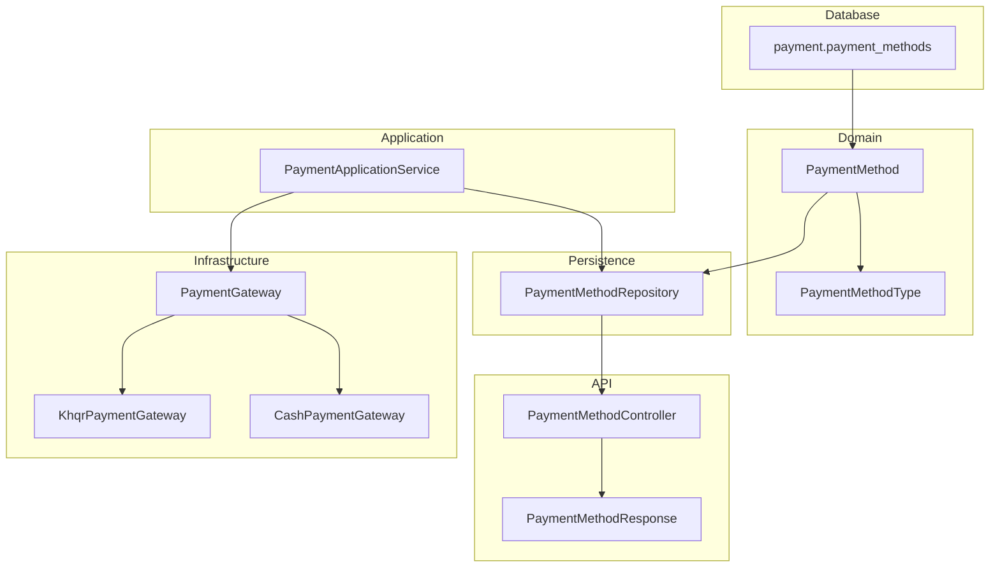
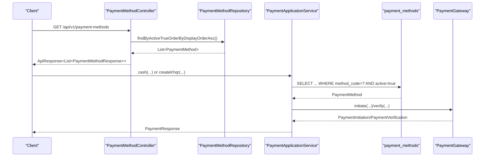
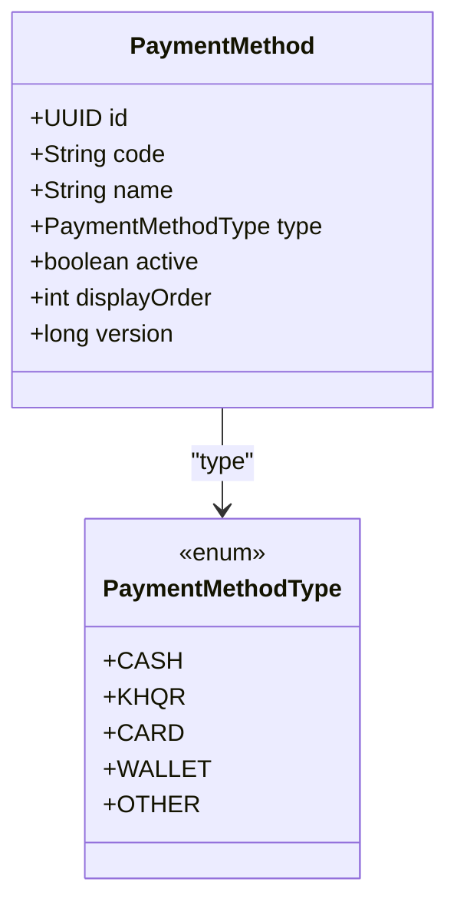
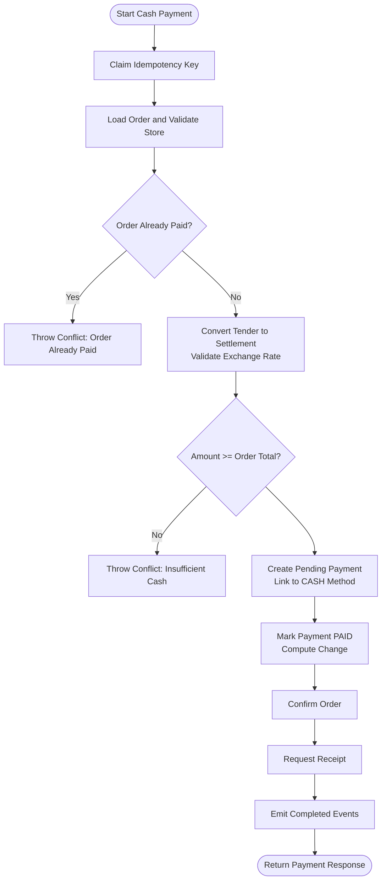
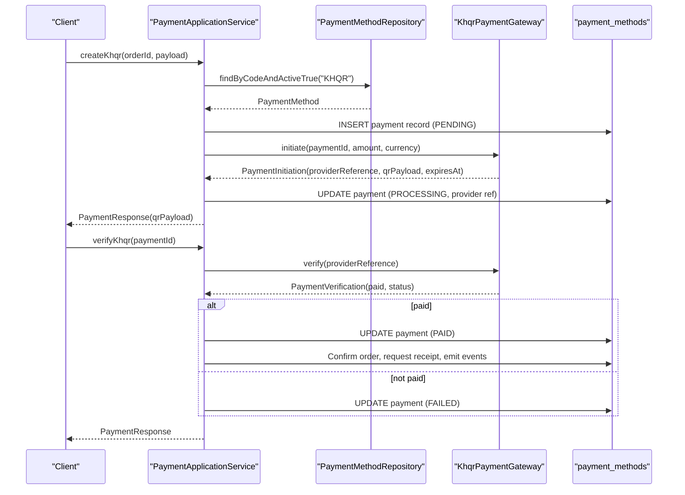
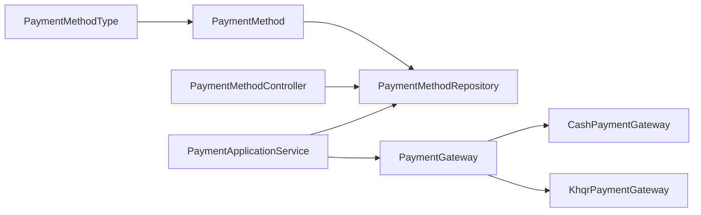

# Payment Methods Configuration

<cite>
**Referenced Files in This Document**
- [V007__payments_receipts.sql](file://src/main/resources/db/migration/V007__payments_receipts.sql)
- [smart-coffee-logical.dbml](file://database/smart-coffee-logical.dbml)
- [PaymentMethod.java](file://src/main/java/com/smartcoffee/modules/payment/domain/PaymentMethod.java)
- [PaymentMethodType.java](file://src/main/java/com/smartcoffee/modules/payment/domain/PaymentMethodType.java)
- [PaymentMethodRepository.java](file://src/main/java/com/smartcoffee/modules/payment/persistence/PaymentMethodRepository.java)
- [PaymentMethodController.java](file://src/main/java/com/smartcoffee/modules/payment/api/PaymentMethodController.java)
- [PaymentMethodResponse.java](file://src/main/java/com/smartcoffee/modules/payment/api/PaymentMethodResponse.java)
- [PaymentApplicationService.java](file://src/main/java/com/smartcoffee/modules/payment/application/PaymentApplicationService.java)
- [PaymentGateway.java](file://src/main/java/com/smartcoffee/infrastructure/payment/PaymentGateway.java)
- [CashPaymentGateway.java](file://src/main/java/com/smartcoffee/infrastructure/payment/CashPaymentGateway.java)
- [KhqrPaymentGateway.java](file://src/main/java/com/smartcoffee/infrastructure/payment/KhqrPaymentGateway.java)
</cite>

## Table of Contents
1. Introduction
2. Project Structure
3. Core Components
4. Architecture Overview
5. Detailed Component Analysis
6. Dependency Analysis
7. Performance Considerations
8. Troubleshooting Guide
9. Conclusion

## Introduction
This document explains the Payment Methods configuration schema and how payment methods are configured, validated, and used across the system. It focuses on the payment_methods table structure, supported method types (CASH, KHQR, CARD, WALLET, OTHER), currency handling, activation status, store-specific considerations, and integration patterns with external payment providers via a gateway abstraction.

## Project Structure
The payment method configuration spans database migrations, domain entities, repositories, API endpoints, and infrastructure gateways:
- Database layer defines the payment_methods table and constraints for method_type values.
- Domain layer models the entity and type enumeration.
- Repository provides queries to find active methods by code or list them in display order.
- API exposes listing of available payment methods.
- Application service validates and enforces business rules when processing payments using configured methods.
- Infrastructure gateways implement provider-specific logic for digital payments and cash.

**Diagram sources**
- [V007__payments_receipts.sql:3-20](file://src/main/resources/db/migration/V007__payments_receipts.sql#L3-L20)
- [PaymentMethod.java:6-24](file://src/main/java/com/smartcoffee/modules/payment/domain/PaymentMethod.java#L6-L24)
- [PaymentMethodType.java:3-5](file://src/main/java/com/smartcoffee/modules/payment/domain/PaymentMethodType.java#L3-L5)
- [PaymentMethodRepository.java:7-11](file://src/main/java/com/smartcoffee/modules/payment/persistence/PaymentMethodRepository.java#L7-L11)
- [PaymentMethodController.java:9-24](file://src/main/java/com/smartcoffee/modules/payment/api/PaymentMethodController.java#L9-L24)
- [PaymentMethodResponse.java:5-6](file://src/main/java/com/smartcoffee/modules/payment/api/PaymentMethodResponse.java#L5-L6)
- [PaymentApplicationService.java:20-46](file://src/main/java/com/smartcoffee/modules/payment/application/PaymentApplicationService.java#L20-L46)
- [PaymentGateway.java:1-5](file://src/main/java/com/smartcoffee/infrastructure/payment/PaymentGateway.java#L1-L5)
- [CashPaymentGateway.java:1-5](file://src/main/java/com/smartcoffee/infrastructure/payment/CashPaymentGateway.java#L1-L5)
- [KhqrPaymentGateway.java:1-9](file://src/main/java/com/smartcoffee/infrastructure/payment/KhqrPaymentGateway.java#L1-L9)

**Section sources**
- [V007__payments_receipts.sql:3-20](file://src/main/resources/db/migration/V007__payments_receipts.sql#L3-L20)
- [smart-coffee-logical.dbml:460-469](file://database/smart-coffee-logical.dbml#L460-L469)
- [PaymentMethod.java:6-24](file://src/main/java/com/smartcoffee/modules/payment/domain/PaymentMethod.java#L6-L24)
- [PaymentMethodType.java:3-5](file://src/main/java/com/smartcoffee/modules/payment/domain/PaymentMethodType.java#L3-L5)
- [PaymentMethodRepository.java:7-11](file://src/main/java/com/smartcoffee/modules/payment/persistence/PaymentMethodRepository.java#L7-L11)
- [PaymentMethodController.java:9-24](file://src/main/java/com/smartcoffee/modules/payment/api/PaymentMethodController.java#L9-L24)
- [PaymentMethodResponse.java:5-6](file://src/main/java/com/smartcoffee/modules/payment/api/PaymentMethodResponse.java#L5-L6)
- [PaymentApplicationService.java:20-46](file://src/main/java/com/smartcoffee/modules/payment/application/PaymentApplicationService.java#L20-L46)
- [PaymentGateway.java:1-5](file://src/main/java/com/smartcoffee/infrastructure/payment/PaymentGateway.java#L1-L5)
- [CashPaymentGateway.java:1-5](file://src/main/java/com/smartcoffee/infrastructure/payment/CashPaymentGateway.java#L1-L5)
- [KhqrPaymentGateway.java:1-9](file://src/main/java/com/smartcoffee/infrastructure/payment/KhqrPaymentGateway.java#L1-L9)

## Core Components
- payment_methods table: Defines unique method_code, human-readable method_name, method_type constrained to allowed values, and an active flag. The logical model also includes optional currency_code and audit timestamps.
- PaymentMethod entity: Maps to payment_methods with fields for id, code, name, type, active, display_order, and version.
- PaymentMethodType enum: Enumerates CASH, KHQR, CARD, WALLET, OTHER.
- PaymentMethodRepository: Provides lookup by code with active filter and listing of active methods ordered by display_order.
- PaymentMethodController: Exposes GET /api/v1/payment-methods returning active methods with code, name, and type.
- PaymentApplicationService: Enforces validation when creating payments, including ensuring the selected method is active and available, and orchestrating provider interactions through gateways.

Key behaviors:
- Method availability is enforced at runtime by requiring an active method with a matching code.
- Digital payments use a gateway pattern; cash payments are handled directly without external provider calls.
- Currency conversion is applied when tender currency differs from settlement currency, requiring a valid exchange rate.

**Section sources**
- [V007__payments_receipts.sql:3-20](file://src/main/resources/db/migration/V007__payments_receipts.sql#L3-L20)
- [smart-coffee-logical.dbml:460-469](file://database/smart-coffee-logical.dbml#L460-L469)
- [PaymentMethod.java:6-24](file://src/main/java/com/smartcoffee/modules/payment/domain/PaymentMethod.java#L6-L24)
- [PaymentMethodType.java:3-5](file://src/main/java/com/smartcoffee/modules/payment/domain/PaymentMethodType.java#L3-L5)
- [PaymentMethodRepository.java:7-11](file://src/main/java/com/smartcoffee/modules/payment/persistence/PaymentMethodRepository.java#L7-L11)
- [PaymentMethodController.java:18-24](file://src/main/java/com/smartcoffee/modules/payment/api/PaymentMethodController.java#L18-L24)
- [PaymentApplicationService.java:48-70](file://src/main/java/com/smartcoffee/modules/payment/application/PaymentApplicationService.java#L48-L70)
- [PaymentApplicationService.java:72-108](file://src/main/java/com/smartcoffee/modules/payment/application/PaymentApplicationService.java#L72-L108)
- [PaymentApplicationService.java:110-126](file://src/main/java/com/smartcoffee/modules/payment/application/PaymentApplicationService.java#L110-L126)

## Architecture Overview
The payment flow uses a layered architecture:
- API layer exposes endpoints to list payment methods and initiate/verify payments.
- Application layer validates inputs, ensures method availability, handles currency conversion, and coordinates with persistence and infrastructure.
- Persistence layer stores payment methods and related payment records.
- Infrastructure layer abstracts external providers via a common gateway interface; concrete implementations handle specific providers like cash and KHQR.

**Diagram sources**
- [PaymentMethodController.java:18-24](file://src/main/java/com/smartcoffee/modules/payment/api/PaymentMethodController.java#L18-L24)
- [PaymentMethodRepository.java:7-11](file://src/main/java/com/smartcoffee/modules/payment/persistence/PaymentMethodRepository.java#L7-L11)
- [PaymentApplicationService.java:48-70](file://src/main/java/com/smartcoffee/modules/payment/application/PaymentApplicationService.java#L48-L70)
- [PaymentApplicationService.java:72-108](file://src/main/java/com/smartcoffee/modules/payment/application/PaymentApplicationService.java#L72-L108)
- [PaymentGateway.java:1-5](file://src/main/java/com/smartcoffee/infrastructure/payment/PaymentGateway.java#L1-L5)

## Detailed Component Analysis

### Data Model: payment_methods
- Primary key: payment_method_id (UUID)
- method_code: unique identifier for the method (e.g., CASH, KHQR)
- method_name: human-readable label
- method_type: constrained to CASH, KHQR, CARD, WALLET, OTHER
- active: boolean flag controlling availability
- display_order: ordering for UI presentation
- version: optimistic concurrency control
- Optional currency_code and timestamps appear in the logical model

Validation rules enforced:
- method_type must be one of the allowed values via database constraint.
- At runtime, only active methods can be used for payments.

Multi-currency support:
- Logical model includes currency_code on payment_methods; application-level currency conversion is performed during payment processing when tender currency differs from settlement currency.

Store-specific configuration:
- Payments are tied to a store context; while payment_methods are global, usage is validated against the order’s store context during payment creation.

**Diagram sources**
- [PaymentMethod.java:6-24](file://src/main/java/com/smartcoffee/modules/payment/domain/PaymentMethod.java#L6-L24)
- [PaymentMethodType.java:3-5](file://src/main/java/com/smartcoffee/modules/payment/domain/PaymentMethodType.java#L3-L5)

**Section sources**
- [V007__payments_receipts.sql:3-20](file://src/main/resources/db/migration/V007__payments_receipts.sql#L3-L20)
- [smart-coffee-logical.dbml:460-469](file://database/smart-coffee-logical.dbml#L460-L469)
- [PaymentMethod.java:6-24](file://src/main/java/com/smartcoffee/modules/payment/domain/PaymentMethod.java#L6-L24)
- [PaymentMethodType.java:3-5](file://src/main/java/com/smartcoffee/modules/payment/domain/PaymentMethodType.java#L3-L5)

### API: Listing Available Payment Methods
- Endpoint: GET /api/v1/payment-methods
- Behavior: Returns all active payment methods sorted by display_order, exposing id, code, name, and type.

Use cases:
- Frontend renders available payment options based on this list.
- Clients can select a method code that matches an active entry.

**Section sources**
- [PaymentMethodController.java:9-24](file://src/main/java/com/smartcoffee/modules/payment/api/PaymentMethodController.java#L9-L24)
- [PaymentMethodResponse.java:5-6](file://src/main/java/com/smartcoffee/modules/payment/api/PaymentMethodResponse.java#L5-L6)
- [PaymentMethodRepository.java:7-11](file://src/main/java/com/smartcoffee/modules/payment/persistence/PaymentMethodRepository.java#L7-L11)

### Cash Payment Setup and Validation
- Flow:
  - Idempotency claim prevents duplicate submissions.
  - Order ownership and store match are validated.
  - Ensures order is not already paid.
  - Converts received amount to settlement currency if needed; requires a valid exchange rate when currencies differ.
  - Validates sufficient funds received.
  - Creates a pending payment linked to the CASH method, marks it paid immediately, confirms the order, requests receipt, and emits events.

**Diagram sources**
- [PaymentApplicationService.java:48-70](file://src/main/java/com/smartcoffee/modules/payment/application/PaymentApplicationService.java#L48-L70)
- [PaymentApplicationService.java:110-116](file://src/main/java/com/smartcoffee/modules/payment/application/PaymentApplicationService.java#L110-L116)

**Section sources**
- [PaymentApplicationService.java:48-70](file://src/main/java/com/smartcoffee/modules/payment/application/PaymentApplicationService.java#L48-L70)
- [PaymentApplicationService.java:110-116](file://src/main/java/com/smartcoffee/modules/payment/application/PaymentApplicationService.java#L110-L116)

### Digital Payment Provider Integration (KHQR Example)
- Flow:
  - Idempotency claim prevents duplicate initiation.
  - Order ownership and payment status checked.
  - Creates pending payment linked to KHQR method with expiry.
  - Initiates payment via KHQR gateway; stores provider reference and sets status to processing.
  - Verification polls the provider; on success, marks payment paid, confirms order, requests receipt, and emits events.

**Diagram sources**
- [PaymentApplicationService.java:72-108](file://src/main/java/com/smartcoffee/modules/payment/application/PaymentApplicationService.java#L72-L108)
- [PaymentGateway.java:1-5](file://src/main/java/com/smartcoffee/infrastructure/payment/PaymentGateway.java#L1-L5)
- [KhqrPaymentGateway.java:1-9](file://src/main/java/com/smartcoffee/infrastructure/payment/KhqrPaymentGateway.java#L1-L9)

**Section sources**
- [PaymentApplicationService.java:72-108](file://src/main/java/com/smartcoffee/modules/payment/application/PaymentApplicationService.java#L72-L108)
- [PaymentGateway.java:1-5](file://src/main/java/com/smartcoffee/infrastructure/payment/PaymentGateway.java#L1-L5)
- [KhqrPaymentGateway.java:1-9](file://src/main/java/com/smartcoffee/infrastructure/payment/KhqrPaymentGateway.java#L1-L9)

### Multi-Currency Support
- Settlement vs tender currency:
  - If tender equals settlement, no conversion is needed.
  - If different, a positive exchange rate must be provided; otherwise, validation fails.
- Conversion applies to cash payments where customers may pay in a different currency than the order’s settlement currency.

**Section sources**
- [PaymentApplicationService.java:110-116](file://src/main/java/com/smartcoffee/modules/payment/application/PaymentApplicationService.java#L110-L116)

### Store-Specific Configurations
- While payment_methods are global, payment creation validates that the order belongs to the specified store and prevents cross-store misuse.
- This ensures store isolation even when multiple stores share the same method definitions.

**Section sources**
- [PaymentApplicationService.java:48-70](file://src/main/java/com/smartcoffee/modules/payment/application/PaymentApplicationService.java#L48-L70)

## Dependency Analysis
- PaymentMethod depends on PaymentMethodType for value constraints.
- PaymentMethodRepository depends on JPA and maps to payment_methods.
- PaymentMethodController depends on PaymentMethodRepository to list active methods.
- PaymentApplicationService depends on PaymentMethodRepository and PaymentGateway implementations to enforce availability and orchestrate payments.
- Gateway implementations depend on Spring profiles and provide provider-specific behavior.

**Diagram sources**
- [PaymentMethodType.java:3-5](file://src/main/java/com/smartcoffee/modules/payment/domain/PaymentMethodType.java#L3-L5)
- [PaymentMethod.java:6-24](file://src/main/java/com/smartcoffee/modules/payment/domain/PaymentMethod.java#L6-L24)
- [PaymentMethodRepository.java:7-11](file://src/main/java/com/smartcoffee/modules/payment/persistence/PaymentMethodRepository.java#L7-L11)
- [PaymentMethodController.java:9-24](file://src/main/java/com/smartcoffee/modules/payment/api/PaymentMethodController.java#L9-L24)
- [PaymentApplicationService.java:20-46](file://src/main/java/com/smartcoffee/modules/payment/application/PaymentApplicationService.java#L20-L46)
- [PaymentGateway.java:1-5](file://src/main/java/com/smartcoffee/infrastructure/payment/PaymentGateway.java#L1-L5)
- [CashPaymentGateway.java:1-5](file://src/main/java/com/smartcoffee/infrastructure/payment/CashPaymentGateway.java#L1-L5)
- [KhqrPaymentGateway.java:1-9](file://src/main/java/com/smartcoffee/infrastructure/payment/KhqrPaymentGateway.java#L1-L9)

**Section sources**
- [PaymentMethodType.java:3-5](file://src/main/java/com/smartcoffee/modules/payment/domain/PaymentMethodType.java#L3-L5)
- [PaymentMethod.java:6-24](file://src/main/java/com/smartcoffee/modules/payment/domain/PaymentMethod.java#L6-L24)
- [PaymentMethodRepository.java:7-11](file://src/main/java/com/smartcoffee/modules/payment/persistence/PaymentMethodRepository.java#L7-L11)
- [PaymentMethodController.java:9-24](file://src/main/java/com/smartcoffee/modules/payment/api/PaymentMethodController.java#L9-L24)
- [PaymentApplicationService.java:20-46](file://src/main/java/com/smartcoffee/modules/payment/application/PaymentApplicationService.java#L20-L46)
- [PaymentGateway.java:1-5](file://src/main/java/com/smartcoffee/infrastructure/payment/PaymentGateway.java#L1-L5)
- [CashPaymentGateway.java:1-5](file://src/main/java/com/smartcoffee/infrastructure/payment/CashPaymentGateway.java#L1-L5)
- [KhqrPaymentGateway.java:1-9](file://src/main/java/com/smartcoffee/infrastructure/payment/KhqrPaymentGateway.java#L1-L9)

## Performance Considerations
- Use active-only queries to minimize result sets and avoid unnecessary filtering in clients.
- Leverage repository methods that sort by display_order to reduce client-side sorting overhead.
- Ensure proper indexing on frequently queried columns (method_code, active) as defined by the migration and logical model.
- For digital payments, keep provider calls asynchronous where possible and use idempotency keys to prevent retries from causing duplicate work.

[No sources needed since this section provides general guidance]

## Troubleshooting Guide
Common issues and resolutions:
- Payment method unavailable: Occurs when attempting to use a method code that is either inactive or missing. Ensure the method exists and is active before initiating payments.
- Order already paid: Attempting to process a payment for an order that has reached PAID status will fail. Check order state before retrying.
- Insufficient cash received: Cash payments require received amount to meet or exceed the order total after conversion. Verify amounts and exchange rates.
- Exchange rate required: When tender currency differs from settlement currency, a positive exchange rate must be provided.
- Gateway unavailable: If no implementation of PaymentGateway matches the requested method code, initialization will fail. Ensure appropriate profiles and components are enabled.

**Section sources**
- [PaymentApplicationService.java:48-70](file://src/main/java/com/smartcoffee/modules/payment/application/PaymentApplicationService.java#L48-L70)
- [PaymentApplicationService.java:72-108](file://src/main/java/com/smartcoffee/modules/payment/application/PaymentApplicationService.java#L72-L108)
- [PaymentApplicationService.java:110-126](file://src/main/java/com/smartcoffee/modules/payment/application/PaymentApplicationService.java#L110-L126)

## Conclusion
The payment_methods table provides a robust foundation for configuring supported payment methods with strict type constraints and activation controls. The system enforces method availability at runtime, supports multi-currency conversions, and integrates with external providers through a clean gateway abstraction. Cash payments are processed internally, while digital payments follow a provider-driven flow with idempotency and event emission for downstream systems. Proper configuration of active methods and correct currency handling ensures reliable and consistent payment experiences across stores.

[No sources needed since this section summarizes without analyzing specific files]