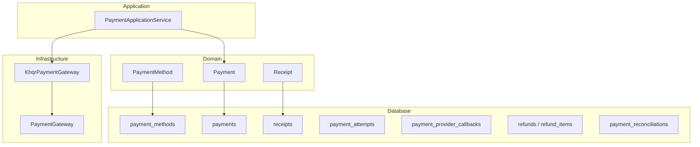
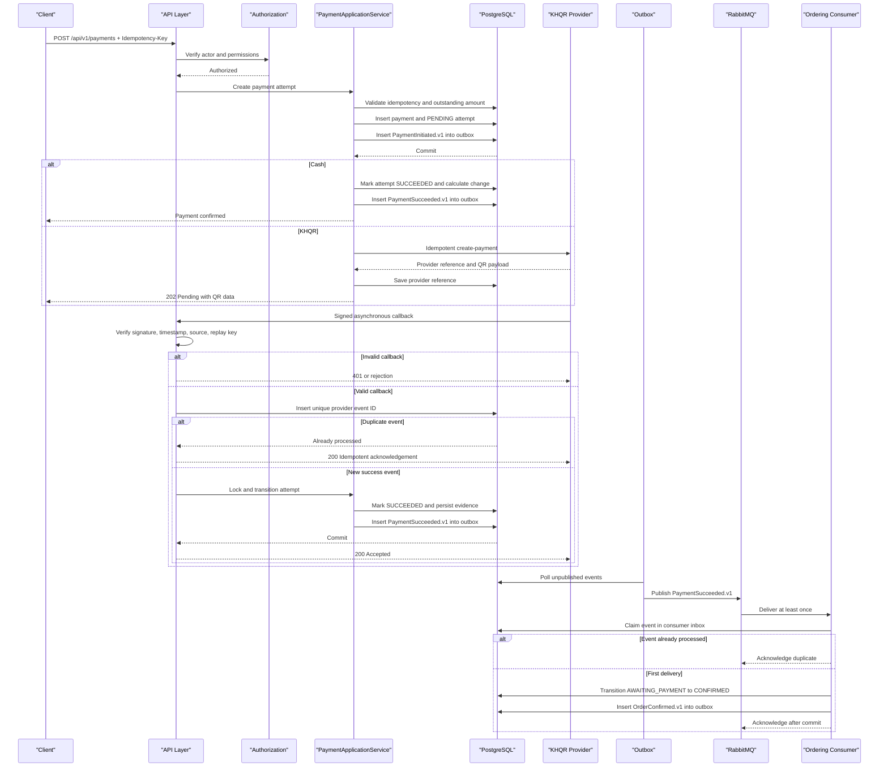
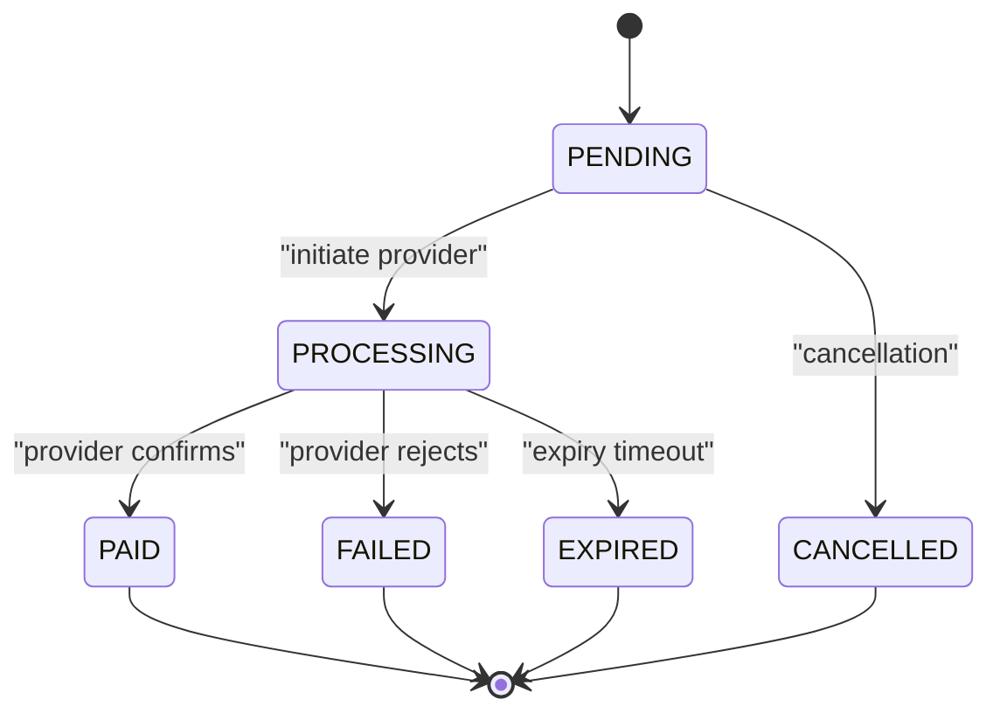
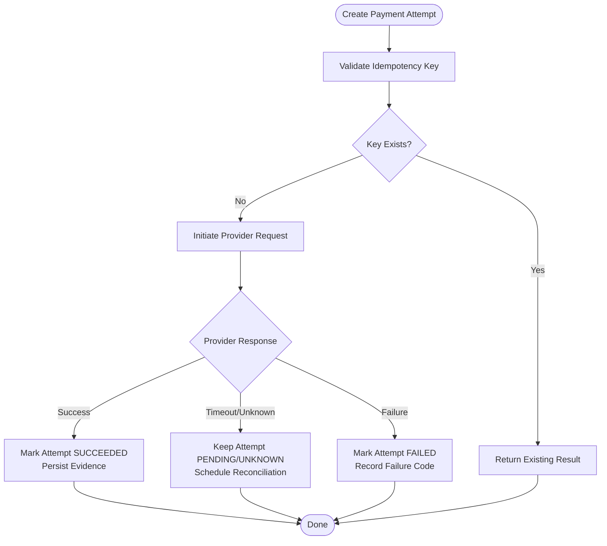
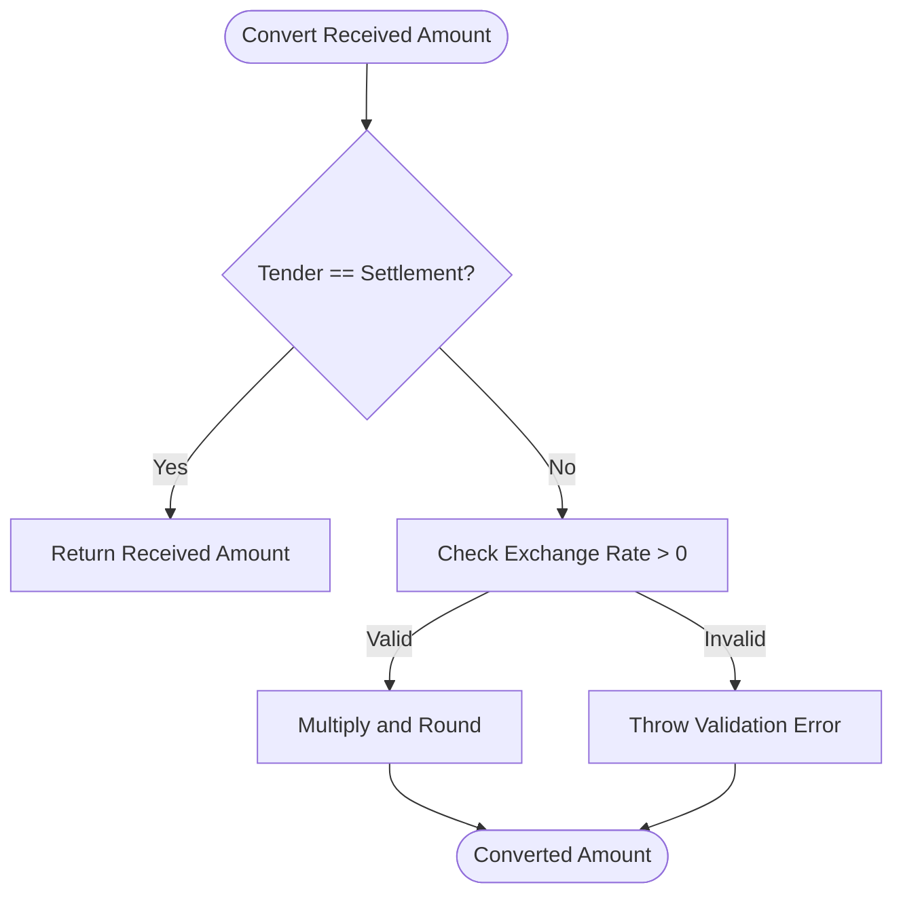
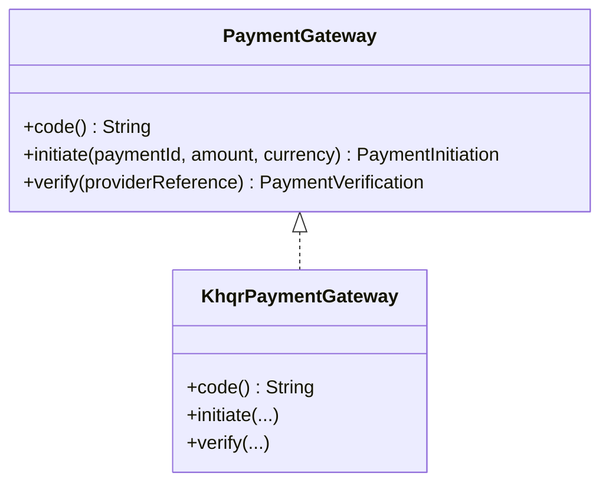
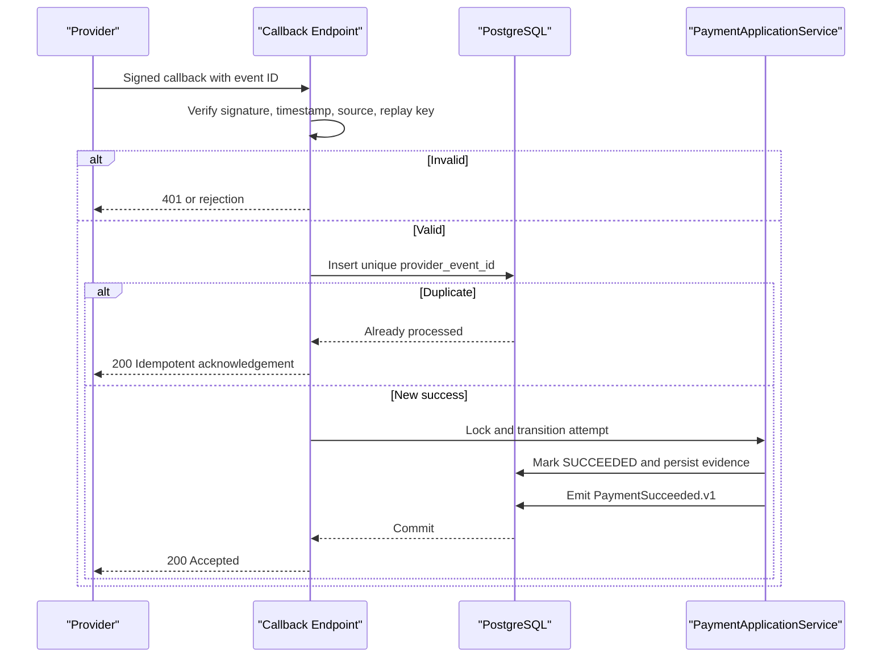
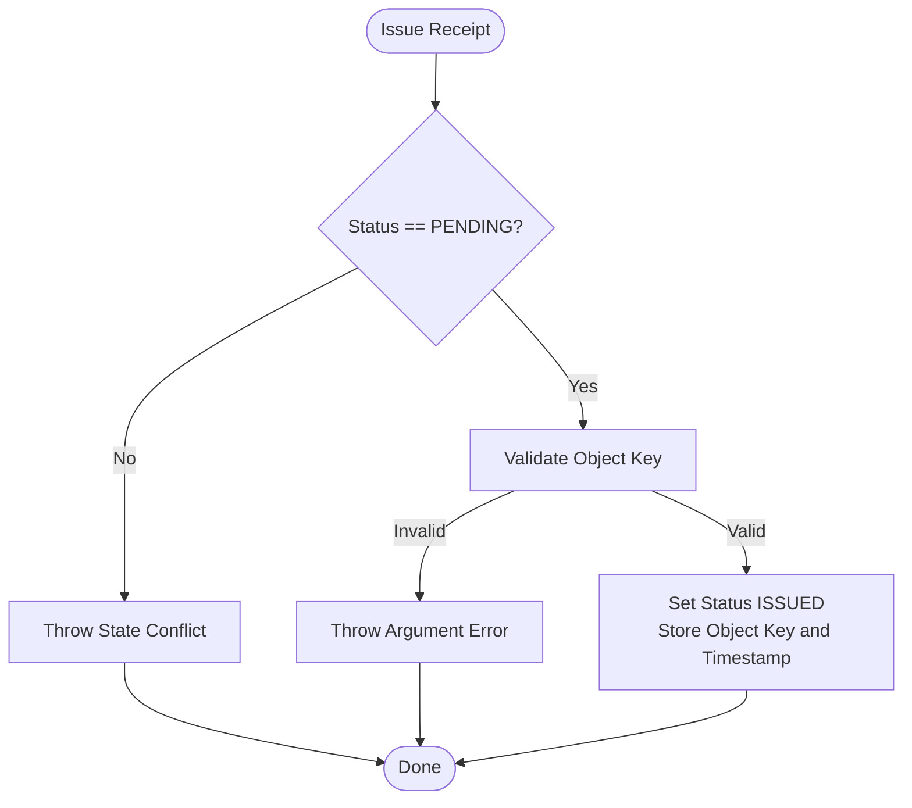
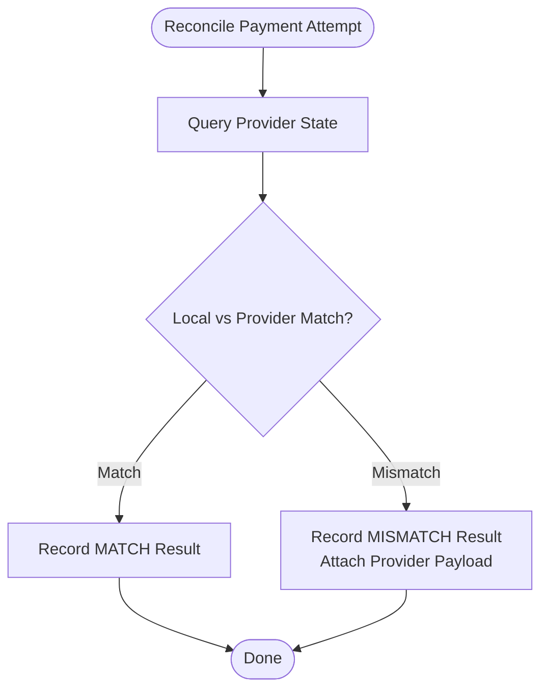
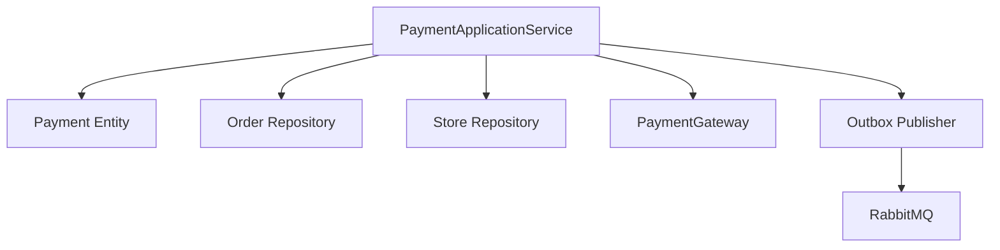

# Payment Processing Schema

<cite>
**Referenced Files in This Document**
- [Payment.java](file://src/main/java/com/smartcoffee/modules/payment/domain/Payment.java)
- [PaymentStatus.java](file://src/main/java/com/smartcoffee/modules/payment/domain/PaymentStatus.java)
- [PaymentMethod.java](file://src/main/java/com/smartcoffee/modules/payment/domain/PaymentMethod.java)
- [PaymentMethodType.java](file://src/main/java/com/smartcoffee/modules/payment/domain/PaymentMethodType.java)
- [Receipt.java](file://src/main/java/com/smartcoffee/modules/payment/domain/Receipt.java)
- [ReceiptStatus.java](file://src/main/java/com/smartcoffee/modules/payment/domain/ReceiptStatus.java)
- [PaymentGateway.java](file://src/main/java/com/smartcoffee/infrastructure/payment/PaymentGateway.java)
- [KhqrPaymentGateway.java](file://src/main/java/com/smartcoffee/infrastructure/payment/KhqrPaymentGateway.java)
- [PaymentApplicationService.java](file://src/main/java/com/smartcoffee/modules/payment/application/PaymentApplicationService.java)
- [V007__payments_receipts.sql](file://src/main/resources/db/migration/V007__payments_receipts.sql)
- [smart-coffee-logical.dbml](file://database/smart-coffee-logical.dbml)
- [PAYMENT_FLOW.mermaid](file://architecture/PAYMENT_FLOW.mermaid)
</cite>

## Table of Contents
1. [Introduction](#introduction)
2. [Project Structure](#project-structure)
3. [Core Components](#core-components)
4. [Architecture Overview](#architecture-overview)
5. [Detailed Component Analysis](#detailed-component-analysis)
6. [Dependency Analysis](#dependency-analysis)
7. [Performance Considerations](#performance-considerations)
8. [Troubleshooting Guide](#troubleshooting-guide)
9. [Conclusion](#conclusion)

## Introduction
This document defines the payment processing data model and operational behavior for the Smart Coffee backend. It covers:
- Payment methods, payments, payment attempts, refunds, receipts, and reconciliation tables
- The payment state machine with PENDING, PROCESSING, PAID, FAILED, EXPIRED, and CANCELLED states
- Attempt tracking, provider integration patterns, signature verification, and callback handling
- Amount tracking, currency conversion, exchange rates, and idempotency keys
- Security, audit trails, and reconciliation processes

The schema is implemented across JPA entities, database migrations, logical DBML definitions, and application services that coordinate with external payment providers.

## Project Structure
The payment domain spans several layers:
- Domain models define core entities and state transitions
- Database migrations and logical DBML define persistent structures and constraints
- Application services orchestrate payment workflows and provider interactions
- Infrastructure gateways abstract provider-specific integrations

**Diagram sources**
- [PaymentMethod.java:6-24](file://src/main/java/com/smartcoffee/modules/payment/domain/PaymentMethod.java#L6-L24)
- [Payment.java:9-51](file://src/main/java/com/smartcoffee/modules/payment/domain/Payment.java#L9-L51)
- [Receipt.java:16-57](file://src/main/java/com/smartcoffee/modules/payment/domain/Receipt.java#L16-L57)
- [smart-coffee-logical.dbml:460-567](file://database/smart-coffee-logical.dbml#L460-L567)
- [PaymentApplicationService.java:89-116](file://src/main/java/com/smartcoffee/modules/payment/application/PaymentApplicationService.java#L89-L116)
- [PaymentGateway.java:1-5](file://src/main/java/com/smartcoffee/infrastructure/payment/PaymentGateway.java#L1-L5)
- [KhqrPaymentGateway.java:1-9](file://src/main/java/com/smartcoffee/infrastructure/payment/KhqrPaymentGateway.java#L1-L9)

**Section sources**
- [PaymentMethod.java:1-50](file://src/main/java/com/smartcoffee/modules/payment/domain/PaymentMethod.java#L1-L50)
- [Payment.java:1-166](file://src/main/java/com/smartcoffee/modules/payment/domain/Payment.java#L1-L166)
- [Receipt.java:1-183](file://src/main/java/com/smartcoffee/modules/payment/domain/Receipt.java#L1-L183)
- [smart-coffee-logical.dbml:460-567](file://database/smart-coffee-logical.dbml#L460-L567)
- [PaymentApplicationService.java:89-116](file://src/main/java/com/smartcoffee/modules/payment/application/PaymentApplicationService.java#L89-L116)
- [PaymentGateway.java:1-5](file://src/main/java/com/smartcoffee/infrastructure/payment/PaymentGateway.java#L1-L5)
- [KhqrPaymentGateway.java:1-9](file://src/main/java/com/smartcoffee/infrastructure/payment/KhqrPaymentGateway.java#L1-L9)

## Core Components
This section documents the primary data entities and their responsibilities.

### Payment Methods
- Purpose: Define supported payment channels such as cash, KHQR, card, wallet, and other types.
- Key fields: method code, name, type, active flag, display order.
- Constraints: Method type must be one of the allowed values; unique method code.

**Section sources**
- [PaymentMethod.java:6-24](file://src/main/java/com/smartcoffee/modules/payment/domain/PaymentMethod.java#L6-L24)
- [PaymentMethodType.java:3-5](file://src/main/java/com/smartcoffee/modules/payment/domain/PaymentMethodType.java#L3-L5)
- [V007__payments_receipts.sql:3-20](file://src/main/resources/db/migration/V007__payments_receipts.sql#L3-L20)
- [smart-coffee-logical.dbml:460-469](file://database/smart-coffee-logical.dbml#L460-L469)

### Payments
- Purpose: Represent a payment lifecycle tied to an order and store, including amounts, currencies, provider references, and timestamps.
- Key fields: reference, order ID, store ID, method ID, status, currency, amount, amount received, change amount, provider details, failure code, expiry and event timestamps, version.
- State machine: PENDING → PROCESSING → PAID or FAILED or EXPIRED or CANCELLED.
- Constraints: Non-negative amounts; non-negative received/change when present; unique provider reference per provider; index on order_id and created_at; partial unique index ensuring only one paid payment per order.

**Section sources**
- [Payment.java:9-51](file://src/main/java/com/smartcoffee/modules/payment/domain/Payment.java#L9-L51)
- [PaymentStatus.java:3-5](file://src/main/java/com/smartcoffee/modules/payment/domain/PaymentStatus.java#L3-L5)
- [V007__payments_receipts.sql:22-78](file://src/main/resources/db/migration/V007__payments_receipts.sql#L22-L78)

### Receipts
- Purpose: Capture receipt issuance evidence linked to a payment and order, including JSON snapshot and object storage key.
- Key fields: receipt number, payment ID (unique), order ID, store ID, status, JSONB snapshot, object key, issued timestamp, version.
- State machine: PENDING → ISSUED or FAILED.
- Constraints: Unique receipt number; unique payment link; status restricted to allowed values.

**Section sources**
- [Receipt.java:16-57](file://src/main/java/com/smartcoffee/modules/payment/domain/Receipt.java#L16-L57)
- [ReceiptStatus.java:3-5](file://src/main/java/com/smartcoffee/modules/payment/domain/ReceiptStatus.java#L3-L5)
- [V007__payments_receipts.sql:80-95](file://src/main/resources/db/migration/V007__payments_receipts.sql#L80-L95)

### Payment Attempts
- Purpose: Track each attempt to settle a payment, including tender vs settlement currency, exchange rate, provider linkage, idempotency key, and outcome.
- Key fields: payment ID, method ID, attempt number, status, amount, settlement currency, tender currency, exchange rate, amount received, change amount, provider code/reference, idempotency key, failure details, processed timestamp.
- Indexes: Unique per payment and attempt number; unique provider reference pair; supports reconciliation and deduplication.

**Section sources**
- [smart-coffee-logical.dbml:486-507](file://database/smart-coffee-logical.dbml#L486-L507)

### Provider Callbacks
- Purpose: Persist provider callbacks with signature validation results and payloads for auditability and replay safety.
- Key fields: provider code, provider event ID, optional payment attempt ID, signature_valid, JSONB payload, received and processed timestamps, processing error.
- Indexes: Unique by provider event ID per provider.

**Section sources**
- [smart-coffee-logical.dbml:509-520](file://database/smart-coffee-logical.dbml#L509-L520)

### Refunds and Refund Items
- Purpose: Model refund requests and line-level breakdowns.
- Key fields: refund reference, payment ID, status, amount, currency, reason, idempotency key, provider reference, requester, timestamps, version.
- Refund items: Link to order items with quantity and amount.

**Section sources**
- [smart-coffee-logical.dbml:522-544](file://database/smart-coffee-logical.dbml#L522-L544)

### Reconciliations
- Purpose: Record reconciliation checks against provider state, capturing provider status, result, and payload.
- Key fields: payment attempt ID, provider status, result, JSONB provider payload, checked timestamp.

**Section sources**
- [smart-coffee-logical.dbml:546-554](file://database/smart-coffee-logical.dbml#L546-L554)

## Architecture Overview
The payment flow integrates client requests, authorization, payment orchestration, provider calls, outbox events, and downstream consumers.

**Diagram sources**
- [PAYMENT_FLOW.mermaid:1-72](file://architecture/PAYMENT_FLOW.mermaid#L1-L72)

## Detailed Component Analysis

### Payment State Machine
The Payment entity enforces a strict state machine through domain methods:
- PENDING: Initial state upon creation.
- PROCESSING: When interacting with a provider.
- PAID: Successful settlement; records amount received and change.
- FAILED: Explicit failure with a failure code.
- EXPIRED: Expired without completion.
- CANCELLED: Cancelled externally or by policy.

**Diagram sources**
- [Payment.java:56-105](file://src/main/java/com/smartcoffee/modules/payment/domain/Payment.java#L56-L105)
- [PaymentStatus.java:3-5](file://src/main/java/com/smartcoffee/modules/payment/domain/PaymentStatus.java#L3-L5)

**Section sources**
- [Payment.java:56-105](file://src/main/java/com/smartcoffee/modules/payment/domain/Payment.java#L56-L105)

### Payment Attempts and Idempotency
- Each attempt captures:
  - Settlement vs tender currency and exchange rate
  - Amount received and change
  - Provider code and reference
  - Unique idempotency key to prevent duplicate charges
  - Failure codes and messages
- Indexes ensure uniqueness per payment attempt number and per provider reference pair.

**Diagram sources**
- [smart-coffee-logical.dbml:486-507](file://database/smart-coffee-logical.dbml#L486-L507)

**Section sources**
- [smart-coffee-logical.dbml:486-507](file://database/smart-coffee-logical.dbml#L486-L507)

### Currency Conversion and Exchange Rates
- Tender currency may differ from settlement currency.
- Exchange rate is stored per attempt to preserve historical conversion accuracy.
- Conversion logic validates positive rates and applies rounding rules.

**Diagram sources**
- [PaymentApplicationService.java:110-116](file://src/main/java/com/smartcoffee/modules/payment/application/PaymentApplicationService.java#L110-L116)
- [smart-coffee-logical.dbml:493-495](file://database/smart-coffee-logical.dbml#L493-L495)

**Section sources**
- [PaymentApplicationService.java:110-116](file://src/main/java/com/smartcoffee/modules/payment/application/PaymentApplicationService.java#L110-L116)
- [smart-coffee-logical.dbml:493-495](file://database/smart-coffee-logical.dbml#L493-L495)

### Provider Integration Patterns
- Gateway interface abstracts provider initiation and verification.
- KHQR gateway placeholder demonstrates profile-based implementation strategy.
- Application service coordinates provider calls, state transitions, and event emission.

**Diagram sources**
- [PaymentGateway.java:1-5](file://src/main/java/com/smartcoffee/infrastructure/payment/PaymentGateway.java#L1-L5)
- [KhqrPaymentGateway.java:1-9](file://src/main/java/com/smartcoffee/infrastructure/payment/KhqrPaymentGateway.java#L1-L9)

**Section sources**
- [PaymentGateway.java:1-5](file://src/main/java/com/smartcoffee/infrastructure/payment/PaymentGateway.java#L1-L5)
- [KhqrPaymentGateway.java:1-9](file://src/main/java/com/smartcoffee/infrastructure/payment/KhqrPaymentGateway.java#L1-L9)
- [PaymentApplicationService.java:89-116](file://src/main/java/com/smartcoffee/modules/payment/application/PaymentApplicationService.java#L89-L116)

### Signature Verification and Callback Handling
- Callbacks are persisted with signature validity flags and full payloads.
- Unique provider event IDs prevent duplicate processing.
- Invalid callbacks are rejected; valid ones transition attempts and emit events.

**Diagram sources**
- [PAYMENT_FLOW.mermaid:41-57](file://architecture/PAYMENT_FLOW.mermaid#L41-L57)
- [smart-coffee-logical.dbml:509-520](file://database/smart-coffee-logical.dbml#L509-L520)

**Section sources**
- [PAYMENT_FLOW.mermaid:41-57](file://architecture/PAYMENT_FLOW.mermaid#L41-L57)
- [smart-coffee-logical.dbml:509-520](file://database/smart-coffee-logical.dbml#L509-L520)

### Receipt Issuance
- Receipts capture a JSON snapshot of the final payment context and can be issued to object storage.
- Only pending receipts can be issued or marked failed; idempotent issuance allows safe retries.

**Diagram sources**
- [Receipt.java:146-166](file://src/main/java/com/smartcoffee/modules/payment/domain/Receipt.java#L146-L166)

**Section sources**
- [Receipt.java:146-166](file://src/main/java/com/smartcoffee/modules/payment/domain/Receipt.java#L146-L166)

### Refunds and Reconciliation
- Refunds include idempotency keys and provider references to ensure safe retry semantics.
- Reconciliation records capture provider status and results for auditability and dispute resolution.

**Diagram sources**
- [smart-coffee-logical.dbml:546-554](file://database/smart-coffee-logical.dbml#L546-L554)

**Section sources**
- [smart-coffee-logical.dbml:522-554](file://database/smart-coffee-logical.dbml#L522-L554)

## Dependency Analysis
The payment module depends on:
- Ordering module for order ownership and confirmation
- Organization module for store context
- Infrastructure gateways for provider communication
- Messaging infrastructure for outbox and event publishing

**Diagram sources**
- [PaymentApplicationService.java:89-116](file://src/main/java/com/smartcoffee/modules/payment/application/PaymentApplicationService.java#L89-L116)
- [Payment.java:17-22](file://src/main/java/com/smartcoffee/modules/payment/domain/Payment.java#L17-L22)
- [PaymentGateway.java:1-5](file://src/main/java/com/smartcoffee/infrastructure/payment/PaymentGateway.java#L1-L5)

**Section sources**
- [PaymentApplicationService.java:89-116](file://src/main/java/com/smartcoffee/modules/payment/application/PaymentApplicationService.java#L89-L116)
- [Payment.java:17-22](file://src/main/java/com/smartcoffee/modules/payment/domain/Payment.java#L17-L22)
- [PaymentGateway.java:1-5](file://src/main/java/com/smartcoffee/infrastructure/payment/PaymentGateway.java#L1-L5)

## Performance Considerations
- Use unique indexes on provider references and attempt numbers to avoid contention and enable fast lookups.
- Partial unique index on paid payments per order prevents multiple settlements.
- Expiry indexes optimize cleanup of stale pending/processing payments.
- JSONB snapshots in receipts allow flexible payload evolution without schema changes.
- Versioned entities support optimistic concurrency control to reduce lock contention.

[No sources needed since this section provides general guidance]

## Troubleshooting Guide
Common issues and resolutions:
- Duplicate provider callbacks: Ensure provider_event_id uniqueness; return idempotent acknowledgements.
- Failed signature verification: Validate cryptographic signatures, timestamps, and source IPs; reject invalid callbacks.
- Stale pending payments: Implement scheduled jobs to expire or reconcile based on expires_at and status.
- Currency mismatch: Validate exchange rates and tender/settlement currency alignment before conversion.
- Receipt issuance conflicts: Enforce pending-only issuance and validate object keys.

**Section sources**
- [smart-coffee-logical.dbml:509-520](file://database/smart-coffee-logical.dbml#L509-L520)
- [V007__payments_receipts.sql:63-78](file://src/main/resources/db/migration/V007__payments_receipts.sql#L63-L78)
- [Receipt.java:146-166](file://src/main/java/com/smartcoffee/modules/payment/domain/Receipt.java#L146-L166)

## Conclusion
The payment processing schema provides a robust foundation for multi-provider payment flows with strong guarantees around idempotency, currency conversion, security, and auditability. The combination of domain-enforced state machines, database constraints, and outbox-driven eventing ensures reliable settlement, clear reconciliation, and extensible provider integrations.

[No sources needed since this section summarizes without analyzing specific files]