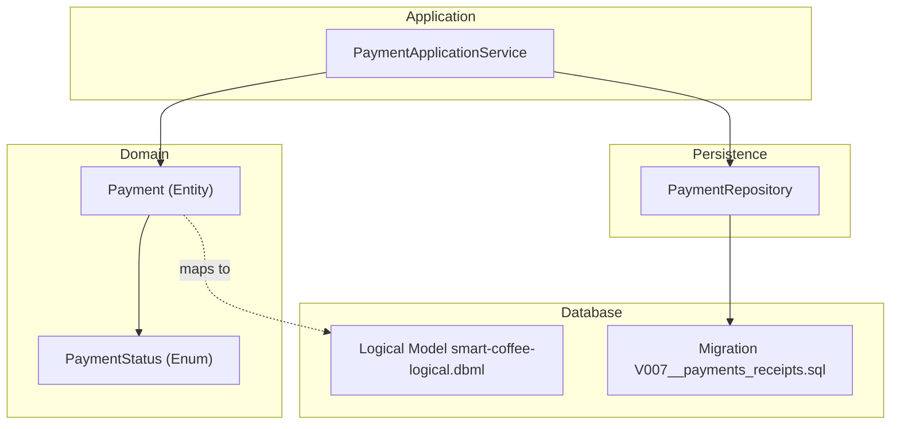
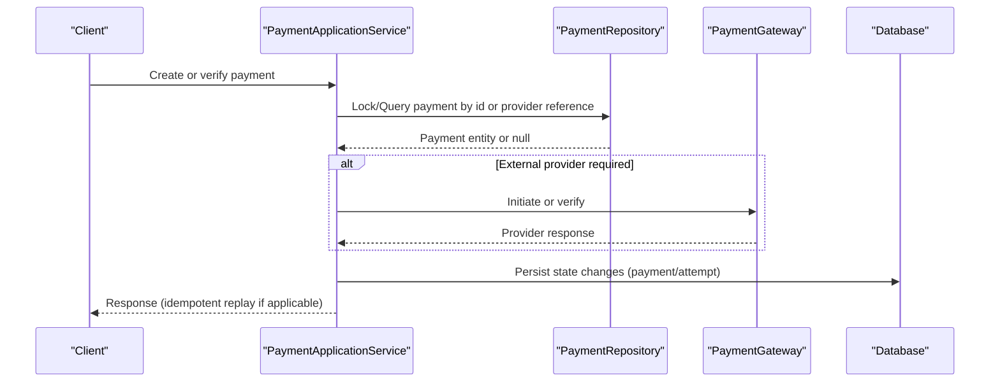
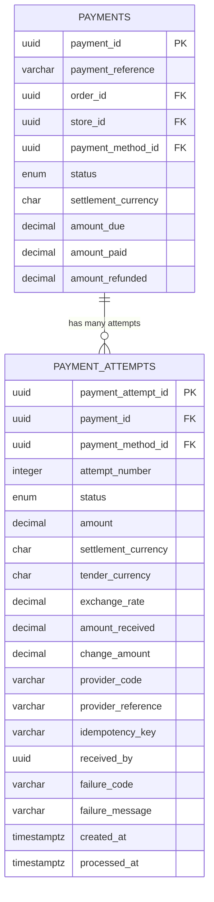
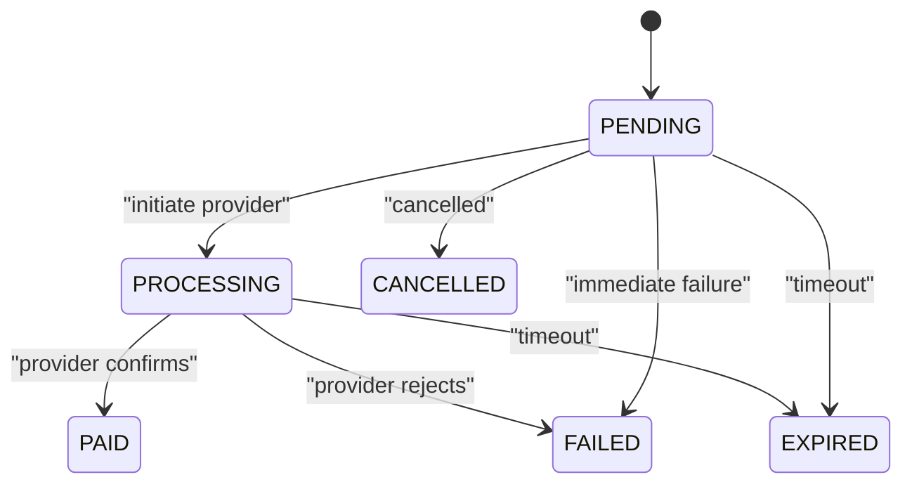
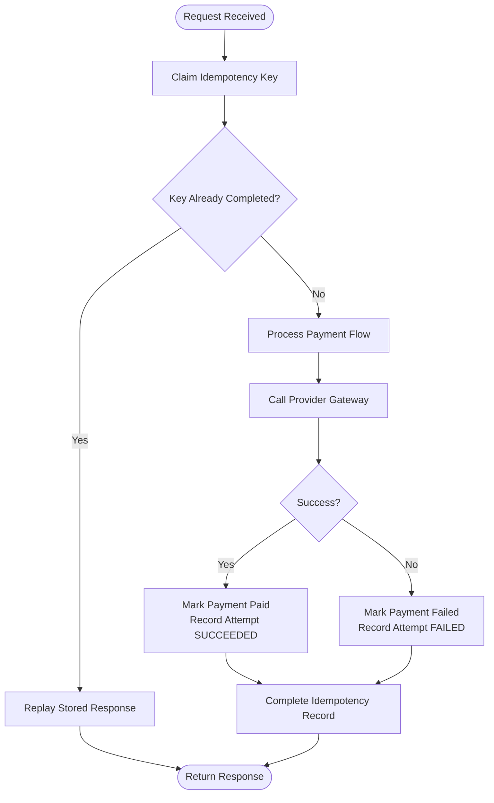
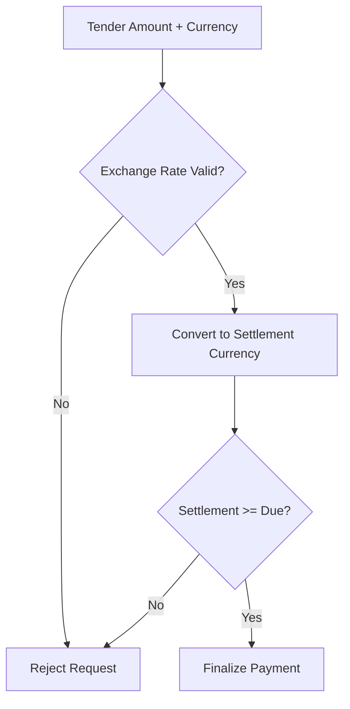
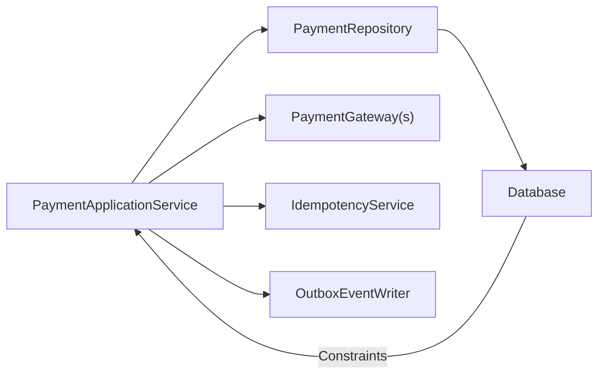

# Payment Transactions & Attempts

<cite>
**Referenced Files in This Document**
- [smart-coffee-logical.dbml](file://database/smart-coffee-logical.dbml)
- [V007__payments_receipts.sql](file://src/main/resources/db/migration/V007__payments_receipts.sql)
- [Payment.java](file://src/main/java/com/smartcoffee/modules/payment/domain/Payment.java)
- [PaymentStatus.java](file://src/main/java/com/smartcoffee/modules/payment/domain/PaymentStatus.java)
- [PaymentApplicationService.java](file://src/main/java/com/smartcoffee/modules/payment/application/PaymentApplicationService.java)
- [PaymentRepository.java](file://src/main/java/com/smartcoffee/modules/payment/persistence/PaymentRepository.java)
</cite>

## Table of Contents
1. Introduction
2. Project Structure
3. Core Components
4. Architecture Overview
5. Detailed Component Analysis
6. Dependency Analysis
7. Performance Considerations
8. Troubleshooting Guide
9. Conclusion

## Introduction
This document provides comprehensive data model documentation for payment transactions and attempts, focusing on the payments table and the payment_attempts table as defined in the logical schema. It explains fields, constraints, state transitions, currency handling, provider integration, financial calculations, idempotency, and the relationship between payments and attempts. It also outlines retry mechanisms and how the application enforces idempotent operations and safe state changes.

## Project Structure
The payment domain is implemented under modules.payment with:
- Domain entities and status enums
- Application service orchestrating payment flows
- Persistence repository for queries and locking
- Database migrations and a logical DBML model defining schemas and relationships

**Diagram sources**
- [Payment.java:1-166](file://src/main/java/com/smartcoffee/modules/payment/domain/Payment.java#L1-L166)
- [PaymentStatus.java:1-7](file://src/main/java/com/smartcoffee/modules/payment/domain/PaymentStatus.java#L1-L7)
- [PaymentApplicationService.java:1-163](file://src/main/java/com/smartcoffee/modules/payment/application/PaymentApplicationService.java#L1-L163)
- [PaymentRepository.java:1-26](file://src/main/java/com/smartcoffee/modules/payment/persistence/PaymentRepository.java#L1-L26)
- [V007__payments_receipts.sql:22-78](file://src/main/resources/db/migration/V007__payments_receipts.sql#L22-L78)
- [smart-coffee-logical.dbml:471-507](file://database/smart-coffee-logical.dbml#L471-L507)

**Section sources**
- [Payment.java:1-166](file://src/main/java/com/smartcoffee/modules/payment/domain/Payment.java#L1-L166)
- [PaymentStatus.java:1-7](file://src/main/java/com/smartcoffee/modules/payment/domain/PaymentStatus.java#L1-L7)
- [PaymentApplicationService.java:1-163](file://src/main/java/com/smartcoffee/modules/payment/application/PaymentApplicationService.java#L1-L163)
- [PaymentRepository.java:1-26](file://src/main/java/com/smartcoffee/modules/payment/persistence/PaymentRepository.java#L1-L26)
- [V007__payments_receipts.sql:22-78](file://src/main/resources/db/migration/V007__payments_receipts.sql#L22-L78)
- [smart-coffee-logical.dbml:471-507](file://database/smart-coffee-logical.dbml#L471-L507)

## Core Components
- Payments table: Represents a payment transaction linked to an order, with status tracking, settlement currency, and monetary totals.
- Payment attempts table: Captures each attempt to process a payment through a provider, including exchange rates, amounts received, change, provider references, and idempotency keys.
- Status enums: Define allowed states for payments and attempts.
- Application service: Enforces business rules, idempotency, gateway interactions, and event publishing.
- Repository: Provides locking and queries for expiration and uniqueness checks.

Key responsibilities:
- Maintain consistent state transitions for payments.
- Record detailed attempt-level information for auditability and reconciliation.
- Ensure idempotent creation and verification of payments.
- Handle currency conversion and financial calculations safely.

**Section sources**
- [smart-coffee-logical.dbml:471-507](file://database/smart-coffee-logical.dbml#L471-L507)
- [Payment.java:56-105](file://src/main/java/com/smartcoffee/modules/payment/domain/Payment.java#L56-L105)
- [PaymentStatus.java:1-7](file://src/main/java/com/smartcoffee/modules/payment/domain/PaymentStatus.java#L1-L7)
- [PaymentApplicationService.java:48-116](file://src/main/java/com/smartcoffee/modules/payment/application/PaymentApplicationService.java#L48-L116)
- [PaymentRepository.java:11-24](file://src/main/java/com/smartcoffee/modules/payment/persistence/PaymentRepository.java#L11-L24)

## Architecture Overview
The payment flow uses an application service to coordinate domain actions, persistence, and external gateways. Idempotency is enforced at the API layer using a claim-and-replay mechanism. The database defines strict constraints and indexes to ensure consistency and performance.

**Diagram sources**
- [PaymentApplicationService.java:72-108](file://src/main/java/com/smartcoffee/modules/payment/application/PaymentApplicationService.java#L72-L108)
- [PaymentRepository.java:11-20](file://src/main/java/com/smartcoffee/modules/payment/persistence/PaymentRepository.java#L11-L20)

## Detailed Component Analysis

### Payments Data Model
- Primary key: payment_id (UUID)
- Unique identifier: payment_reference
- Order linkage: order_id (FK to ordering.orders)
- Store linkage: store_id (FK to organization.stores)
- Method linkage: payment_method_id (FK to payment.payment_methods)
- Status: constrained to allowed values
- Currency: settlement_currency or currency_code depending on model view
- Amounts: amount_due/amount (total), amount_paid/amount_received, amount_refunded/change_amount
- Provider info: provider_name/provider_reference
- Failure info: failure_code
- Time fields: expires_at, paid_at, failed_at, created_at, updated_at
- Concurrency control: version field
- Indexes: unique provider reference where present; partial index for paid per order; expiry scan index

Notes on alignment:
- The logical DBML defines payment.payments with settlement_currency, amount_due, amount_paid, amount_refunded.
- The migration V007 defines payment.payments with currency_code, amount, amount_received, change_amount.
- The domain entity Payment maps to the migration’s column names and includes additional fields like provider_name and provider_reference.

State transitions enforced by domain methods:
- PENDING -> PROCESSING (when initiating provider interaction)
- PROCESSING/PENDING -> PAID (on successful receipt)
- PROCESSING/PENDING -> FAILED (on rejection)
- PROCESSING/PENDING -> EXPIRED (by scheduler or timeout)
- CANCELLED is available in enum but not set via current domain methods

Constraints and integrity:
- Check constraints enforce non-negative amounts and valid statuses
- Unique index on provider_name + provider_reference when present
- Partial unique index ensures only one PAID payment per order

**Section sources**
- [smart-coffee-logical.dbml:471-484](file://database/smart-coffee-logical.dbml#L471-L484)
- [V007__payments_receipts.sql:22-78](file://src/main/resources/db/migration/V007__payments_receipts.sql#L22-L78)
- [Payment.java:12-51](file://src/main/java/com/smartcoffee/modules/payment/domain/Payment.java#L12-L51)
- [PaymentStatus.java:1-7](file://src/main/java/com/smartcoffee/modules/payment/domain/PaymentStatus.java#L1-L7)

### Payment Attempts Data Model
- Primary key: payment_attempt_id (UUID)
- Linkage: payment_id (FK to payment.payments), payment_method_id (FK to payment.payment_methods)
- Attempt number: attempt_number (per payment)
- Status: constrained to allowed attempt statuses
- Financials: amount, settlement_currency, tender_currency, exchange_rate, amount_received, change_amount
- Provider integration: provider_code, provider_reference
- Idempotency: idempotency_key (unique)
- Audit: received_by, failure_code, failure_message, processed_at
- Indexes: unique (payment_id, attempt_number); unique (provider_code, provider_reference)

Purpose:
- Records each discrete attempt to charge or verify payment via a provider
- Captures exchange rate and tender vs settlement currency details
- Enables retries and reconciliation with provider systems
- Prevents duplicate processing via idempotency_key

Note:
- The logical DBML defines this table explicitly with all fields listed above.
- A corresponding migration for payment_attempts was not found in the analyzed files; however, the logical model serves as the authoritative schema definition for this document.

**Section sources**
- [smart-coffee-logical.dbml:486-507](file://database/smart-coffee-logical.dbml#L486-L507)

### Relationship Between Payments and Attempts
- One-to-many: A payment can have multiple attempts (incrementing attempt_number).
- Uniqueness: Each attempt is uniquely identified within a payment by attempt_number.
- Provider deduplication: Attempts are also uniquely indexed by provider_code + provider_reference to avoid duplicate provider-side events.
- Reconciliation: Additional tables (e.g., callbacks, reconciliations) link to attempts to record provider responses and outcomes.

**Diagram sources**
- [smart-coffee-logical.dbml:471-507](file://database/smart-coffee-logical.dbml#L471-L507)

### State Machine Transitions
Payments:
- PENDING -> PROCESSING: When initiating provider interaction
- PROCESSING/PENDING -> PAID: On successful payment confirmation
- PROCESSING/PENDING -> FAILED: On provider rejection or validation failure
- PROCESSING/PENDING -> EXPIRED: By scheduled cleanup or explicit expiration
- CANCELLED: Defined in enum; not set via current domain methods

Attempts:
- CREATED -> PENDING: Initial queued state
- PENDING -> SUCCEEDED: On successful provider response
- PENDING -> FAILED: On error or rejection
- PENDING -> EXPIRED: If time-bound window elapses without resolution
- PENDING -> CANCELLED: If explicitly cancelled
- UNKNOWN: For unresolved or unrecognized states

**Diagram sources**
- [PaymentStatus.java:1-7](file://src/main/java/com/smartcoffee/modules/payment/domain/PaymentStatus.java#L1-L7)
- [smart-coffee-logical.dbml:15-17](file://database/smart-coffee-logical.dbml#L15-L17)

### Retry Mechanisms and Idempotency
- API-level idempotency: The application service claims an idempotency key per operation and replays stored responses to prevent duplicate processing.
- Attempt-level idempotency: Each attempt stores a unique idempotency_key to guard against duplicate provider callbacks or retries.
- Provider reference uniqueness: Attempts are indexed by provider_code + provider_reference to avoid double-processing provider events.
- Concurrency safety: Repository supports pessimistic locking to serialize updates on a payment during critical transitions.

**Diagram sources**
- [PaymentApplicationService.java:48-116](file://src/main/java/com/smartcoffee/modules/payment/application/PaymentApplicationService.java#L48-L116)
- [PaymentRepository.java:11-20](file://src/main/java/com/smartcoffee/modules/payment/persistence/PaymentRepository.java#L11-L20)
- [smart-coffee-logical.dbml:486-507](file://database/smart-coffee-logical.dbml#L486-L507)

### Currency Handling and Financial Calculations
- Settlement vs Tender:
  - Settlement currency is the currency used for accounting and reporting.
  - Tender currency is the currency presented to the customer or received from the customer.
- Exchange Rate:
  - Stored per attempt to capture the rate used for conversion.
  - Conversion logic multiplies tender amount by exchange rate to derive settlement amount.
- Monetary Fields:
  - amount_due/amount: Total owed.
  - amount_paid/amount_received: Amount settled or received.
  - amount_refunded/change_amount: Refunds or change returned.
- Validation:
  - Non-negative constraints enforced at the database level.
  - Insufficient funds checks performed before marking payment paid.

**Diagram sources**
- [PaymentApplicationService.java:110-116](file://src/main/java/com/smartcoffee/modules/payment/application/PaymentApplicationService.java#L110-L116)
- [V007__payments_receipts.sql:52-60](file://src/main/resources/db/migration/V007__payments_receipts.sql#L52-L60)
- [smart-coffee-logical.dbml:486-507](file://database/smart-coffee-logical.dbml#L486-L507)

## Dependency Analysis
- Domain depends on status enums and JPA mappings.
- Application service depends on repositories, gateways, idempotency services, and outbox writers.
- Repository depends on JPA and database constraints.
- Database schema enforces referential integrity and performance via indexes.

**Diagram sources**
- [PaymentApplicationService.java:20-46](file://src/main/java/com/smartcoffee/modules/payment/application/PaymentApplicationService.java#L20-L46)
- [PaymentRepository.java:11-24](file://src/main/java/com/smartcoffee/modules/payment/persistence/PaymentRepository.java#L11-L24)
- [V007__payments_receipts.sql:22-78](file://src/main/resources/db/migration/V007__payments_receipts.sql#L22-L78)

**Section sources**
- [PaymentApplicationService.java:20-46](file://src/main/java/com/smartcoffee/modules/payment/application/PaymentApplicationService.java#L20-L46)
- [PaymentRepository.java:11-24](file://src/main/java/com/smartcoffee/modules/payment/persistence/PaymentRepository.java#L11-L24)
- [V007__payments_receipts.sql:22-78](file://src/main/resources/db/migration/V007__payments_receipts.sql#L22-L78)

## Performance Considerations
- Use partial indexes for expired scans to optimize cleanup jobs.
- Leverage unique constraints on provider references to avoid duplicate processing overhead.
- Apply pessimistic locking only around critical updates to minimize contention.
- Keep monetary fields precise with appropriate precision/scale to avoid rounding errors.
- Cache or precompute frequently accessed lookups (e.g., payment methods) if needed.

[No sources needed since this section provides general guidance]

## Troubleshooting Guide
Common issues and resolutions:
- Duplicate payment attempts:
  - Verify idempotency_key uniqueness and provider reference uniqueness.
  - Check callback deduplication and outbox event handling.
- Insufficient cash received:
  - Ensure exchange rate is provided and positive; validate tender vs settlement.
- Order already paid:
  - Confirm no prior PAID payment exists for the order; handle conflicts gracefully.
- Payment not open for transition:
  - Validate current status allows the requested transition; otherwise reject with conflict.

Operational tips:
- Monitor expired payments using the repository query for pending/processing with expired timestamps.
- Review failure codes and messages on attempts for root cause analysis.
- Use receipts and outbox events to trace end-to-end payment lifecycle.

**Section sources**
- [PaymentApplicationService.java:56-66](file://src/main/java/com/smartcoffee/modules/payment/application/PaymentApplicationService.java#L56-L66)
- [PaymentApplicationService.java:90-108](file://src/main/java/com/smartcoffee/modules/payment/application/PaymentApplicationService.java#L90-L108)
- [PaymentRepository.java:22-24](file://src/main/java/com/smartcoffee/modules/payment/persistence/PaymentRepository.java#L22-L24)

## Conclusion
The payment system models robust transactional semantics with clear separation between high-level payments and granular attempts. Constraints, indexes, and domain methods ensure data integrity, while idempotency and provider reference uniqueness protect against duplicates. Currency handling is explicit with exchange rates and validated conversions. The design supports reliable retries, reconciliation, and observability through events and receipts.

[No sources needed since this section summarizes without analyzing specific files]