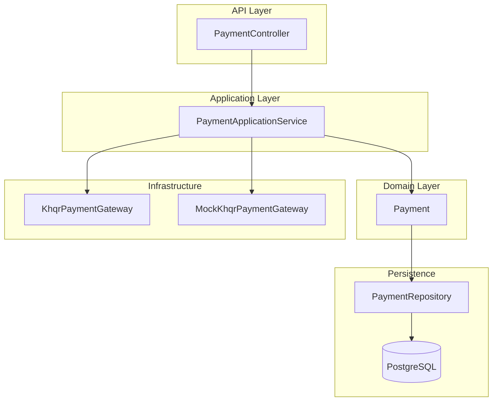
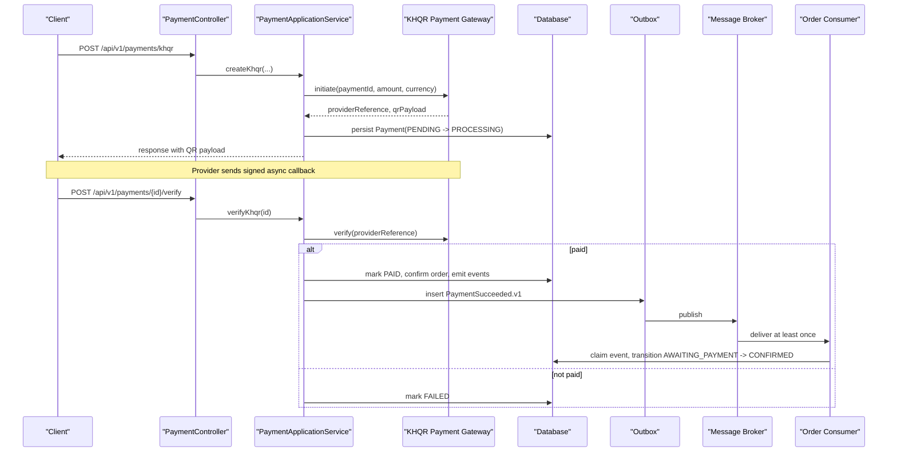
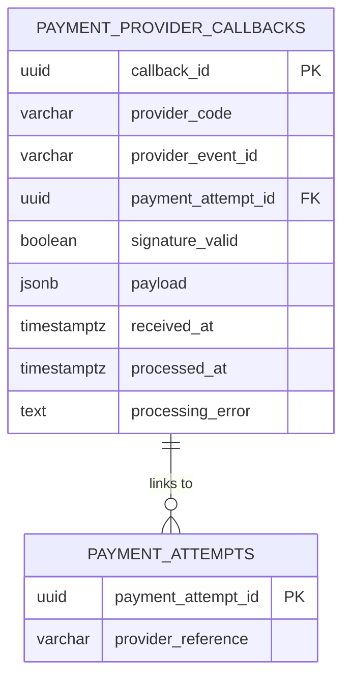
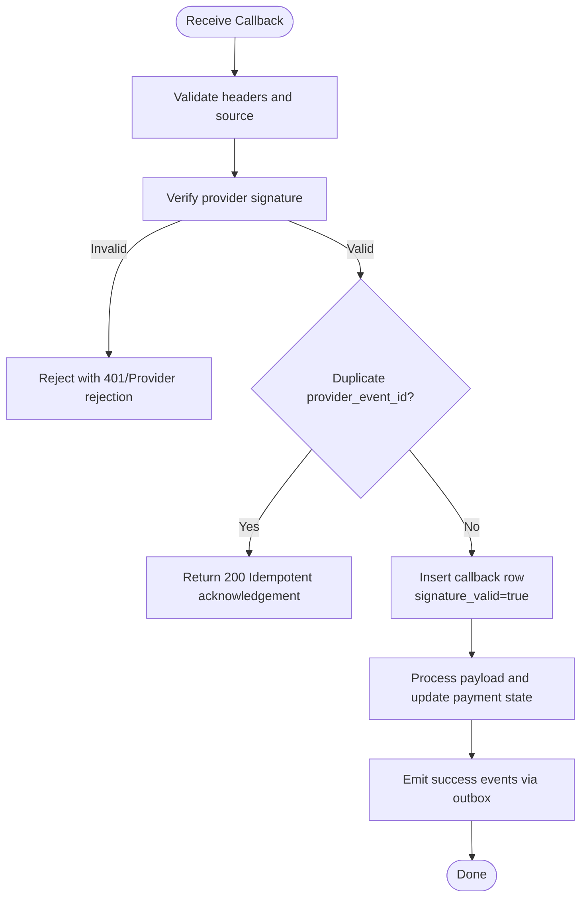
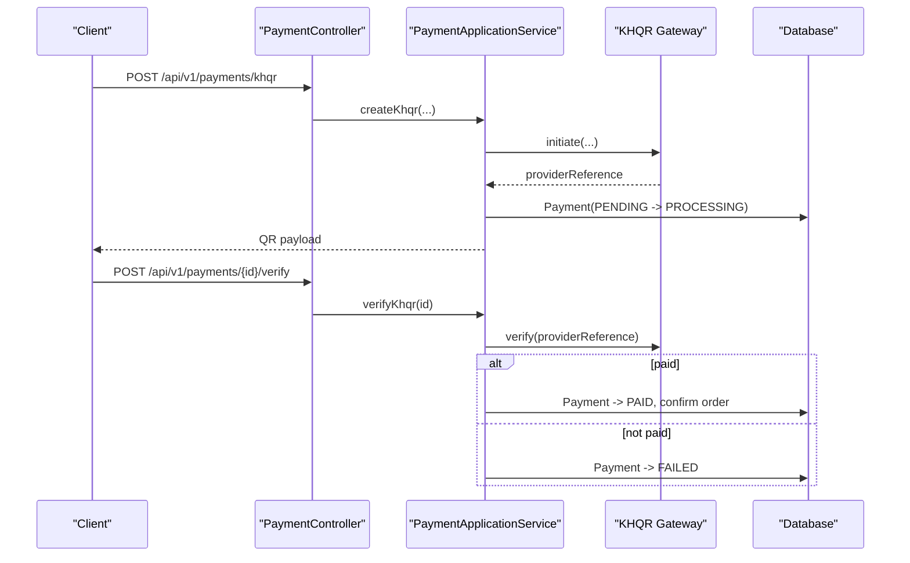
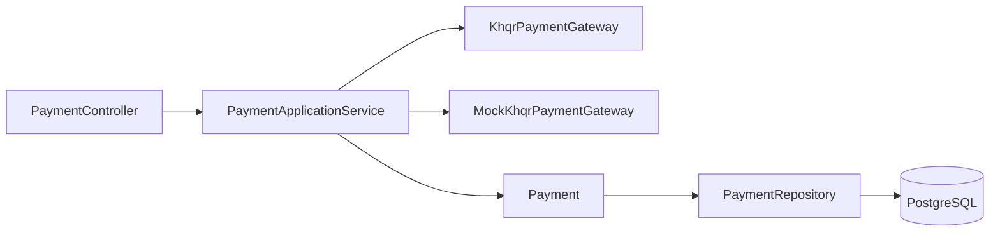

# Provider Integration & Callbacks

<cite>
**Referenced Files in This Document**
- [smart-coffee-logical.dbml](file://database/smart-coffee-logical.dbml)
- [PAYMENT_FLOW.mermaid](file://architecture/PAYMENT_FLOW.mermaid)
- [PaymentController.java](file://src/main/java/com/smartcoffee/modules/payment/api/PaymentController.java)
- [PaymentApplicationService.java](file://src/main/java/com/smartcoffee/modules/payment/application/PaymentApplicationService.java)
- [KhqrPaymentGateway.java](file://src/main/java/com/smartcoffee/infrastructure/payment/KhqrPaymentGateway.java)
- [MockKhqrPaymentGateway.java](file://src/main/java/com/smartcoffee/infrastructure/payment/MockKhqrPaymentGateway.java)
- [PaymentRepository.java](file://src/main/java/com/smartcoffee/modules/payment/persistence/PaymentRepository.java)
- [SCHEMA_CHANGELOG.md](file://database/SCHEMA_CHANGELOG.md)
- [DB_OWNERSHIP_MATRIX.md](file://database/DB_OWNERSHIP_MATRIX.md)
</cite>

## Table of Contents
1. Introduction
2. Project Structure
3. Core Components
4. Architecture Overview
5. Detailed Component Analysis
6. Dependency Analysis
7. Performance Considerations
8. Troubleshooting Guide
9. Conclusion

## Introduction
This document specifies the data model and processing design for Payment Provider Integration and Callbacks, focusing on the payment_provider_callbacks table and how provider webhooks are handled end-to-end. It explains callback storage, signature verification, payload validation, idempotency, error handling, and provider-specific patterns for KHQR payments. It also outlines security considerations and best practices for robust integration with external payment providers.

## Project Structure
The repository organizes payment-related code under modules/payment (domain, application, persistence, API) and infrastructure/payment (provider gateways). Database schema definitions live under database/, including a logical DBML model and migration changelog. Architectural flows are documented as Mermaid diagrams under architecture/.

**Diagram sources**
- [PaymentController.java:11-37](file://src/main/java/com/smartcoffee/modules/payment/api/PaymentController.java#L11-L37)
- [PaymentApplicationService.java:72-107](file://src/main/java/com/smartcoffee/modules/payment/application/PaymentApplicationService.java#L72-L107)
- [Payment.java:56-99](file://src/main/java/com/smartcoffee/modules/payment/domain/Payment.java#L56-L99)
- [PaymentRepository.java:11-23](file://src/main/java/com/smartcoffee/modules/payment/persistence/PaymentRepository.java#L11-L23)
- [KhqrPaymentGateway.java:1-8](file://src/main/java/com/smartcoffee/infrastructure/payment/KhqrPaymentGateway.java#L1-L8)
- [MockKhqrPaymentGateway.java:1-4](file://src/main/java/com/smartcoffee/infrastructure/payment/MockKhqrPaymentGateway.java#L1-L4)

**Section sources**
- [PaymentController.java:11-37](file://src/main/java/com/smartcoffee/modules/payment/api/PaymentController.java#L11-L37)
- [PaymentApplicationService.java:72-107](file://src/main/java/com/smartcoffee/modules/payment/application/PaymentApplicationService.java#L72-L107)
- [Payment.java:56-99](file://src/main/java/com/smartcoffee/modules/payment/domain/Payment.java#L56-L99)
- [PaymentRepository.java:11-23](file://src/main/java/com/smartcoffee/modules/payment/persistence/PaymentRepository.java#L11-L23)
- [KhqrPaymentGateway.java:1-8](file://src/main/java/com/smartcoffee/infrastructure/payment/KhqrPaymentGateway.java#L1-L8)
- [MockKhqrPaymentGateway.java:1-4](file://src/main/java/com/smartcoffee/infrastructure/payment/MockKhqrPaymentGateway.java#L1-L4)

## Core Components
- payment_provider_callbacks table: Stores provider webhook evidence and supports replay protection via a unique constraint on (provider_code, provider_event_id). Includes fields for signature verification status, JSONB payload storage, timestamps for receipt and processing, and optional linkage to a payment attempt.
- Payment domain: Tracks lifecycle states (PENDING, PROCESSING, PAID, FAILED, EXPIRED), provider references, and monetary details.
- Payment gateway abstraction: Encapsulates provider-specific initiation and verification; KHQR is implemented as a placeholder for production and a mock for local/test profiles.
- Application service: Orchestrates creating KHQR payments, verifying status, and emitting events through an outbox pattern.
- Repository: Provides locking and queries needed for safe state transitions and reconciliation.

Key responsibilities:
- Persist provider callbacks immutably with signature validity and full payload for auditability.
- Enforce idempotent processing using provider event identity.
- Transition payment attempts atomically with external evidence.
- Publish downstream events reliably via outbox.

**Section sources**
- [smart-coffee-logical.dbml:509-520](file://database/smart-coffee-logical.dbml#L509-L520)
- [Payment.java:56-99](file://src/main/java/com/smartcoffee/modules/payment/domain/Payment.java#L56-L99)
- [PaymentApplicationService.java:72-107](file://src/main/java/com/smartcoffee/modules/payment/application/PaymentApplicationService.java#L72-L107)
- [PaymentRepository.java:11-23](file://src/main/java/com/smartcoffee/modules/payment/persistence/PaymentRepository.java#L11-L23)

## Architecture Overview
The payment flow integrates client-initiated creation, asynchronous provider callbacks, idempotent processing, and reliable event publication. The callback path validates signatures, enforces uniqueness by provider event ID, updates payment state, and emits success events to downstream consumers.

**Diagram sources**
- [PaymentController.java:22-37](file://src/main/java/com/smartcoffee/modules/payment/api/PaymentController.java#L22-L37)
- [PaymentApplicationService.java:72-107](file://src/main/java/com/smartcoffee/modules/payment/application/PaymentApplicationService.java#L72-L107)
- [PAYMENT_FLOW.mermaid:41-72](file://architecture/PAYMENT_FLOW.mermaid#L41-L72)

## Detailed Component Analysis

### Data Model: payment_provider_callbacks
- Purpose: Immutable record of each provider callback with full payload and signature verification result, enabling audit, debugging, and replay protection.
- Fields:
  - callback_id: Primary key (UUID)
  - provider_code: Identifier for the payment provider (e.g., KHQR)
  - provider_event_id: Unique identifier from the provider to ensure idempotent processing
  - payment_attempt_id: Optional link to a specific payment attempt
  - signature_valid: Boolean flag indicating whether the provider signature was verified
  - payload: JSONB column storing the raw provider payload for inspection and reprocessing
  - received_at: Timestamp when the callback was received
  - processed_at: Timestamp when the callback was successfully processed
  - processing_error: Text field capturing the last processing error, if any
- Indexes:
  - Unique index on (provider_code, provider_event_id) ensures exactly-once semantics for duplicate callbacks

**Diagram sources**
- [smart-coffee-logical.dbml:486-520](file://database/smart-coffee-logical.dbml#L486-L520)

**Section sources**
- [smart-coffee-logical.dbml:509-520](file://database/smart-coffee-logical.dbml#L509-L520)
- [SCHEMA_CHANGELOG.md:57-57](file://database/SCHEMA_CHANGELOG.md#L57-L57)
- [DB_OWNERSHIP_MATRIX.md:77-77](file://database/DB_OWNERSHIP_MATRIX.md#L77-L77)

### Provider Webhook Handling and Signature Verification
- Entry points:
  - Client initiates KHQR payment via POST /api/v1/payments/khqr
  - Provider sends asynchronous signed callback to a dedicated endpoint (conceptual; implementation uses the same controller surface)
- Processing steps:
  - Validate request origin and headers
  - Verify provider signature using provider-specific algorithm and secrets
  - Check timestamp freshness and source IP allowlist to prevent replay attacks
  - Insert callback into payment_provider_callbacks with signature_valid set accordingly
  - If invalid signature or tampering detected, reject with appropriate HTTP status
- Idempotency:
  - Use unique (provider_code, provider_event_id) to detect duplicates
  - On duplicate, return success without reprocessing effects

**Diagram sources**
- [PAYMENT_FLOW.mermaid:41-57](file://architecture/PAYMENT_FLOW.mermaid#L41-L57)

**Section sources**
- [PaymentController.java:22-37](file://src/main/java/com/smartcoffee/modules/payment/api/PaymentController.java#L22-L37)
- [PaymentApplicationService.java:72-107](file://src/main/java/com/smartcoffee/modules/payment/application/PaymentApplicationService.java#L72-L107)
- [PAYMENT_FLOW.mermaid:41-57](file://architecture/PAYMENT_FLOW.mermaid#L41-L57)

### Payload Validation and Sanitization
- Store raw payload in JSONB to preserve fidelity for audits and reprocessing.
- Validate critical fields (amount, currency, tender vs settlement, exchange rate) before applying state changes.
- Sanitize inputs by rejecting malformed payloads and unknown fields where applicable.
- Record processing errors in processing_error for observability and remediation.

**Section sources**
- [smart-coffee-logical.dbml:509-520](file://database/smart-coffee-logical.dbml#L509-L520)
- [PaymentApplicationService.java:110-116](file://src/main/java/com/smartcoffee/modules/payment/application/PaymentApplicationService.java#L110-L116)

### Error Handling Strategies
- Invalid signature or tampered payload: immediate rejection and logging.
- Duplicate provider event: idempotent acknowledgment without side effects.
- Payment already paid: conflict exception to prevent double settlement.
- Provider rejection: mark payment failed and emit failure events.
- Processing failures: capture error in processing_error and retry according to operational policies.

**Section sources**
- [PaymentApplicationService.java:72-107](file://src/main/java/com/smartcoffee/modules/payment/application/PaymentApplicationService.java#L72-L107)
- [PaymentApplicationService.java:138-162](file://src/main/java/com/smartcoffee/modules/payment/application/PaymentApplicationService.java#L138-L162)

### KHQR Payment Callback Example Workflow
- Create KHQR payment:
  - Client calls POST /api/v1/payments/khqr with order context
  - Application service creates Payment(PENDING), transitions to PROCESSING, and returns QR payload
- Provider callback:
  - Provider sends signed callback with provider_event_id
  - System verifies signature, stores callback, checks for duplicates, and updates payment to PAID if valid
- Polling fallback:
  - Client can call POST /api/v1/payments/{paymentId}/verify to poll provider status
  - On success, system confirms order and emits events

**Diagram sources**
- [PaymentController.java:22-37](file://src/main/java/com/smartcoffee/modules/payment/api/PaymentController.java#L22-L37)
- [PaymentApplicationService.java:72-107](file://src/main/java/com/smartcoffee/modules/payment/application/PaymentApplicationService.java#L72-L107)

**Section sources**
- [PaymentController.java:22-37](file://src/main/java/com/smartcoffee/modules/payment/api/PaymentController.java#L22-L37)
- [PaymentApplicationService.java:72-107](file://src/main/java/com/smartcoffee/modules/payment/application/PaymentApplicationService.java#L72-L107)

### Security Considerations
- Signature verification: Always validate provider signatures before trusting payloads.
- Replay protection: Enforce timestamp windows and unique provider_event_id constraints.
- Source validation: Restrict incoming callbacks to known provider IPs and use TLS.
- Secret management: Store provider secrets securely and rotate them per provider policy.
- Least privilege: Ensure callback endpoints do not expose sensitive operations beyond verification and idempotent processing.

**Section sources**
- [PAYMENT_FLOW.mermaid:41-57](file://architecture/PAYMENT_FLOW.mermaid#L41-L57)
- [smart-coffee-logical.dbml:509-520](file://database/smart-coffee-logical.dbml#L509-L520)

### Provider-Specific Integration Patterns
- KHQR:
  - Initiation via gateway returns provider reference and QR payload
  - Verification via gateway polls provider status
  - Production gateway is a placeholder awaiting real adapter configuration
  - Mock gateway provides deterministic behavior for local/test environments

**Section sources**
- [KhqrPaymentGateway.java:1-8](file://src/main/java/com/smartcoffee/infrastructure/payment/KhqrPaymentGateway.java#L1-L8)
- [MockKhqrPaymentGateway.java:1-4](file://src/main/java/com/smartcoffee/infrastructure/payment/MockKhqrPaymentGateway.java#L1-L4)

## Dependency Analysis
- API layer depends on application service for business logic.
- Application service depends on:
  - Payment gateway abstraction for provider interactions
  - Domain models for state transitions
  - Repositories for persistence and locking
- Persistence layer depends on PostgreSQL with unique constraints for idempotency.
- Outbox and message broker integrate asynchronously for reliable event delivery.

**Diagram sources**
- [PaymentController.java:11-37](file://src/main/java/com/smartcoffee/modules/payment/api/PaymentController.java#L11-L37)
- [PaymentApplicationService.java:72-107](file://src/main/java/com/smartcoffee/modules/payment/application/PaymentApplicationService.java#L72-L107)
- [PaymentRepository.java:11-23](file://src/main/java/com/smartcoffee/modules/payment/persistence/PaymentRepository.java#L11-L23)

**Section sources**
- [PaymentController.java:11-37](file://src/main/java/com/smartcoffee/modules/payment/api/PaymentController.java#L11-L37)
- [PaymentApplicationService.java:72-107](file://src/main/java/com/smartcoffee/modules/payment/application/PaymentApplicationService.java#L72-L107)
- [PaymentRepository.java:11-23](file://src/main/java/com/smartcoffee/modules/payment/persistence/PaymentRepository.java#L11-L23)

## Performance Considerations
- Idempotency via unique (provider_code, provider_event_id) prevents redundant processing and reduces contention.
- Pessimistic locking on payment entities avoids race conditions during concurrent updates.
- JSONB payload storage enables efficient querying and indexing of critical fields if needed.
- Asynchronous event publishing via outbox decouples payment confirmation from downstream processing.

**Section sources**
- [PaymentRepository.java:11-23](file://src/main/java/com/smartcoffee/modules/payment/persistence/PaymentRepository.java#L11-L23)
- [smart-coffee-logical.dbml:509-520](file://database/smart-coffee-logical.dbml#L509-L520)

## Troubleshooting Guide
- Duplicate callbacks:
  - Symptom: Repeated provider_event_id
  - Resolution: Unique constraint ensures idempotent acknowledgment; inspect processing_error if present
- Signature failures:
  - Symptom: signature_valid=false
  - Resolution: Verify provider secret configuration and timestamp window; log and alert
- Payment already paid:
  - Symptom: Conflict when attempting to settle again
  - Resolution: Confirm order state and avoid re-processing; handle gracefully in client
- Provider rejection:
  - Symptom: Payment marked FAILED
  - Resolution: Inspect failure_code and notify relevant parties; consider retry or manual intervention

**Section sources**
- [PaymentApplicationService.java:72-107](file://src/main/java/com/smartcoffee/modules/payment/application/PaymentApplicationService.java#L72-L107)
- [PaymentApplicationService.java:138-162](file://src/main/java/com/smartcoffee/modules/payment/application/PaymentApplicationService.java#L138-L162)

## Conclusion
The payment_provider_callbacks table and associated workflows provide a robust foundation for secure, idempotent, and auditable payment provider integrations. By enforcing signature verification, storing full payloads, and leveraging unique provider event identities, the system protects against replay and duplication while supporting reliable downstream processing through outbox-driven events. KHQR-specific flows demonstrate initiation, verification, and callback handling patterns that can be extended to additional providers.